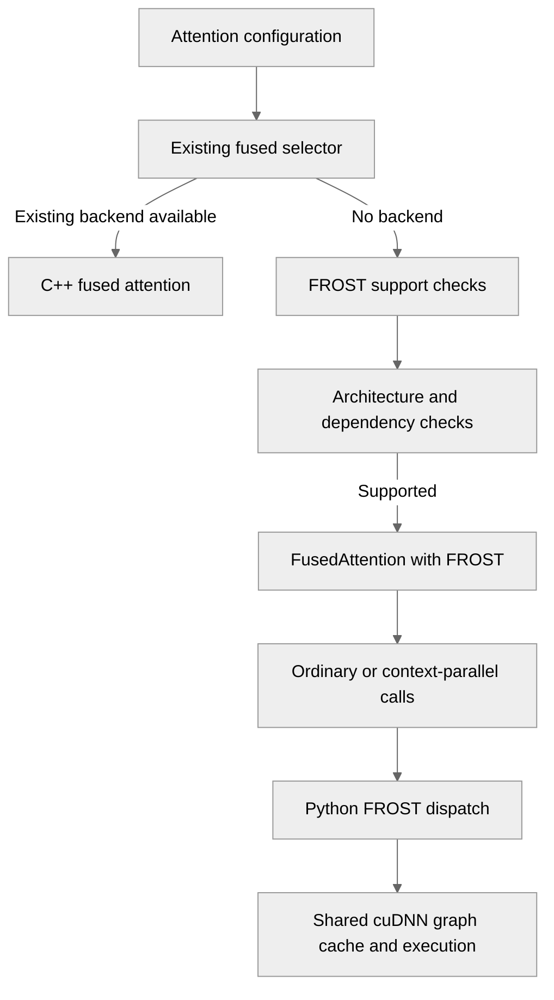

# feat(attention): cuDNN FROST attention backend for head_dim in (256, 512], with context parallelism

[Upstream PR](https://github.com/NVIDIA/TransformerEngine/pull/3527) · state: open · merged: False

## Original PR description

## Problem

`get_attention_backend` selects **no backend at all** for symmetric `head_dim=512` with context
parallelism, so that configuration raises rather than running:

- FlashAttention 2 and 3 instantiate kernels up to `head_dim` 256
- FA4 is disabled at symmetric 512 on SM100/SM110 (TMEM budget)
- the C++ cuDNN fused path caps at 256
- `UnfusedDotProductAttention` serves 512 but is disabled under CP

Hybrid models such as Gemma 4, which interleave sliding-window layers at `head_dim` 256 with
global layers at 512, therefore cannot use context parallelism at all.

To be precise about the claim: this makes context parallelism *available* at symmetric 512 from
released components. It is not a claim to unbounded context. Dao-AILab/flash-attention#2877 adds
symmetric D512 kernels to FA4 and, with #3532, that path also works and scales further, but it is
unmerged and unreviewed. Measured capacity here, and the workspace behaviour that bounds it, are
in *Known limitations*.

## Approach

cuDNN Frontend >= 1.29.0 ships CuTe-DSL ("FROST") SDPA kernels that serve symmetric 512 forward
and backward on SM100/SM103. They are reachable only through the cuDNN graph **Python** API, since
the FROST engines register at Python import time and need `nvidia-cutlass-dsl`, while TE's C++
builds against cuDNN Frontend headers only.

FROST is a **FusedAttention sub-backend**, `FusedAttnBackend["FROST"]`, not a fourth top-level
backend:

- `frost_attention.py` holds the kernel wrapper and `fused_attn_fwd/bwd` behind the
  `cpp_extensions.fused_attn` signatures
- `cpp_extensions/fused_attn.py` routes to those two functions when the sub-backend is FROST,
  before any C++ call
- `utils.py` consults `is_frost_attention_supported` inside `_get_fused_attn_backend`, where the
  C++ selector returns `No_Backend`, and checks availability once at the end of
  `get_attention_backend`, the way flash-attn's version is checked

So `FusedAttnFunc` and `attn_forward_func_with_cp` reach these kernels without knowing which
sub-backend they got, and **`dot_product_attention.py` needs no change at all**.

Several declines now come from the existing fused filters rather than their own copies: the
context-parallel mask, window and a2a restrictions; the `score_mod` and `softcap` filters;
and FP8, since `FusedAttnFunc` forces the FP8 sub-backend on that path. The all-gather path's
`causal -> causal_bottom_right` rewrite applies to FROST for free, which is what gives it the
bottom-right band it needs on a trimmed KV range.

## Verification

Full suite on B200 against this head, in a container with `nvidia-cudnn-frontend` 1.29.0 and
`nvidia-cutlass-dsl` 4.8.0:

| check | result |
|---|---|
| FROST is reached as a FusedAttention sub-backend | 8 gates pass |
| `flex_attention.py` regression | 27 passed |
| non-distributed numerics vs a float64 reference | 43 passed |
| context parallelism | 22 passed |
| broader `test_attention.py` suite | 2652 passed, 2605 skipped |

The broad suite is **identical to the pre-change baseline** and `flex_attention.py`'s own suite is
clean, which is what says the shared-module extraction below preserved behaviour rather than merely
compiling.

One of the eight gates covers the shared module itself: that `cudnn_pygraph` owns the only plan
cache and the only cache key, that neither backend kept its own, and that `execute_graph` cannot
have its handle name defaulted away. A plan built for one graph being served to another is the
failure that would not surface as a crash.

Correctness uses the criterion FlashAttention applies to itself,
`err(kernel, fp64) <= 2 * err(inputs rounded to dtype, fp64)`, with that floor measured per case so
the bar tracks shape and dtype instead of encoding a number that rots. Coverage is square and
rectangular, causal / bottom-right / non-causal, GQA and MHA, forward **and backward** in bf16 and
fp16, plus fp16 arms under CP.

Context parallelism, each compared against the non-CP reference via `run_attention_with_cp.py`:

| | bshd | sbhd |
|---|---|---|
| `p2p` | CP=2, CP=4 | CP=2, CP=4 |
| `all_gather` | CP=2, CP=4 | CP=2 |
| `a2a` | CP=2, CP=4 | CP=2 |

Plus 2 nodes x 2 ranks for every comm type including `a2a+p2p`, with a `FusedAttention` control
passing throughout. `a2a+p2p` needs the multi-node arm specifically: at `world_size` 4 the a2a
level takes consecutive ranks `(0,1)`,`(2,3)` and the p2p level takes strided ranks `(0,2)`,`(1,3)`,
so block assignment across two nodes puts the all-to-all inside each node and the ring across the
fabric. On one node both levels sit on NVLink and the arrangement is never exercised. The run
establishes the rank-to-host mapping first and declines to report unless it is block ordered,
since round-robin would invert the two levels and pass while testing the opposite topology.

`test_frost_attention.py` is non-distributed and checks the forward, the LSE convention and the
backward gradients against an independent float64 reference, across both causal alignments, bf16
and fp16, GQA and MHA, and a rectangular shape where top-left and bottom-right masking differ.
The CP tests cannot do this: `run_attention_with_cp.py` compares a CP run against a non-CP run of
the *same* backend, so a systematic kernel error appears on both sides and cancels. The reference
must be float64 rather than float32, because torch computes fp32 matmuls in TF32 on Ampere and
newer and TF32's significand is 11 bits, the same as fp16, so an fp32 reference is no more
accurate than the kernel under test.

End to end, a Gemma 4 dense model (sliding layers on FlashAttention, global layers on FROST)
matched its CP=1 result to **9.7e-05** on the loss.

**These tests skip in CI as it stands**, and the blocker is the dependency floors rather than the
Blackwell requirement. Stock `nvcr.io/nvidia/pytorch:26.08-py3` ships `nvidia-cudnn-frontend`
1.26.0 and `nvidia-cutlass-dsl` 4.6.2, both below what FROST needs, so
`is_frost_attention_available()` declines and the tests skip with that reason rather than failing.
`qa/L3_pytorch_FA_versions_test/test.sh` targets sm100+ but pins `nvidia-cutlass-dsl[cu13]==4.4.2`
for the FA4 path, so it would skip even on a B200; and `nvidia-cutlass-dsl` is not a declared TE
dependency at all, arriving transitively via `flash-attn-4`. Happy to wire this into whichever
lane you consider the right home.

## Performance

Against `UnfusedDotProductAttention` at the same shape (b2 hq8 hkv4 d512 causal bf16, CP=1,
single layer), the only other backend serving this head dim from released components:

| seqlen | fwd speedup | fwd+bwd speedup | unfused peak (fwd) | FROST peak (fwd) |
|---|---|---|---|---|
| 4096 | 5.8x | 2.4x | 1520 MiB | 224 MiB |
| 16384 | 15.2x | 6.4x | 51232 MiB | 1057 MiB |
| 32768 | n/a (OOM) | n/a (OOM) | OOM on 178 GiB | 2850 MiB |

The unfused path materialises the full `s x s` score matrix, so it grows O(s^2). Note that in
forward+backward FROST uses *more* memory than unfused below roughly 8k, where the saved tensors
and workspace exceed the small score matrix; the crossover is between 8192 and 16384.

## Notes for reviewers

**Two places the "no changes outside `frost_attention.py`" goal does not quite hold**, both the
same root cause: the selected sub-backend was being discarded and re-derived as
`F16_arbitrary_seqlen` in seven places, so those places now keep it instead.

- `context_parallel.py` (+29/-7): each of the three autograd classes recomputed the sub-backend
  locally rather than receiving it. `attn_forward_func_with_cp` gains one argument, threaded
  through, with the existing derivation kept as the fallback. One further line: the p2p forward
  step returned `max_logit` with a starred tail, which is only unambiguous while no backend has a
  statically known return length. The FROST branch gives pylint one, so the tail resolved to empty
  and the five-label unpacks tripped `unbalanced-tuple-unpacking`. Indexing says what the function
  actually returns.
- `backends.py` (+5/-5): the non-FP8 backward hardcoded `F16_arbitrary_seqlen`, discarding the
  value the forward had already saved, so it now simply reads
  `ctx_attrs["fused_attention_backend"]`. The CP assert admitted only that sub-backend.

**`FusedAttnBackend.FROST` has no pybind counterpart.** It is `3`, past the C++ enum, and the
import-time sync assert now exempts python-only members. Nothing in `transformer_engine/pytorch`
constructs `NVTE_Fused_Attn_Backend(int)`, and the dispatch happens before any C++ call, so the
value never reaches pybind. Every post-selection check in `utils.py` is guarded on `== FP8` or
`== F16_arbitrary_seqlen`, so a FROST value falls through them.

**`is_frost_attention_supported` deliberately does not probe availability.** Probing imports cuDNN
Frontend with the FROST engines enabled, which is process-wide and reorders plan selection for
every other cuDNN consumer. That must not happen for the overwhelming majority of configs, which
are nowhere near `head_dim` 512. Availability is checked once at the end, beside the flash-attn
version checks.

**Plan selection is deliberately strict.** `heur_mode.A` with an explicit name-checked
`select_plan`, rather than `A|FALLBACK` with `HEURISTICS_CHOICE`. Without a pin, `build_plans`
walks the ranked list and finalizes the first plan that builds, logging declines at INFO. At d512
that matters in the forward, where an ordinary engine may build and compute a different function;
the backward is self-limiting, since no non-FROST d512 backward exists. Pinning is also what makes
`check_support` fatal rather than advisory, which is why it follows the selection.

**Version constraint worth knowing.** FROST enforces `nvidia-cutlass-dsl >= 4.7.0` at plan-build
time while `cudnn-frontend` only declares `>= 4.6.2`. Below that floor every FROST engine silently
declines and ordinary backend plans are returned with no error, which is why the code checks the
selected plan by name rather than assuming the engine was used. Stock 26.08 ships exactly 4.6.2.
Separately, 4.7.1 is incompatible with `flash-attn-4` 4.0.0b11, which CI currently pins.

## Scope

SM100/SM103 only (the cuDNN d512 backward is Blackwell-only), bf16/fp16, symmetric `head_dim` in
(256, 512], `bshd` and `sbhd`, mask types `no_mask` / `causal` / `causal_bottom_right`.

**Symmetric specifically, and the constraint is the backward engine's.** `v` carries its own graph
node and its own cache-key entry, so an asymmetric pair is expressible here. It is declined because
`sdpa_bwd_sm100`, the only f16 FROST backward reachable on SM100/SM103, leaves `dqk_ge_dv` unset,
which cuDNN reads as requiring `d_qk == d_v` at every head dim rather than only above 256. The
forward is the opposite: `sdpa_fwd_prefill_sm100` lists `(192, 128)` among its native `d_shapes`
and has no `dqk_ge_dv` concept at all. So the decline covers both directions rather than training
alone, since `is_training` is `module.training` and `eval()` does not disable autograd, which makes
a served forward no guarantee that no backward follows.

The head-dim range is that same engine's declared envelope: `d_envelope_floor=256` (exclusive),
`d={512}` and `d_pad_multiple=8`, which is `_MIN_HEAD_DIM` 257, `_MAX_HEAD_DIM` 512 and
`_HEAD_DIM_MULTIPLE` 8 here.

**FP8 forward with a FROST backward is not supported**, and cannot arise: FP8 serves `head_dim`
up to 256 and FROST only above it, so their ranges are disjoint. `_fused_attn_setup_ctx` therefore
hands the backward whatever the forward recorded, which is FP8 for an FP8 forward and FROST for a
FROST one. Supporting a mixed pair would need `get_attention_backend` to return a backend per
direction, which is out of scope here.

Declined by the selector, each an explicit decline rather than a silent fallback: FP8, attention
bias, dropout, softcap, non-vanilla softmax, `thd`, `max_logit`, KV caching, CUDA graph
capture, and deterministic execution. `thd` is expressible with these kernels but is not implemented here.
Determinism is declined because cuDNN has no deterministic backward for them at all; measured,
not assumed.

Also declined: a right-bounded window on a *non-causal* mask when `max_seqlen_q != max_seqlen_kv`.
That combination takes its alignment only from `bottom_right_diagonal`, which defaults to
top-left, while the all-gather ring measures its window against the bottom-right diagonal. The two
differ exactly when the lengths do, so FROST declines rather than guessing.

Sliding window **is** supported, with `all_gather` or `a2a`. It is declined with `p2p` and
`a2a+p2p`, whose ring shards KV across steps so a bound measured against the full sequence does
not survive the per-step tiles, which is the same rule `FusedAttention` carries. That matters for
the motivating model: Gemma 4's sliding layers are the other half of it.

## Known limitations and open decisions

**Backward memory grows super-linearly with sequence length.** Measured on B200,
`b2 hq8 hkv4 d512` causal bf16, single GPU, peak allocated for forward + backward:

| seqlen | 4,096 | 8,192 | 16,384 | 32,768 | 65,536 |
|---|---|---|---|---|---|
| peak | 2.0 GiB | 8.0 GiB | 8.0 GiB | 32.0 GiB | 112.0 GiB |

The forward is not the source: its workspace measures zero at every length above. The growth is in
the backward, where the cuDNN graph's `get_workspace_size()` request rises from 1.6 GiB at 4k to
74 GiB at 64k, and this module allocates what the graph asks for.

The consequence is a ceiling on the per-rank shard rather than on the model: shards beyond roughly
32k tokens are impractical on a 180 GB device, so a long-context configuration needs a
correspondingly higher `cp_size`. Largest global sequence that fits:

| `cp_size` | 1 | 2 | 4 | 8 |
|---|---|---|---|---|
| longest context | 65,536 | 131,072 | 131,072 | 262,144 |

The request is also **layout-dependent**, which matters if you try to reproduce these numbers.
Same logical problem, same plan, differing only in the strides the graph is built against:

| seqlen | 4,096 | 8,192 | 16,384 | 32,768 | 65,536 |
|---|---|---|---|---|---|
| `bshd` strided view | 1.13 GiB | 4.25 GiB | 4.50 GiB | 17.00 GiB | 66.00 GiB |
| `bhsd` contiguous | 1.63 GiB | 5.25 GiB | 6.50 GiB | 21.00 GiB | 74.00 GiB |

The difference is exactly linear, 128 KiB per query token at both ends of the sweep, while the
super-linear term is identical in both layouts. Note the direction: the *contiguous* layout is the
more expensive one. This module keys its plan cache on each tensor's actual strides, so which
figure applies follows from the caller's layout. Both columns are reproducible without
TransformerEngine by building the same two graphs through the cuDNN graph API and reading
`get_workspace_size()`, which is how they were measured: nothing executed, no workspace allocated.

**The `cudnn_pygraph.py` extraction is done.** `frost_attention.py` and `flex_attention.py` now
drive cuDNN through one shared module: the frontend import and its process-wide engine switch, the
per-device handle with its per-call `set_stream`, the dtype mapping, the BHSD tensor description,
the SDPA forward and backward graph builders, the plan cache and the key that identifies a
plan, plan finalization and graph execution. `flex_attention.py` comes out at +126/-268 against main.

The reason to share these is ownership rather than line count, and the module docstring says so: the
state behind them is process-global, and giving it two owners is how this code has produced bugs
before. flex also picks up a fix on the way, since it was building graphs under whatever device
happened to be current while only the handle named the right one.

Worth stating plainly: this takes the duplication from **three** pygraph sites to two, not to one.
`transformer_engine/jax/cpp_extensions/flex_attention.py` carries its own copy, shares no code with
either, and cannot consume a torch-dependent module.

The graph builders are shared as `cudnn_pygraph.build_fwd` and `build_bwd`. Each backend passes
tensor descriptors, any auxiliary tensors its callback reads, and its own `sdpa` arguments, so a
mask, a score_mod and the choice of which engine to pin or bar stay with the backend that wants
them.

What stayed behind is the part that is not cuDNN mechanics: the selector, the TE mask vocabulary,
the runtime guards and the `cpp_extensions` shims.

**flex is barred from the FROST engines, by default rather than on request.** Those engines accept
a score_mod graph, pass `check_support`, build, and then compute without the callback. Measured on
B200: a FROST plan ranks at index 0 and an unpinned build selects it at `head_dim` 64, 128, 256 and
512, with the output tracking a float64 reference computed *without* the modifier. The switch that
offers them is process-wide, so declining to ask for them is not enough.

`finalize_plans` now bars them unless the caller pins a plan by name, which FROST does and flex does
not. The default direction is deliberate: forgetting to exclude gives silently wrong numbers, while
excluding wrongly gives a slower plan or a loud decline. The engine names live in one place, so the
pin and the bar cannot name different engines; previously they were separate string literals in two
files, and cuDNN has renamed that family once already.

It cannot be checked any cheaper than end to end. `deselect_engines` **marks rather than removes**,
measured on B200 at `head_dim` 64, 128 and 256: the plan count is unchanged and index 0 still names
the barred engine after `build_plans`, so a post-build assertion on the selected plan would fire
falsely. What verifies the bar is `test_frost_switch_does_not_change_what_flex_computes`, which runs
the score_mod path with the engines on and off and compares. `NVTE_FLEX_TEST_REQUIRED` exists so a
lane can make that test fail rather than skip.

The underlying cuDNN defect is filed upstream: those engines do have a score_mod capability gate,
but it reads a key the `sdpa()` path never writes. The bar carries that as a removal condition in
its docstring rather than becoming permanent by default.

**One handle is shared across overlapped CP streams.** The `wait_stream` serialization in
`context_parallel.py` exists for FA3/FA4's *internal* per-call workspace, and its comment says
FusedAttention keeps the per-step overlap. FROST's workspace is caller-owned and per-call, and
FusedAttention uses the identical one-handle-per-device plus `cudnnSetStream`-per-call model while
being deliberately left overlapped, so I have not added FROST to that guard.

**Dependency floors are intentionally not enforced by the build.** Bumping
`nvidia-cudnn-frontend` to 1.29.0 would force `nvidia-cutlass-dsl` and `apache-tvm-ffi` into every
TE-PyTorch install, because 1.29.0 drops the `cutedsl` extra marker, and it still would not
guarantee the 4.7.0 floor, since the transitive requirement is 4.6.2. Every other optional backend
here (flash-attn 2/3/4, GDN, quack) is undeclared and runtime-probed, which is what this does.
`NVTE_FROST_TEST_REQUIRED` and `NVTE_FLEX_TEST_REQUIRED` mirror `NVTE_GDN_TEST_REQUIRED`, so a lane
meant to cover either can fail loudly rather than skipping. Neither is set in qa: there is no
Blackwell L0 lane for the first, and I cannot verify the L0 container carries the frontend package
for the second. The flex one matters more than it used to, since that file's single numerical test
is now what says this refactor preserved its behaviour.

**Documentation.** `NVTE_FROST_ATTN` is in `docs/envvars.rst`, described as a FusedAttention
sub-backend. The backend tables in `docs/examples/attention/attention.ipynb` are not updated yet.


## Review and discussion

### reviews

- greptile-apps[bot] · COMMENTED · 2026-09-16T04:38:32Z · [source](https://github.com/NVIDIA/TransformerEngine/pull/3527#pullrequestreview-5218553954)

(No body; status only.)

- nvegesna-netizen · COMMENTED · 2026-09-16T06:03:34Z · [source](https://github.com/NVIDIA/TransformerEngine/pull/3527#pullrequestreview-5219031676)

(No body; status only.)

- nvegesna-netizen · COMMENTED · 2026-09-16T06:03:36Z · [source](https://github.com/NVIDIA/TransformerEngine/pull/3527#pullrequestreview-5219031875)

(No body; status only.)

- greptile-apps[bot] · COMMENTED · 2026-09-16T07:39:36Z · [source](https://github.com/NVIDIA/TransformerEngine/pull/3527#pullrequestreview-5219818985)

(No body; status only.)

- nvegesna-netizen · COMMENTED · 2026-09-16T07:48:11Z · [source](https://github.com/NVIDIA/TransformerEngine/pull/3527#pullrequestreview-5219899668)

(No body; status only.)

- greptile-apps[bot] · COMMENTED · 2026-09-16T16:40:05Z · [source](https://github.com/NVIDIA/TransformerEngine/pull/3527#pullrequestreview-5225540023)

(No body; status only.)

- nvegesna-netizen · COMMENTED · 2026-09-16T16:43:21Z · [source](https://github.com/NVIDIA/TransformerEngine/pull/3527#pullrequestreview-5225575288)

(No body; status only.)

- cyanguwa · COMMENTED · 2026-09-18T17:09:10Z · [source](https://github.com/NVIDIA/TransformerEngine/pull/3527#pullrequestreview-5249070999)

(No body; status only.)

- nvegesna-netizen · COMMENTED · 2026-09-21T07:55:06Z · [source](https://github.com/NVIDIA/TransformerEngine/pull/3527#pullrequestreview-5264221069)

(No body; status only.)

- nvegesna-netizen · COMMENTED · 2026-09-21T07:55:16Z · [source](https://github.com/NVIDIA/TransformerEngine/pull/3527#pullrequestreview-5264222760)

(No body; status only.)

- nvegesna-netizen · COMMENTED · 2026-09-21T07:55:25Z · [source](https://github.com/NVIDIA/TransformerEngine/pull/3527#pullrequestreview-5264224240)

(No body; status only.)

- nvegesna-netizen · COMMENTED · 2026-09-21T07:55:33Z · [source](https://github.com/NVIDIA/TransformerEngine/pull/3527#pullrequestreview-5264225471)

(No body; status only.)

- nvegesna-netizen · COMMENTED · 2026-09-21T07:55:35Z · [source](https://github.com/NVIDIA/TransformerEngine/pull/3527#pullrequestreview-5264225722)

(No body; status only.)

- nvegesna-netizen · COMMENTED · 2026-10-01T08:53:13Z · [source](https://github.com/NVIDIA/TransformerEngine/pull/3527#pullrequestreview-5377068343)

(No body; status only.)

- nvegesna-netizen · COMMENTED · 2026-10-01T08:53:22Z · [source](https://github.com/NVIDIA/TransformerEngine/pull/3527#pullrequestreview-5377069766)

(No body; status only.)

- greptile-apps[bot] · COMMENTED · 2026-10-01T08:59:12Z · [source](https://github.com/NVIDIA/TransformerEngine/pull/3527#pullrequestreview-5377145921)

(No body; status only.)

- nvegesna-netizen · COMMENTED · 2026-10-01T09:04:25Z · [source](https://github.com/NVIDIA/TransformerEngine/pull/3527#pullrequestreview-5377201971)

(No body; status only.)

- greptile-apps[bot] · COMMENTED · 2026-10-01T10:07:00Z · [source](https://github.com/NVIDIA/TransformerEngine/pull/3527#pullrequestreview-5377851500)

(No body; status only.)

- nvegesna-netizen · COMMENTED · 2026-10-01T10:11:19Z · [source](https://github.com/NVIDIA/TransformerEngine/pull/3527#pullrequestreview-5377892667)

(No body; status only.)

- greptile-apps[bot] · COMMENTED · 2026-10-01T10:12:29Z · [source](https://github.com/NVIDIA/TransformerEngine/pull/3527#pullrequestreview-5377903626)

(No body; status only.)

- greptile-apps[bot] · COMMENTED · 2026-10-04T09:58:52Z · [source](https://github.com/NVIDIA/TransformerEngine/pull/3527#pullrequestreview-5405419214)

(No body; status only.)

- nvegesna-netizen · COMMENTED · 2026-10-04T10:05:49Z · [source](https://github.com/NVIDIA/TransformerEngine/pull/3527#pullrequestreview-5405448581)

(No body; status only.)

- greptile-apps[bot] · COMMENTED · 2026-10-06T00:52:41Z · [source](https://github.com/NVIDIA/TransformerEngine/pull/3527#pullrequestreview-5422537570)

(No body; status only.)

- nvegesna-netizen · COMMENTED · 2026-10-06T04:42:58Z · [source](https://github.com/NVIDIA/TransformerEngine/pull/3527#pullrequestreview-5423867380)

(No body; status only.)

- greptile-apps[bot] · COMMENTED · 2026-10-06T04:43:32Z · [source](https://github.com/NVIDIA/TransformerEngine/pull/3527#pullrequestreview-5423870520)

(No body; status only.)

- greptile-apps[bot] · COMMENTED · 2026-10-07T05:29:28Z · [source](https://github.com/NVIDIA/TransformerEngine/pull/3527#pullrequestreview-5438039442)

(No body; status only.)

- nvegesna-netizen · COMMENTED · 2026-10-07T05:35:36Z · [source](https://github.com/NVIDIA/TransformerEngine/pull/3527#pullrequestreview-5438078417)

(No body; status only.)

- cyanguwa · COMMENTED · 2026-10-08T20:55:06Z · [source](https://github.com/NVIDIA/TransformerEngine/pull/3527#pullrequestreview-5462512920)

(No body; status only.)

- greptile-apps[bot] · COMMENTED · 2026-10-08T22:22:39Z · [source](https://github.com/NVIDIA/TransformerEngine/pull/3527#pullrequestreview-5463572933)

(No body; status only.)

- nvegesna-netizen · COMMENTED · 2026-10-08T22:42:49Z · [source](https://github.com/NVIDIA/TransformerEngine/pull/3527#pullrequestreview-5463744049)

(No body; status only.)

- nvegesna-netizen · COMMENTED · 2026-10-08T22:42:50Z · [source](https://github.com/NVIDIA/TransformerEngine/pull/3527#pullrequestreview-5463744262)

(No body; status only.)

- nvegesna-netizen · COMMENTED · 2026-10-08T22:42:56Z · [source](https://github.com/NVIDIA/TransformerEngine/pull/3527#pullrequestreview-5463744869)

(No body; status only.)

- nvegesna-netizen · COMMENTED · 2026-10-08T22:43:03Z · [source](https://github.com/NVIDIA/TransformerEngine/pull/3527#pullrequestreview-5463745667)

(No body; status only.)

- nvegesna-netizen · COMMENTED · 2026-10-08T22:43:05Z · [source](https://github.com/NVIDIA/TransformerEngine/pull/3527#pullrequestreview-5463745926)

(No body; status only.)

- nvegesna-netizen · COMMENTED · 2026-10-08T22:43:07Z · [source](https://github.com/NVIDIA/TransformerEngine/pull/3527#pullrequestreview-5463746121)

(No body; status only.)

- nvegesna-netizen · COMMENTED · 2026-10-08T22:48:40Z · [source](https://github.com/NVIDIA/TransformerEngine/pull/3527#pullrequestreview-5463786819)

(No body; status only.)

- nvegesna-netizen · COMMENTED · 2026-10-08T23:22:44Z · [source](https://github.com/NVIDIA/TransformerEngine/pull/3527#pullrequestreview-5464021728)

(No body; status only.)

- cyanguwa · COMMENTED · 2026-10-10T00:42:28Z · [source](https://github.com/NVIDIA/TransformerEngine/pull/3527#pullrequestreview-5473563394)

(No body; status only.)

- nvegesna-netizen · COMMENTED · 2026-10-10T01:19:49Z · [source](https://github.com/NVIDIA/TransformerEngine/pull/3527#pullrequestreview-5476842281)

(No body; status only.)

- nvegesna-netizen · COMMENTED · 2026-10-10T01:19:53Z · [source](https://github.com/NVIDIA/TransformerEngine/pull/3527#pullrequestreview-5476842445)

(No body; status only.)

- nvegesna-netizen · COMMENTED · 2026-10-10T01:19:57Z · [source](https://github.com/NVIDIA/TransformerEngine/pull/3527#pullrequestreview-5476842599)

(No body; status only.)

- greptile-apps[bot] · COMMENTED · 2026-10-10T01:20:46Z · [source](https://github.com/NVIDIA/TransformerEngine/pull/3527#pullrequestreview-5476845323)

(No body; status only.)

- nvegesna-netizen · COMMENTED · 2026-10-10T01:28:43Z · [source](https://github.com/NVIDIA/TransformerEngine/pull/3527#pullrequestreview-5476878723)

(No body; status only.)

- nvegesna-netizen · COMMENTED · 2026-10-10T01:45:08Z · [source](https://github.com/NVIDIA/TransformerEngine/pull/3527#pullrequestreview-5476935375)

(No body; status only.)

- nvegesna-netizen · COMMENTED · 2026-10-10T01:55:31Z · [source](https://github.com/NVIDIA/TransformerEngine/pull/3527#pullrequestreview-5476978591)

(No body; status only.)

- nvegesna-netizen · COMMENTED · 2026-10-10T01:55:33Z · [source](https://github.com/NVIDIA/TransformerEngine/pull/3527#pullrequestreview-5476978743)

(No body; status only.)

- nvegesna-netizen · COMMENTED · 2026-10-10T01:55:35Z · [source](https://github.com/NVIDIA/TransformerEngine/pull/3527#pullrequestreview-5476978856)

(No body; status only.)

- nvegesna-netizen · COMMENTED · 2026-10-10T01:55:37Z · [source](https://github.com/NVIDIA/TransformerEngine/pull/3527#pullrequestreview-5476978983)

(No body; status only.)

- nvegesna-netizen · COMMENTED · 2026-10-10T01:55:39Z · [source](https://github.com/NVIDIA/TransformerEngine/pull/3527#pullrequestreview-5476979137)

(No body; status only.)

- nvegesna-netizen · COMMENTED · 2026-10-10T01:55:40Z · [source](https://github.com/NVIDIA/TransformerEngine/pull/3527#pullrequestreview-5476979258)

(No body; status only.)

- nvegesna-netizen · COMMENTED · 2026-10-10T01:55:42Z · [source](https://github.com/NVIDIA/TransformerEngine/pull/3527#pullrequestreview-5476979471)

(No body; status only.)

- nvegesna-netizen · COMMENTED · 2026-10-10T01:55:44Z · [source](https://github.com/NVIDIA/TransformerEngine/pull/3527#pullrequestreview-5476979599)

(No body; status only.)

- nvegesna-netizen · COMMENTED · 2026-10-10T01:55:46Z · [source](https://github.com/NVIDIA/TransformerEngine/pull/3527#pullrequestreview-5476979701)

(No body; status only.)

- nvegesna-netizen · COMMENTED · 2026-10-10T01:55:48Z · [source](https://github.com/NVIDIA/TransformerEngine/pull/3527#pullrequestreview-5476979809)

(No body; status only.)

- nvegesna-netizen · COMMENTED · 2026-10-10T01:55:50Z · [source](https://github.com/NVIDIA/TransformerEngine/pull/3527#pullrequestreview-5476979913)

(No body; status only.)

- nvegesna-netizen · COMMENTED · 2026-10-10T01:55:52Z · [source](https://github.com/NVIDIA/TransformerEngine/pull/3527#pullrequestreview-5476980035)

(No body; status only.)

- nvegesna-netizen · COMMENTED · 2026-10-10T01:55:54Z · [source](https://github.com/NVIDIA/TransformerEngine/pull/3527#pullrequestreview-5476980273)

(No body; status only.)

- nvegesna-netizen · COMMENTED · 2026-10-10T01:55:55Z · [source](https://github.com/NVIDIA/TransformerEngine/pull/3527#pullrequestreview-5476980416)

(No body; status only.)

- nvegesna-netizen · COMMENTED · 2026-10-10T01:55:57Z · [source](https://github.com/NVIDIA/TransformerEngine/pull/3527#pullrequestreview-5476980530)

(No body; status only.)

- nvegesna-netizen · COMMENTED · 2026-10-10T01:55:59Z · [source](https://github.com/NVIDIA/TransformerEngine/pull/3527#pullrequestreview-5476980685)

(No body; status only.)

- nvegesna-netizen · COMMENTED · 2026-10-10T01:56:01Z · [source](https://github.com/NVIDIA/TransformerEngine/pull/3527#pullrequestreview-5476980802)

(No body; status only.)

- nvegesna-netizen · COMMENTED · 2026-10-10T01:56:03Z · [source](https://github.com/NVIDIA/TransformerEngine/pull/3527#pullrequestreview-5476980887)

(No body; status only.)

- nvegesna-netizen · COMMENTED · 2026-10-10T01:56:04Z · [source](https://github.com/NVIDIA/TransformerEngine/pull/3527#pullrequestreview-5476980981)

(No body; status only.)

- nvegesna-netizen · COMMENTED · 2026-10-10T01:56:06Z · [source](https://github.com/NVIDIA/TransformerEngine/pull/3527#pullrequestreview-5476981069)

(No body; status only.)

- nvegesna-netizen · COMMENTED · 2026-10-10T01:56:08Z · [source](https://github.com/NVIDIA/TransformerEngine/pull/3527#pullrequestreview-5476981165)

(No body; status only.)

- nvegesna-netizen · COMMENTED · 2026-10-10T01:56:36Z · [source](https://github.com/NVIDIA/TransformerEngine/pull/3527#pullrequestreview-5476983078)

(No body; status only.)

- nvegesna-netizen · COMMENTED · 2026-10-10T01:56:38Z · [source](https://github.com/NVIDIA/TransformerEngine/pull/3527#pullrequestreview-5476983177)

(No body; status only.)

- nvegesna-netizen · COMMENTED · 2026-10-10T01:56:39Z · [source](https://github.com/NVIDIA/TransformerEngine/pull/3527#pullrequestreview-5476983354)

(No body; status only.)

- nvegesna-netizen · COMMENTED · 2026-10-10T01:56:42Z · [source](https://github.com/NVIDIA/TransformerEngine/pull/3527#pullrequestreview-5476983575)

(No body; status only.)

- nvegesna-netizen · COMMENTED · 2026-10-10T01:56:44Z · [source](https://github.com/NVIDIA/TransformerEngine/pull/3527#pullrequestreview-5476983638)

(No body; status only.)

- nvegesna-netizen · COMMENTED · 2026-10-10T01:56:46Z · [source](https://github.com/NVIDIA/TransformerEngine/pull/3527#pullrequestreview-5476983717)

(No body; status only.)

- nvegesna-netizen · COMMENTED · 2026-10-10T01:58:17Z · [source](https://github.com/NVIDIA/TransformerEngine/pull/3527#pullrequestreview-5476990691)

(No body; status only.)

- nvegesna-netizen · COMMENTED · 2026-10-10T02:01:05Z · [source](https://github.com/NVIDIA/TransformerEngine/pull/3527#pullrequestreview-5477004208)

(No body; status only.)

- nvegesna-netizen · COMMENTED · 2026-10-10T02:22:53Z · [source](https://github.com/NVIDIA/TransformerEngine/pull/3527#pullrequestreview-5477101514)

(No body; status only.)

- nvegesna-netizen · COMMENTED · 2026-10-10T02:22:55Z · [source](https://github.com/NVIDIA/TransformerEngine/pull/3527#pullrequestreview-5477101615)

(No body; status only.)

- nvegesna-netizen · COMMENTED · 2026-10-10T02:22:57Z · [source](https://github.com/NVIDIA/TransformerEngine/pull/3527#pullrequestreview-5477101710)

(No body; status only.)

- nvegesna-netizen · COMMENTED · 2026-10-10T02:23:54Z · [source](https://github.com/NVIDIA/TransformerEngine/pull/3527#pullrequestreview-5477105327)

(No body; status only.)

- nvegesna-netizen · COMMENTED · 2026-10-10T02:49:16Z · [source](https://github.com/NVIDIA/TransformerEngine/pull/3527#pullrequestreview-5477226126)

(No body; status only.)

- nvegesna-netizen · COMMENTED · 2026-10-10T02:49:18Z · [source](https://github.com/NVIDIA/TransformerEngine/pull/3527#pullrequestreview-5477226377)

(No body; status only.)

- nvegesna-netizen · COMMENTED · 2026-10-10T02:49:19Z · [source](https://github.com/NVIDIA/TransformerEngine/pull/3527#pullrequestreview-5477226580)

(No body; status only.)

- nvegesna-netizen · COMMENTED · 2026-10-10T02:49:21Z · [source](https://github.com/NVIDIA/TransformerEngine/pull/3527#pullrequestreview-5477226793)

(No body; status only.)

- nvegesna-netizen · COMMENTED · 2026-10-10T02:49:23Z · [source](https://github.com/NVIDIA/TransformerEngine/pull/3527#pullrequestreview-5477226993)

(No body; status only.)

- nvegesna-netizen · COMMENTED · 2026-10-10T02:58:22Z · [source](https://github.com/NVIDIA/TransformerEngine/pull/3527#pullrequestreview-5477262556)

(No body; status only.)

- nvegesna-netizen · COMMENTED · 2026-10-15T06:19:22Z · [source](https://github.com/NVIDIA/TransformerEngine/pull/3527#pullrequestreview-5528978146)

(No body; status only.)

- nvegesna-netizen · COMMENTED · 2026-10-15T06:21:31Z · [source](https://github.com/NVIDIA/TransformerEngine/pull/3527#pullrequestreview-5528995317)

(No body; status only.)

- nvegesna-netizen · COMMENTED · 2026-10-15T06:24:03Z · [source](https://github.com/NVIDIA/TransformerEngine/pull/3527#pullrequestreview-5529014756)

(No body; status only.)

- nvegesna-netizen · COMMENTED · 2026-10-15T06:39:53Z · [source](https://github.com/NVIDIA/TransformerEngine/pull/3527#pullrequestreview-5529145096)

(No body; status only.)

### issue_comments

- greptile-apps[bot] · comment · 2026-09-16T04:38:27Z · [source](https://github.com/NVIDIA/TransformerEngine/pull/3527#issuecomment-5692119055)

<!-- greptile_summary -->

<h2><a href="https://app.greptile.com/api/retrigger?id=64820923"><picture><source media="(prefers-color-scheme: dark)" srcset="https://greptile-static-assets.s3.amazonaws.com/badges/RetriggerDark.svg?v=2"><source media="(prefers-color-scheme: light)" srcset="https://greptile-static-assets.s3.amazonaws.com/badges/Retrigger.svg?v=2"></picture></a><a href="https://app.greptile.com/nvidia-public-github/github/NVIDIA/transformerengine/-/pull/3527"><picture><source media="(prefers-color-scheme: dark)" srcset="https://greptile-static-assets.s3.amazonaws.com/badges/ViewInGreptileDark.svg?v=2"><source media="(prefers-color-scheme: light)" srcset="https://greptile-static-assets.s3.amazonaws.com/badges/ViewInGreptile.svg?v=2"></picture></a>Confidence Score: 5/5</h2>

**[High impact]** The changes since the last review appear safe to merge.

<h3>Summary</h3>

This PR adds FROST as a Python-only sub-backend of FusedAttention for supported Blackwell attention configurations above head dimension 256.

- FusedAttention can use FROST for supported head dimensions through 512.
- FROST and Flex Attention share cuDNN graph tools.

The supplied previous threads are unnumbered, so they receive no numbered ledger entries. Their fixes and withdrawn findings remain consistent with the current diff.

<h3>Diagram</h3>



<!-- greptile_confidence_score:5 -->

<sub>Reviews (95) · Last reviewed commit: ["test(attention): drop the FROST k/v mism..."](https://github.com/nvidia/transformerengine/commit/f3f77a35e2c1c6b2215b0956d42f13fdb87696aa) · [Reviewed by Greptile](https://www.greptile.com/?utm_source=greptile_review&utm_medium=github&utm_campaign=review_public&utm_content=nvidia/transformerengine)</sub>

- nvegesna-netizen · comment · 2026-09-17T01:31:30Z · [source](https://github.com/NVIDIA/TransformerEngine/pull/3527#issuecomment-5707048653)

Verified end-to-end on B200 (SM100) at `e5071dec`, cudnn-frontend 1.29.0 / cutlass-dsl 4.7.1:

- **Numerics** — 59 cases against an independent float64 reference, forward and backward, across head_dim 320/512, bf16/fp16, and the mask and sliding-window matrix. The bar is the one FlashAttention applies to itself: error within 2x the floor the reference itself incurs from reduced-precision inputs, measured per case rather than hard-coded. float64 rather than float32 because TF32's significand is 11 bits, the same as fp16, so an fp32 reference cannot judge an fp16 kernel.
- **Context parallelism** — 18 CP tests pass (`all_gather`, `a2a`), plus a FusedAttention CP control to confirm nothing regressed for existing users.
- **Stream safety** — the cuDNN handle is per-device with the stream bound per call; a FROST execute issued on a non-default stream is bitwise identical to the default-stream result over 50 repeats.
- **Determinism** — cuDNN refuses a deterministic backward, and the selector declines it rather than silently returning a non-deterministic one.
- **No collateral** — broad attention suite 388 passed / 0 failed; mixed-THD 33 passed.

One gap worth naming: `tests/pytorch/test_torch_compile.py` cannot run in the 26.08 container — it dies at collection on `MXFP8Quantizer is not registered as an opaque type`, from the torch opaque-object API move (the registration in `dynamo/quantizer_opaque.py` is swallowed by design to keep TE importable). It fails identically on `main`, so it is unrelated to this PR, but it does mean the `fullgraph=True` tracing of `get_attention_backend` is covered here only by the traceable unit test, not by that suite. If there is a lane with a matching torch, that is the useful one to run.


- cyanguwa · comment · 2026-09-18T16:58:48Z · [source](https://github.com/NVIDIA/TransformerEngine/pull/3527#issuecomment-5733339986)

Thanks for the PR! I have a few design questions/proposals first:

Can we route FROST through `fused_attn_fwd` instead of having it as a parallel backend stack to Fused? The `FrostAttnFunc`, `FrostAttention`, six `cp_*_frost_attn` helpers, and a 7th `get_attention_backend` return value, can all be mapped onto one dispatch branch as Fused, because FROST produces the contract the current `fused_attn_fwd` does.

```
transformer_engine/pytorch/
  cudnn_pygraph.py                 NEW  shared handle / cache / version probe
  cpp_extensions/fused_attn.py     +20  FROST branch, lazy import, no pygraph
  attention/dot_product_attention/
    frost_attention.py             702 -> ~350   kernel graphs + validation
    frost_fused_adapter.py         NEW ~80       fwd_as_fused / bwd_as_fused
    flex_attention.py              shrinks onto cudnn_pygraph
    backends.py                    unchanged
    context_parallel.py            unchanged
```

`flex_attention.py` already has the pygraph, handle, cache helpers this PR needs, so why don't we extract them to a separate file `cudnn_pygraph.py`?

To not break `torch.compile`, we can exclude FROST from the compiled path, by adding a line in `_needs_eager_fused_attention`, so it declines FROST through the existing no_torch_dynamo(when=...) hook and get the eager-fallback warning for free.

The `fwd_as_fused` can be a shim translating the arguments and calling frost:
```
# transformer_engine/pytorch/attention/dot_product_attention/frost_fused_adapter.py

def fwd_as_fused(
    is_training, max_seqlen_q, max_seqlen_kv, cu_seqlens_q, cu_seqlens_kv,
    q, k, v, fake_dtype, fused_attention_backend, attn_bias=None,
    cu_seqlens_q_padded=None, cu_seqlens_kv_padded=None,
    page_table_k=None, page_table_v=None, s_quantizer=None, o_quantizer=None,
    attn_scale=None, dropout=0.0, fast_zero_fill=True,
    qkv_layout="sbh3d", o_format="sbhd", qkv_scale_inv_format=None,
    attn_bias_type="no_bias", attn_mask_type="padding", softmax_type="vanilla",
    window_size=(-1, -1), bottom_right_diagonal=None, rng_gen=None,
    softmax_offset=None, return_max_logit=False, cuda_graph=False,
):
    """FROST forward, shaped as fused_attn_fwd. See that function for the contract."""
    # 1. Everything the selector declines must be inert here, not silently dropped.
    _assert_inert(
        attn_bias=attn_bias, dropout=dropout, softmax_offset=softmax_offset,
        s_quantizer=s_quantizer, o_quantizer=o_quantizer,
        page_table_k=page_table_k, page_table_v=page_table_v,
        attn_bias_type=attn_bias_type, softmax_type=softmax_type,
        return_max_logit=return_max_logit, cuda_graph=cuda_graph,
        qkv_layout=qkv_layout,          # rejects "thd"
    )

    # 2. Layout: fused_attn_fwd hands q/k/v separately even for packed layouts,
    #    so each becomes a [b, h, s, d] view off its own format.
    q_fmt, kv_fmt = nvte_get_q_format(qkv_layout), nvte_get_kv_format(qkv_layout)
    assert o_format == q_fmt, f"FROST returns out in q's layout; got o_format={o_format}"
    q_f = to_frost_layout(q, q_fmt)
    k_f, v_f = to_frost_layout(k, kv_fmt), to_frost_layout(v, kv_fmt)

    # 3. Mask: TE's (mask type, window, diagonal flag) -> FROST's (alignment, band).
    mask_type, window = _frost_mask(attn_mask_type, window_size, bottom_right_diagonal)

    out, lse = frost_attn_fwd(
        q_f, k_f, v_f,
        attn_scale=attn_scale if attn_scale is not None else q.shape[-1] ** -0.5,
        attn_mask_type=mask_type,
        window_size=window,
        squeeze_lse=False,              # keep [b, h, sq, 1]: the fused contract
    )
    out = from_frost_layout(out, q_fmt)

    if not is_training:
        return out, ()
    # 4. fused_attn_bwd requires rng_state as the last aux element. FROST has no
    #    dropout, so this is a placeholder that keeps the contract intact.
    return out, (lse, torch.zeros(2, dtype=torch.int64, device=q.device))
```

We can add a `FusedAttentionBackend["FROST"]` backend. Also, the checks added in `utils.py` can probably stay, if FROST engine's own `check_support` doesn't provide a good error message (please check).

Please mark this feature experimental and subject to change (in FrostAttention docstring), because when #3508 is merged, this branch might go away!

Let me know if you have any comments/questions on the design, and happy to take a call offline!

- cyanguwa · comment · 2026-09-28T16:56:25Z · [source](https://github.com/NVIDIA/TransformerEngine/pull/3527#issuecomment-5874663520)

I had another look at the PR, and I think the frost_attn backend is to very similar to the flex_attn backend/implementation. There are three differences from what I can tell:
- 1) the support matrix (well, flex supports score_mod, while frost has its own set of restrictions as you listed in utils.py),
- 2) frost needs to find the plans with `_FROST_FWD/BWD_PLAN_TOKEN` tokens (L406-423 in [_select_frost_plan](https://github.com/nvegesna-netizen/TransformerEngine/blob/c5d882511c06f9c0472ea70acf07cb78be7559a8/transformer_engine/pytorch/attention/dot_product_attention/frost_attention.py#L406)), while flex is ok with the plans generated by `graph.create_execution_plans([cudnn.heur_mode.A])`, 
- 3) flex doesn't support CP (not yet), while frost can potentially easily take advantage of the existing fused_attn path, because they are essentially going through the same interface (number of tensors, tensor shapes, etc) with a different support surface of course. 

The rest of the implementation  though, we can reuse [flex_attention.py](https://github.com/nvegesna-netizen/TransformerEngine/blob/nvegesna/te-frost-d512-cp/transformer_engine/pytorch/attention/dot_product_attention/flex_attention.py), whether it's graph creation, the passing of tensors (BSHD -> BHSD), the caching of graphs, usage of cuDNN handles, putting together variant packs, or the execution of the plan.

So, could you try forcing the flex path with a D512 config, and see if it runs? I think you will need to go through [here](https://github.com/nvegesna-netizen/TransformerEngine/blob/c5d882511c06f9c0472ea70acf07cb78be7559a8/transformer_engine/pytorch/attention/dot_product_attention/backends.py#L2773), disable any relevant selection logic (for flex) in utils.py, patch up the plan selection (with your _select_frost_plan), and run D512? I think once a correct FROST plan is selected, it should be able to run (non-CP of course, for now). Happy to set up a call to discuss the details if needed. Thanks!

- cyanguwa · comment · 2026-10-06T00:24:00Z · [source](https://github.com/NVIDIA/TransformerEngine/pull/3527#issuecomment-6006399380)

Thanks for the new changes, but I feel they didn't quite follow our discussion. I think in the end we want to achieve:
- frost attn as a sub-backend of fused attn, i.e. `FusedAttnBackend["FROST"]`
- there should be no changes in `dot_product_attention.py`, `backends.py` or `context_parallel.py` in the end; because `frost_attention.py` will provide `fused_attn_fwd/fused_attn_bwd` functions, which will be loaded on the spot if `fused_attention_backend == FusedAttnBackend["FROST"]`, to be used by `FusedAttnFunc` and `attn_forward_func_with_cp`
- can you tell your agent to do this to create `frost_attention.py` please
   - make a copy of `flex_attention.py` as `frost_attention.py`
   - remove all score_mod related code, such as score_mod/_tensors, score_mod_bprop/_tensors, or the score_mod/ScoreMod prefix in the names of all the functions/variables; this can serve as a bland pygraph.sdpa setup
   - change the `frost_attention.py` to use the new select_frost_plan
   - add `is_frost_attention_supported/_available` functions to `frost_attention.py`
   - add `fused_attn_fwd/bwd` implementation to `frost_attention.py`
- `utils.py` should only call `is_frost_attention_supported` in `_get_fused_attn_backend` at L455
   - example code:
     ```
      if fused_attention_backend == FusedAttnBackend.No_Backend:
          fused_attention_backend, reject_message = is_frost_attention_supported(
              FusedAttentionParams(**fused_attn_kwargs)
      )
      ```
  - `FusedAttentionParams` doesn't have `context_parallel`, but it has a lot of the non-CP parameters, and the logic starting from [here](https://github.com/nvegesna-netizen/TransformerEngine/blob/69a253b530e592ac0554d932adcdccb2267b3861/transformer_engine/pytorch/attention/dot_product_attention/utils.py#L1887) can all go to `is_frost_attention_supported`. The CP related logic can stay in `utils.py` after the `is_frost_attention_supported` call, like with other `context_parallel` logic.
  - `is_frost_attention_supported` should't call `is_frost_attention_available`. It's only to determine whether FROST CAN support a certain config. Like with flash attn, we can then use `is_frost_attention_available` to determine if `fused_attention_backend` can be `["FROST"]` or not, just like when we're checking if the right version of flash-attn is installed at the end of `get_attention_backend`.
- once `frost_attention.py` is up and running, we can then figure out the duplication between it and `flex_attention.py` and extract the common functions to a `cudnn_pygraph.py` file.
- I haven't looked at the test files. Let's fix the implementation code first.

Can we discuss this on a call please? I think it might be easier to go over the details. Thanks!

- cyanguwa · comment · 2026-10-14T22:02:26Z · [source](https://github.com/NVIDIA/TransformerEngine/pull/3527#issuecomment-6179464333)

@nvegesna-netizen, I made a few changes in [7c56bcb](https://github.com/NVIDIA/TransformerEngine/pull/3527/commits/7c56bcb397a469b2dc992aafd724bfdce0b2e389). I think these files should be good now: `backends.py`, `context_parallel.py`, `utils.py`, `fused_attn.py`. But these files will need another look: `cudnn_pygraph.py`, `flex_attention.py`, `frost_attention.py`. There's still some duplication happening in them, for example, `_bhsd_dim_stride` and `_bhsd_tensor_spec`. Could you please take a closer look at these files, consolidate their functions, and make their code structure as lean as safely possible? 

If we have taken a function out of Flex to cudnn_pygraph, we can remove their shims as well, for example, `_bhsd_dim_stride` -> `bhsd_dim_stride`, `device_key` -> `_score_mod_device_key`, `finalize_plans` -> `finalize_cudnn_graph`. Don't be afraid to touch the Flex code :) `FusedAttentionWithScoreModFunc` should be left alone but the rest of the file should be fine for some modification.

I think at the end of the day, we want to just have one set of these functions in `cudnn_pygraph`: `build_graph_fwd/bwd`, `cache_graph` (including the key generation, the global cache dict, etc), `finalize_plans` (which is already good I think), and so on. Flex and FROST can then call these shared functions, with a couple of changes on the input args (e.g. Flex with score_mod), and it should all just work!

Some of the `opts`, such as `bottom_right_diagonal`, are specific to FROST, but they can be passed to `cudnn_pygraph.build_graph_fwd/bwd` as well. They just need to be `False` or some other specific values, for a specific BACKEND_NAME to work. FROST has `is_frost_attention_supported` to disable some of the configs it doesn't support. Flex is the same, and some of its condition checks are in `utils.py` (can be moved to flex_attention technically).

Meanwhile, please keep the comments/docstrings short and sweet - I think so far TE has adopted a mostly defensive (sparse and empirical) documentation style. 

Thanks.

- cyanguwa · comment · 2026-10-14T22:27:31Z · [source](https://github.com/NVIDIA/TransformerEngine/pull/3527#issuecomment-6179903635)

/te-ci pytorch L0

- nvegesna-netizen · comment · 2026-10-15T04:40:14Z · [source](https://github.com/NVIDIA/TransformerEngine/pull/3527#issuecomment-6184558666)

Done in 6d65eb6, 42eaaab, a66f88f, e72c5cd8 and e88dc70.

Removed: both `_import_cudnn_frontend`, `_bhsd_dim_stride`, `_bhsd_tensor_spec`, `_score_mod_device_key`, `_score_mod_bhsd_tensor_metadata`, `_finalize_cudnn_graph`, `_execute_cudnn_graph`, and frost's `_bhsd` and its `described` closure. `_finalize_cudnn_graph` had no production caller.

`cudnn_pygraph` now owns the cache and the key. `cached_graph` takes `backend_name` and keys one module-level cache; `sdpa_cache_key` states what identifies a plan, with anything backend-specific passed through an opaque `extras`, so flex's score_mod protocol stays in flex; `execute_graph` requires `backend_name`, since it picks the handle.

On comments, I kept the cuDNN and engine facts and moved decline reasons into the messages, since the subtree explains declines through `logger.debug` rather than comments.

One thing to flag: `FusedAttentionWithScoreModFunc` was touched three times, all call-site updates, with no change to its logic, signature, `ctx` protocol or return. One follows from removing `_bhsd_dim_stride`, which you asked for; the other two from removing `_execute_cudnn_graph`, which was my call. 


### inline_comments

- greptile-apps[bot] · comment · 2026-09-16T04:38:31Z · [source](https://github.com/NVIDIA/TransformerEngine/pull/3527#discussion_r4022539574)

File: `transformer_engine/pytorch/attention/dot_product_attention/frost_attention.py` · line None

<a href="#"></a> **Frontend version is unchecked**

On SM100/SM103 installations using the repository-supported `nvidia-cudnn-frontend` 1.28.x and CUTLASS DSL 4.7+, this check reports FROST as available even though the backend requires frontend 1.29.0. Backend selection then chooses FROST for head dimensions above 256, but the first plan build finds no matching FROST plan and raises at runtime instead of declining the backend. Please check the frontend package version here alongside the CUTLASS DSL version.

- greptile-apps[bot] · comment · 2026-09-16T04:38:31Z · [source](https://github.com/NVIDIA/TransformerEngine/pull/3527#discussion_r4022539584)

File: `transformer_engine/pytorch/attention/dot_product_attention/frost_attention.py` · line None

<a href="#"></a> **Plan cache ignores device**

The process-global cache key omits the CUDA device. In a single-process multi-GPU workload, the same attention shape on a second device therefore reuses the cuDNN graph built under the first device while allocating tensors and workspace on the second. This device mismatch can make the second execution fail. Include the CUDA device in the cache key so plans remain isolated per device.

- greptile-apps[bot] · comment · 2026-09-16T04:38:31Z · [source](https://github.com/NVIDIA/TransformerEngine/pull/3527#discussion_r4022539591)

File: `tests/pytorch/attention/test_attention_with_cp.py` · line 470

<a href="#"></a> **FROST tests never run**

These configurations are not referenced by any pytest parametrization, and every submission in this test module still selects FlashAttention or FusedAttention. The new FROST runner branch is therefore dead test code, leaving the p2p, all-gather, and a2a FROST paths without the intended automated CP coverage. Please add a FROST test covering the supported layouts, communication modes, and these configurations.

Note: If this suggestion doesn't match your team's coding style, reply to this and let me know. I'll remember it for next time!

- nvegesna-netizen · comment · 2026-09-16T06:03:34Z · [source](https://github.com/NVIDIA/TransformerEngine/pull/3527#discussion_r4022956235)

File: `transformer_engine/pytorch/attention/dot_product_attention/frost_attention.py` · line None

Confirmed, and the reachable case is worse than described. I checked the published wheels directly:

| version | `cudnn/sdpa` importable | d512 fwd | d512 bwd |
|---|---|---|---|
| 1.26.0 | yes | no | no |
| 1.28.0 | yes | **yes** | **no** |
| 1.29.0 | yes | yes | yes |

1.28.0 ships `cudnn/sdpa`, so the `ImportError` guard in `_import_cudnn` does not catch it, and it ships `prefill_d512_f16_sm100.py` but not `bprop_d512_f16_sm100.py`. On a spec-compliant install (`build_tools/pytorch.py` pins `nvidia-cudnn-frontend>=1.28.0`) the forward plan therefore builds fine and the **first backward** raises, mid training step rather than at setup. The error message also named only `nvidia-cutlass-dsl`, sending the user after the wrong package.

Fixed in 63294e88: `is_frost_attention_available` now gates on `_MIN_CUDNN_FRONTEND = (1, 29, 0)`, reading `cudnn.__version__` and falling back to the distribution metadata, and the `_select_frost_plan` error reports both versions with their floors. Gating at runtime rather than raising the repo-wide pin, since this is an optional SM100-only path and bumping the pin would force it on all PyTorch users.

- nvegesna-netizen · comment · 2026-09-16T06:03:35Z · [source](https://github.com/NVIDIA/TransformerEngine/pull/3527#discussion_r4022956349)

File: `transformer_engine/pytorch/attention/dot_product_attention/frost_attention.py` · line None

Confirmed. The key was device-free by construction: shapes, strides, dtype, mask and scale are identical across ranks, so two devices collide on one entry while `out`, `lse`, the gradients and the workspace are all allocated on `q.device`.

The decisive evidence is that both of TE's other cuDNN caches already guard against exactly this. `common/fused_attn/config_and_params.h` carries `int device_id` with the comment "distinguish graphs on different GPUs in a single-process run", populated from `cuda::current_device()`, and `flex_attention.py` keys its Python graph cache on device via `_score_mod_device_key`. `_PLAN_CACHE` was the only exception.

Fixed in 63294e88 by adding the device index to `_key`, normalising `None` to `torch.cuda.current_device()` so `cuda` and `cuda:0` do not build two plans for one device — the same normalisation `_score_mod_device_key` does.

Worth noting for the record that this was latent rather than active: FROST's only consumers are the CP entry points, and the CP tests run one process per GPU, so nothing in the suite reached it. Closing it costs one tuple element.

- greptile-apps[bot] · comment · 2026-09-16T07:39:34Z · [source](https://github.com/NVIDIA/TransformerEngine/pull/3527#discussion_r4023605593)

File: `docs/envvars.rst` · line None

<a href="#"></a> **FROST exclusivity is overstated**

This says FrostAttention is the only backend serving symmetric `head_dim` in (256, 512], but UnfusedDotProductAttention supports the same dimensions when context parallelism is disabled. Please qualify the claim as applying to context-parallel configurations so users without CP are not incorrectly told that FROST and its Blackwell-only dependencies are required.

```suggestion
   :Description: Enable or disable FrostAttention backend (the cuDNN FROST CuTe-DSL SDPA kernels in cuDNN Frontend) for DotProductAttention. When set to ``0``, FrostAttention will not be used. FrostAttention is the only backend serving symmetric ``head_dim`` in (256, 512] with context parallelism, and is limited to SM100/SM103 with BF16/FP16 inputs and ``nvidia-cudnn-frontend>=1.29.0`` and ``nvidia-cutlass-dsl>=4.7.0`` installed. It supports context parallelism with ``cp_comm_type`` of ``p2p``, ``all_gather`` or ``a2a``, and declines FP8, ``thd`` layouts, dropout, attention bias, sliding window, softcap, KV caching and ``max_logit``.
```

Note: If this suggestion doesn't match your team's coding style, reply to this and let me know. I'll remember it for next time!

- nvegesna-netizen · comment · 2026-09-16T07:48:11Z · [source](https://github.com/NVIDIA/TransformerEngine/pull/3527#discussion_r4023672169)

File: `docs/envvars.rst` · line None

Good catch, and it was wrong in both directions. There is no head-dim filter against UnfusedDotProductAttention anywhere in `get_attention_backend`, so it does serve symmetric `head_dim` in (256, 512] — as written the text would have told a user without context parallelism that they need a Blackwell-only dependency stack they do not need.

Fixed in c47a0e55, scoped to context parallelism as you suggest. I also corrected the sentence two paragraphs up, which claimed FrostAttention "never displaces a backend that could otherwise have run" — that is wrong the other way, since it does suppress UnfusedDotProductAttention when both are eligible. The description now reads: only backend for that range *with* context parallelism; without it, unfused covers the same shapes and FROST is merely preferred.

- greptile-apps[bot] · comment · 2026-09-16T16:40:01Z · [source](https://github.com/NVIDIA/TransformerEngine/pull/3527#discussion_r4028440007)

File: `transformer_engine/pytorch/attention/dot_product_attention/utils.py` · line None

<a href="#"></a> **A2A Drops Sliding Windows**

Sliding-window configurations with context parallelism and `cp_comm_type="a2a"` can now select FrostAttention, but the FROST a2a helpers do not receive or forward `window_size`. They therefore run ordinary causal attention without the requested left bound, silently producing incorrect outputs and gradients. Please pass the window through the a2a path or continue declining this combination.

- nvegesna-netizen · comment · 2026-09-16T16:43:21Z · [source](https://github.com/NVIDIA/TransformerEngine/pull/3527#discussion_r4028470129)

File: `transformer_engine/pytorch/attention/dot_product_attention/utils.py` · line None

Correct, and thanks — this was a genuine hole opened by removing the blanket sliding-window decline. The a2a helpers took no `window_size`, so the left bound was silently dropped and the run produced finite, plausible output with wrong gradients.

Fixed in 839326c4, taking both halves of your suggestion where each applies:

- **a2a now carries the window.** After the all-to-all each rank holds the full sequence for a subset of heads, so the user's window applies unchanged — this path can serve it, and declining would have given up a real capability.
- **p2p and a2a+p2p now decline it.** The ring shards KV across steps, so a left bound measured against the full sequence does not survive the per-step tiles. This is the same rule `FusedAttention` already carries (`utils.py`, "does not support context parallelism with sliding window attention and cp_comm_type"), for the same reason.
- `all_gather` was already correct: its helper derives the mask from the trimmed-KV window and now passes the bound through.

Sliding-window support is new in the preceding commit and has not run on hardware yet; a B200 job covering it is queued, including an oracle check that a window actually changes the output, since a dropped bound otherwise still produces plausible numbers.

- cyanguwa · comment · 2026-09-18T14:44:21Z · [source](https://github.com/NVIDIA/TransformerEngine/pull/3527#discussion_r4047760978)

File: `transformer_engine/pytorch/attention/dot_product_attention/frost_attention.py` · line None

Do we need to reset the stream for the handle before exec? Please see flex attention or the fused attention on the C++ side. Thanks.

- cyanguwa · comment · 2026-09-18T14:44:28Z · [source](https://github.com/NVIDIA/TransformerEngine/pull/3527#discussion_r4047761986)

File: `transformer_engine/pytorch/attention/dot_product_attention/frost_attention.py` · line None

I feel the plan selection is a bit odd - do we have to do it manually?

Also, should we run the check_check before plan selection or after? Is it validating the graph or the plan? Does get_plan_name_at_index already guarantee the support if the plan is already listed there?

- cyanguwa · comment · 2026-09-18T14:44:31Z · [source](https://github.com/NVIDIA/TransformerEngine/pull/3527#discussion_r4047762488)

File: `transformer_engine/pytorch/attention/dot_product_attention/frost_attention.py` · line None

Please check if FROST's own check_support can return an error message detailing the reject reason, like we did on 'main' on the C++ side. Thanks.

- cyanguwa · comment · 2026-09-18T14:44:36Z · [source](https://github.com/NVIDIA/TransformerEngine/pull/3527#discussion_r4047763233)

File: `transformer_engine/pytorch/attention/dot_product_attention/frost_attention.py` · line None

This docstring can probably be trimmed a bit. Thanks.

- cyanguwa · comment · 2026-09-18T17:09:05Z · [source](https://github.com/NVIDIA/TransformerEngine/pull/3527#discussion_r4048939098)

File: `transformer_engine/pytorch/attention/dot_product_attention/utils.py` · line None

Please clean up some of the comments - I think they're helpful for reviewers but they may be too specific to the PR and become noise in main branch. Thanks.

- nvegesna-netizen · comment · 2026-09-21T07:55:06Z · [source](https://github.com/NVIDIA/TransformerEngine/pull/3527#discussion_r4060195254)

File: `transformer_engine/pytorch/attention/dot_product_attention/frost_attention.py` · line None

Yes, and it is already in (`7755a057`). `_handle_for` calls `cudnn.set_stream` on every invocation and is used in the `execute` call itself, so the handle is always on PyTorch's current stream. It was added for the p2p ring, which issues attention inside `torch.cuda.stream(cp_stream)` on alternating steps; verified bitwise identical to the default-stream result over 50 repeats.

- nvegesna-netizen · comment · 2026-09-21T07:55:16Z · [source](https://github.com/NVIDIA/TransformerEngine/pull/3527#discussion_r4060196313)

File: `transformer_engine/pytorch/attention/dot_product_attention/frost_attention.py` · line None

Manual because the default walk is the thing that has to be prevented: `build_plans()` starts at the selected index and finalizes the first plan that builds, so without a pin a non-FROST plan could serve the graph silently. `select_plan` is documented as strict, a decline there raises instead of moving on.

On the ordering: `check_support()` is scoped to the **selected plan**, not the graph, since it dispatches on `selected_engine` / `_plan_index`. So it has to follow `select_plan`; called first it would answer for whichever plan the heuristic ranked at index 0.

And you are right that it is close to redundant here: for a python engine, being listed already implies its own `check_support` passed when it proposed the plan, so the call is a re-affirmation rather than a new gate. I have kept it and recorded the ordering reason in `3029dc5d`, but happy to drop it if you would rather.

- nvegesna-netizen · comment · 2026-09-21T07:55:25Z · [source](https://github.com/NVIDIA/TransformerEngine/pull/3527#discussion_r4060197252)

File: `transformer_engine/pytorch/attention/dot_product_attention/frost_attention.py` · line None

Checked: they exist and they read well. `_sdpa_validate.py` rejects with messages like "For group-query attention, number of heads for key and query must be a factor of number of heads for query".

The problem is when they surface. They require a built graph, and `get_attention_backend` has to choose a backend before building anything, so using them as the selector predicate would pay the plan-build cost per candidate that `_PLAN_CACHE` exists to avoid, and would need a decline-and-fall-back path rather than a decline-before-selection one.

So the pre-flight checks stay. If you would like them thinner, the ones I would defend are the silent-wrong-answer cases (sliding window under a ring, non-vanilla softmax); the rest could reasonably move.

- nvegesna-netizen · comment · 2026-09-21T07:55:33Z · [source](https://github.com/NVIDIA/TransformerEngine/pull/3527#discussion_r4060198187)

File: `transformer_engine/pytorch/attention/dot_product_attention/frost_attention.py` · line None

Trimmed in `3029dc5d`, 37 lines to 24. Dropped the backend-by-backend motivation, which duplicates the PR description and will date quickly, and kept the three kernel properties that actually constrain the code. Also marked the module experimental there.

- nvegesna-netizen · comment · 2026-09-21T07:55:35Z · [source](https://github.com/NVIDIA/TransformerEngine/pull/3527#discussion_r4060198382)

File: `transformer_engine/pytorch/attention/dot_product_attention/utils.py` · line None

Done in `3029dc5d`. The FROST rationale block is down to two lines and the local-import note to one. Agreed they read as PR-specific once merged.

- nvegesna-netizen · comment · 2026-10-01T08:53:13Z · [source](https://github.com/NVIDIA/TransformerEngine/pull/3527#discussion_r4153567472)

File: `transformer_engine/pytorch/attention/dot_product_attention/frost_attention.py` · line None

Yes it has to be manual, `check_support` goes after, and no, being listed guarantees nothing. From the 1.29.0 Python source.

**Manual selection.** `build_plans` walks the ranked list and finalizes the first plan that builds, logging declines at INFO (`_pygraph.py:1495-1553`); `HEURISTICS_CHOICE` is the same as passing nothing. So an unpinned d512 forward can land on an ordinary engine that builds fine and computes something else, which I have measured against a float64 oracle rather than assumed (nvbug 6856051). A too-old `nvidia-cutlass-dsl` also makes FROST decline silently, and the pin is what turns that into a named error instead of a wrong forward.

I had the backward wrong in that comment: `sdpa_bwd_sm100` is the only d512 backward, so an unpinned backward exhausts the list and raises on its own. It is the forward that is exposed. Docstring corrected.

**`check_support` after.** With a plan selected it dispatches to that engine's own check (`_pygraph.py:1462-1493`); with nothing selected it falls through to the backend's aggregate check, which upstream documents as answering for the backend rather than for one plan. More to the point, pinning is what makes a decline fatal at all: unpinned, cuDNN records it and keeps walking.

**`get_plan_name_at_index`.** Listed means offered, not supported; a decline surfaces at `check_support` or `build_plans`. nvbug 6856051 is the case where neither fires: the plan is offered, passes `check_support`, builds, runs, and silently drops the score_mod.

Two things I have not changed. Both tokens are strict prefixes of their `_fp8`/`_mxfp8` siblings, so the match is one upstream reordering away from pinning an FP8 engine for a BF16 graph. And the frost path passes `heuristics=[heur_mode.A]` only, dropping the FALLBACK block flex keeps. Happy to tighten either.

- nvegesna-netizen · comment · 2026-10-01T08:53:22Z · [source](https://github.com/NVIDIA/TransformerEngine/pull/3527#discussion_r4153568737)

File: `transformer_engine/pytorch/attention/dot_product_attention/frost_attention.py` · line None

Done in 40b8a2aa.

The pinned path has two failures that read very differently. The engine not being offered was already explained. The engine being offered and then refusing was escaping bare, although cuDNN puts its reason in the exception. That one now reads:

```
cuDNN engine 'sdpa_fwd_prefill_sm100' was offered but declined this graph: <cuDNN's reason> <both version floors>
```

so it names the engine that judged the graph unservable, keeps cuDNN's own reason, and carries the same version hint the other failure gets. Covered by a CPU-only test, since this is an error path and the last error path here without one stayed broken unnoticed.

- greptile-apps[bot] · comment · 2026-10-01T08:59:11Z · [source](https://github.com/NVIDIA/TransformerEngine/pull/3527#discussion_r4153634060)

File: `tests/pytorch/attention/test_frost_attention.py` · line None

<a href="#"></a> **Optional dependency fails L0 tests**

If the Python cuDNN Frontend package is absent, this unskipped test raises `ImportError`. L0 now runs the module, so the job fails even though FROST is designed to be unavailable without that optional package. The new diagonal-band test in `test_flex_attention.py` also imports it without a skip; the existing score-mod test skips when it is absent.

- nvegesna-netizen · comment · 2026-10-01T09:04:25Z · [source](https://github.com/NVIDIA/TransformerEngine/pull/3527#discussion_r4153679717)

File: `tests/pytorch/attention/test_frost_attention.py` · line None

Good catch, fixed in c981a0da.

Both now use the same `try/except ImportError` then `pytest.skip` guard the existing score_mod test uses.

For the record, two of the six new tests could reach the import. The other four cannot: `test_mask_spec_and_score_mod_cannot_be_combined` raises before `_mask_or_score_mod_kwargs` gets to the import, `test_no_mask_spec_still_takes_the_score_mod_path` returns on the `mask_spec is None` branch above it, `test_score_mod_graph_signatures_stay_aligned` only uses `inspect`, and `test_frost_engines_are_enabled_even_if_flex_imported_cudnn_first` installs stub modules into `sys.modules` before calling, so the import resolves from there.

- greptile-apps[bot] · comment · 2026-10-01T10:06:59Z · [source](https://github.com/NVIDIA/TransformerEngine/pull/3527#discussion_r4154212141)

File: `tests/pytorch/attention/test_flex_attention.py` · line 848

<a href="#"></a> **Engine switch test can pass**

If this process has not already imported `cudnn.sdpa`, setting the environment switch here does not register the FROST engines. Both runs can then use non-FROST plans and pass even if flex fails to exclude FROST plans. This leaves the regression the test is meant to catch untested; register the engines before the enabled run.

- nvegesna-netizen · comment · 2026-10-01T10:11:19Z · [source](https://github.com/NVIDIA/TransformerEngine/pull/3527#discussion_r4154246832)

File: `tests/pytorch/attention/test_flex_attention.py` · line 848

Half right, and the half that holds is worth fixing, so done in 2cfd6ff4.

The mechanism is not the issue: the engines do not need `cudnn.sdpa` to have been imported. `engines_for(graph)` calls `instantiate(...)`, which does `importlib.import_module(family.module)` on the string path from the static manifest, so they are discovered lazily at planning time. The instance cache is keyed on `(engine_id, sorted(ids.items()))` where `ids` comes from `offered_ids()`, which reads the switch live, so flipping it changes the key rather than returning a frozen off-state. Measured too: a standalone probe that only sets the variable and does `import cudnn`, never `cudnn.sdpa`, gets a FROST plan at rank 0 at head_dim 64, 128, 256 and 512.

But the test could pass vacuously for a different reason. It was guarded only on `torch.cuda.is_available()`, so on anything that is not SM100/SM103, or with `nvidia-cutlass-dsl` below 4.7.0, the engines are absent or decline on arch, both runs get a backend plan, and it agrees no matter what flex does. That is most machines.

It now skips unless `is_frost_attention_available()` says the engines are actually reachable, so a pass means something.

- greptile-apps[bot] · comment · 2026-10-01T10:12:29Z · [source](https://github.com/NVIDIA/TransformerEngine/pull/3527#discussion_r4154256353)

File: `tests/pytorch/attention/test_flex_attention.py` · line 848

That addresses the substantive issue with the original comment: engine discovery is lazy, and the availability gate prevents the CUDA-only test from passing on unsupported architectures or dependency versions where FROST cannot be selected. The added guard is sufficient for the intended CI behavior, so I’m withdrawing the finding.

- greptile-apps[bot] · comment · 2026-10-04T09:58:50Z · [source](https://github.com/NVIDIA/TransformerEngine/pull/3527#discussion_r4177029358)

File: `transformer_engine/pytorch/attention/dot_product_attention/context_parallel.py` · line None

<a href="#"></a> **FROST ring crashes at CP=4**

With FrostAttention and `cp_comm_type="p2p"` or `"a2a+p2p"`, the ring can run for more than two steps, but its per-step result lists now have only two slots. This assignment still uses the full step index, so CP=4 raises `IndexError` on the third step. The other FROST result assignments have the same indexing problem; they need to use the alternating slots read by the correction code.

- nvegesna-netizen · comment · 2026-10-04T10:05:49Z · [source](https://github.com/NVIDIA/TransformerEngine/pull/3527#discussion_r4177050015)

File: `transformer_engine/pytorch/attention/dot_product_attention/context_parallel.py` · line None

Correct, and it would have crashed. Fixed in 69a253b5.

Cause is the merge of main in 8ae16638, not the original code. #2916 shrank the P2P forward's per-step result lists from `cp_size` to two alternating slots and converted the fused and flash branches to `[i % 2]`. The FROST branch was added separately, so it kept `[i]` and from the third ring step indexed past the end: `IndexError` at CP=4 on `p2p` and `a2a+p2p`.

Twelve indices across the four FROST forward sites. `out_per_step`, `softmax_lse_per_step` and `max_logit_per_step` are the two-slot lists; `rng_states` and `attn_biases` are still `cp_size` long and correctly keep `[i]`.

The `all_gather` path is deliberately unchanged: its loop is `for i in range(len(local_seq_chunk_ids) + 1)` and the fused branch at the same site also uses `[i]`, so FROST matches upstream's convention there. I checked every FROST call site against its fused sibling and they now agree everywhere.

The CP suite covers CP=4 on `p2p`, so this would have been caught on the next run; it passed last time because that run predates the merge. Re-running now.

- greptile-apps[bot] · comment · 2026-10-06T00:52:39Z · [source](https://github.com/NVIDIA/TransformerEngine/pull/3527#discussion_r4190427464)

File: `transformer_engine/pytorch/attention/dot_product_attention/frost_attention.py` · line 196

<a href="#"></a> **All-gather uses wrong mask alignment**

With `cp_comm_type="all_gather"`, a causal or sliding-window FROST step can receive a trimmed KV range longer than its Q chunk. The all-gather path adjusts the window for bottom-right alignment, but its shared fused call does not pass `bottom_right_diagonal`. This conversion therefore selects a top-left band, masking the wrong keys in later chunks and producing incorrect outputs and gradients.

- nvegesna-netizen · comment · 2026-10-06T04:42:58Z · [source](https://github.com/NVIDIA/TransformerEngine/pull/3527#discussion_r4191601596)

File: `transformer_engine/pytorch/attention/dot_product_attention/frost_attention.py` · line 196

The alignment is correct for the cases named here, though not by the mechanism this assumes. The all-gather path carries the anchor in the mask type rather than the flag: `context_parallel.py:3319`/`:3412` rewrite `causal` to `causal_bottom_right` whenever `use_fused_attention` is set, which FROST now is, and `fused_attn_fwd` derives `bottom_right_diagonal=True` from that name at `cpp_extensions/fused_attn.py:334`, before the FROST branch at `:357`. `ctx.attn_mask_type` is saved after both rewrites, so the backward sees it too, and `get_cp_fused_attn_configs` sets `br=True` for all-gather at selection time. Replaying the chain, both a causal and a causal sliding-window all-gather step build a BOTTOM_RIGHT band.

It did point near a real gap, which is fixed in 0d1c4bf5. A right-bounded window on a *non-causal* mask (`no_mask` with `(>=0, 0)`, which `check_set_window_size` permits) takes its anchor only from `bottom_right_diagonal`, which defaults to top-left, while the all-gather ring measures its window bottom-right. The selector declined that before FROST became a sub-backend and I dropped the decline when the checks moved onto `FusedAttentionParams`. It is back, scoped to `max_seqlen_q != max_seqlen_kv` where the two anchors actually differ, with tests.


- greptile-apps[bot] · comment · 2026-10-06T04:43:32Z · [source](https://github.com/NVIDIA/TransformerEngine/pull/3527#discussion_r4191604395)

File: `transformer_engine/pytorch/attention/dot_product_attention/frost_attention.py` · line 196

You're right — the original finding does not apply to the cases it named. `context_parallel.py` rewrites causal masks to `causal_bottom_right` for fused attention, and that value is preserved in the saved context for backward; `fused_attn_fwd/bwd` therefore derives the bottom-right anchor from the mask type before dispatching to FROST. The resulting `_te_mask_spec` builds a `causal_bottom_right` band for both causal and causal sliding-window all-gather steps.

The related gap for a non-causal, right-bounded window when `max_seqlen_q != max_seqlen_kv` is the meaningful ambiguity, and the selector decline added in `0d1c4bf5` addresses it. I’m withdrawing the previous comment.

- greptile-apps[bot] · comment · 2026-10-07T05:29:27Z · [source](https://github.com/NVIDIA/TransformerEngine/pull/3527#discussion_r4203410286)

File: `transformer_engine/pytorch/attention/dot_product_attention/cudnn_pygraph.py` · line None

<a href="#"></a> **Uncacheable builds use wrong device**

When a flex-attention score-mod callback is uncacheable, this branch builds its cuDNN graph without entering the requested CUDA device context. In a single-process multi-GPU workload where `query_layer.device` differs from the current device, plan JIT compilation may therefore target the wrong GPU. The helper already notes that compilation may use the current CUDA context, and the cacheable branch correctly enters the requested device context; the same scope is needed here.

```suggestion
    scope = (
        torch.cuda.device(device)
        if device is not None and device.type == "cuda"
        else contextlib.nullcontext()
    )
    if key is None:
        with scope:
            return build()
    entry = cache.get(key)
    if entry is None:
        with scope:
            entry = build()
```

- nvegesna-netizen · comment · 2026-10-07T05:35:36Z · [source](https://github.com/NVIDIA/TransformerEngine/pull/3527#discussion_r4203443429)

File: `transformer_engine/pytorch/attention/dot_product_attention/cudnn_pygraph.py` · line None

Good catch, fixed in 2931c958.

Confirmed both halves: flex does produce `key=None` (`flex_attention.py` returns it when the score_mod callback is unkeyable), and the device matters for the reason the docstring gives, so the uncacheable build could JIT against whatever device was current.

One correction on severity: this is not a regression. Before this PR flex scoped neither branch, so the gap pre-existed and I closed only half of it.

Rather than add the scope to the second build site, I restructured so there is only one:

```python
entry = None if key is None else cache.get(key)
if entry is None:
    with scope:
        entry = build()
    if key is not None:
        cache[key] = entry
return entry
```

A second build site is free to forget the scope, which is how this happened. Checked all three paths: uncacheable builds under the device and does not store, a miss builds under the device and stores, a hit does neither.

- cyanguwa · comment · 2026-10-08T20:32:32Z · [source](https://github.com/NVIDIA/TransformerEngine/pull/3527#discussion_r4223841878)

File: `transformer_engine/pytorch/attention/dot_product_attention/backends.py` · line None

We can probably remove the comment here - helpful in code reviews, but may not be needed in production code.

- cyanguwa · comment · 2026-10-08T20:32:35Z · [source](https://github.com/NVIDIA/TransformerEngine/pull/3527#discussion_r4223842324)

File: `transformer_engine/pytorch/attention/dot_product_attention/backends.py` · line None

I feel the logic here is a bit iffy. `fused_attention_backend` changes to FP8 ([here](https://github.com/NVIDIA/TransformerEngine/blob/62b13895c2e6edabfae7cfe6d2ae761358503c3d/transformer_engine/pytorch/attention/dot_product_attention/backends.py#L1729)) but it remains the original value passed into `FusedAttnFunc.forward`, i.e. F16_arb or FROST, the one selected by `get_attention_backend`. The logic here is trying to support both `FP8 fwd + FP8 bwd` and `FP8 fwd + F16/FROST bwd` combinations, so `if fp8`, i.e. FP8 bwd, we preserve the `fwd_args.fused_attention_backend`; `if not fp8`, we use either F16_arb or FROST, determined by the selection logic.

- cyanguwa · comment · 2026-10-08T20:34:34Z · [source](https://github.com/NVIDIA/TransformerEngine/pull/3527#discussion_r4223859617)

File: `transformer_engine/pytorch/attention/dot_product_attention/context_parallel.py` · line None

Can you double check the logic here - should we just assert `fused_attn_backend in (F16_arb, FROST)` instead of assigning `fused_attn_backend = F16_arb`?

- cyanguwa · comment · 2026-10-08T20:36:11Z · [source](https://github.com/NVIDIA/TransformerEngine/pull/3527#discussion_r4223874003)

File: `transformer_engine/pytorch/attention/dot_product_attention/cudnn_pygraph.py` · line None

Could we human-write this docstring please :)

- cyanguwa · comment · 2026-10-08T20:46:50Z · [source](https://github.com/NVIDIA/TransformerEngine/pull/3527#discussion_r4223967368)

File: `transformer_engine/pytorch/attention/dot_product_attention/frost_attention.py` · line 14

Maybe we can simplify the docstring here and just say:
```
cuDNN FROST attention. This feature is **experimental and subject to change**.

FROST runs through cudnn-frontend's Python API and is registered behind the CUDNN_FRONTEND_ENABLE_FROST_ENGINES=1 flag. Different from FusedAttnBackend.F16_arbitrary_seqlen and FusedAttnBackend.FP8, FusedAttnBackend.FROST is Python only and requires the Python installation of cudnn-frontend, not just its C++ header files.
```

We should avoid mentioning specifically head dim (256, 512], even though it is this PR's purpose. We may use FROST's other features as well, in the future, before cudnn-frontend's Python API is fully integrated into TE.

- cyanguwa · comment · 2026-10-08T20:49:32Z · [source](https://github.com/NVIDIA/TransformerEngine/pull/3527#discussion_r4223990619)

File: `transformer_engine/pytorch/attention/dot_product_attention/frost_attention.py` · line None

This is only for D (256, 512], right? I think for other dims, FROST does support `head_dim_qk != head_dim_v`, e.g. with dqk192/dv128. So could we add a condition here for D (256, 512], because we may use FROST's other features in the future, and may call on `is_frost_attention_supported` to do the checks.

- cyanguwa · comment · 2026-10-08T20:52:48Z · [source](https://github.com/NVIDIA/TransformerEngine/pull/3527#discussion_r4224018248)

File: `transformer_engine/pytorch/attention/dot_product_attention/frost_attention.py` · line 415

I think we can extract the graph build and caching functions from flex to `cudnn_pygraph` and use them for frost as well, just like what we did with `cudnn_pygraph.finalize_plans`. It'll be something like `cudnn_pygraph.build_fwd(...., backend_name=_BACKEND_NAME)`, etc, here. We can keep a superset of the flex+frost implementation in cudnn_pygraph, and just call those functions with specified backend names (flex or frost)?

The layout checks can probably go away as well, once we do that. Because I don't think we have those checks in flex? cuDNN does accept BSHD/SBHD, i.e. non-BHSD formats, as long as the strides are passed in correctly.

- cyanguwa · comment · 2026-10-08T20:53:18Z · [source](https://github.com/NVIDIA/TransformerEngine/pull/3527#discussion_r4224022530)

File: `transformer_engine/pytorch/attention/dot_product_attention/utils.py` · line None

We can probably remove this comment - useful for design discussions, not for production code.

- cyanguwa · comment · 2026-10-08T20:54:06Z · [source](https://github.com/NVIDIA/TransformerEngine/pull/3527#discussion_r4224029137)

File: `transformer_engine/pytorch/attention/dot_product_attention/utils.py` · line None

The format of "reject_message" might need to be tweaked because they might end up with two disjoint sentences together when neither cpp or frost supports a particular config.

- cyanguwa · comment · 2026-10-08T20:54:56Z · [source](https://github.com/NVIDIA/TransformerEngine/pull/3527#discussion_r4224036254)

File: `transformer_engine/pytorch/attention/dot_product_attention/utils.py` · line None

Same here - I think we can remove this comment. The difference between "check support" and "check availability" has been established by the existing code related to FA2/3/4.

- greptile-apps[bot] · comment · 2026-10-08T22:22:38Z · [source](https://github.com/NVIDIA/TransformerEngine/pull/3527#discussion_r4224742548)

File: `transformer_engine/pytorch/attention/dot_product_attention/frost_attention.py` · line None

<a href="#"></a> **Higher ranks bypass validation**

The removed rank guard is not replaced by cuDNN validation. `_validate_qkv` now passes each tensor directly to `_bhsd`, while `bhsd_dim_stride` reads only dimensions and strides 0–3. A tensor with more than four dimensions can therefore be described and executed as 4D with its trailing dimensions silently omitted, potentially returning an output with the wrong rank instead of rejecting the malformed input. Please retain an explicit `tensor.dim() == 4` check before constructing the descriptor.

- nvegesna-netizen · comment · 2026-10-08T22:42:49Z · [source](https://github.com/NVIDIA/TransformerEngine/pull/3527#discussion_r4224884139)

File: `transformer_engine/pytorch/attention/dot_product_attention/backends.py` · line None

Removed, along with the conditional below.

- nvegesna-netizen · comment · 2026-10-08T22:42:50Z · [source](https://github.com/NVIDIA/TransformerEngine/pull/3527#discussion_r4224884357)

File: `transformer_engine/pytorch/attention/dot_product_attention/backends.py` · line None

You're right. The local is bound once from `args` at L1678 and only reassigned under `if fp8` at L1729, and the backend enum has nothing else in it, so `ctx_attrs["fused_attention_backend"]` is already FP8 when fp8 and the selected backend otherwise. Collapsed to that one line.

- nvegesna-netizen · comment · 2026-10-08T22:42:56Z · [source](https://github.com/NVIDIA/TransformerEngine/pull/3527#discussion_r4224884893)

File: `transformer_engine/pytorch/attention/dot_product_attention/frost_attention.py` · line 14

Used your wording.

- nvegesna-netizen · comment · 2026-10-08T22:43:03Z · [source](https://github.com/NVIDIA/TransformerEngine/pull/3527#discussion_r4224885530)

File: `transformer_engine/pytorch/attention/dot_product_attention/utils.py` · line None

Removed.

- nvegesna-netizen · comment · 2026-10-08T22:43:05Z · [source](https://github.com/NVIDIA/TransformerEngine/pull/3527#discussion_r4224885704)

File: `transformer_engine/pytorch/attention/dot_product_attention/utils.py` · line None

Fixed. Strips trailing punctuation off the C++ message and joins with a period, so the two reasons read as separate sentences.

- nvegesna-netizen · comment · 2026-10-08T22:43:06Z · [source](https://github.com/NVIDIA/TransformerEngine/pull/3527#discussion_r4224885907)

File: `transformer_engine/pytorch/attention/dot_product_attention/utils.py` · line None

Removed.

- nvegesna-netizen · comment · 2026-10-08T22:48:40Z · [source](https://github.com/NVIDIA/TransformerEngine/pull/3527#discussion_r4224921932)

File: `transformer_engine/pytorch/attention/dot_product_attention/frost_attention.py` · line None

You're right, and the reasoning I removed it on was wrong for the rank half.

cuDNN's `_check_dim_stride` inspects the cuDNN graph tensor, and `bhsd_dim_stride` builds that dim list as exactly four elements, so cuDNN validates the descriptor, never the torch tensor. The head-dim stride does flow into the descriptor, so that half is genuinely covered; the rank cannot be, and a rank > 4 tensor gets described as 4D with the trailing dims dropped.

Restored the `dim() != 4` check in `73645352`. `o` and `d_o` need nothing: their shape is compared for equality against the 4-element `o_shape`.

- nvegesna-netizen · comment · 2026-10-08T23:22:44Z · [source](https://github.com/NVIDIA/TransformerEngine/pull/3527#discussion_r4225133189)

File: `transformer_engine/pytorch/attention/dot_product_attention/cudnn_pygraph.py` · line None

Done in `0effc6cc`. 

- cyanguwa · comment · 2026-10-09T17:54:19Z · [source](https://github.com/NVIDIA/TransformerEngine/pull/3527#discussion_r4233031671)

File: `transformer_engine/pytorch/cpp_extensions/fused_attn.py` · line None

We can probably go without "every member of" here - I feel it doesn't really add much value to this sentence or paragraph?

We should incorporate your comment on L122-L124 to this docstring though, so it describes `FusedAttnBackend` more accurately - as a combination of the CPP backends from `transformer_engine_torch.NVTE_Fused_Attn_Backend` AND a Python-only backend `FusedAttnBackend.FROST` which is newly added.

Hard-coding FROST=3 might silently alias a future CPP enumerator. Maybe we can do `FP8 + 1`, or `int(NVTE_Fused_Attn_Backend.NVTE_Fused_Attn_Num_Backends)`, with `NVTE_Fused_Attn_Num_Backends` being added to `NVTE_Fused_Attn_Backend` in `fused_attn.h`, like with `kNVTEFusedAttnConfigNumAttributes` in `NVTEFusedAttnConfigAttribute`.

- cyanguwa · comment · 2026-10-09T23:02:29Z · [source](https://github.com/NVIDIA/TransformerEngine/pull/3527#discussion_r4235260599)

File: `transformer_engine/pytorch/cpp_extensions/fused_attn.py` · line 358

Plugging frost fused_attn_fwd/bwd here might be safe for now, but it may not be the best architecture design to avoid circular imports. Need to think about this a bit more.

- cyanguwa · comment · 2026-10-09T23:03:43Z · [source](https://github.com/NVIDIA/TransformerEngine/pull/3527#discussion_r4235266074)

File: `docs/envvars.rst` · line 184

Probably no need to add this text here. FROST is hidden behind FusedAttention so whatever decision to use it or description for it should be inside FusedAttention I think.

- cyanguwa · comment · 2026-10-09T23:07:48Z · [source](https://github.com/NVIDIA/TransformerEngine/pull/3527#discussion_r4235285028)

File: `docs/envvars.rst` · line 221

In general, we/TE wants to avoid adding more environment variables. How necessary is this?

I also discovered that cudnn-frontend has an opt-in mechanism for _some_ kernels, whose accessibility is controlled by `CUDNN_FRONTEND_ENABLE_FROST_ENGINES`. But for some non-opt-in kernels, they'll be discoverable anyway - not sure how that changes our strategy here. We _could_ possibly use `NVTE_FROST_ATTN` to control whether we run `is_frost_attention_supported` at all (see `utils.py`).

All this text can go into the header docstring in `frost_attention.py`. (What I suggested in the last iteration wasn't set in stone by the way; please feel free to edit - but please make it succinct. Thanks!)

- cyanguwa · comment · 2026-10-09T23:11:45Z · [source](https://github.com/NVIDIA/TransformerEngine/pull/3527#discussion_r4235302762)

File: `tests/pytorch/attention/run_attention_with_cp.py` · line None

Can probably remove this comment. Thanks.

Please go through some of the other comments in the PR and give them a trim if necessary as well.

- cyanguwa · comment · 2026-10-09T23:14:14Z · [source](https://github.com/NVIDIA/TransformerEngine/pull/3527#discussion_r4235314283)

File: `tests/pytorch/attention/test_attention_with_cp.py` · line None

Would this logic not be covered by `is_frost_attention_available()` already?

- cyanguwa · comment · 2026-10-09T23:15:12Z · [source](https://github.com/NVIDIA/TransformerEngine/pull/3527#discussion_r4235319974)

File: `tests/pytorch/attention/test_attention_with_cp.py` · line None

Can remove this paragraph.

- cyanguwa · comment · 2026-10-09T23:27:32Z · [source](https://github.com/NVIDIA/TransformerEngine/pull/3527#discussion_r4235373129)

File: `tests/pytorch/attention/test_flex_attention.py` · line 797

Very good that we have this test!

- cyanguwa · comment · 2026-10-09T23:28:09Z · [source](https://github.com/NVIDIA/TransformerEngine/pull/3527#discussion_r4235375716)

File: `tests/pytorch/attention/test_flex_attention.py` · line None

I feel we have defined this somewhere, flex_attention.py, test_flex_attention.py, or cudnn-frontend. Maybe we can borrow it instead of defining it ourselves here?

- cyanguwa · comment · 2026-10-09T23:30:54Z · [source](https://github.com/NVIDIA/TransformerEngine/pull/3527#discussion_r4235386762)

File: `tests/pytorch/attention/test_frost_attention.py` · line None

Can remove this paragraph.

- cyanguwa · comment · 2026-10-09T23:32:23Z · [source](https://github.com/NVIDIA/TransformerEngine/pull/3527#discussion_r4235392817)

File: `tests/pytorch/attention/test_frost_attention.py` · line 16

Have you encountered cases where comparing to FP64 is necessary, i.e. it uncovered some numerical issues that we wouldn't have otherwise?

- cyanguwa · comment · 2026-10-09T23:33:37Z · [source](https://github.com/NVIDIA/TransformerEngine/pull/3527#discussion_r4235398616)

File: `tests/pytorch/attention/test_frost_attention.py` · line None

Same here - wouldn't this logic be already covered by is_frost_attention_available()?


- cyanguwa · comment · 2026-10-09T23:34:18Z · [source](https://github.com/NVIDIA/TransformerEngine/pull/3527#discussion_r4235402252)

File: `tests/pytorch/attention/test_frost_attention.py` · line None

Can remove this comment - and the one in test_flex_attention.py as well. Thanks.

- cyanguwa · comment · 2026-10-09T23:45:35Z · [source](https://github.com/NVIDIA/TransformerEngine/pull/3527#discussion_r4235452155)

File: `tests/pytorch/attention/test_frost_attention.py` · line None

Can we keep some of the design comments to ourselves: this paragraph here, L56-57, L52-53? Unless they're super critical.

- cyanguwa · comment · 2026-10-09T23:46:10Z · [source](https://github.com/NVIDIA/TransformerEngine/pull/3527#discussion_r4235454631)

File: `tests/pytorch/attention/test_frost_attention.py` · line 115

Can we not use UnfusedDPA as the reference? (if FP32 suffices)

- cyanguwa · comment · 2026-10-09T23:47:53Z · [source](https://github.com/NVIDIA/TransformerEngine/pull/3527#discussion_r4235461249)

File: `tests/pytorch/attention/test_frost_attention.py` · line None

This can probably be folded into the bwd test, since it runs fwd anyway.

- cyanguwa · comment · 2026-10-09T23:51:11Z · [source](https://github.com/NVIDIA/TransformerEngine/pull/3527#discussion_r4235474158)

File: `tests/pytorch/attention/test_frost_attention.py` · line 321

We can probably remove this test.

- cyanguwa · comment · 2026-10-09T23:53:04Z · [source](https://github.com/NVIDIA/TransformerEngine/pull/3527#discussion_r4235481561)

File: `tests/pytorch/attention/test_frost_attention.py` · line None

We can probably remove this test as well - or add it to test_frost_declines_unsupported_configs as a test case.

- cyanguwa · comment · 2026-10-09T23:53:33Z · [source](https://github.com/NVIDIA/TransformerEngine/pull/3527#discussion_r4235483623)

File: `tests/pytorch/attention/test_frost_attention.py` · line 430

Can remove this test.

- cyanguwa · comment · 2026-10-09T23:54:43Z · [source](https://github.com/NVIDIA/TransformerEngine/pull/3527#discussion_r4235488213)

File: `tests/pytorch/attention/test_frost_attention.py` · line None

Again, I think this is too trivial to test - we should be able to trust some of our code to do what it's designed to do. We don't want to bloat the CI too much. Thanks.

- cyanguwa · comment · 2026-10-09T23:58:50Z · [source](https://github.com/NVIDIA/TransformerEngine/pull/3527#discussion_r4235505294)

File: `transformer_engine/pytorch/attention/dot_product_attention/backends.py` · line 2042

We can keep the original code - in the PR description, we can admit that "FP8 fwd + FROST F16 bwd" is not supported. I wanted to make "FP8 fwd + FP8 bwd" and "FP8 fwd + FROST/F16_arb bwd" support happen, but I think that would require `get_attention_backend` to return two backends (FP8 and FROST, for example) to be used in fwd and bwd separately. For now, I think we can ignore that case - FP8 doesn't support D>256 and FROST only support D>256.

- cyanguwa · comment · 2026-10-09T23:59:29Z · [source](https://github.com/NVIDIA/TransformerEngine/pull/3527#discussion_r4235507668)

File: `transformer_engine/pytorch/attention/dot_product_attention/context_parallel.py` · line 1114

Can we remove this change - if it's not causing CI lint issues. Just wanted to keep the PR focused.

- cyanguwa · comment · 2026-10-10T00:01:36Z · [source](https://github.com/NVIDIA/TransformerEngine/pull/3527#discussion_r4235515664)

File: `transformer_engine/pytorch/attention/dot_product_attention/context_parallel.py` · line None

Should `fused_attn_backend` simply be `=fused_attention_backend`, because `fused_attention_backend` has been pre-selected as the most appropriate backend by `get_attention_backend` and passed into the `attn_forward_func_with_cp`?

- cyanguwa · comment · 2026-10-10T00:03:01Z · [source](https://github.com/NVIDIA/TransformerEngine/pull/3527#discussion_r4235521306)

File: `transformer_engine/pytorch/attention/dot_product_attention/context_parallel.py` · line 2391

It seems like we're using `fused_attention_backend` here, not `fused_attn_backend`, already? Which kind of aligns with my previous comment.

- cyanguwa · comment · 2026-10-10T00:06:09Z · [source](https://github.com/NVIDIA/TransformerEngine/pull/3527#discussion_r4235532852)

File: `transformer_engine/pytorch/attention/dot_product_attention/cudnn_pygraph.py` · line None

Can probably remove the remark "cuDNN has already renamed this family
once (collapsing the per-head-dim ``..._d512`` rows), and if these strings stopped matching,
frost would fail loudly while flex failed silently." I think.

- cyanguwa · comment · 2026-10-10T00:08:29Z · [source](https://github.com/NVIDIA/TransformerEngine/pull/3527#discussion_r4235541248)

File: `transformer_engine/pytorch/attention/dot_product_attention/cudnn_pygraph.py` · line 29

Should we put `NVTE_FROST_ATTN` to use here (if we have kept it from the above discussion)?


- cyanguwa · comment · 2026-10-10T00:09:31Z · [source](https://github.com/NVIDIA/TransformerEngine/pull/3527#discussion_r4235545006)

File: `transformer_engine/pytorch/attention/dot_product_attention/cudnn_pygraph.py` · line None

Should `NVTE_FROST_ATTN=0` by default then?

- cyanguwa · comment · 2026-10-10T00:20:39Z · [source](https://github.com/NVIDIA/TransformerEngine/pull/3527#discussion_r4235586772)

File: `transformer_engine/pytorch/attention/dot_product_attention/flex_attention.py` · line None

Change this to FlexAttention, or change to "FROST Attention" in frost_attention.py? I see we have "cuDNN attention".

- cyanguwa · comment · 2026-10-10T00:26:54Z · [source](https://github.com/NVIDIA/TransformerEngine/pull/3527#discussion_r4235617307)

File: `transformer_engine/pytorch/attention/dot_product_attention/frost_attention.py` · line None

Remove "just"?

These are also helpers really: "cuDNN-backed FROST Attention helpers". Can decide on the wording in the end.

- cyanguwa · comment · 2026-10-10T00:29:38Z · [source](https://github.com/NVIDIA/TransformerEngine/pull/3527#discussion_r4235626932)

File: `transformer_engine/pytorch/attention/dot_product_attention/frost_attention.py` · line None

In theory, FE should provide all the necessary checks accurately, but it's ok to have some of them in TE temporarily. We have a few other ones that we want to move to FE as well - that should be the best place to host these checks.


- cyanguwa · comment · 2026-10-10T00:29:50Z · [source](https://github.com/NVIDIA/TransformerEngine/pull/3527#discussion_r4235627607)

File: `transformer_engine/pytorch/attention/dot_product_attention/frost_attention.py` · line None

This could be moved to cudnn_pygraph.py. Even though flex attn doesn't use it (because it doesn't support it), in the future the general pygraph might, and including the FROST backend.

- cyanguwa · comment · 2026-10-10T00:30:59Z · [source](https://github.com/NVIDIA/TransformerEngine/pull/3527#discussion_r4235631506)

File: `transformer_engine/pytorch/attention/dot_product_attention/frost_attention.py` · line None

Can be moved to cudnn_pygraph as well. I think we have some logic for checking the minimum version for flex as well so it can reuse this function.

- cyanguwa · comment · 2026-10-10T00:34:14Z · [source](https://github.com/NVIDIA/TransformerEngine/pull/3527#discussion_r4235642549)

File: `transformer_engine/pytorch/attention/dot_product_attention/frost_attention.py` · line 159

Are we sure there's no THD support in FROST?

- cyanguwa · comment · 2026-10-10T00:34:42Z · [source](https://github.com/NVIDIA/TransformerEngine/pull/3527#discussion_r4235644018)

File: `transformer_engine/pytorch/attention/dot_product_attention/frost_attention.py` · line 162

Can we reuse get_qkv_format() for this?


- cyanguwa · comment · 2026-10-10T00:35:49Z · [source](https://github.com/NVIDIA/TransformerEngine/pull/3527#discussion_r4235648287)

File: `transformer_engine/pytorch/attention/dot_product_attention/frost_attention.py` · line 199

We have check_set_window_size in utils.py - I wonder if it performs the same functionality?

- cyanguwa · comment · 2026-10-10T00:40:00Z · [source](https://github.com/NVIDIA/TransformerEngine/pull/3527#discussion_r4235667871)

File: `transformer_engine/pytorch/attention/dot_product_attention/frost_attention.py` · line 597

For BSHD/SBHD with no padding, empty_strided works, but for THD or any padding mask, we may need zero_strided. Note for the future. Thanks.

- cyanguwa · comment · 2026-10-10T00:40:39Z · [source](https://github.com/NVIDIA/TransformerEngine/pull/3527#discussion_r4235670388)

File: `transformer_engine/pytorch/attention/dot_product_attention/frost_attention.py` · line None

We probably shouldn't squeeze on lse in order to keep the same [b, h, s, 1] shape, as the CPP fused_attn_fwd implementation.

- cyanguwa · comment · 2026-10-10T00:41:17Z · [source](https://github.com/NVIDIA/TransformerEngine/pull/3527#discussion_r4235672661)

File: `transformer_engine/pytorch/attention/dot_product_attention/frost_attention.py` · line None

Similarly, we should return (dq, dk, dv) just like the CPP fused_attn_bwd.

- cyanguwa · comment · 2026-10-10T00:41:35Z · [source](https://github.com/NVIDIA/TransformerEngine/pull/3527#discussion_r4235673748)

File: `transformer_engine/pytorch/attention/dot_product_attention/frost_attention.py` · line 717

Same comment as for out in fwd. Not a concern for now.

- cyanguwa · comment · 2026-10-10T00:42:09Z · [source](https://github.com/NVIDIA/TransformerEngine/pull/3527#discussion_r4235675668)

File: `transformer_engine/pytorch/attention/dot_product_attention/utils.py` · line 454

Should we do
```
if fused_attention_backend == FusedAttnBackend.No_Backend and "NVTE_FROST_ATTN"==1
```
here?

- cyanguwa · comment · 2026-10-10T00:42:15Z · [source](https://github.com/NVIDIA/TransformerEngine/pull/3527#discussion_r4235676034)

File: `transformer_engine/pytorch/attention/dot_product_attention/utils.py` · line None

Could we change L459-L462 to
```
        frost_attention_backend, frost_reject_message = is_frost_attention_supported(params)
        if frost_attention_backend != FusedAttnBackend.No_Backend:
            return int(frost_attention_backend), frost_reject_message
        reject_message = f"[CPP sub-backends] {reject_message.rstrip('. ')}. [Python sub-backends] {frost_reject.rstrip('. ')}."
```

- nvegesna-netizen · comment · 2026-10-10T01:19:49Z · [source](https://github.com/NVIDIA/TransformerEngine/pull/3527#discussion_r4235806144)

File: `transformer_engine/pytorch/attention/dot_product_attention/frost_attention.py` · line None

Scoped it. The rule turns out to be the backward engine's rather than the range's.

`sdpa_bwd_sm100` is the only f16 backward on SM100/SM103 and leaves `dqk_ge_dv` unset, which cuDNN reads as requiring `d_qk == d_v` at every head dim (`sdpa/bwd/engines.py:116`). The forward is the opposite: `sdpa_fwd_prefill_sm100` lists `(192, 128)` in its `d_shapes` (`sdpa/fwd/engines.py:627`). So 192/128 runs forward here but has no backward, which is why the decline covers both directions.

The head-dim constants are that engine's envelope exactly: `d_envelope_floor=256`, `d={512}`, `d_pad_multiple=8`.

- nvegesna-netizen · comment · 2026-10-10T01:19:53Z · [source](https://github.com/NVIDIA/TransformerEngine/pull/3527#discussion_r4235806336)

File: `transformer_engine/pytorch/attention/dot_product_attention/frost_attention.py` · line 415

Done. `cudnn_pygraph.build_fwd` / `build_bwd`, called from both backends. Caching was already shared through `cudnn_pygraph.cached_graph`. Three flex helpers lost their callers and are gone.

The layout checks split in two:

- head-dim stride: removed. Unreachable anyway, `.contiguous()` runs immediately before `_validate_qkv`, and cuDNN rejects it too since that stride reaches the descriptor.
- rank: kept. cuDNN only sees the descriptor, which `bhsd_dim_stride` always builds with four dims, so a rank-5 tensor is described as 4D. `_key` carries strides but not rank, so it can reuse a valid plan.

Neither was a format restriction; that is `_qkv_format_from_layout`. Same hole on `softmax_lse` fixed alongside.

- nvegesna-netizen · comment · 2026-10-10T01:19:57Z · [source](https://github.com/NVIDIA/TransformerEngine/pull/3527#discussion_r4235806503)

File: `transformer_engine/pytorch/cpp_extensions/fused_attn.py` · line None

All three done in `c3951865`. For the value I derived it in python rather than adding the sentinel:

```python
FROST = max(int(v) for v in NVTE_Fused_Attn_Backend.__members__.values()) + 1
```

The sentinel needs more than it looks. `common/util/pybind_helper.h:93-96` and `jax/csrc/extensions/pybind.cpp:257-260` both bind members explicitly, so it would not be visible from python without a `.value()` in each, and the sync assert compares against `__members__`, so it would fail on the new name. Also `nvte_get_fused_attn_backend` returns this enum, so every member means "the backend selected", unlike the index enum where a count belongs.

- greptile-apps[bot] · comment · 2026-10-10T01:20:45Z · [source](https://github.com/NVIDIA/TransformerEngine/pull/3527#discussion_r4235808937)

File: `tests/pytorch/attention/test_frost_attention.py` · line 210

<a href="#"></a> **Bottom-right coverage is lost**

Consolidating these tests removes every unwindowed `causal_bottom_right` case and excludes the only rectangular shape from the forward/LSE matrix. The remaining bottom-right reference test always uses a sliding window and does not validate LSE. As a result, regressions in unwindowed bottom-right alignment or its LSE, which context-parallel correction relies on, would no longer be detected. Please retain at least one unwindowed rectangular `causal_bottom_right` forward/LSE case.

- nvegesna-netizen · comment · 2026-10-10T01:28:43Z · [source](https://github.com/NVIDIA/TransformerEngine/pull/3527#discussion_r4235835562)

File: `transformer_engine/pytorch/attention/dot_product_attention/context_parallel.py` · line None

Yes, you're right, done in `8eaa51a8`. All six sites now assign it directly.

Checked the fallback was never firing: the only callers are `backends.py:1227`, which sets neither argument so cannot reach these lines, and `backends.py:2616`, which always passes both. And defaulting to `F16_arbitrary_seqlen` would be the wrong backend for a d512 config anyway.

I put your original assert in once at the entry point rather than six times at the use sites, because without it a caller omitting the argument reaches `FusedAttnBackend.cast(None)` and gets `int() argument must be ... not 'NoneType'`.

CP diff is -6 lines.

- nvegesna-netizen · comment · 2026-10-10T01:45:08Z · [source](https://github.com/NVIDIA/TransformerEngine/pull/3527#discussion_r4235886284)

File: `tests/pytorch/attention/test_frost_attention.py` · line 210

Good catch, both claims check out. Added one case back in `e726f4e5`.

`test_frost_bottom_right_forward_matches_reference`: `_SHAPES[2]` (sq 256, skv 512), `causal_bottom_right`, no window, checking output and LSE against the float64 reference.

One case rather than the 18 the fold removed, so the suite is 25 instead of back at 42.

- nvegesna-netizen · comment · 2026-10-10T01:55:31Z · [source](https://github.com/NVIDIA/TransformerEngine/pull/3527#discussion_r4235919377)

File: `docs/envvars.rst` · line 184

Removed. Agreed, it belongs under FusedAttention rather than in the ordering paragraph.

- nvegesna-netizen · comment · 2026-10-10T01:55:33Z · [source](https://github.com/NVIDIA/TransformerEngine/pull/3527#discussion_r4235919511)

File: `tests/pytorch/attention/run_attention_with_cp.py` · line None

Trimmed, and went through the others in that file and the two test files.

- nvegesna-netizen · comment · 2026-10-10T01:55:35Z · [source](https://github.com/NVIDIA/TransformerEngine/pull/3527#discussion_r4235919607)

File: `tests/pytorch/attention/test_attention_with_cp.py` · line None

Yes. `is_frost_attention_available()` already checks both, and it imports with the engines off so probing has no side effect to avoid. Pre-checks removed.

- nvegesna-netizen · comment · 2026-10-10T01:55:37Z · [source](https://github.com/NVIDIA/TransformerEngine/pull/3527#discussion_r4235919706)

File: `tests/pytorch/attention/test_attention_with_cp.py` · line None

Removed.

- nvegesna-netizen · comment · 2026-10-10T01:55:39Z · [source](https://github.com/NVIDIA/TransformerEngine/pull/3527#discussion_r4235919873)

File: `tests/pytorch/attention/test_flex_attention.py` · line 797

Thanks.

- nvegesna-netizen · comment · 2026-10-10T01:55:40Z · [source](https://github.com/NVIDIA/TransformerEngine/pull/3527#discussion_r4235920037)

File: `tests/pytorch/attention/test_flex_attention.py` · line None

You're right, `_score_mod_post_scale_bias` in the same file is identical. Reusing it.

- nvegesna-netizen · comment · 2026-10-10T01:55:42Z · [source](https://github.com/NVIDIA/TransformerEngine/pull/3527#discussion_r4235920181)

File: `tests/pytorch/attention/test_frost_attention.py` · line None

Removed.

- nvegesna-netizen · comment · 2026-10-10T01:55:44Z · [source](https://github.com/NVIDIA/TransformerEngine/pull/3527#discussion_r4235920317)

File: `tests/pytorch/attention/test_frost_attention.py` · line None

Same, removed.

- nvegesna-netizen · comment · 2026-10-10T01:55:46Z · [source](https://github.com/NVIDIA/TransformerEngine/pull/3527#discussion_r4235920412)

File: `tests/pytorch/attention/test_frost_attention.py` · line None

Removed, and the flex one.

- nvegesna-netizen · comment · 2026-10-10T01:55:48Z · [source](https://github.com/NVIDIA/TransformerEngine/pull/3527#discussion_r4235920519)

File: `tests/pytorch/attention/test_frost_attention.py` · line None

Removed all three.

- nvegesna-netizen · comment · 2026-10-10T01:55:50Z · [source](https://github.com/NVIDIA/TransformerEngine/pull/3527#discussion_r4235920601)

File: `tests/pytorch/attention/test_frost_attention.py` · line None

Folded into `test_frost_declines_unsupported_configs`, which already carried a positive assertion, so it sits next to the ambiguous-window decline it is the complement of.

- nvegesna-netizen · comment · 2026-10-10T01:55:52Z · [source](https://github.com/NVIDIA/TransformerEngine/pull/3527#discussion_r4235920686)

File: `transformer_engine/pytorch/attention/dot_product_attention/context_parallel.py` · line 2391

Yes, that is the parameter being saved to ctx under its own name; `fused_attn_backend` is the local the branches below assign. Resolved by the change above, which drops the local indirection in the non-fp8 path.

- nvegesna-netizen · comment · 2026-10-10T01:55:54Z · [source](https://github.com/NVIDIA/TransformerEngine/pull/3527#discussion_r4235920847)

File: `transformer_engine/pytorch/attention/dot_product_attention/cudnn_pygraph.py` · line None

Removed.

- nvegesna-netizen · comment · 2026-10-10T01:55:55Z · [source](https://github.com/NVIDIA/TransformerEngine/pull/3527#discussion_r4235920983)

File: `transformer_engine/pytorch/attention/dot_product_attention/flex_attention.py` · line None

Changed flex to `"FlexAttention"`, matching `"FrostAttention"` and TE's class names.

- nvegesna-netizen · comment · 2026-10-10T01:55:57Z · [source](https://github.com/NVIDIA/TransformerEngine/pull/3527#discussion_r4235921099)

File: `transformer_engine/pytorch/attention/dot_product_attention/frost_attention.py` · line None

Removed. Left the rest of your wording as-is.

- nvegesna-netizen · comment · 2026-10-10T01:55:59Z · [source](https://github.com/NVIDIA/TransformerEngine/pull/3527#discussion_r4235921262)

File: `transformer_engine/pytorch/attention/dot_product_attention/frost_attention.py` · line None

Agreed, FE is the right home. Left as-is for now.

- nvegesna-netizen · comment · 2026-10-10T01:56:01Z · [source](https://github.com/NVIDIA/TransformerEngine/pull/3527#discussion_r4235921375)

File: `transformer_engine/pytorch/attention/dot_product_attention/frost_attention.py` · line None

Moved to `cudnn_pygraph.diagonal_band_kwargs`.

- nvegesna-netizen · comment · 2026-10-10T01:56:03Z · [source](https://github.com/NVIDIA/TransformerEngine/pull/3527#discussion_r4235921460)

File: `transformer_engine/pytorch/attention/dot_product_attention/frost_attention.py` · line None

Moved to `cudnn_pygraph.pkg_version`. Flex has no version logic today, so nothing to reuse it yet, but it is there if it gains one.

- nvegesna-netizen · comment · 2026-10-10T01:56:04Z · [source](https://github.com/NVIDIA/TransformerEngine/pull/3527#discussion_r4235921572)

File: `transformer_engine/pytorch/attention/dot_product_attention/frost_attention.py` · line 597

Noted, thanks.

- nvegesna-netizen · comment · 2026-10-10T01:56:06Z · [source](https://github.com/NVIDIA/TransformerEngine/pull/3527#discussion_r4235921666)

File: `transformer_engine/pytorch/attention/dot_product_attention/frost_attention.py` · line 717

Noted.

- nvegesna-netizen · comment · 2026-10-10T01:56:08Z · [source](https://github.com/NVIDIA/TransformerEngine/pull/3527#discussion_r4235921762)

File: `transformer_engine/pytorch/attention/dot_product_attention/utils.py` · line None

Adopted, including the local names.

- nvegesna-netizen · comment · 2026-10-10T01:56:36Z · [source](https://github.com/NVIDIA/TransformerEngine/pull/3527#discussion_r4235923018)

File: `tests/pytorch/attention/test_frost_attention.py` · line 16

Yes. The floor is measured per case, and with an fp32 reference it collapses: 3e-08 against ~1e-03 for fp16, because TF32's significand is 11 bits, the same as fp16, so the reference is no more accurate than the kernel it judges. The bound then degenerates to the bare absolute slack.

Separately, a float64 reference is what adjudicated the cuDNN score_mod silent-drop: FROST tracked the no-bias answer while the backend tracked the with-bias one, and only an independent reference could say which was right.

- nvegesna-netizen · comment · 2026-10-10T01:56:38Z · [source](https://github.com/NVIDIA/TransformerEngine/pull/3527#discussion_r4235923119)

File: `tests/pytorch/attention/test_frost_attention.py` · line 115

`UnfusedDotProductAttention` returns the output and optionally `max_logit`, a per-head `[h]` tensor; it has no softmax LSE. The LSE is half of what these tests check, and a wrong log base there is exactly the kind of error the CP comparison cancels out.

fp32 does not suffice either, and it is measured: with an fp32 reference the fp16 floor came out at 3e-08 against ~1e-03, because torch uses TF32 for fp32 matmuls on Ampere and newer and TF32's significand is 11 bits, the same as fp16.

- nvegesna-netizen · comment · 2026-10-10T01:56:39Z · [source](https://github.com/NVIDIA/TransformerEngine/pull/3527#discussion_r4235923188)

File: `tests/pytorch/attention/test_frost_attention.py` · line 430

Keeping this one. Two of the guards it covers were dead on the fused path until `16915e9d`: `_te_mask_spec` unpacked `window_size` before `_mask_spec` ever saw it, so a malformed window escaped selection as a `TypeError` instead of declining. The test exists because that happened.

It is `@requires_frost`, so it only runs on Blackwell and costs nothing in the usual lanes.

- nvegesna-netizen · comment · 2026-10-10T01:56:42Z · [source](https://github.com/NVIDIA/TransformerEngine/pull/3527#discussion_r4235923367)

File: `transformer_engine/pytorch/attention/dot_product_attention/cudnn_pygraph.py` · line 29

Leaving the bar unconditional. It protects flex from engines that a user can enable directly via `CUDNN_FRONTEND_ENABLE_FROST_ENGINES`, independently of whether FROST attention is on, so gating it on `NVTE_FROST_ATTN` would re-expose flex in exactly that case.

`cudnn_pygraph` is also shared and backend-agnostic otherwise; this would be the one attention-specific thing in it.

- nvegesna-netizen · comment · 2026-10-10T01:56:44Z · [source](https://github.com/NVIDIA/TransformerEngine/pull/3527#discussion_r4235923460)

File: `transformer_engine/pytorch/attention/dot_product_attention/cudnn_pygraph.py` · line None

They mean different things. The parameter default is "this caller does not need the engines", which is flex. `NVTE_FROST_ATTN=1` means "available if the arch and dependency checks pass".

Defaulting the env var to 0 would make FROST opt-in, and it is the only backend serving `head_dim` in (256, 512] with context parallelism, so the case this PR exists for would stop working unless the user knew to switch it on.

- nvegesna-netizen · comment · 2026-10-10T01:56:46Z · [source](https://github.com/NVIDIA/TransformerEngine/pull/3527#discussion_r4235923534)

File: `transformer_engine/pytorch/attention/dot_product_attention/utils.py` · line 454

Keeping the check inside `is_frost_attention_supported`, so all the FROST decline reasons live in one place and the reject message can say "disabled by NVTE_FROST_ATTN=0" rather than leaving the Python half blank.

It also saves less than it looks: `is_frost_attention_supported` deliberately does not probe availability, so it imports nothing from cuDNN.

- nvegesna-netizen · comment · 2026-10-10T01:58:17Z · [source](https://github.com/NVIDIA/TransformerEngine/pull/3527#discussion_r4235927990)

File: `transformer_engine/pytorch/attention/dot_product_attention/frost_attention.py` · line 199

Close, but a different contract. `check_set_window_size` is a normaliser: it corrects the window, warns, or asserts, and DPA already calls it upstream. `_mask_spec` validates and raises `NotImplementedError`, which is what makes the selector decline rather than crash.

It is also stricter in one place: a right bound past the diagonal is permitted for `no_mask` there, and declined here, since no TE mask type asks for it and cuDNN would need an anchor we cannot infer.

- nvegesna-netizen · comment · 2026-10-10T02:01:05Z · [source](https://github.com/NVIDIA/TransformerEngine/pull/3527#discussion_r4235940433)

File: `transformer_engine/pytorch/attention/dot_product_attention/frost_attention.py` · line 162

Checked, and it cannot express the case this needs, so keeping the local helper.

Without `inference_params`, `get_qkv_format` reads only `splited[0]`, so `sbhd_bshd_bshd` returns `("sbhd", "sbhd", "sbhd")` and the fact that k and v are bshd is lost. That is the one layout this must decline, since FROST declares k and v with q's descriptors and a mixed layout would bind the wrong strides.

`_qkv_format_from_layout` builds a set across all three components for that reason. Reusing `get_qkv_format` would still need the component check alongside it, so it would add a call without removing the logic.

- nvegesna-netizen · comment · 2026-10-10T02:22:53Z · [source](https://github.com/NVIDIA/TransformerEngine/pull/3527#discussion_r4236014617)

File: `transformer_engine/pytorch/attention/dot_product_attention/frost_attention.py` · line 159

The kernels do support it, we just don't implement the plumbing. `sdpa_fwd_prefill_sm100` and `sdpa_bwd_sm100` both declare `thd=True`, the backward additionally `thd_declared_totals=True`, and the sm100 forward leaves `thd_d_shapes` unset so the shape gate is skipped.

What is missing is on our side: `cu_seqlens` and the padded variants are ignored here, so varlen offsets never reach the graph. The decline message already says that rather than claiming the kernels lack it.

- nvegesna-netizen · comment · 2026-10-10T02:22:55Z · [source](https://github.com/NVIDIA/TransformerEngine/pull/3527#discussion_r4236014704)

File: `transformer_engine/pytorch/attention/dot_product_attention/frost_attention.py` · line None

You're right, done in `869ef399`. The forward now returns the LSE as `[b, h, s, 1]`.

It mattered more than a shape mismatch. `context_parallel.py:2152` squeezes it itself (`# [b, h, sq, 1] -> [b, h, sq]`), so against our pre-squeezed tensor that squeeze was a no-op and both paths happened to land on `[b, h, s]`. At seqlen 1 they do not: `[b, h, 1]` loses the sequence dimension and becomes `[b, h]`.

- nvegesna-netizen · comment · 2026-10-10T02:22:57Z · [source](https://github.com/NVIDIA/TransformerEngine/pull/3527#discussion_r4236014809)

File: `transformer_engine/pytorch/attention/dot_product_attention/frost_attention.py` · line None

Agreed on matching it, though the C++ one returns five rather than three: `{dQ, dK, dV, dBias, dSoftmaxOffset}` at `csrc/extensions/attention.cpp:646`, which is also the contract `backends.py:2091` documents.

So returning five in `869ef399`, with the last two `None` since FROST declines bias and non-vanilla softmax. Four happened to work only because every caller either stars the tail or stops at `dbias`.

- nvegesna-netizen · comment · 2026-10-10T02:23:54Z · [source](https://github.com/NVIDIA/TransformerEngine/pull/3527#discussion_r4236017541)

File: `transformer_engine/pytorch/attention/dot_product_attention/context_parallel.py` · line 1114

This one does trip lint, so I've left it. Measured on the current file with the repo `pylintrc`: reverting to `*max_logit` emits four `W0632 unbalanced-tuple-unpacking` at lines 2038, 2067, 2096 and 2126, and the lane runs `pylint --recursive=y transformer_engine/pytorch` with nothing disabled.

The cause is the star: `cp_p2p_fwd_fused_attn` returns five values in both branches, but pylint infers four from the starred form, and the four call sites unpack five.

`max_logit[0]` is exactly equivalent, not a behaviour change. `fused_attn_fwd` returns three values when `return_max_logit` is set, so `*max_logit` collects exactly one element on that branch, and the other branch already returns `None` explicitly.

- nvegesna-netizen · comment · 2026-10-10T02:49:15Z · [source](https://github.com/NVIDIA/TransformerEngine/pull/3527#discussion_r4236108773)

File: `transformer_engine/pytorch/cpp_extensions/fused_attn.py` · line 358

Both directions are already function-local for exactly this reason: `frost_attention.py:298` imports from here inside a function, and `:359` / `:653` here import frost inside a function. That is the established pattern elsewhere too, suppressed at seventeen sites across `grouped_mlp.py`, `dynamo/custom_op.py`, `utils.py` and `ops/_common.py`.

There is a clean fix available. Everything frost imports from here is pure data defined above the functions: `TORCH_DType`, `QKVFormat`, `QKVLayout`, `AttnBiasType`, `AttnMaskType`, `SoftmaxType` and `FusedAttnBackend`, all depending only on `torch`, `tex` and `..constants`. Moving them into a types module and re-exporting from here would break the cycle rather than defer it, and none of the thirteen places importing these names would change.

Leaving this open for you to decide whether that is worth doing, and whether here or separately.

- nvegesna-netizen · comment · 2026-10-10T02:49:17Z · [source](https://github.com/NVIDIA/TransformerEngine/pull/3527#discussion_r4236108909)

File: `docs/envvars.rst` · line 221

The closest analogue argues your way: FusedAttention's other sub-backend, FP8, has no on/off env variable at all. `NVTE_FLASH_ATTN_V2/V3/V4` are versions of a different backend rather than sub-backends of one, so they are not really comparable.

What I think still justifies it is narrower. FP8 is opted into through a recipe, so a user who does not want it simply does not ask for it. FROST is selected automatically whenever the C++ sub-backends decline, so without this variable the only ways to rule it out are `NVTE_FUSED_ATTN=0`, which disables the C++ paths as well, and `CUDNN_FRONTEND_ENABLE_FROST_ENGINES=0`, which is cuDNN's rather than ours.

On the opt-in mechanism: for SDPA it is all or nothing. Every FROST SDPA slot is `opt_in=True`, nine forward and four backward (`engines/manifest.py:210-233`), and `offered_ids()` filters on `enabled or not s.opt_in`. The non-opt-in FROST engines belong to the GDN, KDA and GDP families, which the attention path never builds graphs for.

Kept for now, but this is a policy call rather than a technical one, so leaving it to you.

- nvegesna-netizen · comment · 2026-10-10T02:49:19Z · [source](https://github.com/NVIDIA/TransformerEngine/pull/3527#discussion_r4236109101)

File: `tests/pytorch/attention/test_frost_attention.py` · line 321

I could not settle which one you meant, so flagging rather than guessing.

At `c3951865` this lands on `def _frost_params(**overrides):`, with the backward test's closing paren at 323 and blank lines at 324-325, so the anchor is the helper rather than a test. Removing the test above contradicts the fold you asked for in the comment just before, and removing the one below contradicts your later comment asking to add a case to it.

If you mean the helper itself: it has three call sites, all inside `test_frost_declines_unsupported_configs`, and the `**overrides` pattern is what lets each of the fifteen decline cases vary a single field. Kept on that basis.

- nvegesna-netizen · comment · 2026-10-10T02:49:21Z · [source](https://github.com/NVIDIA/TransformerEngine/pull/3527#discussion_r4236109233)

File: `tests/pytorch/attention/test_frost_attention.py` · line None

`_check_kv_match` is the only thing on this path that checks k and v agree. Nothing upstream in `dot_product_attention.py` asserts it, so if the test goes the guard has no coverage at all. What it catches is not a style violation: `execute` binds raw pointers, so a v that disagrees with k on batch, heads or seqlen is reinterpreted rather than rejected, and the output looks plausible.

It is `@requires_frost`, so it only runs on Blackwell with the dependencies present and costs nothing in the usual lanes.

Kept for now, but leaving this one to you.

- nvegesna-netizen · comment · 2026-10-10T02:49:23Z · [source](https://github.com/NVIDIA/TransformerEngine/pull/3527#discussion_r4236109335)

File: `transformer_engine/pytorch/attention/dot_product_attention/backends.py` · line 2042

Reverting this sends FROST's backward to the C++ path. `fused_attn_bwd` dispatches on `fused_attention_backend == FROST` (`cpp_extensions/fused_attn.py:652`), and it gets that value from `bwd_args` via `_fused_attn_backward_impl` (`:2224`, `:2293`). Main's `else` branch re-derives `F16_arbitrary_seqlen`, so a non-FP8 FROST forward would come back to a C++ backward that has no d512 kernel.

Your point about FP8 and FROST having disjoint head-dim ranges holds, it just applies to the `if fp8` branch; the breakage is in the `else`.

Added the admission that FP8 forward with a FROST backward is unsupported to the PR description, under Scope.

- nvegesna-netizen · comment · 2026-10-10T02:58:22Z · [source](https://github.com/NVIDIA/TransformerEngine/pull/3527#discussion_r4236136347)

File: `tests/pytorch/attention/test_frost_attention.py` · line None

Folded in `8f2416e8`, with one case added back in `e726f4e5`: 42 down to 25.

One reference evaluation serves both halves now. It requires grad, so its outputs are the exact forward answer and it is also what autograd differentiates, which means two float64 passes per case where the two tests previously cost three between them.

The merged matrix is square-only and does not cover `causal_bottom_right`, so `test_frost_bottom_right_forward_matches_reference` keeps one unwindowed rectangular case checking output and LSE. That pairing matters: top-left and bottom-right coincide when `sq == skv`, and the LSE is what the context-parallel correction consumes.


- nvegesna-netizen · comment · 2026-10-15T06:19:21Z · [source](https://github.com/NVIDIA/TransformerEngine/pull/3527#discussion_r4279727491)

File: `tests/pytorch/attention/test_frost_attention.py` · line None

Removed in f3f77a3. The guard itself stays, so a mismatched v is still rejected at runtime; it just has no test now.

- nvegesna-netizen · comment · 2026-10-15T06:21:31Z · [source](https://github.com/NVIDIA/TransformerEngine/pull/3527#discussion_r4279742223)

File: `transformer_engine/pytorch/cpp_extensions/fused_attn.py` · line 358

Closing on your later comment, which lists fused_attn.py as good now. The types-module fix is still there if you want it, but it would be its own change rather than part of this one.

- nvegesna-netizen · comment · 2026-10-15T06:24:03Z · [source](https://github.com/NVIDIA/TransformerEngine/pull/3527#discussion_r4279758623)

File: `tests/pytorch/attention/test_frost_attention.py` · line 321

Closing this one. The anchor is line 326 at 0effc6cc, which is def _frost_params, the helper rather than a test. Your later comment asks to add the unambiguous-window case to test_frost_declines_unsupported_configs, which is the only thing _frost_params serves: three call sites, seventeen cases, including that one. So removing it would take out the test you asked me to extend.

If you did mean a test next to it, point me at it in the current file and I will take it out.

- nvegesna-netizen · comment · 2026-10-15T06:39:53Z · [source](https://github.com/NVIDIA/TransformerEngine/pull/3527#discussion_r4279865309)

File: `docs/envvars.rst` · line 221

Keeping it, and closing this.

The precedent is `NVTE_FLASH_ATTN_V2/V3/V4`: sub-backends of one backend, each with its own switch so you can exclude one without touching the others. FROST is the same shape. The other FusedAttention sub-backends have none, but FP8 is chosen by recipe and `F16_arbitrary_seqlen` is the default path, so neither is a preference you would want to express.

Neither alternative covers it. `NVTE_FUSED_ATTN=0` also drops the C++ sub-backends, so on a hybrid model you would downgrade the `head_dim` 256 layers in order to disable the 512 ones. `CUDNN_FRONTEND_ENABLE_FROST_ENGINES` is cuDNN's and process-wide: TE imports cuDNN in about eighteen places, and TE writes to that same variable at `cudnn_pygraph.py:50`.

## Changed files and fixed code

- `docs/envvars.rst` · modified · additions 10 / deletions 4
  - [head](https://github.com/nvegesna-netizen/TransformerEngine/blob/f3f77a35e2c1c6b2215b0956d42f13fdb87696aa/docs/envvars.rst)
  - [base](https://github.com/NVIDIA/TransformerEngine/blob/6eb41bd20f16c14b9c83c45e72b2f14e75072930/docs/envvars.rst)
- `qa/L0_pytorch_unittest/test.sh` · modified · additions 1 / deletions 0
  - [head](https://github.com/nvegesna-netizen/TransformerEngine/blob/f3f77a35e2c1c6b2215b0956d42f13fdb87696aa/qa/L0_pytorch_unittest/test.sh)
  - [base](https://github.com/NVIDIA/TransformerEngine/blob/6eb41bd20f16c14b9c83c45e72b2f14e75072930/qa/L0_pytorch_unittest/test.sh)
- `tests/pytorch/attention/run_attention_with_cp.py` · modified · additions 23 / deletions 0
  - [head](https://github.com/nvegesna-netizen/TransformerEngine/blob/f3f77a35e2c1c6b2215b0956d42f13fdb87696aa/tests/pytorch/attention/run_attention_with_cp.py)
  - [base](https://github.com/NVIDIA/TransformerEngine/blob/6eb41bd20f16c14b9c83c45e72b2f14e75072930/tests/pytorch/attention/run_attention_with_cp.py)
- `tests/pytorch/attention/test_attention_with_cp.py` · modified · additions 109 / deletions 0
  - [head](https://github.com/nvegesna-netizen/TransformerEngine/blob/f3f77a35e2c1c6b2215b0956d42f13fdb87696aa/tests/pytorch/attention/test_attention_with_cp.py)
  - [base](https://github.com/NVIDIA/TransformerEngine/blob/6eb41bd20f16c14b9c83c45e72b2f14e75072930/tests/pytorch/attention/test_attention_with_cp.py)
- `tests/pytorch/attention/test_flex_attention.py` · modified · additions 168 / deletions 11
  - [head](https://github.com/nvegesna-netizen/TransformerEngine/blob/f3f77a35e2c1c6b2215b0956d42f13fdb87696aa/tests/pytorch/attention/test_flex_attention.py)
  - [base](https://github.com/NVIDIA/TransformerEngine/blob/6eb41bd20f16c14b9c83c45e72b2f14e75072930/tests/pytorch/attention/test_flex_attention.py)
- `tests/pytorch/attention/test_frost_attention.py` · added · additions 625 / deletions 0
  - [head](https://github.com/nvegesna-netizen/TransformerEngine/blob/f3f77a35e2c1c6b2215b0956d42f13fdb87696aa/tests/pytorch/attention/test_frost_attention.py)
  - [base](https://github.com/NVIDIA/TransformerEngine/blob/6eb41bd20f16c14b9c83c45e72b2f14e75072930/tests/pytorch/attention/test_frost_attention.py)
- `tests/pytorch/utils.py` · modified · additions 1 / deletions 1
  - [head](https://github.com/nvegesna-netizen/TransformerEngine/blob/f3f77a35e2c1c6b2215b0956d42f13fdb87696aa/tests/pytorch/utils.py)
  - [base](https://github.com/NVIDIA/TransformerEngine/blob/6eb41bd20f16c14b9c83c45e72b2f14e75072930/tests/pytorch/utils.py)
- `transformer_engine/pytorch/attention/dot_product_attention/backends.py` · modified · additions 10 / deletions 5
  - [head](https://github.com/nvegesna-netizen/TransformerEngine/blob/f3f77a35e2c1c6b2215b0956d42f13fdb87696aa/transformer_engine/pytorch/attention/dot_product_attention/backends.py)
  - [base](https://github.com/NVIDIA/TransformerEngine/blob/6eb41bd20f16c14b9c83c45e72b2f14e75072930/transformer_engine/pytorch/attention/dot_product_attention/backends.py)
- `transformer_engine/pytorch/attention/dot_product_attention/context_parallel.py` · modified · additions 23 / deletions 7
  - [head](https://github.com/nvegesna-netizen/TransformerEngine/blob/f3f77a35e2c1c6b2215b0956d42f13fdb87696aa/transformer_engine/pytorch/attention/dot_product_attention/context_parallel.py)
  - [base](https://github.com/NVIDIA/TransformerEngine/blob/6eb41bd20f16c14b9c83c45e72b2f14e75072930/transformer_engine/pytorch/attention/dot_product_attention/context_parallel.py)
- `transformer_engine/pytorch/attention/dot_product_attention/cudnn_pygraph.py` · added · additions 508 / deletions 0
  - [head](https://github.com/nvegesna-netizen/TransformerEngine/blob/f3f77a35e2c1c6b2215b0956d42f13fdb87696aa/transformer_engine/pytorch/attention/dot_product_attention/cudnn_pygraph.py)
  - [base](https://github.com/NVIDIA/TransformerEngine/blob/6eb41bd20f16c14b9c83c45e72b2f14e75072930/transformer_engine/pytorch/attention/dot_product_attention/cudnn_pygraph.py)
- `transformer_engine/pytorch/attention/dot_product_attention/flex_attention.py` · modified · additions 133 / deletions 268
  - [head](https://github.com/nvegesna-netizen/TransformerEngine/blob/f3f77a35e2c1c6b2215b0956d42f13fdb87696aa/transformer_engine/pytorch/attention/dot_product_attention/flex_attention.py)
  - [base](https://github.com/NVIDIA/TransformerEngine/blob/6eb41bd20f16c14b9c83c45e72b2f14e75072930/transformer_engine/pytorch/attention/dot_product_attention/flex_attention.py)
- `transformer_engine/pytorch/attention/dot_product_attention/frost_attention.py` · added · additions 735 / deletions 0
  - [head](https://github.com/nvegesna-netizen/TransformerEngine/blob/f3f77a35e2c1c6b2215b0956d42f13fdb87696aa/transformer_engine/pytorch/attention/dot_product_attention/frost_attention.py)
  - [base](https://github.com/NVIDIA/TransformerEngine/blob/6eb41bd20f16c14b9c83c45e72b2f14e75072930/transformer_engine/pytorch/attention/dot_product_attention/frost_attention.py)
- `transformer_engine/pytorch/attention/dot_product_attention/utils.py` · modified · additions 24 / deletions 3
  - [head](https://github.com/nvegesna-netizen/TransformerEngine/blob/f3f77a35e2c1c6b2215b0956d42f13fdb87696aa/transformer_engine/pytorch/attention/dot_product_attention/utils.py)
  - [base](https://github.com/NVIDIA/TransformerEngine/blob/6eb41bd20f16c14b9c83c45e72b2f14e75072930/transformer_engine/pytorch/attention/dot_product_attention/utils.py)
- `transformer_engine/pytorch/cpp_extensions/fused_attn.py` · modified · additions 94 / deletions 8
  - [head](https://github.com/nvegesna-netizen/TransformerEngine/blob/f3f77a35e2c1c6b2215b0956d42f13fdb87696aa/transformer_engine/pytorch/cpp_extensions/fused_attn.py)
  - [base](https://github.com/NVIDIA/TransformerEngine/blob/6eb41bd20f16c14b9c83c45e72b2f14e75072930/transformer_engine/pytorch/cpp_extensions/fused_attn.py)

## Evidence and interpretation boundary

[Original JSON, discussions and patches](../../../../../../evidence/prs/NVIDIA--TransformerEngine/3527-562c2379c431aa081a691427463de6568ffdad4c6ce5b9a0dc9d7a23dde1b74e.json) · SHA-256 `562c2379c431aa081a691427463de6568ffdad4c6ce5b9a0dc9d7a23dde1b74e`.

Diff complete: True. Missing/binary/truncated patches require pinned source inspection. This is a source page, not an independently verified optimization case. Open, merged and released are different states; recheck the deployed dependency.
