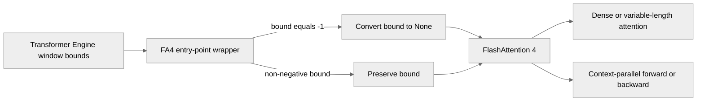

# fix(attention): stop handing FlashAttention 4 the -1 window sentinel

[Upstream PR](https://github.com/NVIDIA/TransformerEngine/pull/3532) · state: closed · merged: False

## Original PR description

## Problem

FlashAttention 4 returns an **all-zero output** for causal attention on SM100, silently — no
exception, no warning, finite values, every element zero. Fixes #3528.

No context parallelism is needed to reproduce it:

```python
import torch, transformer_engine.pytorch as te
b, s, h, d = 2, 1024, 8, 128
q, k, v = (torch.randn(b, s, h, d, device="cuda", dtype=torch.bfloat16) for _ in range(3))
dpa = te.DotProductAttention(h, d, qkv_format="bshd", attn_mask_type="causal",
                             attention_dropout=0.0).to(dtype=torch.bfloat16, device="cuda")
print(dpa(q, k, v).abs().max())   # tensor(0., device='cuda:0')
```

Run it with `NVTE_FUSED_ATTN=0 NVTE_UNFUSED_ATTN=0`, or cuDNN FusedAttention wins backend
selection for this shape and hides the defect entirely.

## Cause

TE normalises an unbounded window side to `-1` (`check_set_window_size`); FA4's sentinel is `None`.
Until Dao-AILab/flash-attention#2490 a shim widened any pair summing below zero to full attention,
so TE's causal encoding `(-1, 0)` was always erased and `causal=True` alone set the mask. #2490
narrowed that to pairs where **both** bounds are negative, so `(-1, 0)` now survives as a literal
band of `[row + 1, row]` — empty. `flash_attn/cute/mask.py` guards on `is not None` and uses the
value arithmetically, so the kernel returns zeros and an all `-inf` LSE.

Measured directly, with TransformerEngine out of the picture:

```python
flash_attn_func(q, k, v, causal=True, window_size=(-1, 0))      # out.abs().max() = 0.0
flash_attn_func(q, k, v, causal=True, window_size=(None, None)) # out.abs().max() = 3.453125
```

## Change

Normalise negative window bounds to `None` at the FA4 entry points, where the symbols are bound.

**Why there rather than at the call sites.** The ~20 sites that build these kwargs are shared with
FA2 >= 2.7 and FA3, for which `-1` is the correct spelling; rewriting them in place would mean
forking every one on `use_flash_attn_4`.

**Why all four entry points.** The non-CP path calls `flash_attn_func` / `flash_attn_varlen_func`;
context parallelism calls `_flash_attn_fwd` / `_flash_attn_bwd`. Covering only one pair is worse
than covering neither, because `run_attention_with_cp.py` grades a CP run against a non-CP run of
the same backend: with both sides returning zeros the comparison agrees and passes, so correcting
one side alone makes the fix present as a regression. That is not hypothetical — an earlier partial
attempt did exactly that, turning two passing arms red.

Genuine sliding windows already carry non-negative bounds and pass through untouched.

## Verification (B200, SM100)

| check | result |
|---|---|
| non-CP causal through `DotProductAttention` | `3.453125e+00`, was `0.000000e+00`; relerr vs float64 `2.046e-03` |
| sliding windows `(256,0)`, `(128,0)`, `(0,0)` | relerr `2.046e-03`, `2.046e-03`, `0.000e+00` |
| CP with FA4 on: `p2p` bshd/sbhd/thd | 3/3 pass — **`p2p` failed before this change** |
| CP with FA4 on: `all_gather`, `a2a` bshd/sbhd | 4/4 pass — were passing before, and still are |
| CP with FA4 off (control) | 3/3 pass |
| `test_fa4_window_sentinel.py` | 12 passed |
| `test_attention.py` sweep (regression) | 487 passed, 138 skipped, 0 failed |

Numerics are graded against a **float64** reference, never against another backend. That matters
here: the defect survived because the CP suite compares against a run of the same backend, so an
error present on both sides cancels. float64 rather than float32 because torch computes fp32
matmuls in TF32 on Ampere and newer, whose significand is 11 bits — the same as fp16 — so an fp32
reference cannot judge a bf16 kernel.

## Tests

`tests/pytorch/attention/test_fa4_window_sentinel.py`, registered in `qa/L0_pytorch_unittest`:

- eleven parametrized cases for the normalizer, which run on any machine, including that a genuine
  sliding window such as `(511, 0)` is passed through unchanged
- one end-to-end case, skipped unless FA4 is installed on SM100, pinned to FlashAttention and
  anchored to a float64 reference. It asserts a non-zero output separately from the tolerance
  check, so the specific failure is named rather than reported as a large error.

## Note on CI

Three independent reasons this was invisible, each worth addressing on its own and none of them
fixed here:

1. `NVTE_FLASH_ATTN_V4=0` is exported in `qa/L1_pytorch_distributed_unittest/test.sh` and the L0
   suites, so FA4 is never exercised under context parallelism.
2. CI pins `flash-attn-4==4.0.0b11`, which predates Dao-AILab/flash-attention#2490.
3. `run_attention_with_cp.py` grades a CP run against a non-CP run of the same backend, so it
   cannot detect any error affecting both equally. Two of the three comm types reported PASS on a
   backend that was returning zeros.


## Review and discussion

### reviews

- greptile-apps[bot] · COMMENTED · 2026-09-17T08:26:15Z · [source](https://github.com/NVIDIA/TransformerEngine/pull/3532#pullrequestreview-5233030466)

(No body; status only.)

- nvegesna-netizen · COMMENTED · 2026-09-17T08:31:14Z · [source](https://github.com/NVIDIA/TransformerEngine/pull/3532#pullrequestreview-5233074562)

(No body; status only.)

- greptile-apps[bot] · COMMENTED · 2026-09-17T08:32:05Z · [source](https://github.com/NVIDIA/TransformerEngine/pull/3532#pullrequestreview-5233081999)

(No body; status only.)

- sudhakarsingh27 · COMMENTED · 2026-09-21T13:23:37Z · [source](https://github.com/NVIDIA/TransformerEngine/pull/3532#pullrequestreview-5267117725)

(No body; status only.)

- nvegesna-netizen · COMMENTED · 2026-09-22T13:13:37Z · [source](https://github.com/NVIDIA/TransformerEngine/pull/3532#pullrequestreview-5278548732)

(No body; status only.)

- sudhakarsingh27 · COMMENTED · 2026-09-29T04:38:40Z · [source](https://github.com/NVIDIA/TransformerEngine/pull/3532#pullrequestreview-5347759991)

(No body; status only.)

- sudhakarsingh27 · COMMENTED · 2026-09-29T04:43:20Z · [source](https://github.com/NVIDIA/TransformerEngine/pull/3532#pullrequestreview-5347789777)

(No body; status only.)

- yashaswikarnati · COMMENTED · 2026-09-29T19:31:43Z · [source](https://github.com/NVIDIA/TransformerEngine/pull/3532#pullrequestreview-5357407806)

(No body; status only.)

- nvegesna-netizen · COMMENTED · 2026-10-01T07:17:50Z · [source](https://github.com/NVIDIA/TransformerEngine/pull/3532#pullrequestreview-5376092722)

(No body; status only.)

- nvegesna-netizen · COMMENTED · 2026-10-01T07:18:00Z · [source](https://github.com/NVIDIA/TransformerEngine/pull/3532#pullrequestreview-5376094413)

(No body; status only.)

- nvegesna-netizen · COMMENTED · 2026-10-01T07:18:02Z · [source](https://github.com/NVIDIA/TransformerEngine/pull/3532#pullrequestreview-5376094809)

(No body; status only.)

- sudhakarsingh27 · COMMENTED · 2026-10-01T21:20:25Z · [source](https://github.com/NVIDIA/TransformerEngine/pull/3532#pullrequestreview-5385676708)

(No body; status only.)

- nvegesna-netizen · COMMENTED · 2026-10-01T21:25:09Z · [source](https://github.com/NVIDIA/TransformerEngine/pull/3532#pullrequestreview-5385729808)

(No body; status only.)

- greptile-apps[bot] · COMMENTED · 2026-10-01T21:28:56Z · [source](https://github.com/NVIDIA/TransformerEngine/pull/3532#pullrequestreview-5385773667)

(No body; status only.)

- yashaswikarnati · APPROVED · 2026-10-01T21:30:21Z · [source](https://github.com/NVIDIA/TransformerEngine/pull/3532#pullrequestreview-5385789109)

(No body; status only.)

- nvegesna-netizen · COMMENTED · 2026-10-01T21:31:51Z · [source](https://github.com/NVIDIA/TransformerEngine/pull/3532#pullrequestreview-5385805872)

(No body; status only.)

- greptile-apps[bot] · COMMENTED · 2026-10-01T21:37:23Z · [source](https://github.com/NVIDIA/TransformerEngine/pull/3532#pullrequestreview-5385868131)

(No body; status only.)

### issue_comments

- greptile-apps[bot] · comment · 2026-09-17T08:26:11Z · [source](https://github.com/NVIDIA/TransformerEngine/pull/3532#issuecomment-5711330235)

<!-- greptile_summary -->

<h2><a href="https://app.greptile.com/api/retrigger?id=65417919"><picture><source media="(prefers-color-scheme: dark)" srcset="https://greptile-static-assets.s3.amazonaws.com/badges/RetriggerDark.svg?v=2"><source media="(prefers-color-scheme: light)" srcset="https://greptile-static-assets.s3.amazonaws.com/badges/Retrigger.svg?v=2"></picture></a>Confidence Score: 5/5</h2>

**[High risk]** Changes how attention window parameters reach FlashAttention 4\.

The PR appears safe to merge, with both previous findings resolved and no new actionable issues introduced since the previous review.

<h3>Summary</h3>

This PR prevents FlashAttention 4 from receiving Transformer Engine’s `-1` unbounded-window sentinel, which FA4 can interpret as an empty causal window and silently return all-zero attention output.
- Adds an FA4-specific wrapper that converts `-1` window bounds to `None` across dense, variable-length, context-parallel forward, and context-parallel backward entry points.
- Leaves non-negative sliding-window bounds unchanged.
- Adds normalization coverage and an SM100 end-to-end numerical regression test that pins and verifies FA4 backend selection.
- Changes since the previous review only shorten explanatory comments and docstrings; runtime behavior is unchanged.

<h3>Diagram</h3>



<!-- greptile_confidence_score:5 -->

<sub>Reviews (9) · Last reviewed commit: ["refactor(attention): condense the FA4 se..."](https://github.com/nvidia/transformerengine/commit/c0d1c37d787a9eb832fa4f6cbdd4fcffff1e5932) · [Reviewed by Greptile](https://www.greptile.com/?utm_source=greptile_expert&utm_medium=github&utm_campaign=code_reviews&utm_content=nvidia/transformerengine)</sub>

- sudhakarsingh27 · comment · 2026-09-29T04:43:45Z · [source](https://github.com/NVIDIA/TransformerEngine/pull/3532#issuecomment-5883795623)

Pls also fix the DCO

- ptrendx · comment · 2026-09-29T21:02:31Z · [source](https://github.com/NVIDIA/TransformerEngine/pull/3532#issuecomment-5898826868)

Following up on the DCO request above: @nvegesna-netizen Please sign every commit in this PR. See https://github.com/NVIDIA/TransformerEngine/blob/main/CONTRIBUTING.rst#sign-your-work

- sudhakarsingh27 · comment · 2026-10-01T22:12:47Z · [source](https://github.com/NVIDIA/TransformerEngine/pull/3532#issuecomment-5941691212)

/te-ci pytorch L0 L1

- sudhakarsingh27 · comment · 2026-10-12T22:41:29Z · [source](https://github.com/NVIDIA/TransformerEngine/pull/3532#issuecomment-6134008316)

Closing since #3540 went that addresses this FA4 sentinel issue as well 

### inline_comments

- greptile-apps[bot] · comment · 2026-09-17T08:26:14Z · [source](https://github.com/NVIDIA/TransformerEngine/pull/3532#discussion_r4034684646)

File: `qa/L0_pytorch_unittest/test.sh` · line None

<a href="#"></a> **FA4 Test Runs Disabled**

The end-to-end regression test is registered only in the L0 runner, but this runner exports `NVTE_FLASH_ATTN_V4=0`. The test disables fused and unfused attention without re-enabling FA4, so even an SM100 L0 job cannot validate the corrected FA4 kernel path. The FA4-enabled L3 runner also does not invoke this test file. Please register it in the FA4-enabled matrix or explicitly enable FA4 for this isolated test so CI can catch a recurrence of the silent-zero behavior.

**Knowledge Base Used:** [Verification and CI matrix](https://app.greptile.com/nvidia-public-github/-/custom-context/knowledge-base/nvidia/transformerengine/-/docs/verification-and-ci.md)

- nvegesna-netizen · comment · 2026-09-17T08:31:14Z · [source](https://github.com/NVIDIA/TransformerEngine/pull/3532#discussion_r4034720415)

File: `qa/L0_pytorch_unittest/test.sh` · line None

Good catch, and the consequence is worse than described — fixed in 927e05ad.

`qa/L0_pytorch_unittest/test.sh:28` does export `NVTE_FLASH_ATTN_V4=0`, but the test would not
merely fail to validate FA4: it would **pass while measuring FA2**. The skip condition checked
`flash_attn_func_v4 is None`, which is an import-time binding that env var does not affect, so the
test would run, TE would decline FA4, and selection would fall through to FA2 — the same lane sets
`NVTE_FLASH_ATTN_V2=1`, and FA2 serves head_dim 128 causal bshd on SM100 perfectly well. A green
test exercising the wrong backend is precisely the failure mode this PR exists to close.

Rather than depend on the lane, the test now pins the backend itself and verifies the result:

```python
pinned = {"NVTE_FUSED_ATTN": "0", "NVTE_UNFUSED_ATTN": "0", "NVTE_FLASH_ATTN_V4": "1"}
...
selected = _attention_backends["flash_attention_backend"]
assert selected is not None and str(selected).startswith("4"), ...
```

The assertion runs before any numerical grading, so the test is correct in any lane and a future
lane cannot quietly opt it out.

I left the registration in L0 rather than moving it to the FA4-enabled L3 matrix, since the test is
now self-sufficient and the eleven non-GPU cases are worth running everywhere. Happy to add it to
L3 as well if you would prefer coverage there too.

- greptile-apps[bot] · comment · 2026-09-17T08:32:05Z · [source](https://github.com/NVIDIA/TransformerEngine/pull/3532#discussion_r4034726705)

File: `qa/L0_pytorch_unittest/test.sh` · line None

This resolves the issue. The test now pins `NVTE_FLASH_ATTN_V4=1` while disabling fused and unfused fallbacks, then asserts that the selected backend is version 4 before evaluating numerical correctness. A green FA2 run can no longer mask a broken FA4 path. Keeping the registration in L0 is reasonable: the test is self-contained, skips when FA4/SM100 is unavailable, and still runs the backend-independent normalizer cases everywhere. No further concern here.

Tip: You can customize Greptile's behavior for this repo with [`.greptile/rules.md` and `.greptile/config.json`](https://www.greptile.com/docs/code-review/custom-standards).

- sudhakarsingh27 · comment · 2026-09-21T13:23:37Z · [source](https://github.com/NVIDIA/TransformerEngine/pull/3532#discussion_r4062522021)

File: `tests/pytorch/attention/test_fa4_window_sentinel.py` · line 1

IMO, it's unnecessary to add the test here, could we add a versioned gate on the calls to "normalize windows" method? (something [like this](https://github.com/NVIDIA/TransformerEngine/pull/3540/changes#diff-001f32a8be891802f01328c1bcc97e377bcc0177f019a1adbbb2ddef627d2520R246-R250) but I'm sure that I've got the minimum version incorrect)

- nvegesna-netizen · comment · 2026-09-22T13:13:37Z · [source](https://github.com/NVIDIA/TransformerEngine/pull/3532#discussion_r4072016515)

File: `tests/pytorch/attention/test_fa4_window_sentinel.py` · line 1

I checked whether a gate is needed, and I do not think it is.

I transcribed `_resolve_causal_local_window` from before #2490 (`interface.py` @ `59cf537812`) and after it, verified both transcriptions against the real source, and ran every `(causal, window)` pair TE emits through each. TE derives `causal` from `attn_mask_type` and the window from `check_set_window_size`, so the two always agree and `causal=False` with `(-1, 0)` never arises.

| mask type | pre as-is | pre normalized | post as-is | post normalized |
|---|---|---|---|---|
| causal | CAUSAL | CAUSAL | **LOCAL left=-1 right=0** | CAUSAL |
| causal_bottom_right | CAUSAL | CAUSAL | **LOCAL left=-1 right=0** | CAUSAL |
| no_mask | FULL | FULL | FULL | FULL |
| sliding window | LOCAL 511/0 | LOCAL 511/0 | LOCAL 511/0 | LOCAL 511/0 |

Normalizing is inert on the older release, not merely harmless. The old code reaches the same resolved state from `(-1, 0)` by widening that the new code reaches from `(None, 0)` directly, via the same `window_size_left is None and window_size_right == 0` branch, which is unchanged context in #2490's diff. All four entry points funnel through that one resolver on both releases.

So ungated looks safer rather than just simpler: a threshold has to be right, and any release between #2490 merging on 9 Sep and the gated version would stay broken. Reasoning is now in the docstring in `4a84a21e`.

On the test, I would keep it. Eleven of the twelve cases are pure Python with no GPU, so the CI cost is small. What earns their place is that this bug was invisible three separate ways: `NVTE_FLASH_ATTN_V4=0` in the distributed suite, a `flash-attn-4` pin predating #2490, and the CP suite comparing a CP run against a non-CP run of the same backend, which agrees when both sides return zeros. The end to end case pins `NVTE_FLASH_ATTN_V4=1` and asserts the selected backend reports version 4 before grading numbers, so it cannot pass on FA2 the way the original would have.

- sudhakarsingh27 · comment · 2026-09-29T04:37:57Z · [source](https://github.com/NVIDIA/TransformerEngine/pull/3532#discussion_r4129673855)

File: `tests/pytorch/attention/test_fa4_window_sentinel.py` · line None

Is this test relevant to the changes in this PR? 

- sudhakarsingh27 · comment · 2026-09-29T04:43:20Z · [source](https://github.com/NVIDIA/TransformerEngine/pull/3532#discussion_r4129700484)

File: `tests/pytorch/attention/test_fa4_window_sentinel.py` · line 1

Thanks for explaining! You're right that ungated is probably better. Two suggestions:
1. Make the kwargs sanitize leaner - I don't think we need two separate functions (it's doing the same thing as [here ](https://github.com/NVIDIA/TransformerEngine/pull/3540/changes#diff-001f32a8be891802f01328c1bcc97e377bcc0177f019a1adbbb2ddef627d2520R108-R122)but just with more verbosity)
2. Make the tests leaner too - do we need all those different tests/configs? There's also a completely unrelated test - pls remove it. 

(If using AI, please append it with a qualifier instruction: "make sure any changes/assumptions/design decisions are kept minimal and the language in code/comment/PR thread replies is straightforward for human readability - tldr; first and then more context". Thanks!)

- yashaswikarnati · comment · 2026-09-29T19:31:44Z · [source](https://github.com/NVIDIA/TransformerEngine/pull/3532#discussion_r4137501563)

File: `transformer_engine/pytorch/attention/dot_product_attention/backends.py` · line None

i wonder if we should be strict on the bound and just do bound == -1, instead of broad <0

- nvegesna-netizen · comment · 2026-10-01T07:17:50Z · [source](https://github.com/NVIDIA/TransformerEngine/pull/3532#discussion_r4152790903)

File: `transformer_engine/pytorch/attention/dot_product_attention/backends.py` · line None

Done, switched to == -1.

Evidence, since I originally argued the other way: FA4 widens a window to full attention only when both bounds are negative. A lone negative is a valid request for an empty window, so `< 0` would silently turn one of those into full attention. `== -1` translates exactly TE's sentinel and leaves everything else with its FA4 meaning.

It also matches how TE spells this elsewhere (`fused_attn_f16_arbitrary_seqlen.cu:179`, `config_and_params.cpp:68`, `utils.py:1435`). `utils.py:1435` matters most: it already treats a non-(-1) negative as a real sliding window, so `< 0` would have left two places in the same subsystem disagreeing about what one value means.

- nvegesna-netizen · comment · 2026-10-01T07:18:00Z · [source](https://github.com/NVIDIA/TransformerEngine/pull/3532#discussion_r4152792097)

File: `tests/pytorch/attention/test_fa4_window_sentinel.py` · line 1

Done on both counts.

Merged the two functions into one, and switched the match to `== -1` per @yashaswikarnati's comment.

Removed `test_fa4_window_normalization_preserves_other_kwargs` -- it was checking kwargs passthrough rather than anything about windows. Kept the parametrized sentinel cases and the end-to-end one: that is the only test that would catch the all-zeros behaviour coming back, and it pins the backend and asserts the selection before grading numbers, so it cannot pass on FA2.

- nvegesna-netizen · comment · 2026-10-01T07:18:02Z · [source](https://github.com/NVIDIA/TransformerEngine/pull/3532#discussion_r4152792378)

File: `tests/pytorch/attention/test_fa4_window_sentinel.py` · line None

Kept this one. It is the regression test for the bug: it pins `NVTE_FLASH_ATTN_V4=1` with fused and unfused disabled, then asserts the selected backend reports version 4 before grading any numbers, so it cannot go green on FA2. The unrelated one (`test_fa4_window_normalization_preserves_other_kwargs`) is removed.

- sudhakarsingh27 · comment · 2026-10-01T21:20:25Z · [source](https://github.com/NVIDIA/TransformerEngine/pull/3532#discussion_r4160602325)

File: `tests/pytorch/attention/test_fa4_window_sentinel.py` · line 1

Pls add this suite of tests to `test_attention.py`. Adding a new test file for every new feature being tested isn't sustainable

- nvegesna-netizen · comment · 2026-10-01T21:25:09Z · [source](https://github.com/NVIDIA/TransformerEngine/pull/3532#discussion_r4160642720)

File: `tests/pytorch/attention/test_fa4_window_sentinel.py` · line 1

Fair, done in c88e28d8. The file and its L0 entry are gone and both tests now live in `test_attention.py`.

Agreed on the principle for this one in particular: the directory already has 14 test files, but the others each cover a backend or subsystem, and this was two tests for a one-line fix.

Nothing was dropped in the move. The module docstring became a section comment above the tests, because it records why the numerical test is anchored to a float64 reference rather than to another backend: `run_attention_with_cp.py` grades a CP run against a non-CP run of the same backend, so an error on both sides cancels, which is how this bug survived.

- greptile-apps[bot] · comment · 2026-10-01T21:28:55Z · [source](https://github.com/NVIDIA/TransformerEngine/pull/3532#discussion_r4160677627)

File: `tests/pytorch/attention/test_attention.py` · line None

<a href="#"></a> **Inherited setting disables FA4**

This test now runs in the same pytest process as earlier attention tests that leave `NVTE_FLASH_ATTN=0`. Setting `NVTE_FLASH_ATTN_V4=1` does not override that global switch, so on SM100 the test fails backend selection instead of checking the window fix. Pin and restore the global switch alongside the other settings.

```suggestion
    pinned = {
        "NVTE_FLASH_ATTN": "1",
        "NVTE_FUSED_ATTN": "0",
        "NVTE_UNFUSED_ATTN": "0",
        "NVTE_FLASH_ATTN_V4": "1",
    }
```

**Knowledge Base Used:** [Verification and CI matrix](https://app.greptile.com/nvidia-public-github/-/custom-context/knowledge-base/nvidia/transformerengine/-/docs/verification-and-ci.md)

- nvegesna-netizen · comment · 2026-10-01T21:31:51Z · [source](https://github.com/NVIDIA/TransformerEngine/pull/3532#discussion_r4160702612)

File: `tests/pytorch/attention/test_attention.py` · line None

Correct, and it is a consequence of moving the file into `test_attention.py` in the previous commit. Fixed in 771f8520.

Verified rather than taken on trust: `utils.py:612` derives `use_flash_attention_4 = use_flash_attention and int(os.environ.get("NVTE_FLASH_ATTN_V4", "1"))`, so an inherited 0 disables FA4 whatever the v4 switch says. And `test_attention.py` sets `NVTE_FLASH_ATTN=0` at a dozen sites, several of which do not restore it.

One refinement to the diagnosis: this would fail rather than pass quietly. The test asserts the selected backend reports version 4 before grading any numbers, so an inherited 0 trips that assertion instead of measuring the wrong backend. Still worth fixing, since a test that fails for an unrelated reason is nearly as bad as one that passes for one.

The save and restore iterate the pinned dict, so the new key is covered by both without any other change.

- greptile-apps[bot] · comment · 2026-10-01T21:37:23Z · [source](https://github.com/NVIDIA/TransformerEngine/pull/3532#discussion_r4160750678)

File: `tests/pytorch/attention/test_attention.py` · line None

Thanks for confirming and for the additional context. The fix in `771f8520` correctly pins `NVTE_FLASH_ATTN` alongside the other backend-selection switches, and the existing save/restore loop covers it automatically. Your clarification is also right: the version-4 assertion makes this an unrelated test failure rather than a silent false pass. Resolving this comment.

## Changed files and fixed code

- `tests/pytorch/attention/test_attention.py` · modified · additions 136 / deletions 0
  - [head](https://github.com/nvegesna-netizen/TransformerEngine/blob/c0d1c37d787a9eb832fa4f6cbdd4fcffff1e5932/tests/pytorch/attention/test_attention.py)
  - [base](https://github.com/NVIDIA/TransformerEngine/blob/0838ecbe4f9e0a370beffa5408278b21110f3ac3/tests/pytorch/attention/test_attention.py)
- `transformer_engine/pytorch/attention/dot_product_attention/backends.py` · modified · additions 30 / deletions 4
  - [head](https://github.com/nvegesna-netizen/TransformerEngine/blob/c0d1c37d787a9eb832fa4f6cbdd4fcffff1e5932/transformer_engine/pytorch/attention/dot_product_attention/backends.py)
  - [base](https://github.com/NVIDIA/TransformerEngine/blob/0838ecbe4f9e0a370beffa5408278b21110f3ac3/transformer_engine/pytorch/attention/dot_product_attention/backends.py)

## Evidence and interpretation boundary

[Original JSON, discussions and patches](../../../../../../evidence/prs/NVIDIA--TransformerEngine/3532-4de9e307cdc1c662b92cfc368ebf25a1d1f40cc2febe1f78ef3a45081148674d.json) · SHA-256 `4de9e307cdc1c662b92cfc368ebf25a1d1f40cc2febe1f78ef3a45081148674d`.

Diff complete: True. Missing/binary/truncated patches require pinned source inspection. This is a source page, not an independently verified optimization case. Open, merged and released are different states; recheck the deployed dependency.
