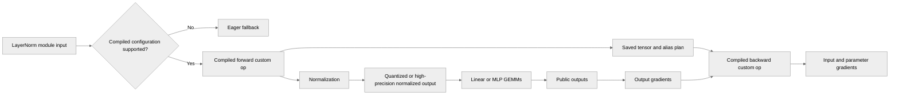

# [PyTorch] [torch.compile] torch.compile support for LayerNormLinear and LayerNormMLP

[Upstream PR](https://github.com/NVIDIA/TransformerEngine/pull/3534) · state: open · merged: False

## Original PR description

## Description

Add full-graph `torch.compile` support for `LayerNormLinear` and `LayerNormMLP`, including backward, dynamic batch dimensions and normalization outputs.

Targets `main`. This branch includes the NVFP4 packed-buffer, TensorSpec and Bias correctness fixes from [NVIDIA/TransformerEngine#3628](https://github.com/NVIDIA/TransformerEngine/pull/3628).

## Changes

- Describe forward outputs, saved tensors, aliases and backward gradients for both LayerNorm modules; retain eager fallbacks for unsupported configurations.
- Share output-gradient setup and quantizer validation with Linear. Adapt the newly inherited fused-attention backward container to the same gradient setup contract, preserving its existing first-output gradient assignment.
- Validate both MLP GEMMs, including gated activations and sequence-parallel dimensions.
- Describe LayerNorm/RMSNorm output, mean and reciprocal standard deviation through `dynamo.fake.fake_norm`, used by both LayerNorm modules. Share the fused-quantization layout predicate with activation output metadata, including the RHT-fusion disable flag and output device; remove duplicate layout helpers. Preserve MXFP8/cuDNN normalization layouts and gathered LayerNormMLP output shapes.
- Parameterize module compile tests across recipes, shapes and modes, with LayerNorm-specific outputs, gradients and eager fallbacks. Retain the non-matrix Linear regressions and expanded cold CUDA Graph recipe coverage inherited from #3628.

## Validation

B100/SM100, PyTorch `2.15.0a0+875d815502.nvinternal.main`, CUDA 13.4; existing October 7 native libraries reused, no fresh native build.

- Focused LayerNorm compile selection: **180 passed, 4 expected skips** for unsupported LayerNormMLP backward overrides. Includes full-graph forward/backward, non-matrix inputs, normalization output gradients, variants and eager fallbacks.
- The selection includes **60 normalization scale-layout cases**: both modules, LayerNorm/RMSNorm, MXFP8 and NVFP4, cuDNN settings, shapes, returned norm output, and NVFP4 RHT fusion enabled/disabled.
- The inherited cold CUDA Graph regression is identical to the version validated in #3628: **48 passed** with an independent eager model and no implicit recipe construction for unquantized inputs.
- Pre-commit, license, syntax and whitespace checks passed. Full PyTorch Python lint retains an unchanged C0411 import-order diagnostic in `attention/fused_mla_q_uproj.py` in the GPU container; no unrelated source cleanup is included. Pylint on all changed production files passed.

No complete compile-suite rerun or distributed TP/SP/Userbuffers validation. The gathered-output test emulates the collective and does not establish multi-GPU correctness.

## Review and discussion

### reviews

- greptile-apps[bot] · COMMENTED · 2026-09-17T17:18:55Z · [source](https://github.com/NVIDIA/TransformerEngine/pull/3534#pullrequestreview-5239112957)

(No body; status only.)

- greptile-apps[bot] · COMMENTED · 2026-09-28T10:45:14Z · [source](https://github.com/NVIDIA/TransformerEngine/pull/3534#pullrequestreview-5337421449)

(No body; status only.)

- greptile-apps[bot] · COMMENTED · 2026-09-28T11:22:17Z · [source](https://github.com/NVIDIA/TransformerEngine/pull/3534#pullrequestreview-5337821064)

(No body; status only.)

- ptrendx · COMMENTED · 2026-09-29T20:51:09Z · [source](https://github.com/NVIDIA/TransformerEngine/pull/3534#pullrequestreview-5358305190)

(No body; status only.)

- pggPL · COMMENTED · 2026-09-30T13:18:57Z · [source](https://github.com/NVIDIA/TransformerEngine/pull/3534#pullrequestreview-5366722713)

(No body; status only.)

### issue_comments

- greptile-apps[bot] · comment · 2026-09-17T17:18:43Z · [source](https://github.com/NVIDIA/TransformerEngine/pull/3534#issuecomment-5718454753)

<!-- greptile_summary -->

<h2><a href="https://app.greptile.com/api/retrigger?id=65625466"><picture><source media="(prefers-color-scheme: dark)" srcset="https://greptile-static-assets.s3.amazonaws.com/badges/RetriggerDark.svg?v=2"><source media="(prefers-color-scheme: light)" srcset="https://greptile-static-assets.s3.amazonaws.com/badges/Retrigger.svg?v=2"></picture></a>Confidence Score: 4/5</h2>

**[High impact]** Adds torch\.compile support to core quantized modules\.

The PR is not yet safe to merge because the unresolved backward-container compatibility break can still make externally registered custom operations fail during backward.

<h2>Findings</h2>

1. &nbsp;**Backward API Compatibility Break** <a href="https://github.com/NVIDIA/TransformerEngine/pull/3534#discussion_r4039623617">▶</a>
2. &nbsp;**Non\-2D compile tests fail** <a href="https://github.com/NVIDIA/TransformerEngine/pull/3534#discussion_r4121547342">▶</a>

<h3>Summary</h3>

This PR adds full-graph `torch.compile` support for `LayerNormLinear` and `LayerNormMLP`, including custom forward/backward operators, fake tensor metadata, normalization outputs, dynamic shapes, eager fallbacks, and expanded low-precision coverage.

- Introduces fake specifications for normalization, bias gradients, quantized scale layouts, aliases, saved tensors, and gradients.
- Adds compiled custom-op paths and unsupported-configuration fallbacks for both LayerNorm modules.
- Preserves MXFP8 and NVFP4 storage metadata through compiled normalization and activation paths.
- Expands eager-versus-compiled tests across module variants, recipes, tensor ranks, CUDA Graphs, and output-gradient routing.
- The previously reported higher-rank fake-normalization shape issue is fixed by flattening all leading dimensions when constructing normalization metadata.

<h3>Diagram</h3>

<!-- greptile_confidence_score:4 -->

Reviews (11) · Last reviewed commit: ["\[PyTorch\] Include the cold CUDA Graph te..."](https://github.com/nvidia/transformerengine/commit/c1ea841c256fd8933ca79765823ad6bf451a91fa) · [Reviewed by Greptile](https://www.greptile.com/?utm_source=greptile_expert&utm_medium=github&utm_campaign=code_reviews&utm_content=nvidia/transformerengine)

- greptile-apps[bot] · comment · 2026-10-12T15:35:04Z · [source](https://github.com/NVIDIA/TransformerEngine/pull/3534#issuecomment-6127462796)

<!-- greptile_outside_diff -->

<h3>Comments Outside Diff</h3>

These findings could not be posted inline.

- &nbsp;**Quantized fake tensors fail** `transformer_engine/pytorch/dynamo/tensor_spec.py:102` <a href="https://github.com/nvidia/transformerengine/blob/576edca43b02c8b8b6250a824bd817bbb7319b25/transformer_engine/pytorch/dynamo/tensor_spec.py#L101-L102">▶</a>

  When a quantized `TensorSpec` does not explicitly set `with_gemm_swizzled_scales`, these lines omit that value from the metadata passed to storage reconstruction. BasicLinear’s fake quantized forward and dgrad paths create such specs, but the MXFP8 and NVFP4 storage constructors require this argument. Tracing therefore fails while assembling the fake tensor, before the compiled operation can run. Please preserve the quantizer-derived default when the field is unspecified while still allowing fake paths to override a known native layout.

### inline_comments

- greptile-apps[bot] · comment · 2026-09-17T17:18:51Z · [source](https://github.com/NVIDIA/TransformerEngine/pull/3534#discussion_r4039623617)

File: `transformer_engine/pytorch/dynamo/custom_op.py` · line 1061

 **Backward API Compatibility Break**

`register_custom_op` is exported from `transformer_engine.pytorch.dynamo`, but backward now unconditionally calls `setup_grad_outputs`. Existing integrations that follow the previous `grad_output` or `grad_outputs` field convention can therefore register and compile successfully, then fail with `AttributeError` during backward. Please preserve the field-based fallback or provide a compatibility default while callers migrate.

- greptile-apps[bot] · comment · 2026-09-28T10:45:13Z · [source](https://github.com/NVIDIA/TransformerEngine/pull/3534#discussion_r4121232917)

File: `transformer_engine/pytorch/module/layernorm_linear.py` · line None

 **Higher-rank NVFP4 tracing fails**

With NVFP4 and a rank-3 or higher input, this fake normalization output keeps the full input shape, but `update_normalization_output_spec` unpacks that shape as exactly two dimensions. Tracing raises before the compiled LayerNormLinear operation can run, even though eager normalization handles the leading dimensions as flattened rows. LayerNormMLP uses the same pattern.

**Knowledge Base Used:** [PyTorch FP8 and low-precision quantization](https://app.greptile.com/nvidia-public-github/-/custom-context/knowledge-base/nvidia/transformerengine/-/docs/pytorch-quantization.md)

- greptile-apps[bot] · comment · 2026-09-28T11:22:16Z · [source](https://github.com/NVIDIA/TransformerEngine/pull/3534#discussion_r4121547342)

File: `tests/pytorch/test_torch_compile.py` · line 2029

 **Non-2D compile tests fail**

The new `LayerNormLinear` cases run BF16 backward with rank-1 and rank-4 inputs through the default Inductor backend. As noted in the PR’s validation results, Inductor fails while preparing backward for these exact cases because it sees a 2D stride on the saved normalization output. The newly enabled tests will therefore fail instead of verifying compile support. Please fix the compiled path before enabling them, or mark the affected cases as expected failures.

**Knowledge Base Used:** [Verification and CI matrix](https://app.greptile.com/nvidia-public-github/-/custom-context/knowledge-base/nvidia/transformerengine/-/docs/verification-and-ci.md)

- ptrendx · comment · 2026-09-29T20:51:09Z · [source](https://github.com/NVIDIA/TransformerEngine/pull/3534#discussion_r4138203238)

File: `transformer_engine/pytorch/module/_common.py` · line None

We need to support arbitrary shape of the tensors, they are not going to be flattened to 2D every time.

- pggPL · comment · 2026-09-30T13:18:56Z · [source](https://github.com/NVIDIA/TransformerEngine/pull/3534#discussion_r4145008991)

File: `transformer_engine/pytorch/module/_common.py` · line None

Done

## Changed files and fixed code

- `tests/pytorch/test_torch_compile.py` · modified · additions 669 / deletions 199
  - [head](https://github.com/pggPL/TransformerEngine/blob/c1ea841c256fd8933ca79765823ad6bf451a91fa/tests/pytorch/test_torch_compile.py)
  - [base](https://github.com/NVIDIA/TransformerEngine/blob/2e959f352c8e2d4b2709e6775867f2c7494656f3/tests/pytorch/test_torch_compile.py)
- `transformer_engine/pytorch/attention/dot_product_attention/backends.py` · modified · additions 5 / deletions 1
  - [head](https://github.com/pggPL/TransformerEngine/blob/c1ea841c256fd8933ca79765823ad6bf451a91fa/transformer_engine/pytorch/attention/dot_product_attention/backends.py)
  - [base](https://github.com/NVIDIA/TransformerEngine/blob/2e959f352c8e2d4b2709e6775867f2c7494656f3/transformer_engine/pytorch/attention/dot_product_attention/backends.py)
- `transformer_engine/pytorch/dynamo/custom_op.py` · modified · additions 8 / deletions 11
  - [head](https://github.com/pggPL/TransformerEngine/blob/c1ea841c256fd8933ca79765823ad6bf451a91fa/transformer_engine/pytorch/dynamo/custom_op.py)
  - [base](https://github.com/NVIDIA/TransformerEngine/blob/2e959f352c8e2d4b2709e6775867f2c7494656f3/transformer_engine/pytorch/dynamo/custom_op.py)
- `transformer_engine/pytorch/dynamo/fake.py` · added · additions 98 / deletions 0
  - [head](https://github.com/pggPL/TransformerEngine/blob/c1ea841c256fd8933ca79765823ad6bf451a91fa/transformer_engine/pytorch/dynamo/fake.py)
  - [base](https://github.com/NVIDIA/TransformerEngine/blob/2e959f352c8e2d4b2709e6775867f2c7494656f3/transformer_engine/pytorch/dynamo/fake.py)
- `transformer_engine/pytorch/dynamo/tensor_spec.py` · modified · additions 6 / deletions 1
  - [head](https://github.com/pggPL/TransformerEngine/blob/c1ea841c256fd8933ca79765823ad6bf451a91fa/transformer_engine/pytorch/dynamo/tensor_spec.py)
  - [base](https://github.com/NVIDIA/TransformerEngine/blob/2e959f352c8e2d4b2709e6775867f2c7494656f3/transformer_engine/pytorch/dynamo/tensor_spec.py)
- `transformer_engine/pytorch/module/_common.py` · modified · additions 56 / deletions 1
  - [head](https://github.com/pggPL/TransformerEngine/blob/c1ea841c256fd8933ca79765823ad6bf451a91fa/transformer_engine/pytorch/module/_common.py)
  - [base](https://github.com/NVIDIA/TransformerEngine/blob/2e959f352c8e2d4b2709e6775867f2c7494656f3/transformer_engine/pytorch/module/_common.py)
- `transformer_engine/pytorch/module/layernorm_linear.py` · modified · additions 509 / deletions 21
  - [head](https://github.com/pggPL/TransformerEngine/blob/c1ea841c256fd8933ca79765823ad6bf451a91fa/transformer_engine/pytorch/module/layernorm_linear.py)
  - [base](https://github.com/NVIDIA/TransformerEngine/blob/2e959f352c8e2d4b2709e6775867f2c7494656f3/transformer_engine/pytorch/module/layernorm_linear.py)
- `transformer_engine/pytorch/module/layernorm_mlp.py` · modified · additions 668 / deletions 105
  - [head](https://github.com/pggPL/TransformerEngine/blob/c1ea841c256fd8933ca79765823ad6bf451a91fa/transformer_engine/pytorch/module/layernorm_mlp.py)
  - [base](https://github.com/NVIDIA/TransformerEngine/blob/2e959f352c8e2d4b2709e6775867f2c7494656f3/transformer_engine/pytorch/module/layernorm_mlp.py)
- `transformer_engine/pytorch/module/linear.py` · modified · additions 21 / deletions 103
  - [head](https://github.com/pggPL/TransformerEngine/blob/c1ea841c256fd8933ca79765823ad6bf451a91fa/transformer_engine/pytorch/module/linear.py)
  - [base](https://github.com/NVIDIA/TransformerEngine/blob/2e959f352c8e2d4b2709e6775867f2c7494656f3/transformer_engine/pytorch/module/linear.py)
- `transformer_engine/pytorch/ops/basic/bias.py` · modified · additions 5 / deletions 9
  - [head](https://github.com/pggPL/TransformerEngine/blob/c1ea841c256fd8933ca79765823ad6bf451a91fa/transformer_engine/pytorch/ops/basic/bias.py)
  - [base](https://github.com/NVIDIA/TransformerEngine/blob/2e959f352c8e2d4b2709e6775867f2c7494656f3/transformer_engine/pytorch/ops/basic/bias.py)
- `transformer_engine/pytorch/tensor/nvfp4_tensor.py` · modified · additions 1 / deletions 1
  - [head](https://github.com/pggPL/TransformerEngine/blob/c1ea841c256fd8933ca79765823ad6bf451a91fa/transformer_engine/pytorch/tensor/nvfp4_tensor.py)
  - [base](https://github.com/NVIDIA/TransformerEngine/blob/2e959f352c8e2d4b2709e6775867f2c7494656f3/transformer_engine/pytorch/tensor/nvfp4_tensor.py)
- `transformer_engine/pytorch/tensor/storage/nvfp4_tensor_storage.py` · modified · additions 2 / deletions 1
  - [head](https://github.com/pggPL/TransformerEngine/blob/c1ea841c256fd8933ca79765823ad6bf451a91fa/transformer_engine/pytorch/tensor/storage/nvfp4_tensor_storage.py)
  - [base](https://github.com/NVIDIA/TransformerEngine/blob/2e959f352c8e2d4b2709e6775867f2c7494656f3/transformer_engine/pytorch/tensor/storage/nvfp4_tensor_storage.py)
- `transformer_engine/pytorch/utils.py` · modified · additions 4 / deletions 4
  - [head](https://github.com/pggPL/TransformerEngine/blob/c1ea841c256fd8933ca79765823ad6bf451a91fa/transformer_engine/pytorch/utils.py)
  - [base](https://github.com/NVIDIA/TransformerEngine/blob/2e959f352c8e2d4b2709e6775867f2c7494656f3/transformer_engine/pytorch/utils.py)

## Evidence and interpretation boundary

[Original JSON, discussions and patches](../../../../../../evidence/prs/NVIDIA--TransformerEngine/3534-6bb41de4d7654c8b5fc5625896f3c1366e69a0b97ccf3e7cba9471edbea8263e.json) · SHA-256 `6bb41de4d7654c8b5fc5625896f3c1366e69a0b97ccf3e7cba9471edbea8263e`.

Diff complete: True. Missing/binary/truncated patches require pinned source inspection. This is a source page, not an independently verified optimization case. Open, merged and released are different states; recheck the deployed dependency.
