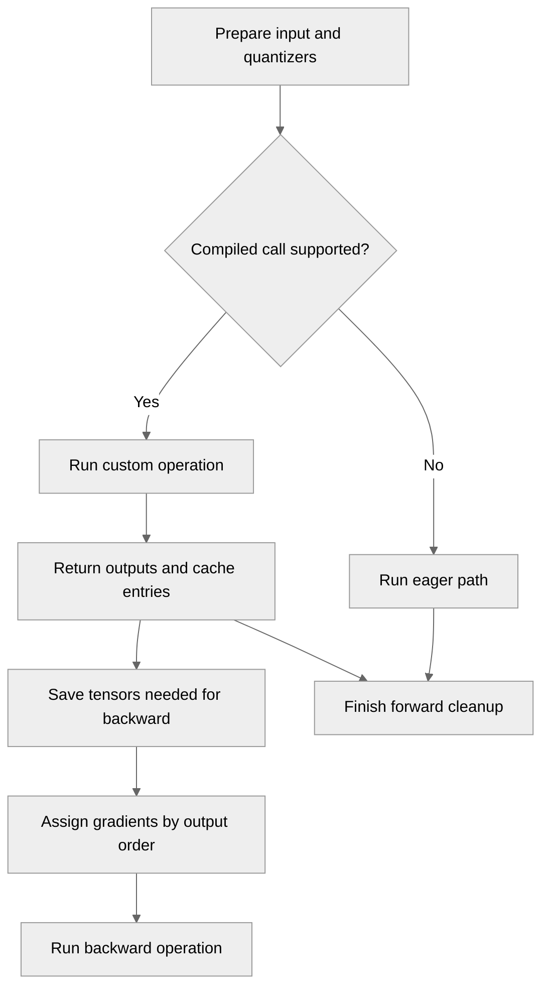

# [PyTorch] [torch.compile] torch.compile support for LayerNormLinear and LayerNormMLP

[Upstream PR](https://github.com/NVIDIA/TransformerEngine/pull/3534) · state: open · merged: False

## Original PR description

## Description

Add full-graph `torch.compile` support for `LayerNormLinear` and `LayerNormMLP`, including backward, dynamic batch dimensions and normalization outputs.

The single late fallback check relies on the Dynamo fix in [pggPL/pytorch#4](https://github.com/pggPL/pytorch/pull/4), related to [pytorch/pytorch#144820](https://github.com/pytorch/pytorch/issues/144820). Without that fix, a graph break inside forward's try/finally can disable compilation for subsequent supported instances of the same module class.

Targets `main`. This branch includes the NVFP4 packed-buffer, TensorSpec and Bias correctness fixes from [NVIDIA/TransformerEngine#3628](https://github.com/NVIDIA/TransformerEngine/pull/3628). It also includes the GEMM scale-layout fix prepared separately in [pggPL/TransformerEngine#72](https://github.com/pggPL/TransformerEngine/pull/72), so fake outputs can follow quantizer metadata without querying native kernel layout rules.

## Changes

- Describe forward outputs, saved tensors, aliases and backward gradients for both LayerNorm modules; retain eager fallbacks for unsupported configurations.
- Decide fallback eligibility once after preparing quantizers in Linear, LayerNormLinear and LayerNormMLP; reuse the prepared eager path and preserve end_forward cleanup.
- Share output-gradient setup and quantizer validation with Linear. Adapt the newly inherited fused-attention backward container to the same gradient setup contract, preserving its existing first-output gradient assignment.
- Support compiled FP8 weight caching in both LayerNorm modules, following Linear: replace the cache on the first microbatch and reuse it on subsequent microbatches, including both MLP weights. GPU-controlled cache updates and fused wgrad accumulation retain eager fallbacks.
- Share the cache regression across Linear, LayerNormLinear and LayerNormMLP, checking independent eager outputs/gradients, cache refresh/reuse, optimizer updates, immediate/deferred backward and CUDA Graph replay.
- Describe normalization statistics and activation outputs directly from quantizer metadata, including gathered LayerNormMLP output shapes. Remove layout-query bindings and backend-specific layout prediction from fake implementations.
- Parameterize module compile tests across recipes, shapes and modes, with LayerNorm-specific outputs, gradients and eager fallbacks. Retain the non-matrix Linear regressions and expanded cold CUDA Graph recipe coverage inherited from #3628.

## Review and discussion

### reviews

- greptile-apps[bot] · COMMENTED · 2026-09-17T17:18:55Z · [source](https://github.com/NVIDIA/TransformerEngine/pull/3534#pullrequestreview-5239112957)

(No body; status only.)

- greptile-apps[bot] · COMMENTED · 2026-09-28T10:45:14Z · [source](https://github.com/NVIDIA/TransformerEngine/pull/3534#pullrequestreview-5337421449)

(No body; status only.)

- greptile-apps[bot] · COMMENTED · 2026-09-28T11:22:17Z · [source](https://github.com/NVIDIA/TransformerEngine/pull/3534#pullrequestreview-5337821064)

(No body; status only.)

- ptrendx · COMMENTED · 2026-09-29T20:51:09Z · [source](https://github.com/NVIDIA/TransformerEngine/pull/3534#pullrequestreview-5358305190)

(No body; status only.)

- pggPL · COMMENTED · 2026-09-30T13:18:57Z · [source](https://github.com/NVIDIA/TransformerEngine/pull/3534#pullrequestreview-5366722713)

(No body; status only.)

- greptile-apps[bot] · COMMENTED · 2026-10-23T22:50:30Z · [source](https://github.com/NVIDIA/TransformerEngine/pull/3534#pullrequestreview-5635240977)

(No body; status only.)

- greptile-apps[bot] · COMMENTED · 2026-10-28T14:14:59Z · [source](https://github.com/NVIDIA/TransformerEngine/pull/3534#pullrequestreview-5684085740)

(No body; status only.)

- ptrendx · COMMENTED · 2026-10-29T21:24:52Z · [source](https://github.com/NVIDIA/TransformerEngine/pull/3534#pullrequestreview-5705170429)

(No body; status only.)

- ptrendx · COMMENTED · 2026-10-29T21:26:34Z · [source](https://github.com/NVIDIA/TransformerEngine/pull/3534#pullrequestreview-5705188272)

(No body; status only.)

- greptile-apps[bot] · COMMENTED · 2026-10-30T12:23:48Z · [source](https://github.com/NVIDIA/TransformerEngine/pull/3534#pullrequestreview-5712173954)

(No body; status only.)

- pggPL · COMMENTED · 2026-10-30T13:09:40Z · [source](https://github.com/NVIDIA/TransformerEngine/pull/3534#pullrequestreview-5712705513)

(No body; status only.)

- pggPL · COMMENTED · 2026-10-30T13:10:43Z · [source](https://github.com/NVIDIA/TransformerEngine/pull/3534#pullrequestreview-5712717123)

(No body; status only.)

### issue_comments

- greptile-apps[bot] · comment · 2026-09-17T17:18:43Z · [source](https://github.com/NVIDIA/TransformerEngine/pull/3534#issuecomment-5718454753)

<!-- greptile_summary -->

<h2><a href="https://app.greptile.com/api/retrigger?id=65625466"><picture><source media="(prefers-color-scheme: dark)" srcset="https://greptile-static-assets.s3.amazonaws.com/badges/RetriggerDark.svg?v=2"><source media="(prefers-color-scheme: light)" srcset="https://greptile-static-assets.s3.amazonaws.com/badges/Retrigger.svg?v=2"></picture></a><a href="https://app.greptile.com/-/switch-tenant?tenant=nvidia-public-github&amp;next=%2FNVIDIA%2Ftransformerengine%2Fpull%2F3534&amp;utm_source=greptile_review&amp;utm_medium=github&amp;utm_campaign=view_in_greptile"><picture><source media="(prefers-color-scheme: dark)" srcset="https://greptile-static-assets.s3.amazonaws.com/badges/ViewInGreptileDark.svg?v=2"><source media="(prefers-color-scheme: light)" srcset="https://greptile-static-assets.s3.amazonaws.com/badges/ViewInGreptile.svg?v=2"></picture></a>Confidence Score: 5/5</h2>

**[High impact]** The latest changes appear safe to merge; no new blocking issue was found.

<h3>Summary</h3>

Adds compiled forward and backward support for `LayerNormLinear` and `LayerNormMLP`, including dynamic batch sizes, normalization outputs, and FP8 weight caching.

- LayerNorm modules can run compiled forward and backward passes.
- Compiled module calls carry shapes and output gradients explicitly.
- Quantized outputs follow the requested GEMM scale layout.

No new actionable issues were found in the changes since the previous review. No runtime tests were run.

<h3>Diagram</h3>

<!-- greptile_confidence_score:5 -->

Reviews (38) · Last reviewed commit: ["Merge branch &#39;quantizer\_gemm\_ready\_outpu..."](https://github.com/nvidia/transformerengine/commit/af09a102c803ca10f25ebf8eab606d8877dd9a70) · [Reviewed by Greptile](https://www.greptile.com/?utm_source=greptile_review&utm_medium=github&utm_campaign=review_public&utm_content=nvidia/transformerengine)

- greptile-apps[bot] · comment · 2026-10-12T15:35:04Z · [source](https://github.com/NVIDIA/TransformerEngine/pull/3534#issuecomment-6127462796)

<!-- greptile_outside_diff -->

<h3>Comments Outside Diff</h3>

These findings could not be posted inline.

- &nbsp;**Recipe changes reuse unsupported plans** `transformer_engine/pytorch/ops/fuser.py:709` <a href="https://github.com/nvidia/transformerengine/blob/70e4b7d56bc7d193c22a389831ed551637cf96d1/transformer_engine/pytorch/ops/fuser.py#L705-L709">▶</a>

  The cache key now includes only recipe type, backward boundary, and `backward_override`. Fusion also depends on `disable_rht`, MXFP8 format, and `enable_cutedsl_fused_grouped_mlp`. A same-class recipe change returns the old plan without checking those settings. For example, a plan built with NVFP4 RHT stays selected after RHT is disabled, although the fused path requires it. Include the fusion-relevant recipe settings in the key.

### inline_comments

- greptile-apps[bot] · comment · 2026-09-17T17:18:51Z · [source](https://github.com/NVIDIA/TransformerEngine/pull/3534#discussion_r4039623617)

File: `transformer_engine/pytorch/dynamo/custom_op.py` · line 1082

 **Backward API Compatibility Break**

`register_custom_op` is exported from `transformer_engine.pytorch.dynamo`, but backward now unconditionally calls `setup_grad_outputs`. Existing integrations that follow the previous `grad_output` or `grad_outputs` field convention can therefore register and compile successfully, then fail with `AttributeError` during backward. Please preserve the field-based fallback or provide a compatibility default while callers migrate.

- greptile-apps[bot] · comment · 2026-09-28T10:45:13Z · [source](https://github.com/NVIDIA/TransformerEngine/pull/3534#discussion_r4121232917)

File: `transformer_engine/pytorch/module/layernorm_linear.py` · line None

 **Higher-rank NVFP4 tracing fails**

With NVFP4 and a rank-3 or higher input, this fake normalization output keeps the full input shape, but `update_normalization_output_spec` unpacks that shape as exactly two dimensions. Tracing raises before the compiled LayerNormLinear operation can run, even though eager normalization handles the leading dimensions as flattened rows. LayerNormMLP uses the same pattern.

**Knowledge Base Used:** [PyTorch FP8 and low-precision quantization](https://app.greptile.com/nvidia-public-github/-/custom-context/knowledge-base/nvidia/transformerengine/-/docs/pytorch-quantization.md)

- greptile-apps[bot] · comment · 2026-09-28T11:22:16Z · [source](https://github.com/NVIDIA/TransformerEngine/pull/3534#discussion_r4121547342)

File: `tests/pytorch/test_torch_compile.py` · line 2117

 **Non-2D compile tests fail**

The new `LayerNormLinear` cases run BF16 backward with rank-1 and rank-4 inputs through the default Inductor backend. As noted in the PR’s validation results, Inductor fails while preparing backward for these exact cases because it sees a 2D stride on the saved normalization output. The newly enabled tests will therefore fail instead of verifying compile support. Please fix the compiled path before enabling them, or mark the affected cases as expected failures.

**Knowledge Base Used:** [Verification and CI matrix](https://app.greptile.com/nvidia-public-github/-/custom-context/knowledge-base/nvidia/transformerengine/-/docs/verification-and-ci.md)

- ptrendx · comment · 2026-09-29T20:51:09Z · [source](https://github.com/NVIDIA/TransformerEngine/pull/3534#discussion_r4138203238)

File: `transformer_engine/pytorch/module/_common.py` · line None

We need to support arbitrary shape of the tensors, they are not going to be flattened to 2D every time.

- pggPL · comment · 2026-09-30T13:18:56Z · [source](https://github.com/NVIDIA/TransformerEngine/pull/3534#discussion_r4145008991)

File: `transformer_engine/pytorch/module/_common.py` · line None

Done

- greptile-apps[bot] · comment · 2026-10-23T22:50:29Z · [source](https://github.com/NVIDIA/TransformerEngine/pull/3534#discussion_r4364864941)

File: `transformer_engine/pytorch/dynamo/fake.py` · line None

 **RMSNorm gradients read wrong scales**

With `NVTE_NORM_FWD_USE_CUDNN=1`, a `CustomRecipe` can choose `MXFP8Quantizer(with_2d_quantization=True)` for normalization. For an aligned input such as `(128, 128)`, `fake_norm` marks the saved scales as compact. Native RMSNorm instead keeps them swizzled because its compact-scale path excludes two-dimensional quantization.

Compiled backward then rebuilds the saved tensor with the wrong scale setting, so the weight-gradient GEMM reads the scales incorrectly. Match the native RMSNorm condition before overriding `with_gemm_swizzled_scales`.

**Knowledge Base Used:** [PyTorch FP8 and low-precision quantization](https://app.greptile.com/nvidia-public-github/-/custom-context/knowledge-base/nvidia/transformerengine/-/docs/pytorch-quantization.md)

- greptile-apps[bot] · comment · 2026-10-28T14:14:55Z · [source](https://github.com/NVIDIA/TransformerEngine/pull/3534#discussion_r4401658947)

File: `tests/cpp/test_common.h` · line None

 **Older CUDA builds fail**

The ordinary `if` makes the compiler instantiate the recursive branch even after it finds the requested type. With CUDA before 13.4, `types` has fewer entries than `DType::kNumTypes`, so recursion reaches an out-of-range `std::tuple_element` and the C++ tests fail to build. Restore the compile-time bounds check.

- greptile-apps[bot] · comment · 2026-10-28T14:14:55Z · [source](https://github.com/NVIDIA/TransformerEngine/pull/3534#discussion_r4401658966)

File: `transformer_engine/pytorch/quantized_tensor.py` · line None

 **Backward loses distributed weights**

Removing the saved reference loses `DistributedWeight` when saved-tensor hooks return an ordinary tensor, as activation offloading and non-reentrant checkpointing can do. `restore_from_saved()` now returns that tensor without its `is_distributed_weight` marker. Backward in `Linear`, `LayerNormLinear`, and `GroupedLinear` then skips the weight-gather and gradient-finalization hooks. Retain the original distributed weight alongside the saved tensor.

- greptile-apps[bot] · comment · 2026-10-28T14:14:55Z · [source](https://github.com/NVIDIA/TransformerEngine/pull/3534#discussion_r4401658987)

File: `transformer_engine/pytorch/ops/fused/grouped_mlp.py` · line None

 **Expert weights skip their gather**

The fused grouped MLP now quantizes plain distributed shards before calling `materialize_weight_for_forward()`. The new tensors lack the distributed-weight marker, so the dispatcher skips the original leader's gather hook. Backward also passes gathered BF16 weights straight to code that reads `_columnwise_data` and `_columnwise_scale_inv`.

Gather the original weights first, then quantize any plain gathered weights with the forward's saved quantizers.

**Knowledge Base Used:** [PyTorch tensor and operator abstractions](https://app.greptile.com/nvidia-public-github/-/custom-context/knowledge-base/nvidia/transformerengine/-/docs/pytorch-tensors-and-ops.md)

- greptile-apps[bot] · comment · 2026-10-28T14:14:55Z · [source](https://github.com/NVIDIA/TransformerEngine/pull/3534#discussion_r4401659009)

File: `transformer_engine/pytorch/csrc/extensions/cast.cpp` · line None

 **Splits use the wrong scaling**

Moving `BULK_NVFP4` allocation outside the row-scaled check breaks mixed tensor-scaled and row-scaled quantizers. The bulk allocator takes `row_scaled_nvfp4` only from the first quantizer and applies it to every output. Quantization reads that output flag, so later splits silently use the first split's scaling mode instead of their own. Keep mixed groups on per-tensor allocation, or allocate each output from its own quantizer.

**Knowledge Base Used:** [PyTorch FP8 and low-precision quantization](https://app.greptile.com/nvidia-public-github/-/custom-context/knowledge-base/nvidia/transformerengine/-/docs/pytorch-quantization.md)

- greptile-apps[bot] · comment · 2026-10-28T14:14:55Z · [source](https://github.com/NVIDIA/TransformerEngine/pull/3534#discussion_r4401659030)

File: `transformer_engine/pytorch/csrc/extensions/cast.cpp` · line None

 **Grouped casts ignore input strides**

`group_quantize()` no longer makes its input contiguous, but it still passes only `data_ptr()` and the logical element count to the native grouped tensor. It neither passes nor checks strides. A transposed or sliced 2D input is read as contiguous storage and produces wrong quantized values. Restore the contiguous copy or reject unsupported strides before dispatch.

- greptile-apps[bot] · comment · 2026-10-28T14:14:55Z · [source](https://github.com/NVIDIA/TransformerEngine/pull/3534#discussion_r4401659046)

File: `transformer_engine/pytorch/tensor/utils.py` · line None

 **Rowwise master updates fail**

The master-weight cast now unconditionally reads `_columnwise_scale_inv.shape`. A valid MXFP8 primary created with `columnwise=False` has no columnwise scales, so `quantize_master_weights()` raises `AttributeError` before updating it. The later partial-cast changes also require columnwise buffers again. Preserve the rowwise-only path throughout the update.

**Knowledge Base Used:** [PyTorch FP8 and low-precision quantization](https://app.greptile.com/nvidia-public-github/-/custom-context/knowledge-base/nvidia/transformerengine/-/docs/pytorch-quantization.md)

- greptile-apps[bot] · comment · 2026-10-28T14:14:55Z · [source](https://github.com/NVIDIA/TransformerEngine/pull/3534#discussion_r4401659063)

File: `transformer_engine/common/util/rtc.cpp` · line None

 **Cleanup uses destroyed driver caches**

Making `KernelManager` and the driver caches destructible restores an exit-time lifetime bug. The manager exists before its first `get_function()` call initializes the driver caches, so those caches are destroyed first at exit. The manager then destroys its kernels, and `Kernel::~Kernel()` calls the driver wrapper through its destroyed map and mutex. Keep these caches alive through process teardown, or explicitly destroy kernels before the driver caches.

**Knowledge Base Used:** [Native CUDA kernel platform](https://app.greptile.com/nvidia-public-github/-/custom-context/knowledge-base/nvidia/transformerengine/-/docs/native-kernels.md)

- greptile-apps[bot] · comment · 2026-10-28T14:14:55Z · [source](https://github.com/NVIDIA/TransformerEngine/pull/3534#discussion_r4401659080)

File: `transformer_engine/common/fused_router/fused_moe_aux_loss.cu` · line None

 **Large loss inputs overflow offsets**

Removing the `INT_MAX` checks lets large probability matrices reach kernels whose flattened offsets still use `int`. For example, `(8_388_609, 256)` fits on current GPUs but makes `row * num_cols + col` overflow. Forward reads outside the matrix, and backward has the same problem for writes. Restore the size checks or use wide offsets and loop counters throughout all three paths.

- greptile-apps[bot] · comment · 2026-10-28T14:14:55Z · [source](https://github.com/NVIDIA/TransformerEngine/pull/3534#discussion_r4401659101)

File: `transformer_engine/pytorch/router.py` · line None

 **Inference bounds stop routing**

The new QB validation unconditionally reads `bin_bounds._version`. Tensors created inside `torch.inference_mode()` do not have version counters, so valid bounds created in that scope raise before the router runs. Handle inference tensors without reading `_version`, and retain value checks where capture permits them. The public `mark_qb_bin_bounds_validated()` helper needs the same treatment.

- greptile-apps[bot] · comment · 2026-10-28T14:14:56Z · [source](https://github.com/NVIDIA/TransformerEngine/pull/3534#discussion_r4401659122)

File: `transformer_engine/pytorch/triton/permutation.py` · line None

 **Permutation mixes GPU devices**

`make_row_id_map()` now allocates its output and workspace on the current CUDA device instead of `routing_map.device`. If the routing map is on another GPU, the Triton launch receives pointers from different devices. The public permutation path does not switch devices before this call. Allocate these buffers on `routing_map.device` as before.

- ptrendx · comment · 2026-10-29T21:24:53Z · [source](https://github.com/NVIDIA/TransformerEngine/pull/3534#discussion_r4418057567)

File: `transformer_engine/pytorch/csrc/extensions/normalization.cpp` · line None

Why is this checking specifically for RMSNorm? This sounds like the original logic had some bug where only RMSNorm was checked rather than any normalization.

- ptrendx · comment · 2026-10-29T21:26:35Z · [source](https://github.com/NVIDIA/TransformerEngine/pull/3534#discussion_r4418071789)

File: `transformer_engine/pytorch/csrc/extensions/pybind.cpp` · line None

This is a very specific function and takes very specific arguments. Could we generalize it a little bit?

- greptile-apps[bot] · comment · 2026-10-30T12:23:47Z · [source](https://github.com/NVIDIA/TransformerEngine/pull/3534#discussion_r4423557748)

File: `tests/pytorch/test_torch_compile.py` · line None

 **Tests fail without FP8**

The new `CustomRecipe` case runs even when `fp8_available` is false. On an A100 or another GPU without FP8 support, `_run_module_compile_test` enters `te.autocast`, which asserts before compilation starts. This adds six failing cases where the existing recipe list correctly skips unsupported hardware. Gate this case on `fp8_available` too.

- pggPL · comment · 2026-10-30T13:09:39Z · [source](https://github.com/NVIDIA/TransformerEngine/pull/3534#discussion_r4423950581)

File: `transformer_engine/pytorch/csrc/extensions/pybind.cpp` · line None

done

- pggPL · comment · 2026-10-30T13:10:43Z · [source](https://github.com/NVIDIA/TransformerEngine/pull/3534#discussion_r4423959555)

File: `transformer_engine/pytorch/csrc/extensions/normalization.cpp` · line None

yes, it seems we have but it is hard to obtain it in real training since it is about layernorming 2d scaled tensor (weights) which does not happen. I ll fix in separate PR

## Changed files and fixed code

- `tests/pytorch/test_quantized_tensor.py` · modified · additions 218 / deletions 0
  - [head](https://github.com/pggPL/TransformerEngine/blob/af09a102c803ca10f25ebf8eab606d8877dd9a70/tests/pytorch/test_quantized_tensor.py)
  - [base](https://github.com/NVIDIA/TransformerEngine/blob/5c3f067c28b6f23a26d2d3b46bdf37ecf1470167/tests/pytorch/test_quantized_tensor.py)
- `tests/pytorch/test_torch_compile.py` · modified · additions 699 / deletions 205
  - [head](https://github.com/pggPL/TransformerEngine/blob/af09a102c803ca10f25ebf8eab606d8877dd9a70/tests/pytorch/test_torch_compile.py)
  - [base](https://github.com/NVIDIA/TransformerEngine/blob/5c3f067c28b6f23a26d2d3b46bdf37ecf1470167/tests/pytorch/test_torch_compile.py)
- `transformer_engine/pytorch/attention/dot_product_attention/backends.py` · modified · additions 5 / deletions 1
  - [head](https://github.com/pggPL/TransformerEngine/blob/af09a102c803ca10f25ebf8eab606d8877dd9a70/transformer_engine/pytorch/attention/dot_product_attention/backends.py)
  - [base](https://github.com/NVIDIA/TransformerEngine/blob/5c3f067c28b6f23a26d2d3b46bdf37ecf1470167/transformer_engine/pytorch/attention/dot_product_attention/backends.py)
- `transformer_engine/pytorch/csrc/common.h` · modified · additions 3 / deletions 0
  - [head](https://github.com/pggPL/TransformerEngine/blob/af09a102c803ca10f25ebf8eab606d8877dd9a70/transformer_engine/pytorch/csrc/common.h)
  - [base](https://github.com/NVIDIA/TransformerEngine/blob/5c3f067c28b6f23a26d2d3b46bdf37ecf1470167/transformer_engine/pytorch/csrc/common.h)
- `transformer_engine/pytorch/csrc/extensions/activation.cpp` · modified · additions 3 / deletions 0
  - [head](https://github.com/pggPL/TransformerEngine/blob/af09a102c803ca10f25ebf8eab606d8877dd9a70/transformer_engine/pytorch/csrc/extensions/activation.cpp)
  - [base](https://github.com/NVIDIA/TransformerEngine/blob/5c3f067c28b6f23a26d2d3b46bdf37ecf1470167/transformer_engine/pytorch/csrc/extensions/activation.cpp)
- `transformer_engine/pytorch/csrc/extensions/bias.cpp` · modified · additions 5 / deletions 0
  - [head](https://github.com/pggPL/TransformerEngine/blob/af09a102c803ca10f25ebf8eab606d8877dd9a70/transformer_engine/pytorch/csrc/extensions/bias.cpp)
  - [base](https://github.com/NVIDIA/TransformerEngine/blob/5c3f067c28b6f23a26d2d3b46bdf37ecf1470167/transformer_engine/pytorch/csrc/extensions/bias.cpp)
- `transformer_engine/pytorch/csrc/extensions/cast.cpp` · modified · additions 63 / deletions 8
  - [head](https://github.com/pggPL/TransformerEngine/blob/af09a102c803ca10f25ebf8eab606d8877dd9a70/transformer_engine/pytorch/csrc/extensions/cast.cpp)
  - [base](https://github.com/NVIDIA/TransformerEngine/blob/5c3f067c28b6f23a26d2d3b46bdf37ecf1470167/transformer_engine/pytorch/csrc/extensions/cast.cpp)
- `transformer_engine/pytorch/csrc/extensions/gemm.cpp` · modified · additions 1 / deletions 0
  - [head](https://github.com/pggPL/TransformerEngine/blob/af09a102c803ca10f25ebf8eab606d8877dd9a70/transformer_engine/pytorch/csrc/extensions/gemm.cpp)
  - [base](https://github.com/NVIDIA/TransformerEngine/blob/5c3f067c28b6f23a26d2d3b46bdf37ecf1470167/transformer_engine/pytorch/csrc/extensions/gemm.cpp)
- `transformer_engine/pytorch/csrc/extensions/normalization.cpp` · modified · additions 18 / deletions 12
  - [head](https://github.com/pggPL/TransformerEngine/blob/af09a102c803ca10f25ebf8eab606d8877dd9a70/transformer_engine/pytorch/csrc/extensions/normalization.cpp)
  - [base](https://github.com/NVIDIA/TransformerEngine/blob/5c3f067c28b6f23a26d2d3b46bdf37ecf1470167/transformer_engine/pytorch/csrc/extensions/normalization.cpp)
- `transformer_engine/pytorch/csrc/extensions/pybind.cpp` · modified · additions 0 / deletions 5
  - [head](https://github.com/pggPL/TransformerEngine/blob/af09a102c803ca10f25ebf8eab606d8877dd9a70/transformer_engine/pytorch/csrc/extensions/pybind.cpp)
  - [base](https://github.com/NVIDIA/TransformerEngine/blob/5c3f067c28b6f23a26d2d3b46bdf37ecf1470167/transformer_engine/pytorch/csrc/extensions/pybind.cpp)
- `transformer_engine/pytorch/csrc/extensions/swizzle.cpp` · modified · additions 15 / deletions 3
  - [head](https://github.com/pggPL/TransformerEngine/blob/af09a102c803ca10f25ebf8eab606d8877dd9a70/transformer_engine/pytorch/csrc/extensions/swizzle.cpp)
  - [base](https://github.com/NVIDIA/TransformerEngine/blob/5c3f067c28b6f23a26d2d3b46bdf37ecf1470167/transformer_engine/pytorch/csrc/extensions/swizzle.cpp)
- `transformer_engine/pytorch/dynamo/custom_op.py` · modified · additions 25 / deletions 17
  - [head](https://github.com/pggPL/TransformerEngine/blob/af09a102c803ca10f25ebf8eab606d8877dd9a70/transformer_engine/pytorch/dynamo/custom_op.py)
  - [base](https://github.com/NVIDIA/TransformerEngine/blob/5c3f067c28b6f23a26d2d3b46bdf37ecf1470167/transformer_engine/pytorch/dynamo/custom_op.py)
- `transformer_engine/pytorch/dynamo/fake.py` · modified · additions 42 / deletions 64
  - [head](https://github.com/pggPL/TransformerEngine/blob/af09a102c803ca10f25ebf8eab606d8877dd9a70/transformer_engine/pytorch/dynamo/fake.py)
  - [base](https://github.com/NVIDIA/TransformerEngine/blob/5c3f067c28b6f23a26d2d3b46bdf37ecf1470167/transformer_engine/pytorch/dynamo/fake.py)
- `transformer_engine/pytorch/module/_common.py` · modified · additions 82 / deletions 1
  - [head](https://github.com/pggPL/TransformerEngine/blob/af09a102c803ca10f25ebf8eab606d8877dd9a70/transformer_engine/pytorch/module/_common.py)
  - [base](https://github.com/NVIDIA/TransformerEngine/blob/5c3f067c28b6f23a26d2d3b46bdf37ecf1470167/transformer_engine/pytorch/module/_common.py)
- `transformer_engine/pytorch/module/layernorm_linear.py` · modified · additions 486 / deletions 30
  - [head](https://github.com/pggPL/TransformerEngine/blob/af09a102c803ca10f25ebf8eab606d8877dd9a70/transformer_engine/pytorch/module/layernorm_linear.py)
  - [base](https://github.com/NVIDIA/TransformerEngine/blob/5c3f067c28b6f23a26d2d3b46bdf37ecf1470167/transformer_engine/pytorch/module/layernorm_linear.py)
- `transformer_engine/pytorch/module/layernorm_mlp.py` · modified · additions 572 / deletions 58
  - [head](https://github.com/pggPL/TransformerEngine/blob/af09a102c803ca10f25ebf8eab606d8877dd9a70/transformer_engine/pytorch/module/layernorm_mlp.py)
  - [base](https://github.com/NVIDIA/TransformerEngine/blob/5c3f067c28b6f23a26d2d3b46bdf37ecf1470167/transformer_engine/pytorch/module/layernorm_mlp.py)
- `transformer_engine/pytorch/module/linear.py` · modified · additions 44 / deletions 156
  - [head](https://github.com/pggPL/TransformerEngine/blob/af09a102c803ca10f25ebf8eab606d8877dd9a70/transformer_engine/pytorch/module/linear.py)
  - [base](https://github.com/NVIDIA/TransformerEngine/blob/5c3f067c28b6f23a26d2d3b46bdf37ecf1470167/transformer_engine/pytorch/module/linear.py)
- `transformer_engine/pytorch/quantized_tensor.py` · modified · additions 3 / deletions 0
  - [head](https://github.com/pggPL/TransformerEngine/blob/af09a102c803ca10f25ebf8eab606d8877dd9a70/transformer_engine/pytorch/quantized_tensor.py)
  - [base](https://github.com/NVIDIA/TransformerEngine/blob/5c3f067c28b6f23a26d2d3b46bdf37ecf1470167/transformer_engine/pytorch/quantized_tensor.py)

## Evidence and interpretation boundary

[Original JSON, discussions and patches](../../../../../../evidence/prs/NVIDIA--TransformerEngine/3534-d3194792d7e1a4ec87264c3fdd7ff9571decf05efe9b88be7fa1c69e79db7aa6.json) · SHA-256 `d3194792d7e1a4ec87264c3fdd7ff9571decf05efe9b88be7fa1c69e79db7aa6`.

Diff complete: True. Missing/binary/truncated patches require pinned source inspection. This is a source page, not an independently verified optimization case. Open, merged and released are different states; recheck the deployed dependency.
