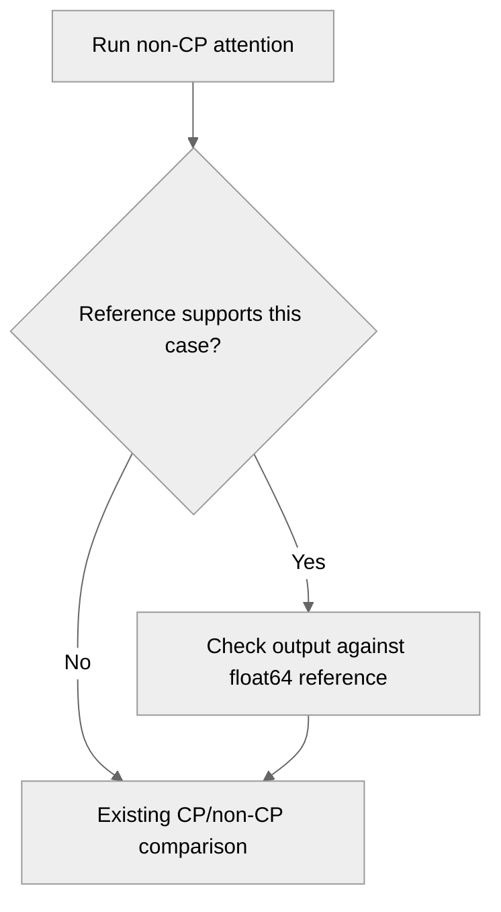

# test(attention): anchor the context-parallel suite to an independent reference

[Upstream PR](https://github.com/NVIDIA/TransformerEngine/pull/3536) · state: closed · merged: True

## Original PR description

## Problem

`tests/pytorch/attention/run_attention_with_cp.py` grades a context-parallel run **against a non-CP
run of the same backend** (`tensors_no_cp` vs `tensors_cp`). That validates the context-parallel
plumbing and nothing about the kernel beneath it: any error affecting both sides equally cancels,
and the comparison passes.

This is not hypothetical. Measured on B200 against the FA4 defect in #3528, where the backend
returns an all-zero output for causal attention:

| `cp_comm_type` | before this change | after |
|---|---|---|
| `all_gather` | **PASS** | FAIL — `non-CP output is all zeros` |
| `a2a` | **PASS** | FAIL — `non-CP output is all zeros` |
| `p2p` | FAIL | FAIL |

Two of three communication types reported PASS on a backend returning nothing at all. Zeros on one
side, zeros on the other, agreement. Only `p2p` failed, and only incidentally: its ring merge turned
the accompanying `-inf` LSE into a NaN that the zeros on the other side did not match.

The same structure also inverts the sign of a partial fix. An earlier attempt at #3528 corrected the
CP side only, which made the two sides disagree — so the **fix** was reported as a regression in
`all_gather` and `a2a`, while the fully broken state had been reported as a pass.

## Change

Check one `(batch, head)` slice of the non-CP output against an independently computed float64
reference, before the CP/no-CP comparison, so a systematically wrong kernel cannot cancel itself out.

It is a sanity bound, not a precision test — the existing CP/no-CP comparison already covers
precision. It targets catastrophic wrongness: zeros, NaNs, a mask applied in the wrong place. An
all-zero output is asserted separately from the tolerance so it is named rather than surfacing as a
large numeric error.

float64 rather than float32: torch computes fp32 matmuls in TF32 on Ampere and newer, whose
significand is 11 bits — the same as fp16 — so an fp32 reference cannot judge a bf16 kernel.

Configurations the reference does not model are **skipped rather than approximated**: fp8, attention
bias, non-vanilla softmax, `thd`, padding masks, and softcap. Modelling softcap would mean
duplicating its `tanh` rescaling in the reference, which is how a reference starts reimplementing
the thing it is meant to check independently.

## Verification (B200)

The negative control is the real defect rather than a synthetic one: this branch is cut from `main`,
which still carries the FA4 zero-output bug, so the check can be tested against a backend that is
genuinely returning nothing.

| check | result |
|---|---|
| bug present on this tree | `out.abs().max() = 0.0` confirmed |
| **anchor + broken backend** | `all_gather`, `a2a`, `p2p` all fail, naming the all-zero output |
| **anchor + correct backend** (FA4 off) | `all_gather`, `a2a`, `p2p` all pass |
| full FlashAttention CP suite, correct backend | 18 passed, 0 failed |

The third row matters as much as the second. A reference that rejects correct kernels would be worse
than the gap it closes, and it is the more likely way to get this wrong — the mask convention has to
match at bottom-right alignment, sliding windows and GQA. An earlier revision failed three softcap
cases for exactly that reason; those are now skipped.

## Note

#3532 fixes the FA4 defect used as the negative control here. Once it lands, that particular
backend will no longer return zeros — but the gap this closes is structural and independent of it:
the suite cannot detect **any** error affecting CP and non-CP equally.

## Review and discussion

### reviews

- denera · APPROVED · 2026-11-02T17:54:42Z · [source](https://github.com/NVIDIA/TransformerEngine/pull/3536#pullrequestreview-5740924245)

LGTM! I've reviewed the CI failures and they are unrelated to this PR.

### issue_comments

- nvegesna-netizen · comment · 2026-09-17T16:18:03Z · [source](https://github.com/NVIDIA/TransformerEngine/pull/3536#issuecomment-5717660554)

One note on merge order, since these two are related but independent.

**Please land #3532 before this one.** #3532 fixes the FA4 defect that this change uses as its
negative control. If this merges while that bug is still on `main`, any lane enabling FA4 on SM100
starts failing — correctly, since the backend really is returning an all-zero output, but it would
present as *this* change breaking CI rather than as the pre-existing bug it is surfacing. Today's
lanes export `NVTE_FLASH_ATTN_V4=0` so it would not fire in practice, but that is a thin thing to
rely on.

Kept separate from #3532 deliberately rather than folded in:

- that one is a correctness fix to shipping code; this one modifies a harness every context-parallel
  test runs through, which is a different kind of review
- this adds a float64 computation per test plus skip conditions and a tolerance, all reasonably
  debatable — and a silent wrong-answer fix should not wait on that debate
- it is not FA4-specific: it protects every backend under context parallelism, and filing it under an
  FA4 fix would undersell it

No dependency between them otherwise — different files, cut from `main`, no conflict either way.

- greptile-apps[bot] · comment · 2026-09-17T16:18:35Z · [source](https://github.com/NVIDIA/TransformerEngine/pull/3536#issuecomment-5717669557)

<!-- greptile_summary -->

<h2><a href="https://app.greptile.com/api/retrigger?id=65598209"><picture><source media="(prefers-color-scheme: dark)" srcset="https://greptile-static-assets.s3.amazonaws.com/badges/RetriggerDark.svg?v=2"><source media="(prefers-color-scheme: light)" srcset="https://greptile-static-assets.s3.amazonaws.com/badges/Retrigger.svg?v=2"></picture></a><a href="https://app.greptile.com/nvidia-public-github/github/NVIDIA/transformerengine/-/pull/3536?utm_source=greptile_review&amp;utm_medium=github&amp;utm_campaign=view_in_greptile"><picture><source media="(prefers-color-scheme: dark)" srcset="https://greptile-static-assets.s3.amazonaws.com/badges/ViewInGreptileDark.svg?v=2"><source media="(prefers-color-scheme: light)" srcset="https://greptile-static-assets.s3.amazonaws.com/badges/ViewInGreptile.svg?v=2"></picture></a>Confidence Score: 5/5</h2>

**[Low impact]** The PR appears safe to merge.

<h3>Summary</h3>

Adds an independent float64 check before the existing CP/non-CP comparison.
- Context-parallel attention tests check non-CP results against an independent reference.

No actionable issues were found. The full PR diff was reviewed because the previous commit did not pass the ancestry check. No runtime tests were run.

<h3>Diagram</h3>

<!-- greptile_confidence_score:5 -->

Reviews (3) · Last reviewed commit: ["test(attention): skip softcap configs in..."](https://github.com/nvidia/transformerengine/commit/d1551d626fde99819d54ee70dc17cba2107d42ea) · [Reviewed by Greptile](https://www.greptile.com/?utm_source=greptile_review&utm_medium=github&utm_campaign=review_public&utm_content=nvidia/transformerengine)

- ptrendx · comment · 2026-09-29T21:02:28Z · [source](https://github.com/NVIDIA/TransformerEngine/pull/3536#issuecomment-5898825661)

@nvegesna-netizen Please sign every commit in this PR. See https://github.com/NVIDIA/TransformerEngine/blob/main/CONTRIBUTING.rst#sign-your-work

- denera · comment · 2026-10-19T23:02:29Z · [source](https://github.com/NVIDIA/TransformerEngine/pull/3536#issuecomment-6279252912)

/te-ci L1

- denera · comment · 2026-10-30T22:06:35Z · [source](https://github.com/NVIDIA/TransformerEngine/pull/3536#issuecomment-6534508622)

/te-ci L1

### inline_comments

## Changed files and fixed code

- `tests/pytorch/attention/run_attention_with_cp.py` · modified · additions 90 / deletions 0
  - [head](https://github.com/nvegesna-netizen/TransformerEngine/blob/d1551d626fde99819d54ee70dc17cba2107d42ea/tests/pytorch/attention/run_attention_with_cp.py)
  - [base](https://github.com/NVIDIA/TransformerEngine/blob/35a8e2f9db996e2957a20fc0d17df1ce03849a0a/tests/pytorch/attention/run_attention_with_cp.py)

## Evidence and interpretation boundary

[Original JSON, discussions and patches](../../../../../../evidence/prs/NVIDIA--TransformerEngine/3536-f91284441c8aae1f511dc3a9519bebbfd905fc29cc98f812f62c678983b657df.json) · SHA-256 `f91284441c8aae1f511dc3a9519bebbfd905fc29cc98f812f62c678983b657df`.

Diff complete: True. Missing/binary/truncated patches require pinned source inspection. This is a source page, not an independently verified optimization case. Open, merged and released are different states; recheck the deployed dependency.
