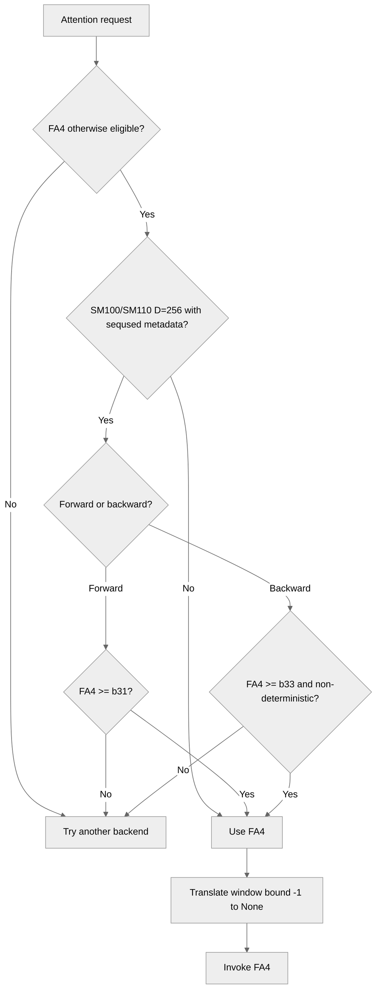

# [PyTorch][CP] Support D=256 THD metadata with FA4 b33

[Upstream PR](https://github.com/NVIDIA/TransformerEngine/pull/3540) · state: open · merged: False

## Original PR description

## Summary

FlashAttention 4 b33 adds backward support for D=256 THD attention with per-sequence length metadata on SM100/SM110. This PR selects FA4 only when the installed version supports the requested direction: b31–b32 for forward, b33+ for forward and backward. Earlier versions fall back, and deterministic D=256 backward remains excluded.

Transformer Engine uses `-1` for an unbounded attention window, while FA4 expects `None`. This PR translates that sentinel at the FA4 entry points without changing other negative window offsets.

The SM100+ L3 test lane uses FA4 b33 with CUTLASS DSL 4.8.0. It covers D=256 no-load-balance context parallelism and window handling, and runs the full backend-selection test module for FA4.

## Validation

H100 FA3 and B200 FA4 b33 L3 tests passed. The expanded B200 CP run (`NVTE_TEST_ESSENTIAL=0`) recorded 1,389 passes, 54,489 skips, and no failures. Focused reruns passed the backend-selection module and D=128/D=256 no-load-balance cases. The final test-only skip/assertion edit passed Python 3.12 compilation and `git diff --check`; it has not had another GPU run.

## Review and discussion

### reviews

- greptile-apps[bot] · COMMENTED · 2026-09-17T20:31:53Z · [source](https://github.com/NVIDIA/TransformerEngine/pull/3540#pullrequestreview-5241123567)

(No body; status only.)

- greptile-apps[bot] · COMMENTED · 2026-10-07T19:54:54Z · [source](https://github.com/NVIDIA/TransformerEngine/pull/3540#pullrequestreview-5447585162)

(No body; status only.)

- cyanguwa · COMMENTED · 2026-10-08T17:24:40Z · [source](https://github.com/NVIDIA/TransformerEngine/pull/3540#pullrequestreview-5460459787)

(No body; status only.)

- cyanguwa · COMMENTED · 2026-10-08T18:54:07Z · [source](https://github.com/NVIDIA/TransformerEngine/pull/3540#pullrequestreview-5461440937)

(No body; status only.)

- cyanguwa · COMMENTED · 2026-10-08T19:01:48Z · [source](https://github.com/NVIDIA/TransformerEngine/pull/3540#pullrequestreview-5461528420)

(No body; status only.)

- cyanguwa · COMMENTED · 2026-10-08T19:05:55Z · [source](https://github.com/NVIDIA/TransformerEngine/pull/3540#pullrequestreview-5461572547)

(No body; status only.)

- cyanguwa · COMMENTED · 2026-10-08T19:08:41Z · [source](https://github.com/NVIDIA/TransformerEngine/pull/3540#pullrequestreview-5461601382)

(No body; status only.)

- cyanguwa · COMMENTED · 2026-10-08T19:16:16Z · [source](https://github.com/NVIDIA/TransformerEngine/pull/3540#pullrequestreview-5461701504)

(No body; status only.)

- cyanguwa · COMMENTED · 2026-10-08T19:17:44Z · [source](https://github.com/NVIDIA/TransformerEngine/pull/3540#pullrequestreview-5461718021)

(No body; status only.)

- cyanguwa · COMMENTED · 2026-10-08T19:18:38Z · [source](https://github.com/NVIDIA/TransformerEngine/pull/3540#pullrequestreview-5461729408)

(No body; status only.)

- cyanguwa · COMMENTED · 2026-10-08T19:24:02Z · [source](https://github.com/NVIDIA/TransformerEngine/pull/3540#pullrequestreview-5461788413)

(No body; status only.)

- sudhakarsingh27 · COMMENTED · 2026-10-09T20:48:49Z · [source](https://github.com/NVIDIA/TransformerEngine/pull/3540#pullrequestreview-5475213782)

(No body; status only.)

- sudhakarsingh27 · COMMENTED · 2026-10-09T20:48:51Z · [source](https://github.com/NVIDIA/TransformerEngine/pull/3540#pullrequestreview-5475214005)

(No body; status only.)

- sudhakarsingh27 · COMMENTED · 2026-10-09T20:48:53Z · [source](https://github.com/NVIDIA/TransformerEngine/pull/3540#pullrequestreview-5475214256)

(No body; status only.)

- sudhakarsingh27 · COMMENTED · 2026-10-09T20:48:54Z · [source](https://github.com/NVIDIA/TransformerEngine/pull/3540#pullrequestreview-5475214447)

(No body; status only.)

- sudhakarsingh27 · COMMENTED · 2026-10-09T20:48:56Z · [source](https://github.com/NVIDIA/TransformerEngine/pull/3540#pullrequestreview-5475214668)

(No body; status only.)

- sudhakarsingh27 · COMMENTED · 2026-10-09T20:48:57Z · [source](https://github.com/NVIDIA/TransformerEngine/pull/3540#pullrequestreview-5475214861)

(No body; status only.)

- sudhakarsingh27 · COMMENTED · 2026-10-09T20:48:58Z · [source](https://github.com/NVIDIA/TransformerEngine/pull/3540#pullrequestreview-5475215026)

(No body; status only.)

- sudhakarsingh27 · COMMENTED · 2026-10-09T20:49:00Z · [source](https://github.com/NVIDIA/TransformerEngine/pull/3540#pullrequestreview-5475215289)

(No body; status only.)

- sudhakarsingh27 · COMMENTED · 2026-10-09T20:49:01Z · [source](https://github.com/NVIDIA/TransformerEngine/pull/3540#pullrequestreview-5475215657)

(No body; status only.)

- cyanguwa · APPROVED · 2026-10-09T21:50:26Z · [source](https://github.com/NVIDIA/TransformerEngine/pull/3540#pullrequestreview-5475683969)

(No body; status only.)

### issue_comments

- greptile-apps[bot] · comment · 2026-09-17T20:31:46Z · [source](https://github.com/NVIDIA/TransformerEngine/pull/3540#issuecomment-5720828066)

<!-- greptile_summary -->

<h2><a href="https://app.greptile.com/api/retrigger?id=65722705"><picture><source media="(prefers-color-scheme: dark)" srcset="https://greptile-static-assets.s3.amazonaws.com/badges/RetriggerDark.svg?v=2"><source media="(prefers-color-scheme: light)" srcset="https://greptile-static-assets.s3.amazonaws.com/badges/Retrigger.svg?v=2"></picture></a>Confidence Score: 5/5</h2>

**[Medium impact]** The PR appears safe to merge; no outstanding correctness, security, or repository-rule violations were identified.

<h3>Summary</h3>

This PR enables version-aware FA4 selection for SM100/SM110 D=256 THD attention and adapts Transformer Engine’s unbounded-window sentinel at FA4 entry points.
- Requires FA4 b31+ for D=256 `seqused_q/k` forward and b33+ for backward.
- Excludes deterministic D=256 FA4 backward where the kernel does not support it.
- Updates the SM100+ L3 lane to FA4 b33 and CUTLASS DSL 4.8.0.
- Adds backend-selection, sentinel-normalization, and D=256 context-parallel coverage.
- The two previous review findings were resolved by adding focused D=256 no-load-balance coverage and running the complete backend-selection module in the FA4 lane.

<h3>Diagram</h3>



<!-- greptile_confidence_score:5 -->

<sub>Reviews (16) · Last reviewed commit: ["Keep full CP model catalogs for focused ..."](https://github.com/nvidia/transformerengine/commit/88b294b280cc24c009cf2d89de75bf551c69626c) · [Reviewed by Greptile](https://www.greptile.com/?utm_source=greptile_expert&utm_medium=github&utm_campaign=code_reviews&utm_content=nvidia/transformerengine)</sub>

- sudhakarsingh27 · comment · 2026-09-17T21:25:30Z · [source](https://github.com/NVIDIA/TransformerEngine/pull/3540#issuecomment-5721454123)

/te-ci pytorch L3

- sudhakarsingh27 · comment · 2026-09-21T13:13:20Z · [source](https://github.com/NVIDIA/TransformerEngine/pull/3540#issuecomment-5761060967)

/te-ci pytorch L3

- sudhakarsingh27 · comment · 2026-09-29T19:59:12Z · [source](https://github.com/NVIDIA/TransformerEngine/pull/3540#issuecomment-5897647393)

/te-ci pytorch L3

- sudhakarsingh27 · comment · 2026-10-07T20:00:56Z · [source](https://github.com/NVIDIA/TransformerEngine/pull/3540#issuecomment-6045787726)

/te-ci pytorch L1 L3 

- sudhakarsingh27 · comment · 2026-10-09T21:51:30Z · [source](https://github.com/NVIDIA/TransformerEngine/pull/3540#issuecomment-6089859692)

/te-ci pytorch L1 L3

### inline_comments

- greptile-apps[bot] · comment · 2026-09-17T20:31:51Z · [source](https://github.com/NVIDIA/TransformerEngine/pull/3540#discussion_r4041195265)

File: `tests/pytorch/attention/test_attention_with_cp.py` · line None

<a href="#"></a> **D=256 Path Remains Untested**

The new `cp_nlb_hdim256` configuration does not exercise the behavior it is meant to protect. Essential mode is enabled by default and filters this configuration out, including in the updated FA4 QA job. Even in the full matrix, the general test keeps `DUAL_CHUNK_SWAP`, while the dedicated `NO_LOAD_BALANCE` test still uses the D=128 `cp_2_0` configuration. As a result, the new D=256 FA4 compact-metadata forward and backward path has no regression coverage.

- greptile-apps[bot] · comment · 2026-10-07T19:54:52Z · [source](https://github.com/NVIDIA/TransformerEngine/pull/3540#discussion_r4211328001)

File: `qa/L3_pytorch_FA_versions_test/test.sh` · line None

<a href="#"></a> **Numerical Regression Coverage Removed**

The FA4 lane now runs only the wrapper-level sentinel test after removing `test_fa4_causal_attention_matches_reference`. The remaining test wraps `dict.update`, so it cannot catch problems in `DotProductAttention`, backend selection, argument forwarding, or FA4 numerical behavior. This removes the only independent end-to-end numerical regression for the window adapter, allowing integration regressions in the actual causal FA4 path to go unnoticed.

Note: If this suggestion doesn't match your team's coding style, reply to this and let me know. I'll remember it for next time!

- cyanguwa · comment · 2026-10-08T17:24:40Z · [source](https://github.com/NVIDIA/TransformerEngine/pull/3540#discussion_r4222104215)

File: `qa/L3_pytorch_FA_versions_test/test.sh` · line None

I think this will still fail Rubin tests because they will need cutlass 4.8. Is there a way we can update FA4 to a version that can work with cutlass 4.8+? Thanks.

- cyanguwa · comment · 2026-10-08T18:54:07Z · [source](https://github.com/NVIDIA/TransformerEngine/pull/3540#discussion_r4222940759)

File: `transformer_engine/pytorch/attention/dot_product_attention/utils.py` · line None

"only for padding" -> "only for pad_between_seqs=True"?

- cyanguwa · comment · 2026-10-08T19:01:48Z · [source](https://github.com/NVIDIA/TransformerEngine/pull/3540#discussion_r4223011967)

File: `transformer_engine/pytorch/attention/dot_product_attention/utils.py` · line 1306

I see this .requires_backward is added in 3595, but is it really necessary? Could we not use the .training flag for the same purpose? 

- cyanguwa · comment · 2026-10-08T19:05:55Z · [source](https://github.com/NVIDIA/TransformerEngine/pull/3540#discussion_r4223050257)

File: `tests/pytorch/attention/test_attention_with_cp.py` · line None

Would this logic not be already covered by `get_available_attention_backends()`?

- cyanguwa · comment · 2026-10-08T19:08:41Z · [source](https://github.com/NVIDIA/TransformerEngine/pull/3540#discussion_r4223075166)

File: `qa/L3_pytorch_FA_versions_test/test.sh` · line 144

Should we not just run the entire `test_attention_backend_selection.py` here, instead of just these two tests?

- cyanguwa · comment · 2026-10-08T19:16:16Z · [source](https://github.com/NVIDIA/TransformerEngine/pull/3540#discussion_r4223155955)

File: `tests/pytorch/attention/test_attention_with_cp.py` · line None

Could we parameterize over the `model_config`, instead of reusing `cp_2_0` and splitting off another parameter `head_dim`? We could 
```
model_configs = ["cp_2_0", "cp_x_x"] # create another config with head_dim_qk=head_dim_v=256
@pytest.mark.parametrize("model", model_configs)
def test_cp_with_flash_attention_no_load_balance(cp_pool, model):
...
```
?
This way, we preserve the different head_dim for QK and V as well, if we need to add some test for FA4 for other (head_dim_qk, head_dim_v) combinations?

- cyanguwa · comment · 2026-10-08T19:17:44Z · [source](https://github.com/NVIDIA/TransformerEngine/pull/3540#discussion_r4223169777)

File: `tests/pytorch/attention/run_attention_with_cp.py` · line None

"head_dim" can be absorbed by the "config" as commented below in `test_attention_with_cp.py`.

- cyanguwa · comment · 2026-10-08T19:18:38Z · [source](https://github.com/NVIDIA/TransformerEngine/pull/3540#discussion_r4223178590)

File: `tests/pytorch/attention/test_attention_backend_selection.py` · line None

Should we preserve "head_dim_qk, head_dim_v" here?

- cyanguwa · comment · 2026-10-08T19:23:57Z · [source](https://github.com/NVIDIA/TransformerEngine/pull/3540#discussion_r4223228723)

File: `tests/pytorch/attention/test_attention_backend_selection.py` · line None

Would this test not be covered by `test_attetnion.py::test_dot_product_attention` in L0 or L3 tests? 

- sudhakarsingh27 · comment · 2026-10-09T20:48:49Z · [source](https://github.com/NVIDIA/TransformerEngine/pull/3540#discussion_r4234428260)

File: `qa/L3_pytorch_FA_versions_test/test.sh` · line None

Good catch. FA4 b33 passed L3 with CUTLASS DSL 4.8.0 on SM100 and SM107, so I updated the pin and installation guidance.

- sudhakarsingh27 · comment · 2026-10-09T20:48:51Z · [source](https://github.com/NVIDIA/TransformerEngine/pull/3540#discussion_r4234428400)

File: `transformer_engine/pytorch/attention/dot_product_attention/utils.py` · line None

Agreed. The comment now says `pad_between_seqs=True`.

- sudhakarsingh27 · comment · 2026-10-09T20:48:53Z · [source](https://github.com/NVIDIA/TransformerEngine/pull/3540#discussion_r4234428561)

File: `transformer_engine/pytorch/attention/dot_product_attention/utils.py` · line 1306

An `.eval()` call can still need backward. `requires_backward` captures that, and the existing regression test covers it.

- sudhakarsingh27 · comment · 2026-10-09T20:48:54Z · [source](https://github.com/NVIDIA/TransformerEngine/pull/3540#discussion_r4234428739)

File: `tests/pytorch/attention/test_attention_with_cp.py` · line None

Good point. The test now checks availability before deciding to skip. Unsupported D=256 setups skip; if FA4 is expected but missing, the test fails.

- sudhakarsingh27 · comment · 2026-10-09T20:48:56Z · [source](https://github.com/NVIDIA/TransformerEngine/pull/3540#discussion_r4234428967)

File: `qa/L3_pytorch_FA_versions_test/test.sh` · line 144

Agreed. L3 now runs the full backend-selection file instead of selecting two tests.

- sudhakarsingh27 · comment · 2026-10-09T20:48:57Z · [source](https://github.com/NVIDIA/TransformerEngine/pull/3540#discussion_r4234429122)

File: `tests/pytorch/attention/test_attention_with_cp.py` · line None

Done. The D=256 case now uses a model config, which keeps QK and V dimensions separate.

- sudhakarsingh27 · comment · 2026-10-09T20:48:58Z · [source](https://github.com/NVIDIA/TransformerEngine/pull/3540#discussion_r4234429255)

File: `tests/pytorch/attention/run_attention_with_cp.py` · line None

Agreed. I removed the one-off `head_dim` runner override; the model config supplies those dimensions.

- sudhakarsingh27 · comment · 2026-10-09T20:49:00Z · [source](https://github.com/NVIDIA/TransformerEngine/pull/3540#discussion_r4234429407)

File: `tests/pytorch/attention/test_attention_backend_selection.py` · line None

Yes. The existing cases now pass separate QK and V dimensions.

- sudhakarsingh27 · comment · 2026-10-09T20:49:01Z · [source](https://github.com/NVIDIA/TransformerEngine/pull/3540#discussion_r4234429632)

File: `tests/pytorch/attention/test_attention_backend_selection.py` · line None

You're right that L3 already runs FA4 causal cross-backend comparisons. I removed the redundant standalone reference test and kept the window-sentinel test.

## Changed files and fixed code

- `qa/L3_pytorch_FA_versions_test/test.sh` · modified · additions 12 / deletions 5
  - [head](https://github.com/sudhakarsingh27/TransformerEngine/blob/88b294b280cc24c009cf2d89de75bf551c69626c/qa/L3_pytorch_FA_versions_test/test.sh)
  - [base](https://github.com/NVIDIA/TransformerEngine/blob/ce29d240ca9bc7cdb392a73e2637a0f2bdf71fe5/qa/L3_pytorch_FA_versions_test/test.sh)
- `tests/pytorch/attention/test_attention_backend_selection.py` · modified · additions 83 / deletions 11
  - [head](https://github.com/sudhakarsingh27/TransformerEngine/blob/88b294b280cc24c009cf2d89de75bf551c69626c/tests/pytorch/attention/test_attention_backend_selection.py)
  - [base](https://github.com/NVIDIA/TransformerEngine/blob/ce29d240ca9bc7cdb392a73e2637a0f2bdf71fe5/tests/pytorch/attention/test_attention_backend_selection.py)
- `tests/pytorch/attention/test_attention_with_cp.py` · modified · additions 24 / deletions 8
  - [head](https://github.com/sudhakarsingh27/TransformerEngine/blob/88b294b280cc24c009cf2d89de75bf551c69626c/tests/pytorch/attention/test_attention_with_cp.py)
  - [base](https://github.com/NVIDIA/TransformerEngine/blob/ce29d240ca9bc7cdb392a73e2637a0f2bdf71fe5/tests/pytorch/attention/test_attention_with_cp.py)
- `transformer_engine/pytorch/attention/dot_product_attention/backends.py` · modified · additions 28 / deletions 4
  - [head](https://github.com/sudhakarsingh27/TransformerEngine/blob/88b294b280cc24c009cf2d89de75bf551c69626c/transformer_engine/pytorch/attention/dot_product_attention/backends.py)
  - [base](https://github.com/NVIDIA/TransformerEngine/blob/ce29d240ca9bc7cdb392a73e2637a0f2bdf71fe5/transformer_engine/pytorch/attention/dot_product_attention/backends.py)
- `transformer_engine/pytorch/attention/dot_product_attention/utils.py` · modified · additions 37 / deletions 5
  - [head](https://github.com/sudhakarsingh27/TransformerEngine/blob/88b294b280cc24c009cf2d89de75bf551c69626c/transformer_engine/pytorch/attention/dot_product_attention/utils.py)
  - [base](https://github.com/NVIDIA/TransformerEngine/blob/ce29d240ca9bc7cdb392a73e2637a0f2bdf71fe5/transformer_engine/pytorch/attention/dot_product_attention/utils.py)

## Evidence and interpretation boundary

[Original JSON, discussions and patches](../../../../../../evidence/prs/NVIDIA--TransformerEngine/3540-b7249fe4fc9943a53b7e034a004f14e6d70a9bcdfedd6111cf9433cbeaecd706.json) · SHA-256 `b7249fe4fc9943a53b7e034a004f14e6d70a9bcdfedd6111cf9433cbeaecd706`.

Diff complete: True. Missing/binary/truncated patches require pinned source inspection. This is a source page, not an independently verified optimization case. Open, merged and released are different states; recheck the deployed dependency.
