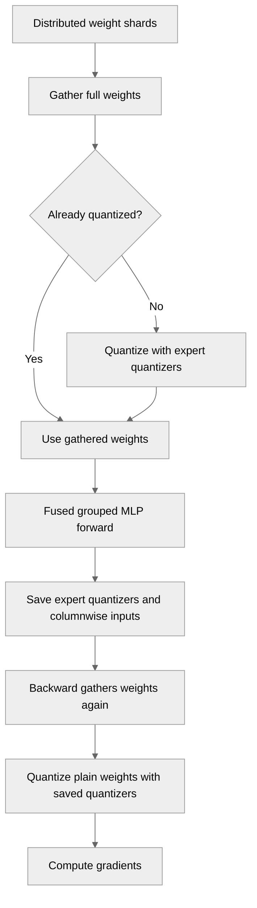

# [PyTorch] Fix DistributedWeight handling under saved-tensor hooks and in the fused grouped MLP

[Upstream PR](https://github.com/NVIDIA/TransformerEngine/pull/3545) · state: open · merged: False

## Original PR description

# Description

Three fixes for distributed (e.g. GTP-sharded) weights in the PyTorch frontend,
all surfaced while running Megatron-Core MoE experts with fine-grained
activation offloading and per-module quantization recipes.

1. `Linear` and `GroupedLinear` lose the `DistributedWeight` subclass in
   backward when `torch.autograd.graph.saved_tensors_hooks` are installed:
   autograd unpacks the saved parameter as a fresh plain tensor, so backward
   takes the plain-parameter branch and fails with
   "weight was removed while fuse_wgrad_accumulation=True". Keep the
   `DistributedWeight` objects on the backward args and prefer them over the
   saved tensors, on both the split-quantize and native grouped-tensor paths.
2. The fused grouped-MLP op assumed gathered distributed weights were already
   quantized, which fails for a module whose per-module recipe does not create
   native-quantized params (e.g. MXFP8 experts under a global NVFP4 recipe).
   Gather first, then quantize whatever is still unquantized with the op's
   per-expert weight quantizers, mirroring `module/linear.py`. The per-expert weight
   quantizers are saved on the forward context and used in backward, so a later
   forward under a different (or no) recipe cannot reset them out from under an
   earlier backward.
3. The fused grouped-MLP save path kept NVFP4 rowwise input data and scales
   that no wgrad path reads. Prune them as already done for MXFP8. Per decoder
   expert layer of a Nemotron hybrid proxy (83k tokens, hidden 3072) this
   removes ~136 MiB from the ~1.9 GiB saved set with unchanged numerics.

## Type of change

- [ ] Documentation change (change only to the documentation, either a fix or a new content)
- [x] Bug fix (non-breaking change which fixes an issue)
- [ ] New feature (non-breaking change which adds functionality)
- [ ] Breaking change (fix or feature that would cause existing functionality to not work as expected)
- [ ] Infra/Build change
- [ ] Code refactoring

## Changes

- `module/linear.py`, `module/grouped_linear.py`: keep `DistributedWeight`
  objects on `LinearBwdArgs` / `GroupedLinearBwdArgs` /
  `GroupedLinearGraphSafeBwdArgs` and use them in backward.
- `ops/fused/grouped_mlp.py`: gather distributed weights before quantizing;
  quantize re-gathered BF16 weights with the per-expert quantizers, save those
  quantizers on the FC1/FC2 contexts for backward; move the FC2 backward
  re-gather ahead of the NVFP4 amax computation; drop NVFP4 rowwise input
  data and scales from the saved state.
- New tests, all registered in `qa/L0_pytorch_unittest/test.sh`:
  - `tests/pytorch/test_module_distributed_weight_saved_tensor_hooks.py`:
    `Linear` and both `GroupedLinear` paths with identity saved-tensor hooks,
    using an in-repo fake `DistributedWeight` implementer. The grouped-tensor
    case skips when the native path is unsupported on the device / cuBLASLt.
  - `tests/pytorch/test_ops_grouped_mlp_distributed_weight.py`: fused grouped
    MLP with BF16 and MXFP8 fake distributed weights under per-module MXFP8,
    optionally inside a global NVFP4 autocast; bit-exact against a plain reference
    up to the fake hooks' scales plus a backward after a second forward under no
    recipe or NVFP4..
  - `tests/pytorch/test_ops_grouped_mlp_nvfp4_saved_tensors.py`: exactly one
    FP4 data and one scale tensor saved per quantized input on the fused NVFP4
    path, for group sizes 1 and 4. The single-group dense path saves a GroupedTensor
    wrapper, whose buffers are inspected directly.

# Checklist:

- [x] I have read and followed the [contributing guidelines](https://github.com/NVIDIA/TransformerEngine/blob/main/CONTRIBUTING.rst)
- [x] The functionality is complete
- [x] I have commented my code, particularly in hard-to-understand areas
- [ ] I have made corresponding changes to the documentation
- [x] My changes generate no new warnings
- [x] I have added tests that prove my fix is effective or that my feature works
- [x] New and existing unit tests pass locally with my changes

## Review and discussion

### reviews

- greptile-apps[bot] · COMMENTED · 2026-09-18T08:31:51Z · [source](https://github.com/NVIDIA/TransformerEngine/pull/3545#pullrequestreview-5245816354)

(No body; status only.)

- greptile-apps[bot] · COMMENTED · 2026-09-28T12:56:09Z · [source](https://github.com/NVIDIA/TransformerEngine/pull/3545#pullrequestreview-5338924700)

(No body; status only.)

- greptile-apps[bot] · COMMENTED · 2026-09-28T13:36:05Z · [source](https://github.com/NVIDIA/TransformerEngine/pull/3545#pullrequestreview-5339414811)

(No body; status only.)

- greptile-apps[bot] · COMMENTED · 2026-10-18T07:11:14Z · [source](https://github.com/NVIDIA/TransformerEngine/pull/3545#pullrequestreview-5561897002)

(No body; status only.)

### issue_comments

- greptile-apps[bot] · comment · 2026-09-18T08:31:47Z · [source](https://github.com/NVIDIA/TransformerEngine/pull/3545#issuecomment-5727392309)

<!-- greptile_summary -->

<h2><a href="https://app.greptile.com/api/retrigger?id=65948964"><picture><source media="(prefers-color-scheme: dark)" srcset="https://greptile-static-assets.s3.amazonaws.com/badges/RetriggerDark.svg?v=2"><source media="(prefers-color-scheme: light)" srcset="https://greptile-static-assets.s3.amazonaws.com/badges/Retrigger.svg?v=2"></picture></a><a href="https://app.greptile.com/nvidia-public-github/github/NVIDIA/transformerengine/-/pull/3545"><picture><source media="(prefers-color-scheme: dark)" srcset="https://greptile-static-assets.s3.amazonaws.com/badges/ViewInGreptileDark.svg?v=2"><source media="(prefers-color-scheme: light)" srcset="https://greptile-static-assets.s3.amazonaws.com/badges/ViewInGreptile.svg?v=2"></picture></a>Confidence Score: 5/5</h2>

**[High impact]** The PR appears safe to merge; no new actionable issue was established.

<h3>Summary</h3>

This PR keeps distributed-weight objects available during backward and fixes gathered-weight quantization in the fused grouped MLP.

- Linear layers keep distributed weights available during backward.
- The fused grouped MLP quantizes gathered weights with each expert’s recipe.
- The fused grouped MLP saves only the input layout used for weight gradients.

The earlier coverage thread was manually resolved without explanation. The current tests cover that concern and skip unsupported native grouped execution rather than counting a fallback as native coverage. The earlier recipe-change concern is addressed by saving the quantizers on the forward context.

Review was based on code inspection; GPU tests were not run.

<h3>Diagram</h3>

<!-- greptile_confidence_score:5 -->

Reviews (19) · Last reviewed commit: ["\[PyTorch\] Drop NVFP4 rowwise input copie..."](https://github.com/nvidia/transformerengine/commit/250974fde43484a9bd901f568ee9111d92ba9fdc) · [Reviewed by Greptile](https://www.greptile.com/?utm_source=greptile_review&utm_medium=github&utm_campaign=review_public&utm_content=nvidia/transformerengine)

- fanshiqing · comment · 2026-09-21T23:51:11Z · [source](https://github.com/NVIDIA/TransformerEngine/pull/3545#issuecomment-5769218248)

LGTM, thanks for the fix!

- ksivaman · comment · 2026-09-25T20:09:39Z · [source](https://github.com/NVIDIA/TransformerEngine/pull/3545#issuecomment-5838853539)

@xrennvidia Can you rebase this with main? #3517 has been merged

- xrennvidia · comment · 2026-09-28T12:29:16Z · [source](https://github.com/NVIDIA/TransformerEngine/pull/3545#issuecomment-5869842995)

> @xrennvidia Can you rebase this with main? #3517 has been merged

Done.

- greptile-apps[bot] · comment · 2026-09-28T12:32:12Z · [source](https://github.com/NVIDIA/TransformerEngine/pull/3545#issuecomment-5869886160)

<!-- greptile_outside_diff -->

<h3>Comments Outside Diff</h3>

No findings outside the diff remain.

- greptile-apps[bot] · comment · 2026-09-28T13:02:59Z · [source](https://github.com/NVIDIA/TransformerEngine/pull/3545#issuecomment-5870406396)

Want your agent to iterate on Greptile's feedback? Try [*greploops*](https://github.com/greptileai/skills/blob/main/greploop/SKILL.md).

- ksivaman · comment · 2026-09-29T17:58:44Z · [source](https://github.com/NVIDIA/TransformerEngine/pull/3545#issuecomment-5895735492)

/te-ci pytorch L0

### inline_comments

- greptile-apps[bot] · comment · 2026-09-18T08:31:50Z · [source](https://github.com/NVIDIA/TransformerEngine/pull/3545#discussion_r4045110075)

File: `transformer_engine/pytorch/module/grouped_linear.py` · line None

 **Missing hook regression coverage**

This compatibility fix has no regression test covering `saved_tensors_hooks` with a `DistributedWeight`. Please add coverage for both Linear and GroupedLinear, especially with fused weight-gradient accumulation, to verify that backward retains the distributed path after hooks unpack the saved weight as a plain tensor.

Note: If this suggestion doesn't match your team's coding style, reply to this and let me know. I'll remember it for next time!

- greptile-apps[bot] · comment · 2026-09-28T12:56:06Z · [source](https://github.com/NVIDIA/TransformerEngine/pull/3545#discussion_r4122381254)

File: `tests/pytorch/test_module_distributed_weight_saved_tensor_hooks.py` · line 196

 **Native path coverage can disappear**

If the CUDA device or cuBLASLt version does not support the native grouped-tensor path, `GroupedLinear` silently falls back to split-quantize. This `grouped-tensor` case then repeats the other test case, so a regression in native backward dispatch could pass CI unnoticed. Check that native dispatch is supported before counting this case as coverage for it.

- greptile-apps[bot] · comment · 2026-09-28T13:36:04Z · [source](https://github.com/NVIDIA/TransformerEngine/pull/3545#discussion_r4122770182)

File: `transformer_engine/pytorch/module/grouped_linear.py` · line None

 **Second backward loses distributed weights**

When `GroupedLinear` runs under saved-tensor hooks and its output is backpropagated twice with `retain_graph=True`, the first backward clears `ctx.dist_weights` here; the split backward path clears it too. On the second backward, the saved weights unpack as plain tensors, so the distributed-weight path is lost again. Backward can then fail when it tries to use the unsaved gathered weights, or skip distributed gradient finalization. Keep the original weights available for each backward while the graph is retained.

- greptile-apps[bot] · comment · 2026-10-18T07:11:13Z · [source](https://github.com/NVIDIA/TransformerEngine/pull/3545#discussion_r4306133315)

File: `transformer_engine/pytorch/ops/fused/grouped_mlp.py` · line None

 **Later forwards break earlier backward**

`_quantize_unquantized_weights` reads quantizers from the live `op`, including during backward. If a distributed BF16-weight MLP runs under MXFP8, then runs again without quantization before the first backward, the second forward clears `op._quantizers`. The earlier backward then gets `None` here and fails at `set_usage`. Switching to another quantized recipe can instead supply the wrong weight format.

Save all per-expert weight quantizers on the forward context and use those when quantizing gathered weights in backward.

## Changed files and fixed code

- `qa/L0_pytorch_unittest/test.sh` · modified · additions 3 / deletions 0
  - [head](https://github.com/xrennvidia/TransformerEngine/blob/250974fde43484a9bd901f568ee9111d92ba9fdc/qa/L0_pytorch_unittest/test.sh)
  - [base](https://github.com/NVIDIA/TransformerEngine/blob/eb3c860a4d3394b7eb5e21dba3021fa10782a52e/qa/L0_pytorch_unittest/test.sh)
- `tests/pytorch/test_module_distributed_weight_saved_tensor_hooks.py` · added · additions 237 / deletions 0
  - [head](https://github.com/xrennvidia/TransformerEngine/blob/250974fde43484a9bd901f568ee9111d92ba9fdc/tests/pytorch/test_module_distributed_weight_saved_tensor_hooks.py)
  - [base](https://github.com/NVIDIA/TransformerEngine/blob/eb3c860a4d3394b7eb5e21dba3021fa10782a52e/tests/pytorch/test_module_distributed_weight_saved_tensor_hooks.py)
- `tests/pytorch/test_ops_grouped_mlp_distributed_weight.py` · added · additions 368 / deletions 0
  - [head](https://github.com/xrennvidia/TransformerEngine/blob/250974fde43484a9bd901f568ee9111d92ba9fdc/tests/pytorch/test_ops_grouped_mlp_distributed_weight.py)
  - [base](https://github.com/NVIDIA/TransformerEngine/blob/eb3c860a4d3394b7eb5e21dba3021fa10782a52e/tests/pytorch/test_ops_grouped_mlp_distributed_weight.py)
- `tests/pytorch/test_ops_grouped_mlp_nvfp4_saved_tensors.py` · added · additions 116 / deletions 0
  - [head](https://github.com/xrennvidia/TransformerEngine/blob/250974fde43484a9bd901f568ee9111d92ba9fdc/tests/pytorch/test_ops_grouped_mlp_nvfp4_saved_tensors.py)
  - [base](https://github.com/NVIDIA/TransformerEngine/blob/eb3c860a4d3394b7eb5e21dba3021fa10782a52e/tests/pytorch/test_ops_grouped_mlp_nvfp4_saved_tensors.py)
- `transformer_engine/pytorch/module/grouped_linear.py` · modified · additions 17 / deletions 0
  - [head](https://github.com/xrennvidia/TransformerEngine/blob/250974fde43484a9bd901f568ee9111d92ba9fdc/transformer_engine/pytorch/module/grouped_linear.py)
  - [base](https://github.com/NVIDIA/TransformerEngine/blob/eb3c860a4d3394b7eb5e21dba3021fa10782a52e/transformer_engine/pytorch/module/grouped_linear.py)
- `transformer_engine/pytorch/module/linear.py` · modified · additions 9 / deletions 0
  - [head](https://github.com/xrennvidia/TransformerEngine/blob/250974fde43484a9bd901f568ee9111d92ba9fdc/transformer_engine/pytorch/module/linear.py)
  - [base](https://github.com/NVIDIA/TransformerEngine/blob/eb3c860a4d3394b7eb5e21dba3021fa10782a52e/transformer_engine/pytorch/module/linear.py)
- `transformer_engine/pytorch/ops/fused/grouped_mlp.py` · modified · additions 89 / deletions 35
  - [head](https://github.com/xrennvidia/TransformerEngine/blob/250974fde43484a9bd901f568ee9111d92ba9fdc/transformer_engine/pytorch/ops/fused/grouped_mlp.py)
  - [base](https://github.com/NVIDIA/TransformerEngine/blob/eb3c860a4d3394b7eb5e21dba3021fa10782a52e/transformer_engine/pytorch/ops/fused/grouped_mlp.py)

## Evidence and interpretation boundary

[Original JSON, discussions and patches](../../../../../../evidence/prs/NVIDIA--TransformerEngine/3545-75d03288da8d7faa4d86f018484461be71957b559e4a2af28244f4be673f9c09.json) · SHA-256 `75d03288da8d7faa4d86f018484461be71957b559e4a2af28244f4be673f9c09`.

Diff complete: True. Missing/binary/truncated patches require pinned source inspection. This is a source page, not an independently verified optimization case. Open, merged and released are different states; recheck the deployed dependency.
