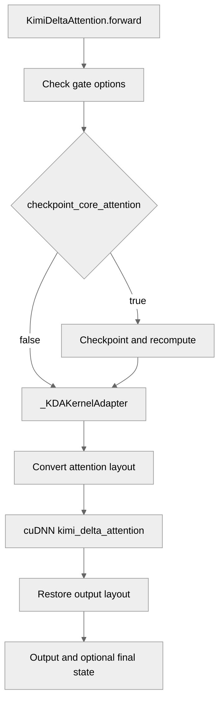

# KDA attention

[Upstream PR](https://github.com/NVIDIA/TransformerEngine/pull/3548) · state: closed · merged: True

## Original PR description

# Description

Adds support for KDA attention via the fused kernel in `cudnn-frontend`.

## Type of change

- [ ] Documentation change (change only to the documentation, either a fix or a new content)
- [ ] Bug fix (non-breaking change which fixes an issue)
- [x] New feature (non-breaking change which adds functionality)
- [ ] Breaking change (fix or feature that would cause existing functionality to not work as expected)
- [ ] Infra/Build change
- [ ] Code refactoring

## Changes

- Adds support for KDA attention via the fused kernel in `cudnn-frontend`.

# Checklist:

- [x] I have read and followed the [contributing guidelines](https://github.com/NVIDIA/TransformerEngine/blob/main/CONTRIBUTING.rst)
- [x] The functionality is complete
- [x] I have commented my code, particularly in hard-to-understand areas
- [x] I have made corresponding changes to the documentation
- [x] My changes generate no new warnings
- [x] I have added tests that prove my fix is effective or that my feature works
- [x] New and existing unit tests pass locally with my changes

## Review and discussion

### reviews

- greptile-apps[bot] · COMMENTED · 2026-09-18T18:16:10Z · [source](https://github.com/NVIDIA/TransformerEngine/pull/3548#pullrequestreview-5251116475)

(No body; status only.)

- KshitijLakhani · COMMENTED · 2026-10-05T23:20:07Z · [source](https://github.com/NVIDIA/TransformerEngine/pull/3548#pullrequestreview-5421843135)

- General comment: I was hoping to see the private base not change i order to accommodate KDA and that seems to be the case, so that's good from our initial design's POV.

- I was looking at the gat tolerances and seems like KDA has a non-trivial higher tolerance than GDN/GDP - I'm wondering if this is okay? or something to double check ?

- Could the fuse beta sigmoid and linear gate domain tests also comapre gate gradients agains the FP64 gradients ? Or is there a reason not to do so ?

- Ideally we should not need TE to check the head dims explicitly and this could be moved over to cuDNN FE right @cyanguwa ? Similar to the check cuDNN FE has for SDPA.
Would be good for all backend checks to be queried and managed by cuDN FE so that we get the updated/latest support for free and don't incorrectly let unsupported configs pass through  

- KshitijLakhani · APPROVED · 2026-10-14T21:43:00Z · [source](https://github.com/NVIDIA/TransformerEngine/pull/3548#pullrequestreview-5525065178)

Looks good to me
Okay to merge once CI passes
Thanks !

### issue_comments

- greptile-apps[bot] · comment · 2026-09-18T18:15:57Z · [source](https://github.com/NVIDIA/TransformerEngine/pull/3548#issuecomment-5734280622)

<!-- greptile_summary -->

<h2><a href="https://app.greptile.com/api/retrigger?id=66161200"><picture><source media="(prefers-color-scheme: dark)" srcset="https://greptile-static-assets.s3.amazonaws.com/badges/RetriggerDark.svg?v=2"><source media="(prefers-color-scheme: light)" srcset="https://greptile-static-assets.s3.amazonaws.com/badges/Retrigger.svg?v=2"></picture></a>Confidence Score: 5/5</h2>

**[Medium impact]** The latest changes appear safe to merge; the two earlier test-coverage suggestions remain non-blocking.

<h2>Findings</h2>

1. &nbsp;**Required Tests Can Skip** <a href="https://github.com/NVIDIA/TransformerEngine/pull/3548#discussion_r4049450826">▶</a>
2. &nbsp;**Validation Paths Lack Coverage** <a href="https://github.com/NVIDIA/TransformerEngine/pull/3548#discussion_r4049450835">▶</a>

<h3>Summary</h3>

Adds `KimiDeltaAttention` through the cuDNN frontend, with public exports, API docs, and a required QA test command.
- PyTorch callers can run Kimi Delta Attention with cuDNN.

<h3>Diagram</h3>

<!-- greptile_confidence_score:5 -->

Reviews (6) · Last reviewed commit: ["Tol check and extra comparisons for gate..."](https://github.com/nvidia/transformerengine/commit/0f533115e37abe84657e4dbe0f815bae4cbf1e1d) · [Reviewed by Greptile](https://www.greptile.com/?utm_source=greptile_expert&utm_medium=github&utm_campaign=code_reviews&utm_content=nvidia/transformerengine)

- ksivaman · comment · 2026-09-21T15:03:20Z · [source](https://github.com/NVIDIA/TransformerEngine/pull/3548#issuecomment-5762669887)

/te-ci pytorch L0

- ksivaman · comment · 2026-09-30T16:57:16Z · [source](https://github.com/NVIDIA/TransformerEngine/pull/3548#issuecomment-5915842904)

/te-ci pytorch L0

- ksivaman · comment · 2026-10-13T18:47:52Z · [source](https://github.com/NVIDIA/TransformerEngine/pull/3548#issuecomment-6152731484)

/te-ci pytorch L0

### inline_comments

- greptile-apps[bot] · comment · 2026-09-18T18:16:04Z · [source](https://github.com/NVIDIA/TransformerEngine/pull/3548#discussion_r4049450826)

File: `tests/pytorch/attention/test_kda_attention.py` · line 55

 **Required Tests Can Skip**

If the L0 suite runs on a non-SM100/SM103/SM107 GPU that has the KDA op and CUTLASS installed, `NVTE_KDA_TEST_REQUIRED=1` does not raise, but the `requires_kda` marker skips every KDA test. The command can therefore succeed without exercising the feature, giving false assurance that KDA was tested. Required mode should also fail when the current architecture cannot run KDA.

- greptile-apps[bot] · comment · 2026-09-18T18:16:04Z · [source](https://github.com/NVIDIA/TransformerEngine/pull/3548#discussion_r4049450835)

File: `transformer_engine/pytorch/attention/linear_attention/kda.py` · line 428

 **Validation Paths Lack Coverage**

The new public validation branches have no negative tests. This leaves contracts such as rejecting `allow_neg_eigval` without fused sigmoid, invalid gate domains, safe-gate-only parameters without `safe_gate`, and `safe_gate` with a linear gate unprotected against regressions. Focused rejection tests would prevent future changes from passing invalid combinations to the kernel.

Note: If this suggestion doesn't match your team's coding style, reply to this and let me know. I'll remember it for next time!

- KshitijLakhani · comment · 2026-10-05T23:18:52Z · [source](https://github.com/NVIDIA/TransformerEngine/pull/3548#discussion_r4189865523)

File: `tests/pytorch/attention/test_kda_attention.py` · line None

I was looking at the gate tolerances and seems like KDA has a non-trivial higher tolerance than GDN/GDP - instead of 4/2 (GDN, GDP) it is 6/3 here.
Were these higher tols set just based on higher measured errors testint ?

## Changed files and fixed code

- `docs/api/pytorch.rst` · modified · additions 3 / deletions 0
  - [head](https://github.com/ksivaman/TransformerEngine-1/blob/0f533115e37abe84657e4dbe0f815bae4cbf1e1d/docs/api/pytorch.rst)
  - [base](https://github.com/NVIDIA/TransformerEngine/blob/0c4d9610ac3b6447e90af212e70b7260ef0c4ad1/docs/api/pytorch.rst)
- `qa/L0_pytorch_unittest/test.sh` · modified · additions 1 / deletions 0
  - [head](https://github.com/ksivaman/TransformerEngine-1/blob/0f533115e37abe84657e4dbe0f815bae4cbf1e1d/qa/L0_pytorch_unittest/test.sh)
  - [base](https://github.com/NVIDIA/TransformerEngine/blob/0c4d9610ac3b6447e90af212e70b7260ef0c4ad1/qa/L0_pytorch_unittest/test.sh)
- `tests/pytorch/attention/test_kda_attention.py` · added · additions 774 / deletions 0
  - [head](https://github.com/ksivaman/TransformerEngine-1/blob/0f533115e37abe84657e4dbe0f815bae4cbf1e1d/tests/pytorch/attention/test_kda_attention.py)
  - [base](https://github.com/NVIDIA/TransformerEngine/blob/0c4d9610ac3b6447e90af212e70b7260ef0c4ad1/tests/pytorch/attention/test_kda_attention.py)
- `transformer_engine/pytorch/__init__.py` · modified · additions 1 / deletions 0
  - [head](https://github.com/ksivaman/TransformerEngine-1/blob/0f533115e37abe84657e4dbe0f815bae4cbf1e1d/transformer_engine/pytorch/__init__.py)
  - [base](https://github.com/NVIDIA/TransformerEngine/blob/0c4d9610ac3b6447e90af212e70b7260ef0c4ad1/transformer_engine/pytorch/__init__.py)
- `transformer_engine/pytorch/attention/__init__.py` · modified · additions 2 / deletions 0
  - [head](https://github.com/ksivaman/TransformerEngine-1/blob/0f533115e37abe84657e4dbe0f815bae4cbf1e1d/transformer_engine/pytorch/attention/__init__.py)
  - [base](https://github.com/NVIDIA/TransformerEngine/blob/0c4d9610ac3b6447e90af212e70b7260ef0c4ad1/transformer_engine/pytorch/attention/__init__.py)
- `transformer_engine/pytorch/attention/linear_attention/__init__.py` · modified · additions 2 / deletions 0
  - [head](https://github.com/ksivaman/TransformerEngine-1/blob/0f533115e37abe84657e4dbe0f815bae4cbf1e1d/transformer_engine/pytorch/attention/linear_attention/__init__.py)
  - [base](https://github.com/NVIDIA/TransformerEngine/blob/0c4d9610ac3b6447e90af212e70b7260ef0c4ad1/transformer_engine/pytorch/attention/linear_attention/__init__.py)
- `transformer_engine/pytorch/attention/linear_attention/kda.py` · added · additions 450 / deletions 0
  - [head](https://github.com/ksivaman/TransformerEngine-1/blob/0f533115e37abe84657e4dbe0f815bae4cbf1e1d/transformer_engine/pytorch/attention/linear_attention/kda.py)
  - [base](https://github.com/NVIDIA/TransformerEngine/blob/0c4d9610ac3b6447e90af212e70b7260ef0c4ad1/transformer_engine/pytorch/attention/linear_attention/kda.py)

## Evidence and interpretation boundary

[Original JSON, discussions and patches](../../../../../../evidence/prs/NVIDIA--TransformerEngine/3548-32672711e91b389d0c385ed9a39f983cdebb8babb04f1753996923f9950ac6a6.json) · SHA-256 `32672711e91b389d0c385ed9a39f983cdebb8babb04f1753996923f9950ac6a6`.

Diff complete: True. Missing/binary/truncated patches require pinned source inspection. This is a source page, not an independently verified optimization case. Open, merged and released are different states; recheck the deployed dependency.
