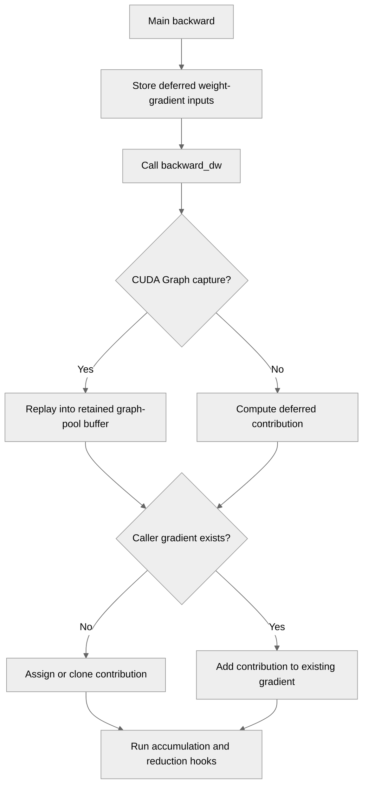

# Accumulate delayed wgrads into shared (tied) parameters

[Upstream PR](https://github.com/NVIDIA/TransformerEngine/pull/3552) · state: open · merged: False

## Original PR description

Fixes #3437.

Delayed `backward_dw()` calls from modules sharing a parameter must add their contributions to the existing gradient. Assignment drops earlier tied-weight and microbatch contributions. Apply the same None-versus-add contract to all four implementations: the base path used by `te.Linear`, `te.LayerNormMLP`, `te.GroupedLinear`, and `te.ops.GroupedLinear`.

LayerNormMLP accumulates both FC weight gradients and nonempty deferred bias gradients. Biases computed in the main backward, including FP8 block-scaling biases, are preserved without recomputing them from saved activations. Grouped paths cover discrete and packed weights, with deferred discrete bias accumulation in the module path. Fused `main_grad` accumulation and reduction hooks retain their existing behavior.

Merge current main (`5e994640`) and resolve the LayerNormMLP bias conflict while preserving the accumulation fix and upstream changes.

The public regression file is now launched by `qa/L0_pytorch_unittest/test.sh`. Its 50 parametrized GPU cases cover tied and non-tied Linear, an independent `nn.Linear` reference, both drain orders, multiple microbatches, two reset/step iterations with both `set_to_none` settings, both LayerNormMLP FCs and biases, FP8 block-scaling bias preservation, and discrete/packed grouped weights. Tests keep their sizes local and spell out execution and drain steps; only the two-Linear factory is shared. Packed and FP8 cases check their existing runtime support predicates.

CUDA Graph follow-up at `dbe1326e7a2ddfca0ee40b19142f84404eaa9399`:

The two deferred-weight-gradient capture paths now clear ordinary-allocator `.grad` targets while capturing, retain the fresh graph-pool contributions, and clone or add those contributions into caller-owned gradients before delayed hooks during replay. `zero_grad(set_to_none=True)` can release the caller's gradients without invalidating a captured accumulation address. Reset releases the retained graph gradients.

`tests/pytorch/test_cuda_graphs.py` adds 26 parametrized cases covering both capture schedules, both gradient reset modes, FP32/BF16, bias, retained gradients, tied weights, multiple microbatches and fused `main_grad`, compared with independent PyTorch references.

Validation for this follow-up:

- Private CPU controls execute the actual four method bodies and production `WeightGradStore` using real CPU Parameters and independent PyTorch autograd results. All 36 accumulation controls passed; the previous review head fails 32 of them in the three remaining implementations. Another nine controls passed for fused-main-grad preservation and hook invocation.
- Private import-free definition collection confirms all 50 parametrizations. This is a test-definition check, not native TE execution.
- The 36 accumulation and nine preservation controls passed again for this follow-up. Eight additional CPU source controls passed for the actual capture/replay/reset helpers with real CPU Parameters; graph capture and replay are modeled, so these do not validate CUDA allocation or native TE kernels.
- Scoped pre-commit checks, Python syntax and diff checks passed. Targeted pylint for `transformer_engine/pytorch/graph.py` passed (10.00/10).
- The reviewer reported 24 failures among the 50 eager cases on SM100. Those failures have not been rerun or diagnosed from per-case logs. Native SM100, CUDA Graph and FP8 validation is deferred until SM100 access is available; no GPU pass is claimed for this follow-up. The earlier eight-case Linear GPU results apply only to the prior revision.

Microbatch accumulation can differ in BF16 rounding order; those cases use a 1e-2 tolerance. Single-microbatch Linear comparisons remain exact.


## Review and discussion

### reviews

- greptile-apps[bot] · COMMENTED · 2026-09-21T04:53:49Z · [source](https://github.com/NVIDIA/TransformerEngine/pull/3552#pullrequestreview-5263151100)

(No body; status only.)

- wujingyue · COMMENTED · 2026-09-21T06:31:22Z · [source](https://github.com/NVIDIA/TransformerEngine/pull/3552#pullrequestreview-5263653314)

(No body; status only.)

- 0z5a · COMMENTED · 2026-09-21T13:23:09Z · [source](https://github.com/NVIDIA/TransformerEngine/pull/3552#pullrequestreview-5267112811)

(No body; status only.)

- 0z5a · COMMENTED · 2026-09-21T13:23:11Z · [source](https://github.com/NVIDIA/TransformerEngine/pull/3552#pullrequestreview-5267113205)

(No body; status only.)

- wujingyue · COMMENTED · 2026-09-21T14:14:28Z · [source](https://github.com/NVIDIA/TransformerEngine/pull/3552#pullrequestreview-5267632406)

Core changes look good! Tests need a lot of cleanup in addition to my comments. 

- 0z5a · COMMENTED · 2026-09-21T14:36:20Z · [source](https://github.com/NVIDIA/TransformerEngine/pull/3552#pullrequestreview-5267917947)

(No body; status only.)

- 0z5a · COMMENTED · 2026-09-21T14:36:22Z · [source](https://github.com/NVIDIA/TransformerEngine/pull/3552#pullrequestreview-5267918315)

(No body; status only.)

- 0z5a · COMMENTED · 2026-09-21T14:36:24Z · [source](https://github.com/NVIDIA/TransformerEngine/pull/3552#pullrequestreview-5267918632)

(No body; status only.)

- 0z5a · COMMENTED · 2026-09-21T14:36:27Z · [source](https://github.com/NVIDIA/TransformerEngine/pull/3552#pullrequestreview-5267919048)

(No body; status only.)

- 0z5a · COMMENTED · 2026-09-21T14:36:29Z · [source](https://github.com/NVIDIA/TransformerEngine/pull/3552#pullrequestreview-5267919552)

(No body; status only.)

- 0z5a · COMMENTED · 2026-09-21T14:36:31Z · [source](https://github.com/NVIDIA/TransformerEngine/pull/3552#pullrequestreview-5267919844)

(No body; status only.)

- wujingyue · CHANGES_REQUESTED · 2026-09-24T06:05:12Z · [source](https://github.com/NVIDIA/TransformerEngine/pull/3552#pullrequestreview-5300379945)

(No body; status only.)

- denera · CHANGES_REQUESTED · 2026-10-02T16:28:55Z · [source](https://github.com/NVIDIA/TransformerEngine/pull/3552#pullrequestreview-5394229885)

Thank you for the PR!

In addition to @wujingyue's review comments, I would request two additional changes, one trivial but the other a critical omission.

1. [TRIVIAL] The new test will not run in our CI. I would recommend moving the cases into `test_numerics.py` OR adding `test_tied_delayed_wgrad.py` into the `qa/L0_pytorch_unittest/test.sh` script (this is what our CI pipeline actually launches).

2. [CRITICAL] Your fix covers only one of the four delayed-wgrad implementations. `te.LayerNormMLP.backward_dw`, `te.GroupedLinear.backward_dw` and `te.ops.GroupedLinear.backward_dw` all remain unchanged and still drop all but the last wgrad contribution. These should be addressed in this PR as well.

- denera · CHANGES_REQUESTED · 2026-10-08T09:56:04Z · [source](https://github.com/NVIDIA/TransformerEngine/pull/3552#pullrequestreview-5454805908)

@0z5a I just manually tested this PR and I'm seeing 24 of the 50 test cases added in this PR failing on SM100. Could you please make sure that all the tests pass locally on your end before we launch the CI pipeline? Thanks!

Additionally, there's a CUDA-graph hazard here whenever `optimizer.zero_grad()` is invoked.
1. `make_graphed_callables()` does a few eager warmup passes before capture. After these warmups, `param.grad` holds a tensor `G` from the normal caching allocator, not the graph's private pool.
2. Graph capture on `backward_dw()` records kernels, not Python assignments. It captures the WGRAD GEMM writing into a fresh buffer `S` from the graph's pool, and the `G.add_(S)` for the accumulation with the raw address for tensor `G` baked in at capture time (NOTE: This only affects `fuse_wgrad_accumulation=False`).
3. `optimizer.zero_grad()` by default sets `param.grad = None`. This drops the last reference to `G` and the normal caching allocator frees the block.
4. Next time the graph runs, the captured raw address for tensor `G` is no longer valid. If the caching allocator has handed that address block to something else, the WGRAD accumulation corrupts it on graph replay.

Fixing this requires setting the `param.grad = None` for the parameters of modules that require `backward_dw()` right before the two `bwd_dw_graph` captures in lines 809 and 1008 for `transformer_engine/pytorch/graph.py`.

I would also recommend adding a test for `backward_dw()` capture under `test_cuda_graphs.py`. Something simple like `te.Linear` with `delay_wgrad_compute=True` graphed and compared against eager would reveal the above graph capture issue in the future.

### issue_comments

- greptile-apps[bot] · comment · 2026-09-21T04:53:45Z · [source](https://github.com/NVIDIA/TransformerEngine/pull/3552#issuecomment-5755578914)

<!-- greptile_summary -->

<h2><a href="https://app.greptile.com/api/retrigger?id=66804102"><picture><source media="(prefers-color-scheme: dark)" srcset="https://greptile-static-assets.s3.amazonaws.com/badges/RetriggerDark.svg?v=2"><source media="(prefers-color-scheme: light)" srcset="https://greptile-static-assets.s3.amazonaws.com/badges/Retrigger.svg?v=2"></picture></a>Confidence Score: 5/5</h2>

**[Medium impact]** The PR appears safe to merge, with no outstanding correctness, security, or repository-rule findings identified.

<h3>Summary</h3>

This PR fixes delayed weight-gradient accumulation for tied parameters and multiple microbatches, applying consistent accumulation behavior across Linear, LayerNormMLP, and grouped-linear implementations.
- Preserves and accumulates deferred weight and bias gradients rather than replacing prior contributions.
- Adds CUDA Graph ownership handling so graph-pool gradients survive caller gradient resets without exposing captured buffers.
- Adds eager and CUDA Graph regression coverage for tied weights, microbatches, reset modes, grouped layouts, FP8 bias behavior, and fused `main_grad`.
- Registers the tied delayed-gradient regression suite in the L0 PyTorch test runner.

<h3>Diagram</h3>



<!-- greptile_confidence_score:5 -->

<sub>Reviews (9) · Last reviewed commit: ["Own delayed gradients during CUDA Graph ..."](https://github.com/nvidia/transformerengine/commit/dbe1326e7a2ddfca0ee40b19142f84404eaa9399) · [Reviewed by Greptile](https://www.greptile.com/?utm_source=greptile_expert&utm_medium=github&utm_campaign=code_reviews&utm_content=nvidia/transformerengine)</sub>

- greptile-apps[bot] · comment · 2026-09-24T01:13:35Z · [source](https://github.com/NVIDIA/TransformerEngine/pull/3552#issuecomment-5805676413)

Want your agent to iterate on Greptile's feedback? Try [*greploops*](https://github.com/greptileai/skills/blob/main/greploop/SKILL.md).

### inline_comments

- greptile-apps[bot] · comment · 2026-09-21T04:53:48Z · [source](https://github.com/NVIDIA/TransformerEngine/pull/3552#discussion_r4059347600)

File: `tests/pytorch/test_tied_delayed_wgrad.py` · line None

<a href="#"></a> **Step Isolation Is Unverified**

This test claims to verify that the second optimizer step does not inherit the first step's gradient, but it only checks that the second gradient is nonzero and differs from the first. Because each step uses a different random input, a stale-plus-fresh gradient would satisfy both assertions. Compare the second gradient with a fresh model or regular-path result using the same second input so this test catches cross-step contamination.

- wujingyue · comment · 2026-09-21T06:31:19Z · [source](https://github.com/NVIDIA/TransformerEngine/pull/3552#discussion_r4059752211)

File: `transformer_engine/pytorch/module/base.py` · line 2010

Is it safe? There's also `zero_grad(set_to_none=False)`

- 0z5a · comment · 2026-09-21T13:23:09Z · [source](https://github.com/NVIDIA/TransformerEngine/pull/3552#discussion_r4062518025)

File: `transformer_engine/pytorch/module/base.py` · line 2010

Yes. `set_to_none=False` leaves a zeroed tensor where `set_to_none=True` leaves `None`, so the first contribution of the step takes the add path and lands on the same value; nothing in the branch needs `grad` to be `None` to start a step. Said so in the comment (7ed69a4).

It also turned out not to be pinned: the test ran both settings but only asserted `second != first`, which cannot show pollution, because a first-step value carried into the second still differs from the first. It now compares the second step's grad against a fresh model on the same weights and input, bit-exactly.

- 0z5a · comment · 2026-09-21T13:23:11Z · [source](https://github.com/NVIDIA/TransformerEngine/pull/3552#discussion_r4062518310)

File: `tests/pytorch/test_tied_delayed_wgrad.py` · line None

Addressed by the same commit: the second step's grad is now compared against a fresh model on the same weights and input rather than only against the first step, for both `set_to_none` settings.

- wujingyue · comment · 2026-09-21T14:11:48Z · [source](https://github.com/NVIDIA/TransformerEngine/pull/3552#discussion_r4062938329)

File: `tests/pytorch/test_tied_delayed_wgrad.py` · line None

Should go with the test rather than global. 

- wujingyue · comment · 2026-09-21T14:11:53Z · [source](https://github.com/NVIDIA/TransformerEngine/pull/3552#discussion_r4062939248)

File: `tests/pytorch/test_tied_delayed_wgrad.py` · line None

ditto

- wujingyue · comment · 2026-09-21T14:12:32Z · [source](https://github.com/NVIDIA/TransformerEngine/pull/3552#discussion_r4062945335)

File: `tests/pytorch/test_tied_delayed_wgrad.py` · line None

```suggestion
def _tie(model, *, bias):
```
otherwise it's hard to understand what `_tie(model, True)` means

- wujingyue · comment · 2026-09-21T14:12:38Z · [source](https://github.com/NVIDIA/TransformerEngine/pull/3552#discussion_r4062946204)

File: `tests/pytorch/test_tied_delayed_wgrad.py` · line None

ditto

- wujingyue · comment · 2026-09-21T14:13:13Z · [source](https://github.com/NVIDIA/TransformerEngine/pull/3552#discussion_r4062951571)

File: `tests/pytorch/test_tied_delayed_wgrad.py` · line None

This should be separated out of `_build` so SRP

- wujingyue · comment · 2026-09-21T14:13:30Z · [source](https://github.com/NVIDIA/TransformerEngine/pull/3552#discussion_r4062953863)

File: `tests/pytorch/test_tied_delayed_wgrad.py` · line None

What's `order`? 

- 0z5a · comment · 2026-09-21T14:36:20Z · [source](https://github.com/NVIDIA/TransformerEngine/pull/3552#discussion_r4063166807)

File: `tests/pytorch/test_tied_delayed_wgrad.py` · line None

Moved (0f419b2): the global is gone. `_build` and `_x` take `device="cuda"` as a default, the micro-batch test uses `_x(4)`, and the oracle takes the device from `model[0].weight.device`.

- 0z5a · comment · 2026-09-21T14:36:22Z · [source](https://github.com/NVIDIA/TransformerEngine/pull/3552#discussion_r4063167108)

File: `tests/pytorch/test_tied_delayed_wgrad.py` · line None

Moved into `test_multiple_microbatches_accumulate`, the only test that needs it.

- 0z5a · comment · 2026-09-21T14:36:24Z · [source](https://github.com/NVIDIA/TransformerEngine/pull/3552#discussion_r4063167343)

File: `tests/pytorch/test_tied_delayed_wgrad.py` · line None

Done: `_tie(model, *, bias)`.

- 0z5a · comment · 2026-09-21T14:36:27Z · [source](https://github.com/NVIDIA/TransformerEngine/pull/3552#discussion_r4063167691)

File: `tests/pytorch/test_tied_delayed_wgrad.py` · line None

Done: `_build(delay, *, bias=False)`.

- 0z5a · comment · 2026-09-21T14:36:29Z · [source](https://github.com/NVIDIA/TransformerEngine/pull/3552#discussion_r4063168121)

File: `tests/pytorch/test_tied_delayed_wgrad.py` · line None

Done: `_build` now only builds. Tying happens at the call sites, where each test says whether it wants a tied pair or two independent ones.

- 0z5a · comment · 2026-09-21T14:36:31Z · [source](https://github.com/NVIDIA/TransformerEngine/pull/3552#discussion_r4063168356)

File: `tests/pytorch/test_tied_delayed_wgrad.py` · line None

Renamed to `backward_dw_order` and documented: it is the module order used to drain the delayed wgrad queues, which decides which tied module pops its delayed wgrad first.

- wujingyue · comment · 2026-09-24T05:58:22Z · [source](https://github.com/NVIDIA/TransformerEngine/pull/3552#discussion_r4090408764)

File: `tests/pytorch/test_tied_delayed_wgrad.py` · line None

```suggestion
def _build(*, delay, bias, device="cuda"):
```

- wujingyue · comment · 2026-09-24T06:00:36Z · [source](https://github.com/NVIDIA/TransformerEngine/pull/3552#discussion_r4090421474)

File: `tests/pytorch/test_tied_delayed_wgrad.py` · line None

```suggestion
def _build_two_linears(delay, *, bias=False, device="cuda"):
```

- wujingyue · comment · 2026-09-24T06:01:00Z · [source](https://github.com/NVIDIA/TransformerEngine/pull/3552#discussion_r4090423911)

File: `tests/pytorch/test_tied_delayed_wgrad.py` · line None

https://testing.googleblog.com/2019/12/testing-on-toilet-tests-too-dry-make.html

- wujingyue · comment · 2026-09-24T06:03:24Z · [source](https://github.com/NVIDIA/TransformerEngine/pull/3552#discussion_r4090437712)

File: `tests/pytorch/test_tied_delayed_wgrad.py` · line None

xb? 

https://google.github.io/styleguide/pyguide.html#316-naming

- wujingyue · comment · 2026-09-24T06:04:12Z · [source](https://github.com/NVIDIA/TransformerEngine/pull/3552#discussion_r4090441884)

File: `tests/pytorch/test_tied_delayed_wgrad.py` · line None

https://testing.googleblog.com/2019/12/testing-on-toilet-tests-too-dry-make.html

- wujingyue · comment · 2026-09-24T06:04:25Z · [source](https://github.com/NVIDIA/TransformerEngine/pull/3552#discussion_r4090443116)

File: `tests/pytorch/test_tied_delayed_wgrad.py` · line None

https://testing.googleblog.com/2019/12/testing-on-toilet-tests-too-dry-make.html

- wujingyue · comment · 2026-09-24T06:04:39Z · [source](https://github.com/NVIDIA/TransformerEngine/pull/3552#discussion_r4090444470)

File: `tests/pytorch/test_tied_delayed_wgrad.py` · line None

zip

## Changed files and fixed code

- `qa/L0_pytorch_unittest/test.sh` · modified · additions 1 / deletions 0
  - [head](https://github.com/0z5a/TransformerEngine/blob/dbe1326e7a2ddfca0ee40b19142f84404eaa9399/qa/L0_pytorch_unittest/test.sh)
  - [base](https://github.com/NVIDIA/TransformerEngine/blob/5e994640625626263aa62250c709e35601563566/qa/L0_pytorch_unittest/test.sh)
- `tests/pytorch/test_cuda_graphs.py` · modified · additions 174 / deletions 0
  - [head](https://github.com/0z5a/TransformerEngine/blob/dbe1326e7a2ddfca0ee40b19142f84404eaa9399/tests/pytorch/test_cuda_graphs.py)
  - [base](https://github.com/NVIDIA/TransformerEngine/blob/5e994640625626263aa62250c709e35601563566/tests/pytorch/test_cuda_graphs.py)
- `tests/pytorch/test_tied_delayed_wgrad.py` · added · additions 334 / deletions 0
  - [head](https://github.com/0z5a/TransformerEngine/blob/dbe1326e7a2ddfca0ee40b19142f84404eaa9399/tests/pytorch/test_tied_delayed_wgrad.py)
  - [base](https://github.com/NVIDIA/TransformerEngine/blob/5e994640625626263aa62250c709e35601563566/tests/pytorch/test_tied_delayed_wgrad.py)
- `transformer_engine/pytorch/graph.py` · modified · additions 34 / deletions 12
  - [head](https://github.com/0z5a/TransformerEngine/blob/dbe1326e7a2ddfca0ee40b19142f84404eaa9399/transformer_engine/pytorch/graph.py)
  - [base](https://github.com/NVIDIA/TransformerEngine/blob/5e994640625626263aa62250c709e35601563566/transformer_engine/pytorch/graph.py)
- `transformer_engine/pytorch/module/base.py` · modified · additions 10 / deletions 2
  - [head](https://github.com/0z5a/TransformerEngine/blob/dbe1326e7a2ddfca0ee40b19142f84404eaa9399/transformer_engine/pytorch/module/base.py)
  - [base](https://github.com/NVIDIA/TransformerEngine/blob/5e994640625626263aa62250c709e35601563566/transformer_engine/pytorch/module/base.py)
- `transformer_engine/pytorch/module/grouped_linear.py` · modified · additions 16 / deletions 4
  - [head](https://github.com/0z5a/TransformerEngine/blob/dbe1326e7a2ddfca0ee40b19142f84404eaa9399/transformer_engine/pytorch/module/grouped_linear.py)
  - [base](https://github.com/NVIDIA/TransformerEngine/blob/5e994640625626263aa62250c709e35601563566/transformer_engine/pytorch/module/grouped_linear.py)
- `transformer_engine/pytorch/module/layernorm_mlp.py` · modified · additions 20 / deletions 25
  - [head](https://github.com/0z5a/TransformerEngine/blob/dbe1326e7a2ddfca0ee40b19142f84404eaa9399/transformer_engine/pytorch/module/layernorm_mlp.py)
  - [base](https://github.com/NVIDIA/TransformerEngine/blob/5e994640625626263aa62250c709e35601563566/transformer_engine/pytorch/module/layernorm_mlp.py)
- `transformer_engine/pytorch/ops/basic/grouped_linear.py` · modified · additions 11 / deletions 3
  - [head](https://github.com/0z5a/TransformerEngine/blob/dbe1326e7a2ddfca0ee40b19142f84404eaa9399/transformer_engine/pytorch/ops/basic/grouped_linear.py)
  - [base](https://github.com/NVIDIA/TransformerEngine/blob/5e994640625626263aa62250c709e35601563566/transformer_engine/pytorch/ops/basic/grouped_linear.py)

## Evidence and interpretation boundary

[Original JSON, discussions and patches](../../../../../../evidence/prs/NVIDIA--TransformerEngine/3552-0c9fa7e8afa28f58748ba822f829bc69e3684bef83d600dca7977c32293b0a19.json) · SHA-256 `0c9fa7e8afa28f58748ba822f829bc69e3684bef83d600dca7977c32293b0a19`.

Diff complete: True. Missing/binary/truncated patches require pinned source inspection. This is a source page, not an independently verified optimization case. Open, merged and released are different states; recheck the deployed dependency.
