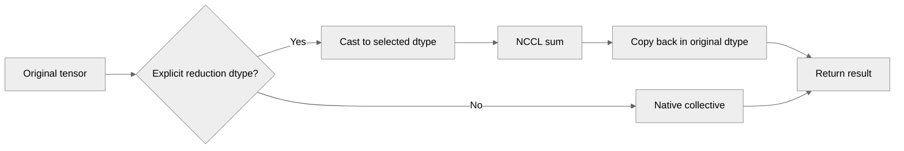

# Extend tensor-parallel reduction dtype across modules and ops

[Upstream PR](https://github.com/NVIDIA/TransformerEngine/pull/3555) · state: open · merged: False

## Original PR description

Expose `reduction_dtype` consistently for NCCL tensor-parallel sums: native (`None`), FP16, BF16, FP32 or FP64, retaining the original result dtype. Cover Linear and LayerNormMLP forward, ops.Linear, and sequence-parallel reduce-scatter. LayerNormLinear rejects row parallelism in this version, so its option controls the column-parallel input-gradient reduction before normalization backward.

Preserve the option through compile eager fallback, validate singleton groups, and copy asynchronous results back on `wait()`. Reject module Userbuffers/symmetric reductions that cannot honor the setting; ops Userbuffers forward fusion leaves explicit dtype selection on the standard collective path.

Validation on 2 × H20, Torch 2.7.0+cu128, CUDA 12.8, cuDNN 9.7.1 and NCCL 2.26.2:

- 256 two-rank tests passed per rank, including all supported dtypes, async identity/wait, sequence parallelism, independent FP64 numerical references, fallback and fusion. Three new-feature cases fail on the reviewed head as expected.
- Original affected sanity matrix: 7,668 passed, 8,964 skipped and 4,403 deselected. L0 license and pre-commit passed. Python lint reports the same existing E1135 on `pools` in both sources, with no new diagnostics.
- All 32 fresh APPA/PAAP process pairs exited normally. Forward/backward graph default-control ratios are 0.9719–1.0223×; BF16/FP32 communication ratios are 0.6429–1.0079×.
- Full Qwen3-0.6B checkpoint inference covers all 28 layers, module/ops projections, SP on/off, 128/512 input tokens and 32 greedy output tokens. Every arm matches the independent native-dtype TE reference's prefill logits and tokens exactly; each case records 8,960 real reductions per rank. Test checkpoint files were cleaned after completion.

Complete-generation timings below use four fresh process-pair medians per role, aggregated geometrically. Ratios below 1 indicate a slowdown; two independent quartets support descriptive comparisons only.

| Projection | SP | Input tokens | Reviewed default (ms) | Updated default (ms) | Default speedup | BF16/FP32 speedup |
|---|---:|---:|---:|---:|---:|---:|
| Linear | 0 | 128 | 836.397 | 853.224 | 0.9803× | 0.9968× |
| Linear | 0 | 512 | 842.047 | 871.269 | 0.9665× | 0.9822× |
| Linear | 1 | 128 | 1205.393 | 1196.570 | 1.0074× | 0.9574× |
| Linear | 1 | 512 | 1171.371 | 1176.668 | 0.9955× | 0.9203× |
| ops.Linear | 0 | 128 | 932.642 | 961.323 | 0.9702× | 0.9878× |
| ops.Linear | 0 | 512 | 951.119 | 960.137 | 0.9906× | 0.9387× |
| ops.Linear | 1 | 128 | 1246.733 | 1251.004 | 0.9966× | 0.9626× |
| ops.Linear | 1 | 512 | 1245.460 | 1247.512 | 0.9984× | 0.9541× |

[Complete Markdown tables, raw samples, provenance and reproduction commands](https://github.com/0z5a/TransformerEngine/blob/opt-in-fp32-tp-reduction/tests/pytorch/distributed/validation_reduction/TEST_RESULT_H20_REDUCTION.md).

These measurements establish dtype-selection correctness and its cost. They do not establish a general speedup or an output-accuracy improvement from two BF16 addends cast back to BF16.


## Review and discussion

### reviews

- greptile-apps[bot] · COMMENTED · 2026-09-21T05:05:31Z · [source](https://github.com/NVIDIA/TransformerEngine/pull/3555#pullrequestreview-5263203165)

(No body; status only.)

- ptrendx · CHANGES_REQUESTED · 2026-09-29T23:15:34Z · [source](https://github.com/NVIDIA/TransformerEngine/pull/3555#pullrequestreview-5359656500)

My issue with this PR is that it introduces a new option in a very "spikey" way. For example:
 - only Linear is covered, whereas LayerNormLinear and LayerNormMLP are not, even though they could also exercise this allreduce path.
 - only module is covered and not ops linear variant
 - the only accepted value for the reduction dtype is FP32. Why not accept any type there, including BF16? That way somebody experimenting with this setting would not need to completely change their model just to switch it on or off.
 - why not add the reduce scatter option to it in addition to allreduce - this would enable the sequence parallel support.

- greptile-apps[bot] · COMMENTED · 2026-10-20T14:53:09Z · [source](https://github.com/NVIDIA/TransformerEngine/pull/3555#pullrequestreview-5586858431)

(No body; status only.)

### issue_comments

- greptile-apps[bot] · comment · 2026-09-21T05:05:21Z · [source](https://github.com/NVIDIA/TransformerEngine/pull/3555#issuecomment-5755654581)

<!-- greptile_summary -->

<h2><a href="https://app.greptile.com/api/retrigger?id=66806512"><picture><source media="(prefers-color-scheme: dark)" srcset="https://greptile-static-assets.s3.amazonaws.com/badges/RetriggerDark.svg?v=2"><source media="(prefers-color-scheme: light)" srcset="https://greptile-static-assets.s3.amazonaws.com/badges/Retrigger.svg?v=2"></picture></a><a href="https://app.greptile.com/-/switch-tenant?tenant=nvidia-public-github&amp;next=%2FNVIDIA%2Ftransformerengine%2Fpull%2F3555&amp;utm_source=greptile_review&amp;utm_medium=github&amp;utm_campaign=view_in_greptile"><picture><source media="(prefers-color-scheme: dark)" srcset="https://greptile-static-assets.s3.amazonaws.com/badges/ViewInGreptileDark.svg?v=2"><source media="(prefers-color-scheme: light)" srcset="https://greptile-static-assets.s3.amazonaws.com/badges/ViewInGreptile.svg?v=2"></picture></a>Confidence Score: 5/5</h2>

**[Medium impact]** The latest change appears safe to merge and fixes the worker-crash reporting issue.

<h3>Summary</h3>

Extends `reduction_dtype` across tensor-parallel modules and ops while keeping the original result dtype.
- Tensor-parallel sums can use a chosen communication dtype and keep their original output dtype.
- PyTorch modules can choose the dtype used for tensor-parallel sums.
- `ops.Linear` can choose the dtype used for row-parallel reductions.

<h3>Diagram</h3>



<!-- greptile_confidence_score:5 -->

<sub>Reviews (5) · Last reviewed commit: ["Fail the validation launcher when a rank..."](https://github.com/nvidia/transformerengine/commit/3aece45428c943dc5f51422bb65f67e08b339b9e) · [Reviewed by Greptile](https://www.greptile.com/?utm_source=greptile_review&utm_medium=github&utm_campaign=review_public&utm_content=nvidia/transformerengine)</sub>

- 0z5a · comment · 2026-09-30T00:11:43Z · [source](https://github.com/NVIDIA/TransformerEngine/pull/3555#issuecomment-5901473838)

> My issue with this PR is that it introduces a new option in a very "spikey" way. For example:
>  - only Linear is covered, whereas LayerNormLinear and LayerNormMLP are not, even though they could also exercise this allreduce path.
>  - only module is covered and not ops linear variant
>  - the only accepted value for the reduction dtype is FP32. Why not accept any type there, including BF16? That way somebody experimenting with this setting would not need to completely change their model just to switch it on or off.
>  - why not add the reduce scatter option to it in addition to allreduce - this would enable the sequence parallel support.

Okay, I will have a try to expand the coverage.

- 0z5a · comment · 2026-10-07T14:26:49Z · [source](https://github.com/NVIDIA/TransformerEngine/pull/3555#issuecomment-6040080119)

The expansion is implemented in c0fda11; the current head, 6a820a9, adds the validation report and raw results.

- `Linear`, `LayerNormLinear`, `LayerNormMLP`, and `ops.Linear` accept `reduction_dtype` with native/default, FP16, BF16, FP32, and FP64 communication.
- Both all-reduce and sequence-parallel reduce-scatter are covered, with results cast back to the tensor's original dtype.
- `LayerNormLinear` applies the option to its column-parallel input-gradient reduction; this version does not support row-parallel `LayerNormLinear`.

The recorded two-H20 validation passed 256 cases per rank, including dtype combinations, sequence parallelism, async cast-back, fallback, and fusion handling. Full-checkpoint Qwen3-0.6B inference also matched the native-dtype reference for logits and generated tokens. Details, limitations, and raw results are in the [validation report](https://github.com/0z5a/TransformerEngine/blob/6a820a9f402ddf99368d829f61e3a9abe901b798/tests/pytorch/distributed/validation_reduction/TEST_RESULT_H20_REDUCTION.md).


### inline_comments

- greptile-apps[bot] · comment · 2026-09-21T05:05:28Z · [source](https://github.com/NVIDIA/TransformerEngine/pull/3555#discussion_r4059390392)

File: `transformer_engine/pytorch/module/linear.py` · line None

<a href="#"></a> **Fallback Drops Reduction Dtype**

Under `torch.compile`, configurations that trigger the early eager fallback return before this validation. `_forward_eager_fallback` then calls `Linear.forward` without `reduction_dtype`. A row-parallel BF16 layer using an option such as `fuse_wgrad_accumulation=True` therefore performs the original BF16 reduction despite requesting `torch.float32`. Unsupported dtype values are also swallowed instead of rejected. Validate the option before the early return and preserve it through the fallback.

- greptile-apps[bot] · comment · 2026-09-21T05:05:28Z · [source](https://github.com/NVIDIA/TransformerEngine/pull/3555#discussion_r4059390396)

File: `transformer_engine/pytorch/module/linear.py` · line None

<a href="#"></a> **Symmetric Reduction Ignores Dtype**

A row-parallel layer with TP greater than one, sequence parallelism disabled, and `symmetric_ar_type` enabled passes this validation with `reduction_dtype=torch.float32`. `_linear_forward_impl` then selects `symmetric_all_reduce`, which has no reduction-dtype argument and uses storage based on the input dtype. BF16 inputs are consequently still reduced in BF16 while the requested precision is silently ignored. Reject this combination unless symmetric all-reduce gains widening support.

- greptile-apps[bot] · comment · 2026-09-21T05:05:28Z · [source](https://github.com/NVIDIA/TransformerEngine/pull/3555#discussion_r4059390402)

File: `transformer_engine/pytorch/distributed.py` · line None

<a href="#"></a> **Single Rank Skips Validation**

`allreduce` returns at world size one before validating the new option. Direct callers can therefore pass an unsupported dtype, or combine `reduction_dtype` with `async_op=True`, successfully during single-rank development and only encounter the documented error after moving to multiple ranks. Validate the arguments before the single-rank bypass so API validity does not depend on the runtime world size.

- greptile-apps[bot] · comment · 2026-09-21T05:05:28Z · [source](https://github.com/NVIDIA/TransformerEngine/pull/3555#discussion_r4059390406)

File: `transformer_engine/pytorch/distributed.py` · line None

<a href="#"></a> **Reduction Path Lacks Coverage**

No test sets `reduction_dtype`, so neither the claimed FP32 accumulation improvement nor the cast-back identity and dtype contract is exercised. Add a multi-rank row-parallel test with precision-sensitive BF16 partials, along with refusal cases for unsupported communication modes. Without this coverage, the feature could regress to native-dtype reduction without existing tests detecting it.

Note: If this suggestion doesn't match your team's coding style, reply to this and let me know. I'll remember it for next time!

- greptile-apps[bot] · comment · 2026-10-20T14:53:07Z · [source](https://github.com/NVIDIA/TransformerEngine/pull/3555#discussion_r4326430504)

File: `tests/pytorch/distributed/validation_reduction/launch.py` · line None

<a href="#"></a> **Worker crashes look successful**

`launch.py` can report success after a worker crashes. When a signal kills a worker, `proc.wait()` returns a negative exit code. If the other worker exits normally, `max(0, -6)` returns zero, so the validation command appears to pass. Return a nonzero status whenever either worker's exit code is nonzero.

```suggestion
raise SystemExit(int(any(row["exit_code"] != 0 for row in rows)))
```

## Changed files and fixed code

- `docs/api/pytorch.rst` · modified · additions 37 / deletions 0
  - [head](https://github.com/0z5a/TransformerEngine/blob/3aece45428c943dc5f51422bb65f67e08b339b9e/docs/api/pytorch.rst)
  - [base](https://github.com/NVIDIA/TransformerEngine/blob/21a066d257afeaf8039325f58df9a62587517976/docs/api/pytorch.rst)
- `tests/pytorch/distributed/test_reduction_dtype.py` · added · additions 298 / deletions 0
  - [head](https://github.com/0z5a/TransformerEngine/blob/3aece45428c943dc5f51422bb65f67e08b339b9e/tests/pytorch/distributed/test_reduction_dtype.py)
  - [base](https://github.com/NVIDIA/TransformerEngine/blob/21a066d257afeaf8039325f58df9a62587517976/tests/pytorch/distributed/test_reduction_dtype.py)
- `tests/pytorch/distributed/validation_reduction/TEST_RESULT_H20_REDUCTION.md` · added · additions 172 / deletions 0
  - [head](https://github.com/0z5a/TransformerEngine/blob/3aece45428c943dc5f51422bb65f67e08b339b9e/tests/pytorch/distributed/validation_reduction/TEST_RESULT_H20_REDUCTION.md)
  - [base](https://github.com/NVIDIA/TransformerEngine/blob/21a066d257afeaf8039325f58df9a62587517976/tests/pytorch/distributed/validation_reduction/TEST_RESULT_H20_REDUCTION.md)
- `tests/pytorch/distributed/validation_reduction/benchmark.py` · added · additions 140 / deletions 0
  - [head](https://github.com/0z5a/TransformerEngine/blob/3aece45428c943dc5f51422bb65f67e08b339b9e/tests/pytorch/distributed/validation_reduction/benchmark.py)
  - [base](https://github.com/NVIDIA/TransformerEngine/blob/21a066d257afeaf8039325f58df9a62587517976/tests/pytorch/distributed/validation_reduction/benchmark.py)
- `tests/pytorch/distributed/validation_reduction/launch.py` · added · additions 62 / deletions 0
  - [head](https://github.com/0z5a/TransformerEngine/blob/3aece45428c943dc5f51422bb65f67e08b339b9e/tests/pytorch/distributed/validation_reduction/launch.py)
  - [base](https://github.com/NVIDIA/TransformerEngine/blob/21a066d257afeaf8039325f58df9a62587517976/tests/pytorch/distributed/validation_reduction/launch.py)
- `tests/pytorch/distributed/validation_reduction/model_e2e.py` · added · additions 285 / deletions 0
  - [head](https://github.com/0z5a/TransformerEngine/blob/3aece45428c943dc5f51422bb65f67e08b339b9e/tests/pytorch/distributed/validation_reduction/model_e2e.py)
  - [base](https://github.com/NVIDIA/TransformerEngine/blob/21a066d257afeaf8039325f58df9a62587517976/tests/pytorch/distributed/validation_reduction/model_e2e.py)
- `tests/pytorch/distributed/validation_reduction/results/h20_reduction_graph.json` · added · additions 36 / deletions 0
  - [head](https://github.com/0z5a/TransformerEngine/blob/3aece45428c943dc5f51422bb65f67e08b339b9e/tests/pytorch/distributed/validation_reduction/results/h20_reduction_graph.json)
  - [base](https://github.com/NVIDIA/TransformerEngine/blob/21a066d257afeaf8039325f58df9a62587517976/tests/pytorch/distributed/validation_reduction/results/h20_reduction_graph.json)
- `tests/pytorch/distributed/validation_reduction/results/h20_reduction_measurements.json` · added · additions 2436 / deletions 0
  - [head](https://github.com/0z5a/TransformerEngine/blob/3aece45428c943dc5f51422bb65f67e08b339b9e/tests/pytorch/distributed/validation_reduction/results/h20_reduction_measurements.json)
  - [base](https://github.com/NVIDIA/TransformerEngine/blob/21a066d257afeaf8039325f58df9a62587517976/tests/pytorch/distributed/validation_reduction/results/h20_reduction_measurements.json)
- `tests/pytorch/distributed/validation_reduction/results/h20_reduction_model.json` · added · additions 36 / deletions 0
  - [head](https://github.com/0z5a/TransformerEngine/blob/3aece45428c943dc5f51422bb65f67e08b339b9e/tests/pytorch/distributed/validation_reduction/results/h20_reduction_model.json)
  - [base](https://github.com/NVIDIA/TransformerEngine/blob/21a066d257afeaf8039325f58df9a62587517976/tests/pytorch/distributed/validation_reduction/results/h20_reduction_model.json)
- `transformer_engine/pytorch/distributed.py` · modified · additions 66 / deletions 8
  - [head](https://github.com/0z5a/TransformerEngine/blob/3aece45428c943dc5f51422bb65f67e08b339b9e/transformer_engine/pytorch/distributed.py)
  - [base](https://github.com/NVIDIA/TransformerEngine/blob/21a066d257afeaf8039325f58df9a62587517976/transformer_engine/pytorch/distributed.py)
- `transformer_engine/pytorch/module/layernorm_linear.py` · modified · additions 30 / deletions 3
  - [head](https://github.com/0z5a/TransformerEngine/blob/3aece45428c943dc5f51422bb65f67e08b339b9e/transformer_engine/pytorch/module/layernorm_linear.py)
  - [base](https://github.com/NVIDIA/TransformerEngine/blob/21a066d257afeaf8039325f58df9a62587517976/transformer_engine/pytorch/module/layernorm_linear.py)
- `transformer_engine/pytorch/module/layernorm_mlp.py` · modified · additions 19 / deletions 2
  - [head](https://github.com/0z5a/TransformerEngine/blob/3aece45428c943dc5f51422bb65f67e08b339b9e/transformer_engine/pytorch/module/layernorm_mlp.py)
  - [base](https://github.com/NVIDIA/TransformerEngine/blob/21a066d257afeaf8039325f58df9a62587517976/transformer_engine/pytorch/module/layernorm_mlp.py)
- `transformer_engine/pytorch/module/linear.py` · modified · additions 27 / deletions 3
  - [head](https://github.com/0z5a/TransformerEngine/blob/3aece45428c943dc5f51422bb65f67e08b339b9e/transformer_engine/pytorch/module/linear.py)
  - [base](https://github.com/NVIDIA/TransformerEngine/blob/21a066d257afeaf8039325f58df9a62587517976/transformer_engine/pytorch/module/linear.py)
- `transformer_engine/pytorch/ops/basic/all_reduce.py` · modified · additions 8 / deletions 1
  - [head](https://github.com/0z5a/TransformerEngine/blob/3aece45428c943dc5f51422bb65f67e08b339b9e/transformer_engine/pytorch/ops/basic/all_reduce.py)
  - [base](https://github.com/NVIDIA/TransformerEngine/blob/21a066d257afeaf8039325f58df9a62587517976/transformer_engine/pytorch/ops/basic/all_reduce.py)
- `transformer_engine/pytorch/ops/basic/reduce_scatter.py` · modified · additions 14 / deletions 2
  - [head](https://github.com/0z5a/TransformerEngine/blob/3aece45428c943dc5f51422bb65f67e08b339b9e/transformer_engine/pytorch/ops/basic/reduce_scatter.py)
  - [base](https://github.com/NVIDIA/TransformerEngine/blob/21a066d257afeaf8039325f58df9a62587517976/transformer_engine/pytorch/ops/basic/reduce_scatter.py)
- `transformer_engine/pytorch/ops/fused/userbuffers_forward_linear.py` · modified · additions 2 / deletions 0
  - [head](https://github.com/0z5a/TransformerEngine/blob/3aece45428c943dc5f51422bb65f67e08b339b9e/transformer_engine/pytorch/ops/fused/userbuffers_forward_linear.py)
  - [base](https://github.com/NVIDIA/TransformerEngine/blob/21a066d257afeaf8039325f58df9a62587517976/transformer_engine/pytorch/ops/fused/userbuffers_forward_linear.py)
- `transformer_engine/pytorch/ops/linear.py` · modified · additions 17 / deletions 3
  - [head](https://github.com/0z5a/TransformerEngine/blob/3aece45428c943dc5f51422bb65f67e08b339b9e/transformer_engine/pytorch/ops/linear.py)
  - [base](https://github.com/NVIDIA/TransformerEngine/blob/21a066d257afeaf8039325f58df9a62587517976/transformer_engine/pytorch/ops/linear.py)

## Evidence and interpretation boundary

[Original JSON, discussions and patches](../../../../../../evidence/prs/NVIDIA--TransformerEngine/3555-ac2720a84d576a4bb07289768416dd877cb23b98b49cb32fcdf5a2731c7bb760.json) · SHA-256 `ac2720a84d576a4bb07289768416dd877cb23b98b49cb32fcdf5a2731c7bb760`.

Diff complete: False. Missing/binary/truncated patches require pinned source inspection. This is a source page, not an independently verified optimization case. Open, merged and released are different states; recheck the deployed dependency.
