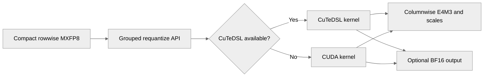

# [Common] Optimize grouped MXFP8 requantization

[Upstream PR](https://github.com/NVIDIA/TransformerEngine/pull/3560) · state: open · merged: False

## Original PR description

  # Description

Add a fused grouped MXFP8 requantization path for Blackwell GPUs. The new   operation converts compact rowwise MXFP8 input into columnwise E4M3 MXFP8 without materializing an intermediate high-precision tensor in global memory.

This reduces memory traffic compared with separate grouped dequantization and quantization calls. The kernel uses a tiled TMA pipeline and packed data movement/conversion operations, and supports both compact and GEMM-swizzled output scaling factors. The quantization configuration selects either an FP32 intermediate or a faster BF16 intermediate.

  ## Type of change

  - [ ] Documentation change (change only to the documentation, either a fix or a new content)
  - [ ] Bug fix (non-breaking change which fixes an issue)
  - [x] New feature (non-breaking change which adds functionality)
  - [ ] Breaking change (fix or feature that would cause existing functionality to not work as expected)
  - [ ] Infra/Build change
  - [ ] Code refactoring

  ## Changes

  Please list the changes introduced in this PR:

  - Add the `nvte_group_requantize_mxfp8` C API for fused grouped rowwise-to-columnwise MXFP8 requantization.
  - Add an SM100+ TMA-based kernel supporting grouped tensors, FP8 input types, E4M3 output, and compact or GEMM-swizzled output scales.
  - Add optimized BF16 fast-math and FP32 intermediate-precision paths.
  - Optimize packed data access and conversion in the requantization kernel.
  - Add parameterized C++ correctness tests comparing the fused operation against separate dequantization and quantization.

  # Checklist:

  - [ ] I have read and followed the [contributing guidelines](https://github.com/NVIDIA/TransformerEngine/blob/main/CONTRIBUTING.rst)
  - [ ] The functionality is complete
  - [x] I have commented my code, particularly in hard-to-understand areas
  - [ ] I have made corresponding changes to the documentation
  - [ ] My changes generate no new warnings
  - [x] I have added tests that prove my fix is effective or that my feature works
  - [ ] New and existing unit tests pass locally with my changes

## Review and discussion

### reviews

- greptile-apps[bot] · COMMENTED · 2026-09-22T18:09:18Z · [source](https://github.com/NVIDIA/TransformerEngine/pull/3560#pullrequestreview-5281854474)

(No body; status only.)

- greptile-apps[bot] · COMMENTED · 2026-10-02T18:14:26Z · [source](https://github.com/NVIDIA/TransformerEngine/pull/3560#pullrequestreview-5395199385)

(No body; status only.)

- greptile-apps[bot] · COMMENTED · 2026-10-02T23:15:06Z · [source](https://github.com/NVIDIA/TransformerEngine/pull/3560#pullrequestreview-5397750975)

(No body; status only.)

- ptrendx · COMMENTED · 2026-10-03T00:32:10Z · [source](https://github.com/NVIDIA/TransformerEngine/pull/3560#pullrequestreview-5398136575)

(No body; status only.)

- greptile-apps[bot] · COMMENTED · 2026-10-03T00:32:40Z · [source](https://github.com/NVIDIA/TransformerEngine/pull/3560#pullrequestreview-5398138728)

(No body; status only.)

- ptrendx · COMMENTED · 2026-10-05T23:17:32Z · [source](https://github.com/NVIDIA/TransformerEngine/pull/3560#pullrequestreview-5421832663)

(No body; status only.)

- greptile-apps[bot] · COMMENTED · 2026-10-05T23:18:16Z · [source](https://github.com/NVIDIA/TransformerEngine/pull/3560#pullrequestreview-5421838334)

(No body; status only.)

- ptrendx · COMMENTED · 2026-10-05T23:28:13Z · [source](https://github.com/NVIDIA/TransformerEngine/pull/3560#pullrequestreview-5421916862)

(No body; status only.)

- greptile-apps[bot] · COMMENTED · 2026-10-05T23:28:44Z · [source](https://github.com/NVIDIA/TransformerEngine/pull/3560#pullrequestreview-5421920763)

(No body; status only.)

- greptile-apps[bot] · COMMENTED · 2026-10-17T20:57:39Z · [source](https://github.com/NVIDIA/TransformerEngine/pull/3560#pullrequestreview-5560058313)

(No body; status only.)

### issue_comments

- greptile-apps[bot] · comment · 2026-09-22T18:08:52Z · [source](https://github.com/NVIDIA/TransformerEngine/pull/3560#issuecomment-5781537718)

<!-- greptile_summary -->

<h2><a href="https://app.greptile.com/api/retrigger?id=67604466"><picture><source media="(prefers-color-scheme: dark)" srcset="https://greptile-static-assets.s3.amazonaws.com/badges/RetriggerDark.svg?v=2"><source media="(prefers-color-scheme: light)" srcset="https://greptile-static-assets.s3.amazonaws.com/badges/Retrigger.svg?v=2"></picture></a><a href="https://app.greptile.com/nvidia-public-github/github/NVIDIA/transformerengine/-/pull/3560"><picture><source media="(prefers-color-scheme: dark)" srcset="https://greptile-static-assets.s3.amazonaws.com/badges/ViewInGreptileDark.svg?v=2"><source media="(prefers-color-scheme: light)" srcset="https://greptile-static-assets.s3.amazonaws.com/badges/ViewInGreptile.svg?v=2"></picture></a>Confidence Score: 4/5</h2>

**[High impact]** Replaces grouped MXFP8 requantization kernel with new implementation\.

Fix the missing CuTeDSL bridge interfaces before merging.

<h2>Findings</h2>

1. &nbsp;**CuTeDSL builds fail** <a href="https://github.com/NVIDIA/TransformerEngine/pull/3560#discussion_r4304476342">▶</a>

<h3>Summary</h3>

Replaces the earlier fused path with grouped MXFP8 requantization and adds a CuTeDSL backend.
- Grouped MXFP8 requantization converts rowwise input to columnwise E4M3 output in one operation.

<h3>Diagram</h3>

<!-- greptile_confidence_score:4 -->

Reviews (11) · Last reviewed commit: ["Merge main into pr\_requantize\_mxfp8\_perf"](https://github.com/nvidia/transformerengine/commit/f42e4e9928ce2e1afe339bb86b17fe38b8a7a1d5) · [Reviewed by Greptile](https://www.greptile.com/?utm_source=greptile_review&utm_medium=github&utm_campaign=review_public&utm_content=nvidia/transformerengine)

- ptrendx · comment · 2026-09-23T17:36:03Z · [source](https://github.com/NVIDIA/TransformerEngine/pull/3560#issuecomment-5799757456)

@Oleg-Goncharov This PR seems to have some unrelated changes (like the nccl ep submodule). Could you fix that?

- Oleg-Goncharov · comment · 2026-10-09T15:19:44Z · [source](https://github.com/NVIDIA/TransformerEngine/pull/3560#issuecomment-6083827208)

/te-ci

- ptrendx · comment · 2026-10-09T21:00:37Z · [source](https://github.com/NVIDIA/TransformerEngine/pull/3560#issuecomment-6089176392)

@Oleg-Goncharov Please sign every commit in this PR. See https://github.com/NVIDIA/TransformerEngine/blob/main/CONTRIBUTING.rst#sign-your-work

### inline_comments

- greptile-apps[bot] · comment · 2026-09-22T18:09:11Z · [source](https://github.com/NVIDIA/TransformerEngine/pull/3560#discussion_r4074838260)

File: `transformer_engine/common/cast/dispatch/quantize.cuh` · line None

 **Quantization modes are disabled**

Commenting out the delayed, NVFP4, and block-scaling cases makes ordinary `nvte_quantize` calls for these established modes reach `NVTE_ERROR`. The grouped and host-aware helpers instead return without launching a kernel, leaving their outputs unwritten. These existing dispatch paths need to remain active.

- greptile-apps[bot] · comment · 2026-09-22T18:09:11Z · [source](https://github.com/NVIDIA/TransformerEngine/pull/3560#discussion_r4074838264)

File: `transformer_engine/common/cast/dispatch/quantize.cuh` · line None

 **Fused operations are dropped**

The active MXFP8 calls hardcode all operation flags to `false` and pass `nullptr` for the operation, ignoring `IS_ACT`, `IS_DBIAS`, `IS_DACT`, and `OP`. Fused activation and backward APIs therefore perform plain quantization and omit the requested activation, derivative, and dbias work, producing missing or incorrect outputs. The same issue appears in the backward and grouped dispatches.

- greptile-apps[bot] · comment · 2026-09-22T18:09:11Z · [source](https://github.com/NVIDIA/TransformerEngine/pull/3560#discussion_r4074838268)

File: `transformer_engine/common/cast/dispatch/gated.cuh` · line None

 **Gated operations do nothing**

The complete scaling-mode switch is commented out, so this helper stops after validation without invoking a kernel or reporting an error. Public gated activation calls such as SwiGLU therefore return successfully while leaving the output tensor unwritten. The backward helper has the same problem.

- greptile-apps[bot] · comment · 2026-09-22T18:09:11Z · [source](https://github.com/NVIDIA/TransformerEngine/pull/3560#discussion_r4074838274)

File: `transformer_engine/common/cast/dispatch/dequantize.cuh` · line None

 **Dequantization support is removed**

Commenting out this NVFP4 case makes established `nvte_dequantize` calls reach the default “not implemented” error. The grouped block-scaling cases are also disabled and fail in the same way. These paths are unrelated to grouped MXFP8 requantization and need to remain supported.

- greptile-apps[bot] · comment · 2026-09-22T18:09:11Z · [source](https://github.com/NVIDIA/TransformerEngine/pull/3560#discussion_r4074838281)

File: `tests/cpp/CMakeLists.txt` · line None

 **Older CUDA builds break**

For CUDA toolkits below 12.8, this branch now requests architecture 100 even though the main build supports CUDA 12.1–12.7 with architectures 70, 80, 89, and 90 only. Test builds using those supported older toolkits will therefore attempt to compile an unsupported SM100 target and fail.

- greptile-apps[bot] · comment · 2026-09-22T18:09:11Z · [source](https://github.com/NVIDIA/TransformerEngine/pull/3560#discussion_r4074838287)

File: `tests/cpp/operator/CMakeLists.txt` · line None

 **Operator coverage is removed**

This comments out the entire existing operator suite and builds only the new requantization test. Coverage for cast, dequantization, gated activation, transpose, normalization, softmax, swizzle, and grouped GEMM is lost, including tests that would catch the dispatch regressions introduced here.

- greptile-apps[bot] · comment · 2026-09-22T18:09:11Z · [source](https://github.com/NVIDIA/TransformerEngine/pull/3560#discussion_r4074838298)

File: `tests/cpp/operator/test_requantize_mxfp8_grouped.cu` · line None

 **Kernel variants lack coverage**

The test instantiates only E4M3 input with fast math and swizzled output, although the implementation has separate paths for E5M2 input, FP32 intermediate precision, and compact output scales. Those distinct specializations remain untested, making regressions in them harder to detect. Please exercise both input types and both values for each boolean parameter.

Note: If this suggestion doesn't match your team's coding style, reply to this and let me know. I'll remember it for next time!

- greptile-apps[bot] · comment · 2026-10-02T18:14:22Z · [source](https://github.com/NVIDIA/TransformerEngine/pull/3560#discussion_r4168514929)

File: `transformer_engine/common/cast/mxfp8/requantize_mxfp8.cu` · line 384

  **BF16 output can overflow**

When a varying-width group has a member whose width is not divisible by 32, this store checks only that the tile starts within the row, then writes all 32 BF16 values. It overwrites the next row and can write past an exactly sized output on the last row. The grouped C API does not reject that member width.

**How this was verified:** The grouped C API accepts an unaligned member width, and the guarded store writes 32 BF16 elements from its final in-bounds tile without checking the tile’s end.

- greptile-apps[bot] · comment · 2026-10-02T18:14:22Z · [source](https://github.com/NVIDIA/TransformerEngine/pull/3560#discussion_r4168514933)

File: `transformer_engine/common/cast/mxfp8/requantize_mxfp8.cu` · line 920

 **FP32 precision option ignored**

`nvte_group_requantize` now ignores `quant_config.use_fast_math` and always uses the BF16 processing stage. A caller requesting the previously documented default FP32 intermediate can therefore get different columnwise scales and FP8 data—for example, when a decoded value remains nonzero in FP32 but rounds to zero in BF16.

- greptile-apps[bot] · comment · 2026-10-02T23:15:05Z · [source](https://github.com/NVIDIA/TransformerEngine/pull/3560#discussion_r4170592271)

File: `tests/cpp/operator/test_requantize_mxfp8_grouped.cu` · line 442

 **Test input is overwritten**

`actual` aliases the quantized input's rowwise data and, for compact output, its rowwise scales. Sentinel-filling `actual` therefore overwrites the varied input before both the fused operation and reference chain read it. Their byte comparison can pass on sentinel data without testing requantization of the generated values.

- ptrendx · comment · 2026-10-03T00:32:10Z · [source](https://github.com/NVIDIA/TransformerEngine/pull/3560#discussion_r4170923063)

File: `transformer_engine/common/cast/mxfp8/requantize_mxfp8.cu` · line 920

Yes, that was a conscious decision. This new handling is actually closer to the reference of quant(dequant(x)), since the main precision used for training LLMs is BF16 (and therefore dequant would produce BF16 output), and for the FP32 case, this only affects valuse that are FP32 denormals that cannot be represented as BF16.

- greptile-apps[bot] · comment · 2026-10-03T00:32:40Z · [source](https://github.com/NVIDIA/TransformerEngine/pull/3560#discussion_r4170924965)

File: `transformer_engine/common/cast/mxfp8/requantize_mxfp8.cu` · line 920

That makes sense. Given the intended reference is `quant(dequant(x))` with BF16 dequantization, and decoded MXFP8 values are generally exactly representable in BF16, the difference is limited to the FP32-only edge cases you described. I’ll withdraw this finding; ignoring `use_fast_math` is intentional for this fused path.

- ptrendx · comment · 2026-10-05T23:17:32Z · [source](https://github.com/NVIDIA/TransformerEngine/pull/3560#discussion_r4189856906)

File: `transformer_engine/common/cast/mxfp8/requantize_mxfp8.cu` · line 384

The varying dimension has to be divisible by 128 - this is documented in the grouped functionality API and there is also a check for it and the device guard get_tensor_cols_num

- greptile-apps[bot] · comment · 2026-10-05T23:18:16Z · [source](https://github.com/NVIDIA/TransformerEngine/pull/3560#discussion_r4189861699)

File: `transformer_engine/common/cast/mxfp8/requantize_mxfp8.cu` · line 384

You're right — I overlooked the grouped-shape invariant. For `VARYING_LAST_DIM` and `VARYING_BOTH_DIMS`, `get_tensor_cols_num` rejects each tensor whose last dimension is not divisible by 128, matching the grouped API contract. Therefore the non-32-aligned width scenario in my comment is not reachable through this API, and the guarded 32-element BF16 store is safe for supported inputs. Retracting this finding.

- ptrendx · comment · 2026-10-05T23:28:12Z · [source](https://github.com/NVIDIA/TransformerEngine/pull/3560#discussion_r4189923766)

File: `tests/cpp/operator/test_requantize_mxfp8_grouped.cu` · line 442

No, since the aliasing happens in the actual.tensor and not actual (and it is the actual.rowwise_data that the fill_output_sentinel checks before doing the memset).

- greptile-apps[bot] · comment · 2026-10-05T23:28:44Z · [source](https://github.com/NVIDIA/TransformerEngine/pull/3560#discussion_r4189926687)

File: `tests/cpp/operator/test_requantize_mxfp8_grouped.cu` · line 442

You're right. `fill_output_sentinel(actual)` only checks `actual.rowwise_data` and `actual.rowwise_scale_inv`, and both remain null for the compact alias case; assigning the pointers through `actual.tensor` does not populate those owner fields. In the swizzled case, the rowwise scale has a separate allocation, so the input scale is also not overwritten. The input is therefore still intact when `nvte_group_requantize` and the reference path run. I withdraw this finding.

- greptile-apps[bot] · comment · 2026-10-17T20:57:38Z · [source](https://github.com/NVIDIA/TransformerEngine/pull/3560#discussion_r4304476342)

File: `transformer_engine/common/cast/mxfp8/requantize_mxfp8_cutedsl.cuh` · line 48

 **CuTeDSL builds fail**

`MXFP8RequantConfig::get_kernel` uses `tvm_ffi_bridge::TVMFFIKernel` and `make_tvm_ffi_kernel`, but neither exists in the repository. Builds with `NVTE_WITH_CUTEDSL=ON` therefore fail while compiling this header, even when the backend is disabled at runtime.

Use `std::optional<tvm::ffi::Function>` throughout the cache, as the existing bridge expects.

## Changed files and fixed code

- `tests/cpp/operator/CMakeLists.txt` · modified · additions 1 / deletions 1
  - [head](https://github.com/Oleg-Goncharov/TransformerEngine/blob/f42e4e9928ce2e1afe339bb86b17fe38b8a7a1d5/tests/cpp/operator/CMakeLists.txt)
  - [base](https://github.com/NVIDIA/TransformerEngine/blob/564e8b00666fcea1c30e9ad64fbcbefd8850c117/tests/cpp/operator/CMakeLists.txt)
- `tests/cpp/operator/test_fused_group_requantize_mxfp8.cu` · removed · additions 0 / deletions 344
  - [head](https://github.com/Oleg-Goncharov/TransformerEngine/blob/f42e4e9928ce2e1afe339bb86b17fe38b8a7a1d5/tests/cpp/operator/test_fused_group_requantize_mxfp8.cu)
  - [base](https://github.com/NVIDIA/TransformerEngine/blob/564e8b00666fcea1c30e9ad64fbcbefd8850c117/tests/cpp/operator/test_fused_group_requantize_mxfp8.cu)
- `tests/cpp/operator/test_requantize_mxfp8_grouped.cu` · added · additions 582 / deletions 0
  - [head](https://github.com/Oleg-Goncharov/TransformerEngine/blob/f42e4e9928ce2e1afe339bb86b17fe38b8a7a1d5/tests/cpp/operator/test_requantize_mxfp8_grouped.cu)
  - [base](https://github.com/NVIDIA/TransformerEngine/blob/564e8b00666fcea1c30e9ad64fbcbefd8850c117/tests/cpp/operator/test_requantize_mxfp8_grouped.cu)
- `tests/pytorch/mxfp8/test_mxfp8_group_quantize_graph_safe.py` · modified · additions 35 / deletions 3
  - [head](https://github.com/Oleg-Goncharov/TransformerEngine/blob/f42e4e9928ce2e1afe339bb86b17fe38b8a7a1d5/tests/pytorch/mxfp8/test_mxfp8_group_quantize_graph_safe.py)
  - [base](https://github.com/NVIDIA/TransformerEngine/blob/564e8b00666fcea1c30e9ad64fbcbefd8850c117/tests/pytorch/mxfp8/test_mxfp8_group_quantize_graph_safe.py)
- `tests/pytorch/mxfp8/test_mxfp8_requantize_cutedsl.py` · added · additions 199 / deletions 0
  - [head](https://github.com/Oleg-Goncharov/TransformerEngine/blob/f42e4e9928ce2e1afe339bb86b17fe38b8a7a1d5/tests/pytorch/mxfp8/test_mxfp8_requantize_cutedsl.py)
  - [base](https://github.com/NVIDIA/TransformerEngine/blob/564e8b00666fcea1c30e9ad64fbcbefd8850c117/tests/pytorch/mxfp8/test_mxfp8_requantize_cutedsl.py)
- `transformer_engine/common/CMakeLists.txt` · modified · additions 1 / deletions 1
  - [head](https://github.com/Oleg-Goncharov/TransformerEngine/blob/f42e4e9928ce2e1afe339bb86b17fe38b8a7a1d5/transformer_engine/common/CMakeLists.txt)
  - [base](https://github.com/NVIDIA/TransformerEngine/blob/564e8b00666fcea1c30e9ad64fbcbefd8850c117/transformer_engine/common/CMakeLists.txt)
- `transformer_engine/common/CuTeDSL/__init__.py` · modified · additions 6 / deletions 0
  - [head](https://github.com/Oleg-Goncharov/TransformerEngine/blob/f42e4e9928ce2e1afe339bb86b17fe38b8a7a1d5/transformer_engine/common/CuTeDSL/__init__.py)
  - [base](https://github.com/NVIDIA/TransformerEngine/blob/564e8b00666fcea1c30e9ad64fbcbefd8850c117/transformer_engine/common/CuTeDSL/__init__.py)
- `transformer_engine/common/CuTeDSL/cast/mxfp8/requantize_mxfp8.py` · added · additions 1011 / deletions 0
  - [head](https://github.com/Oleg-Goncharov/TransformerEngine/blob/f42e4e9928ce2e1afe339bb86b17fe38b8a7a1d5/transformer_engine/common/CuTeDSL/cast/mxfp8/requantize_mxfp8.py)
  - [base](https://github.com/NVIDIA/TransformerEngine/blob/564e8b00666fcea1c30e9ad64fbcbefd8850c117/transformer_engine/common/CuTeDSL/cast/mxfp8/requantize_mxfp8.py)
- `transformer_engine/common/cast/fused_group_requantize.cu` · removed · additions 0 / deletions 739
  - [head](https://github.com/Oleg-Goncharov/TransformerEngine/blob/f42e4e9928ce2e1afe339bb86b17fe38b8a7a1d5/transformer_engine/common/cast/fused_group_requantize.cu)
  - [base](https://github.com/NVIDIA/TransformerEngine/blob/564e8b00666fcea1c30e9ad64fbcbefd8850c117/transformer_engine/common/cast/fused_group_requantize.cu)
- `transformer_engine/common/cast/mxfp8/requantize_mxfp8.cu` · added · additions 929 / deletions 0
  - [head](https://github.com/Oleg-Goncharov/TransformerEngine/blob/f42e4e9928ce2e1afe339bb86b17fe38b8a7a1d5/transformer_engine/common/cast/mxfp8/requantize_mxfp8.cu)
  - [base](https://github.com/NVIDIA/TransformerEngine/blob/564e8b00666fcea1c30e9ad64fbcbefd8850c117/transformer_engine/common/cast/mxfp8/requantize_mxfp8.cu)
- `transformer_engine/common/cast/mxfp8/requantize_mxfp8_cutedsl.cuh` · added · additions 138 / deletions 0
  - [head](https://github.com/Oleg-Goncharov/TransformerEngine/blob/f42e4e9928ce2e1afe339bb86b17fe38b8a7a1d5/transformer_engine/common/cast/mxfp8/requantize_mxfp8_cutedsl.cuh)
  - [base](https://github.com/NVIDIA/TransformerEngine/blob/564e8b00666fcea1c30e9ad64fbcbefd8850c117/transformer_engine/common/cast/mxfp8/requantize_mxfp8_cutedsl.cuh)
- `transformer_engine/common/common.h` · modified · additions 3 / deletions 0
  - [head](https://github.com/Oleg-Goncharov/TransformerEngine/blob/f42e4e9928ce2e1afe339bb86b17fe38b8a7a1d5/transformer_engine/common/common.h)
  - [base](https://github.com/NVIDIA/TransformerEngine/blob/564e8b00666fcea1c30e9ad64fbcbefd8850c117/transformer_engine/common/common.h)
- `transformer_engine/common/include/transformer_engine/cast.h` · modified · additions 22 / deletions 37
  - [head](https://github.com/Oleg-Goncharov/TransformerEngine/blob/f42e4e9928ce2e1afe339bb86b17fe38b8a7a1d5/transformer_engine/common/include/transformer_engine/cast.h)
  - [base](https://github.com/NVIDIA/TransformerEngine/blob/564e8b00666fcea1c30e9ad64fbcbefd8850c117/transformer_engine/common/include/transformer_engine/cast.h)
- `transformer_engine/pytorch/csrc/extensions/cast.cpp` · modified · additions 34 / deletions 43
  - [head](https://github.com/Oleg-Goncharov/TransformerEngine/blob/f42e4e9928ce2e1afe339bb86b17fe38b8a7a1d5/transformer_engine/pytorch/csrc/extensions/cast.cpp)
  - [base](https://github.com/NVIDIA/TransformerEngine/blob/564e8b00666fcea1c30e9ad64fbcbefd8850c117/transformer_engine/pytorch/csrc/extensions/cast.cpp)

## Evidence and interpretation boundary

[Original JSON, discussions and patches](../../../../../../evidence/prs/NVIDIA--TransformerEngine/3560-10326796d389efdaa33e57b603311ed5ea06b0f348b818e16651d39da9847d02.json) · SHA-256 `10326796d389efdaa33e57b603311ed5ea06b0f348b818e16651d39da9847d02`.

Diff complete: True. Missing/binary/truncated patches require pinned source inspection. This is a source page, not an independently verified optimization case. Open, merged and released are different states; recheck the deployed dependency.
