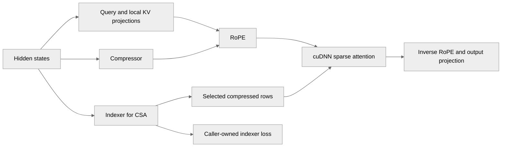

# Add DSv4 cudnn sparse attention kernel adapters to TE

[Upstream PR](https://github.com/NVIDIA/TransformerEngine/pull/3566) · state: open · merged: False

## Original PR description

DSv4 HCA and CSA combine local and compressed KV rows; CSA also selects compressed rows. This PR exposes the cuDNN Frontend compressor, selector, sparse attention, and indexer-training primitives, then composes them with TE projections and norms in `DSv4Attention`. `Compressor` and `Indexer` are also public building blocks for reuse in other attention layers.

The high-level layer defaults to `qkv_format="sbhd"` with hidden states `[S,B,D]`, following TE MHA naming; hidden states omit the projected head axis. Callers can select `qkv_format="bshd"`, or packed `qkv_format="thd"` with `[T, hidden_size]` tensors and `cu_seqlens_q`/`max_seqlen_q`. Packed compressed prefixes are computed on device without a host synchronization; unused compressed capacity rows are cleared before normalization. Prepared-tensor callers use `dsa_cudnn.sparse_attention` directly; the redundant core module wrapper is removed.

RoPE frequencies are cached in FP32, with an injectable RoPE module for policies such as compressed YaRN. Forward/backward rotation uses Triton kernels copied from [Megatron-LM c4129aff](https://github.com/NVIDIA/Megatron-LM/blob/c4129afff4867ca89b1fb7b4b911128424cdfbe8/megatron/core/fusions/fused_mla_yarn_rope_apply.py). TE retains its existing tensor ownership and autograd boundaries. The DSv4-specific CuTe implementation and native bridge are removed.

CSA can return live indexer tensors and detached attention tensors; the caller owns indexer auxiliary-loss calculation and training-loop integration. Full-sequence BF16 on SM100 with 64 attention heads is supported. Physical inter-sequence padding, packed multi-sequence auxiliary context, cache/decode, FP8, and tensor/context/sequence parallelism remain outside this implementation.

## Validation

- Before the naming/delegation refactor, all 23 tests in `tests/pytorch/test_dsv4_attention.py` passed on B200 with PyTorch 26.10, including dense attention oracles, forced Triton RoPE forward/backward, and packed HCA/CSA parity against independent dense calls for lengths `[129,257]` and `[255,383]`.
- Two optimizer steps each for packed HCA and CSA passed finite output, loss, input-gradient, and parameter-gradient checks.
- Existing matched-weight Hugging Face and Megatron integration comparisons validated HCA/CSA forward/backward and caller-owned CSA auxiliary-loss plumbing before the backend replacement.
- Same-node CuTe versus Triton comparison at batch 2, sequence length 32768, BF16, 64 heads: forward-plus-backward medians were 37.996 versus 38.206 ms for HCA and 37.640 versus 37.810 ms for CSA (two warmups, three samples). Triton was 0.55%/0.45% slower, with equal peak allocation. Matched output, input-gradient, and parameter-gradient comparisons passed; this replacement simplifies the backend rather than claiming a speedup.
- Python compilation, Black, license checks, and `git diff --check` passed. The exact-source native build and imported Python/native paths were verified; the removed DSv4 CuTe binding was absent.


- The naming/delegation refactor passed 16 local source-module tests with PyTorch 26.08 on RTX A6000, including forced Triton forward/backward and FP8 rejection; eight SM100-only tests were skipped. Kernels and native code are unchanged.
- The sparse-attention entry-point rename and README examples passed Python syntax checks, rename-only AST comparison, reference checks, and `git diff --check`; no GPU rerun was needed for these changes.
- All four [GitHub lint jobs](https://github.com/NVIDIA/TransformerEngine/actions/runs/38450072521) passed on `06013cea`; DCO passed after adding the three missing sign-offs. The history repair preserved every commit tree.
- All 27 focused GPU tests passed on B200 for `e02f6c10`, including width-96 eager RoPE forward/backward, standalone 32/64-head Indexer scores/backward and parameter gradients against a PyTorch reference, and separate DSv4 layer context checks.


## Review and discussion

### reviews

- greptile-apps[bot] · COMMENTED · 2026-10-13T18:58:32Z · [source](https://github.com/NVIDIA/TransformerEngine/pull/3566#pullrequestreview-5508523009)

(No body; status only.)

- sudhakarsingh27 · COMMENTED · 2026-10-13T20:14:10Z · [source](https://github.com/NVIDIA/TransformerEngine/pull/3566#pullrequestreview-5509391900)

(No body; status only.)

- sudhakarsingh27 · COMMENTED · 2026-10-13T20:14:12Z · [source](https://github.com/NVIDIA/TransformerEngine/pull/3566#pullrequestreview-5509392306)

(No body; status only.)

- sudhakarsingh27 · COMMENTED · 2026-10-13T23:49:32Z · [source](https://github.com/NVIDIA/TransformerEngine/pull/3566#pullrequestreview-5511129719)

(No body; status only.)

- cyanguwa · COMMENTED · 2026-10-14T22:43:53Z · [source](https://github.com/NVIDIA/TransformerEngine/pull/3566#pullrequestreview-5525727414)

(No body; status only.)

- cyanguwa · COMMENTED · 2026-10-14T22:44:10Z · [source](https://github.com/NVIDIA/TransformerEngine/pull/3566#pullrequestreview-5525729552)

(No body; status only.)

- cyanguwa · COMMENTED · 2026-10-14T22:45:55Z · [source](https://github.com/NVIDIA/TransformerEngine/pull/3566#pullrequestreview-5525742518)

(No body; status only.)

- cyanguwa · COMMENTED · 2026-10-14T22:47:37Z · [source](https://github.com/NVIDIA/TransformerEngine/pull/3566#pullrequestreview-5525755241)

(No body; status only.)

- cyanguwa · COMMENTED · 2026-10-14T23:03:28Z · [source](https://github.com/NVIDIA/TransformerEngine/pull/3566#pullrequestreview-5525869754)

(No body; status only.)

- cyanguwa · COMMENTED · 2026-10-14T23:08:45Z · [source](https://github.com/NVIDIA/TransformerEngine/pull/3566#pullrequestreview-5525911003)

(No body; status only.)

- cyanguwa · COMMENTED · 2026-10-14T23:18:42Z · [source](https://github.com/NVIDIA/TransformerEngine/pull/3566#pullrequestreview-5525983774)

(No body; status only.)

- cyanguwa · COMMENTED · 2026-10-14T23:20:06Z · [source](https://github.com/NVIDIA/TransformerEngine/pull/3566#pullrequestreview-5525996045)

(No body; status only.)

- cyanguwa · COMMENTED · 2026-10-14T23:22:51Z · [source](https://github.com/NVIDIA/TransformerEngine/pull/3566#pullrequestreview-5526014379)

(No body; status only.)

- cyanguwa · COMMENTED · 2026-10-14T23:31:56Z · [source](https://github.com/NVIDIA/TransformerEngine/pull/3566#pullrequestreview-5526075387)

(No body; status only.)

- cyanguwa · COMMENTED · 2026-10-14T23:34:13Z · [source](https://github.com/NVIDIA/TransformerEngine/pull/3566#pullrequestreview-5526091673)

(No body; status only.)

- cyanguwa · COMMENTED · 2026-10-14T23:38:01Z · [source](https://github.com/NVIDIA/TransformerEngine/pull/3566#pullrequestreview-5526118950)

(No body; status only.)

- sudhakarsingh27 · COMMENTED · 2026-10-15T20:19:48Z · [source](https://github.com/NVIDIA/TransformerEngine/pull/3566#pullrequestreview-5539361695)

(No body; status only.)

- sudhakarsingh27 · COMMENTED · 2026-10-15T20:19:50Z · [source](https://github.com/NVIDIA/TransformerEngine/pull/3566#pullrequestreview-5539362160)

(No body; status only.)

- sudhakarsingh27 · COMMENTED · 2026-10-15T20:19:52Z · [source](https://github.com/NVIDIA/TransformerEngine/pull/3566#pullrequestreview-5539362533)

(No body; status only.)

- sudhakarsingh27 · COMMENTED · 2026-10-15T20:19:54Z · [source](https://github.com/NVIDIA/TransformerEngine/pull/3566#pullrequestreview-5539362849)

(No body; status only.)

- sudhakarsingh27 · COMMENTED · 2026-10-15T20:19:56Z · [source](https://github.com/NVIDIA/TransformerEngine/pull/3566#pullrequestreview-5539363173)

(No body; status only.)

- sudhakarsingh27 · COMMENTED · 2026-10-15T20:19:58Z · [source](https://github.com/NVIDIA/TransformerEngine/pull/3566#pullrequestreview-5539363575)

(No body; status only.)

- sudhakarsingh27 · COMMENTED · 2026-10-15T20:19:59Z · [source](https://github.com/NVIDIA/TransformerEngine/pull/3566#pullrequestreview-5539363849)

(No body; status only.)

- sudhakarsingh27 · COMMENTED · 2026-10-15T20:20:01Z · [source](https://github.com/NVIDIA/TransformerEngine/pull/3566#pullrequestreview-5539364154)

(No body; status only.)

- sudhakarsingh27 · COMMENTED · 2026-10-15T20:20:03Z · [source](https://github.com/NVIDIA/TransformerEngine/pull/3566#pullrequestreview-5539364456)

(No body; status only.)

- sudhakarsingh27 · COMMENTED · 2026-10-15T20:20:05Z · [source](https://github.com/NVIDIA/TransformerEngine/pull/3566#pullrequestreview-5539364809)

(No body; status only.)

- sudhakarsingh27 · COMMENTED · 2026-10-15T20:20:06Z · [source](https://github.com/NVIDIA/TransformerEngine/pull/3566#pullrequestreview-5539365084)

(No body; status only.)

- sudhakarsingh27 · COMMENTED · 2026-10-15T20:20:08Z · [source](https://github.com/NVIDIA/TransformerEngine/pull/3566#pullrequestreview-5539365359)

(No body; status only.)

- sudhakarsingh27 · COMMENTED · 2026-10-16T17:34:47Z · [source](https://github.com/NVIDIA/TransformerEngine/pull/3566#pullrequestreview-5551407330)

(No body; status only.)

- sudhakarsingh27 · COMMENTED · 2026-10-16T17:34:49Z · [source](https://github.com/NVIDIA/TransformerEngine/pull/3566#pullrequestreview-5551407886)

(No body; status only.)

- sudhakarsingh27 · COMMENTED · 2026-10-16T17:34:51Z · [source](https://github.com/NVIDIA/TransformerEngine/pull/3566#pullrequestreview-5551408275)

(No body; status only.)

- sudhakarsingh27 · COMMENTED · 2026-10-16T17:34:52Z · [source](https://github.com/NVIDIA/TransformerEngine/pull/3566#pullrequestreview-5551408612)

(No body; status only.)

- sudhakarsingh27 · COMMENTED · 2026-10-16T17:34:54Z · [source](https://github.com/NVIDIA/TransformerEngine/pull/3566#pullrequestreview-5551408875)

(No body; status only.)

- sudhakarsingh27 · COMMENTED · 2026-10-16T17:34:55Z · [source](https://github.com/NVIDIA/TransformerEngine/pull/3566#pullrequestreview-5551409233)

(No body; status only.)

- sudhakarsingh27 · COMMENTED · 2026-10-16T17:34:57Z · [source](https://github.com/NVIDIA/TransformerEngine/pull/3566#pullrequestreview-5551409631)

(No body; status only.)

- sudhakarsingh27 · COMMENTED · 2026-10-16T17:34:59Z · [source](https://github.com/NVIDIA/TransformerEngine/pull/3566#pullrequestreview-5551409975)

(No body; status only.)

- sudhakarsingh27 · COMMENTED · 2026-10-16T17:35:01Z · [source](https://github.com/NVIDIA/TransformerEngine/pull/3566#pullrequestreview-5551410276)

(No body; status only.)

### issue_comments

- cyanguwa · comment · 2026-10-06T19:57:56Z · [source](https://github.com/NVIDIA/TransformerEngine/pull/3566#issuecomment-6024346434)

A few initial comments - I know the PR is still in draft.

- Should we rename `DSv4Attention` to `DSv4CoreAttention`, and `DSv4HybridAttention` to `DSv4Attention`? Also, maybe we can tighten up the file naming/structure a bit more so it's more obvious to users what modules we're trying to offer. I feel maybe these ones (without the v4 denotation, given that they can be used by v4.1, Qwen as well): ds_rope, ds_compressor, ds_indexer, ds_core_attention, ds_attention?
- You've included some explanation in README.md about the structure/usage of this PR, but I feel it's still a bit confusing. Maybe we could reuse the sketch in Po's presentation, and replace certain components with our module names?
- How easy is it to add your Megatron/Hugging Face validator to our tests/? It could be a good way to show the usage of our PR, but this can be punted to a future PR as well (as we discussed offline) if it requires too many changes.

Thanks!

- greptile-apps[bot] · comment · 2026-10-13T18:58:27Z · [source](https://github.com/NVIDIA/TransformerEngine/pull/3566#issuecomment-6152922117)

<!-- greptile_summary -->

<h2><a href="https://app.greptile.com/api/retrigger?id=80113221"><picture><source media="(prefers-color-scheme: dark)" srcset="https://greptile-static-assets.s3.amazonaws.com/badges/RetriggerDark.svg?v=2"><source media="(prefers-color-scheme: light)" srcset="https://greptile-static-assets.s3.amazonaws.com/badges/Retrigger.svg?v=2"></picture></a><a href="https://app.greptile.com/nvidia-public-github/github/NVIDIA/transformerengine/-/pull/3566"><picture><source media="(prefers-color-scheme: dark)" srcset="https://greptile-static-assets.s3.amazonaws.com/badges/ViewInGreptileDark.svg?v=2"><source media="(prefers-color-scheme: light)" srcset="https://greptile-static-assets.s3.amazonaws.com/badges/ViewInGreptile.svg?v=2"></picture></a>Confidence Score: 5/5</h2>

**[Medium impact]** The PR appears safe to merge; no new actionable issues were established.

<h3>Summary</h3>

Adds experimental `DSv4Attention`, reusable `Compressor` and `Indexer` modules, and cuDNN sparse-attention adapters.
- DSv4Attention maps hidden states through HCA or CSA attention.
- Compressed KV rows and CSA selection come from reusable modules.
- cuDNN adapters provide compression, sparse attention, and indexer-loss operations.
- DSv4 rotates token and compressed keys with cached FP32 RoPE.

<h3>Diagram</h3>



<!-- greptile_confidence_score:5 -->

<sub>Reviews (5) · Last reviewed commit: ["Merge branch &#39;main&#39; into sudhakars/dsv4-..."](https://github.com/nvidia/transformerengine/commit/9754d2181d36257ffd0ad5bc65fbd65aa92bd570) · [Reviewed by Greptile](https://www.greptile.com/?utm_source=greptile_review&utm_medium=github&utm_campaign=review_public&utm_content=nvidia/transformerengine)</sub>

- sudhakarsingh27 · comment · 2026-10-16T19:39:39Z · [source](https://github.com/NVIDIA/TransformerEngine/pull/3566#issuecomment-6223293734)

/te-ci pytorch L0

- sudhakarsingh27 · comment · 2026-10-19T01:09:40Z · [source](https://github.com/NVIDIA/TransformerEngine/pull/3566#issuecomment-6257512424)

/te-ci pytorch L0

### inline_comments

- greptile-apps[bot] · comment · 2026-10-13T18:58:30Z · [source](https://github.com/NVIDIA/TransformerEngine/pull/3566#discussion_r4262782969)

File: `transformer_engine/pytorch/attention/sparse_attention/dsa_rope.py` · line None

<a href="#"></a> **Accepted RoPE widths fail**

If Triton is installed, an accepted setting such as `rope_head_dim=96` fails on the first forward call. `_can_use_triton` accepts it because 96 is divisible by four, but the kernel uses `tl.arange(0, emb_dim // 2)`. That range has length 48, and Triton requires a power-of-two length.

Require a power-of-two width in this check so other accepted widths use the eager path, or pad and mask the kernel range.

- greptile-apps[bot] · comment · 2026-10-13T18:58:30Z · [source](https://github.com/NVIDIA/TransformerEngine/pull/3566#discussion_r4262782986)

File: `transformer_engine/pytorch/attention/sparse_attention/dsa_cudnn.py` · line 302

<a href="#"></a> **Indexer training lacks coverage**

No test calls `dense_indexer_loss_scores` or `dense_indexer_loss_backward`, and the only `return_indexer_context=True` test checks rejection. The attention-output gradient tests cannot catch errors in this path because top-k does not pass gradients to the indexer.

Add a test that trains the CSA indexer through the returned context, covering 32 and 64 heads. Compare the required reshapes, head padding, and indexer parameter gradients against a small reference.

Note: If this suggestion doesn't match your team's coding style, reply to this and let me know. I'll remember it for next time!

- sudhakarsingh27 · comment · 2026-10-13T20:14:10Z · [source](https://github.com/NVIDIA/TransformerEngine/pull/3566#discussion_r4263527414)

File: `transformer_engine/pytorch/attention/sparse_attention/dsa_rope.py` · line None

Fixed in e02f6c10. Non-power-of-two widths use eager RoPE; width-96 forward/backward passed on B200.

- sudhakarsingh27 · comment · 2026-10-13T20:14:12Z · [source](https://github.com/NVIDIA/TransformerEngine/pull/3566#discussion_r4263527717)

File: `transformer_engine/pytorch/attention/sparse_attention/dsa_cudnn.py` · line 302

Added in e02f6c10: standalone Indexer tests for 32/64 heads compare scores, backward, and parameter gradients with PyTorch. DSv4 layer context wiring is checked separately. All 27 GPU tests passed.

- sudhakarsingh27 · comment · 2026-10-13T23:10:18Z · [source](https://github.com/NVIDIA/TransformerEngine/pull/3566#discussion_r4265020956)

File: `transformer_engine/pytorch/attention/sparse_attention/dsa_cudnn.py` · line None

Don't need this 1.29 specified here

- sudhakarsingh27 · comment · 2026-10-13T23:11:34Z · [source](https://github.com/NVIDIA/TransformerEngine/pull/3566#discussion_r4265028980)

File: `transformer_engine/pytorch/attention/sparse_attention/dsa_cudnn.py` · line None

There are references to DSv4 in this file, either these should be generic or this method should be in ds4v_attention.py

- sudhakarsingh27 · comment · 2026-10-13T23:16:59Z · [source](https://github.com/NVIDIA/TransformerEngine/pull/3566#discussion_r4265075988)

File: `transformer_engine/pytorch/attention/sparse_attention/dsa_cudnn.py` · line None

Does it make sense to call it `select_tokens`/`select_indices` instead?

- sudhakarsingh27 · comment · 2026-10-13T23:23:36Z · [source](https://github.com/NVIDIA/TransformerEngine/pull/3566#discussion_r4265125663)

File: `transformer_engine/pytorch/attention/sparse_attention/dsa_cudnn.py` · line None

"not attention Q/KV" - that's not needed

- sudhakarsingh27 · comment · 2026-10-13T23:31:30Z · [source](https://github.com/NVIDIA/TransformerEngine/pull/3566#discussion_r4265176025)

File: `transformer_engine/pytorch/attention/sparse_attention/dsa_cudnn.py` · line None

should this be called "_prepare_sparse_kv"

- sudhakarsingh27 · comment · 2026-10-13T23:36:57Z · [source](https://github.com/NVIDIA/TransformerEngine/pull/3566#discussion_r4265210093)

File: `transformer_engine/pytorch/attention/sparse_attention/dsv4_attention.py` · line None

change the jargon to be more relevant to the PR

- sudhakarsingh27 · comment · 2026-10-13T23:38:28Z · [source](https://github.com/NVIDIA/TransformerEngine/pull/3566#discussion_r4265219356)

File: `transformer_engine/pytorch/attention/sparse_attention/dsv4_attention.py` · line None

The docstring here doesn't need to be aware of state of the passes

- sudhakarsingh27 · comment · 2026-10-13T23:39:53Z · [source](https://github.com/NVIDIA/TransformerEngine/pull/3566#discussion_r4265227684)

File: `transformer_engine/pytorch/attention/sparse_attention/dsv4_attention.py` · line None

Also, overall, this docstring states a lot of concepts that don't need explicit mention like sequences in a batch have the same length, THD is unequal, etc. That's already established knowledge

- sudhakarsingh27 · comment · 2026-10-13T23:41:12Z · [source](https://github.com/NVIDIA/TransformerEngine/pull/3566#discussion_r4265235530)

File: `transformer_engine/pytorch/attention/sparse_attention/dsv4_attention.py` · line None

would it make sense to bring this towards the existing condition so as not to have another condition

- sudhakarsingh27 · comment · 2026-10-13T23:43:04Z · [source](https://github.com/NVIDIA/TransformerEngine/pull/3566#discussion_r4265246744)

File: `transformer_engine/pytorch/attention/sparse_attention/dsv4_attention.py` · line None

similar to previous comments, keep the info specific to only the concepts and not re-mention exsiting knowledge

- sudhakarsingh27 · comment · 2026-10-13T23:45:24Z · [source](https://github.com/NVIDIA/TransformerEngine/pull/3566#discussion_r4265261141)

File: `transformer_engine/pytorch/attention/sparse_attention/dsv4_attention.py` · line 242

What are the advantages of providing a module instead of directly providing the embedding values like in existing TE MHA setup

- sudhakarsingh27 · comment · 2026-10-13T23:46:34Z · [source](https://github.com/NVIDIA/TransformerEngine/pull/3566#discussion_r4265267993)

File: `transformer_engine/pytorch/attention/sparse_attention/dsa_rope.py` · line 214

What's the difference b/w these two that warrants separate calls 

- cyanguwa · comment · 2026-10-14T22:43:54Z · [source](https://github.com/NVIDIA/TransformerEngine/pull/3566#discussion_r4277077582)

File: `transformer_engine/pytorch/attention/sparse_attention/README.md` · line 74

Should we add a line before the code here about CSA?

- cyanguwa · comment · 2026-10-14T22:44:10Z · [source](https://github.com/NVIDIA/TransformerEngine/pull/3566#discussion_r4277079529)

File: `transformer_engine/pytorch/attention/sparse_attention/README.md` · line None

Should we call this `csa=...`

- cyanguwa · comment · 2026-10-14T22:45:55Z · [source](https://github.com/NVIDIA/TransformerEngine/pull/3566#discussion_r4277091064)

File: `transformer_engine/pytorch/attention/sparse_attention/README.md` · line None

Does it support sm100 only, or sm100+?

"sliding-only" as in SWA branch only?

- cyanguwa · comment · 2026-10-14T22:47:38Z · [source](https://github.com/NVIDIA/TransformerEngine/pull/3566#discussion_r4277102787)

File: `transformer_engine/pytorch/attention/sparse_attention/README.md` · line None

"to pooled rows" -> "to compressed KV"?

- cyanguwa · comment · 2026-10-14T23:03:28Z · [source](https://github.com/NVIDIA/TransformerEngine/pull/3566#discussion_r4277205515)

File: `transformer_engine/pytorch/__init__.py` · line 36

Do we want to make `Compressor` and `Indexer` public as well? Same in `attention/__init__.py`.

Those are the components that potentially external users want to use to build their own models IIUC?

- cyanguwa · comment · 2026-10-14T23:08:45Z · [source](https://github.com/NVIDIA/TransformerEngine/pull/3566#discussion_r4277240524)

File: `transformer_engine/pytorch/attention/sparse_attention/__init__.py` · line None

Maybe remove the second paragraph? since README already covers a lot of the content and some of this message is obvious as well?

How about
```
Sparse attention. This feature is experimental and subject to change.
```

I guess we may put multiple variants of sparse attention here. What we have now is DSv4 style, and in the future, we potentially can have QSA/Qwen Sparse Attention (qsa_attention.py), MSA/MiniMax Sparse Attention (msa_attention.py). Not sure if we want to rename compressor.py -> dsa_compressor.py, indexer.py -> dsa_indexer.py, but still keep the class names the same (Compressor/Indexer). Something to think about :) 

- cyanguwa · comment · 2026-10-14T23:18:42Z · [source](https://github.com/NVIDIA/TransformerEngine/pull/3566#discussion_r4277304567)

File: `transformer_engine/pytorch/attention/sparse_attention/compressor.py` · line None

What are pooled rows? Is your AI writing "rows" now rather than tokens or sequences (like in that RoPE PR again)? :) 

Is "compression" a better term than "pooling"?

- cyanguwa · comment · 2026-10-14T23:20:06Z · [source](https://github.com/NVIDIA/TransformerEngine/pull/3566#discussion_r4277314059)

File: `transformer_engine/pytorch/attention/sparse_attention/compressor.py` · line 5

Maybe say something generic about "compression"?

- cyanguwa · comment · 2026-10-14T23:22:50Z · [source](https://github.com/NVIDIA/TransformerEngine/pull/3566#discussion_r4277330599)

File: `transformer_engine/pytorch/attention/sparse_attention/dsa_cudnn.py` · line None

Maybe one mention of "experimental" is enough? in `sparse_attention/__init__.py`?

Also, do we usually use cuDNN Frontend or cudnn-frontend.

How about "PyTorch wrapper modules for cuDNN DSA/CSA primitives" or "PyTorch autograd functions for cuDNN primitives"?

- cyanguwa · comment · 2026-10-14T23:31:56Z · [source](https://github.com/NVIDIA/TransformerEngine/pull/3566#discussion_r4277385494)

File: `transformer_engine/pytorch/attention/sparse_attention/dsa_cudnn.py` · line None

"Gated compression"?

What's first-order backward?

- cyanguwa · comment · 2026-10-14T23:34:13Z · [source](https://github.com/NVIDIA/TransformerEngine/pull/3566#discussion_r4277399510)

File: `transformer_engine/pytorch/attention/sparse_attention/dsa_cudnn.py` · line None

Maybe remove the last paragraph? It's more like a design consideration, and once done, it's done. No need to mention to users?

- cyanguwa · comment · 2026-10-14T23:38:01Z · [source](https://github.com/NVIDIA/TransformerEngine/pull/3566#discussion_r4277423667)

File: `transformer_engine/pytorch/attention/sparse_attention/dsa_cudnn.py` · line None

Yeah, that might be a better name, "_prepare_for_sparse_attention"?

- sudhakarsingh27 · comment · 2026-10-15T20:19:48Z · [source](https://github.com/NVIDIA/TransformerEngine/pull/3566#discussion_r4287863311)

File: `transformer_engine/pytorch/attention/sparse_attention/README.md` · line 74

Added a sentence introducing CSA before the example.

- sudhakarsingh27 · comment · 2026-10-15T20:19:50Z · [source](https://github.com/NVIDIA/TransformerEngine/pull/3566#discussion_r4287863637)

File: `transformer_engine/pytorch/attention/sparse_attention/README.md` · line None

Renamed to `csa`; the packed example now explicitly constructs a THD layer.

- sudhakarsingh27 · comment · 2026-10-15T20:19:52Z · [source](https://github.com/NVIDIA/TransformerEngine/pull/3566#discussion_r4287863985)

File: `transformer_engine/pytorch/attention/sparse_attention/README.md` · line None

SM100 only. CSA/HCA include SWA; standalone SWA-only layers are unsupported. Clarified both docs.

- sudhakarsingh27 · comment · 2026-10-15T20:19:54Z · [source](https://github.com/NVIDIA/TransformerEngine/pull/3566#discussion_r4287864266)

File: `transformer_engine/pytorch/attention/sparse_attention/README.md` · line None

Changed to "compressed KV".

- sudhakarsingh27 · comment · 2026-10-15T20:19:56Z · [source](https://github.com/NVIDIA/TransformerEngine/pull/3566#discussion_r4287864627)

File: `transformer_engine/pytorch/__init__.py` · line 36

Exported both from `sparse_attention`, `attention`, and `te.pytorch`.

- sudhakarsingh27 · comment · 2026-10-15T20:19:58Z · [source](https://github.com/NVIDIA/TransformerEngine/pull/3566#discussion_r4287864961)

File: `transformer_engine/pytorch/attention/sparse_attention/__init__.py` · line None

Used the suggested docstring. Kept the current filenames.

- sudhakarsingh27 · comment · 2026-10-15T20:19:59Z · [source](https://github.com/NVIDIA/TransformerEngine/pull/3566#discussion_r4287865210)

File: `transformer_engine/pytorch/attention/sparse_attention/compressor.py` · line None

Replaced pooling terminology and added overlapping/non-overlapping examples.

- sudhakarsingh27 · comment · 2026-10-15T20:20:01Z · [source](https://github.com/NVIDIA/TransformerEngine/pull/3566#discussion_r4287865459)

File: `transformer_engine/pytorch/attention/sparse_attention/compressor.py` · line 5

Kept the module description generic; clarified compression in the class docstring.

- sudhakarsingh27 · comment · 2026-10-15T20:20:03Z · [source](https://github.com/NVIDIA/TransformerEngine/pull/3566#discussion_r4287865771)

File: `transformer_engine/pytorch/attention/sparse_attention/dsa_cudnn.py` · line None

Shortened to "PyTorch wrappers for cuDNN DSA/CSA primitives."

- sudhakarsingh27 · comment · 2026-10-15T20:20:05Z · [source](https://github.com/NVIDIA/TransformerEngine/pull/3566#discussion_r4287866059)

File: `transformer_engine/pytorch/attention/sparse_attention/dsa_cudnn.py` · line None

Used "compression" consistently and removed "first-order" wording.

- sudhakarsingh27 · comment · 2026-10-15T20:20:06Z · [source](https://github.com/NVIDIA/TransformerEngine/pull/3566#discussion_r4287866306)

File: `transformer_engine/pytorch/attention/sparse_attention/dsa_cudnn.py` · line None

Removed the synchronization rationale; retained the output-capacity contract.

- sudhakarsingh27 · comment · 2026-10-15T20:20:08Z · [source](https://github.com/NVIDIA/TransformerEngine/pull/3566#discussion_r4287866546)

File: `transformer_engine/pytorch/attention/sparse_attention/dsa_cudnn.py` · line None

Renamed to `_prepare_sparse_indices`, since it prepares indices only.

- sudhakarsingh27 · comment · 2026-10-16T17:34:47Z · [source](https://github.com/NVIDIA/TransformerEngine/pull/3566#discussion_r4297470419)

File: `transformer_engine/pytorch/attention/sparse_attention/dsa_cudnn.py` · line None

Made the reusable wrapper documentation and diagnostics generic; retained cuDNN kernel constraints.

- sudhakarsingh27 · comment · 2026-10-16T17:34:49Z · [source](https://github.com/NVIDIA/TransformerEngine/pull/3566#discussion_r4297470824)

File: `transformer_engine/pytorch/attention/sparse_attention/dsa_cudnn.py` · line None

Renamed to `select_indices` throughout the wrapper, Indexer, and README.

- sudhakarsingh27 · comment · 2026-10-16T17:34:51Z · [source](https://github.com/NVIDIA/TransformerEngine/pull/3566#discussion_r4297471133)

File: `transformer_engine/pytorch/attention/sparse_attention/dsa_cudnn.py` · line None

Removed that clause.

- sudhakarsingh27 · comment · 2026-10-16T17:34:52Z · [source](https://github.com/NVIDIA/TransformerEngine/pull/3566#discussion_r4297471402)

File: `transformer_engine/pytorch/attention/sparse_attention/dsv4_attention.py` · line None

Changed to "Build compressed sequence prefixes and output capacity."

- sudhakarsingh27 · comment · 2026-10-16T17:34:54Z · [source](https://github.com/NVIDIA/TransformerEngine/pull/3566#discussion_r4297471606)

File: `transformer_engine/pytorch/attention/sparse_attention/dsv4_attention.py` · line None

Removed implementation-status wording and repeated layout explanations.

- sudhakarsingh27 · comment · 2026-10-16T17:34:55Z · [source](https://github.com/NVIDIA/TransformerEngine/pull/3566#discussion_r4297471865)

File: `transformer_engine/pytorch/attention/sparse_attention/dsv4_attention.py` · line None

Combined the unfused projections under the existing `else`. Parameter names/shapes are unchanged; seeded initialization order changes.

- sudhakarsingh27 · comment · 2026-10-16T17:34:57Z · [source](https://github.com/NVIDIA/TransformerEngine/pull/3566#discussion_r4297472153)

File: `transformer_engine/pytorch/attention/sparse_attention/dsv4_attention.py` · line None

Trimmed repeated layout details; retained packed metadata and optional context requirements.

- sudhakarsingh27 · comment · 2026-10-16T17:34:59Z · [source](https://github.com/NVIDIA/TransformerEngine/pull/3566#discussion_r4297472487)

File: `transformer_engine/pytorch/attention/sparse_attention/dsv4_attention.py` · line 242

The module caches FP32 frequencies and supports custom RoPE policies, matching Megatron's ownership. No input-interface change made.

- sudhakarsingh27 · comment · 2026-10-16T17:35:01Z · [source](https://github.com/NVIDIA/TransformerEngine/pull/3566#discussion_r4297472736)

File: `transformer_engine/pytorch/attention/sparse_attention/dsa_rope.py` · line 214

The query helper rotates fresh queries in place to avoid copying. General RoPE preserves inputs, including cuDNN's saved output; both backward paths preserve incoming gradients.

## Changed files and fixed code

- `tests/pytorch/test_dsv4_attention.py` · added · additions 500 / deletions 0
  - [head](https://github.com/sudhakarsingh27/TransformerEngine/blob/9754d2181d36257ffd0ad5bc65fbd65aa92bd570/tests/pytorch/test_dsv4_attention.py)
  - [base](https://github.com/NVIDIA/TransformerEngine/blob/eb3c860a4d3394b7eb5e21dba3021fa10782a52e/tests/pytorch/test_dsv4_attention.py)
- `transformer_engine/common/triton/dsa_rope.py` · added · additions 253 / deletions 0
  - [head](https://github.com/sudhakarsingh27/TransformerEngine/blob/9754d2181d36257ffd0ad5bc65fbd65aa92bd570/transformer_engine/common/triton/dsa_rope.py)
  - [base](https://github.com/NVIDIA/TransformerEngine/blob/eb3c860a4d3394b7eb5e21dba3021fa10782a52e/transformer_engine/common/triton/dsa_rope.py)
- `transformer_engine/pytorch/__init__.py` · modified · additions 6 / deletions 0
  - [head](https://github.com/sudhakarsingh27/TransformerEngine/blob/9754d2181d36257ffd0ad5bc65fbd65aa92bd570/transformer_engine/pytorch/__init__.py)
  - [base](https://github.com/NVIDIA/TransformerEngine/blob/eb3c860a4d3394b7eb5e21dba3021fa10782a52e/transformer_engine/pytorch/__init__.py)
- `transformer_engine/pytorch/attention/__init__.py` · modified · additions 6 / deletions 0
  - [head](https://github.com/sudhakarsingh27/TransformerEngine/blob/9754d2181d36257ffd0ad5bc65fbd65aa92bd570/transformer_engine/pytorch/attention/__init__.py)
  - [base](https://github.com/NVIDIA/TransformerEngine/blob/eb3c860a4d3394b7eb5e21dba3021fa10782a52e/transformer_engine/pytorch/attention/__init__.py)
- `transformer_engine/pytorch/attention/sparse_attention/README.md` · added · additions 132 / deletions 0
  - [head](https://github.com/sudhakarsingh27/TransformerEngine/blob/9754d2181d36257ffd0ad5bc65fbd65aa92bd570/transformer_engine/pytorch/attention/sparse_attention/README.md)
  - [base](https://github.com/NVIDIA/TransformerEngine/blob/eb3c860a4d3394b7eb5e21dba3021fa10782a52e/transformer_engine/pytorch/attention/sparse_attention/README.md)
- `transformer_engine/pytorch/attention/sparse_attention/__init__.py` · added · additions 18 / deletions 0
  - [head](https://github.com/sudhakarsingh27/TransformerEngine/blob/9754d2181d36257ffd0ad5bc65fbd65aa92bd570/transformer_engine/pytorch/attention/sparse_attention/__init__.py)
  - [base](https://github.com/NVIDIA/TransformerEngine/blob/eb3c860a4d3394b7eb5e21dba3021fa10782a52e/transformer_engine/pytorch/attention/sparse_attention/__init__.py)
- `transformer_engine/pytorch/attention/sparse_attention/compressor.py` · added · additions 103 / deletions 0
  - [head](https://github.com/sudhakarsingh27/TransformerEngine/blob/9754d2181d36257ffd0ad5bc65fbd65aa92bd570/transformer_engine/pytorch/attention/sparse_attention/compressor.py)
  - [base](https://github.com/NVIDIA/TransformerEngine/blob/eb3c860a4d3394b7eb5e21dba3021fa10782a52e/transformer_engine/pytorch/attention/sparse_attention/compressor.py)
- `transformer_engine/pytorch/attention/sparse_attention/dsa_cudnn.py` · added · additions 470 / deletions 0
  - [head](https://github.com/sudhakarsingh27/TransformerEngine/blob/9754d2181d36257ffd0ad5bc65fbd65aa92bd570/transformer_engine/pytorch/attention/sparse_attention/dsa_cudnn.py)
  - [base](https://github.com/NVIDIA/TransformerEngine/blob/eb3c860a4d3394b7eb5e21dba3021fa10782a52e/transformer_engine/pytorch/attention/sparse_attention/dsa_cudnn.py)
- `transformer_engine/pytorch/attention/sparse_attention/dsa_rope.py` · added · additions 214 / deletions 0
  - [head](https://github.com/sudhakarsingh27/TransformerEngine/blob/9754d2181d36257ffd0ad5bc65fbd65aa92bd570/transformer_engine/pytorch/attention/sparse_attention/dsa_rope.py)
  - [base](https://github.com/NVIDIA/TransformerEngine/blob/eb3c860a4d3394b7eb5e21dba3021fa10782a52e/transformer_engine/pytorch/attention/sparse_attention/dsa_rope.py)
- `transformer_engine/pytorch/attention/sparse_attention/dsv4_attention.py` · added · additions 322 / deletions 0
  - [head](https://github.com/sudhakarsingh27/TransformerEngine/blob/9754d2181d36257ffd0ad5bc65fbd65aa92bd570/transformer_engine/pytorch/attention/sparse_attention/dsv4_attention.py)
  - [base](https://github.com/NVIDIA/TransformerEngine/blob/eb3c860a4d3394b7eb5e21dba3021fa10782a52e/transformer_engine/pytorch/attention/sparse_attention/dsv4_attention.py)
- `transformer_engine/pytorch/attention/sparse_attention/indexer.py` · added · additions 112 / deletions 0
  - [head](https://github.com/sudhakarsingh27/TransformerEngine/blob/9754d2181d36257ffd0ad5bc65fbd65aa92bd570/transformer_engine/pytorch/attention/sparse_attention/indexer.py)
  - [base](https://github.com/NVIDIA/TransformerEngine/blob/eb3c860a4d3394b7eb5e21dba3021fa10782a52e/transformer_engine/pytorch/attention/sparse_attention/indexer.py)

## Evidence and interpretation boundary

[Original JSON, discussions and patches](../../../../../../evidence/prs/NVIDIA--TransformerEngine/3566-a6b4ae6d032fe7a5cfeb740b9a4903bc14a9a5ee47b313b5b8e454aed221bcb9.json) · SHA-256 `a6b4ae6d032fe7a5cfeb740b9a4903bc14a9a5ee47b313b5b8e454aed221bcb9`.

Diff complete: True. Missing/binary/truncated patches require pinned source inspection. This is a source page, not an independently verified optimization case. Open, merged and released are different states; recheck the deployed dependency.
