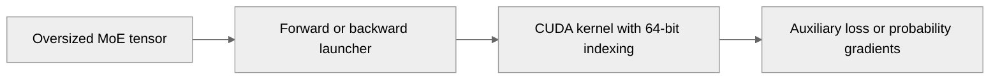

# Guard fused MoE auxiliary loss integer offsets

[Upstream PR](https://github.com/NVIDIA/TransformerEngine/pull/3569) · state: open · merged: False

## Original PR description

# Description

The fused MoE auxiliary loss kernels use 32-bit flattened offsets. Reject shapes above `INT_MAX` in both forward launchers and the backward launcher before launching a kernel.

Fixes #3568

## Type of change

- [x] Bug fix (non-breaking change which fixes an issue)

## Changes

- Check `num_rows * num_cols` with 64-bit arithmetic in all three launchers.
- Add a parametrized BF16 test that expects each path to reject an oversized shape.

## Verification

- `pre-commit` on both changed files: all hooks passed.
- Ran the new test on an RTX 2000 Ada (8 GB) against a shim built from the real `fused_moe_aux_loss.cu`: all three cases pass with this change and fail without it (illegal memory access).
- A full TE build was not available locally (fails on Windows in existing `__uint128_t` code), so the `transformer_engine_torch` binding was not exercised; CI covers that.

# Checklist

- [x] I have read and followed the contributing guidelines.
- [x] The functionality is complete.
- [x] I have added a test for the fix.
- [x] New and existing unit tests pass locally with my changes (see Verification).


## Review and discussion

### reviews

- denera · CHANGES_REQUESTED · 2026-10-02T16:39:59Z · [source](https://github.com/NVIDIA/TransformerEngine/pull/3569#pullrequestreview-5394292569)

Thanks for the PR!

It looks good to me overall. Just two nits:
1. Unnecessary skip condition on CUDA GPU presence.
2. `fused_moe_aux_loss.cu` needs `#include <climits>` for `INT_MAX`. This currently comes in transitively from another header, but as a matter of code style and header safety, we include it explicitly in other fused MoE/top-K files too. This one should adopt the same approach.

### issue_comments

- greptile-apps[bot] · comment · 2026-09-30T23:25:44Z · [source](https://github.com/NVIDIA/TransformerEngine/pull/3569#issuecomment-5921507725)

<!-- greptile_summary -->

<h2><a href="https://app.greptile.com/api/retrigger?id=72458828"><picture><source media="(prefers-color-scheme: dark)" srcset="https://greptile-static-assets.s3.amazonaws.com/badges/RetriggerDark.svg?v=2"><source media="(prefers-color-scheme: light)" srcset="https://greptile-static-assets.s3.amazonaws.com/badges/Retrigger.svg?v=2"></picture></a>Confidence Score: 5/5</h2>

**[High risk]** Changes integer types in GPU kernel for large tensor support\.

The PR appears safe to merge based on the changes reviewed.

<h3>Summary</h3>

The PR widens fused MoE auxiliary-loss kernel indexing and adds a BF16 test for tensors with more than `INT_MAX` elements.
- Forward, graph-safe forward, and backward paths use 64-bit loop indices or offset-related arithmetic.
- The new test checks all three paths on an oversized shape.

<h3>Diagram</h3>



<!-- greptile_confidence_score:5 -->

<sub>Reviews (5) · Last reviewed commit: ["Unroll forward row loop in fused MoE aux..."](https://github.com/nvidia/transformerengine/commit/198df0eb30c7058b917b89cd6e44113eb229b930) · [Reviewed by Greptile](https://www.greptile.com/?utm_source=greptile_expert&utm_medium=github&utm_campaign=code_reviews&utm_content=nvidia/transformerengine)</sub>

- ptrendx · comment · 2026-10-06T23:46:11Z · [source](https://github.com/NVIDIA/TransformerEngine/pull/3569#issuecomment-6027581071)

Actually, I have a different concern - if the problem is that the shapes could exceed the int32 maximum then we should actually make the kernel work with int64/size_t for the variables that could overflow.

- arcusbuilds · comment · 2026-10-07T01:07:33Z · [source](https://github.com/NVIDIA/TransformerEngine/pull/3569#issuecomment-6028671609)

Extended the kernels to use int64_t indexing instead of rejecting shapes above INT_MAX.

- denera · comment · 2026-10-08T09:20:37Z · [source](https://github.com/NVIDIA/TransformerEngine/pull/3569#issuecomment-6056754326)

> Actually, I have a different concern - if the problem is that the shapes could exceed the int32 maximum then we should actually make the kernel work with int64/size_t for the variables that could overflow.

@ptrendx I took a closer look across the entire fused router stack of kernels and I would argue that #3568 is NOT actually a real bug.

The `probs` that feed into our aux loss kernel come from top-k and score kernels that are explicitly guarded to reject `num_tokens * num_experts > INT_MAX`. Consequently, there is no actual risk of the shapes overflowing unless our aux loss kernel is used together with external non-TE fused router components that do not guard the shapes like ours do.

The reported bug says:
> I found this through source inspection and have not run the oversized kernel, since an overflowing offset may access memory outside the tensor.

So this bug was never actually observed in execution, and it couldn't have been in a pure-TE implementation anyway because our top-k and score kernels will never feed a shape into aux loss that would overflow.

If we want to make our fused router accept `num_tokens * num_experts > INT_MAX` and shift the boundary to maximum representable int64, that would require touching every fused router kernel, not just aux loss.

Otherwise, I think the right approach here is to simply add the same `INT_MAX` size guard into the aux loss kernel that we already have in other fused router kernels.

----

@arcusbuilds In local testing, I'm seeing a forward pass perf difference between the old int32 and the new int64 implementations. I believe this is because the compiler is unrolling the int64 loop but not unrolling the int32. Could you add `#pragma unroll 4` to the forward inner loop so we don't have to leave this up to the compiler in the future regardless of whether we stick with int64 or go back to int32 per my comments above?

- arcusbuilds · comment · 2026-10-08T18:47:13Z · [source](https://github.com/NVIDIA/TransformerEngine/pull/3569#issuecomment-6066754101)

@denera Added `#pragma unroll 4` to the inner row loop in both forward kernels.

- denera · comment · 2026-10-13T20:36:31Z · [source](https://github.com/NVIDIA/TransformerEngine/pull/3569#issuecomment-6154696998)

@arcusbuilds After internal discussion about this, we're going to move forward with the original recommendation of rejecting `num_tokens * num_experts > INT_MAX` in the aux loss just like we do in all the other fused router kernels. Sorry for the back and forth about this! Would appreciate it if you could revert the int64 change and bring back the assert (we should keep `#pragma unroll 4` in the inner row loop though regardless).

Effort to support int64 max sizes in the fused router should be deferred to a separate PR because it's going to have to touch ALL of the fused router kernels, not just aux loss.

### inline_comments

- denera · comment · 2026-10-02T16:35:55Z · [source](https://github.com/NVIDIA/TransformerEngine/pull/3569#discussion_r4167755295)

File: `tests/pytorch/test_fused_router.py` · line None

```suggestion
```
Skip condition is unnecessary. Every test in this file assumes the presence of a CUDA GPU.

## Changed files and fixed code

- `tests/pytorch/test_fused_router.py` · modified · additions 54 / deletions 0
  - [head](https://github.com/arcusbuilds/TransformerEngine/blob/198df0eb30c7058b917b89cd6e44113eb229b930/tests/pytorch/test_fused_router.py)
  - [base](https://github.com/NVIDIA/TransformerEngine/blob/bba2d2b9fda11c382a65c30f2428d2683f0f8e3d/tests/pytorch/test_fused_router.py)
- `transformer_engine/common/fused_router/fused_moe_aux_loss.cu` · modified · additions 12 / deletions 9
  - [head](https://github.com/arcusbuilds/TransformerEngine/blob/198df0eb30c7058b917b89cd6e44113eb229b930/transformer_engine/common/fused_router/fused_moe_aux_loss.cu)
  - [base](https://github.com/NVIDIA/TransformerEngine/blob/bba2d2b9fda11c382a65c30f2428d2683f0f8e3d/transformer_engine/common/fused_router/fused_moe_aux_loss.cu)

## Evidence and interpretation boundary

[Original JSON, discussions and patches](../../../../../../evidence/prs/NVIDIA--TransformerEngine/3569-332d6072a31f0d5042f9d31e43b54cb7a54b36c407603d7c99686bbef080c478.json) · SHA-256 `332d6072a31f0d5042f9d31e43b54cb7a54b36c407603d7c99686bbef080c478`.

Diff complete: True. Missing/binary/truncated patches require pinned source inspection. This is a source page, not an independently verified optimization case. Open, merged and released are different states; recheck the deployed dependency.
