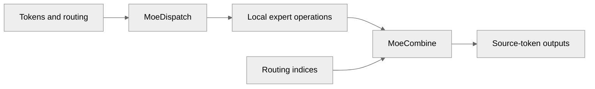

# Add a PyTorch EP=1 backend for MoE dispatch and combine

[Upstream PR](https://github.com/NVIDIA/TransformerEngine/pull/3571) · state: open · merged: False

## Original PR description

**EP=1-only review diff: [vthumbe1503/TransformerEngine#7](https://github.com/vthumbe1503/TransformerEngine/pull/7).**

## Dependency

This draft targets `NVIDIA:main` while [#3503](https://github.com/NVIDIA/TransformerEngine/pull/3503) is still open. The branch is based on #3503 head `261a81c` plus one signed-off `0z5a` implementation commit and one pre-commit.ci formatting commit. Its main-targeting Files changed tab therefore also includes #3503; the linked #7 shows the six-file EP=1 delta for review. After #3503 lands, the branch should be rebased onto `NVIDIA:main` before this PR is made ready.

## Summary

Add a bufferless PyTorch backend for `MoeDispatch` and `MoeCombine` when the expert-parallel group has one rank. Dispatch orders local routes by expert and combine sums expert outputs back into source tokens. Routing metadata belongs to each invocation, so two outstanding forwards do not overwrite each other. The local backend rejects remote expert IDs and communication settings it cannot honor.

This implements the [EP=1 follow-up requested on #3503](https://github.com/NVIDIA/TransformerEngine/pull/3503#issuecomment-5864381517).

## Validation

| Check | Result |
|---|---|
| `CUDA_VISIBLE_DEVICES=3 PYTHONPATH=$PWD python -m pytest tests/pytorch/test_moe_ep_local.py -q` | **13 passed in 11.57 s** on RTX 5090, PyTorch 2.13.0+cu130, at head `6ce761b` |
| Five-op `MoeDispatch → GroupedLinear → ScaledSwiGLU → GroupedLinear → MoeCombine` | BF16 forward and backward match an independent dense PyTorch MoE within `rtol=atol=2e-2`, including token, gate-weight, and expert-weight gradients |
| Twelve-step training E2E with changing inputs and top-k=2 routes | Full five-op forward, backward, SGD updates, and post-update inference matched the dense PyTorch reference; 8 parameter tensors changed, maximum output absolute difference 0.00178438 and maximum gradient absolute difference 0.00277808 |
| Routing cases | top-k=1 and 2, repeated and dropped routes, empty experts, two outstanding forwards, and unsupported settings covered |
| Repository license checker | Passed |

The tests imported the source tree, ran without an initialized `torch.distributed` process group, and the loaded native extension exposed no EP entry points. The NCCL EP distributed suite was not run on this machine. The full L0 launcher was not run because it installs dependencies; the focused tests used the existing environment without package changes.

## Review and discussion

### reviews

- greptile-apps[bot] · COMMENTED · 2026-09-28T08:20:13Z · [source](https://github.com/NVIDIA/TransformerEngine/pull/3571#pullrequestreview-5335784283)

(No body; status only.)

- greptile-apps[bot] · COMMENTED · 2026-10-21T17:13:17Z · [source](https://github.com/NVIDIA/TransformerEngine/pull/3571#pullrequestreview-5603448231)

(No body; status only.)

### issue_comments

- greptile-apps[bot] · comment · 2026-09-28T08:20:05Z · [source](https://github.com/NVIDIA/TransformerEngine/pull/3571#issuecomment-5866185724)

<!-- greptile_summary -->

<h2><a href="https://app.greptile.com/api/retrigger?id=70489431"><picture><source media="(prefers-color-scheme: dark)" srcset="https://greptile-static-assets.s3.amazonaws.com/badges/RetriggerDark.svg?v=2"><source media="(prefers-color-scheme: light)" srcset="https://greptile-static-assets.s3.amazonaws.com/badges/Retrigger.svg?v=2"></picture></a><a href="https://app.greptile.com/-/switch-tenant?tenant=nvidia-public-github&amp;next=%2FNVIDIA%2Ftransformerengine%2Fpull%2F3571&amp;utm_source=greptile_review&amp;utm_medium=github&amp;utm_campaign=view_in_greptile"><picture><source media="(prefers-color-scheme: dark)" srcset="https://greptile-static-assets.s3.amazonaws.com/badges/ViewInGreptileDark.svg?v=2"><source media="(prefers-color-scheme: light)" srcset="https://greptile-static-assets.s3.amazonaws.com/badges/ViewInGreptile.svg?v=2"></picture></a>Confidence Score: 2/5</h2>

**[Medium impact]** The PR adds a local route through the PyTorch MoE dispatch and combine operations\.

The PR still needs fixes for unsupported recipes, changed routing, and mismatched token counts before merging.

<h2>Findings</h2>

1. &nbsp;**Unsupported recipes select MXFP8** <a href="https://github.com/NVIDIA/TransformerEngine/pull/3571#discussion_r4119977332">▶</a>
2. &nbsp;**Combine can use changed routing** <a href="https://github.com/NVIDIA/TransformerEngine/pull/3571#discussion_r4119977338">▶</a>
3. &nbsp;**Dispatch silently drops unmatched tokens** <a href="https://github.com/NVIDIA/TransformerEngine/pull/3571#discussion_r4339729339">▶</a>
4. &nbsp;**Local token limit is ignored** <a href="https://github.com/NVIDIA/TransformerEngine/pull/3571#discussion_r4119977348">▶</a>
5. &nbsp;**Local tests miss L0** <a href="https://github.com/NVIDIA/TransformerEngine/pull/3571#discussion_r4119977356">▶</a>

<h3>Summary</h3>

Adds a bufferless PyTorch backend for single-rank expert routing.
- Local MoE routes now pack expert inputs and sum outputs back to tokens.
- EP configs pick an alignment default from their group.

<h3>Diagram</h3>

<!-- greptile_confidence_score:2 -->

Reviews (5) · Last reviewed commit: ["Merge remote-tracking branch &#39;upstream/m..."](https://github.com/nvidia/transformerengine/commit/3df88213684a3a7691ef0fefa39e98275344253e) · [Reviewed by Greptile](https://www.greptile.com/?utm_source=greptile_review&utm_medium=github&utm_campaign=review_public&utm_content=nvidia/transformerengine)

### inline_comments

- greptile-apps[bot] · comment · 2026-09-28T08:20:11Z · [source](https://github.com/NVIDIA/TransformerEngine/pull/3571#discussion_r4119977332)

File: `transformer_engine/pytorch/ops/basic/dispatch.py` · line 142

 **Unsupported recipes select MXFP8** If an `EpBuffer` has a non-MXFP8 dispatch recipe, this path still quantizes the tokens as MXFP8 rather than rejecting the recipe. That silently uses a different transport format from the one configured. The buffered `MoeCombine` backward path has the same issue; both paths should validate the recipe.

**Knowledge Base Used:** [PyTorch distributed execution](https://app.greptile.com/nvidia-public-github/-/custom-context/knowledge-base/nvidia/transformerengine/-/docs/pytorch-distributed-execution.md)

- greptile-apps[bot] · comment · 2026-09-28T08:20:11Z · [source](https://github.com/NVIDIA/TransformerEngine/pull/3571#discussion_r4119977338)

File: `transformer_engine/pytorch/ops/basic/combine.py` · line 124

 **Combine can use changed routing** Local combine rebuilds the token order from the `topk_idx` supplied at combine time rather than using the order from dispatch. If a caller reuses or changes that tensor between separately invoked stages, combine assigns expert outputs to the wrong source tokens without reporting an error. Retain or verify the dispatch routing.

**Knowledge Base Used:** [PyTorch distributed execution](https://app.greptile.com/nvidia-public-github/-/custom-context/knowledge-base/nvidia/transformerengine/-/docs/pytorch-distributed-execution.md)

- greptile-apps[bot] · comment · 2026-09-28T08:20:12Z · [source](https://github.com/NVIDIA/TransformerEngine/pull/3571#discussion_r4119977348)

File: `transformer_engine/pytorch/ops/basic/moe_local.py` · line 100

 **Local token limit is ignored** Local dispatch accepts more tokens than `config.max_tokens_per_rank` and returns routes for all of them. This makes the configured limit unreliable across EP backends, so callers cannot depend on it to reject an oversized batch. Enforce the limit or clarify that it does not apply locally.

**Knowledge Base Used:** [PyTorch distributed execution](https://app.greptile.com/nvidia-public-github/-/custom-context/knowledge-base/nvidia/transformerengine/-/docs/pytorch-distributed-execution.md)

- greptile-apps[bot] · comment · 2026-09-28T08:20:12Z · [source](https://github.com/NVIDIA/TransformerEngine/pull/3571#discussion_r4119977356)

File: `tests/pytorch/test_moe_ep_local.py` · line 5

 **Local tests miss L0** The PyTorch L0 launcher lists its test files individually but does not include this new file. As a result, the main single-process gate misses the local routing, gradient, and five-operation sequence checks, leaving regressions in the new backend less likely to be caught. Add this file to the launcher.

**Knowledge Base Used:** [Verification and CI matrix](https://app.greptile.com/nvidia-public-github/-/custom-context/knowledge-base/nvidia/transformerengine/-/docs/verification-and-ci.md)

Note: If this suggestion doesn't match your team's coding style, reply to this and let me know. I'll remember it for next time!

- greptile-apps[bot] · comment · 2026-10-21T17:13:16Z · [source](https://github.com/NVIDIA/TransformerEngine/pull/3571#discussion_r4339729339)

File: `transformer_engine/pytorch/ops/basic/dispatch.py` · line 124

 **Dispatch silently drops unmatched tokens**

Local dispatch never checks that `input_` and `topk_idx` describe the same number of tokens. If a caller passes routing from a shorter batch, dispatch silently drops the remaining input rows. Backward then returns a gradient sized for the routing rather than the input, causing training to fail. Check that the row counts match before building the routing plan.

**Knowledge Base Used:** [PyTorch tensor and operator abstractions](https://app.greptile.com/nvidia-public-github/-/custom-context/knowledge-base/nvidia/transformerengine/-/docs/pytorch-tensors-and-ops.md)

## Changed files and fixed code

- `docs/api/pytorch.rst` · modified · additions 8 / deletions 0
  - [head](https://github.com/0z5a/TransformerEngine/blob/3df88213684a3a7691ef0fefa39e98275344253e/docs/api/pytorch.rst)
  - [base](https://github.com/NVIDIA/TransformerEngine/blob/63451d6b868af0db6dd879cf5dd6a3f9bf14e1f9/docs/api/pytorch.rst)
- `tests/pytorch/test_moe_ep_local.py` · added · additions 376 / deletions 0
  - [head](https://github.com/0z5a/TransformerEngine/blob/3df88213684a3a7691ef0fefa39e98275344253e/tests/pytorch/test_moe_ep_local.py)
  - [base](https://github.com/NVIDIA/TransformerEngine/blob/63451d6b868af0db6dd879cf5dd6a3f9bf14e1f9/tests/pytorch/test_moe_ep_local.py)
- `transformer_engine/pytorch/ep.py` · modified · additions 10 / deletions 5
  - [head](https://github.com/0z5a/TransformerEngine/blob/3df88213684a3a7691ef0fefa39e98275344253e/transformer_engine/pytorch/ep.py)
  - [base](https://github.com/NVIDIA/TransformerEngine/blob/63451d6b868af0db6dd879cf5dd6a3f9bf14e1f9/transformer_engine/pytorch/ep.py)
- `transformer_engine/pytorch/ops/basic/combine.py` · modified · additions 24 / deletions 5
  - [head](https://github.com/0z5a/TransformerEngine/blob/3df88213684a3a7691ef0fefa39e98275344253e/transformer_engine/pytorch/ops/basic/combine.py)
  - [base](https://github.com/NVIDIA/TransformerEngine/blob/63451d6b868af0db6dd879cf5dd6a3f9bf14e1f9/transformer_engine/pytorch/ops/basic/combine.py)
- `transformer_engine/pytorch/ops/basic/dispatch.py` · modified · additions 40 / deletions 13
  - [head](https://github.com/0z5a/TransformerEngine/blob/3df88213684a3a7691ef0fefa39e98275344253e/transformer_engine/pytorch/ops/basic/dispatch.py)
  - [base](https://github.com/NVIDIA/TransformerEngine/blob/63451d6b868af0db6dd879cf5dd6a3f9bf14e1f9/transformer_engine/pytorch/ops/basic/dispatch.py)
- `transformer_engine/pytorch/ops/basic/moe_local.py` · added · additions 164 / deletions 0
  - [head](https://github.com/0z5a/TransformerEngine/blob/3df88213684a3a7691ef0fefa39e98275344253e/transformer_engine/pytorch/ops/basic/moe_local.py)
  - [base](https://github.com/NVIDIA/TransformerEngine/blob/63451d6b868af0db6dd879cf5dd6a3f9bf14e1f9/transformer_engine/pytorch/ops/basic/moe_local.py)

## Evidence and interpretation boundary

[Original JSON, discussions and patches](../../../../../../evidence/prs/NVIDIA--TransformerEngine/3571-a9b3d06a771d20259bc01b229e537a8776497abb2e73f1d22e8f2ffbcd617fbd.json) · SHA-256 `a9b3d06a771d20259bc01b229e537a8776497abb2e73f1d22e8f2ffbcd617fbd`.

Diff complete: True. Missing/binary/truncated patches require pinned source inspection. This is a source page, not an independently verified optimization case. Open, merged and released are different states; recheck the deployed dependency.
