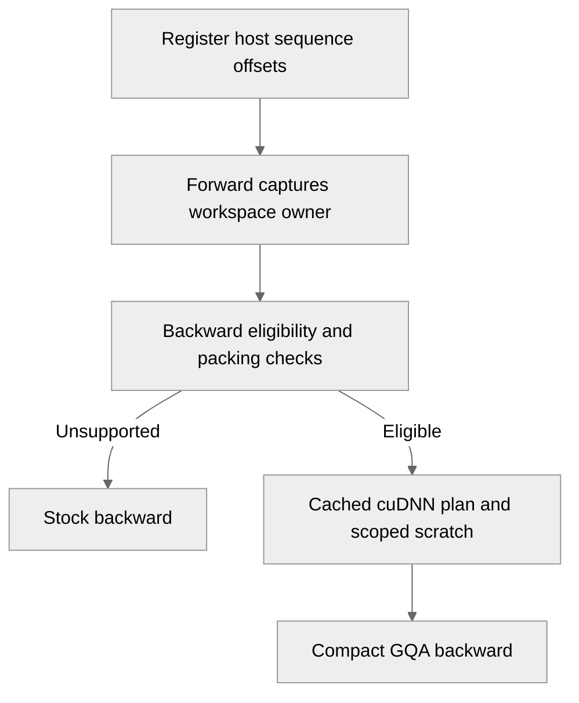

# Add opt-in compact GQA backward with registered packing metadata

[Upstream PR](https://github.com/NVIDIA/TransformerEngine/pull/3575) · state: open · merged: False

## Original PR description

Add opt-in compact GQA backward through cuDNN Frontend. Register host packing offsets and scope scratch reuse to forward/backward; unsupported inputs keep the existing path.

Enable with `NVTE_CUDNN_COMPACT_GQA_BWD=1`. Supports SM107, BF16 packed THD, Hq=8/Hkv=1, D=256, and causal attention.

Validation: 39 CPU contract tests across the companion changes and three native SM107 numerical cases passed. Latest full-workload A/B reduced mean policy-training time by **1.46%**; rollout token counts differed, so timings are not normalized. The complete required L0 suites remain pending.

Requires NVIDIA/cudnn-frontend#1207. Packing integration: NVIDIA-NeMo/RL#4293.

## Review and discussion

### reviews

- greptile-apps[bot] · COMMENTED · 2026-09-29T12:24:12Z · [source](https://github.com/NVIDIA/TransformerEngine/pull/3575#pullrequestreview-5352522449)

(No body; status only.)

- greptile-apps[bot] · COMMENTED · 2026-09-29T12:35:43Z · [source](https://github.com/NVIDIA/TransformerEngine/pull/3575#pullrequestreview-5352661824)

(No body; status only.)

- layalir · COMMENTED · 2026-09-29T12:47:31Z · [source](https://github.com/NVIDIA/TransformerEngine/pull/3575#pullrequestreview-5352793677)

(No body; status only.)

- layalir · COMMENTED · 2026-09-29T12:47:32Z · [source](https://github.com/NVIDIA/TransformerEngine/pull/3575#pullrequestreview-5352794004)

(No body; status only.)

- layalir · COMMENTED · 2026-09-29T12:47:34Z · [source](https://github.com/NVIDIA/TransformerEngine/pull/3575#pullrequestreview-5352794294)

(No body; status only.)

- greptile-apps[bot] · COMMENTED · 2026-09-29T12:48:11Z · [source](https://github.com/NVIDIA/TransformerEngine/pull/3575#pullrequestreview-5352801151)

(No body; status only.)

### issue_comments

- greptile-apps[bot] · comment · 2026-09-29T12:24:07Z · [source](https://github.com/NVIDIA/TransformerEngine/pull/3575#issuecomment-5890243862)

<!-- greptile_summary -->

<h2><a href="https://app.greptile.com/api/retrigger?id=71302452"><picture><source media="(prefers-color-scheme: dark)" srcset="https://greptile-static-assets.s3.amazonaws.com/badges/RetriggerDark.svg?v=2"><source media="(prefers-color-scheme: light)" srcset="https://greptile-static-assets.s3.amazonaws.com/badges/Retrigger.svg?v=2"></picture></a>Confidence Score: 5/5</h2>

**[Medium risk]** Adds opt\-in compact GQA backward path for attention\.

The reviewed changes appear safe to merge; no new actionable issue or outstanding prior finding was identified.

<h3>Summary</h3>

The PR adds opt-in compact GQA backward dispatch using registered host packing metadata and scoped scratch reuse.
- Adds eligibility checks and a stock-backward fallback.
- Exposes the registration and workspace APIs, documents the opt-in setting, and adds the compact GQA tests to PyTorch L0.

<h3>Diagram</h3>

<!-- greptile_confidence_score:5 -->

Reviews (3) · Last reviewed commit: ["Address compact GQA review coverage and ..."](https://github.com/nvidia/transformerengine/commit/b5620e267459f8068bd62493c0a16923c321a875)

### inline_comments

- greptile-apps[bot] · comment · 2026-09-29T12:24:10Z · [source](https://github.com/NVIDIA/TransformerEngine/pull/3575#discussion_r4133397767)

File: `transformer_engine/pytorch/attention/dot_product_attention/compact_gqa.py` · line 125

 **Plan cache ignores sequence capacity**

A later batch on the same device and stream can have longer sequences than the batch used to compile this cached plan. The code enlarges the scratch buffer but reuses the plan compiled with the smaller `max_seqlen`. If the compiled plan cannot handle longer sequences after workspace reinitialization, backward can fail or return incorrect gradients. Rebuild or distinguish plans when capacity grows.

**Knowledge Base Used:** [PyTorch attention execution](https://app.greptile.com/nvidia-public-github/-/custom-context/knowledge-base/nvidia/transformerengine/-/docs/pytorch-attention.md)

- greptile-apps[bot] · comment · 2026-09-29T12:24:10Z · [source](https://github.com/NVIDIA/TransformerEngine/pull/3575#discussion_r4133397775)

File: `tests/pytorch/attention/test_compact_gqa_dispatch.py` · line None

 **New tests miss L0**

The PyTorch L0 suite runs attention tests by explicit filename, but it does not include this module, `test_compact_gqa_dispatch_cuda.py`, or `test_packed_sequence_metadata.py`. As a result, registration, dispatch, and workspace behavior can regress without failing that gate. Add the new files to its attention test commands while retaining the native test’s SM107 gate.

**Knowledge Base Used:** [Verification and CI matrix](https://app.greptile.com/nvidia-public-github/-/custom-context/knowledge-base/nvidia/transformerengine/-/docs/verification-and-ci.md)

Note: If this suggestion doesn't match your team's coding style, reply to this and let me know. I'll remember it for next time!

- greptile-apps[bot] · comment · 2026-09-29T12:35:42Z · [source](https://github.com/NVIDIA/TransformerEngine/pull/3575#discussion_r4133504134)

File: `docs/envvars.rst` · line None

 **Registration instructions are missing**

Setting this variable alone does not activate compact GQA backward. Callers must register the sequence offsets; otherwise the code silently uses stock backward. The shortened description says only “registered packing metadata” without naming `attention.register_cu_seqlens` or explaining when to call it, so users following these instructions may never reach the new backend.

- layalir · comment · 2026-09-29T12:47:31Z · [source](https://github.com/NVIDIA/TransformerEngine/pull/3575#discussion_r4133615121)

File: `transformer_engine/pytorch/attention/dot_product_attention/compact_gqa.py` · line 125

The cuDNN API supports growth without recompilation: [compile()](https://github.com/NVIDIA/cudnn-frontend/blob/9f0b93ce6b4d50b7061b6f698fab02bf680992c5/python/cudnn/sdpa/bwd/compact_gqa/api.py#L233) uses symbolic lengths, and [initialize_workspace()](https://github.com/NVIDIA/cudnn-frontend/blob/9f0b93ce6b4d50b7061b6f698fab02bf680992c5/python/cudnn/sdpa/bwd/compact_gqa/api.py#L332) updates capacity/layout. Kept the length-independent cache and added small → large → small coverage with one plan and workspace scope in [b5620e267459](https://github.com/NVIDIA/TransformerEngine/commit/b5620e267459f8068bd62493c0a16923c321a875). CPU checks pass; the SM107 numerical rerun remains pending.

- layalir · comment · 2026-09-29T12:47:32Z · [source](https://github.com/NVIDIA/TransformerEngine/pull/3575#discussion_r4133615342)

File: `tests/pytorch/attention/test_compact_gqa_dispatch.py` · line None

Added the consolidated test_compact_gqa.py to PyTorch L0 in [b5620e267459](https://github.com/NVIDIA/TransformerEngine/commit/b5620e267459f8068bd62493c0a16923c321a875). CUDA/SM107 gates are retained.

- layalir · comment · 2026-09-29T12:47:34Z · [source](https://github.com/NVIDIA/TransformerEngine/pull/3575#discussion_r4133615585)

File: `docs/envvars.rst` · line None

The one-line description now names attention.register_cu_seqlens(tensor, offsets) and requires registration after each prefix tensor's final write, before forward. Updated in [b5620e267459](https://github.com/NVIDIA/TransformerEngine/commit/b5620e267459f8068bd62493c0a16923c321a875).

- greptile-apps[bot] · comment · 2026-09-29T12:48:11Z · [source](https://github.com/NVIDIA/TransformerEngine/pull/3575#discussion_r4133621626)

File: `transformer_engine/pytorch/attention/dot_product_attention/compact_gqa.py` · line 125

Thanks for the clarification. With `compile()` using symbolic sequence lengths and `initialize_workspace()` updating the plan’s capacity/layout, reusing a length-independent plan is supported. The larger scratch allocation is rebound when capacity grows, and the small → large → small coverage exercises the relevant workspace transition, so my original concern about requiring a plan rebuild is resolved.

Tip: You can customize Greptile's behavior for this repo with [`.greptile/rules.md` and `.greptile/config.json`](https://www.greptile.com/docs/code-review/custom-standards).

## Changed files and fixed code

- `docs/api/pytorch.rst` · modified · additions 4 / deletions 0
  - [head](https://github.com/layalir/TransformerEngine/blob/b5620e267459f8068bd62493c0a16923c321a875/docs/api/pytorch.rst)
  - [base](https://github.com/NVIDIA/TransformerEngine/blob/9c33764bd9fd88cb4984ef2b60e9f0623055d3b2/docs/api/pytorch.rst)
- `docs/envvars.rst` · modified · additions 1 / deletions 0
  - [head](https://github.com/layalir/TransformerEngine/blob/b5620e267459f8068bd62493c0a16923c321a875/docs/envvars.rst)
  - [base](https://github.com/NVIDIA/TransformerEngine/blob/9c33764bd9fd88cb4984ef2b60e9f0623055d3b2/docs/envvars.rst)
- `qa/L0_pytorch_unittest/test.sh` · modified · additions 1 / deletions 0
  - [head](https://github.com/layalir/TransformerEngine/blob/b5620e267459f8068bd62493c0a16923c321a875/qa/L0_pytorch_unittest/test.sh)
  - [base](https://github.com/NVIDIA/TransformerEngine/blob/9c33764bd9fd88cb4984ef2b60e9f0623055d3b2/qa/L0_pytorch_unittest/test.sh)
- `tests/pytorch/attention/test_compact_gqa.py` · added · additions 386 / deletions 0
  - [head](https://github.com/layalir/TransformerEngine/blob/b5620e267459f8068bd62493c0a16923c321a875/tests/pytorch/attention/test_compact_gqa.py)
  - [base](https://github.com/NVIDIA/TransformerEngine/blob/9c33764bd9fd88cb4984ef2b60e9f0623055d3b2/tests/pytorch/attention/test_compact_gqa.py)
- `transformer_engine/pytorch/attention/__init__.py` · modified · additions 3 / deletions 0
  - [head](https://github.com/layalir/TransformerEngine/blob/b5620e267459f8068bd62493c0a16923c321a875/transformer_engine/pytorch/attention/__init__.py)
  - [base](https://github.com/NVIDIA/TransformerEngine/blob/9c33764bd9fd88cb4984ef2b60e9f0623055d3b2/transformer_engine/pytorch/attention/__init__.py)
- `transformer_engine/pytorch/attention/dot_product_attention/backends.py` · modified · additions 13 / deletions 0
  - [head](https://github.com/layalir/TransformerEngine/blob/b5620e267459f8068bd62493c0a16923c321a875/transformer_engine/pytorch/attention/dot_product_attention/backends.py)
  - [base](https://github.com/NVIDIA/TransformerEngine/blob/9c33764bd9fd88cb4984ef2b60e9f0623055d3b2/transformer_engine/pytorch/attention/dot_product_attention/backends.py)
- `transformer_engine/pytorch/attention/dot_product_attention/compact_gqa.py` · added · additions 172 / deletions 0
  - [head](https://github.com/layalir/TransformerEngine/blob/b5620e267459f8068bd62493c0a16923c321a875/transformer_engine/pytorch/attention/dot_product_attention/compact_gqa.py)
  - [base](https://github.com/NVIDIA/TransformerEngine/blob/9c33764bd9fd88cb4984ef2b60e9f0623055d3b2/transformer_engine/pytorch/attention/dot_product_attention/compact_gqa.py)
- `transformer_engine/pytorch/attention/packed_sequence.py` · added · additions 105 / deletions 0
  - [head](https://github.com/layalir/TransformerEngine/blob/b5620e267459f8068bd62493c0a16923c321a875/transformer_engine/pytorch/attention/packed_sequence.py)
  - [base](https://github.com/NVIDIA/TransformerEngine/blob/9c33764bd9fd88cb4984ef2b60e9f0623055d3b2/transformer_engine/pytorch/attention/packed_sequence.py)

## Evidence and interpretation boundary

[Original JSON, discussions and patches](../../../../../../evidence/prs/NVIDIA--TransformerEngine/3575-25a85c3c8b71691965ade18fb1c061398336cfbb3f8db61c73bd0f6c8132c3bf.json) · SHA-256 `25a85c3c8b71691965ade18fb1c061398336cfbb3f8db61c73bd0f6c8132c3bf`.

Diff complete: True. Missing/binary/truncated patches require pinned source inspection. This is a source page, not an independently verified optimization case. Open, merged and released are different states; recheck the deployed dependency.
