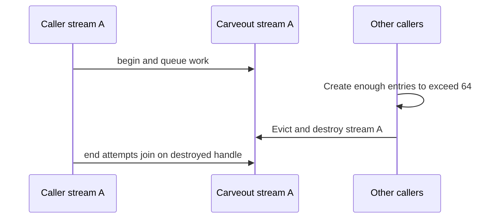

# [Common] Add NVTE_GROUPED_QUANTIZE_SM_MARGIN to reserve SMs from grouped quantize/swizzle

[Upstream PR](https://github.com/NVIDIA/TransformerEngine/pull/3585) · state: closed · merged: False

## Original PR description

# Description

Adds `NVTE_GROUPED_QUANTIZE_SM_MARGIN` to reserve SMs from grouped MXFP8 quantize/swizzle kernels via a green-context-carved stream, so overlapped comms have room to run.

## Type of change

- [ ] Documentation change (change only to the documentation, either a fix or a new content)
- [ ] Bug fix (non-breaking change which fixes an issue)
- [x] New feature (non-breaking change which adds functionality)
- [ ] Breaking change (fix or feature that would cause existing functionality to not work as expected)
- [ ] Infra/Build change
- [ ] Code refactoring

## Changes

- All grouped quantize/swizzle kernels (persistent and direct-mapper) launch on a stream carved by `sm_carveout_stream_begin`/`_end` (`sm_carveout.{h,cpp}`; CUDA 12.4+, ignored with a warning otherwise). The carveout is skipped and the original stream is used unchanged when the margin is 0.
- `cuda_driver.h`: version-aware driver symbol resolution for the green-context APIs.
- Documented in `docs/envvars.rst`.
- 
### Testing
- `test_cast_mxfp8_grouped.cu`, `test_swizzle.cu`: valid and out-of-range margins.
- Full grouped cast/swizzle regression suite (986 cases) passes.
 
# Checklist:

- [x] I have read and followed the [contributing guidelines](https://github.com/NVIDIA/TransformerEngine/blob/main/CONTRIBUTING.rst)
- [x] The functionality is complete
- [x] I have commented my code, particularly in hard-to-understand areas
- [x] I have made corresponding changes to the documentation
- [x] My changes generate no new warnings
- [x] I have added tests that prove my fix is effective or that my feature works
- [x] New and existing unit tests pass locally with my changes

## Review and discussion

### reviews

- greptile-apps[bot] · COMMENTED · 2026-09-29T16:34:11Z · [source](https://github.com/NVIDIA/TransformerEngine/pull/3585#pullrequestreview-5355564708)

(No body; status only.)

- Oleg-Goncharov · DISMISSED · 2026-09-29T16:41:43Z · [source](https://github.com/NVIDIA/TransformerEngine/pull/3585#pullrequestreview-5355646037)

LGTM

- vthumbe1503 · COMMENTED · 2026-09-29T16:48:00Z · [source](https://github.com/NVIDIA/TransformerEngine/pull/3585#pullrequestreview-5355713959)

(No body; status only.)

- vthumbe1503 · COMMENTED · 2026-09-29T16:49:27Z · [source](https://github.com/NVIDIA/TransformerEngine/pull/3585#pullrequestreview-5355729484)

(No body; status only.)

- phu0ngng · COMMENTED · 2026-09-29T16:50:02Z · [source](https://github.com/NVIDIA/TransformerEngine/pull/3585#pullrequestreview-5355736312)

(No body; status only.)

- phu0ngng · COMMENTED · 2026-09-29T17:10:36Z · [source](https://github.com/NVIDIA/TransformerEngine/pull/3585#pullrequestreview-5355952045)

(No body; status only.)

- greptile-apps[bot] · COMMENTED · 2026-09-29T18:24:28Z · [source](https://github.com/NVIDIA/TransformerEngine/pull/3585#pullrequestreview-5356700237)

(No body; status only.)

- greptile-apps[bot] · COMMENTED · 2026-09-29T18:43:13Z · [source](https://github.com/NVIDIA/TransformerEngine/pull/3585#pullrequestreview-5356896962)

(No body; status only.)

- greptile-apps[bot] · COMMENTED · 2026-09-29T19:27:31Z · [source](https://github.com/NVIDIA/TransformerEngine/pull/3585#pullrequestreview-5357363265)

(No body; status only.)

- greptile-apps[bot] · COMMENTED · 2026-09-29T19:43:56Z · [source](https://github.com/NVIDIA/TransformerEngine/pull/3585#pullrequestreview-5357528502)

(No body; status only.)

### issue_comments

- phu0ngng · comment · 2026-09-29T16:33:52Z · [source](https://github.com/NVIDIA/TransformerEngine/pull/3585#issuecomment-5894429238)

/te-ci L0 core

- greptile-apps[bot] · comment · 2026-09-29T16:34:05Z · [source](https://github.com/NVIDIA/TransformerEngine/pull/3585#issuecomment-5894432528)

<!-- greptile_summary -->

<h2><a href="https://app.greptile.com/api/retrigger?id=71451707"><picture><source media="(prefers-color-scheme: dark)" srcset="https://greptile-static-assets.s3.amazonaws.com/badges/RetriggerDark.svg?v=2"><source media="(prefers-color-scheme: light)" srcset="https://greptile-static-assets.s3.amazonaws.com/badges/Retrigger.svg?v=2"></picture></a>Confidence Score: 4/5</h2>

**[Medium risk]** Adds SM carveout mechanism for grouped quantize and swizzle kernels\.

The PR is not yet safe to merge because cache eviction can break an active grouped operation’s stream synchronization.

<h2>Findings</h2>

1. &nbsp;**Active carveout stream evicted** <a href="https://github.com/NVIDIA/TransformerEngine/pull/3585#discussion_r4137603189">▶</a>

<h3>Summary</h3>

The PR adds a configurable SM margin for grouped MXFP8 quantization and scale swizzling by launching their kernels on green-context streams.
- Adds driver-symbol resolution, stream fork/join handling, documentation, and margin tests.
- The newly bounded stream cache can evict a resource while a call still uses it.

<h3>Diagram</h3>

<!-- greptile_confidence_score:4 -->

Reviews (5) · Last reviewed commit: ["Fix SM margin validation on pre-12.4 CUD..."](https://github.com/nvidia/transformerengine/commit/6e62c31994d3f4b679d5b09416a422168917ab59)

- phu0ngng · comment · 2026-09-29T19:23:57Z · [source](https://github.com/NVIDIA/TransformerEngine/pull/3585#issuecomment-5897091267)

/te-ci L0 core

### inline_comments

- greptile-apps[bot] · comment · 2026-09-29T16:34:09Z · [source](https://github.com/NVIDIA/TransformerEngine/pull/3585#discussion_r4135922894)

File: `transformer_engine/common/cast/mxfp8/group_quantize_mxfp8.cuh` · line None

 **Negative margins pass validation**

A negative `NVTE_GROUPED_QUANTIZE_SM_MARGIN` passes this check. For example, `-1` increases the persistent grid instead of reserving SMs, and `INT_MIN` can overflow the signed subtraction before the grid is sized. The variable-shape swizzle path has the same check, so both paths need to reject negative values.

- greptile-apps[bot] · comment · 2026-09-29T16:34:09Z · [source](https://github.com/NVIDIA/TransformerEngine/pull/3585#discussion_r4135922908)

File: `tests/cpp/operator/test_swizzle.cu` · line None

 **Irregular shape coverage removed**

Case 3 now duplicates Case 2 instead of testing mixed small and irregular shapes. This leaves the variable-shape padding and bounds handling for inputs such as `(33, 64)` and `(1, 32)` without that regression coverage. Keep the irregular case alongside the new margin tests.

**Knowledge Base Used:** [Verification and CI matrix](https://app.greptile.com/nvidia-public-github/-/custom-context/knowledge-base/nvidia/transformerengine/-/docs/verification-and-ci.md)

Note: If this suggestion doesn't match your team's coding style, reply to this and let me know. I'll remember it for next time!

- greptile-apps[bot] · comment · 2026-09-29T16:34:09Z · [source](https://github.com/NVIDIA/TransformerEngine/pull/3585#discussion_r4135922920)

File: `tests/cpp/operator/test_cast_mxfp8_grouped.cu` · line 902

 **SM reservation remains untested**

The successful-margin tests check that the operations produce correct output, but not that their grids shrink. They would still pass if the margin were ignored, so they do not protect the feature’s intended SM reservation. Add a focused check of the reduced launch size or another observable scheduling effect; the swizzle success test has the same gap.

- greptile-apps[bot] · comment · 2026-09-29T16:34:09Z · [source](https://github.com/NVIDIA/TransformerEngine/pull/3585#discussion_r4135922929)

File: `tests/cpp/operator/test_swizzle.cu` · line None

 **Tests depend on process isolation**

CTest gives these cases separate processes, but the margin is cached on its first read for the lifetime of a process. If the GoogleTest executable is run directly without a filter, an earlier test can cache a different value, causing the out-of-range test to fail to throw. Make the environment-dependent cases independently runnable or isolate them explicitly; the grouped-cast margin tests have the same dependency.

**Knowledge Base Used:** [Verification and CI matrix](https://app.greptile.com/nvidia-public-github/-/custom-context/knowledge-base/nvidia/transformerengine/-/docs/verification-and-ci.md)

- vthumbe1503 · comment · 2026-09-29T16:48:00Z · [source](https://github.com/NVIDIA/TransformerEngine/pull/3585#discussion_r4136048305)

File: `transformer_engine/common/cast/mxfp8/group_quantize_mxfp8.cuh` · line None

Currently i dont think this would give any perf benefit. Since this code path is not used for SAME_BOTH_DIMS and VARYING_FIRST_DIMS which are used in our prod workflow for group_quantizing weights/activations/grads.

We recently got rid of persistent kernel for varying first dims since @Oleg-Goncharov found we got better perf without it in this PR
https://github.com/NVIDIA/TransformerEngine/pull/3337

We probably need to evaluate whether still going back to persistent kernel is a better idea to reserve SMs for comms.

- vthumbe1503 · comment · 2026-09-29T16:49:27Z · [source](https://github.com/NVIDIA/TransformerEngine/pull/3585#discussion_r4136061642)

File: `transformer_engine/common/swizzle/swizzle.cu` · line 2335

It might be better to have a different env variable for this. Since we are not really reserving SMs for group quantize here?

- phu0ngng · comment · 2026-09-29T16:50:01Z · [source](https://github.com/NVIDIA/TransformerEngine/pull/3585#discussion_r4136067233)

File: `transformer_engine/common/cast/mxfp8/group_quantize_mxfp8.cuh` · line None

Oh, good to know that this code path is not used for those. 
Let me add the SM carve-out for other code paths in addition, then. 

- phu0ngng · comment · 2026-09-29T17:10:36Z · [source](https://github.com/NVIDIA/TransformerEngine/pull/3585#discussion_r4136250929)

File: `transformer_engine/common/swizzle/swizzle.cu` · line 2335

I prefer reusing the same env since swizzle always goes with quantize and should not use more SMs than quantize anyway. We can add more env vars later if we have a use case in which we need finer tuning. 

- greptile-apps[bot] · comment · 2026-09-29T18:24:27Z · [source](https://github.com/NVIDIA/TransformerEngine/pull/3585#discussion_r4136894575)

File: `transformer_engine/common/util/sm_carveout.cpp` · line None

 **Independent calls share one stream**

With a nonzero margin, grouped quantize and swizzle calls on the same device all use this cached stream. Calls from different caller streams therefore run one after another, and a call waiting for its inputs can delay an otherwise ready call. This can reduce the concurrency the operations previously had and slow workloads that overlap GPU work.

**Knowledge Base Used:** [Native CUDA kernel platform](https://app.greptile.com/nvidia-public-github/-/custom-context/knowledge-base/nvidia/transformerengine/-/docs/native-kernels.md)

Note: If this suggestion doesn't match your team's coding style, reply to this and let me know. I'll remember it for next time!

- greptile-apps[bot] · comment · 2026-09-29T18:43:12Z · [source](https://github.com/NVIDIA/TransformerEngine/pull/3585#discussion_r4137063291)

File: `transformer_engine/common/swizzle/swizzle.cu` · line None

 **SM reservation is not enforced**

With a nonzero margin, variable-shape grouped swizzle now launches fewer blocks on an unrestricted caller stream. Grouped quantize does the same. Fewer blocks do not control which SMs CUDA uses, so these kernels can still run on SMs meant to be available for concurrent communication. The requested reservation is therefore not guaranteed for either persistent path.

- greptile-apps[bot] · comment · 2026-09-29T19:27:26Z · [source](https://github.com/NVIDIA/TransformerEngine/pull/3585#discussion_r4137463088)

File: `transformer_engine/common/util/sm_carveout.cpp` · line 32

 **Invalid margins bypass validation**

On a supported CUDA 12.1–12.3 build, the only remaining margin range check is compiled out. A margin equal to or greater than the device SM count is now warned about and ignored instead of rejected. This regresses variable-shape swizzle and makes its out-of-range test fail on those builds. Keep range validation outside the CUDA 12.4 guard.

- greptile-apps[bot] · comment · 2026-09-29T19:27:26Z · [source](https://github.com/NVIDIA/TransformerEngine/pull/3585#discussion_r4137463096)

File: `transformer_engine/common/util/sm_carveout.cpp` · line None

 **Per-caller GPU resources accumulate**

Each distinct caller-stream handle permanently retains a green-context stream and two events. Callers that create and discard streams therefore accumulate GPU resources and cache entries for the process lifetime, even after those streams are gone. Provide a bounded or lifecycle-aware way to release them.

- greptile-apps[bot] · comment · 2026-09-29T19:43:51Z · [source](https://github.com/NVIDIA/TransformerEngine/pull/3585#discussion_r4137603189)

File: `transformer_engine/common/util/sm_carveout.cpp` · line 163

 **Active carveout stream evicted**

With a nonzero margin, concurrent calls on more than 64 distinct caller streams can evict an entry between its `sm_carveout_stream_begin` and `sm_carveout_stream_end` calls. Eviction destroys the carveout stream that the first call still holds. `end` then creates a new cache entry but tries to record its join event on the destroyed stream handle. The operation can fail, or the caller stream can lose the dependency on unfinished quantize or swizzle work.

**Knowledge Base Used:** [Native CUDA kernel platform](https://app.greptile.com/nvidia-public-github/-/custom-context/knowledge-base/nvidia/transformerengine/-/docs/native-kernels.md)

## Changed files and fixed code

- `docs/envvars.rst` · modified · additions 12 / deletions 0
  - [head](https://github.com/phu0ngng/TransformerEngine/blob/6e62c31994d3f4b679d5b09416a422168917ab59/docs/envvars.rst)
  - [base](https://github.com/NVIDIA/TransformerEngine/blob/eb56ba22fd2b3c1fa4c962a4a575d4ba12d1fcbc/docs/envvars.rst)
- `tests/cpp/operator/test_cast_mxfp8_grouped.cu` · modified · additions 83 / deletions 0
  - [head](https://github.com/phu0ngng/TransformerEngine/blob/6e62c31994d3f4b679d5b09416a422168917ab59/tests/cpp/operator/test_cast_mxfp8_grouped.cu)
  - [base](https://github.com/NVIDIA/TransformerEngine/blob/eb56ba22fd2b3c1fa4c962a4a575d4ba12d1fcbc/tests/cpp/operator/test_cast_mxfp8_grouped.cu)
- `tests/cpp/operator/test_swizzle.cu` · modified · additions 24 / deletions 0
  - [head](https://github.com/phu0ngng/TransformerEngine/blob/6e62c31994d3f4b679d5b09416a422168917ab59/tests/cpp/operator/test_swizzle.cu)
  - [base](https://github.com/NVIDIA/TransformerEngine/blob/eb56ba22fd2b3c1fa4c962a4a575d4ba12d1fcbc/tests/cpp/operator/test_swizzle.cu)
- `transformer_engine/common/CMakeLists.txt` · modified · additions 1 / deletions 0
  - [head](https://github.com/phu0ngng/TransformerEngine/blob/6e62c31994d3f4b679d5b09416a422168917ab59/transformer_engine/common/CMakeLists.txt)
  - [base](https://github.com/NVIDIA/TransformerEngine/blob/eb56ba22fd2b3c1fa4c962a4a575d4ba12d1fcbc/transformer_engine/common/CMakeLists.txt)
- `transformer_engine/common/cast/mxfp8/group_quantize_mxfp8.cuh` · modified · additions 15 / deletions 2
  - [head](https://github.com/phu0ngng/TransformerEngine/blob/6e62c31994d3f4b679d5b09416a422168917ab59/transformer_engine/common/cast/mxfp8/group_quantize_mxfp8.cuh)
  - [base](https://github.com/NVIDIA/TransformerEngine/blob/eb56ba22fd2b3c1fa4c962a4a575d4ba12d1fcbc/transformer_engine/common/cast/mxfp8/group_quantize_mxfp8.cuh)
- `transformer_engine/common/swizzle/swizzle.cu` · modified · additions 14 / deletions 3
  - [head](https://github.com/phu0ngng/TransformerEngine/blob/6e62c31994d3f4b679d5b09416a422168917ab59/transformer_engine/common/swizzle/swizzle.cu)
  - [base](https://github.com/NVIDIA/TransformerEngine/blob/eb56ba22fd2b3c1fa4c962a4a575d4ba12d1fcbc/transformer_engine/common/swizzle/swizzle.cu)
- `transformer_engine/common/util/cuda_driver.h` · modified · additions 28 / deletions 7
  - [head](https://github.com/phu0ngng/TransformerEngine/blob/6e62c31994d3f4b679d5b09416a422168917ab59/transformer_engine/common/util/cuda_driver.h)
  - [base](https://github.com/NVIDIA/TransformerEngine/blob/eb56ba22fd2b3c1fa4c962a4a575d4ba12d1fcbc/transformer_engine/common/util/cuda_driver.h)
- `transformer_engine/common/util/cuda_runtime.cpp` · modified · additions 7 / deletions 0
  - [head](https://github.com/phu0ngng/TransformerEngine/blob/6e62c31994d3f4b679d5b09416a422168917ab59/transformer_engine/common/util/cuda_runtime.cpp)
  - [base](https://github.com/NVIDIA/TransformerEngine/blob/eb56ba22fd2b3c1fa4c962a4a575d4ba12d1fcbc/transformer_engine/common/util/cuda_runtime.cpp)
- `transformer_engine/common/util/cuda_runtime.h` · modified · additions 6 / deletions 0
  - [head](https://github.com/phu0ngng/TransformerEngine/blob/6e62c31994d3f4b679d5b09416a422168917ab59/transformer_engine/common/util/cuda_runtime.h)
  - [base](https://github.com/NVIDIA/TransformerEngine/blob/eb56ba22fd2b3c1fa4c962a4a575d4ba12d1fcbc/transformer_engine/common/util/cuda_runtime.h)
- `transformer_engine/common/util/sm_carveout.cpp` · added · additions 191 / deletions 0
  - [head](https://github.com/phu0ngng/TransformerEngine/blob/6e62c31994d3f4b679d5b09416a422168917ab59/transformer_engine/common/util/sm_carveout.cpp)
  - [base](https://github.com/NVIDIA/TransformerEngine/blob/eb56ba22fd2b3c1fa4c962a4a575d4ba12d1fcbc/transformer_engine/common/util/sm_carveout.cpp)
- `transformer_engine/common/util/sm_carveout.h` · added · additions 29 / deletions 0
  - [head](https://github.com/phu0ngng/TransformerEngine/blob/6e62c31994d3f4b679d5b09416a422168917ab59/transformer_engine/common/util/sm_carveout.h)
  - [base](https://github.com/NVIDIA/TransformerEngine/blob/eb56ba22fd2b3c1fa4c962a4a575d4ba12d1fcbc/transformer_engine/common/util/sm_carveout.h)

## Evidence and interpretation boundary

[Original JSON, discussions and patches](../../../../../../evidence/prs/NVIDIA--TransformerEngine/3585-3aa759f32989d51cae0ae87b7d8a5244ce4f9e7c92d1cfc5961ec8ce7bcf39cc.json) · SHA-256 `3aa759f32989d51cae0ae87b7d8a5244ce4f9e7c92d1cfc5961ec8ce7bcf39cc`.

Diff complete: True. Missing/binary/truncated patches require pinned source inspection. This is a source page, not an independently verified optimization case. Open, merged and released are different states; recheck the deployed dependency.
