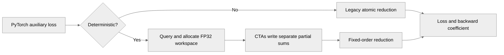

# Deterministic MoE Router Kernel By Removing Global Atomic Ops

[Upstream PR](https://github.com/NVIDIA/TransformerEngine/pull/3587) · state: open · merged: False

## Original PR description

# Description

Please include a brief summary of the changes, relevant motivation and context.

Fixes https://github.com/NVIDIA/Megatron-LM/issues/7221

## Type of change

- [ ] Documentation change (change only to the documentation, either a fix or a new content)
- [ ] Bug fix (non-breaking change which fixes an issue)
- [ ] New feature (non-breaking change which adds functionality)
- [ ] Breaking change (fix or feature that would cause existing functionality to not work as expected)
- [ ] Infra/Build change
- [ ] Code refactoring

## Changes

Please list the changes introduced in this PR:

- Change A
- Change B

# Checklist:

- [ ] I have read and followed the [contributing guidelines](https://github.com/NVIDIA/TransformerEngine/blob/main/CONTRIBUTING.rst)
- [ ] The functionality is complete
- [ ] I have commented my code, particularly in hard-to-understand areas
- [ ] I have made corresponding changes to the documentation
- [ ] My changes generate no new warnings
- [ ] I have added tests that prove my fix is effective or that my feature works
- [ ] New and existing unit tests pass locally with my changes

## Review and discussion

### reviews

- ptrendx · COMMENTED · 2026-09-29T23:25:47Z · [source](https://github.com/NVIDIA/TransformerEngine/pull/3587#pullrequestreview-5359719683)

(No body; status only.)

- zhongbozhu · COMMENTED · 2026-10-09T18:42:49Z · [source](https://github.com/NVIDIA/TransformerEngine/pull/3587#pullrequestreview-5474035271)

(No body; status only.)

### issue_comments

- greptile-apps[bot] · comment · 2026-09-29T18:31:35Z · [source](https://github.com/NVIDIA/TransformerEngine/pull/3587#issuecomment-5896239608)

<!-- greptile_summary -->

<h2><a href="https://app.greptile.com/api/retrigger?id=71527388"><picture><source media="(prefers-color-scheme: dark)" srcset="https://greptile-static-assets.s3.amazonaws.com/badges/RetriggerDark.svg?v=2"><source media="(prefers-color-scheme: light)" srcset="https://greptile-static-assets.s3.amazonaws.com/badges/Retrigger.svg?v=2"></picture></a>Confidence Score: 5/5</h2>

**[High risk]** Refactors MoE auxiliary loss kernel to remove atomic operations\.

The PR appears safe to merge; no actionable new issue was established.

<h3>Summary</h3>

The PR adds an opt-in deterministic MoE auxiliary-loss reduction while retaining the existing atomic path by default.
- Native forward variants write per-block partial sums to caller-owned workspace and reduce them in a fixed order.
- PyTorch queries workspace metadata, reuses scratch for eager calls, and allocates private scratch during CUDA graph capture.
- New native and PyTorch tests cover workspace validation, dispatch, reproducibility, and graph replay.

<h3>Diagram</h3>

<!-- greptile_confidence_score:5 -->

Reviews (2) · Last reviewed commit: ["Align deterministic MoE aux-loss workspa..."](https://github.com/nvidia/transformerengine/commit/17c35fa04b968a084666531c85da990a2f804925) · [Reviewed by Greptile](https://www.greptile.com/?utm_source=greptile_expert&utm_medium=github&utm_campaign=code_reviews&utm_content=nvidia/transformerengine)

- ZhiyuLi-Nvidia · comment · 2026-10-12T06:52:19Z · [source](https://github.com/NVIDIA/TransformerEngine/pull/3587#issuecomment-6119269000)

Thanks a lot @zhongbozhu.

The kernel is deterministic on one GPU. For multi-node runs, does determinism also hold with multi-node job, do we need the same placement and a fixed NCCL algorithm? Good to put it in the docs if there's anything worth noting.

### inline_comments

- ptrendx · comment · 2026-09-29T23:25:47Z · [source](https://github.com/NVIDIA/TransformerEngine/pull/3587#discussion_r4139337165)

File: `transformer_engine/common/include/transformer_engine/fused_router.h` · line None

The way we handle the workspace in the other APIs is similar to CUB - we run the APIs with the nullptr arguments for the workspace once (which populates the other fields), then run it again with the proper workspace. Please align this API to that.

- zhongbozhu · comment · 2026-10-09T18:42:49Z · [source](https://github.com/NVIDIA/TransformerEngine/pull/3587#discussion_r4233441743)

File: `transformer_engine/common/include/transformer_engine/fused_router.h` · line None

fixed

## Changed files and fixed code

- `tests/cpp/operator/CMakeLists.txt` · modified · additions 1 / deletions 0
  - [head](https://github.com/zhongbozhu/TransformerEngine/blob/17c35fa04b968a084666531c85da990a2f804925/tests/cpp/operator/CMakeLists.txt)
  - [base](https://github.com/NVIDIA/TransformerEngine/blob/14be43fb924af0431d99e3fcc9043574b3afbefd/tests/cpp/operator/CMakeLists.txt)
- `tests/cpp/operator/test_fused_moe_aux_loss.cpp` · added · additions 72 / deletions 0
  - [head](https://github.com/zhongbozhu/TransformerEngine/blob/17c35fa04b968a084666531c85da990a2f804925/tests/cpp/operator/test_fused_moe_aux_loss.cpp)
  - [base](https://github.com/NVIDIA/TransformerEngine/blob/14be43fb924af0431d99e3fcc9043574b3afbefd/tests/cpp/operator/test_fused_moe_aux_loss.cpp)
- `tests/pytorch/test_fused_router.py` · modified · additions 308 / deletions 17
  - [head](https://github.com/zhongbozhu/TransformerEngine/blob/17c35fa04b968a084666531c85da990a2f804925/tests/pytorch/test_fused_router.py)
  - [base](https://github.com/NVIDIA/TransformerEngine/blob/14be43fb924af0431d99e3fcc9043574b3afbefd/tests/pytorch/test_fused_router.py)
- `transformer_engine/common/fused_router/fused_moe_aux_loss.cu` · modified · additions 147 / deletions 35
  - [head](https://github.com/zhongbozhu/TransformerEngine/blob/17c35fa04b968a084666531c85da990a2f804925/transformer_engine/common/fused_router/fused_moe_aux_loss.cu)
  - [base](https://github.com/NVIDIA/TransformerEngine/blob/14be43fb924af0431d99e3fcc9043574b3afbefd/transformer_engine/common/fused_router/fused_moe_aux_loss.cu)
- `transformer_engine/common/include/transformer_engine/fused_router.h` · modified · additions 42 / deletions 6
  - [head](https://github.com/zhongbozhu/TransformerEngine/blob/17c35fa04b968a084666531c85da990a2f804925/transformer_engine/common/include/transformer_engine/fused_router.h)
  - [base](https://github.com/NVIDIA/TransformerEngine/blob/14be43fb924af0431d99e3fcc9043574b3afbefd/transformer_engine/common/include/transformer_engine/fused_router.h)
- `transformer_engine/pytorch/attention/fused_mla_q_uproj.py` · modified · additions 2 / deletions 1
  - [head](https://github.com/zhongbozhu/TransformerEngine/blob/17c35fa04b968a084666531c85da990a2f804925/transformer_engine/pytorch/attention/fused_mla_q_uproj.py)
  - [base](https://github.com/NVIDIA/TransformerEngine/blob/14be43fb924af0431d99e3fcc9043574b3afbefd/transformer_engine/pytorch/attention/fused_mla_q_uproj.py)
- `transformer_engine/pytorch/csrc/extensions.h` · modified · additions 8 / deletions 6
  - [head](https://github.com/zhongbozhu/TransformerEngine/blob/17c35fa04b968a084666531c85da990a2f804925/transformer_engine/pytorch/csrc/extensions.h)
  - [base](https://github.com/NVIDIA/TransformerEngine/blob/14be43fb924af0431d99e3fcc9043574b3afbefd/transformer_engine/pytorch/csrc/extensions.h)
- `transformer_engine/pytorch/csrc/extensions/pybind.cpp` · modified · additions 3 / deletions 0
  - [head](https://github.com/zhongbozhu/TransformerEngine/blob/17c35fa04b968a084666531c85da990a2f804925/transformer_engine/pytorch/csrc/extensions/pybind.cpp)
  - [base](https://github.com/NVIDIA/TransformerEngine/blob/14be43fb924af0431d99e3fcc9043574b3afbefd/transformer_engine/pytorch/csrc/extensions/pybind.cpp)
- `transformer_engine/pytorch/csrc/extensions/router.cpp` · modified · additions 52 / deletions 9
  - [head](https://github.com/zhongbozhu/TransformerEngine/blob/17c35fa04b968a084666531c85da990a2f804925/transformer_engine/pytorch/csrc/extensions/router.cpp)
  - [base](https://github.com/NVIDIA/TransformerEngine/blob/14be43fb924af0431d99e3fcc9043574b3afbefd/transformer_engine/pytorch/csrc/extensions/router.cpp)
- `transformer_engine/pytorch/router.py` · modified · additions 47 / deletions 2
  - [head](https://github.com/zhongbozhu/TransformerEngine/blob/17c35fa04b968a084666531c85da990a2f804925/transformer_engine/pytorch/router.py)
  - [base](https://github.com/NVIDIA/TransformerEngine/blob/14be43fb924af0431d99e3fcc9043574b3afbefd/transformer_engine/pytorch/router.py)

## Evidence and interpretation boundary

[Original JSON, discussions and patches](../../../../../../evidence/prs/NVIDIA--TransformerEngine/3587-7fe8a9f3a1f16bd0cbf234bc659e09ae5dd22f72c335af53d5cc9251f0263e09.json) · SHA-256 `7fe8a9f3a1f16bd0cbf234bc659e09ae5dd22f72c335af53d5cc9251f0263e09`.

Diff complete: True. Missing/binary/truncated patches require pinned source inspection. This is a source page, not an independently verified optimization case. Open, merged and released are different states; recheck the deployed dependency.
