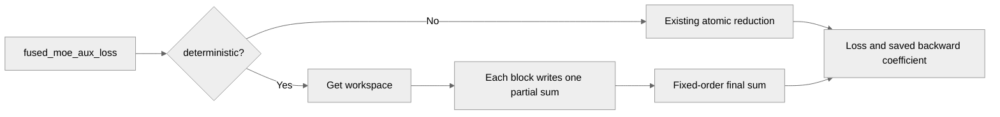

# Deterministic MoE Router Kernel By Removing Global Atomic Ops

[Upstream PR](https://github.com/NVIDIA/TransformerEngine/pull/3587) · state: closed · merged: True

## Original PR description

# Description

Please include a brief summary of the changes, relevant motivation and context.

Fixes https://github.com/NVIDIA/Megatron-LM/issues/7221

## Type of change

- [ ] Documentation change (change only to the documentation, either a fix or a new content)
- [ ] Bug fix (non-breaking change which fixes an issue)
- [ ] New feature (non-breaking change which adds functionality)
- [ ] Breaking change (fix or feature that would cause existing functionality to not work as expected)
- [ ] Infra/Build change
- [ ] Code refactoring

## Changes

Please list the changes introduced in this PR:

- Change A
- Change B

# Checklist:

- [ ] I have read and followed the [contributing guidelines](https://github.com/NVIDIA/TransformerEngine/blob/main/CONTRIBUTING.rst)
- [ ] The functionality is complete
- [ ] I have commented my code, particularly in hard-to-understand areas
- [ ] I have made corresponding changes to the documentation
- [ ] My changes generate no new warnings
- [ ] I have added tests that prove my fix is effective or that my feature works
- [ ] New and existing unit tests pass locally with my changes

## Review and discussion

### reviews

- ptrendx · COMMENTED · 2026-09-29T23:25:47Z · [source](https://github.com/NVIDIA/TransformerEngine/pull/3587#pullrequestreview-5359719683)

(No body; status only.)

- zhongbozhu · COMMENTED · 2026-10-09T18:42:49Z · [source](https://github.com/NVIDIA/TransformerEngine/pull/3587#pullrequestreview-5474035271)

(No body; status only.)

- vthumbe1503 · COMMENTED · 2026-10-26T04:09:00Z · [source](https://github.com/NVIDIA/TransformerEngine/pull/3587#pullrequestreview-5647026415)

LGTM,  with minor suggestion on workspace contract

- zhongbozhu · COMMENTED · 2026-10-28T08:30:12Z · [source](https://github.com/NVIDIA/TransformerEngine/pull/3587#pullrequestreview-5679777580)

(No body; status only.)

- vthumbe1503 · APPROVED · 2026-10-29T19:17:25Z · [source](https://github.com/NVIDIA/TransformerEngine/pull/3587#pullrequestreview-5703630759)

(No body; status only.)

### issue_comments

- greptile-apps[bot] · comment · 2026-09-29T18:31:35Z · [source](https://github.com/NVIDIA/TransformerEngine/pull/3587#issuecomment-5896239608)

<!-- greptile_summary -->

<h2><a href="https://app.greptile.com/api/retrigger?id=71527388"><picture><source media="(prefers-color-scheme: dark)" srcset="https://greptile-static-assets.s3.amazonaws.com/badges/RetriggerDark.svg?v=2"><source media="(prefers-color-scheme: light)" srcset="https://greptile-static-assets.s3.amazonaws.com/badges/Retrigger.svg?v=2"></picture></a><a href="https://app.greptile.com/nvidia-public-github/github/NVIDIA/transformerengine/-/pull/3587?utm_source=greptile_review&amp;utm_medium=github&amp;utm_campaign=view_in_greptile"><picture><source media="(prefers-color-scheme: dark)" srcset="https://greptile-static-assets.s3.amazonaws.com/badges/ViewInGreptileDark.svg?v=2"><source media="(prefers-color-scheme: light)" srcset="https://greptile-static-assets.s3.amazonaws.com/badges/ViewInGreptile.svg?v=2"></picture></a>Confidence Score: 5/5</h2>

**[Medium impact]** The reviewed changes appear safe to merge; no blocking issue was found.

<h3>Summary</h3>

Adds an optional fixed-order reduction for MoE auxiliary loss while keeping the existing atomic path as the default.
- MoE auxiliary loss can use a fixed-order reduction.
- The fused MLA module keeps its imports in source order.

No actionable new issues were found. Tests were not run. No previous review threads were supplied, and their history could not be retrieved.

<h3>Diagram</h3>

<!-- greptile_confidence_score:5 -->

Reviews (7) · Last reviewed commit: ["Merge branch &#39;main&#39; into fix/determinist..."](https://github.com/nvidia/transformerengine/commit/d26dc2246d6fb6cc4ee1b796fbf6538a62edf4ee) · [Reviewed by Greptile](https://www.greptile.com/?utm_source=greptile_review&utm_medium=github&utm_campaign=review_public&utm_content=nvidia/transformerengine)

- ZhiyuLi-Nvidia · comment · 2026-10-12T06:52:19Z · [source](https://github.com/NVIDIA/TransformerEngine/pull/3587#issuecomment-6119269000)

Thanks a lot @zhongbozhu.

The kernel is deterministic on one GPU. For multi-node runs, does determinism also hold with multi-node job, do we need the same placement and a fixed NCCL algorithm? Good to put it in the docs if there's anything worth noting.

- zhongbozhu · comment · 2026-10-15T07:30:03Z · [source](https://github.com/NVIDIA/TransformerEngine/pull/3587#issuecomment-6186902282)

/te-ci pytorch

- ZhiyuLi-Nvidia · comment · 2026-10-19T23:14:11Z · [source](https://github.com/NVIDIA/TransformerEngine/pull/3587#issuecomment-6279425511)

Verified on my end:
* mcore determinism in unit tests
*  e2e run https://forge.coreweave.com/wandb/nvidia/determinism-zhiyul?nw=tv4seg54n2
Feel free to move forward.

- zhongbozhu · comment · 2026-10-20T00:30:42Z · [source](https://github.com/NVIDIA/TransformerEngine/pull/3587#issuecomment-6280441203)

/te-ci pytorch

- zhongbozhu · comment · 2026-10-28T08:30:32Z · [source](https://github.com/NVIDIA/TransformerEngine/pull/3587#issuecomment-6464326374)

/te-ci pytorch

- vthumbe1503 · comment · 2026-10-30T05:15:02Z · [source](https://github.com/NVIDIA/TransformerEngine/pull/3587#issuecomment-6515558634)

/te-ci L0

- vthumbe1503 · comment · 2026-10-30T17:02:54Z · [source](https://github.com/NVIDIA/TransformerEngine/pull/3587#issuecomment-6528560234)

Relevant tests are passing. Pipeline: 77803646

### inline_comments

- ptrendx · comment · 2026-09-29T23:25:47Z · [source](https://github.com/NVIDIA/TransformerEngine/pull/3587#discussion_r4139337165)

File: `transformer_engine/common/include/transformer_engine/fused_router.h` · line None

The way we handle the workspace in the other APIs is similar to CUB - we run the APIs with the nullptr arguments for the workspace once (which populates the other fields), then run it again with the proper workspace. Please align this API to that.

- zhongbozhu · comment · 2026-10-09T18:42:49Z · [source](https://github.com/NVIDIA/TransformerEngine/pull/3587#discussion_r4233441743)

File: `transformer_engine/common/include/transformer_engine/fused_router.h` · line None

fixed

- vthumbe1503 · comment · 2026-10-26T03:29:57Z · [source](https://github.com/NVIDIA/TransformerEngine/pull/3587#discussion_r4373712053)

File: `transformer_engine/pytorch/attention/fused_mla_q_uproj.py` · line 20

This file change is not needed right?

- vthumbe1503 · comment · 2026-10-26T04:08:33Z · [source](https://github.com/NVIDIA/TransformerEngine/pull/3587#discussion_r4373849800)

File: `transformer_engine/common/fused_router/fused_moe_aux_loss.cu` · line None

Minor suggestion to simplify the workspace contract given that we always expect user to create a 256 sized buffer.

https://github.com/zhongbozhu/TransformerEngine/pull/1

- zhongbozhu · comment · 2026-10-28T08:30:12Z · [source](https://github.com/NVIDIA/TransformerEngine/pull/3587#discussion_r4398402609)

File: `transformer_engine/pytorch/attention/fused_mla_q_uproj.py` · line 20

that seems to be linter complaint? 

## Changed files and fixed code

- `tests/cpp/operator/CMakeLists.txt` · modified · additions 1 / deletions 0
  - [head](https://github.com/zhongbozhu/TransformerEngine/blob/d26dc2246d6fb6cc4ee1b796fbf6538a62edf4ee/tests/cpp/operator/CMakeLists.txt)
  - [base](https://github.com/NVIDIA/TransformerEngine/blob/5f3abe14458cbcb08ef9d4f9bc0e5beee524fcc5/tests/cpp/operator/CMakeLists.txt)
- `tests/cpp/operator/test_fused_moe_aux_loss.cpp` · added · additions 74 / deletions 0
  - [head](https://github.com/zhongbozhu/TransformerEngine/blob/d26dc2246d6fb6cc4ee1b796fbf6538a62edf4ee/tests/cpp/operator/test_fused_moe_aux_loss.cpp)
  - [base](https://github.com/NVIDIA/TransformerEngine/blob/5f3abe14458cbcb08ef9d4f9bc0e5beee524fcc5/tests/cpp/operator/test_fused_moe_aux_loss.cpp)
- `tests/pytorch/test_fused_router.py` · modified · additions 340 / deletions 21
  - [head](https://github.com/zhongbozhu/TransformerEngine/blob/d26dc2246d6fb6cc4ee1b796fbf6538a62edf4ee/tests/pytorch/test_fused_router.py)
  - [base](https://github.com/NVIDIA/TransformerEngine/blob/5f3abe14458cbcb08ef9d4f9bc0e5beee524fcc5/tests/pytorch/test_fused_router.py)
- `transformer_engine/common/fused_router/fused_moe_aux_loss.cu` · modified · additions 146 / deletions 35
  - [head](https://github.com/zhongbozhu/TransformerEngine/blob/d26dc2246d6fb6cc4ee1b796fbf6538a62edf4ee/transformer_engine/common/fused_router/fused_moe_aux_loss.cu)
  - [base](https://github.com/NVIDIA/TransformerEngine/blob/5f3abe14458cbcb08ef9d4f9bc0e5beee524fcc5/transformer_engine/common/fused_router/fused_moe_aux_loss.cu)
- `transformer_engine/common/include/transformer_engine/fused_router.h` · modified · additions 42 / deletions 6
  - [head](https://github.com/zhongbozhu/TransformerEngine/blob/d26dc2246d6fb6cc4ee1b796fbf6538a62edf4ee/transformer_engine/common/include/transformer_engine/fused_router.h)
  - [base](https://github.com/NVIDIA/TransformerEngine/blob/5f3abe14458cbcb08ef9d4f9bc0e5beee524fcc5/transformer_engine/common/include/transformer_engine/fused_router.h)
- `transformer_engine/pytorch/attention/fused_mla_q_uproj.py` · modified · additions 2 / deletions 1
  - [head](https://github.com/zhongbozhu/TransformerEngine/blob/d26dc2246d6fb6cc4ee1b796fbf6538a62edf4ee/transformer_engine/pytorch/attention/fused_mla_q_uproj.py)
  - [base](https://github.com/NVIDIA/TransformerEngine/blob/5f3abe14458cbcb08ef9d4f9bc0e5beee524fcc5/transformer_engine/pytorch/attention/fused_mla_q_uproj.py)
- `transformer_engine/pytorch/csrc/extensions.h` · modified · additions 8 / deletions 6
  - [head](https://github.com/zhongbozhu/TransformerEngine/blob/d26dc2246d6fb6cc4ee1b796fbf6538a62edf4ee/transformer_engine/pytorch/csrc/extensions.h)
  - [base](https://github.com/NVIDIA/TransformerEngine/blob/5f3abe14458cbcb08ef9d4f9bc0e5beee524fcc5/transformer_engine/pytorch/csrc/extensions.h)
- `transformer_engine/pytorch/csrc/extensions/pybind.cpp` · modified · additions 3 / deletions 0
  - [head](https://github.com/zhongbozhu/TransformerEngine/blob/d26dc2246d6fb6cc4ee1b796fbf6538a62edf4ee/transformer_engine/pytorch/csrc/extensions/pybind.cpp)
  - [base](https://github.com/NVIDIA/TransformerEngine/blob/5f3abe14458cbcb08ef9d4f9bc0e5beee524fcc5/transformer_engine/pytorch/csrc/extensions/pybind.cpp)
- `transformer_engine/pytorch/csrc/extensions/router.cpp` · modified · additions 52 / deletions 9
  - [head](https://github.com/zhongbozhu/TransformerEngine/blob/d26dc2246d6fb6cc4ee1b796fbf6538a62edf4ee/transformer_engine/pytorch/csrc/extensions/router.cpp)
  - [base](https://github.com/NVIDIA/TransformerEngine/blob/5f3abe14458cbcb08ef9d4f9bc0e5beee524fcc5/transformer_engine/pytorch/csrc/extensions/router.cpp)
- `transformer_engine/pytorch/router.py` · modified · additions 47 / deletions 2
  - [head](https://github.com/zhongbozhu/TransformerEngine/blob/d26dc2246d6fb6cc4ee1b796fbf6538a62edf4ee/transformer_engine/pytorch/router.py)
  - [base](https://github.com/NVIDIA/TransformerEngine/blob/5f3abe14458cbcb08ef9d4f9bc0e5beee524fcc5/transformer_engine/pytorch/router.py)

## Evidence and interpretation boundary

[Original JSON, discussions and patches](../../../../../../evidence/prs/NVIDIA--TransformerEngine/3587-13d816ff425f1366ccb0f5375be04a4675ad09c6fc71a6c20904c85817c63ba5.json) · SHA-256 `13d816ff425f1366ccb0f5375be04a4675ad09c6fc71a6c20904c85817c63ba5`.

Diff complete: True. Missing/binary/truncated patches require pinned source inspection. This is a source page, not an independently verified optimization case. Open, merged and released are different states; recheck the deployed dependency.
