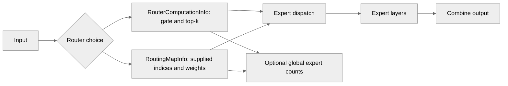

# TE MoE Return Expert Counts and Custom Routing for DSv4 Support

[Upstream PR](https://github.com/NVIDIA/TransformerEngine/pull/3596) · state: closed · merged: True

## Original PR description

# Description

This PR adds support for DSv4 features in TE MoE block which includes the following
- Providing expert count metadata (this is useful for users to perform routing bias updates, as DSv4 does)
- Adding support for custom routing policies with `moe_from_routing` (allows for hash routing)

These changes will be useful to make TE MoE block more flexible and configurable for new, upcoming models such as DSv4.

## Type of change

- [ ] Documentation change (change only to the documentation, either a fix or a new content)
- [ ] Bug fix (non-breaking change which fixes an issue)
- [x] New feature (non-breaking change which adds functionality)
- [ ] Breaking change (fix or feature that would cause existing functionality to not work as expected)
- [ ] Infra/Build change
- [ ] Code refactoring

## Changes

Please list the changes introduced in this PR:

- If desired by the user, allow the caller of `moe` to pass `collect_expert_counts=True` which will compute the expert counts  and return them to the caller as a part of the metadata.
    - Tested by validating expert counts in MoE block tests 
- A new API function `moe_from_routing(...)` which allows the user to provide their expert assignments and weights. Given this routing information, `moe_from_routing` will re-use functionality of `moe` except the gate computation. Backwards gradients will be computed through weight.
    - Tested by implementing a simple hash routing in test and validating the TE MoE block with the pure JAX implementation
    - Had to slightly increase tolerance to adjust for accumulation differences

# Checklist:

- [ ] I have read and followed the [contributing guidelines](https://github.com/NVIDIA/TransformerEngine/blob/main/CONTRIBUTING.rst)
- [ ] The functionality is complete
- [ ] I have commented my code, particularly in hard-to-understand areas
- [ ] I have made corresponding changes to the documentation
- [ ] My changes generate no new warnings
- [ ] I have added tests that prove my fix is effective or that my feature works
- [ ] New and existing unit tests pass locally with my changes


## Review and discussion

### reviews

- greptile-apps[bot] · COMMENTED · 2026-09-30T14:42:08Z · [source](https://github.com/NVIDIA/TransformerEngine/pull/3596#pullrequestreview-5367797264)

(No body; status only.)

- jberchtold-nvidia · COMMENTED · 2026-09-30T22:43:29Z · [source](https://github.com/NVIDIA/TransformerEngine/pull/3596#pullrequestreview-5372648505)

(No body; status only.)

- dinodeep · COMMENTED · 2026-10-01T13:52:06Z · [source](https://github.com/NVIDIA/TransformerEngine/pull/3596#pullrequestreview-5380197428)

(No body; status only.)

- dinodeep · COMMENTED · 2026-10-01T14:18:47Z · [source](https://github.com/NVIDIA/TransformerEngine/pull/3596#pullrequestreview-5380598453)

(No body; status only.)

- greptile-apps[bot] · COMMENTED · 2026-10-01T15:32:24Z · [source](https://github.com/NVIDIA/TransformerEngine/pull/3596#pullrequestreview-5381619938)

(No body; status only.)

- jberchtold-nvidia · COMMENTED · 2026-10-02T23:14:28Z · [source](https://github.com/NVIDIA/TransformerEngine/pull/3596#pullrequestreview-5397606451)

(No body; status only.)

- dinodeep · COMMENTED · 2026-10-02T23:21:49Z · [source](https://github.com/NVIDIA/TransformerEngine/pull/3596#pullrequestreview-5397797715)

(No body; status only.)

- dinodeep · COMMENTED · 2026-10-02T23:26:35Z · [source](https://github.com/NVIDIA/TransformerEngine/pull/3596#pullrequestreview-5397822250)

(No body; status only.)

- dinodeep · COMMENTED · 2026-10-02T23:41:41Z · [source](https://github.com/NVIDIA/TransformerEngine/pull/3596#pullrequestreview-5397898178)

(No body; status only.)

- jberchtold-nvidia · COMMENTED · 2026-10-05T22:59:09Z · [source](https://github.com/NVIDIA/TransformerEngine/pull/3596#pullrequestreview-5421684000)

(No body; status only.)

- jberchtold-nvidia · COMMENTED · 2026-10-05T23:03:18Z · [source](https://github.com/NVIDIA/TransformerEngine/pull/3596#pullrequestreview-5421720140)

(No body; status only.)

- jberchtold-nvidia · COMMENTED · 2026-10-05T23:05:59Z · [source](https://github.com/NVIDIA/TransformerEngine/pull/3596#pullrequestreview-5421742249)

(No body; status only.)

- greptile-apps[bot] · COMMENTED · 2026-10-22T16:35:41Z · [source](https://github.com/NVIDIA/TransformerEngine/pull/3596#pullrequestreview-5617623881)

(No body; status only.)

- jberchtold-nvidia · APPROVED · 2026-10-27T15:09:57Z · [source](https://github.com/NVIDIA/TransformerEngine/pull/3596#pullrequestreview-5669450036)

LGTM, Thanks!

### issue_comments

- greptile-apps[bot] · comment · 2026-09-30T14:41:35Z · [source](https://github.com/NVIDIA/TransformerEngine/pull/3596#issuecomment-5913561364)

<!-- greptile_summary -->

<h2><a href="https://app.greptile.com/api/retrigger?id=72117989"><picture><source media="(prefers-color-scheme: dark)" srcset="https://greptile-static-assets.s3.amazonaws.com/badges/RetriggerDark.svg?v=2"><source media="(prefers-color-scheme: light)" srcset="https://greptile-static-assets.s3.amazonaws.com/badges/Retrigger.svg?v=2"></picture></a><a href="https://app.greptile.com/nvidia-public-github/github/NVIDIA/transformerengine/-/pull/3596"><picture><source media="(prefers-color-scheme: dark)" srcset="https://greptile-static-assets.s3.amazonaws.com/badges/ViewInGreptileDark.svg?v=2"><source media="(prefers-color-scheme: light)" srcset="https://greptile-static-assets.s3.amazonaws.com/badges/ViewInGreptile.svg?v=2"></picture></a>Confidence Score: 3/5</h2>

**[Medium impact]** The changes affect callers of the JAX MoE API and its Flax block\.

The PR needs compatibility fixes before merging because existing calls and three-value result unpacking both break.

<h2>Findings</h2>

1. &nbsp;**Existing functional calls fail** <a href="https://github.com/NVIDIA/TransformerEngine/pull/3596#discussion_r4350944270">▶</a>
2. &nbsp;**Existing callers cannot unpack results** <a href="https://github.com/NVIDIA/TransformerEngine/pull/3596#discussion_r4145875277">▶</a>

<h3>Summary</h3>

This PR adds caller-supplied routing and global expert counts to the JAX MoE layer.

- JAX MoE callers can supply their own expert choices and routing weights.
- JAX MoE calls can return the number of assignments sent to each expert.

<h3>Diagram</h3>



<!-- greptile_confidence_score:3 -->

<sub>Reviews (12) · Last reviewed commit: ["Support user-provided routing and return..."](https://github.com/nvidia/transformerengine/commit/e2d6a6cc41884978f0ceda00db9bc6e1fa864c0f) · [Reviewed by Greptile](https://www.greptile.com/?utm_source=greptile_review&utm_medium=github&utm_campaign=review_public&utm_content=nvidia/transformerengine)</sub>

- greptile-apps[bot] · comment · 2026-09-30T14:42:34Z · [source](https://github.com/NVIDIA/TransformerEngine/pull/3596#issuecomment-5913578591)

<!-- greptile_outside_diff -->

<h3>Comments Outside Diff</h3>

No findings outside the diff remain.

- ptrendx · comment · 2026-09-30T20:53:30Z · [source](https://github.com/NVIDIA/TransformerEngine/pull/3596#issuecomment-5919540918)

@dinodeep Please sign every commit in this PR. See https://github.com/NVIDIA/TransformerEngine/blob/main/CONTRIBUTING.rst#sign-your-work

- jberchtold-nvidia · comment · 2026-10-05T23:06:32Z · [source](https://github.com/NVIDIA/TransformerEngine/pull/3596#issuecomment-6005050113)

/te-ci L1 jax

- jberchtold-nvidia · comment · 2026-10-06T16:27:35Z · [source](https://github.com/NVIDIA/TransformerEngine/pull/3596#issuecomment-6020721537)

/te-ci L1 jax

- greptile-apps[bot] · comment · 2026-10-07T16:00:58Z · [source](https://github.com/NVIDIA/TransformerEngine/pull/3596#issuecomment-6041711084)

Want your agent to iterate on Greptile's feedback? Try [*greploops*](https://github.com/greptileai/skills/blob/main/greploop/SKILL.md).

- jberchtold-nvidia · comment · 2026-10-07T21:54:45Z · [source](https://github.com/NVIDIA/TransformerEngine/pull/3596#issuecomment-6047624417)

/te-ci L1 jax

- jberchtold-nvidia · comment · 2026-10-26T17:15:34Z · [source](https://github.com/NVIDIA/TransformerEngine/pull/3596#issuecomment-6422588497)

/te-ci L1 jax

### inline_comments

- greptile-apps[bot] · comment · 2026-09-30T14:42:04Z · [source](https://github.com/NVIDIA/TransformerEngine/pull/3596#discussion_r4145875277)

File: `transformer_engine/jax/moe.py` · line None

<a href="#"></a> **Existing callers cannot unpack results**

`moe()` now returns four values instead of three, and `_MoEBlock` passes that result through. Existing callers that unpack the previous three-value result will raise `ValueError: too many values to unpack`, making this a breaking change to the public API.

- greptile-apps[bot] · comment · 2026-09-30T14:42:04Z · [source](https://github.com/NVIDIA/TransformerEngine/pull/3596#discussion_r4145875292)

File: `transformer_engine/jax/moe.py` · line None

<a href="#"></a> **Duplicate routes exceed receive capacity**

`moe_from_routing()` accepts repeated expert indices for a token, but its default receive capacity assumes each expert gets at most one assignment per token. For example, with eight experts, two EP ranks, top-k two, and 128 tokens per EP group, repeated indices can require 640 padded receive slots while the calculated capacity is 512. The default overflow policy then traps instead of completing the call; a drop-on-overflow policy can discard assignments.

- jberchtold-nvidia · comment · 2026-09-30T22:21:45Z · [source](https://github.com/NVIDIA/TransformerEngine/pull/3596#discussion_r4149898746)

File: `transformer_engine/jax/moe.py` · line 451

I like this warning! To confirm my understanding, this will only be caught when a user is using Explicit Sharding. Otherwise the sharding info won't be available for us to validate at trace time, right?

- jberchtold-nvidia · comment · 2026-09-30T22:28:39Z · [source](https://github.com/NVIDIA/TransformerEngine/pull/3596#discussion_r4149941086)

File: `transformer_engine/jax/moe.py` · line None

Instead of a new `moe_from_routing` API, could we instead add `routing_indices: Optional[jnp.ndarray] = None` and `routing_weights` to this existing `moe` API, but they default to None. When None, this behaves as it did previously. When non-None, it will use those router indices+weights instead of computing it's own. I think the VJP is already doing this with your changes, it just needs to be updated at this public API level

Let me know if there is a distinction between these two APIs that I missed, thanks!

- jberchtold-nvidia · comment · 2026-09-30T22:42:12Z · [source](https://github.com/NVIDIA/TransformerEngine/pull/3596#discussion_r4150020490)

File: `transformer_engine/jax/moe.py` · line None

With this change, these router arguments are no longer relevant. This is still functionally correct and this complexity is currently hidden from the user via this separate `moe_from_routing` API, but I'm brainstorming if there is a better way to pass these through, especially with my comment above on unifying the `moe` and `moe_from_routing` APIs

My initial idea is we deprecate the isolated router arguments and instead pack them all into a struct/pytree datatype. Then we could have something like this:
```
def moe(
        ... other args...
       router_info: Union[RouterComputationInfo | RoutingMapInfo],
       ....):
```

and then
```
class RouterComputationInfo:
       score_function: ...
       ...
```
and 
```
class RoutingMapInfo:
    routing_indices: jnp.ndarray
    routing_weights: jnp.ndarray
```

So if a user would like TE's MoEBlock to compute the router itself, they use `RouterComputationInfo`. If they would like to pass in their own routing info and skip TE's router, such as for hash routing, they use `RoutingMapInfo`

Thoughts?

- dinodeep · comment · 2026-10-01T13:52:05Z · [source](https://github.com/NVIDIA/TransformerEngine/pull/3596#discussion_r4156135723)

File: `transformer_engine/jax/moe.py` · line 451

Yes that is correct. This logic was already a part of the `moe` method, and in order to avoid duplicating it in `moe_from_routing`, I moved it to a helper, but this code movement won't be necessary with the new API.

- dinodeep · comment · 2026-10-01T14:18:46Z · [source](https://github.com/NVIDIA/TransformerEngine/pull/3596#discussion_r4156457852)

File: `transformer_engine/jax/moe.py` · line None

Yea, I prefer this API. It is cleaner than having two, and I think it better logically groups the routing arguments together as well as the option on whether the user is supplying a custom routing. I will work on updating it

- greptile-apps[bot] · comment · 2026-10-01T15:32:15Z · [source](https://github.com/NVIDIA/TransformerEngine/pull/3596#discussion_r4157285195)

File: `transformer_engine/jax/moe.py` · line None

<a href="#"></a> **Externally routed backward fails**

When a caller differentiates `moe()` with `RoutingMapInfo`, the backward rule returns `routing_indices=None` even though the forward call supplied an integer array. That changes the JAX pytree structure of the router argument, so the custom VJP cannot match the gradient to its input and the backward pass fails. Return a structurally matching cotangent for the indices.

- jberchtold-nvidia · comment · 2026-10-02T22:52:40Z · [source](https://github.com/NVIDIA/TransformerEngine/pull/3596#discussion_r4170477373)

File: `tests/jax/test_te_ep_moe.py` · line None

For which tests was this tolerance relaxing required? Was it the new tests you added with `scaling_factor` that was greater than `1.0`?

- jberchtold-nvidia · comment · 2026-10-02T22:56:08Z · [source](https://github.com/NVIDIA/TransformerEngine/pull/3596#discussion_r4170498499)

File: `transformer_engine/jax/moe.py` · line 573

Should this arg be added as a field to RoutingMapInfo instead if it only applies to caller-supplied routing indices?

- jberchtold-nvidia · comment · 2026-10-02T23:00:47Z · [source](https://github.com/NVIDIA/TransformerEngine/pull/3596#discussion_r4170521576)

File: `transformer_engine/jax/moe.py` · line None

Why did this topk call turn into a dict + kwargs call? I'm not seeing the difference between the original call and this new version, besides the kwargs changes

- dinodeep · comment · 2026-10-02T23:21:48Z · [source](https://github.com/NVIDIA/TransformerEngine/pull/3596#discussion_r4170628660)

File: `tests/jax/test_te_ep_moe.py` · line None

Yea this was for the new test that I added, specifically `TestTeEpMoeHashRouting:test_hash_forward_and_backward` (which has `scaling_factor=1.5`). There were just a couple of elements that were one ULP off. I saw a comment saying that the tolerances were determined based on the worst error observed, so I decided to just increase it slightly to account for the new test case. If that isn't desired, I can re-work the tests so that we aren't changing the bounds

- dinodeep · comment · 2026-10-02T23:26:34Z · [source](https://github.com/NVIDIA/TransformerEngine/pull/3596#discussion_r4170650894)

File: `transformer_engine/jax/moe.py` · line None

The `tex.fused_topk_with_score_function_fwd` is potentially called twice (once for routing, another time for computing the auxiliary loss) with the same kwargs, so I consolidated them into a single-dictionary and kwargs. I can revert it back to the original topk call if that's preferred

- dinodeep · comment · 2026-10-02T23:41:40Z · [source](https://github.com/NVIDIA/TransformerEngine/pull/3596#discussion_r4170717280)

File: `transformer_engine/jax/moe.py` · line 573

Yea I was a little conflicted on this. If the user provides `RoutingMapInfo`, then we need to return the gradients of the `routing_weights` in the backward pass. The only residual information that we need for that is `routing_weights.dtype` since it might be different than `d_topk_w`. Hence, the data-type needs to be stored in the `_Ctx`. I didn't want to store it in the `RoutingMapInfo` since it is something that is already determined when the user provides `routing_weights`, and I didn't want to store `RoutingMapInfo` in `_Ctx` since that would be unnecessary for this case. As a result, the `routing_weights_dtype` here kinda sticks out, but I feel that it would be necessary to have in `_Ctx`.

It might be cleaner to have equivalent structs for the backwards pass `RoutingMapCtx` and `RoutingComputationCtx` and only store the necessary information in the context there potentially and add those to the `_Ctx` struct. That way we can have the same `Union[RoutingComputationCtx, RoutingMapCtx]` pattern as we have in the forward pass call. Let me know your thoughts

- jberchtold-nvidia · comment · 2026-10-05T22:59:08Z · [source](https://github.com/NVIDIA/TransformerEngine/pull/3596#discussion_r4189738172)

File: `transformer_engine/jax/moe.py` · line None

Awesome, great find! Let's keep this fix that you made then

- jberchtold-nvidia · comment · 2026-10-05T23:03:17Z · [source](https://github.com/NVIDIA/TransformerEngine/pull/3596#discussion_r4189766177)

File: `tests/jax/test_te_ep_moe.py` · line None

Would you be able to override the tolerance for this particular test and keep the base tolerance at 1e-7 as it is upstream? 

- jberchtold-nvidia · comment · 2026-10-05T23:05:58Z · [source](https://github.com/NVIDIA/TransformerEngine/pull/3596#discussion_r4189784057)

File: `transformer_engine/jax/moe.py` · line 573

I misread the diff here. I had thought `routing_weights_dtype` was an arg to the `moe` function itself that the user must provide. Since this is internal to the `_Ctx` state of the VJP, then this change looks good. Thanks!

- greptile-apps[bot] · comment · 2026-10-22T16:35:40Z · [source](https://github.com/NVIDIA/TransformerEngine/pull/3596#discussion_r4350944270)

File: `transformer_engine/jax/moe.py` · line 2089

<a href="#"></a> **Existing functional calls fail**

`moe()` no longer accepts the existing `num_experts_per_tok` keyword or a gate array as its second argument. Existing callers now raise `TypeError` before running the layer, even if they update their result unpacking. Keep the old calling form working alongside `router_info`, since this PR is described as non-breaking.

## Changed files and fixed code

- `tests/jax/moe/test_moe_fsdp_layout.py` · modified · additions 2 / deletions 1
  - [head](https://github.com/dinodeep/TransformerEngine/blob/e2d6a6cc41884978f0ceda00db9bc6e1fa864c0f/tests/jax/moe/test_moe_fsdp_layout.py)
  - [base](https://github.com/NVIDIA/TransformerEngine/blob/53d1a3c71a8f54cbfcdbc5e9f548eba040e42523/tests/jax/moe/test_moe_fsdp_layout.py)
- `tests/jax/moe/test_moe_resource_api.py` · modified · additions 9 / deletions 6
  - [head](https://github.com/dinodeep/TransformerEngine/blob/e2d6a6cc41884978f0ceda00db9bc6e1fa864c0f/tests/jax/moe/test_moe_resource_api.py)
  - [base](https://github.com/NVIDIA/TransformerEngine/blob/53d1a3c71a8f54cbfcdbc5e9f548eba040e42523/tests/jax/moe/test_moe_resource_api.py)
- `tests/jax/test_custom_call_compute.py` · modified · additions 8 / deletions 7
  - [head](https://github.com/dinodeep/TransformerEngine/blob/e2d6a6cc41884978f0ceda00db9bc6e1fa864c0f/tests/jax/test_custom_call_compute.py)
  - [base](https://github.com/NVIDIA/TransformerEngine/blob/53d1a3c71a8f54cbfcdbc5e9f548eba040e42523/tests/jax/test_custom_call_compute.py)
- `tests/jax/test_te_ep_moe.py` · modified · additions 301 / deletions 21
  - [head](https://github.com/dinodeep/TransformerEngine/blob/e2d6a6cc41884978f0ceda00db9bc6e1fa864c0f/tests/jax/test_te_ep_moe.py)
  - [base](https://github.com/NVIDIA/TransformerEngine/blob/53d1a3c71a8f54cbfcdbc5e9f548eba040e42523/tests/jax/test_te_ep_moe.py)
- `transformer_engine/jax/flax/moe.py` · modified · additions 23 / deletions 12
  - [head](https://github.com/dinodeep/TransformerEngine/blob/e2d6a6cc41884978f0ceda00db9bc6e1fa864c0f/transformer_engine/jax/flax/moe.py)
  - [base](https://github.com/NVIDIA/TransformerEngine/blob/53d1a3c71a8f54cbfcdbc5e9f548eba040e42523/transformer_engine/jax/flax/moe.py)
- `transformer_engine/jax/moe.py` · modified · additions 402 / deletions 249
  - [head](https://github.com/dinodeep/TransformerEngine/blob/e2d6a6cc41884978f0ceda00db9bc6e1fa864c0f/transformer_engine/jax/moe.py)
  - [base](https://github.com/NVIDIA/TransformerEngine/blob/53d1a3c71a8f54cbfcdbc5e9f548eba040e42523/transformer_engine/jax/moe.py)

## Evidence and interpretation boundary

[Original JSON, discussions and patches](../../../../../../evidence/prs/NVIDIA--TransformerEngine/3596-b7cc9a23d7e1e058b25512afbf8d22daf539360652ca13b162a933c40b926a52.json) · SHA-256 `b7cc9a23d7e1e058b25512afbf8d22daf539360652ca13b162a933c40b926a52`.

Diff complete: True. Missing/binary/truncated patches require pinned source inspection. This is a source page, not an independently verified optimization case. Open, merged and released are different states; recheck the deployed dependency.
