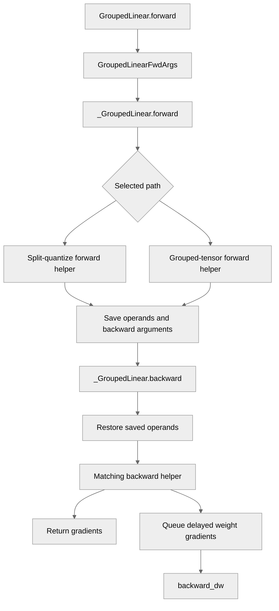

# [PyTorch] Refactor GroupedLinear forward and backward

[Upstream PR](https://github.com/NVIDIA/TransformerEngine/pull/3606) · state: closed · merged: True

## Original PR description

# Description

Refactor `GroupedLinear` forward and backward to separate computation from autograd state handling. This prepares the module for `torch.compile` support in a follow-up PR while keeping the public API unchanged.

## Type of change

- [ ] Documentation change (change only to the documentation, either a fix or a new content)
- [ ] Bug fix (non-breaking change which fixes an issue)
- [ ] New feature (non-breaking change which adds functionality)
- [ ] Breaking change (fix or feature that would cause existing functionality to not work as expected)
- [ ] Infra/Build change
- [x] Code refactoring

## Changes

- Extract forward/backward helpers and explicit argument/state objects for the split-quantize and grouped-tensor paths.
- Separate autograd bookkeeping while preserving distributed-weight and delayed-wgrad behavior.

Validation: Ada unit tests, Python lint and pre-commit passed. Fused Python behavior was checked with a GEMM stand-in; native fused kernels were not run on Ada. PyTorch L0/L1 CI has been launched.

# Checklist:

- [x] I have read and followed the [contributing guidelines](https://github.com/NVIDIA/TransformerEngine/blob/main/CONTRIBUTING.rst)
- [x] The functionality is complete
- [x] I have commented my code, particularly in hard-to-understand areas
- [ ] I have made corresponding changes to the documentation
- [x] My changes generate no new warnings
- [ ] I have added tests that prove my fix is effective or that my feature works
- [x] New and existing unit tests pass locally with my changes (available Ada tests; native fused tests skipped)


## Review and discussion

### reviews

- greptile-apps[bot] · COMMENTED · 2026-10-01T19:04:09Z · [source](https://github.com/NVIDIA/TransformerEngine/pull/3606#pullrequestreview-5384167689)

(No body; status only.)

- vthumbe1503 · COMMENTED · 2026-10-07T02:39:40Z · [source](https://github.com/NVIDIA/TransformerEngine/pull/3606#pullrequestreview-5436982765)

I am assuming this is going to be used for torch.compile workflow. If so, would the state of grouped_linear.py as of this PR, enable us to have a torch compile unit test @pggPL ?

- vthumbe1503 · COMMENTED · 2026-10-12T18:06:05Z · [source](https://github.com/NVIDIA/TransformerEngine/pull/3606#pullrequestreview-5493928693)

Overall LGTM. Refactor seems consistent with the torch.compile based refactor already done in other modules. Code also looks cleaner because of the demands of the refactor. I hope, in future, we could also fold the common code between grouped linear op and this module in the same place.

My comments are mainly trying to reduce CPU overheads where we can since grouped_linear CPU overheads has been one of our major hotspots in terms of CPU bottlenecks.

- vthumbe1503 · APPROVED · 2026-10-13T16:32:29Z · [source](https://github.com/NVIDIA/TransformerEngine/pull/3606#pullrequestreview-5506816735)

(No body; status only.)

### issue_comments

- greptile-apps[bot] · comment · 2026-10-01T19:04:04Z · [source](https://github.com/NVIDIA/TransformerEngine/pull/3606#issuecomment-5938529900)

<!-- greptile_summary -->

<h2><a href="https://app.greptile.com/api/retrigger?id=73010083"><picture><source media="(prefers-color-scheme: dark)" srcset="https://greptile-static-assets.s3.amazonaws.com/badges/RetriggerDark.svg?v=2"><source media="(prefers-color-scheme: light)" srcset="https://greptile-static-assets.s3.amazonaws.com/badges/Retrigger.svg?v=2"></picture></a>Confidence Score: 5/5</h2>

**[Medium impact]** The PR appears safe to merge; no new blocking issue was found.

<h3>Summary</h3>

This PR separates `GroupedLinear` computation from the state PyTorch saves for backward.
- GroupedLinear keeps its API while forward and backward work move into helpers.

<h3>Diagram</h3>



<!-- greptile_confidence_score:5 -->

<sub>Reviews (5) · Last reviewed commit: ["Merge main into grouped\_linear\_refactor"](https://github.com/nvidia/transformerengine/commit/cfee84415eddc71569dc12c1f0bc1bd96a1f6c81) · [Reviewed by Greptile](https://www.greptile.com/?utm_source=greptile_expert&utm_medium=github&utm_campaign=code_reviews&utm_content=nvidia/transformerengine)</sub>

- pggPL · comment · 2026-10-07T06:30:28Z · [source](https://github.com/NVIDIA/TransformerEngine/pull/3606#issuecomment-6032361030)

No, this PR is just code shuffle which will enable adding torch.compile support in next PR. 

- pggPL · comment · 2026-10-07T06:30:57Z · [source](https://github.com/NVIDIA/TransformerEngine/pull/3606#issuecomment-6032367202)

/te-ci pytorch L1

- vthumbe1503 · comment · 2026-10-13T17:13:34Z · [source](https://github.com/NVIDIA/TransformerEngine/pull/3606#issuecomment-6151049971)

/te-ci pytorch L1


### inline_comments

- greptile-apps[bot] · comment · 2026-10-01T19:04:07Z · [source](https://github.com/NVIDIA/TransformerEngine/pull/3606#discussion_r4159352369)

File: `transformer_engine/pytorch/module/grouped_linear.py` · line None

<a href="#"></a> **Unused bias reductions** In debug mode with bias disabled, this condition computes a bias reduction for every expert, then discards the results before returning. Keeping the reduction gated on `use_bias` avoids that unnecessary work on every backward pass.

```suggestion
        compute_dbias=(args.fp8 or args.debug) and args.use_bias,
```

Note: If this suggestion doesn't match your team's coding style, reply to this and let me know. I'll remember it for next time!

- greptile-apps[bot] · comment · 2026-10-01T19:04:07Z · [source](https://github.com/NVIDIA/TransformerEngine/pull/3606#discussion_r4159352397)

File: `transformer_engine/pytorch/module/grouped_linear.py` · line 1527

<a href="#"></a> **Missing native-path regression test** The native grouped-tensor path now passes saved operands through separate forward and autograd-state helpers, but this refactor adds no test of that handoff. A forward/backward regression test using the native path would catch saved-state mismatches that a GEMM stand-in cannot exercise.

**Knowledge Base Used:** [PyTorch Transformer layers](https://app.greptile.com/nvidia-public-github/-/custom-context/knowledge-base/nvidia/transformerengine/-/docs/pytorch-transformer-layers.md)

- vthumbe1503 · comment · 2026-10-12T17:11:51Z · [source](https://github.com/NVIDIA/TransformerEngine/pull/3606#discussion_r4250571561)

File: `transformer_engine/pytorch/module/grouped_linear.py` · line None

I am thinking "graph_safe" instead of "fused"? But I am not strongly opinionated on this one. But if we keep fused, we should explain what do we mean by fused here. It is "all gemms fused in one one kernel via GroupedTensor infrastructure" 

- vthumbe1503 · comment · 2026-10-12T17:13:25Z · [source](https://github.com/NVIDIA/TransformerEngine/pull/3606#discussion_r4250584350)

File: `transformer_engine/pytorch/module/grouped_linear.py` · line None

My thinking for graph_safe is the main intent of the alternate path is we need a graph safe path which consumes m_splits on the device without D2H copy. Fusion is just the means to achieve that

- vthumbe1503 · comment · 2026-10-12T17:41:16Z · [source](https://github.com/NVIDIA/TransformerEngine/pull/3606#discussion_r4250798719)

File: `transformer_engine/pytorch/module/grouped_linear.py` · line None

Extra list() wrapper is not needed here. Since slicing in python already creates a copy. Creating another copy on top of it is more CPU overheads. Rough benchmarking tells me this causes about 30ns per call. 10 of those calls is 0.3 us. There are some other places below which have this list creation.

```suggestion
        self.inputmats = saved[:n]
        self.weights_fp8 = saved[n : 2 * n]
        self.saved_weights = saved[2 * n : 3 * n]
        self.biases = saved[3 * n : 4 * n]
```

- vthumbe1503 · comment · 2026-10-12T17:42:25Z · [source](https://github.com/NVIDIA/TransformerEngine/pull/3606#discussion_r4250807018)

File: `transformer_engine/pytorch/module/grouped_linear.py` · line None

CPU overheads with list construction. Unless absolutely needed. Lets avoid it.

- vthumbe1503 · comment · 2026-10-12T17:57:34Z · [source](https://github.com/NVIDIA/TransformerEngine/pull/3606#discussion_r4250922039)

File: `transformer_engine/pytorch/module/grouped_linear.py` · line None

avoiding multiple torch calls is better. For our typical weight sizes, benchmark shows, this saves 0.2 us (300 us vs 100ns)

```suggestion
weight_shape = weights[0].shape
in_features = weight_shape[-1]
out_features = weight_shape[-2]
```

- vthumbe1503 · comment · 2026-10-12T18:03:00Z · [source](https://github.com/NVIDIA/TransformerEngine/pull/3606#discussion_r4250962453)

File: `transformer_engine/pytorch/module/grouped_linear.py` · line None

Reducing CPU overhead
```suggestion
    out_features = grad_output.shape[-1]
    grad_output_view = grad_output.contiguous().view(-1, out_features)
```

## Changed files and fixed code

- `tests/pytorch/test_backward_override.py` · modified · additions 5 / deletions 4
  - [head](https://github.com/pggPL/TransformerEngine/blob/cfee84415eddc71569dc12c1f0bc1bd96a1f6c81/tests/pytorch/test_backward_override.py)
  - [base](https://github.com/NVIDIA/TransformerEngine/blob/0c4d9610ac3b6447e90af212e70b7260ef0c4ad1/tests/pytorch/test_backward_override.py)
- `transformer_engine/pytorch/module/grouped_linear.py` · modified · additions 1318 / deletions 1235
  - [head](https://github.com/pggPL/TransformerEngine/blob/cfee84415eddc71569dc12c1f0bc1bd96a1f6c81/transformer_engine/pytorch/module/grouped_linear.py)
  - [base](https://github.com/NVIDIA/TransformerEngine/blob/0c4d9610ac3b6447e90af212e70b7260ef0c4ad1/transformer_engine/pytorch/module/grouped_linear.py)

## Evidence and interpretation boundary

[Original JSON, discussions and patches](../../../../../../evidence/prs/NVIDIA--TransformerEngine/3606-0548fe2f3e90232b505488d672c52eaf2d53d87e83090f0544291f63cf9b8d8c.json) · SHA-256 `0548fe2f3e90232b505488d672c52eaf2d53d87e83090f0544291f63cf9b8d8c`.

Diff complete: False. Missing/binary/truncated patches require pinned source inspection. This is a source page, not an independently verified optimization case. Open, merged and released are different states; recheck the deployed dependency.
