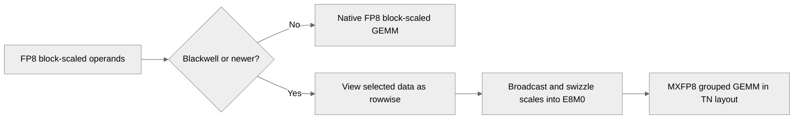

# [Common/PyTorch] Enable FP8BS for Grouped GEMM on Blackwell via MXFP8 Broadcast

[Upstream PR](https://github.com/NVIDIA/TransformerEngine/pull/3614) · state: open · merged: False

## Original PR description

# Description

Extends `Float8BlockScaling` on the grouped-tensor path from Hopper-only to Blackwell and newer. This covers grouped quantization, cuBLASLt grouped GEMM, and `te.pytorch.GroupedLinear` (module and fusible op). The new path applies wherever MXFP8 grouped GEMM is supported (SM100/SM103/SM107/SM110) by broadcasting FP32 power-of-2 scales into swizzled E8M0 MXFP8 scales.

Fixes #3520

## Performance

### Broadcast + Swizzle

#### Grouped tensors w/ `nvte_swizzle_grouped_block_scaling_to_mxfp8_scaling_factors`

| Operand | Tensors × shape | MXFP8 scales | Time |
|:--|--:|--:|--:|
| Activations (1D), uniform splits | 8 × 4096 × 7168 | 7.3 MB | 5.7 µs |
| Activations (1D), varying splits | 8 × 4096 × 7168 | 7.3 MB | 5.9 µs |
| Activations (1D), varying splits | 32 × 1024 × 7168 | 7.3 MB | 6.8 µs |
| Activations (1D), varying splits | 128 × 256 × 7168 | 7.3 MB | 9.0 µs |
| Activations (1D), varying splits | 256 × 128 × 7168 | 7.3 MB | 11.3 µs |
| Transposed activations (1D, wgrad), varying last dims | 128 × 7168 × 256 | 7.3 MB | 9.1 µs |
| Weights (2D) | 8 × 4096 × 7168 | 7.3 MB | 4.9 µs |
| Weights (2D) | 128 × 2048 × 7168 | 58.7 MB | 38.6 µs |

#### List of Tensors w/ `nvte_multi_tensor_swizzle_block_scaling_to_mxfp8_scaling_factors`

| Tensors × shape | Fused multi-tensor conversion |
|:--|--:|
| 8 × 4096 × 7168 weights (2D) | 3.7 µs |
| 32 × 2048 × 7168 weights (2D) | 6.7 µs |
| 128 × 2048 × 7168 weights (2D) | 26.1 µs |
| 128 × 256 × 7168 activations (1D) | 7.2 µs |

#### Conversion Cost per GroupedGemm in an MoE Layer

Based on 16 local experts × 2560 tokens, with 4096 hidden size and 1024 expert FFN.

| GEMM | Conversion kernels per call | Grouped GEMM |
|:--|:--|--:|
| FC1 fprop (TN) | 21 µs (activations 14 µs, 16 weights 7 µs) | 653 µs |
| FC1 dgrad (NN) | 18 µs | 675 µs |
| FC1 wgrad (NT) | 27 µs (2 grouped operands) | 739 µs |
| FC2 fprop (TN) | 13 µs | 488 µs |
| FC2 dgrad (NN) | 20 µs | 421 µs |
| FC2 wgrad (NT) | 22 µs (2 grouped operands) | 416 µs |

### GroupedLinear

Based on 4096 hidden size and 1024 FC2 FFN.

#### End-to-End Timing (ms)

| Shape | GEMM | Mode | Grouped GEMM: MXFP8 | FP8BS | FP8BS/MXFP8 | Multi-stream: MXFP8 | FP8BS | FP8BS/MXFP8 |
|---|---|---|---|---|---|---|---|---|
| 16x2560 | FC1 | fwd | 0.932 | 1.032 | 1.11× | 0.916 | 1.081 | 1.18× |
| 16x2560 | FC1 | fwd+bwd | 3.301 | 3.818 | 1.16× | 3.332 | 3.796 | 1.14× |
| 16x2560 | FC2 | fwd | 0.506 | 0.563 | 1.11× | 0.542 | 0.630 | 1.16× |
| 16x2560 | FC2 | fwd+bwd | 1.971 | 2.392 | 1.21× | 1.921 | 2.230 | 1.16× |
| 64x512 | FC1 | fwd | 0.957 | 1.114 | 1.16× | 1.438 | 1.525 | 1.06× |
| 64x512 | FC1 | fwd+bwd | 4.249 | 4.627 | 1.09× | 4.956 | 5.350 | 1.08× |
| 64x512 | FC2 | fwd | 0.571 | 0.671 | 1.18× | 1.438 | 1.505 | 1.05× |
| 64x512 | FC2 | fwd+bwd | 2.315 | 2.576 | 1.11× | 4.816 | 5.856 | 1.22× |

#### Breakdown per FWD+BWD (µs)

| Shape | GEMM | Precision | GEMM | Quantize | FP8BS→MXFP8 conversion | Other | Total |
|---|---|---|---|---|---|---|---|
| 16x2560 | FC1 | MXFP8 | 1968 | 488 | — | 509 | 2965 |
| 16x2560 | FC1 | FP8BS | 2154 | 817 | 53 | 534 | 3558 |
| 16x2560 | FC2 | MXFP8 | 1230 | 349 | — | 217 | 1796 |
| 16x2560 | FC2 | FP8BS | 1255 | 605 | 47 | 205 | 2112 |
| 64x512 | FC1 | MXFP8 | 2267 | 452 | — | 1063 | 3782 |
| 64x512 | FC1 | FP8BS | 2297 | 733 | 83 | 1004 | 4116 |
| 64x512 | FC2 | MXFP8 | 1275 | 326 | — | 530 | 2132 |
| 64x512 | FC2 | FP8BS | 1292 | 513 | 50 | 512 | 2368 |

### Notes

**FP8BS GroupedLinear slowdown vs. MXFP8 is due to the quantization, not the conversion.**

FP8BS forces TN layout in **both** non-grouped and grouped cases:
- Pays the cost of a transposed column-wise copy
- Selects different (slightly slower) GEMM heuristics than NN/NT

Optimizing FP8BS quantization kernels (both grouped and non-grouped) on Blackwell deferred to another PR.

## Type of change

- [ ] Documentation change (change only to the documentation, either a fix or a new content)
- [ ] Bug fix (non-breaking change which fixes an issue)
- [x] New feature (non-breaking change which adds functionality)
- [ ] Breaking change (fix or feature that would cause existing functionality to not work as expected)
- [ ] Infra/Build change
- [ ] Code refactoring

# Checklist:

- [x] I have read and followed the [contributing guidelines](https://github.com/NVIDIA/TransformerEngine/blob/main/CONTRIBUTING.rst)
- [x] The functionality is complete
- [x] I have commented my code, particularly in hard-to-understand areas
- [x] I have made corresponding changes to the documentation
- [x] My changes generate no new warnings
- [x] I have added tests that prove my fix is effective or that my feature works
- [x] New and existing unit tests pass locally with my changes

## Review and discussion

### reviews

- greptile-apps[bot] · COMMENTED · 2026-10-02T13:07:00Z · [source](https://github.com/NVIDIA/TransformerEngine/pull/3614#pullrequestreview-5392141214)

(No body; status only.)

- denera · COMMENTED · 2026-10-02T13:09:40Z · [source](https://github.com/NVIDIA/TransformerEngine/pull/3614#pullrequestreview-5392167675)

(No body; status only.)

- greptile-apps[bot] · COMMENTED · 2026-10-02T13:10:07Z · [source](https://github.com/NVIDIA/TransformerEngine/pull/3614#pullrequestreview-5392171740)

(No body; status only.)

- vthumbe1503 · COMMENTED · 2026-10-05T07:15:21Z · [source](https://github.com/NVIDIA/TransformerEngine/pull/3614#pullrequestreview-5410644970)

Thanks @denera! Mostly LGTM with some minor comments on CPU overheads. Could we also add some perf numbers for this kernel in the description?

- Oleg-Goncharov · COMMENTED · 2026-10-05T16:53:39Z · [source](https://github.com/NVIDIA/TransformerEngine/pull/3614#pullrequestreview-5417777333)

(No body; status only.)

- vthumbe1503 · APPROVED · 2026-10-15T21:56:53Z · [source](https://github.com/NVIDIA/TransformerEngine/pull/3614#pullrequestreview-5540427294)

LGTM

### issue_comments

- denera · comment · 2026-10-02T13:02:24Z · [source](https://github.com/NVIDIA/TransformerEngine/pull/3614#issuecomment-5952959394)

/te-ci pytorch

- greptile-apps[bot] · comment · 2026-10-02T13:06:54Z · [source](https://github.com/NVIDIA/TransformerEngine/pull/3614#issuecomment-5953062993)

<!-- greptile_summary -->

<h2><a href="https://app.greptile.com/api/retrigger?id=73484000"><picture><source media="(prefers-color-scheme: dark)" srcset="https://greptile-static-assets.s3.amazonaws.com/badges/RetriggerDark.svg?v=2"><source media="(prefers-color-scheme: light)" srcset="https://greptile-static-assets.s3.amazonaws.com/badges/Retrigger.svg?v=2"></picture></a><a href="https://app.greptile.com/nvidia-public-github/github/NVIDIA/transformerengine/-/pull/3614"><picture><source media="(prefers-color-scheme: dark)" srcset="https://greptile-static-assets.s3.amazonaws.com/badges/ViewInGreptileDark.svg?v=2"><source media="(prefers-color-scheme: light)" srcset="https://greptile-static-assets.s3.amazonaws.com/badges/ViewInGreptile.svg?v=2"></picture></a>Confidence Score: 5/5</h2>

**[High impact]** The PR appears safe to merge with the documented split-alignment limitation.

<h3>Summary</h3>

Enables FP8 block scaling for grouped GEMM on Blackwell by converting FP32 scales into swizzled MXFP8 scales.

- Blackwell grouped GEMMs can use FP8 block-scaled inputs.
- Grouped FP8 block scaling now supports Blackwell with power-of-two scales.

<h3>Diagram</h3>

<!-- greptile_confidence_score:5 -->

Reviews (5) · Last reviewed commit: ["\[Common\]\[PyTorch\] Document grouped split..."](https://github.com/nvidia/transformerengine/commit/667b67518045a1deae75e1599cc53816da6f69a9) · [Reviewed by Greptile](https://www.greptile.com/?utm_source=greptile_review&utm_medium=github&utm_campaign=review_public&utm_content=nvidia/transformerengine)

- denera · comment · 2026-10-02T15:49:41Z · [source](https://github.com/NVIDIA/TransformerEngine/pull/3614#issuecomment-5956039987)

/te-ci pytorch

- denera · comment · 2026-10-15T21:46:57Z · [source](https://github.com/NVIDIA/TransformerEngine/pull/3614#issuecomment-6202959442)

/te-ci pytorch

### inline_comments

- greptile-apps[bot] · comment · 2026-10-02T13:06:58Z · [source](https://github.com/NVIDIA/TransformerEngine/pull/3614#discussion_r4165988887)

File: `transformer_engine/pytorch/ops/basic/grouped_linear.py` · line 127

 **Uneven splits produce wrong outputs** When an expert’s split size is not a multiple of 128, this predicate now sends Blackwell FP8 block scaling through grouped quantization instead of the split-quantize fallback. The grouped quantizer requires 128-row alignment, but its per-expert check is a device assertion that release builds can strip. Ordinary uneven MoE splits can therefore produce incorrect outputs. Route unsupported splits to the fallback or enforce the constraint before quantization without synchronizing CUDA graphs.

- greptile-apps[bot] · comment · 2026-10-02T13:06:58Z · [source](https://github.com/NVIDIA/TransformerEngine/pull/3614#discussion_r4165988896)

File: `transformer_engine/common/swizzle/swizzle_block_scaling.cu` · line None

 **Expert scan repeats per tile** Every warp starts at the first expert for each 128×128 tile and recalculates the scale offsets. With many experts, conversion work grows with both the tile count and expert count; when each expert contributes one tile, the scans grow quadratically. Reusing the expert and offsets across successive tiles, or assigning work by expert, would avoid making scale conversion a bottleneck before GEMM.

Note: If this suggestion doesn't match your team's coding style, reply to this and let me know. I'll remember it for next time!

- denera · comment · 2026-10-02T13:09:40Z · [source](https://github.com/NVIDIA/TransformerEngine/pull/3614#discussion_r4166008886)

File: `transformer_engine/pytorch/ops/basic/grouped_linear.py` · line 127

It is expensive to perform this check on the host-side, so we accept this limitation, document it in the docstrings and comments, and restrict ourselves to a device-side check only.

- greptile-apps[bot] · comment · 2026-10-02T13:10:07Z · [source](https://github.com/NVIDIA/TransformerEngine/pull/3614#discussion_r4166012142)

File: `transformer_engine/pytorch/ops/basic/grouped_linear.py` · line 127

Understood. Given the intentional trade-off and the added documentation, I’ll withdraw this finding. The device-side-only validation and the possibility of incorrect results for non-128-aligned splits are now explicitly documented.

- vthumbe1503 · comment · 2026-10-05T06:25:40Z · [source](https://github.com/NVIDIA/TransformerEngine/pull/3614#discussion_r4181248200)

File: `transformer_engine/common/swizzle/swizzle_block_scaling.cu` · line None

We could cache this as well.

- vthumbe1503 · comment · 2026-10-05T06:26:08Z · [source](https://github.com/NVIDIA/TransformerEngine/pull/3614#discussion_r4181250989)

File: `transformer_engine/common/swizzle/swizzle_block_scaling.cu` · line None

We can cache this value per device in cuda_runtime.cpp to avoid cpu overheads.

- vthumbe1503 · comment · 2026-10-05T06:55:54Z · [source](https://github.com/NVIDIA/TransformerEngine/pull/3614#discussion_r4181417605)

File: `transformer_engine/pytorch/csrc/extensions/gemm.cpp` · line 889

Is there a need to define this std::vector and emplace the scales in it? It doesnt seem to be used anywhere

- vthumbe1503 · comment · 2026-10-05T07:12:10Z · [source](https://github.com/NVIDIA/TransformerEngine/pull/3614#discussion_r4181511602)

File: `transformer_engine/pytorch/csrc/extensions/gemm.cpp` · line 799

Isnt grouped_swizzle function the right place for this implementation(I dont exactly remember the API).

- vthumbe1503 · comment · 2026-10-05T07:13:38Z · [source](https://github.com/NVIDIA/TransformerEngine/pull/3614#discussion_r4181519794)

File: `transformer_engine/pytorch/csrc/extensions/gemm.cpp` · line None

For weights we would be calling multi_tensor_swizzle somewhere. Maybe that is the right place for this implementation?

- Oleg-Goncharov · comment · 2026-10-05T16:39:10Z · [source](https://github.com/NVIDIA/TransformerEngine/pull/3614#discussion_r4186410643)

File: `transformer_engine/common/swizzle/swizzle_block_scaling.cu` · line None

Could we reuse `DIVUP_TO_MULTIPLE()` from `common/common.h` for the corresponding calculations below?

- Oleg-Goncharov · comment · 2026-10-05T16:45:55Z · [source](https://github.com/NVIDIA/TransformerEngine/pull/3614#discussion_r4186470437)

File: `transformer_engine/common/swizzle/swizzle_block_scaling.cu` · line None

Could we reuse `DIVUP()` from `common/common.h` for the corresponding calculations below?

## Changed files and fixed code

- `tests/cpp/operator/CMakeLists.txt` · modified · additions 1 / deletions 0
  - [head](https://github.com/denera/TransformerEngine/blob/667b67518045a1deae75e1599cc53816da6f69a9/tests/cpp/operator/CMakeLists.txt)
  - [base](https://github.com/NVIDIA/TransformerEngine/blob/33f3b3561943fcd9dd2f544f67dc2dfd62efdc9e/tests/cpp/operator/CMakeLists.txt)
- `tests/cpp/operator/test_cast_float8blockwise_grouped.cu` · modified · additions 49 / deletions 2
  - [head](https://github.com/denera/TransformerEngine/blob/667b67518045a1deae75e1599cc53816da6f69a9/tests/cpp/operator/test_cast_float8blockwise_grouped.cu)
  - [base](https://github.com/NVIDIA/TransformerEngine/blob/33f3b3561943fcd9dd2f544f67dc2dfd62efdc9e/tests/cpp/operator/test_cast_float8blockwise_grouped.cu)
- `tests/cpp/operator/test_dequantize_float8blockwise_grouped.cu` · modified · additions 2 / deletions 3
  - [head](https://github.com/denera/TransformerEngine/blob/667b67518045a1deae75e1599cc53816da6f69a9/tests/cpp/operator/test_dequantize_float8blockwise_grouped.cu)
  - [base](https://github.com/NVIDIA/TransformerEngine/blob/33f3b3561943fcd9dd2f544f67dc2dfd62efdc9e/tests/cpp/operator/test_dequantize_float8blockwise_grouped.cu)
- `tests/cpp/operator/test_grouped_gemm.cu` · modified · additions 3 / deletions 1
  - [head](https://github.com/denera/TransformerEngine/blob/667b67518045a1deae75e1599cc53816da6f69a9/tests/cpp/operator/test_grouped_gemm.cu)
  - [base](https://github.com/NVIDIA/TransformerEngine/blob/33f3b3561943fcd9dd2f544f67dc2dfd62efdc9e/tests/cpp/operator/test_grouped_gemm.cu)
- `tests/cpp/operator/test_swizzle_block_scaling.cu` · added · additions 425 / deletions 0
  - [head](https://github.com/denera/TransformerEngine/blob/667b67518045a1deae75e1599cc53816da6f69a9/tests/cpp/operator/test_swizzle_block_scaling.cu)
  - [base](https://github.com/NVIDIA/TransformerEngine/blob/33f3b3561943fcd9dd2f544f67dc2dfd62efdc9e/tests/cpp/operator/test_swizzle_block_scaling.cu)
- `tests/pytorch/test_grouped_linear.py` · modified · additions 368 / deletions 16
  - [head](https://github.com/denera/TransformerEngine/blob/667b67518045a1deae75e1599cc53816da6f69a9/tests/pytorch/test_grouped_linear.py)
  - [base](https://github.com/NVIDIA/TransformerEngine/blob/33f3b3561943fcd9dd2f544f67dc2dfd62efdc9e/tests/pytorch/test_grouped_linear.py)
- `tests/pytorch/test_grouped_tensor.py` · modified · additions 24 / deletions 13
  - [head](https://github.com/denera/TransformerEngine/blob/667b67518045a1deae75e1599cc53816da6f69a9/tests/pytorch/test_grouped_tensor.py)
  - [base](https://github.com/NVIDIA/TransformerEngine/blob/33f3b3561943fcd9dd2f544f67dc2dfd62efdc9e/tests/pytorch/test_grouped_tensor.py)
- `tests/pytorch/test_recipe.py` · modified · additions 28 / deletions 0
  - [head](https://github.com/denera/TransformerEngine/blob/667b67518045a1deae75e1599cc53816da6f69a9/tests/pytorch/test_recipe.py)
  - [base](https://github.com/NVIDIA/TransformerEngine/blob/33f3b3561943fcd9dd2f544f67dc2dfd62efdc9e/tests/pytorch/test_recipe.py)
- `transformer_engine/common/cast/fp8_blockwise/group_dequantize_fp8_blockwise.cuh` · modified · additions 6 / deletions 8
  - [head](https://github.com/denera/TransformerEngine/blob/667b67518045a1deae75e1599cc53816da6f69a9/transformer_engine/common/cast/fp8_blockwise/group_dequantize_fp8_blockwise.cuh)
  - [base](https://github.com/NVIDIA/TransformerEngine/blob/33f3b3561943fcd9dd2f544f67dc2dfd62efdc9e/transformer_engine/common/cast/fp8_blockwise/group_dequantize_fp8_blockwise.cuh)
- `transformer_engine/common/cast/fp8_blockwise/group_quantize_fp8_blockwise.cuh` · modified · additions 18 / deletions 14
  - [head](https://github.com/denera/TransformerEngine/blob/667b67518045a1deae75e1599cc53816da6f69a9/transformer_engine/common/cast/fp8_blockwise/group_quantize_fp8_blockwise.cuh)
  - [base](https://github.com/NVIDIA/TransformerEngine/blob/33f3b3561943fcd9dd2f544f67dc2dfd62efdc9e/transformer_engine/common/cast/fp8_blockwise/group_quantize_fp8_blockwise.cuh)
- `transformer_engine/common/include/transformer_engine/swizzle.h` · modified · additions 56 / deletions 0
  - [head](https://github.com/denera/TransformerEngine/blob/667b67518045a1deae75e1599cc53816da6f69a9/transformer_engine/common/include/transformer_engine/swizzle.h)
  - [base](https://github.com/NVIDIA/TransformerEngine/blob/33f3b3561943fcd9dd2f544f67dc2dfd62efdc9e/transformer_engine/common/include/transformer_engine/swizzle.h)
- `transformer_engine/common/recipe/__init__.py` · modified · additions 1 / deletions 0
  - [head](https://github.com/denera/TransformerEngine/blob/667b67518045a1deae75e1599cc53816da6f69a9/transformer_engine/common/recipe/__init__.py)
  - [base](https://github.com/NVIDIA/TransformerEngine/blob/33f3b3561943fcd9dd2f544f67dc2dfd62efdc9e/transformer_engine/common/recipe/__init__.py)
- `transformer_engine/common/swizzle/swizzle_block_scaling.cu` · modified · additions 512 / deletions 48
  - [head](https://github.com/denera/TransformerEngine/blob/667b67518045a1deae75e1599cc53816da6f69a9/transformer_engine/common/swizzle/swizzle_block_scaling.cu)
  - [base](https://github.com/NVIDIA/TransformerEngine/blob/33f3b3561943fcd9dd2f544f67dc2dfd62efdc9e/transformer_engine/common/swizzle/swizzle_block_scaling.cu)
- `transformer_engine/pytorch/cpp_extensions/gemm.py` · modified · additions 2 / deletions 0
  - [head](https://github.com/denera/TransformerEngine/blob/667b67518045a1deae75e1599cc53816da6f69a9/transformer_engine/pytorch/cpp_extensions/gemm.py)
  - [base](https://github.com/NVIDIA/TransformerEngine/blob/33f3b3561943fcd9dd2f544f67dc2dfd62efdc9e/transformer_engine/pytorch/cpp_extensions/gemm.py)
- `transformer_engine/pytorch/csrc/extensions/gemm.cpp` · modified · additions 71 / deletions 8
  - [head](https://github.com/denera/TransformerEngine/blob/667b67518045a1deae75e1599cc53816da6f69a9/transformer_engine/pytorch/csrc/extensions/gemm.cpp)
  - [base](https://github.com/NVIDIA/TransformerEngine/blob/33f3b3561943fcd9dd2f544f67dc2dfd62efdc9e/transformer_engine/pytorch/csrc/extensions/gemm.cpp)
- `transformer_engine/pytorch/csrc/extensions/swizzle.cpp` · modified · additions 143 / deletions 22
  - [head](https://github.com/denera/TransformerEngine/blob/667b67518045a1deae75e1599cc53816da6f69a9/transformer_engine/pytorch/csrc/extensions/swizzle.cpp)
  - [base](https://github.com/NVIDIA/TransformerEngine/blob/33f3b3561943fcd9dd2f544f67dc2dfd62efdc9e/transformer_engine/pytorch/csrc/extensions/swizzle.cpp)
- `transformer_engine/pytorch/csrc/util.h` · modified · additions 15 / deletions 0
  - [head](https://github.com/denera/TransformerEngine/blob/667b67518045a1deae75e1599cc53816da6f69a9/transformer_engine/pytorch/csrc/util.h)
  - [base](https://github.com/NVIDIA/TransformerEngine/blob/33f3b3561943fcd9dd2f544f67dc2dfd62efdc9e/transformer_engine/pytorch/csrc/util.h)
- `transformer_engine/pytorch/module/grouped_linear.py` · modified · additions 11 / deletions 17
  - [head](https://github.com/denera/TransformerEngine/blob/667b67518045a1deae75e1599cc53816da6f69a9/transformer_engine/pytorch/module/grouped_linear.py)
  - [base](https://github.com/NVIDIA/TransformerEngine/blob/33f3b3561943fcd9dd2f544f67dc2dfd62efdc9e/transformer_engine/pytorch/module/grouped_linear.py)
- `transformer_engine/pytorch/ops/basic/grouped_linear.py` · modified · additions 15 / deletions 9
  - [head](https://github.com/denera/TransformerEngine/blob/667b67518045a1deae75e1599cc53816da6f69a9/transformer_engine/pytorch/ops/basic/grouped_linear.py)
  - [base](https://github.com/NVIDIA/TransformerEngine/blob/33f3b3561943fcd9dd2f544f67dc2dfd62efdc9e/transformer_engine/pytorch/ops/basic/grouped_linear.py)
- `transformer_engine/pytorch/quantization.py` · modified · additions 17 / deletions 0
  - [head](https://github.com/denera/TransformerEngine/blob/667b67518045a1deae75e1599cc53816da6f69a9/transformer_engine/pytorch/quantization.py)
  - [base](https://github.com/NVIDIA/TransformerEngine/blob/33f3b3561943fcd9dd2f544f67dc2dfd62efdc9e/transformer_engine/pytorch/quantization.py)

## Evidence and interpretation boundary

[Original JSON, discussions and patches](../../../../../../evidence/prs/NVIDIA--TransformerEngine/3614-bd89dafc78e556d968561df7e159d78bbdfe2c256352f04416c453d779bf7d47.json) · SHA-256 `bd89dafc78e556d968561df7e159d78bbdfe2c256352f04416c453d779bf7d47`.

Diff complete: True. Missing/binary/truncated patches require pinned source inspection. This is a source page, not an independently verified optimization case. Open, merged and released are different states; recheck the deployed dependency.
