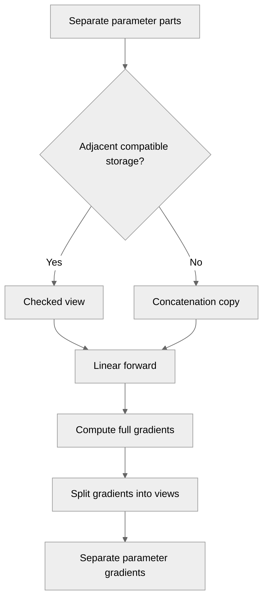

# [PyTorch] Support split Linear parameters with torch.compile

[Upstream PR](https://github.com/NVIDIA/TransformerEngine/pull/3623) · state: open · merged: False

## Original PR description

# Description

Support `torch.compile(fullgraph=True)` for
`te.Linear(parameters_split=...)`, preserving separate Parameters,
state-dict entries and gradients.

Split weights and biases cross the custom-op boundary as tensor lists.
Contiguous parts occupying adjacent regions of the same storage are consumed
through a checked view without a concatenation copy. Other layouts fall back
to `torch.cat`. Storage is checked on each execution.

Eager Linear and LayerNormLinear assemble split operands inside forward
and save the resulting tensors for backward. LayerNormLinear compile support
is outside this PR's scope. Disjoint parameters still require concatenation
in both compiled forward and backward.

## Type of change

- [ ] Documentation change (change only to the documentation, either a fix or a new content)
- [ ] Bug fix (non-breaking change which fixes an issue)
- [x] New feature (non-breaking change which adds functionality)
- [ ] Breaking change (fix or feature that would cause existing functionality to not work as expected)
- [ ] Infra/Build change
- [ ] Code refactoring

## Changes

Please list the changes introduced in this PR:

- Add tensor-list inputs to the custom-op adapter and combined metadata
  handling to Linear's fake implementations.
- Save original compiled parameter parts through autograd and split full
  gradients into views outside the backward op.
- Assemble eager split operands inside Linear and LayerNormLinear forward,
  retaining them for backward.
- Extend existing Linear compile tests with split parameters, quantization
  recipes, selective gradients, weight caching, storage changes and cat counts.

# Checklist:

- [x] I have read and followed the [contributing guidelines](https://github.com/NVIDIA/TransformerEngine/blob/main/CONTRIBUTING.rst)
- [x] The functionality is complete
- [x] I have commented my code, particularly in hard-to-understand areas
- [x] I have made corresponding changes to the documentation
- [x] My changes generate no new warnings
- [x] I have added tests that prove my fix is effective or that my feature works
- [x] New and existing unit tests pass locally with my changes

## Review and discussion

### reviews

- greptile-apps[bot] · COMMENTED · 2026-10-29T11:44:46Z · [source](https://github.com/NVIDIA/TransformerEngine/pull/3623#pullrequestreview-5697124853)

(No body; status only.)

### issue_comments

- pggPL · comment · 2026-10-27T20:48:37Z · [source](https://github.com/NVIDIA/TransformerEngine/pull/3623#issuecomment-6453190321)

<!-- te-ci-local-scope:77100152 -->
**TE CI — selected tests**

Pipeline ID: `77100152` · Commit: `ddb3eaae745e9edb78cbb5fa092d2151877f55c7`

Selected CI jobs and pytest filters are listed below.

**Frameworks:** PyTorch

**Mode:** PR Python, tests and QA with prebuilt native libraries; no TE rebuild.
**Native image digest:** <code>sha256:46ede145e9eac17945e528111d8f074d501d83d9c4ef67db651cd127f3dc3dec</code>

**Selected jobs: 1**

- <code>L0_pytorch_unittest--H100_1GPU</code>

**Not run (manual/skipped): 14**

Show jobs not run

- <code>L0_pytorch_debug_unittest--B200_1GPU</code>
- <code>L0_pytorch_debug_unittest--H100_1GPU</code>
- <code>L0_pytorch_lint</code>
- <code>L0_pytorch_unittest--A100_1GPU</code>
- <code>L0_pytorch_unittest--B200_1GPU</code>
- <code>L1_pytorch_distributed_unittest--B200_8GPU</code>
- <code>L1_pytorch_distributed_unittest--H100_4GPU</code>
- <code>L1_pytorch_mcore_fsdp_integration--B200_8GPU</code>
- <code>L1_pytorch_mcore_integration--B200_1GPU</code>
- <code>L1_pytorch_mcore_integration--H100_1GPU</code>
- <code>L1_pytorch_onnx_unittest--B200_1GPU</code>
- <code>L1_pytorch_onnx_unittest--H100_1GPU</code>
- <code>L3_pytorch_FA_versions_test--B200_8GPU</code>
- <code>L3_pytorch_FA_versions_test--H100_4GPU</code>

Results are reported as individual commit statuses on this PR.

- pggPL · comment · 2026-10-27T21:22:05Z · [source](https://github.com/NVIDIA/TransformerEngine/pull/3623#issuecomment-6453881289)

<!-- te-ci-local-scope:77114224 -->
**TE CI — selected tests**

Pipeline ID: `77114224` · Commit: `ddb3eaae745e9edb78cbb5fa092d2151877f55c7`

Selected CI jobs and pytest filters are listed below.

**Frameworks:** PyTorch

**Mode:** PR Python, tests and QA with prebuilt native libraries; no TE rebuild.
**Native image digest:** <code>sha256:46ede145e9eac17945e528111d8f074d501d83d9c4ef67db651cd127f3dc3dec</code>

**Pytest include:** <code>tests/pytorch/test_torch_compile.py</code>, <code>tests/pytorch/test_sanity.py</code>

Job results cover this pytest subset. Non-pytest QA commands are unchanged.

**Selected jobs: 1**

- <code>L0_pytorch_unittest--B200_1GPU</code>

**Not run (manual/skipped): 14**

Show jobs not run

- <code>L0_pytorch_debug_unittest--B200_1GPU</code>
- <code>L0_pytorch_debug_unittest--H100_1GPU</code>
- <code>L0_pytorch_lint</code>
- <code>L0_pytorch_unittest--A100_1GPU</code>
- <code>L0_pytorch_unittest--H100_1GPU</code>
- <code>L1_pytorch_distributed_unittest--B200_8GPU</code>
- <code>L1_pytorch_distributed_unittest--H100_4GPU</code>
- <code>L1_pytorch_mcore_fsdp_integration--B200_8GPU</code>
- <code>L1_pytorch_mcore_integration--B200_1GPU</code>
- <code>L1_pytorch_mcore_integration--H100_1GPU</code>
- <code>L1_pytorch_onnx_unittest--B200_1GPU</code>
- <code>L1_pytorch_onnx_unittest--H100_1GPU</code>
- <code>L3_pytorch_FA_versions_test--B200_8GPU</code>
- <code>L3_pytorch_FA_versions_test--H100_4GPU</code>

Results are reported as individual commit statuses on this PR.

- pggPL · comment · 2026-10-27T21:40:15Z · [source](https://github.com/NVIDIA/TransformerEngine/pull/3623#issuecomment-6454274536)

<!-- te-ci-local-scope:77123759 -->
**TE CI — selected tests**

Pipeline ID: `77123759` · Commit: `f5a13d2515cd40a83e21cb364dfe8907adff1178`

Selected CI jobs and pytest filters are listed below.

**Frameworks:** PyTorch

**Mode:** PR Python, tests and QA with prebuilt native libraries; no TE rebuild.
**Native image digest:** <code>sha256:46ede145e9eac17945e528111d8f074d501d83d9c4ef67db651cd127f3dc3dec</code>

**Pytest exclude:** <code>tests/pytorch/test_fused_rope.py</code>, <code>tests/pytorch/test_permutation.py</code>, <code>tests/pytorch/test_cross_entropy.py</code>, <code>tests/pytorch/test_mhc.py</code>, <code>tests/pytorch/test_fused_router.py</code>, <code>tests/pytorch/test_fused_router_perf.py</code>

Job results cover this pytest subset. Non-pytest QA commands are unchanged.

**Selected jobs: 7**

- <code>L0_pytorch_debug_unittest--B200_1GPU</code>
- <code>L0_pytorch_debug_unittest--H100_1GPU</code>
- <code>L0_pytorch_lint</code>
- <code>L0_pytorch_unittest--A100_1GPU</code>
- <code>L0_pytorch_unittest--B200_1GPU</code>
- <code>L0_pytorch_unittest--H100_1GPU</code>
- <code>L0_pytorch_unittest--L40_1GPU</code>

**Not run (manual/skipped): 9**

Show jobs not run

- <code>L1_pytorch_distributed_unittest--B200_8GPU</code>
- <code>L1_pytorch_distributed_unittest--H100_4GPU</code>
- <code>L1_pytorch_mcore_fsdp_integration--B200_8GPU</code>
- <code>L1_pytorch_mcore_integration--B200_1GPU</code>
- <code>L1_pytorch_mcore_integration--H100_1GPU</code>
- <code>L1_pytorch_onnx_unittest--B200_1GPU</code>
- <code>L1_pytorch_onnx_unittest--H100_1GPU</code>
- <code>L3_pytorch_FA_versions_test--B200_8GPU</code>
- <code>L3_pytorch_FA_versions_test--H100_4GPU</code>

Results are reported as individual commit statuses on this PR.

- greptile-apps[bot] · comment · 2026-10-29T11:44:42Z · [source](https://github.com/NVIDIA/TransformerEngine/pull/3623#issuecomment-6495756098)

<!-- greptile_summary -->

<h2><a href="https://app.greptile.com/api/retrigger?id=90518567"><picture><source media="(prefers-color-scheme: dark)" srcset="https://greptile-static-assets.s3.amazonaws.com/badges/RetriggerDark.svg?v=2"><source media="(prefers-color-scheme: light)" srcset="https://greptile-static-assets.s3.amazonaws.com/badges/Retrigger.svg?v=2"></picture></a><a href="https://app.greptile.com/-/switch-tenant?tenant=nvidia-public-github&amp;next=%2FNVIDIA%2Ftransformerengine%2Fpull%2F3623&amp;utm_source=greptile_review&amp;utm_medium=github&amp;utm_campaign=view_in_greptile"><picture><source media="(prefers-color-scheme: dark)" srcset="https://greptile-static-assets.s3.amazonaws.com/badges/ViewInGreptileDark.svg?v=2"><source media="(prefers-color-scheme: light)" srcset="https://greptile-static-assets.s3.amazonaws.com/badges/ViewInGreptile.svg?v=2"></picture></a>Confidence Score: 5/5</h2>

**[Medium impact]** The PR appears safe to merge; no new actionable issues were found.

<h3>Summary</h3>

Adds split-parameter support to compiled `Linear` while keeping separate parameters and gradients.
- Compiled Linear keeps split parameters separate through forward and backward.
- Eager LayerNormLinear assembles split operands during its forward pass.

<h3>Diagram</h3>

<!-- greptile_confidence_score:5 -->

Reviews (3) · Last reviewed commit: ["Merge main into split\_parameters\_linear"](https://github.com/nvidia/transformerengine/commit/79375c8b4094842b457f13a254eaa8ee74f551d9) · [Reviewed by Greptile](https://www.greptile.com/?utm_source=greptile_review&utm_medium=github&utm_campaign=review_public&utm_content=nvidia/transformerengine)

- pggPL · comment · 2026-10-29T11:59:55Z · [source](https://github.com/NVIDIA/TransformerEngine/pull/3623#issuecomment-6496056043)

/te-ci pytorch L0

- pggPL · comment · 2026-11-02T11:32:33Z · [source](https://github.com/NVIDIA/TransformerEngine/pull/3623#issuecomment-6576079678)

/te-ci pytorch L0

### inline_comments

- greptile-apps[bot] · comment · 2026-10-29T11:44:45Z · [source](https://github.com/NVIDIA/TransformerEngine/pull/3623#discussion_r4411895764)

File: `transformer_engine/pytorch/module/layernorm_linear.py` · line 1571

 **Split gradients lack direct tests**

`LayerNormLinear` now assembles split parameters inside its autograd forward and splits their gradients in backward, but the added tests only construct `Linear`. Add eager `LayerNormLinear(parameters_split=...)` tests against a concatenated reference, including separate parameter storage and frozen parts. This is non-blocking, but without these checks, regressions in this separate forward/backward path can pass the new tests.

Note: If this suggestion doesn't match your team's coding style, reply to this and let me know. I'll remember it for next time!

## Changed files and fixed code

- `tests/pytorch/test_numerics.py` · modified · additions 71 / deletions 15
  - [head](https://github.com/pggPL/TransformerEngine/blob/79375c8b4094842b457f13a254eaa8ee74f551d9/tests/pytorch/test_numerics.py)
  - [base](https://github.com/NVIDIA/TransformerEngine/blob/63451d6b868af0db6dd879cf5dd6a3f9bf14e1f9/tests/pytorch/test_numerics.py)
- `tests/pytorch/test_torch_compile.py` · modified · additions 256 / deletions 54
  - [head](https://github.com/pggPL/TransformerEngine/blob/79375c8b4094842b457f13a254eaa8ee74f551d9/tests/pytorch/test_torch_compile.py)
  - [base](https://github.com/NVIDIA/TransformerEngine/blob/63451d6b868af0db6dd879cf5dd6a3f9bf14e1f9/tests/pytorch/test_torch_compile.py)
- `transformer_engine/pytorch/dynamo/concat.py` · added · additions 62 / deletions 0
  - [head](https://github.com/pggPL/TransformerEngine/blob/79375c8b4094842b457f13a254eaa8ee74f551d9/transformer_engine/pytorch/dynamo/concat.py)
  - [base](https://github.com/NVIDIA/TransformerEngine/blob/63451d6b868af0db6dd879cf5dd6a3f9bf14e1f9/transformer_engine/pytorch/dynamo/concat.py)
- `transformer_engine/pytorch/dynamo/custom_op.py` · modified · additions 47 / deletions 15
  - [head](https://github.com/pggPL/TransformerEngine/blob/79375c8b4094842b457f13a254eaa8ee74f551d9/transformer_engine/pytorch/dynamo/custom_op.py)
  - [base](https://github.com/NVIDIA/TransformerEngine/blob/63451d6b868af0db6dd879cf5dd6a3f9bf14e1f9/transformer_engine/pytorch/dynamo/custom_op.py)
- `transformer_engine/pytorch/module/_common.py` · modified · additions 24 / deletions 1
  - [head](https://github.com/pggPL/TransformerEngine/blob/79375c8b4094842b457f13a254eaa8ee74f551d9/transformer_engine/pytorch/module/_common.py)
  - [base](https://github.com/NVIDIA/TransformerEngine/blob/63451d6b868af0db6dd879cf5dd6a3f9bf14e1f9/transformer_engine/pytorch/module/_common.py)
- `transformer_engine/pytorch/module/base.py` · modified · additions 6 / deletions 3
  - [head](https://github.com/pggPL/TransformerEngine/blob/79375c8b4094842b457f13a254eaa8ee74f551d9/transformer_engine/pytorch/module/base.py)
  - [base](https://github.com/NVIDIA/TransformerEngine/blob/63451d6b868af0db6dd879cf5dd6a3f9bf14e1f9/transformer_engine/pytorch/module/base.py)
- `transformer_engine/pytorch/module/layernorm_linear.py` · modified · additions 88 / deletions 39
  - [head](https://github.com/pggPL/TransformerEngine/blob/79375c8b4094842b457f13a254eaa8ee74f551d9/transformer_engine/pytorch/module/layernorm_linear.py)
  - [base](https://github.com/NVIDIA/TransformerEngine/blob/63451d6b868af0db6dd879cf5dd6a3f9bf14e1f9/transformer_engine/pytorch/module/layernorm_linear.py)
- `transformer_engine/pytorch/module/linear.py` · modified · additions 148 / deletions 60
  - [head](https://github.com/pggPL/TransformerEngine/blob/79375c8b4094842b457f13a254eaa8ee74f551d9/transformer_engine/pytorch/module/linear.py)
  - [base](https://github.com/NVIDIA/TransformerEngine/blob/63451d6b868af0db6dd879cf5dd6a3f9bf14e1f9/transformer_engine/pytorch/module/linear.py)
- `transformer_engine/pytorch/utils.py` · modified · additions 4 / deletions 4
  - [head](https://github.com/pggPL/TransformerEngine/blob/79375c8b4094842b457f13a254eaa8ee74f551d9/transformer_engine/pytorch/utils.py)
  - [base](https://github.com/NVIDIA/TransformerEngine/blob/63451d6b868af0db6dd879cf5dd6a3f9bf14e1f9/transformer_engine/pytorch/utils.py)

## Evidence and interpretation boundary

[Original JSON, discussions and patches](../../../../../../evidence/prs/NVIDIA--TransformerEngine/3623-2746b3ac2574d7b66421c781241e3b07df0c522809ffbc35c7b6160833a46a41.json) · SHA-256 `2746b3ac2574d7b66421c781241e3b07df0c522809ffbc35c7b6160833a46a41`.

Diff complete: True. Missing/binary/truncated patches require pinned source inspection. This is a source page, not an independently verified optimization case. Open, merged and released are different states; recheck the deployed dependency.
