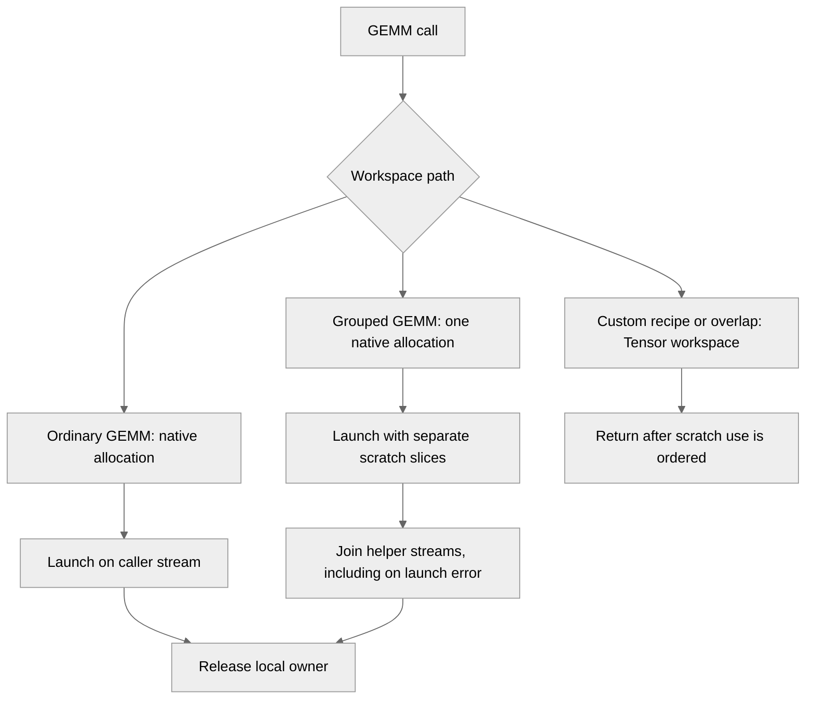

# Let the CUDA allocator manage cuBLAS workspaces

[Upstream PR](https://github.com/NVIDIA/TransformerEngine/pull/3625) · state: open · merged: False

## Original PR description

# Description

Concurrent GEMMs on independent CUDA streams receive the same cuBLAS workspace from the device/mode cache and can overwrite each other's partial sums. On one H200, two FP32 `NT` GEMMs with a reduction dimension of 16384 produced incorrect results in 35 of 48 calls; separate scratch produced zero mismatches against serial execution.

Replace the Python workspace cache with invocation-local memory owned by PyTorch's CUDA allocator. Ordinary GEMMs allocate a native `DataPtr` in the PyTorch binding, avoiding per-call Python Tensor creation. The list/multistream grouped path uses one allocation with disjoint, 256-byte-aligned workspace slices. Its helper streams join the caller before the owner is released. Eager reuse remains stream-ordered; captured allocations belong to their graph's private pool. No persistent per-stream cache or new device synchronization is added.

Custom recipes and communication overlap retain explicit Tensor workspaces. Existing explicit-workspace callers remain supported; the private bindings additionally accept `None` with size zero to request native allocation. Usable workspace sizes, GEMM dtypes and algorithm selection are unchanged. The grouped-tensor backend is unchanged.

## Type of change

- [ ] Documentation change
- [x] Bug fix (non-breaking change which fixes an issue)
- [ ] New feature
- [ ] Breaking change
- [ ] Infra/Build change
- [ ] Code refactoring

## Changes

- Allocate scratch per invocation in the PyTorch native binding for ordinary and list/multistream grouped GEMMs.
- Remove Linear and BasicLinear's preallocation workaround for globally cached scratch.
- Test eager ownership, temporary-stream cleanup, graph-pool isolation across capture generations, concurrent FP32/BF16 graph replay, grouped GEMM numerics, and compiled opaque-GEMM graph generations. Observe native allocation requests without retaining Tensor references.
- Cover router dgrad NN with `weight[128,4096]`, `grad_output[8192,128]`, output `[8192,4096]`, and reduction 128 against exact analytic references in FP32 and BF16. Preserve NT coverage.
- Include the workspace regression in the PyTorch L0 launcher.

## Validation

Exception-path follow-up (`efa5063`, October 26): the common grouped launch now rejoins helper streams before rethrowing a recoverable GEMM error. On H200, the old core reproduces `cudaErrorStreamCaptureUnjoined`; the rebuilt core and PyTorch binding pass all **23 workspace tests**, including the new partial-group failure/capture/recovery regression. Formatting, cpplint and the license check pass. No host/device-wide synchronization or additional successful-path CUDA calls were added. The earlier performance measurements below were not rerun for this exception-path change.

The following records the earlier native-allocation qualification:

H200, PyTorch 2.13.0+cu130, CUDA toolkit 13.0, cuBLASLt 13.5.1, native PyTorch CUDA allocator. The candidate binding was rebuilt with the same flags as main `9ea05cf2e8dc`, using the unchanged common library.

- All 22 cases in `tests/pytorch/test_gemm_workspace.py` pass, including the compiled opaque-GEMM capture-generation case, with no skips.
- Three additional local operational regressions pass. The same independent-stream and concurrent graph-generation fixtures fail on main; both the prior PR revision and native implementation pass. Temporary-stream cleanup and invalid-request checks also pass.
- A two-H200 quantized-wrapper check confirms that device selection follows actual storage and restores the caller's device.
- All 288 paired benchmark comparisons have bitwise-identical outputs and module input/parameter gradients; 18 targeted recheck comparisons also match.
- Six alternating main/candidate process pairs cover three shapes, BF16/block FP8, GEMM/grouped GEMM/Linear/GroupedLinear, and eager/graph execution. Small eager GEMM completion overhead is +1.65% BF16 and +3.48% FP8; grouped GEMM is +0.14%/+0.59%. Small Linear forward/backward is +0.05%/+1.51%, and GroupedLinear is -0.53%/-0.11%. These are paired medians, not universal bounds. CUDA graph replay is measured separately; median changes are within ±1% in these cases. Detailed timing, warmup flags and rechecks are in the benchmark comments below.
- Pre-commit, scoped pylint/cpplint and the L0 license checker pass on macOS. Changes after GPU qualification are repository formatting only.
- Follow-up in `48a48c91896a`: update both Linear compile-test observers to the native binding. Both edited observers pass H200 capture checks through the compiled-GEMM fixture; the full Linear tests remain capability-skipped (11 cases) on the available PyTorch 2.13 build, pending the compatible opaque-object CI environment.
- Full L0 validation of the new native revision remains pending CI. These tests do not establish full-model throughput, distributed-overlap performance or alternate allocator support.

# Checklist

- [x] I have read and followed the [contributing guidelines](https://github.com/NVIDIA/TransformerEngine/blob/main/CONTRIBUTING.rst)
- [x] The functionality is complete
- [x] I have commented my code, particularly in hard-to-understand areas
- [x] I have made corresponding changes to the documentation
- [x] My changes generate no new warnings
- [x] I have added tests that prove my fix is effective or that my feature works
- [x] New and existing unit tests pass locally with my changes

## Review and discussion

### reviews

- greptile-apps[bot] · COMMENTED · 2026-10-05T10:10:37Z · [source](https://github.com/NVIDIA/TransformerEngine/pull/3625#pullrequestreview-5412927493)

(No body; status only.)

- Vtmpas · COMMENTED · 2026-10-05T10:42:44Z · [source](https://github.com/NVIDIA/TransformerEngine/pull/3625#pullrequestreview-5413259507)

(No body; status only.)

- Vtmpas · COMMENTED · 2026-10-05T10:42:46Z · [source](https://github.com/NVIDIA/TransformerEngine/pull/3625#pullrequestreview-5413259760)

(No body; status only.)

- itwastony · COMMENTED · 2026-10-08T18:45:23Z · [source](https://github.com/NVIDIA/TransformerEngine/pull/3625#pullrequestreview-5461348437)

had the same trouble, thanks

- greptile-apps[bot] · COMMENTED · 2026-10-22T20:38:24Z · [source](https://github.com/NVIDIA/TransformerEngine/pull/3625#pullrequestreview-5620548175)

(No body; status only.)

- Vtmpas · COMMENTED · 2026-10-22T21:07:16Z · [source](https://github.com/NVIDIA/TransformerEngine/pull/3625#pullrequestreview-5620865514)

(No body; status only.)

- greptile-apps[bot] · COMMENTED · 2026-10-26T13:01:59Z · [source](https://github.com/NVIDIA/TransformerEngine/pull/3625#pullrequestreview-5652370253)

(No body; status only.)

- Vtmpas · COMMENTED · 2026-10-26T13:38:43Z · [source](https://github.com/NVIDIA/TransformerEngine/pull/3625#pullrequestreview-5652839931)

(No body; status only.)

- zhongbozhu · COMMENTED · 2026-10-29T07:55:33Z · [source](https://github.com/NVIDIA/TransformerEngine/pull/3625#pullrequestreview-5694452155)

I have found similar issues where upper frameworks enable some overlap features and might run into issues like this. 

Beside cublas backend, TE also has cudnn cutedsl grouped gemms which also needs its own workspace buffer, can we apply similar technique for those (without introducing too much cpu overhead)?

### issue_comments

- greptile-apps[bot] · comment · 2026-10-05T10:10:32Z · [source](https://github.com/NVIDIA/TransformerEngine/pull/3625#issuecomment-5992385387)

<!-- greptile_summary -->

<h2><a href="https://app.greptile.com/api/retrigger?id=74741308"><picture><source media="(prefers-color-scheme: dark)" srcset="https://greptile-static-assets.s3.amazonaws.com/badges/RetriggerDark.svg?v=2"><source media="(prefers-color-scheme: light)" srcset="https://greptile-static-assets.s3.amazonaws.com/badges/Retrigger.svg?v=2"></picture></a><a href="https://app.greptile.com/-/switch-tenant?tenant=nvidia-public-github&amp;next=%2FNVIDIA%2Ftransformerengine%2Fpull%2F3625&amp;utm_source=greptile_review&amp;utm_medium=github&amp;utm_campaign=view_in_greptile"><picture><source media="(prefers-color-scheme: dark)" srcset="https://greptile-static-assets.s3.amazonaws.com/badges/ViewInGreptileDark.svg?v=2"><source media="(prefers-color-scheme: light)" srcset="https://greptile-static-assets.s3.amazonaws.com/badges/ViewInGreptile.svg?v=2"></picture></a>Confidence Score: 5/5</h2>

**[High impact]** The PR appears safe to merge; no new actionable issue remains.

<h3>Summary</h3>

This PR replaces shared cuBLAS scratch with memory owned by each GEMM call.
- Ordinary GEMM calls get their own scratch from PyTorch.
- Grouped GEMMs keep scratch separate across helper streams.

All four supplied previous threads appear addressed in the current code. They were unnumbered, so no numbered previous-finding entries are included. No new actionable issue was found. Tests were not run during this review.

<h3>Diagram</h3>

<!-- greptile_confidence_score:5 -->

Reviews (28) · Last reviewed commit: ["Merge branch &#39;main&#39; into fix/cublas-work..."](https://github.com/nvidia/transformerengine/commit/e1cd5888388987b5c359e671b442a718cb0cb9a0) · [Reviewed by Greptile](https://www.greptile.com/?utm_source=greptile_review&utm_medium=github&utm_campaign=review_public&utm_content=nvidia/transformerengine)

- Vtmpas · comment · 2026-10-06T07:54:14Z · [source](https://github.com/NVIDIA/TransformerEngine/pull/3625#issuecomment-6011903498)

@Oleg-Goncharov , @ksivaman , hello! can i have your assistance here?

- Vtmpas · comment · 2026-10-08T10:47:43Z · [source](https://github.com/NVIDIA/TransformerEngine/pull/3625#issuecomment-6058186469)

@ksivaman kindly

- ksivaman · comment · 2026-10-08T17:47:44Z · [source](https://github.com/NVIDIA/TransformerEngine/pull/3625#issuecomment-6065755817)

/te-ci pytorch L0

- greptile-apps[bot] · comment · 2026-10-08T21:33:48Z · [source](https://github.com/NVIDIA/TransformerEngine/pull/3625#issuecomment-6069479850)

<!-- greptile_outside_diff -->

<h3>Comments Outside Diff</h3>

No findings outside the diff remain.

- greptile-apps[bot] · comment · 2026-10-08T21:33:51Z · [source](https://github.com/NVIDIA/TransformerEngine/pull/3625#issuecomment-6069480593)

Want your agent to iterate on Greptile's feedback? Try [*greploops*](https://github.com/greptileai/skills/blob/main/greploop/SKILL.md).

- Vtmpas · comment · 2026-10-08T21:45:26Z · [source](https://github.com/NVIDIA/TransformerEngine/pull/3625#issuecomment-6069652290)

Fixed in f01b35ebc9590d88a9bc6c50169d1bf4a40368bf, on top of the latest main merge. The cold-start test now checks capture-time workspace allocation and release of Python tensor references instead of `cache_info()`. BasicLinear no longer preallocates scratch for the removed cache. The six initialization/training combinations, fullgraph capture checks, and output/gradient comparisons are preserved.

On H200 with CUDA 13 and PyTorch 2.13, the original `AttributeError` reproduced before the fix. Afterward, 22 workspace tests, the fake-initialization test, and three BasicLinear CUDA-graph cases passed. The six compiled cold-start cases are capability-skipped because this PyTorch lacks `register_custom_class`; execution of those cases on a compatible PyTorch build remains unverified. Formatting, scoped pylint, and the license check passed.

- Vtmpas · comment · 2026-10-09T12:47:15Z · [source](https://github.com/NVIDIA/TransformerEngine/pull/3625#issuecomment-6081184977)

@timmoon10 @ksivaman conflicts have been solved 
ci seems okay

- ksivaman · comment · 2026-10-09T18:34:09Z · [source](https://github.com/NVIDIA/TransformerEngine/pull/3625#issuecomment-6086958233)

/te-ci pytorch L0

- Vtmpas · comment · 2026-10-10T08:02:03Z · [source](https://github.com/NVIDIA/TransformerEngine/pull/3625#issuecomment-6095446705)

@ksivaman thanks for kicking off CI again. The last run stopped at `pytorch-py3-base-amd64` before any tests ran, and the public log is empty, so I can't tell what went wrong. The previous run passed everything except the H100 unittest, which was the `cache_info()` test fixed in f01b35eb. Could you rerun it, or let me know if it's something on my side?

- Vtmpas · comment · 2026-10-12T19:17:32Z · [source](https://github.com/NVIDIA/TransformerEngine/pull/3625#issuecomment-6130978319)

@timmoon10 @ksivaman @ptrendx , sorry guys,  are there any updated or feedback? Could you guide me here what's blocking, please? 

- Vtmpas · comment · 2026-10-15T20:27:50Z · [source](https://github.com/NVIDIA/TransformerEngine/pull/3625#issuecomment-6201604160)

Kindly 

- Vtmpas · comment · 2026-10-19T18:24:26Z · [source](https://github.com/NVIDIA/TransformerEngine/pull/3625#issuecomment-6274245849)

@ksivaman are there any updates?

- ksivaman · comment · 2026-10-20T17:09:48Z · [source](https://github.com/NVIDIA/TransformerEngine/pull/3625#issuecomment-6296622335)

/te-ci pytorch L0 L1

- ksivaman · comment · 2026-10-20T17:11:17Z · [source](https://github.com/NVIDIA/TransformerEngine/pull/3625#issuecomment-6296652059)

For the future we should add the same change to the general grouped GEMM to mitigate the risk for that as well.

- Vtmpas · comment · 2026-10-20T18:31:26Z · [source](https://github.com/NVIDIA/TransformerEngine/pull/3625#issuecomment-6298224795)

> For the future we should add the same change to the general grouped GEMM to mitigate the risk for that as well.

I can open a separate PR for this if you’re okay with it.

- ksivaman · comment · 2026-10-22T17:57:56Z · [source](https://github.com/NVIDIA/TransformerEngine/pull/3625#issuecomment-6347593990)

I am worried about re-adding the very high CPU overhead associated with allocated workspaces per gemm. Some of the work in #2377 was done to mitigate this. Although this is higher priority due to correctness, we should make a note of the added overhead via some benchmarking.

- Vtmpas · comment · 2026-10-22T18:04:31Z · [source](https://github.com/NVIDIA/TransformerEngine/pull/3625#issuecomment-6347724732)

> I am worried about re-adding the very high CPU overhead associated with allocated workspaces per gemm. Some of the work in #2377 was done to mitigate this. Although this is higher priority due to correctness, we should make a note of the added overhead via some benchmarking.

Good point. Reusing storage through the CUDA allocator still leaves tensor creation and allocator overhead on every eager call. An earlier H200 microbenchmark measured about 1.31 µs for the intermediate per-stream cache versus 2.62 µs for invocation-local allocation. That only measured the workspace factory, though, and neither side represents a current main-vs-PR comparison. The module timings I collected were also too noisy to establish a reliable regression bound.
 I’ll add a warmed-up comparison against main for the current revision, covering CPU overhead and end-to-end Linear/GroupedLinear forward-backward latency, especially small GEMMs where the overhead is more exposed. I’ll report CUDA graph replay separately and document the measured cost in the PR.

- Vtmpas · comment · 2026-10-22T18:54:42Z · [source](https://github.com/NVIDIA/TransformerEngine/pull/3625#issuecomment-6348761007)

@ksivaman I ran the current PR against main on H200. The CPU cost is real, particularly for small eager GEMMs.

Compared main `9ea05cf2e8dc` with PR `769e7ed11e48`. This includes the cached workspace-size lookup added during review. Both used their complete Python trees and the same freshly built native libraries: there are no native source changes between these revisions.

The warmed workspace factory, including releasing the returned reference, measured:

| CPU time per call | main | PR | Added time, paired median [IQR] |
|---|---:|---:|---:|
| Single workspace | 0.058 µs | 1.892 µs | +1.834 µs [1.812, 1.863] |
| Grouped workspace list (4 buffers) | 0.057 µs | 6.873 µs | +6.816 µs [6.791, 6.967] |

These are thread CPU times with no GEMM enqueued, so they isolate the factory cost from GPU execution. The older 1.31/2.62 µs figures in my previous reply are not the baseline for this comparison.

For actual eager execution, the small `(M,K,N)=(128,256,256)` BF16 GEMM went from **13.59 to 16.53 µs (+21.8%)**. Linear forward+backward at that shape went from **163.61 to 178.25 µs (+8.2%)**, and GroupedLinear with four groups from **425.71 to 465.25 µs (+9.6%)**. A single `4096³` GEMM was **175.04 → 175.22 µs (+0.2%)** in BF16 and **110.01 → 110.20 µs (+0.2%)** in block FP8. The extra host work is exposed in the small cases and largely hidden in those large single-GEMM cases.

CUDA graph replay is reported separately below; capture is excluded. It does not execute the Python workspace factory on every replay. I would not claim a blanket zero-overhead result: large BF16 Linear and large grouped block-FP8 GEMM had substantial pair-to-pair variation, including changes of both signs.

Full latency results: BF16 and block FP8, eager and graph replay

All latencies are µs per GEMM call or per module forward+backward. Values are medians over six independent process pairs. Changes are the median of paired PR/main ratios, with their interquartile range in brackets; they are not calculated from the two separately aggregated latency medians. Positive means slower. IQR describes the observations, not a confidence interval.

Grouped cases have four groups, with M rows **per group**. Shapes: small `128×256×256`, skinny `128×4096×128`, large `4096×4096×4096`, in M×K×N order. A dagger marks a case with a warmup-variance flag in at least one initial process; its separate longer-warmup recheck follows.

**BF16**

| Shape | Operation | Eager main → PR | Change [IQR] | Graph main → PR | Change [IQR] |
|---|---|---:|---:|---:|---:|
| small | GEMM | 13.59 → 16.53 | +21.8% [+21.4, +22.3] | 3.67 → 3.71 † | +1.3% [-2.6, +3.4] |
| small | Grouped GEMM | 48.76 → 58.10 † | +19.1% [+18.7, +19.6] | 8.67 → 8.67 † | -0.3% [-1.9, +1.5] |
| small | Linear fwd+bwd | 163.61 → 178.25 | +8.2% [+6.4, +10.6] | 112.70 → 114.09 | +0.8% [-0.4, +2.1] |
| small | GroupedLinear fwd+bwd | 425.71 → 465.25 | +9.6% [+8.4, +9.8] | 159.73 → 161.59 | +1.2% [-1.2, +1.5] |
| skinny | GEMM | 14.84 → 17.69 | +19.4% [+18.9, +19.8] | 7.09 → 7.06 | -0.4% [-1.8, +0.6] |
| skinny | Grouped GEMM | 53.43 → 62.98 | +17.8% [+17.4, +18.0] | 10.86 → 10.99 | +1.2% [-2.0, +3.6] |
| skinny | Linear fwd+bwd | 170.03 → 186.09 | +9.3% [+6.8, +10.1] | 113.42 → 114.56 † | +0.2% [-1.5, +1.0] |
| skinny | GroupedLinear fwd+bwd | 439.47 → 479.15 | +8.5% [+7.5, +9.4] | 163.92 → 164.66 | +1.0% [-1.2, +1.5] |
| large | GEMM | 175.04 → 175.22 | +0.2% [+0.1, +0.4] | 174.62 → 174.69 | +0.1% [-0.1, +0.1] |
| large | Grouped GEMM | 831.02 → 833.65 | +1.2% [+0.0, +3.4] | 806.17 → 815.21 | +1.0% [+0.1, +2.6] |
| large | Linear fwd+bwd | 578.74 → 599.35 | +3.8% [-0.4, +8.9] | 627.01 → 617.91 | -2.0% [-7.6, +4.8] |
| large | GroupedLinear fwd+bwd | 2515.99 → 2514.83 † | -0.1% [-0.1, +0.5] | 2604.25 → 2606.32 | +0.0% [-0.1, +0.1] |

**FP8 block scaling**

| Shape | Operation | Eager main → PR | Change [IQR] | Graph main → PR | Change [IQR] |
|---|---|---:|---:|---:|---:|
| small | GEMM | 15.79 → 18.74 | +18.4% [+18.0, +19.3] | 4.71 → 4.79 | +2.1% [-1.6, +3.2] |
| small | Grouped GEMM | 55.27 → 65.03 | +17.4% [+16.9, +17.8] | 9.41 → 9.64 | +2.5% [-1.7, +6.1] |
| small | Linear fwd+bwd | 276.71 → 299.48 | +7.8% [+7.4, +8.6] | 110.94 → 111.74 | +0.3% [-1.0, +1.0] |
| small | GroupedLinear fwd+bwd | 680.38 → 725.05 | +6.4% [+5.5, +7.4] | 155.86 → 157.27 | +0.4% [-0.2, +1.2] |
| skinny | GEMM | 16.01 → 19.08 | +19.1% [+18.2, +19.8] | 14.77 → 14.77 | -0.0% [-0.3, +0.3] |
| skinny | Grouped GEMM | 55.99 → 65.71 | +17.0% [+16.6, +17.2] | 17.94 → 18.04 | +0.2% [-0.1, +0.5] |
| skinny | Linear fwd+bwd | 282.73 → 299.72 † | +6.2% [+5.2, +7.2] | 111.46 → 113.07 | +1.0% [+0.0, +2.0] |
| skinny | GroupedLinear fwd+bwd | 691.70 → 738.58 | +6.0% [+5.6, +6.8] | 157.86 → 160.03 | +1.2% [-0.2, +2.2] |
| large | GEMM | 110.01 → 110.20 | +0.2% [+0.1, +0.2] | 109.45 → 109.56 | +0.1% [+0.1, +0.1] |
| large | Grouped GEMM | 480.53 → 486.00 | -2.1% [-5.0, +8.0] | 484.61 → 494.82 | +2.4% [+0.6, +3.6] |
| large | Linear fwd+bwd | 446.39 → 472.33 | +4.6% [+1.6, +6.0] | 504.67 → 504.20 | +0.9% [-0.5, +1.9] |
| large | GroupedLinear fwd+bwd | 1936.71 → 1935.33 | -0.1% [-0.6, +0.2] | 2034.87 → 2035.99 | +0.1% [-0.0, +0.2] |

Targeted recheck of the six warmup-flagged cases

The initial warmup screen flagged a >15% range over its last three batches. I retained those measurements and repeated only the six affected configurations in another six alternating process pairs, with 10×100 warmup calls and 7×100 timed calls per process. These are a separate series; the table above has not been overwritten.

| Case | main → PR (µs) | Change [IQR] |
|---|---:|---:|
| `gemm/tiny/bf16/graph` | 3.33 → 3.21 | -2.3% [-3.5, -0.4] |
| `grouped_gemm/tiny/bf16/eager` | 45.60 → 54.71 | +20.2% [+19.5, +20.8] |
| `grouped_gemm/tiny/bf16/graph` | 8.38 → 8.19 | -1.4% [-2.1, -0.7] |
| `grouped_linear/large/bf16/eager` | 2563.20 → 2565.87 | +0.1% [+0.1, +0.1] |
| `linear/skinny/bf16/graph` | 112.00 → 111.39 | -0.4% [-0.9, -0.1] |
| `linear/skinny/fp8_block/eager` | 279.16 → 292.60 | +4.7% [+3.8, +5.1] |

No warmup-variance flags remained in this recheck, and outputs/gradients matched bitwise in all 36 additional paired case comparisons.

Environment, timing and correctness checks

- One H200, Xeon Platinum 8570, one pinned host thread, default GPU clocks; PyTorch `2.13.0+cu130`, CUDA toolkit 13.0, cuBLASLt runtime 13.5.1, driver 615.71.09, native PyTorch caching allocator.
- Six main/PR process pairs, alternating AB/BA order. Each configuration used 50 timed warmup calls plus setup warmup, then seven batches of 20 calls. Factory measurements used seven batches of 20,000 calls after 1,000 warmup calls. Cyclic GC was disabled during timing.
- End-to-end wall time includes completion, synchronized at batch boundaries rather than after each call. It is not a pure GPU-kernel measurement. Host enqueue time can also include runtime backpressure. CUDA-event intervals were recorded separately and not relabelled as kernel-only time.
- Raw GEMMs use TN layout and preallocated BF16 output. Raw FP8 inputs are block-quantized before timing; module FP8 includes quantization. Modules use BF16 parameters, no bias, no optimizer or FP8 weight cache, and reset gradients each independent step. GroupedLinear explicitly uses `use_grouped_tensor=False`, the affected list/multistream path. Module graphs use TE's forward/backward graph wrappers; raw GEMM graphs replay a single captured operation. This is not a full training-step or distributed benchmark. PyTorch emitted an AccumulateGrad stream-mismatch warning in both module-graph setups; capture/replay completed, but these wrapper-inclusive timings should not be read as pure graph execution time.
- All 48 operation configurations had bitwise-identical outputs between main and PR in all six pairs; input/parameter gradients also matched bitwise for all module cases. Repeated and post-timing values were also checked. This is numerical coverage for these fixtures, not a substitute for the concurrent-stream/graph-ownership regression tests.
- A separate Nsight Systems capture of a small BF16 GEMM (`128×512×512`, 100 calls after warmup) showed the same kernel, `nvjet_sm90_tst_64x8_64x16_1x2_h_bz_TNT`, and no `cudaMalloc`/`cudaFree` calls in either warmed capture. Profiling was off for all reported latency measurements. The allocator reuses storage, but tensor/allocator work on the host still costs time.

- Vtmpas · comment · 2026-10-22T20:37:04Z · [source](https://github.com/NVIDIA/TransformerEngine/pull/3625#issuecomment-6350766725)

@ksivaman I pushed 10f6369f2a82 to address the host overhead without bringing back a workspace cache.

Ordinary GEMMs now get an invocation-local `DataPtr` directly from PyTorch's CUDA allocator in the C++ binding. This removes Python Tensor creation from that path. The list/multistream grouped path uses one allocation with disjoint, 256-byte-aligned slices; its helper streams join the caller before the owner is released. Allocation lifetime still follows the caller stream and capture pool. UB overlap and custom recipes keep their explicit Tensor workspaces; the grouped-tensor backend is unchanged.

I reran the comparison against main `9ea05cf2e8dc` on H200, rebuilding the candidate binding with the same compiler flags and unchanged common library. These are new paired measurements, not a comparison between absolute timings from different runs.

| Eager completion latency vs main | BF16 | Block FP8 |
|---|---:|---:|
| Small GEMM | +1.65% [+0.38, +2.11] | +3.48% [+2.63, +3.65] |
| Small grouped GEMM (4 groups) | +0.14% [-0.28, +0.92] | +0.59% [+0.02, +1.14] |
| Small Linear forward + backward | +0.05% [-2.35, +1.48] | +1.51% [-0.43, +2.49] |
| Small GroupedLinear forward + backward | -0.53% [-1.97, +0.37] | -0.11% [-1.28, +0.14] |
| 4096³ GEMM | -0.25% [-0.78, +0.61] | +0.21% [-0.01, +0.40] |

Small is `(M,K,N)=(128,256,256)`, with M rows per group. Values are median paired changes across six alternating AB/BA process pairs, with IQR in brackets; positive means slower. The remaining small single-GEMM cost is measurable, but the module and grouped results are much closer to main than the Python-allocation revision.

For **host enqueue time**, the small BF16 GEMM adds **0.211 µs**, the small block-FP8 GEMM **0.518 µs**, and the small BF16 grouped call **0.056 µs** (paired medians). These measure the whole submission path and can include runtime backpressure; they are not isolated allocator CPU timings. The old Python factory microbenchmark no longer represents the ordinary GEMM path.

**Correctness:**

- All **22 workspace tests pass**, including the compiled opaque-GEMM graph-generation case, with no skips. Its observer now checks native workspace requests instead of the removed Python allocation call.
- Three additional local regressions pass: independent-stream NT/NN analytic numerics, concurrent replay of separate graph generations, and invalid-request/temporary-stream cleanup. The same fixtures fail the first two tests on main and pass on the previous PR revision as well as this implementation.
- A separate two-H200 check passes for a quantized wrapper whose Tensor metadata device differs from its underlying storage, including restoration of the caller's device.
- Outputs and module input/parameter gradients match main **bitwise in all 288 paired case comparisons**, plus 18 comparisons in the targeted rechecks.

Measurement details and limits

One H200 for timing, Xeon Platinum 8570 with the host process pinned to one CPU, default GPU clocks, PyTorch 2.13.0+cu130, CUDA toolkit 13.0, cuBLASLt 13.5.1, driver 615.71.09, native PyTorch caching allocator. Six AB/BA pairs; each case has 10×100 warmup calls and 7×100 timed calls. Shapes were 128×256×256, 128×4096×128 and 4096³, covering raw GEMM, list/multistream grouped GEMM, Linear and GroupedLinear forward/backward in BF16 and block FP8, both eager and graph replay.

Completion time synchronizes at batch boundaries. Raw GEMMs use TN layout and preallocated BF16 output; raw FP8 quantization is outside timing, while module quantization is included. Modules use BF16 parameters, no bias, optimizer or FP8 weight cache, and reset gradients each call. Grouped cases use four groups and explicitly select the list/multistream backend.

CUDA graph capture is excluded from replay timing. Median paired replay changes were within ±1% across the measured cases; this is an observation, not a zero-overhead guarantee. Module graph timings include TE's graph/autograd wrapper. The existing AccumulateGrad stream warning occurred during setup in both variants; capture and replay completed.

Three initial cases had warmup-variance flags: small FP8 eager GEMM, large FP8 eager GEMM and small FP8 Linear graph replay. Those were retained and separately repeated in six pairs with the same warmup/timing counts; no flags remained. The table uses the rechecks for the two affected eager GEMMs. IQR describes the observed pairs, not a confidence interval.

A separate warmed Nsight Systems capture used the same BF16 GEMM kernel and showed no cudaMalloc/cudaFree calls. Profiling was disabled for latency measurements. Final source changes after the GPU runs were Black/clang-format formatting only; pre-commit, scoped pylint/cpplint and the license check pass.

This qualifies the tested native-allocator paths on H200, not full-model throughput, distributed overlap or every allocator backend. Full L0 still needs CI.

- Vtmpas · comment · 2026-10-22T21:15:29Z · [source](https://github.com/NVIDIA/TransformerEngine/pull/3625#issuecomment-6351480295)

@ksivaman could you rerun PyTorch L0 on `48a48c9` and take another look at the fix when you have a chance? Thanks!

- zhongbozhu · comment · 2026-10-29T07:51:39Z · [source](https://github.com/NVIDIA/TransformerEngine/pull/3625#issuecomment-6491103018)

/te-ci pytorch L0 L1

- Vtmpas · comment · 2026-10-29T08:05:46Z · [source](https://github.com/NVIDIA/TransformerEngine/pull/3625#issuecomment-6491358431)

> I have found similar issues where upper frameworks enable some overlap features and might run into issues like this.
> 
> Beside cublas backend, TE also has cudnn cutedsl grouped gemms which also needs its own workspace buffer, can we apply similar technique for those (without introducing too much cpu overhead)?

I can do it. It you want me to. 

imo, it's important here. 

- Vtmpas · comment · 2026-11-02T16:45:03Z · [source](https://github.com/NVIDIA/TransformerEngine/pull/3625#issuecomment-6582764850)

Kr

- Vtmpas · comment · 2026-11-03T09:08:31Z · [source](https://github.com/NVIDIA/TransformerEngine/pull/3625#issuecomment-6599624119)

@zhongbozhu @ksivaman @timmoon10 I merged current main (`b021980`) in [e1cd588](https://github.com/NVIDIA/TransformerEngine/commit/e1cd5888388987b5c359e671b442a718cb0cb9a0), resolving the Linear conflict while keeping the shared-workspace preallocation removed. DCO, pre-commit and Greptile pass. Could you rerun PyTorch L0/L1 on this head and take another look?

The cuBLAS implementation and evidence are already in the PR:

- [Native allocation](https://github.com/NVIDIA/TransformerEngine/commit/10f6369f2a82eb5d65bfc5ce52ca41cb1ceec2ab): invocation-local `DataPtr`, with disjoint slices for helper streams. The [H200 comparison](https://github.com/NVIDIA/TransformerEngine/pull/3625#issuecomment-6350766725) measured +0.211 µs host enqueue for small BF16 GEMM and +0.056 µs for grouped BF16 versus main `9ea05cf`; these are whole-submission timings, not isolated allocator cost.
- [Exception-path fix and regression](https://github.com/NVIDIA/TransformerEngine/pull/3625#discussion_r4377830885): join submitted helper-stream work before rethrowing. All 23 workspace tests passed on H200 on October 26. Those GPU results predate today's merge; I haven't rerun them on the merged head.

I also traced the cuDNN/CuTeDSL paths. In our frontend 1.26 runtime, the compiled operators retain mutable workspace, and the wgrad launch closures capture it. The [wgrad API](https://github.com/NVIDIA/cudnn-frontend/blob/v1.26.0/python/cudnn/grouped_gemm/grouped_gemm_wgrad/api.py) does not expose caller workspace, so changing an operator attribute after compilation would not redirect those launches. TE's newer [descriptor-workspace path](https://github.com/NVIDIA/TransformerEngine/blob/e1cd5888388987b5c359e671b442a718cb0cb9a0/transformer_engine/pytorch/ops/fused/grouped_mlp.py#L187-L231) caches by FC role/configuration/device, which doesn't isolate overlapping calls or independent graph generations.

The follow-up should reuse compiled kernels but separate workspace ownership for overlapping calls and graph lifetimes, then measure eager enqueue cost and graph replay separately. I haven't added an unverified cuDNN patch here: we only have H200/H100, while these kernels require SM100+. Could you confirm the frontend version/API to target and provide Blackwell CI coverage for concurrent calls, capture generations and delayed wgrad?

### inline_comments

- greptile-apps[bot] · comment · 2026-10-05T10:10:36Z · [source](https://github.com/NVIDIA/TransformerEngine/pull/3625#discussion_r4182854165)

File: `transformer_engine/pytorch/cpp_extensions/gemm.py` · line None

 **Graph capture bypasses preallocation** When a Linear module preallocates its workspace, it caches the buffer under the stream used during construction. If graph capture uses a different stream, this lookup misses and allocates a workspace inside the graph pool. That defeats the existing safeguard against workspaces that may not survive across graph generations, risking invalid scratch memory in a later generation.

- greptile-apps[bot] · comment · 2026-10-05T10:10:36Z · [source](https://github.com/NVIDIA/TransformerEngine/pull/3625#discussion_r4182854171)

File: `transformer_engine/pytorch/cpp_extensions/gemm.py` · line None

 **Temporary streams retain GPU memory** This unbounded cache keeps a GPU workspace for every stream handle it encounters, even after a temporary stream—such as the inline graph-warmup stream—is gone. Repeated stream or graph creation can therefore grow GPU memory use despite a bounded number of active streams.

- Vtmpas · comment · 2026-10-05T10:42:44Z · [source](https://github.com/NVIDIA/TransformerEngine/pull/3625#discussion_r4183103469)

File: `transformer_engine/pytorch/cpp_extensions/gemm.py` · line None

Fixed in e5b55e918ffdbc1118a7dd0e1effbe731c55cbbd. The stream-keyed Python cache is removed entirely, together with Linear's preallocation workaround. Each GEMM allocates invocation-local scratch: eager reuse is handled by the Torch allocator, and allocations made during capture remain owned by the graph-private pool. Native grouped GEMM and userbuffer paths either use the caller stream or enqueue their internal-stream joins before returning.

The rebuilt d0b4b32 SM90 native build on H200 (CUDA 13.0, PyTorch 2.13.0+cu130) passed all 18 workspace tests, including concurrent FP32/BF16 graph replay, repeated capture/pool release, grouped GEMM with immediate scratch reuse, and an actual torch.compile custom GEMM across graph generations. The TE Linear compile test was added but capability-skipped because this Torch build lacks the opaque-object API. Full L0 remains pending; the PR body records both limitations.

- Vtmpas · comment · 2026-10-05T10:42:46Z · [source](https://github.com/NVIDIA/TransformerEngine/pull/3625#discussion_r4183103667)

File: `transformer_engine/pytorch/cpp_extensions/gemm.py` · line None

Fixed in e5b55e918ffdbc1118a7dd0e1effbe731c55cbbd by removing the Python workspace cache, rather than bounding a stream-keyed cache. Scratch tensors have only invocation-local ownership, so temporary stream handles no longer retain tensors in Python. Normal Torch allocator reservation/caching still applies.

The cleanup tests cover dense, userbuffer-sized, and grouped workspaces: tensor weakrefs expire after each invocation and memory_allocated returns to the initial baseline after temporary-stream work completes. Repeated graph capture/replay/reset also restores allocated and reserved memory baselines after empty_cache. All 18 workspace cases passed in the rebuilt SM90 native main build on H200; full L0 remains pending.

- greptile-apps[bot] · comment · 2026-10-22T20:38:23Z · [source](https://github.com/NVIDIA/TransformerEngine/pull/3625#discussion_r4353277421)

File: `transformer_engine/pytorch/cpp_extensions/gemm.py` · line 856

 **Compile tests watch unused hook**

Native GEMMs now bypass `get_cublas_workspace`, but two compile tests still patch that function and require it to run during capture. When PyTorch provides the opaque-object API, `test_te_linear_cublas_workspace_graph_generations` leaves `captured_workspaces` empty and fails its final assertion. The unquantized cases of `test_te_ops_linear_bias_cold_cudagraphs` fail for the same reason.

Update both tests to observe `tex.generic_gemm`, as the workspace regression test now does.

- Vtmpas · comment · 2026-10-22T21:07:16Z · [source](https://github.com/NVIDIA/TransformerEngine/pull/3625#discussion_r4353537764)

File: `transformer_engine/pytorch/cpp_extensions/gemm.py` · line 856

Fixed in 48a48c91896a. Both tests now observe `tex.generic_gemm` and record only `(workspace is None, workspace_size)` during capture. The cold-start test also rejects calls to the Python workspace factory, so initialization cannot silently reintroduce preallocation. The parameter matrix, fresh subprocess, fullgraph/capture assertions, and output/gradient comparisons are unchanged.

On H200, both exact edited observers passed when exercised through the existing compiled-GEMM graph-generation regression; the standalone regression also passed. The cold observer additionally checked CUDA/CPU/meta initialization and its allocation guard. The full Linear compile tests remain capability-skipped (11 cases) on the available PyTorch 2.13 build because it lacks the opaque-object API; they still need execution in the compatible CI environment. Pre-commit passes, and pylint has no new diagnostics relative to the previous head. This changes tests only; the native implementation and benchmark results are unchanged.

- greptile-apps[bot] · comment · 2026-10-26T13:01:58Z · [source](https://github.com/NVIDIA/TransformerEngine/pull/3625#discussion_r4377483482)

File: `transformer_engine/pytorch/csrc/extensions/gemm.cpp` · line 917

 **Failed groups release scratch early**

If cuBLAS rejects a later GEMM in a group, such as when it cannot find an algorithm, the exception skips the helper-stream joins. Earlier GEMMs may still be using `workspace_owner`, but stack unwinding returns its memory to the allocator. Another allocation on the caller stream can then overwrite that scratch while those GEMMs are running.

Ensure the helper streams join the caller on failure before releasing the workspace, not just on successful return.

- Vtmpas · comment · 2026-10-26T13:38:43Z · [source](https://github.com/NVIDIA/TransformerEngine/pull/3625#discussion_r4377830885)

File: `transformer_engine/pytorch/csrc/extensions/gemm.cpp` · line 917

Fixed in efa5063. The grouped launch now saves the exception, runs the existing helper-stream joins, then rethrows the original error before returning to the workspace owner. The successful path has the same CUDA calls; no host or device-wide synchronization was added.

The regression launches a valid BF16 GEMM and then rejects the next group's bias dtype. With the old core, capture fails with `cudaErrorStreamCaptureUnjoined`. With the rebuilt core on H200 (PyTorch 2.13.0+cu130, CUDA 13.0), all 23 workspace tests pass, including partial-group capture/replay, exact output checks, caller-stream consumers, workspace churn and eager recovery. This covers recoverable GEMM rejection in a healthy CUDA context.

## Changed files and fixed code

- `qa/L0_pytorch_unittest/test.sh` · modified · additions 1 / deletions 0
  - [head](https://github.com/Vtmpas/TransformerEngine/blob/e1cd5888388987b5c359e671b442a718cb0cb9a0/qa/L0_pytorch_unittest/test.sh)
  - [base](https://github.com/NVIDIA/TransformerEngine/blob/b021980343e33fdd5b091f95fd13f82e05d581af/qa/L0_pytorch_unittest/test.sh)
- `tests/pytorch/test_gemm_workspace.py` · added · additions 368 / deletions 0
  - [head](https://github.com/Vtmpas/TransformerEngine/blob/e1cd5888388987b5c359e671b442a718cb0cb9a0/tests/pytorch/test_gemm_workspace.py)
  - [base](https://github.com/NVIDIA/TransformerEngine/blob/b021980343e33fdd5b091f95fd13f82e05d581af/tests/pytorch/test_gemm_workspace.py)
- `tests/pytorch/test_torch_compile.py` · modified · additions 71 / deletions 7
  - [head](https://github.com/Vtmpas/TransformerEngine/blob/e1cd5888388987b5c359e671b442a718cb0cb9a0/tests/pytorch/test_torch_compile.py)
  - [base](https://github.com/NVIDIA/TransformerEngine/blob/b021980343e33fdd5b091f95fd13f82e05d581af/tests/pytorch/test_torch_compile.py)
- `transformer_engine/common/gemm/cublaslt_gemm.cu` · modified · additions 35 / deletions 24
  - [head](https://github.com/Vtmpas/TransformerEngine/blob/e1cd5888388987b5c359e671b442a718cb0cb9a0/transformer_engine/common/gemm/cublaslt_gemm.cu)
  - [base](https://github.com/NVIDIA/TransformerEngine/blob/b021980343e33fdd5b091f95fd13f82e05d581af/transformer_engine/common/gemm/cublaslt_gemm.cu)
- `transformer_engine/pytorch/cpp_extensions/gemm.py` · modified · additions 31 / deletions 22
  - [head](https://github.com/Vtmpas/TransformerEngine/blob/e1cd5888388987b5c359e671b442a718cb0cb9a0/transformer_engine/pytorch/cpp_extensions/gemm.py)
  - [base](https://github.com/NVIDIA/TransformerEngine/blob/b021980343e33fdd5b091f95fd13f82e05d581af/transformer_engine/pytorch/cpp_extensions/gemm.py)
- `transformer_engine/pytorch/csrc/extensions.h` · modified · additions 4 / deletions 3
  - [head](https://github.com/Vtmpas/TransformerEngine/blob/e1cd5888388987b5c359e671b442a718cb0cb9a0/transformer_engine/pytorch/csrc/extensions.h)
  - [base](https://github.com/NVIDIA/TransformerEngine/blob/b021980343e33fdd5b091f95fd13f82e05d581af/transformer_engine/pytorch/csrc/extensions.h)
- `transformer_engine/pytorch/csrc/extensions/gemm.cpp` · modified · additions 74 / deletions 10
  - [head](https://github.com/Vtmpas/TransformerEngine/blob/e1cd5888388987b5c359e671b442a718cb0cb9a0/transformer_engine/pytorch/csrc/extensions/gemm.cpp)
  - [base](https://github.com/NVIDIA/TransformerEngine/blob/b021980343e33fdd5b091f95fd13f82e05d581af/transformer_engine/pytorch/csrc/extensions/gemm.cpp)
- `transformer_engine/pytorch/module/linear.py` · modified · additions 0 / deletions 35
  - [head](https://github.com/Vtmpas/TransformerEngine/blob/e1cd5888388987b5c359e671b442a718cb0cb9a0/transformer_engine/pytorch/module/linear.py)
  - [base](https://github.com/NVIDIA/TransformerEngine/blob/b021980343e33fdd5b091f95fd13f82e05d581af/transformer_engine/pytorch/module/linear.py)
- `transformer_engine/pytorch/ops/basic/basic_linear.py` · modified · additions 1 / deletions 18
  - [head](https://github.com/Vtmpas/TransformerEngine/blob/e1cd5888388987b5c359e671b442a718cb0cb9a0/transformer_engine/pytorch/ops/basic/basic_linear.py)
  - [base](https://github.com/NVIDIA/TransformerEngine/blob/b021980343e33fdd5b091f95fd13f82e05d581af/transformer_engine/pytorch/ops/basic/basic_linear.py)

## Evidence and interpretation boundary

[Original JSON, discussions and patches](../../../../../../evidence/prs/NVIDIA--TransformerEngine/3625-eb50a3ac193cc7c03b8e1d78472e09661dbc136441cb07340587ba19a18763e7.json) · SHA-256 `eb50a3ac193cc7c03b8e1d78472e09661dbc136441cb07340587ba19a18763e7`.

Diff complete: True. Missing/binary/truncated patches require pinned source inspection. This is a source page, not an independently verified optimization case. Open, merged and released are different states; recheck the deployed dependency.
