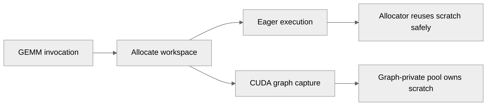

# Let the CUDA allocator manage cuBLAS workspaces

[Upstream PR](https://github.com/NVIDIA/TransformerEngine/pull/3625) · state: open · merged: False

## Original PR description

# Description

Concurrent GEMMs on independent CUDA streams receive the same cuBLAS workspace from the device/mode cache and can overwrite each other's partial sums. On one H200, two FP32 `NT` GEMMs with a reduction dimension of 16384 produced incorrect results in 35 of 48 calls; separate scratch produced zero mismatches against serial execution.

Remove the Python workspace cache and let the PyTorch caching allocator manage scratch for each invocation. Eager allocations are reused safely on their stream. Captured allocations belong to their graph's private pool, so a later capture cannot borrow a buffer from an earlier graph generation. Scratch is returned to the allocator when the invocation ends, without retaining tensors for temporary streams.

This also removes Linear's preallocation workaround for the process-global cache. The workspace signature and sizes, GEMM dtypes and algorithm selection are unchanged. No new device synchronization is added.

## Type of change

- [ ] Documentation change
- [x] Bug fix (non-breaking change which fixes an issue)
- [ ] New feature
- [ ] Breaking change
- [ ] Infra/Build change
- [ ] Code refactoring

## Changes

- Allocate scratch per invocation instead of caching it in Python.
- Remove the preallocation workaround for globally cached scratch.
- Test eager ownership, temporary-stream cleanup, graph-pool isolation across capture generations, concurrent FP32/BF16 graph replay, grouped GEMM scratch reuse, and compiled Linear forward/backward across graph generations.
- Cover router dgrad NN with `weight[128,4096]`, `grad_output[8192,128]`, output `[8192,4096]`, and reduction 128 against exact analytic references in FP32 and BF16. Preserve NT coverage and check every eager invocation while retaining only one pair of large outputs.
- Include the workspace regression in the PyTorch L0 launcher.

## Validation

- One NVIDIA H200, CUDA 13.0, PyTorch 2.13.0+cu130.
- With the exact workspace functions from `main` (`d0b4b32`) loaded into native TE 2.19.0.dev0+b5599209: the first 13 regression cases fail before the fix and pass after it. The previous per-stream-cache revision fails 11 of those 13 cases, including both concurrent graph-replay numerics cases.
- The integration patch passes all 17 workspace cases, including grouped GEMM, and is idempotent.
- Rebuilt current main for SM90 and ran `NVTE_ALLOW_NONDETERMINISTIC_ALGO=0 python -m pytest -v tests/pytorch/test_gemm_workspace.py`: all 22 cases pass in 15.98s, including all four new FP32/BF16 NN eager/independent-graph cases, the existing NT cases, and compiled GEMM graph generations. The compiled Linear cases are capability-skipped because this PyTorch build lacks the required opaque-object API.
- Scoped forward/backward timing used `benchmarks/linear/benchmark_linear.py::benchmark_linear` with BF16/FP8 block scaling on shapes `(8192,4096,128)` and `(128,4096,16384)`. The repeated timings were unstable, so they do not establish a performance improvement or a reliable regression bound.
- Repository pre-commit checks, changed-file pylint and the L0 license checker pass on macOS.
- Full current-main L0 validation is still pending.

The original workspace factory is identical in `main`, `stable`, `release_v2.19` and `release_v2.20`.

# Checklist

- [x] I have read and followed the [contributing guidelines](https://github.com/NVIDIA/TransformerEngine/blob/main/CONTRIBUTING.rst)
- [x] The functionality is complete
- [x] I have commented my code, particularly in hard-to-understand areas
- [x] I have made corresponding changes to the documentation
- [x] My changes generate no new warnings
- [x] I have added tests that prove my fix is effective or that my feature works
- [x] New and existing unit tests pass locally with my changes

## Review and discussion

### reviews

- greptile-apps[bot] · COMMENTED · 2026-10-05T10:10:37Z · [source](https://github.com/NVIDIA/TransformerEngine/pull/3625#pullrequestreview-5412927493)

(No body; status only.)

- Vtmpas · COMMENTED · 2026-10-05T10:42:44Z · [source](https://github.com/NVIDIA/TransformerEngine/pull/3625#pullrequestreview-5413259507)

(No body; status only.)

- Vtmpas · COMMENTED · 2026-10-05T10:42:46Z · [source](https://github.com/NVIDIA/TransformerEngine/pull/3625#pullrequestreview-5413259760)

(No body; status only.)

- itwastony · COMMENTED · 2026-10-08T18:45:23Z · [source](https://github.com/NVIDIA/TransformerEngine/pull/3625#pullrequestreview-5461348437)

had the same trouble, thanks

### issue_comments

- greptile-apps[bot] · comment · 2026-10-05T10:10:32Z · [source](https://github.com/NVIDIA/TransformerEngine/pull/3625#issuecomment-5992385387)

<!-- greptile_summary -->

<h2><a href="https://app.greptile.com/api/retrigger?id=74741308"><picture><source media="(prefers-color-scheme: dark)" srcset="https://greptile-static-assets.s3.amazonaws.com/badges/RetriggerDark.svg?v=2"><source media="(prefers-color-scheme: light)" srcset="https://greptile-static-assets.s3.amazonaws.com/badges/Retrigger.svg?v=2"></picture></a>Confidence Score: 5/5</h2>

**[Medium impact]** The PR appears safe to merge based on this review; no outstanding findings or new actionable issues were identified.

<h3>Summary</h3>

The PR replaces Python-cached cuBLAS workspaces with invocation-local allocations, removes Linear’s workspace preallocation, and adds stream, graph, and numerical regression coverage. The changes since the previous review correct class names in exception messages.

<h3>Diagram</h3>

<!-- greptile_confidence_score:5 -->

Reviews (16) · Last reviewed commit: ["Merge branch &#39;main&#39; into fix/cublas-work..."](https://github.com/nvidia/transformerengine/commit/d50e4cad7c4e0bd9a8a8f84fd56a9ba499e3964f) · [Reviewed by Greptile](https://www.greptile.com/?utm_source=greptile_expert&utm_medium=github&utm_campaign=code_reviews&utm_content=nvidia/transformerengine)

- Vtmpas · comment · 2026-10-06T07:54:14Z · [source](https://github.com/NVIDIA/TransformerEngine/pull/3625#issuecomment-6011903498)

@Oleg-Goncharov , @ksivaman , hello! can i have your assistance here?

- Vtmpas · comment · 2026-10-08T10:47:43Z · [source](https://github.com/NVIDIA/TransformerEngine/pull/3625#issuecomment-6058186469)

@ksivaman kindly

- ksivaman · comment · 2026-10-08T17:47:44Z · [source](https://github.com/NVIDIA/TransformerEngine/pull/3625#issuecomment-6065755817)

/te-ci pytorch L0

- greptile-apps[bot] · comment · 2026-10-08T21:33:48Z · [source](https://github.com/NVIDIA/TransformerEngine/pull/3625#issuecomment-6069479850)

<!-- greptile_outside_diff -->

<h3>Comments Outside Diff</h3>

No findings outside the diff remain.

- greptile-apps[bot] · comment · 2026-10-08T21:33:51Z · [source](https://github.com/NVIDIA/TransformerEngine/pull/3625#issuecomment-6069480593)

Want your agent to iterate on Greptile's feedback? Try [*greploops*](https://github.com/greptileai/skills/blob/main/greploop/SKILL.md).

- Vtmpas · comment · 2026-10-08T21:45:26Z · [source](https://github.com/NVIDIA/TransformerEngine/pull/3625#issuecomment-6069652290)

Fixed in f01b35ebc9590d88a9bc6c50169d1bf4a40368bf, on top of the latest main merge. The cold-start test now checks capture-time workspace allocation and release of Python tensor references instead of `cache_info()`. BasicLinear no longer preallocates scratch for the removed cache. The six initialization/training combinations, fullgraph capture checks, and output/gradient comparisons are preserved.

On H200 with CUDA 13 and PyTorch 2.13, the original `AttributeError` reproduced before the fix. Afterward, 22 workspace tests, the fake-initialization test, and three BasicLinear CUDA-graph cases passed. The six compiled cold-start cases are capability-skipped because this PyTorch lacks `register_custom_class`; execution of those cases on a compatible PyTorch build remains unverified. Formatting, scoped pylint, and the license check passed.

- Vtmpas · comment · 2026-10-09T12:47:15Z · [source](https://github.com/NVIDIA/TransformerEngine/pull/3625#issuecomment-6081184977)

@timmoon10 @ksivaman conflicts have been solved 
ci seems okay

- ksivaman · comment · 2026-10-09T18:34:09Z · [source](https://github.com/NVIDIA/TransformerEngine/pull/3625#issuecomment-6086958233)

/te-ci pytorch L0

- Vtmpas · comment · 2026-10-10T08:02:03Z · [source](https://github.com/NVIDIA/TransformerEngine/pull/3625#issuecomment-6095446705)

@ksivaman thanks for kicking off CI again. The last run stopped at `pytorch-py3-base-amd64` before any tests ran, and the public log is empty, so I can't tell what went wrong. The previous run passed everything except the H100 unittest, which was the `cache_info()` test fixed in f01b35eb. Could you rerun it, or let me know if it's something on my side?

- Vtmpas · comment · 2026-10-12T19:17:32Z · [source](https://github.com/NVIDIA/TransformerEngine/pull/3625#issuecomment-6130978319)

@timmoon10 @ksivaman @ptrendx , sorry guys,  are there any updated or feedback? Could you guide me here what's blocking, please? 

- Vtmpas · comment · 2026-10-15T20:27:50Z · [source](https://github.com/NVIDIA/TransformerEngine/pull/3625#issuecomment-6201604160)

Kindly 

### inline_comments

- greptile-apps[bot] · comment · 2026-10-05T10:10:36Z · [source](https://github.com/NVIDIA/TransformerEngine/pull/3625#discussion_r4182854165)

File: `transformer_engine/pytorch/cpp_extensions/gemm.py` · line None

 **Graph capture bypasses preallocation** When a Linear module preallocates its workspace, it caches the buffer under the stream used during construction. If graph capture uses a different stream, this lookup misses and allocates a workspace inside the graph pool. That defeats the existing safeguard against workspaces that may not survive across graph generations, risking invalid scratch memory in a later generation.

- greptile-apps[bot] · comment · 2026-10-05T10:10:36Z · [source](https://github.com/NVIDIA/TransformerEngine/pull/3625#discussion_r4182854171)

File: `transformer_engine/pytorch/cpp_extensions/gemm.py` · line None

 **Temporary streams retain GPU memory** This unbounded cache keeps a GPU workspace for every stream handle it encounters, even after a temporary stream—such as the inline graph-warmup stream—is gone. Repeated stream or graph creation can therefore grow GPU memory use despite a bounded number of active streams.

- Vtmpas · comment · 2026-10-05T10:42:44Z · [source](https://github.com/NVIDIA/TransformerEngine/pull/3625#discussion_r4183103469)

File: `transformer_engine/pytorch/cpp_extensions/gemm.py` · line None

Fixed in e5b55e918ffdbc1118a7dd0e1effbe731c55cbbd. The stream-keyed Python cache is removed entirely, together with Linear's preallocation workaround. Each GEMM allocates invocation-local scratch: eager reuse is handled by the Torch allocator, and allocations made during capture remain owned by the graph-private pool. Native grouped GEMM and userbuffer paths either use the caller stream or enqueue their internal-stream joins before returning.

The rebuilt d0b4b32 SM90 native build on H200 (CUDA 13.0, PyTorch 2.13.0+cu130) passed all 18 workspace tests, including concurrent FP32/BF16 graph replay, repeated capture/pool release, grouped GEMM with immediate scratch reuse, and an actual torch.compile custom GEMM across graph generations. The TE Linear compile test was added but capability-skipped because this Torch build lacks the opaque-object API. Full L0 remains pending; the PR body records both limitations.

- Vtmpas · comment · 2026-10-05T10:42:46Z · [source](https://github.com/NVIDIA/TransformerEngine/pull/3625#discussion_r4183103667)

File: `transformer_engine/pytorch/cpp_extensions/gemm.py` · line None

Fixed in e5b55e918ffdbc1118a7dd0e1effbe731c55cbbd by removing the Python workspace cache, rather than bounding a stream-keyed cache. Scratch tensors have only invocation-local ownership, so temporary stream handles no longer retain tensors in Python. Normal Torch allocator reservation/caching still applies.

The cleanup tests cover dense, userbuffer-sized, and grouped workspaces: tensor weakrefs expire after each invocation and memory_allocated returns to the initial baseline after temporary-stream work completes. Repeated graph capture/replay/reset also restores allocated and reserved memory baselines after empty_cache. All 18 workspace cases passed in the rebuilt SM90 native main build on H200; full L0 remains pending.

## Changed files and fixed code

- `qa/L0_pytorch_unittest/test.sh` · modified · additions 1 / deletions 0
  - [head](https://github.com/Vtmpas/TransformerEngine/blob/d50e4cad7c4e0bd9a8a8f84fd56a9ba499e3964f/qa/L0_pytorch_unittest/test.sh)
  - [base](https://github.com/NVIDIA/TransformerEngine/blob/81775f2cc0052d3e75608664357a8f3d3f453897/qa/L0_pytorch_unittest/test.sh)
- `tests/pytorch/test_gemm_workspace.py` · added · additions 269 / deletions 0
  - [head](https://github.com/Vtmpas/TransformerEngine/blob/d50e4cad7c4e0bd9a8a8f84fd56a9ba499e3964f/tests/pytorch/test_gemm_workspace.py)
  - [base](https://github.com/NVIDIA/TransformerEngine/blob/81775f2cc0052d3e75608664357a8f3d3f453897/tests/pytorch/test_gemm_workspace.py)
- `tests/pytorch/test_torch_compile.py` · modified · additions 63 / deletions 7
  - [head](https://github.com/Vtmpas/TransformerEngine/blob/d50e4cad7c4e0bd9a8a8f84fd56a9ba499e3964f/tests/pytorch/test_torch_compile.py)
  - [base](https://github.com/NVIDIA/TransformerEngine/blob/81775f2cc0052d3e75608664357a8f3d3f453897/tests/pytorch/test_torch_compile.py)
- `transformer_engine/pytorch/cpp_extensions/gemm.py` · modified · additions 7 / deletions 2
  - [head](https://github.com/Vtmpas/TransformerEngine/blob/d50e4cad7c4e0bd9a8a8f84fd56a9ba499e3964f/transformer_engine/pytorch/cpp_extensions/gemm.py)
  - [base](https://github.com/NVIDIA/TransformerEngine/blob/81775f2cc0052d3e75608664357a8f3d3f453897/transformer_engine/pytorch/cpp_extensions/gemm.py)
- `transformer_engine/pytorch/module/linear.py` · modified · additions 0 / deletions 35
  - [head](https://github.com/Vtmpas/TransformerEngine/blob/d50e4cad7c4e0bd9a8a8f84fd56a9ba499e3964f/transformer_engine/pytorch/module/linear.py)
  - [base](https://github.com/NVIDIA/TransformerEngine/blob/81775f2cc0052d3e75608664357a8f3d3f453897/transformer_engine/pytorch/module/linear.py)
- `transformer_engine/pytorch/ops/basic/basic_linear.py` · modified · additions 1 / deletions 18
  - [head](https://github.com/Vtmpas/TransformerEngine/blob/d50e4cad7c4e0bd9a8a8f84fd56a9ba499e3964f/transformer_engine/pytorch/ops/basic/basic_linear.py)
  - [base](https://github.com/NVIDIA/TransformerEngine/blob/81775f2cc0052d3e75608664357a8f3d3f453897/transformer_engine/pytorch/ops/basic/basic_linear.py)

## Evidence and interpretation boundary

[Original JSON, discussions and patches](../../../../../../evidence/prs/NVIDIA--TransformerEngine/3625-a73eac6e542c628e829399beca19e0efa4f043954e77f7c562ea4c2e635a3258.json) · SHA-256 `a73eac6e542c628e829399beca19e0efa4f043954e77f7c562ea4c2e635a3258`.

Diff complete: True. Missing/binary/truncated patches require pinned source inspection. This is a source page, not an independently verified optimization case. Open, merged and released are different states; recheck the deployed dependency.
