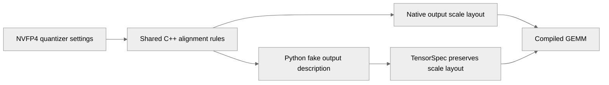

# [PyTorch] Fix NVFP4 metadata in compiled Linear operations

[Upstream PR](https://github.com/NVIDIA/TransformerEngine/pull/3628) · state: open · merged: False

## Original PR description

Fix NVFP4 torch.compile failures for non-matrix Linear inputs and incorrect gradients from Linear operations with bias. Native Bias backward can produce compact scales while its fake output describes GEMM-swizzled scales, causing compiled GEMM to interpret the reconstructed tensor incorrectly.

Native execution and fake metadata now share alignment requirements through NVFP4Quantizer. C++ reads the RHT-fusion environment flag only when needed; Python reads it explicitly so Dynamo can guard changes. TensorSpec preserves the actual scale layout, and NVFP4 metadata matches native packed columnwise buffers and row-scaled amax shapes. Columnwise-only shape warnings are skipped during tracing.

Bias backward uses a small shared fake helper. Follow-up normalization and activation operations should use the same fused-output metadata helper.

Regression coverage stays in test_torch_compile.py, including dynamic shapes, environment changes, quantizer configurations and CUDA Graphs. Focused checks on SM89 passed: 98 tests passed and 44 skipped, including hardware-dependent NVFP4 cases. The C++ extension build and binding checks, pre-commit and changed-source pylint also passed. Validation of the final NVFP4 test matrix on SM100 remains pending; PyTorch L0 CI is requested separately.

Fixes #3626.

## Review and discussion

### reviews

### issue_comments

- greptile-apps[bot] · comment · 2026-10-12T15:37:57Z · [source](https://github.com/NVIDIA/TransformerEngine/pull/3628#issuecomment-6127511662)

<!-- greptile_summary -->

<h2><a href="https://app.greptile.com/api/retrigger?id=79217105"><picture><source media="(prefers-color-scheme: dark)" srcset="https://greptile-static-assets.s3.amazonaws.com/badges/RetriggerDark.svg?v=2"><source media="(prefers-color-scheme: light)" srcset="https://greptile-static-assets.s3.amazonaws.com/badges/Retrigger.svg?v=2"></picture></a>Confidence Score: 5/5</h2>

**[High impact]** The PR appears safe to merge; no actionable new defects were found.

<h3>Summary</h3>

This PR aligns compiled NVFP4 tensor descriptions with native outputs.
- Compiled bias gradients keep the NVFP4 scale layout native code emits.
- Fake NVFP4 tensors keep the native packed buffer shapes.

The changes since the previous review only simplify the NVFP4 Bias test matrix. No actionable new issues were found. No previous review threads were supplied.

<h3>Diagram</h3>

<!-- greptile_confidence_score:5 -->

Reviews (11) · Last reviewed commit: ["Reduce NVFP4 Bias layout test combinatio..."](https://github.com/nvidia/transformerengine/commit/5bc7286eaadb66bbecfd93f53b6f694fbce7712d) · [Reviewed by Greptile](https://www.greptile.com/?utm_source=greptile_expert&utm_medium=github&utm_campaign=code_reviews&utm_content=nvidia/transformerengine)

- pggPL · comment · 2026-10-14T10:47:52Z · [source](https://github.com/NVIDIA/TransformerEngine/pull/3628#issuecomment-6166622318)

/te-ci pytorch L0

### inline_comments

## Changed files and fixed code

- `tests/pytorch/test_torch_compile.py` · modified · additions 175 / deletions 42
  - [head](https://github.com/pggPL/TransformerEngine/blob/5bc7286eaadb66bbecfd93f53b6f694fbce7712d/tests/pytorch/test_torch_compile.py)
  - [base](https://github.com/NVIDIA/TransformerEngine/blob/2e959f352c8e2d4b2709e6775867f2c7494656f3/tests/pytorch/test_torch_compile.py)
- `transformer_engine/pytorch/csrc/common.h` · modified · additions 16 / deletions 0
  - [head](https://github.com/pggPL/TransformerEngine/blob/5bc7286eaadb66bbecfd93f53b6f694fbce7712d/transformer_engine/pytorch/csrc/common.h)
  - [base](https://github.com/NVIDIA/TransformerEngine/blob/2e959f352c8e2d4b2709e6775867f2c7494656f3/transformer_engine/pytorch/csrc/common.h)
- `transformer_engine/pytorch/csrc/extensions/pybind.cpp` · modified · additions 5 / deletions 0
  - [head](https://github.com/pggPL/TransformerEngine/blob/5bc7286eaadb66bbecfd93f53b6f694fbce7712d/transformer_engine/pytorch/csrc/extensions/pybind.cpp)
  - [base](https://github.com/NVIDIA/TransformerEngine/blob/2e959f352c8e2d4b2709e6775867f2c7494656f3/transformer_engine/pytorch/csrc/extensions/pybind.cpp)
- `transformer_engine/pytorch/csrc/quantizer.cpp` · modified · additions 54 / deletions 32
  - [head](https://github.com/pggPL/TransformerEngine/blob/5bc7286eaadb66bbecfd93f53b6f694fbce7712d/transformer_engine/pytorch/csrc/quantizer.cpp)
  - [base](https://github.com/NVIDIA/TransformerEngine/blob/2e959f352c8e2d4b2709e6775867f2c7494656f3/transformer_engine/pytorch/csrc/quantizer.cpp)
- `transformer_engine/pytorch/dynamo/fake.py` · added · additions 94 / deletions 0
  - [head](https://github.com/pggPL/TransformerEngine/blob/5bc7286eaadb66bbecfd93f53b6f694fbce7712d/transformer_engine/pytorch/dynamo/fake.py)
  - [base](https://github.com/NVIDIA/TransformerEngine/blob/2e959f352c8e2d4b2709e6775867f2c7494656f3/transformer_engine/pytorch/dynamo/fake.py)
- `transformer_engine/pytorch/dynamo/tensor_spec.py` · modified · additions 6 / deletions 1
  - [head](https://github.com/pggPL/TransformerEngine/blob/5bc7286eaadb66bbecfd93f53b6f694fbce7712d/transformer_engine/pytorch/dynamo/tensor_spec.py)
  - [base](https://github.com/NVIDIA/TransformerEngine/blob/2e959f352c8e2d4b2709e6775867f2c7494656f3/transformer_engine/pytorch/dynamo/tensor_spec.py)
- `transformer_engine/pytorch/ops/basic/bias.py` · modified · additions 5 / deletions 9
  - [head](https://github.com/pggPL/TransformerEngine/blob/5bc7286eaadb66bbecfd93f53b6f694fbce7712d/transformer_engine/pytorch/ops/basic/bias.py)
  - [base](https://github.com/NVIDIA/TransformerEngine/blob/2e959f352c8e2d4b2709e6775867f2c7494656f3/transformer_engine/pytorch/ops/basic/bias.py)
- `transformer_engine/pytorch/tensor/nvfp4_tensor.py` · modified · additions 3 / deletions 2
  - [head](https://github.com/pggPL/TransformerEngine/blob/5bc7286eaadb66bbecfd93f53b6f694fbce7712d/transformer_engine/pytorch/tensor/nvfp4_tensor.py)
  - [base](https://github.com/NVIDIA/TransformerEngine/blob/2e959f352c8e2d4b2709e6775867f2c7494656f3/transformer_engine/pytorch/tensor/nvfp4_tensor.py)
- `transformer_engine/pytorch/tensor/storage/nvfp4_tensor_storage.py` · modified · additions 3 / deletions 1
  - [head](https://github.com/pggPL/TransformerEngine/blob/5bc7286eaadb66bbecfd93f53b6f694fbce7712d/transformer_engine/pytorch/tensor/storage/nvfp4_tensor_storage.py)
  - [base](https://github.com/NVIDIA/TransformerEngine/blob/2e959f352c8e2d4b2709e6775867f2c7494656f3/transformer_engine/pytorch/tensor/storage/nvfp4_tensor_storage.py)

## Evidence and interpretation boundary

[Original JSON, discussions and patches](../../../../../../evidence/prs/NVIDIA--TransformerEngine/3628-98904982a89c22cf5642b95a25b0b3e666d04f56f83f4d5392191644187e94e6.json) · SHA-256 `98904982a89c22cf5642b95a25b0b3e666d04f56f83f4d5392191644187e94e6`.

Diff complete: True. Missing/binary/truncated patches require pinned source inspection. This is a source page, not an independently verified optimization case. Open, merged and released are different states; recheck the deployed dependency.
