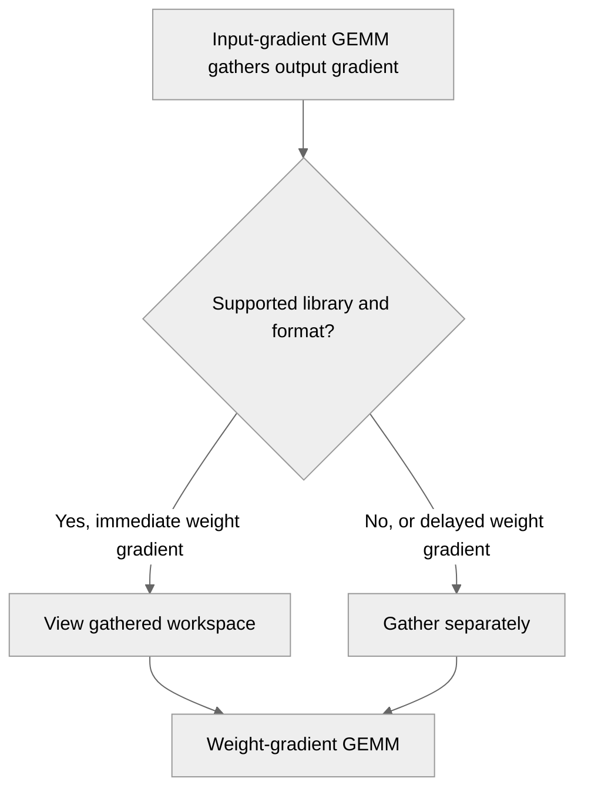

# Reuse cuBLASMp's all-gathered grad_output in the wgrad GEMM

[Upstream PR](https://github.com/NVIDIA/TransformerEngine/pull/3629) · state: open · merged: False

## Original PR description

# Description

Please include a brief summary of the changes, relevant motivation and context.

Fixes # (issue)

## Type of change

- [ ] Documentation change (change only to the documentation, either a fix or a new content)
- [ ] Bug fix (non-breaking change which fixes an issue)
- [x] New feature (non-breaking change which adds functionality)
- [ ] Breaking change (fix or feature that would cause existing functionality to not work as expected)
- [ ] Infra/Build change
- [ ] Code refactoring

## Changes

Please list the changes introduced in this PR:

- Reuse cuBLASMp's all-gathered grad_output in the wgrad GEMM

# Checklist:

- [ ] I have read and followed the [contributing guidelines](https://github.com/NVIDIA/TransformerEngine/blob/main/CONTRIBUTING.rst)
- [ ] The functionality is complete
- [ ] I have commented my code, particularly in hard-to-understand areas
- [ ] I have made corresponding changes to the documentation
- [ ] My changes generate no new warnings
- [ ] I have added tests that prove my fix is effective or that my feature works
- [ ] New and existing unit tests pass locally with my changes

## Review and discussion

### reviews

- greptile-apps[bot] · COMMENTED · 2026-10-05T16:05:55Z · [source](https://github.com/NVIDIA/TransformerEngine/pull/3629#pullrequestreview-5417392793)

(No body; status only.)

- denera · CHANGES_REQUESTED · 2026-10-16T10:05:13Z · [source](https://github.com/NVIDIA/TransformerEngine/pull/3629#pullrequestreview-5545638934)

Overall LGTM except for the cuBLASMp < 0.11 fallback relying on this try/except block.

Since you updated the fusible ops too, can you make sure `test_fusible_ops_with_userbuffers.py` also tests with `use_cublasmp=True`? Currently it's only testing the Userbuffers path, never exercises the cuBLASMp path.

----

I spotted two perf issues in my testing but I believe they are both internal to cuBLASMp, not TE code so I wouldn't consider them blockers for this PR.

1. In a GEMM+RS overlap with SPLIT_MULTICAST algo, cuBLASMp makes every GPU compute the fully-reduced result for every GPU's slice of the output, then each GPU throws away all but its own slice. It moves about TP-times more data over NVLink than necessary where TP is # of tensor-parallel ranks. Userbuffers avoids this by making each GPU reduce only its own slice. cuBLASMp should probably do the same unless there's a NCCL API limitation at play, in which case we should file a ticket with them to fix it.

2. With overlap configs set to use SPLIT_P2P reduce-scatter, the new cuBLASMp path is at perf-parity with the UB path in BF16, but there's a 2-3% deficit in FP8 on a DGXH100 node. The difference exclusively traces to the forward pass. The backward passes are at parity between UB and cuBLASMp. I believe the issue here is that TE's FP8 recipe uses fast accumulation in the forward pass and split accumulator in the backward pass (GEMM chunks inside UB respect these recipe settings). However, the cuBLASMp path in FP8 is locked to the split accumulator in both forward and backward because cuBLASMp itself does not expose any API for the user to control this setting. I have confirmed that the FP8 deficit disappears when I change the TE FP8 recipe to use the split accumulator everywhere as well, but that's not a viable fix. We want to be able to use the fast accumulator in the forward pass for FP8.

NOTE: I have not had the chance to compare perf for MXFP8 yet.

- denera · COMMENTED · 2026-10-16T10:48:29Z · [source](https://github.com/NVIDIA/TransformerEngine/pull/3629#pullrequestreview-5546713822)

(No body; status only.)

- greptile-apps[bot] · COMMENTED · 2026-10-16T10:48:56Z · [source](https://github.com/NVIDIA/TransformerEngine/pull/3629#pullrequestreview-5546718884)

(No body; status only.)

- almogsegal · COMMENTED · 2026-10-18T08:08:57Z · [source](https://github.com/NVIDIA/TransformerEngine/pull/3629#pullrequestreview-5562056735)

(No body; status only.)

### issue_comments

- greptile-apps[bot] · comment · 2026-10-05T16:05:50Z · [source](https://github.com/NVIDIA/TransformerEngine/pull/3629#issuecomment-5998260111)

<!-- greptile_summary -->

<h2><a href="https://app.greptile.com/api/retrigger?id=74933977"><picture><source media="(prefers-color-scheme: dark)" srcset="https://greptile-static-assets.s3.amazonaws.com/badges/RetriggerDark.svg?v=2"><source media="(prefers-color-scheme: light)" srcset="https://greptile-static-assets.s3.amazonaws.com/badges/Retrigger.svg?v=2"></picture></a><a href="https://app.greptile.com/nvidia-public-github/github/NVIDIA/transformerengine/-/pull/3629"><picture><source media="(prefers-color-scheme: dark)" srcset="https://greptile-static-assets.s3.amazonaws.com/badges/ViewInGreptileDark.svg?v=2"><source media="(prefers-color-scheme: light)" srcset="https://greptile-static-assets.s3.amazonaws.com/badges/ViewInGreptile.svg?v=2"></picture></a>Confidence Score: 5/5</h2>

**[High impact]** The PR appears safe to merge, with no new blocking issues found.

<h3>Summary</h3>

Reuses cuBLASMp’s gathered output gradient for weight-gradient GEMMs when the format and library version support it.
- Eligible weight-gradient GEMMs reuse cuBLASMp’s gathered gradient output.

<h3>Diagram</h3>

<!-- greptile_confidence_score:5 -->

Reviews (3) · Last reviewed commit: ["\[PyTorch\] Test the fused te.ops comm+GEM..."](https://github.com/nvidia/transformerengine/commit/6ec34f2dfc8f391c97f23ecefa7aaf09edb9a826) · [Reviewed by Greptile](https://www.greptile.com/?utm_source=greptile_review&utm_medium=github&utm_campaign=review_public&utm_content=nvidia/transformerengine)

- timmoon10 · comment · 2026-10-12T17:41:37Z · [source](https://github.com/NVIDIA/TransformerEngine/pull/3629#issuecomment-6129466077)

Pipeline 73310656

- almogsegal · comment · 2026-10-18T06:33:32Z · [source](https://github.com/NVIDIA/TransformerEngine/pull/3629#issuecomment-6246605358)

> Overall LGTM except for the cuBLASMp < 0.11 fallback relying on this try/except block.
> 
> Since you updated the fusible ops too, can you make sure `test_fusible_ops_with_userbuffers.py` also tests with `use_cublasmp=True`? Currently it's only testing the Userbuffers path, never exercises the cuBLASMp path.
> 
> I spotted two perf issues in my testing but I believe they are both internal to cuBLASMp, not TE code so I wouldn't consider them blockers for this PR.
> 
> 1. In a GEMM+RS overlap with SPLIT_MULTICAST algo, cuBLASMp makes every GPU compute the fully-reduced result for every GPU's slice of the output, then each GPU throws away all but its own slice. It moves about TP-times more data over NVLink than necessary where TP is # of tensor-parallel ranks. Userbuffers avoids this by making each GPU reduce only its own slice. cuBLASMp should probably do the same unless there's a NCCL API limitation at play, in which case we should file a ticket with them to fix it.
> 2. With overlap configs set to use SPLIT_P2P reduce-scatter, the new cuBLASMp path is at perf-parity with the UB path in BF16, but there's a 2-3% deficit in FP8 on a DGXH100 node. The difference exclusively traces to the forward pass. The backward passes are at parity between UB and cuBLASMp. I believe the issue here is that TE's FP8 recipe uses fast accumulation in the forward pass and split accumulator in the backward pass (GEMM chunks inside UB respect these recipe settings). However, the cuBLASMp path in FP8 is locked to the split accumulator in both forward and backward because cuBLASMp itself does not expose any API for the user to control this setting. I have confirmed that the FP8 deficit disappears when I change the TE FP8 recipe to use the split accumulator everywhere as well, but that's not a viable fix. We want to be able to use the fast accumulator in the forward pass for FP8.
> 
> NOTE: I have not had the chance to compare perf for MXFP8 yet.

Thanks for the feedback, Alp!

1. I've noticed that too and it's already fixed in cuBLASMp 0.12.0.
2. As for the FP8 path on H100, I made some improvements and I believe that perf in 0.12.0 is at least the same if not faster than UB. As for the fast accumulation, I'll expose an API to enable it in 0.12.0. I did some runs a few months ago and cuBLASMp was mostly faster than UB with MXFP8, see https://github.com/NVIDIA/TransformerEngine/pull/3145#issuecomment-4798177408.

- timmoon10 · comment · 2026-10-19T17:00:31Z · [source](https://github.com/NVIDIA/TransformerEngine/pull/3629#issuecomment-6272633871)

Pipeline 75052441

### inline_comments

- greptile-apps[bot] · comment · 2026-10-05T16:05:54Z · [source](https://github.com/NVIDIA/TransformerEngine/pull/3629#discussion_r4186103095)

File: `transformer_engine/pytorch/csrc/extensions/comm_gemm_overlap.cpp` · line 335

 **Workspace view can become invalid** If a later operation grows the communicator’s workspace while wgrad still uses this view, cuBLASMp frees the allocation behind it. Wgrad could then read invalid memory. The view does not keep that allocation alive, so its lifetime needs to be protected until consumption finishes.

- denera · comment · 2026-10-16T09:21:06Z · [source](https://github.com/NVIDIA/TransformerEngine/pull/3629#discussion_r4292950810)

File: `transformer_engine/pytorch/module/base.py` · line None

Relying on string-matching an `NVTE_ERROR` is very fragile and changing the error message would silently turn the fallback into a crash. 

Even more importantly, this kind of a fallback costs us an exception PER CALL on cuBLASMp < v0.11, which is every backward pass of every layer with a GEMM+RS overlap in the forward pass. That's a non-trivial CPU overhead.

I would recommend just writing a dedicated cuBLASMp capability/version-check function that caches the result instead.

- denera · comment · 2026-10-16T10:48:29Z · [source](https://github.com/NVIDIA/TransformerEngine/pull/3629#discussion_r4293808841)

File: `transformer_engine/pytorch/csrc/extensions/comm_gemm_overlap.cpp` · line 335

This is impossible in the current module implementations. Nothing runs on this communicator between DGRAD and WGRAD so the view of the buffer is guaranteed to be valid at the WGRAD call-site.

- greptile-apps[bot] · comment · 2026-10-16T10:48:56Z · [source](https://github.com/NVIDIA/TransformerEngine/pull/3629#discussion_r4293813013)

File: `transformer_engine/pytorch/csrc/extensions/comm_gemm_overlap.cpp` · line 335

You're right for the current call paths. `get_buffer()` is called after cuBLASMp DGRAD and the returned view is consumed by WGRAD without another operation on that communicator; delayed-WGRAD paths explicitly fall back to a separate gather. Therefore, the workspace cannot be resized or overwritten between obtaining the view and its use here.

My concern would only apply if another communicator operation could be introduced concurrently or interposed, which these implementations do not permit. I'll withdraw this comment.

- almogsegal · comment · 2026-10-18T08:08:56Z · [source](https://github.com/NVIDIA/TransformerEngine/pull/3629#discussion_r4306286023)

File: `transformer_engine/pytorch/module/base.py` · line None

Done. 

## Changed files and fixed code

- `tests/pytorch/distributed/test_fusible_ops_with_userbuffers.py` · modified · additions 7 / deletions 0
  - [head](https://github.com/almogsegal/TransformerEngine/blob/6ec34f2dfc8f391c97f23ecefa7aaf09edb9a826/tests/pytorch/distributed/test_fusible_ops_with_userbuffers.py)
  - [base](https://github.com/NVIDIA/TransformerEngine/blob/5e994640625626263aa62250c709e35601563566/tests/pytorch/distributed/test_fusible_ops_with_userbuffers.py)
- `transformer_engine/common/comm_gemm/comm_gemm.cpp` · modified · additions 26 / deletions 0
  - [head](https://github.com/almogsegal/TransformerEngine/blob/6ec34f2dfc8f391c97f23ecefa7aaf09edb9a826/transformer_engine/common/comm_gemm/comm_gemm.cpp)
  - [base](https://github.com/NVIDIA/TransformerEngine/blob/5e994640625626263aa62250c709e35601563566/transformer_engine/common/comm_gemm/comm_gemm.cpp)
- `transformer_engine/common/include/transformer_engine/comm_gemm.h` · modified · additions 21 / deletions 0
  - [head](https://github.com/almogsegal/TransformerEngine/blob/6ec34f2dfc8f391c97f23ecefa7aaf09edb9a826/transformer_engine/common/include/transformer_engine/comm_gemm.h)
  - [base](https://github.com/NVIDIA/TransformerEngine/blob/5e994640625626263aa62250c709e35601563566/transformer_engine/common/include/transformer_engine/comm_gemm.h)
- `transformer_engine/common/util/pybind_helper.h` · modified · additions 2 / deletions 1
  - [head](https://github.com/almogsegal/TransformerEngine/blob/6ec34f2dfc8f391c97f23ecefa7aaf09edb9a826/transformer_engine/common/util/pybind_helper.h)
  - [base](https://github.com/NVIDIA/TransformerEngine/blob/5e994640625626263aa62250c709e35601563566/transformer_engine/common/util/pybind_helper.h)
- `transformer_engine/pytorch/csrc/extensions.h` · modified · additions 8 / deletions 0
  - [head](https://github.com/almogsegal/TransformerEngine/blob/6ec34f2dfc8f391c97f23ecefa7aaf09edb9a826/transformer_engine/pytorch/csrc/extensions.h)
  - [base](https://github.com/NVIDIA/TransformerEngine/blob/5e994640625626263aa62250c709e35601563566/transformer_engine/pytorch/csrc/extensions.h)
- `transformer_engine/pytorch/csrc/extensions/comm_gemm_overlap.cpp` · modified · additions 45 / deletions 7
  - [head](https://github.com/almogsegal/TransformerEngine/blob/6ec34f2dfc8f391c97f23ecefa7aaf09edb9a826/transformer_engine/pytorch/csrc/extensions/comm_gemm_overlap.cpp)
  - [base](https://github.com/NVIDIA/TransformerEngine/blob/5e994640625626263aa62250c709e35601563566/transformer_engine/pytorch/csrc/extensions/comm_gemm_overlap.cpp)
- `transformer_engine/pytorch/module/base.py` · modified · additions 58 / deletions 0
  - [head](https://github.com/almogsegal/TransformerEngine/blob/6ec34f2dfc8f391c97f23ecefa7aaf09edb9a826/transformer_engine/pytorch/module/base.py)
  - [base](https://github.com/NVIDIA/TransformerEngine/blob/5e994640625626263aa62250c709e35601563566/transformer_engine/pytorch/module/base.py)
- `transformer_engine/pytorch/module/layernorm_linear.py` · modified · additions 25 / deletions 13
  - [head](https://github.com/almogsegal/TransformerEngine/blob/6ec34f2dfc8f391c97f23ecefa7aaf09edb9a826/transformer_engine/pytorch/module/layernorm_linear.py)
  - [base](https://github.com/NVIDIA/TransformerEngine/blob/5e994640625626263aa62250c709e35601563566/transformer_engine/pytorch/module/layernorm_linear.py)
- `transformer_engine/pytorch/module/layernorm_mlp.py` · modified · additions 29 / deletions 15
  - [head](https://github.com/almogsegal/TransformerEngine/blob/6ec34f2dfc8f391c97f23ecefa7aaf09edb9a826/transformer_engine/pytorch/module/layernorm_mlp.py)
  - [base](https://github.com/NVIDIA/TransformerEngine/blob/5e994640625626263aa62250c709e35601563566/transformer_engine/pytorch/module/layernorm_mlp.py)
- `transformer_engine/pytorch/module/linear.py` · modified · additions 29 / deletions 12
  - [head](https://github.com/almogsegal/TransformerEngine/blob/6ec34f2dfc8f391c97f23ecefa7aaf09edb9a826/transformer_engine/pytorch/module/linear.py)
  - [base](https://github.com/NVIDIA/TransformerEngine/blob/5e994640625626263aa62250c709e35601563566/transformer_engine/pytorch/module/linear.py)
- `transformer_engine/pytorch/ops/fused/userbuffers_backward_linear.py` · modified · additions 25 / deletions 14
  - [head](https://github.com/almogsegal/TransformerEngine/blob/6ec34f2dfc8f391c97f23ecefa7aaf09edb9a826/transformer_engine/pytorch/ops/fused/userbuffers_backward_linear.py)
  - [base](https://github.com/NVIDIA/TransformerEngine/blob/5e994640625626263aa62250c709e35601563566/transformer_engine/pytorch/ops/fused/userbuffers_backward_linear.py)

## Evidence and interpretation boundary

[Original JSON, discussions and patches](../../../../../../evidence/prs/NVIDIA--TransformerEngine/3629-21dc3ef3da4f0ca5d5e08c46ceec084b52ae8613f623e130ce0095a3ec0589e9.json) · SHA-256 `21dc3ef3da4f0ca5d5e08c46ceec084b52ae8613f623e130ce0095a3ec0589e9`.

Diff complete: True. Missing/binary/truncated patches require pinned source inspection. This is a source page, not an independently verified optimization case. Open, merged and released are different states; recheck the deployed dependency.
