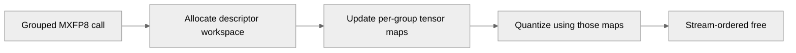

# [Common] Make Grouped MXFP8 quantization concurrency safe for varying last cases

[Upstream PR](https://github.com/NVIDIA/TransformerEngine/pull/3632) · state: closed · merged: False

## Original PR description

# Description

TODO: the impact to CPU overhead is huge: quantize + sync goes from ~50 µs to ~300 µs. I need to come up with something else. This naive fix costs too much

Fixes #3630

## Type of change

- [ ] Documentation change (change only to the documentation, either a fix or a new content)
- [ ] Bug fix (non-breaking change which fixes an issue)
- [ ] New feature (non-breaking change which adds functionality)
- [ ] Breaking change (fix or feature that would cause existing functionality to not work as expected)
- [ ] Infra/Build change
- [ ] Code refactoring

## Changes

- Make grouped MXFP8 allocate their own tensormaps instead of using one shared globally

# Checklist:

- [x] I have read and followed the [contributing guidelines](https://github.com/NVIDIA/TransformerEngine/blob/main/CONTRIBUTING.rst)
- [x] The functionality is complete
- [x] I have commented my code, particularly in hard-to-understand areas
- [x] I have made corresponding changes to the documentation
- [x] My changes generate no new warnings
- [x] I have added tests that prove my fix is effective or that my feature works
- [x] New and existing unit tests pass locally with my changes

## Review and discussion

### reviews

- greptile-apps[bot] · COMMENTED · 2026-10-05T23:36:31Z · [source](https://github.com/NVIDIA/TransformerEngine/pull/3632#pullrequestreview-5421979461)

(No body; status only.)

### issue_comments

- greptile-apps[bot] · comment · 2026-10-05T23:36:18Z · [source](https://github.com/NVIDIA/TransformerEngine/pull/3632#issuecomment-6005540039)

<!-- greptile_summary -->

<h2><a href="https://app.greptile.com/api/retrigger?id=75218572"><picture><source media="(prefers-color-scheme: dark)" srcset="https://greptile-static-assets.s3.amazonaws.com/badges/RetriggerDark.svg?v=2"><source media="(prefers-color-scheme: light)" srcset="https://greptile-static-assets.s3.amazonaws.com/badges/Retrigger.svg?v=2"></picture></a>Confidence Score: 4/5</h2>

**[High risk]** Replaces static device memory with dynamic allocation for quantization state\.

The PR appears safe to merge, with a non-blocking latency concern for repeated grouped quantization calls.

<h2>Findings</h2>

1. &nbsp;**Repeated workspace allocations** <a href="https://github.com/NVIDIA/TransformerEngine/pull/3632#discussion_r4189973502">▶</a>

<h3>Summary</h3>

The PR replaces shared grouped-MXFP8 tensor-map storage with per-call stream-ordered storage and adds concurrent-stream and CUDA-graph replay tests.
- Descriptor updates and quantization now receive the same per-call workspace.
- The new allocation on every varying-last grouped call merits a latency check.

<h3>Diagram</h3>

<!-- greptile_confidence_score:4 -->

Reviews (1) · Last reviewed commit: ["\[Common\] Make Grouped MXFP8 quantization..."](https://github.com/nvidia/transformerengine/commit/090984986a76488334a6f5a2696f16923f1affa0)

### inline_comments

- greptile-apps[bot] · comment · 2026-10-05T23:36:28Z · [source](https://github.com/NVIDIA/TransformerEngine/pull/3632#discussion_r4189973502)

File: `transformer_engine/common/cast/mxfp8/group_quantize_mxfp8.cuh` · line 1244

 **Repeated workspace allocations** Every varying-last-dimension grouped MXFP8 call now allocates and frees a workspace of roughly 34 KiB, even when calls are serialized. That adds allocator work to a quantization hot path that previously used static storage. Please measure the latency of repeated small grouped calls and consider a reusable, concurrency-safe workspace if the cost is material.

**Knowledge Base Used:** [Native GEMM and quantization kernels](https://app.greptile.com/nvidia-public-github/-/custom-context/knowledge-base/nvidia/transformerengine/-/docs/native-gemm-and-quantization.md)

Note: If this suggestion doesn't match your team's coding style, reply to this and let me know. I'll remember it for next time!

## Changed files and fixed code

- `tests/pytorch/mxfp8/test_mxfp8_group_quantize_graph_safe.py` · modified · additions 143 / deletions 0
  - [head](https://github.com/kainzhong/TransformerEngine/blob/090984986a76488334a6f5a2696f16923f1affa0/tests/pytorch/mxfp8/test_mxfp8_group_quantize_graph_safe.py)
  - [base](https://github.com/NVIDIA/TransformerEngine/blob/2cd68931872e55d6727709bfdad69661b14ad007/tests/pytorch/mxfp8/test_mxfp8_group_quantize_graph_safe.py)
- `transformer_engine/common/cast/core/grouped_tma.cuh` · modified · additions 9 / deletions 11
  - [head](https://github.com/kainzhong/TransformerEngine/blob/090984986a76488334a6f5a2696f16923f1affa0/transformer_engine/common/cast/core/grouped_tma.cuh)
  - [base](https://github.com/NVIDIA/TransformerEngine/blob/2cd68931872e55d6727709bfdad69661b14ad007/transformer_engine/common/cast/core/grouped_tma.cuh)
- `transformer_engine/common/cast/mxfp8/group_quantize_mxfp8.cuh` · modified · additions 42 / deletions 14
  - [head](https://github.com/kainzhong/TransformerEngine/blob/090984986a76488334a6f5a2696f16923f1affa0/transformer_engine/common/cast/mxfp8/group_quantize_mxfp8.cuh)
  - [base](https://github.com/NVIDIA/TransformerEngine/blob/2cd68931872e55d6727709bfdad69661b14ad007/transformer_engine/common/cast/mxfp8/group_quantize_mxfp8.cuh)

## Evidence and interpretation boundary

[Original JSON, discussions and patches](../../../../../../evidence/prs/NVIDIA--TransformerEngine/3632-5728d3c51d19498c93bff8e35a94db7f1fecd33601d3e664b98981e969de0c6c.json) · SHA-256 `5728d3c51d19498c93bff8e35a94db7f1fecd33601d3e664b98981e969de0c6c`.

Diff complete: True. Missing/binary/truncated patches require pinned source inspection. This is a source page, not an independently verified optimization case. Open, merged and released are different states; recheck the deployed dependency.
