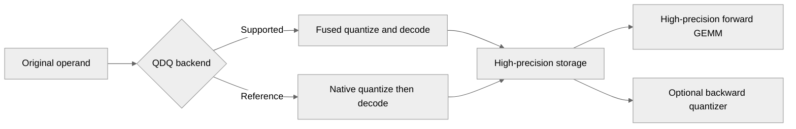

# [PyTorch][Common] Add MXFP8 and NVFP4 QDQ for mixed-precision GEMM

[Upstream PR](https://github.com/NVIDIA/TransformerEngine/pull/3633) · state: open · merged: False

## Original PR description

# Description

Adds experimental MXFP8 and NVFP4 quantize–dequantize (QDQ) quantizers, similar to https://github.com/radixark/miles/pull/2864.

- Fuses quantization and dequantization on SM100, avoiding intermediate quantized data and scale buffers. Native Q+DQ fallback supports additional NVFP4 modes and mixed input/output dtypes.
- Adds recipes for X[BF16] × W[NVFP4-QDQ] forward with BF16 backward, and X[MXFP8-QDQ] × W[NVFP4-QDQ] forward with MXFP8 backward.
- Introduces a shared QDQ quantizer base for custom formats. Includes numerical, distributed, and C++ tests and usage documentation.

```
def mxfp8_qdq_nvfp4_qdq_fwd_mxfp8_bwd_factory(role):
    if role is None or role.module_type not in ("linear", "grouped_linear"):
        return IdentityQuantizer()

    if role.tensor_type == "input":
        return HybridQuantizer(
            rowwise_quantizer=MXFP8QDQQuantizer(),
            columnwise_quantizer=mxfp8_factory(role),
            columnwise_source="original",
        )

    if role.tensor_type == "weight":
        return HybridQuantizer(
            rowwise_quantizer=NVFP4QDQQuantizer(),
            columnwise_quantizer=mxfp8_factory(role),
            columnwise_source="rowwise_dequantized",
        )

    if role.tensor_type == "grad_output":
        return mxfp8_factory(role)

    return IdentityQuantizer()


recipe = CustomRecipe(
    qfactory=mxfp8_qdq_nvfp4_qdq_fwd_mxfp8_bwd_factory,
)
```

## Type of change

- [ ] Documentation change (change only to the documentation, either a fix or a new content)
- [ ] Bug fix (non-breaking change which fixes an issue)
- [X] New feature (non-breaking change which adds functionality)
- [ ] Breaking change (fix or feature that would cause existing functionality to not work as expected)
- [ ] Infra/Build change
- [ ] Code refactoring

## Changes

Please list the changes introduced in this PR:

- Change A
- Change B

# Checklist:

- [ ] I have read and followed the [contributing guidelines](https://github.com/NVIDIA/TransformerEngine/blob/main/CONTRIBUTING.rst)
- [ ] The functionality is complete
- [ ] I have commented my code, particularly in hard-to-understand areas
- [ ] I have made corresponding changes to the documentation
- [ ] My changes generate no new warnings
- [ ] I have added tests that prove my fix is effective or that my feature works
- [ ] New and existing unit tests pass locally with my changes


## Review and discussion

### reviews

- rybakov · COMMENTED · 2026-10-08T21:33:09Z · [source](https://github.com/NVIDIA/TransformerEngine/pull/3633#pullrequestreview-5463109116)

(No body; status only.)

- rybakov · COMMENTED · 2026-10-08T21:39:01Z · [source](https://github.com/NVIDIA/TransformerEngine/pull/3633#pullrequestreview-5463161160)

(No body; status only.)

- rybakov · APPROVED · 2026-10-08T21:42:13Z · [source](https://github.com/NVIDIA/TransformerEngine/pull/3633#pullrequestreview-5463190405)

looks good, with comment about QDQ naming in the description and function names

- negvet · COMMENTED · 2026-10-13T16:06:12Z · [source](https://github.com/NVIDIA/TransformerEngine/pull/3633#pullrequestreview-5506503907)

(No body; status only.)

- negvet · COMMENTED · 2026-10-13T16:06:26Z · [source](https://github.com/NVIDIA/TransformerEngine/pull/3633#pullrequestreview-5506507119)

(No body; status only.)

- greptile-apps[bot] · COMMENTED · 2026-10-13T16:14:21Z · [source](https://github.com/NVIDIA/TransformerEngine/pull/3633#pullrequestreview-5506603530)

(No body; status only.)

- negvet · COMMENTED · 2026-10-14T12:19:19Z · [source](https://github.com/NVIDIA/TransformerEngine/pull/3633#pullrequestreview-5517747518)

(No body; status only.)

- negvet · COMMENTED · 2026-10-14T12:19:26Z · [source](https://github.com/NVIDIA/TransformerEngine/pull/3633#pullrequestreview-5517748860)

(No body; status only.)

- greptile-apps[bot] · COMMENTED · 2026-10-14T12:23:15Z · [source](https://github.com/NVIDIA/TransformerEngine/pull/3633#pullrequestreview-5517795430)

(No body; status only.)

- negvet · COMMENTED · 2026-10-16T12:57:35Z · [source](https://github.com/NVIDIA/TransformerEngine/pull/3633#pullrequestreview-5548075515)

(No body; status only.)

- greptile-apps[bot] · COMMENTED · 2026-10-16T12:58:02Z · [source](https://github.com/NVIDIA/TransformerEngine/pull/3633#pullrequestreview-5548080399)

(No body; status only.)

### issue_comments

- negvet · comment · 2026-10-13T16:07:19Z · [source](https://github.com/NVIDIA/TransformerEngine/pull/3633#issuecomment-6149830426)

/te-ci pytorch

- greptile-apps[bot] · comment · 2026-10-13T16:14:15Z · [source](https://github.com/NVIDIA/TransformerEngine/pull/3633#issuecomment-6149963393)

<!-- greptile_summary -->

<h2><a href="https://app.greptile.com/api/retrigger?id=79996086"><picture><source media="(prefers-color-scheme: dark)" srcset="https://greptile-static-assets.s3.amazonaws.com/badges/RetriggerDark.svg?v=2"><source media="(prefers-color-scheme: light)" srcset="https://greptile-static-assets.s3.amazonaws.com/badges/Retrigger.svg?v=2"></picture></a><a href="https://app.greptile.com/nvidia-public-github/github/NVIDIA/transformerengine/-/pull/3633"><picture><source media="(prefers-color-scheme: dark)" srcset="https://greptile-static-assets.s3.amazonaws.com/badges/ViewInGreptileDark.svg?v=2"><source media="(prefers-color-scheme: light)" srcset="https://greptile-static-assets.s3.amazonaws.com/badges/ViewInGreptile.svg?v=2"></picture></a>Confidence Score: 5/5</h2>

**[High impact]** The PR appears safe to merge; the older-CUDA test failure is fixed and no new blocking issue was found.

<h3>Summary</h3>

Adds experimental MXFP8 and NVFP4 QDQ quantizers that store decoded operands for high-precision GEMMs.
- MXFP8 and NVFP4 QDQ quantizers round values before high-precision computation.
- Linear layers can pair QDQ forward values with BF16 or MXFP8 backward formats.
- Custom quantizers can match stored values to a requested compute dtype.
- Custom recipes can enter autocast without an upfront FP8 hardware check.

<h3>Diagram</h3>



<!-- greptile_confidence_score:5 -->

<sub>Reviews (3) · Last reviewed commit: ["Allow CustomRecipe without FP8 hardware ..."](https://github.com/nvidia/transformerengine/commit/7f5e16fdd6a15e49ded0a3429409f6b1e0f30d25) · [Reviewed by Greptile](https://www.greptile.com/?utm_source=greptile_review&utm_medium=github&utm_campaign=review_public&utm_content=nvidia/transformerengine)</sub>

- negvet · comment · 2026-10-14T12:20:53Z · [source](https://github.com/NVIDIA/TransformerEngine/pull/3633#issuecomment-6168198457)

/te-ci pytorch

- negvet · comment · 2026-10-16T12:58:12Z · [source](https://github.com/NVIDIA/TransformerEngine/pull/3633#issuecomment-6216009229)

/te-ci pytorch

### inline_comments

- rybakov · comment · 2026-10-08T21:33:10Z · [source](https://github.com/NVIDIA/TransformerEngine/pull/3633#discussion_r4224358541)

File: `tests/pytorch/distributed/run_nvfp4_qdq.py` · line 36

can it support NVFP4 with per token second scale instead of global amax?

- rybakov · comment · 2026-10-08T21:39:01Z · [source](https://github.com/NVIDIA/TransformerEngine/pull/3633#discussion_r4224404946)

File: `docs/features/low_precision_training/fine_grained_quantization/fine_grained_quantization.rst` · line None

X[MXFP8_QDQ] x W[NVFP4_QDQ] ?
the same comment is applied to all QDQ types used in the code and description 

also in function name may be it is better to explicitly name it as 
mxfp8_qdq_nvfp4_qdq_fwd_mxfp8_bwd_factory

I would suggest to add QDQ to all names of mxfp8 and nvfp4 when qdq is applied

- negvet · comment · 2026-10-13T16:06:11Z · [source](https://github.com/NVIDIA/TransformerEngine/pull/3633#discussion_r4261046511)

File: `tests/pytorch/distributed/run_nvfp4_qdq.py` · line 36

Added support

- negvet · comment · 2026-10-13T16:06:26Z · [source](https://github.com/NVIDIA/TransformerEngine/pull/3633#discussion_r4261049048)

File: `docs/features/low_precision_training/fine_grained_quantization/fine_grained_quantization.rst` · line None

Sure, fixed

- greptile-apps[bot] · comment · 2026-10-13T16:14:19Z · [source](https://github.com/NVIDIA/TransformerEngine/pull/3633#discussion_r4261131369)

File: `docs/features/low_precision_training/fine_grained_quantization/fine_grained_quantization.rst` · line None

<a href="#"></a> **Backward dtype guidance is wrong**

This paragraph says `rowwise_dequantized` always decodes into the source dtype, but high-precision children now use `torch.promote_types`. An FP16 source with BF16 QDQ output, for example, produces an FP32 columnwise source. Distinguish native children from high-precision children here so recipe authors can predict the backward operand's precision.

```suggestion
Hybrid's ``rowwise_dequantized`` source uses the source tensor's dtype for
native children, preserving existing native compositions, including internal
storage. For high-precision children, it uses ``torch.promote_types`` on the
source and stored dtypes to avoid narrowing decoded forward values. Widening
a value already rounded into BF16 does not recover the discarded precision.
```

Note: If this suggestion doesn't match your team's coding style, reply to this and let me know. I'll remember it for next time!

- greptile-apps[bot] · comment · 2026-10-13T16:14:19Z · [source](https://github.com/NVIDIA/TransformerEngine/pull/3633#discussion_r4261131409)

File: `tests/pytorch/nvfp4/test_nvfp4_qdq.py` · line None

<a href="#"></a> **Fallback tests skip supported GPUs**

The file-wide SM100 skip also disables every `reference` test and the `auto` fallback tests on other supported GPUs. Those are the devices where `auto` must use the reference path, so device-specific failures can go unnoticed. Keep the SM100 requirement on fused tests and gate reference and fallback tests on the native format's availability. The same restriction appears in `tests/pytorch/mxfp8/test_mxfp8_qdq.py`.

- negvet · comment · 2026-10-14T12:19:18Z · [source](https://github.com/NVIDIA/TransformerEngine/pull/3633#discussion_r4270646906)

File: `docs/features/low_precision_training/fine_grained_quantization/fine_grained_quantization.rst` · line None

Should be fixed in [a82d551](https://github.com/NVIDIA/TransformerEngine/pull/3633/commits/a82d551630c61385a3377f922b5c862222c076c6)

- negvet · comment · 2026-10-14T12:19:25Z · [source](https://github.com/NVIDIA/TransformerEngine/pull/3633#discussion_r4270648052)

File: `tests/pytorch/nvfp4/test_nvfp4_qdq.py` · line None

Should be fixed in [a82d551](https://github.com/NVIDIA/TransformerEngine/pull/3633/commits/a82d551630c61385a3377f922b5c862222c076c6)

- greptile-apps[bot] · comment · 2026-10-14T12:23:14Z · [source](https://github.com/NVIDIA/TransformerEngine/pull/3633#discussion_r4270687618)

File: `tests/pytorch/nvfp4/test_qdq_emulation.py` · line 36

<a href="#"></a> **Tests fail on older CUDA**

The new gate runs NVFP4 tests on Ampere and Hopper builds made with CUDA 12.1–12.7. Transformer Engine supports those builds, but `FP4_TYPE_SUPPORTED` is false there, so fused NVFP4 calls raise an error. The regular L0 job runs this directory and will fail on those builds.

Gate the NVFP4 cases and weight-recipe tests on build-time FP4 support while keeping MXFP8 coverage enabled.

- negvet · comment · 2026-10-16T12:57:34Z · [source](https://github.com/NVIDIA/TransformerEngine/pull/3633#discussion_r4294890889)

File: `tests/pytorch/nvfp4/test_qdq_emulation.py` · line 36

Was it fixed in 7f5e16f?"

- greptile-apps[bot] · comment · 2026-10-16T12:58:02Z · [source](https://github.com/NVIDIA/TransformerEngine/pull/3633#discussion_r4294894902)

File: `tests/pytorch/nvfp4/test_qdq_emulation.py` · line 36

Yes. Commit `7f5e16f` fixes this by adding a `requires_fp4_build` marker based on `tex.nvfp4_qdq_supported()`, applying it to the `nvfp4`/`nvfp4_row` cases and to `test_portable_weight_recipe`, while keeping MXFP8 coverage enabled on older builds. The dispatch test remains safe because it only monkeypatches the support flag and does not invoke the unsupported fused kernel.

Tip: You can customize Greptile's behavior for this repo with [`.greptile/rules.md` and `.greptile/config.json`](https://www.greptile.com/docs/code-review/custom-standards).

## Changed files and fixed code

- `docs/features/low_precision_training/fine_grained_quantization/fine_grained_quantization.rst` · modified · additions 141 / deletions 0
  - [head](https://github.com/negvet/TransformerEngine/blob/7f5e16fdd6a15e49ded0a3429409f6b1e0f30d25/docs/features/low_precision_training/fine_grained_quantization/fine_grained_quantization.rst)
  - [base](https://github.com/NVIDIA/TransformerEngine/blob/0c4d9610ac3b6447e90af212e70b7260ef0c4ad1/docs/features/low_precision_training/fine_grained_quantization/fine_grained_quantization.rst)
- `qa/L1_pytorch_hybrid_distributed_unittest/test.sh` · modified · additions 2 / deletions 0
  - [head](https://github.com/negvet/TransformerEngine/blob/7f5e16fdd6a15e49ded0a3429409f6b1e0f30d25/qa/L1_pytorch_hybrid_distributed_unittest/test.sh)
  - [base](https://github.com/NVIDIA/TransformerEngine/blob/0c4d9610ac3b6447e90af212e70b7260ef0c4ad1/qa/L1_pytorch_hybrid_distributed_unittest/test.sh)
- `tests/cpp/operator/CMakeLists.txt` · modified · additions 1 / deletions 0
  - [head](https://github.com/negvet/TransformerEngine/blob/7f5e16fdd6a15e49ded0a3429409f6b1e0f30d25/tests/cpp/operator/CMakeLists.txt)
  - [base](https://github.com/NVIDIA/TransformerEngine/blob/0c4d9610ac3b6447e90af212e70b7260ef0c4ad1/tests/cpp/operator/CMakeLists.txt)
- `tests/cpp/operator/test_nvfp4_qdq.cu` · added · additions 95 / deletions 0
  - [head](https://github.com/negvet/TransformerEngine/blob/7f5e16fdd6a15e49ded0a3429409f6b1e0f30d25/tests/cpp/operator/test_nvfp4_qdq.cu)
  - [base](https://github.com/NVIDIA/TransformerEngine/blob/0c4d9610ac3b6447e90af212e70b7260ef0c4ad1/tests/cpp/operator/test_nvfp4_qdq.cu)
- `tests/pytorch/distributed/run_nvfp4_qdq.py` · added · additions 85 / deletions 0
  - [head](https://github.com/negvet/TransformerEngine/blob/7f5e16fdd6a15e49ded0a3429409f6b1e0f30d25/tests/pytorch/distributed/run_nvfp4_qdq.py)
  - [base](https://github.com/NVIDIA/TransformerEngine/blob/0c4d9610ac3b6447e90af212e70b7260ef0c4ad1/tests/pytorch/distributed/run_nvfp4_qdq.py)
- `tests/pytorch/distributed/test_nvfp4_qdq.py` · added · additions 34 / deletions 0
  - [head](https://github.com/negvet/TransformerEngine/blob/7f5e16fdd6a15e49ded0a3429409f6b1e0f30d25/tests/pytorch/distributed/test_nvfp4_qdq.py)
  - [base](https://github.com/NVIDIA/TransformerEngine/blob/0c4d9610ac3b6447e90af212e70b7260ef0c4ad1/tests/pytorch/distributed/test_nvfp4_qdq.py)
- `tests/pytorch/mxfp8/test_mxfp8_qdq.py` · added · additions 393 / deletions 0
  - [head](https://github.com/negvet/TransformerEngine/blob/7f5e16fdd6a15e49ded0a3429409f6b1e0f30d25/tests/pytorch/mxfp8/test_mxfp8_qdq.py)
  - [base](https://github.com/NVIDIA/TransformerEngine/blob/0c4d9610ac3b6447e90af212e70b7260ef0c4ad1/tests/pytorch/mxfp8/test_mxfp8_qdq.py)
- `tests/pytorch/nvfp4/test_nvfp4_qdq.py` · added · additions 571 / deletions 0
  - [head](https://github.com/negvet/TransformerEngine/blob/7f5e16fdd6a15e49ded0a3429409f6b1e0f30d25/tests/pytorch/nvfp4/test_nvfp4_qdq.py)
  - [base](https://github.com/NVIDIA/TransformerEngine/blob/0c4d9610ac3b6447e90af212e70b7260ef0c4ad1/tests/pytorch/nvfp4/test_nvfp4_qdq.py)
- `tests/pytorch/nvfp4/test_qdq_emulation.py` · added · additions 284 / deletions 0
  - [head](https://github.com/negvet/TransformerEngine/blob/7f5e16fdd6a15e49ded0a3429409f6b1e0f30d25/tests/pytorch/nvfp4/test_qdq_emulation.py)
  - [base](https://github.com/NVIDIA/TransformerEngine/blob/0c4d9610ac3b6447e90af212e70b7260ef0c4ad1/tests/pytorch/nvfp4/test_qdq_emulation.py)
- `tests/pytorch/test_hybrid_quantization.py` · modified · additions 253 / deletions 0
  - [head](https://github.com/negvet/TransformerEngine/blob/7f5e16fdd6a15e49ded0a3429409f6b1e0f30d25/tests/pytorch/test_hybrid_quantization.py)
  - [base](https://github.com/NVIDIA/TransformerEngine/blob/0c4d9610ac3b6447e90af212e70b7260ef0c4ad1/tests/pytorch/test_hybrid_quantization.py)
- `tests/pytorch/test_identity_quantizer.py` · modified · additions 81 / deletions 4
  - [head](https://github.com/negvet/TransformerEngine/blob/7f5e16fdd6a15e49ded0a3429409f6b1e0f30d25/tests/pytorch/test_identity_quantizer.py)
  - [base](https://github.com/NVIDIA/TransformerEngine/blob/0c4d9610ac3b6447e90af212e70b7260ef0c4ad1/tests/pytorch/test_identity_quantizer.py)
- `tests/pytorch/test_recipe.py` · modified · additions 41 / deletions 0
  - [head](https://github.com/negvet/TransformerEngine/blob/7f5e16fdd6a15e49ded0a3429409f6b1e0f30d25/tests/pytorch/test_recipe.py)
  - [base](https://github.com/NVIDIA/TransformerEngine/blob/0c4d9610ac3b6447e90af212e70b7260ef0c4ad1/tests/pytorch/test_recipe.py)
- `transformer_engine/common/CMakeLists.txt` · modified · additions 2 / deletions 0
  - [head](https://github.com/negvet/TransformerEngine/blob/7f5e16fdd6a15e49ded0a3429409f6b1e0f30d25/transformer_engine/common/CMakeLists.txt)
  - [base](https://github.com/NVIDIA/TransformerEngine/blob/0c4d9610ac3b6447e90af212e70b7260ef0c4ad1/transformer_engine/common/CMakeLists.txt)
- `transformer_engine/common/cast/mxfp8/qdq.cu` · added · additions 81 / deletions 0
  - [head](https://github.com/negvet/TransformerEngine/blob/7f5e16fdd6a15e49ded0a3429409f6b1e0f30d25/transformer_engine/common/cast/mxfp8/qdq.cu)
  - [base](https://github.com/NVIDIA/TransformerEngine/blob/0c4d9610ac3b6447e90af212e70b7260ef0c4ad1/transformer_engine/common/cast/mxfp8/qdq.cu)
- `transformer_engine/common/cast/nvfp4/qdq.cu` · added · additions 158 / deletions 0
  - [head](https://github.com/negvet/TransformerEngine/blob/7f5e16fdd6a15e49ded0a3429409f6b1e0f30d25/transformer_engine/common/cast/nvfp4/qdq.cu)
  - [base](https://github.com/NVIDIA/TransformerEngine/blob/0c4d9610ac3b6447e90af212e70b7260ef0c4ad1/transformer_engine/common/cast/nvfp4/qdq.cu)
- `transformer_engine/common/include/transformer_engine/cast.h` · modified · additions 36 / deletions 0
  - [head](https://github.com/negvet/TransformerEngine/blob/7f5e16fdd6a15e49ded0a3429409f6b1e0f30d25/transformer_engine/common/include/transformer_engine/cast.h)
  - [base](https://github.com/NVIDIA/TransformerEngine/blob/0c4d9610ac3b6447e90af212e70b7260ef0c4ad1/transformer_engine/common/include/transformer_engine/cast.h)
- `transformer_engine/common/recipe/__init__.py` · modified · additions 4 / deletions 0
  - [head](https://github.com/negvet/TransformerEngine/blob/7f5e16fdd6a15e49ded0a3429409f6b1e0f30d25/transformer_engine/common/recipe/__init__.py)
  - [base](https://github.com/NVIDIA/TransformerEngine/blob/0c4d9610ac3b6447e90af212e70b7260ef0c4ad1/transformer_engine/common/recipe/__init__.py)
- `transformer_engine/pytorch/csrc/extensions.h` · modified · additions 5 / deletions 0
  - [head](https://github.com/negvet/TransformerEngine/blob/7f5e16fdd6a15e49ded0a3429409f6b1e0f30d25/transformer_engine/pytorch/csrc/extensions.h)
  - [base](https://github.com/NVIDIA/TransformerEngine/blob/0c4d9610ac3b6447e90af212e70b7260ef0c4ad1/transformer_engine/pytorch/csrc/extensions.h)
- `transformer_engine/pytorch/csrc/extensions/cast.cpp` · modified · additions 65 / deletions 0
  - [head](https://github.com/negvet/TransformerEngine/blob/7f5e16fdd6a15e49ded0a3429409f6b1e0f30d25/transformer_engine/pytorch/csrc/extensions/cast.cpp)
  - [base](https://github.com/NVIDIA/TransformerEngine/blob/0c4d9610ac3b6447e90af212e70b7260ef0c4ad1/transformer_engine/pytorch/csrc/extensions/cast.cpp)
- `transformer_engine/pytorch/csrc/extensions/pybind.cpp` · modified · additions 11 / deletions 0
  - [head](https://github.com/negvet/TransformerEngine/blob/7f5e16fdd6a15e49ded0a3429409f6b1e0f30d25/transformer_engine/pytorch/csrc/extensions/pybind.cpp)
  - [base](https://github.com/NVIDIA/TransformerEngine/blob/0c4d9610ac3b6447e90af212e70b7260ef0c4ad1/transformer_engine/pytorch/csrc/extensions/pybind.cpp)
- `transformer_engine/pytorch/custom_recipes/qdq.py` · added · additions 327 / deletions 0
  - [head](https://github.com/negvet/TransformerEngine/blob/7f5e16fdd6a15e49ded0a3429409f6b1e0f30d25/transformer_engine/pytorch/custom_recipes/qdq.py)
  - [base](https://github.com/NVIDIA/TransformerEngine/blob/0c4d9610ac3b6447e90af212e70b7260ef0c4ad1/transformer_engine/pytorch/custom_recipes/qdq.py)
- `transformer_engine/pytorch/custom_recipes/quantizer_factory_zoo.py` · modified · additions 74 / deletions 0
  - [head](https://github.com/negvet/TransformerEngine/blob/7f5e16fdd6a15e49ded0a3429409f6b1e0f30d25/transformer_engine/pytorch/custom_recipes/quantizer_factory_zoo.py)
  - [base](https://github.com/NVIDIA/TransformerEngine/blob/0c4d9610ac3b6447e90af212e70b7260ef0c4ad1/transformer_engine/pytorch/custom_recipes/quantizer_factory_zoo.py)
- `transformer_engine/pytorch/module/base.py` · modified · additions 6 / deletions 1
  - [head](https://github.com/negvet/TransformerEngine/blob/7f5e16fdd6a15e49ded0a3429409f6b1e0f30d25/transformer_engine/pytorch/module/base.py)
  - [base](https://github.com/NVIDIA/TransformerEngine/blob/0c4d9610ac3b6447e90af212e70b7260ef0c4ad1/transformer_engine/pytorch/module/base.py)
- `transformer_engine/pytorch/quantization.py` · modified · additions 6 / deletions 3
  - [head](https://github.com/negvet/TransformerEngine/blob/7f5e16fdd6a15e49ded0a3429409f6b1e0f30d25/transformer_engine/pytorch/quantization.py)
  - [base](https://github.com/NVIDIA/TransformerEngine/blob/0c4d9610ac3b6447e90af212e70b7260ef0c4ad1/transformer_engine/pytorch/quantization.py)
- `transformer_engine/pytorch/quantized_tensor.py` · modified · additions 31 / deletions 4
  - [head](https://github.com/negvet/TransformerEngine/blob/7f5e16fdd6a15e49ded0a3429409f6b1e0f30d25/transformer_engine/pytorch/quantized_tensor.py)
  - [base](https://github.com/NVIDIA/TransformerEngine/blob/0c4d9610ac3b6447e90af212e70b7260ef0c4ad1/transformer_engine/pytorch/quantized_tensor.py)
- `transformer_engine/pytorch/tensor/hybrid_tensor.py` · modified · additions 73 / deletions 23
  - [head](https://github.com/negvet/TransformerEngine/blob/7f5e16fdd6a15e49ded0a3429409f6b1e0f30d25/transformer_engine/pytorch/tensor/hybrid_tensor.py)
  - [base](https://github.com/NVIDIA/TransformerEngine/blob/0c4d9610ac3b6447e90af212e70b7260ef0c4ad1/transformer_engine/pytorch/tensor/hybrid_tensor.py)
- `transformer_engine/pytorch/tensor/identity_tensor.py` · modified · additions 18 / deletions 20
  - [head](https://github.com/negvet/TransformerEngine/blob/7f5e16fdd6a15e49ded0a3429409f6b1e0f30d25/transformer_engine/pytorch/tensor/identity_tensor.py)
  - [base](https://github.com/NVIDIA/TransformerEngine/blob/0c4d9610ac3b6447e90af212e70b7260ef0c4ad1/transformer_engine/pytorch/tensor/identity_tensor.py)

## Evidence and interpretation boundary

[Original JSON, discussions and patches](../../../../../../evidence/prs/NVIDIA--TransformerEngine/3633-67083e57d42a5330bac13968964b0dc6cce8ca3fda5de99fa42154b27272086e.json) · SHA-256 `67083e57d42a5330bac13968964b0dc6cce8ca3fda5de99fa42154b27272086e`.

Diff complete: True. Missing/binary/truncated patches require pinned source inspection. This is a source page, not an independently verified optimization case. Open, merged and released are different states; recheck the deployed dependency.
