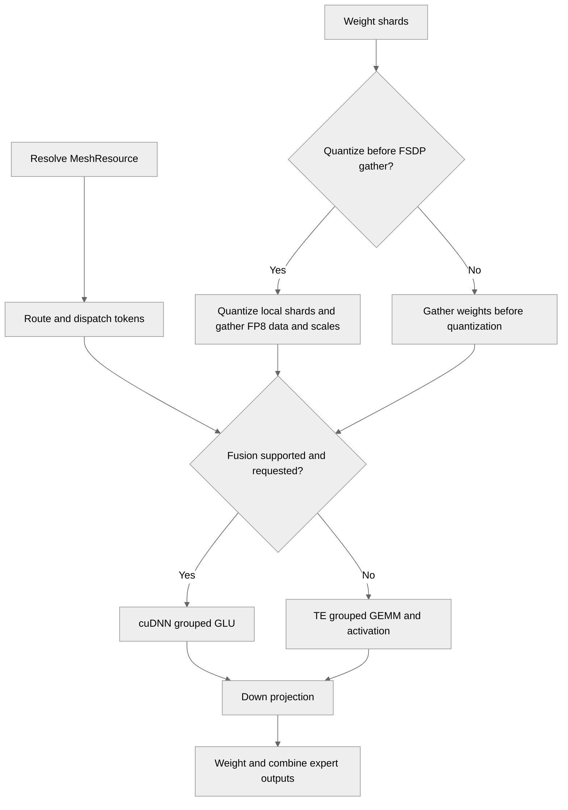

# [JAX] MoE block optimization

[Upstream PR](https://github.com/NVIDIA/TransformerEngine/pull/3638) · state: closed · merged: True

## Original PR description

# Description

This PR delivers 3 key performance optimizations in the TE MoE block:
* Fused (mxfp8 grouped GEMM+act+mxfp8 quant) kernels from cuDNN FE. This includes both Blackwell and Rubin-specialized variants via cuDNN FE's GLU/dGLU imperative API
* Quant before FSDP AG. This allows TE to quantize before the FSDP AG, leading to smaller quant overhead by quantizing smaller shards and allows the AG to happen in FP8 instead of BF16
* Expose MoE block intermediates with checkpointing/remat support so it can be tuned by the user.

## Type of change

- [ ] Documentation change (change only to the documentation, either a fix or a new content)
- [ ] Bug fix (non-breaking change which fixes an issue)
- [x] New feature (non-breaking change which adds functionality)
- [ ] Breaking change (fix or feature that would cause existing functionality to not work as expected)
- [ ] Infra/Build change
- [ ] Code refactoring

## Changes

- Add direct `MeshResource` argument to the TE MoE VJP API. This can be used to control exactly how FSDP and EP are applied, which currently informs how to the quant before FSDP AG, but in future will generalize to more axes like TP
- Extend TE MoE tests to run one pass with fused grouped GEMMs, another unfused, with a single EP teardown between them (fused kernel requires 256-align of groups, while unfused only requires 128-alignment)
- Additional test coverage and changes to support the 3 improvements listed above

# Checklist:

- [x] I have read and followed the [contributing guidelines](https://github.com/NVIDIA/TransformerEngine/blob/main/CONTRIBUTING.rst)
- [x] The functionality is complete
- [x] I have commented my code, particularly in hard-to-understand areas
- [x] I have made corresponding changes to the documentation
- [x] My changes generate no new warnings
- [x] I have added tests that prove my fix is effective or that my feature works
- [x] New and existing unit tests pass locally with my changes


## Review and discussion

### reviews

- greptile-apps[bot] · COMMENTED · 2026-10-06T20:15:01Z · [source](https://github.com/NVIDIA/TransformerEngine/pull/3638#pullrequestreview-5434068582)

(No body; status only.)

- greptile-apps[bot] · COMMENTED · 2026-10-12T21:31:56Z · [source](https://github.com/NVIDIA/TransformerEngine/pull/3638#pullrequestreview-5496176324)

(No body; status only.)

- tdophung · COMMENTED · 2026-10-14T00:21:44Z · [source](https://github.com/NVIDIA/TransformerEngine/pull/3638#pullrequestreview-5511165946)

Will look more tomorrow

- jberchtold-nvidia · COMMENTED · 2026-10-14T19:21:45Z · [source](https://github.com/NVIDIA/TransformerEngine/pull/3638#pullrequestreview-5523433735)

(No body; status only.)

- tdophung · COMMENTED · 2026-10-15T23:04:35Z · [source](https://github.com/NVIDIA/TransformerEngine/pull/3638#pullrequestreview-5540192983)

(No body; status only.)

- tdophung · COMMENTED · 2026-10-15T23:08:08Z · [source](https://github.com/NVIDIA/TransformerEngine/pull/3638#pullrequestreview-5541003194)

(No body; status only.)

- jberchtold-nvidia · COMMENTED · 2026-10-16T15:23:16Z · [source](https://github.com/NVIDIA/TransformerEngine/pull/3638#pullrequestreview-5549898942)

(No body; status only.)

- jberchtold-nvidia · COMMENTED · 2026-10-16T15:23:37Z · [source](https://github.com/NVIDIA/TransformerEngine/pull/3638#pullrequestreview-5549904048)

(No body; status only.)

- jberchtold-nvidia · COMMENTED · 2026-10-16T15:25:10Z · [source](https://github.com/NVIDIA/TransformerEngine/pull/3638#pullrequestreview-5549927409)

(No body; status only.)

- tdophung · COMMENTED · 2026-10-16T18:16:46Z · [source](https://github.com/NVIDIA/TransformerEngine/pull/3638#pullrequestreview-5551946292)

(No body; status only.)

- tdophung · APPROVED · 2026-10-16T18:20:29Z · [source](https://github.com/NVIDIA/TransformerEngine/pull/3638#pullrequestreview-5551992394)

Addressed my comments. LGTM pending CI

### issue_comments

- greptile-apps[bot] · comment · 2026-10-06T20:14:55Z · [source](https://github.com/NVIDIA/TransformerEngine/pull/3638#issuecomment-6024624883)

<!-- greptile_summary -->

<h2><a href="https://app.greptile.com/api/retrigger?id=75849987"><picture><source media="(prefers-color-scheme: dark)" srcset="https://greptile-static-assets.s3.amazonaws.com/badges/RetriggerDark.svg?v=2"><source media="(prefers-color-scheme: light)" srcset="https://greptile-static-assets.s3.amazonaws.com/badges/Retrigger.svg?v=2"></picture></a><a href="https://app.greptile.com/nvidia-public-github/github/NVIDIA/transformerengine/-/pull/3638"><picture><source media="(prefers-color-scheme: dark)" srcset="https://greptile-static-assets.s3.amazonaws.com/badges/ViewInGreptileDark.svg?v=2"><source media="(prefers-color-scheme: light)" srcset="https://greptile-static-assets.s3.amazonaws.com/badges/ViewInGreptile.svg?v=2"></picture></a>Confidence Score: 4/5</h2>

**[Medium impact]** Adds MoE block optimization with new kernel adapters and test coverage\.

The PR still needs the EP weight-ownership check from the previous finding before merging.

<h2>Findings</h2>

1. &nbsp;**Weights lose their EP split** <a href="https://github.com/NVIDIA/TransformerEngine/pull/3638#discussion_r4252510004">▶</a>

<h3>Summary</h3>

This PR adds three MoE optimizations:
- The MoE block can fuse grouped SwiGLU work with cuDNN.
- FSDP can gather MXFP8 weight shards instead of full weights.
- MoE callers can set mesh axes and checkpoint dispatch values.

It also replaces separate parallelism arguments with `MeshResource` and expands layout, resource, and multi-GPU tests.

The earlier threads about separate DP/FSDP axes, expert order, optional-package imports, and fusion-switch documentation were manually resolved without explanatory replies.

Review checks were limited to source inspection; no runtime tests were run.

<h3>Diagram</h3>



<!-- greptile_confidence_score:4 -->

<sub>Reviews (7) · Last reviewed commit: ["Merge github-upstream/main into jberchto..."](https://github.com/nvidia/transformerengine/commit/b61fd2ac5913e3ee43abf403f518478209b35e36) · [Reviewed by Greptile](https://www.greptile.com/?utm_source=greptile_review&utm_medium=github&utm_campaign=review_public&utm_content=nvidia/transformerengine)</sub>

- jberchtold-nvidia · comment · 2026-10-12T21:26:59Z · [source](https://github.com/NVIDIA/TransformerEngine/pull/3638#issuecomment-6132918972)

/te-ci L1 jax

- ptrendx · comment · 2026-10-13T20:02:43Z · [source](https://github.com/NVIDIA/TransformerEngine/pull/3638#issuecomment-6154088794)

@jberchtold-nvidia Please sign every commit in this PR. See https://github.com/NVIDIA/TransformerEngine/blob/main/CONTRIBUTING.rst#sign-your-work

- jberchtold-nvidia · comment · 2026-10-14T20:20:09Z · [source](https://github.com/NVIDIA/TransformerEngine/pull/3638#issuecomment-6177551464)

/te-ci L1 jax

- jberchtold-nvidia · comment · 2026-10-16T16:06:00Z · [source](https://github.com/NVIDIA/TransformerEngine/pull/3638#issuecomment-6219537221)

/te-ci L1 arm

### inline_comments

- greptile-apps[bot] · comment · 2026-10-06T20:14:58Z · [source](https://github.com/NVIDIA/TransformerEngine/pull/3638#discussion_r4200000727)

File: `transformer_engine/jax/moe.py` · line 1197

<a href="#"></a> **Separate DP and FSDP fail**

With distinct DP and FSDP axes larger than one, `moe()` now shards batches and EP outputs across both axes. But `ep_bootstrap()` still calculates `num_ep_groups` from just one outer axis. On a DP2/FSDP2/EP2 mesh, EP outputs have leading size 4 but are partitioned across 8 devices, so compilation fails. Update bootstrap group counting alongside the new resource API.

- greptile-apps[bot] · comment · 2026-10-06T20:14:58Z · [source](https://github.com/NVIDIA/TransformerEngine/pull/3638#discussion_r4200000734)

File: `transformer_engine/jax/moe.py` · line 1216

<a href="#"></a> **Tokens use wrong experts**

When logical rules place `("fsdp", "ep")` on the expert dimension, gathering only FSDP does not recover the contiguous expert slice that EP routing expects. With 8 experts and EP2/FSDP2, EP rank 0 gathers experts `[0, 1, 4, 5]` instead of `[0, 1, 2, 3]`. The code accepts this order and uses those weights as EP-local experts, producing wrong outputs. Require EP before FSDP on this dimension, or restore the expected expert ownership before running the FFN.

- greptile-apps[bot] · comment · 2026-10-06T20:14:58Z · [source](https://github.com/NVIDIA/TransformerEngine/pull/3638#discussion_r4200000742)

File: `tests/jax/run_te_ep_moe.sh` · line None

<a href="#"></a> **Optional package breaks tests**

The launcher now always runs the cuDNN phase, but its tests import `cudnn.jax` without a skip. If that optional module is absent on a supported multi-GPU machine, the previously usable launcher fails with `ModuleNotFoundError` even when ordinary TE execution works. Skip the cuDNN-only tests when the required APIs are unavailable, or make this phase explicitly opt-in.

- greptile-apps[bot] · comment · 2026-10-06T20:14:58Z · [source](https://github.com/NVIDIA/TransformerEngine/pull/3638#discussion_r4200000750)

File: `docs/envvars.rst` · line None

<a href="#"></a> **Fusion switch does nothing**

This entry documents an environment variable that the implementation never reads. It also says fusion defaults off and backward uses ordinary TE execution, while `use_cudnn_fusion` defaults to `True` and fused backward calls `grouped_gemm_dswiglu`. Replace this entry with the actual argument and execution behavior so users do not rely on an ineffective switch.

Note: If this suggestion doesn't match your team's coding style, reply to this and let me know. I'll remember it for next time!

- greptile-apps[bot] · comment · 2026-10-12T21:31:55Z · [source](https://github.com/NVIDIA/TransformerEngine/pull/3638#discussion_r4252510004)

File: `transformer_engine/jax/moe.py` · line 1216

<a href="#"></a> **Weights lose their EP split**

With `quant_before_fsdp_ag=True`, active Flax rules replace the required EP weight split. If those rules map `embed` to FSDP but leave `exp` replicated, each rank gathers all experts even though its token counts cover only `num_experts / EP` experts.

The fused path folds the extra experts into `combined`, giving FC2 the wrong input width. Ordinary grouped GEMM also receives mismatched groups. This configuration worked with the previous forced EP split. Preserve EP on the expert dimension when resolving these specs, or reject incompatible rules before dispatch.

- tdophung · comment · 2026-10-13T23:14:45Z · [source](https://github.com/NVIDIA/TransformerEngine/pull/3638#discussion_r4265055291)

File: `transformer_engine/jax/cpp_extensions/grouped_gemm_glu.py` · line 115

Should we also check for CuDNN FE minimum version here? Seems like the CI fort this PR is failing because the release version it got did not support running under jax.jit?

- jberchtold-nvidia · comment · 2026-10-14T19:21:45Z · [source](https://github.com/NVIDIA/TransformerEngine/pull/3638#discussion_r4275241186)

File: `transformer_engine/jax/cpp_extensions/grouped_gemm_glu.py` · line 115

This has been fixed now in the latest version, it was getting confused as the cuDNN FE BF16 API existed in previous versions but not the mxfp8 fusion. I've now restricted it to check the specific signature of the API we are using for mxfp8 fusions, rather than just the function name

I've tested `nvidia-cudnn-frontend` versions `1.25.0`, `1.29.0`, `1.29.0[cutedsl]`, and the unmerged cuDNN FE branch (which is the only one that has these particular cuDNN FE JAX APIs currently)

I'm leaning towards signature matching rather than cuDNN FE versions as this imperative cuDNN FE APIs may change and break, it is experimental. If we match on the cuDNN FE API signature itself and they introduce a breaking change, we can detect that and fall back to unfused. If we gate purely on minimum version, then we will try to invoke cuDNN FE with the incorrect arguments and get a failure

I am not opposed to gating on both min version and function signature matching if you would like

- tdophung · comment · 2026-10-15T21:31:19Z · [source](https://github.com/NVIDIA/TransformerEngine/pull/3638#discussion_r4288489504)

File: `transformer_engine/jax/moe.py` · line None

shouldn't this be `RHS` since FC1 dgrad would contract the 2N dimension, which is dim 1 of [E, 2N, K] in the cudnn native weight layout? So we would need colwise quantization (which `TensorUsage.RHS` will determine) for the case of cudnn weight layout + using fused kernel?

- tdophung · comment · 2026-10-15T21:47:36Z · [source](https://github.com/NVIDIA/TransformerEngine/pull/3638#discussion_r4288618449)

File: `transformer_engine/jax/moe.py` · line 195

With `MXFP8BlockScaling(fp8_format=Format.HYBRID)`, the dgrad qyuantizers are E5M2 while x or kernel are E4M3. This check on line 195 only check that Fc1 act and weight dtype matches or not, while the backward fused call then passes an E5M2 output dtype, which will make cuDNN raise error for d_dtype not being e4m3. I suggest we add fc1.dgrad == e4m3, and fc2.dgrad == fc2.kernel as well to tthis rejection check.

- tdophung · comment · 2026-10-15T21:49:43Z · [source](https://github.com/NVIDIA/TransformerEngine/pull/3638#discussion_r4288634304)

File: `transformer_engine/jax/moe.py` · line 195

```suggestion
          if fc1_quantizer_set.x.q_dtype != fc1_quantizer_set.kernel.q_dtype:
              errors.append("requires identical FC1 activation and weight MXFP8 payload dtypes")
          if fc2_quantizer_set.dgrad.q_dtype != fc2_quantizer_set.kernel.q_dtype:
              errors.append("requires identical FC2 gradient and weight MXFP8 payload dtypes")
          if fc1_quantizer_set.dgrad.q_dtype != jnp.float8_e4m3fn:
              errors.append("requires an E4M3 FC1 gradient payload for cuDNN dGLU")


```

- tdophung · comment · 2026-10-15T21:50:56Z · [source](https://github.com/NVIDIA/TransformerEngine/pull/3638#discussion_r4288642908)

File: `transformer_engine/jax/moe.py` · line 195

cudnn raising error for d_dtype not being e4m3 here:  https://github.com/NVIDIA/cudnn-frontend/blob/main/python/cudnn/gemm/cutedsl/grouped/canonical_jax.py#L75-L76


- tdophung · comment · 2026-10-15T23:08:07Z · [source](https://github.com/NVIDIA/TransformerEngine/pull/3638#discussion_r4289178039)

File: `transformer_engine/jax/cpp_extensions/grouped_gemm_glu.py` · line 115

let's do both: min version and function signature. I do not know if there are debug versions where the function signature might match but min version might not match so best to be safe

- jberchtold-nvidia · comment · 2026-10-16T15:23:15Z · [source](https://github.com/NVIDIA/TransformerEngine/pull/3638#discussion_r4296275937)

File: `transformer_engine/jax/cpp_extensions/grouped_gemm_glu.py` · line 115

Added version check and corresponding tests

- jberchtold-nvidia · comment · 2026-10-16T15:23:36Z · [source](https://github.com/NVIDIA/TransformerEngine/pull/3638#discussion_r4296279824)

File: `transformer_engine/jax/moe.py` · line 195

Good idea, I've added those checks below

- jberchtold-nvidia · comment · 2026-10-16T15:25:10Z · [source](https://github.com/NVIDIA/TransformerEngine/pull/3638#discussion_r4296297937)

File: `transformer_engine/jax/moe.py` · line None

Yes, you're correct. I've fixed this and added a corresponding test to catch this

- tdophung · comment · 2026-10-16T18:16:46Z · [source](https://github.com/NVIDIA/TransformerEngine/pull/3638#discussion_r4297891934)

File: `transformer_engine/jax/cpp_extensions/grouped_gemm_glu.py` · line 115

Is there a way we can run CI with the latest version so we can test out the fused CUDNN path in CI (so not just verifying locally)?

## Changed files and fixed code

- `tests/jax/moe/test_moe_fsdp_layout.py` · added · additions 368 / deletions 0
  - [head](https://github.com/jberchtold-nvidia/TransformerEngine/blob/b61fd2ac5913e3ee43abf403f518478209b35e36/tests/jax/moe/test_moe_fsdp_layout.py)
  - [base](https://github.com/NVIDIA/TransformerEngine/blob/b7db08fd73129f5af71ff2ee0eaddacd3ff1a751/tests/jax/moe/test_moe_fsdp_layout.py)
- `tests/jax/moe/test_moe_resource_api.py` · added · additions 176 / deletions 0
  - [head](https://github.com/jberchtold-nvidia/TransformerEngine/blob/b61fd2ac5913e3ee43abf403f518478209b35e36/tests/jax/moe/test_moe_resource_api.py)
  - [base](https://github.com/NVIDIA/TransformerEngine/blob/b7db08fd73129f5af71ff2ee0eaddacd3ff1a751/tests/jax/moe/test_moe_resource_api.py)
- `tests/jax/run_te_ep_moe.sh` · modified · additions 17 / deletions 12
  - [head](https://github.com/jberchtold-nvidia/TransformerEngine/blob/b61fd2ac5913e3ee43abf403f518478209b35e36/tests/jax/run_te_ep_moe.sh)
  - [base](https://github.com/NVIDIA/TransformerEngine/blob/b7db08fd73129f5af71ff2ee0eaddacd3ff1a751/tests/jax/run_te_ep_moe.sh)
- `tests/jax/test_custom_call_compute.py` · modified · additions 411 / deletions 0
  - [head](https://github.com/jberchtold-nvidia/TransformerEngine/blob/b61fd2ac5913e3ee43abf403f518478209b35e36/tests/jax/test_custom_call_compute.py)
  - [base](https://github.com/NVIDIA/TransformerEngine/blob/b7db08fd73129f5af71ff2ee0eaddacd3ff1a751/tests/jax/test_custom_call_compute.py)
- `tests/jax/test_te_ep_moe.py` · modified · additions 480 / deletions 17
  - [head](https://github.com/jberchtold-nvidia/TransformerEngine/blob/b61fd2ac5913e3ee43abf403f518478209b35e36/tests/jax/test_te_ep_moe.py)
  - [base](https://github.com/NVIDIA/TransformerEngine/blob/b7db08fd73129f5af71ff2ee0eaddacd3ff1a751/tests/jax/test_te_ep_moe.py)
- `transformer_engine/jax/cpp_extensions/__init__.py` · modified · additions 1 / deletions 0
  - [head](https://github.com/jberchtold-nvidia/TransformerEngine/blob/b61fd2ac5913e3ee43abf403f518478209b35e36/transformer_engine/jax/cpp_extensions/__init__.py)
  - [base](https://github.com/NVIDIA/TransformerEngine/blob/b7db08fd73129f5af71ff2ee0eaddacd3ff1a751/transformer_engine/jax/cpp_extensions/__init__.py)
- `transformer_engine/jax/cpp_extensions/ep.py` · modified · additions 135 / deletions 64
  - [head](https://github.com/jberchtold-nvidia/TransformerEngine/blob/b61fd2ac5913e3ee43abf403f518478209b35e36/transformer_engine/jax/cpp_extensions/ep.py)
  - [base](https://github.com/NVIDIA/TransformerEngine/blob/b7db08fd73129f5af71ff2ee0eaddacd3ff1a751/transformer_engine/jax/cpp_extensions/ep.py)
- `transformer_engine/jax/cpp_extensions/grouped_gemm_glu.py` · added · additions 272 / deletions 0
  - [head](https://github.com/jberchtold-nvidia/TransformerEngine/blob/b61fd2ac5913e3ee43abf403f518478209b35e36/transformer_engine/jax/cpp_extensions/grouped_gemm_glu.py)
  - [base](https://github.com/NVIDIA/TransformerEngine/blob/b7db08fd73129f5af71ff2ee0eaddacd3ff1a751/transformer_engine/jax/cpp_extensions/grouped_gemm_glu.py)
- `transformer_engine/jax/flax/moe.py` · modified · additions 86 / deletions 66
  - [head](https://github.com/jberchtold-nvidia/TransformerEngine/blob/b61fd2ac5913e3ee43abf403f518478209b35e36/transformer_engine/jax/flax/moe.py)
  - [base](https://github.com/NVIDIA/TransformerEngine/blob/b7db08fd73129f5af71ff2ee0eaddacd3ff1a751/transformer_engine/jax/flax/moe.py)
- `transformer_engine/jax/moe.py` · modified · additions 1424 / deletions 692
  - [head](https://github.com/jberchtold-nvidia/TransformerEngine/blob/b61fd2ac5913e3ee43abf403f518478209b35e36/transformer_engine/jax/moe.py)
  - [base](https://github.com/NVIDIA/TransformerEngine/blob/b7db08fd73129f5af71ff2ee0eaddacd3ff1a751/transformer_engine/jax/moe.py)

## Evidence and interpretation boundary

[Original JSON, discussions and patches](../../../../../../evidence/prs/NVIDIA--TransformerEngine/3638-b62c7bd3d7429afc8e1164bc7aa389e487659457c209a53c354d47175295ed72.json) · SHA-256 `b62c7bd3d7429afc8e1164bc7aa389e487659457c209a53c354d47175295ed72`.

Diff complete: False. Missing/binary/truncated patches require pinned source inspection. This is a source page, not an independently verified optimization case. Open, merged and released are different states; recheck the deployed dependency.
