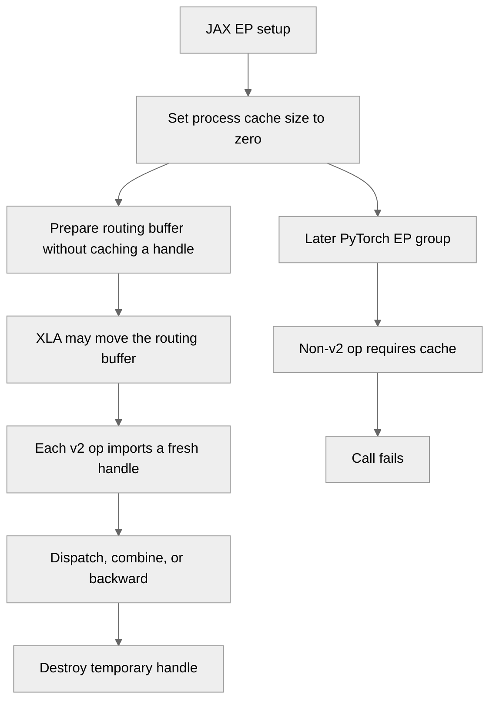

# [Common][JAX] Reconstruct EpHandle via ncclEpImportHandle 

[Upstream PR](https://github.com/NVIDIA/TransformerEngine/pull/3639) · state: open · merged: False

## Original PR description

# Description

Please include a brief summary of the changes, relevant motivation and context.

Fixes # (issue)

## Type of change

- [ ] Documentation change (change only to the documentation, either a fix or a new content)
- [ ] Bug fix (non-breaking change which fixes an issue)
- [ ] New feature (non-breaking change which adds functionality)
- [ ] Breaking change (fix or feature that would cause existing functionality to not work as expected)
- [ ] Infra/Build change
- [ ] Code refactoring

## Changes

Please list the changes introduced in this PR:

- Change A
- Change B

# Checklist:

- [ ] I have read and followed the [contributing guidelines](https://github.com/NVIDIA/TransformerEngine/blob/main/CONTRIBUTING.rst)
- [ ] The functionality is complete
- [ ] I have commented my code, particularly in hard-to-understand areas
- [ ] I have made corresponding changes to the documentation
- [ ] My changes generate no new warnings
- [ ] I have added tests that prove my fix is effective or that my feature works
- [ ] New and existing unit tests pass locally with my changes

## Review and discussion

### reviews

- greptile-apps[bot] · COMMENTED · 2026-10-06T20:35:13Z · [source](https://github.com/NVIDIA/TransformerEngine/pull/3639#pullrequestreview-5434271793)

(No body; status only.)

- greptile-apps[bot] · COMMENTED · 2026-10-06T22:26:50Z · [source](https://github.com/NVIDIA/TransformerEngine/pull/3639#pullrequestreview-5435228851)

(No body; status only.)

- phu0ngng · COMMENTED · 2026-10-06T23:04:25Z · [source](https://github.com/NVIDIA/TransformerEngine/pull/3639#pullrequestreview-5435481310)

(No body; status only.)

- greptile-apps[bot] · COMMENTED · 2026-10-06T23:04:54Z · [source](https://github.com/NVIDIA/TransformerEngine/pull/3639#pullrequestreview-5435484367)

(No body; status only.)

- jberchtold-nvidia · DISMISSED · 2026-10-09T13:46:03Z · [source](https://github.com/NVIDIA/TransformerEngine/pull/3639#pullrequestreview-5470907820)

LGTM pending CI, thanks!

- greptile-apps[bot] · COMMENTED · 2026-10-09T22:01:00Z · [source](https://github.com/NVIDIA/TransformerEngine/pull/3639#pullrequestreview-5475754815)

(No body; status only.)

### issue_comments

- greptile-apps[bot] · comment · 2026-10-06T20:35:07Z · [source](https://github.com/NVIDIA/TransformerEngine/pull/3639#issuecomment-6024954762)

<!-- greptile_summary -->

<h2><a href="https://app.greptile.com/api/retrigger?id=75867504"><picture><source media="(prefers-color-scheme: dark)" srcset="https://greptile-static-assets.s3.amazonaws.com/badges/RetriggerDark.svg?v=2"><source media="(prefers-color-scheme: light)" srcset="https://greptile-static-assets.s3.amazonaws.com/badges/Retrigger.svg?v=2"></picture></a>Confidence Score: 4/5</h2>

**[High impact]** Changes how expert\-parallel handles are cached and reconstructed\.

Keep JAX’s cache choice local to its EP group before merging; the current process-wide setting breaks later PyTorch EP calls.

<h2>Findings</h2>

1. &nbsp;**JAX disables PyTorch EP** <a href="https://github.com/NVIDIA/TransformerEngine/pull/3639#discussion_r4234890042">▶</a>

<h3>Summary</h3>

This PR rebuilds EP handles from saved routing buffers through `ncclEpImportHandle`, so JAX can move those buffers between calls.

- Adds `_v2` operations with explicit layer settings and passes the routing-index dtype through JAX.
- Adds forward and backward tests for `lax.scan` with moved routing buffers.
- JAX’s new process-wide cache setting breaks later PyTorch EP calls in the same process.
- phu0ngng accepted the earlier cache-address churn trade-off: buffers are intended to be reused, `ep_finalize` clears entries, and the default limit can be raised.

<h3>Diagram</h3>

<!-- greptile_confidence_score:4 -->

Reviews (6) · Last reviewed commit: ["Replace EP volatile\_handle\_mem with NVTE..."](https://github.com/nvidia/transformerengine/commit/a7ab15865d2ee726b406346d8a9cd04d46957837) · [Reviewed by Greptile](https://www.greptile.com/?utm_source=greptile_expert&utm_medium=github&utm_campaign=code_reviews&utm_content=nvidia/transformerengine)

### inline_comments

- greptile-apps[bot] · comment · 2026-10-06T20:35:11Z · [source](https://github.com/NVIDIA/TransformerEngine/pull/3639#discussion_r4200176657)

File: `transformer_engine/jax/cpp_extensions/ep.py` · line None

 **Default dtype mismatches saved routing**

`EpLayerConfig` now defaults `topk_idx_dtype` to int64, but existing callers in `ep_moe.py` and `ep_bench.py` use int32 indices without setting this field. Prepare uses the tensor's actual dtype. Later calls import the saved state as int64, so dispatch, combine, and backward receive a handle that does not match the prepared routing.

Derive the dtype from `topk_idx` and preserve it for later calls, or update callers and reject mismatched configs before prepare.

**Knowledge Base Used:** [JAX distributed and MoE execution](https://app.greptile.com/nvidia-public-github/-/custom-context/knowledge-base/nvidia/transformerengine/-/docs/jax-distributed-moe.md)

- greptile-apps[bot] · comment · 2026-10-06T20:35:11Z · [source](https://github.com/NVIDIA/TransformerEngine/pull/3639#discussion_r4200176669)

File: `transformer_engine/common/ep/ep_backend.cpp` · line 421

 **Eviction restores an old dtype**

`prepare_handle_locked` treats configs with different `topk_idx_dtype` values as equal and returns without refreshing the saved config. If a buffer is prepared with int32 indices and later with int64 indices at the same address, its saved dtype remains int32. After eviction, the new recovery path imports the current routing state with that old dtype, rebuilding a handle that does not match the latest prepare.

Include the dtype in `same_cfg`, or refresh the saved config after a successful prepare.

**Knowledge Base Used:** [Native CUDA kernel platform](https://app.greptile.com/nvidia-public-github/-/custom-context/knowledge-base/nvidia/transformerengine/-/docs/native-kernels.md)

- greptile-apps[bot] · comment · 2026-10-06T20:35:12Z · [source](https://github.com/NVIDIA/TransformerEngine/pull/3639#discussion_r4200176673)

File: `transformer_engine/common/ep/ep_backend.cpp` · line None

 **Freed buffers leave cache entries**

Every eviction now keeps a `HandleEntry` in `evicted_`, but that map has no limit or buffer-release cleanup. Entries disappear only when the address is used again or the whole backend shuts down. Long-lived callers that prepare buffers at new addresses retain metadata for freed buffers indefinitely, so `NVTE_EP_HANDLE_CACHE_SIZE` no longer bounds the cache's host memory.

Tie this metadata to buffer lifetime or provide an explicit release path.

- greptile-apps[bot] · comment · 2026-10-06T20:35:12Z · [source](https://github.com/NVIDIA/TransformerEngine/pull/3639#discussion_r4200176679)

File: `tests/jax/test_multi_process_ep.py` · line 1528

 **Mixed test modes fail late**

The newly selectable `TestEpScanHandleRelocation` uses self-hosted communication, but `_ep_test_cases` does not include it in the check that forbids mixing communication modes. Selecting it with `TestEPBorrowedComm` passes this check and later fails during bootstrap because changing modes requires a new process.

Add the new class to the check, preferably by using each class's `USE_BORROWED_COMM` setting.

- greptile-apps[bot] · comment · 2026-10-06T22:26:47Z · [source](https://github.com/NVIDIA/TransformerEngine/pull/3639#discussion_r4201028507)

File: `transformer_engine/common/ep/ep_backend.cpp` · line None

 **Freed buffers exhaust the cache**

`prepare_handle_locked` now stops at the cache limit, but freeing an `EpBuffer` never removes its entry. If a PyTorch caller prepares buffers at enough different addresses, it hits `NVTE_EP_HANDLE_CACHE_SIZE` even after earlier buffers were freed. Valid EP calls then fail until the backend shuts down or the limit is raised.

Add a per-buffer release path, or stop counting released buffers against the live-handle limit.

- phu0ngng · comment · 2026-10-06T23:04:25Z · [source](https://github.com/NVIDIA/TransformerEngine/pull/3639#discussion_r4201259763)

File: `transformer_engine/common/ep/ep_backend.cpp` · line None

Not changing. The cap bounds distinct live `handle_mem` buffers, and a program needs one per layer per in-flight microbatch (e.g. 61 layers x PP degree for DeepSeek-V3), far below the 4096 default. Buffers are meant to be reused across steps; `ep_finalize` clears the cache, and
  `NVTE_EP_HANDLE_CACHE_SIZE` can be raised if needed.

- greptile-apps[bot] · comment · 2026-10-06T23:04:54Z · [source](https://github.com/NVIDIA/TransformerEngine/pull/3639#discussion_r4201262452)

File: `transformer_engine/common/ep/ep_backend.cpp` · line None

Understood. Given the intended lifecycle—buffers are reused across steps, `ep_finalize` clears the cache, and the default capacity of 4096 is well above the expected per-process working set—I agree this is an accepted capacity trade-off rather than a blocker for this PR.

Strictly speaking, the cache retains entries after the underlying buffer is freed, so the cap bounds cached addresses rather than provably live buffers; address churn could still consume the limit. I’ll leave the comment as non-actionable based on the stated usage model.

Tip: You can customize Greptile's behavior for this repo with [`.greptile/rules.md` and `.greptile/config.json`](https://www.greptile.com/docs/code-review/custom-standards).

- greptile-apps[bot] · comment · 2026-10-09T22:00:59Z · [source](https://github.com/NVIDIA/TransformerEngine/pull/3639#discussion_r4234890042)

File: `transformer_engine/jax/csrc/extensions/ep.cpp` · line 53

 **JAX disables PyTorch EP**

`MakeEpGroupConfig` sets `NVTE_EP_HANDLE_CACHE_SIZE=0` for the whole process, not just JAX. If a program runs JAX EP, fully shuts it down, then starts PyTorch EP in the same process, PyTorch inherits the disabled cache. Its non-`_v2` calls, including `nvte_ep_combine`, then fail with “EP op without layer_cfg requires the handle cache.”

The per-device backend keeps its saved cache size after shutdown, so restoring the environment alone does not fix this. Keep JAX’s cache choice local to its EP group instead of overwriting the process setting.

## Changed files and fixed code

- `docs/envvars.rst` · modified · additions 10 / deletions 0
  - [head](https://github.com/phu0ngng/TransformerEngine/blob/a7ab15865d2ee726b406346d8a9cd04d46957837/docs/envvars.rst)
  - [base](https://github.com/NVIDIA/TransformerEngine/blob/ce29d240ca9bc7cdb392a73e2637a0f2bdf71fe5/docs/envvars.rst)
- `tests/cpp_distributed/test_ep.cu` · modified · additions 40 / deletions 0
  - [head](https://github.com/phu0ngng/TransformerEngine/blob/a7ab15865d2ee726b406346d8a9cd04d46957837/tests/cpp_distributed/test_ep.cu)
  - [base](https://github.com/NVIDIA/TransformerEngine/blob/ce29d240ca9bc7cdb392a73e2637a0f2bdf71fe5/tests/cpp_distributed/test_ep.cu)
- `tests/jax/multi_process_launch_ep.sh` · modified · additions 1 / deletions 1
  - [head](https://github.com/phu0ngng/TransformerEngine/blob/a7ab15865d2ee726b406346d8a9cd04d46957837/tests/jax/multi_process_launch_ep.sh)
  - [base](https://github.com/NVIDIA/TransformerEngine/blob/ce29d240ca9bc7cdb392a73e2637a0f2bdf71fe5/tests/jax/multi_process_launch_ep.sh)
- `tests/jax/test_multi_process_ep.py` · modified · additions 277 / deletions 14
  - [head](https://github.com/phu0ngng/TransformerEngine/blob/a7ab15865d2ee726b406346d8a9cd04d46957837/tests/jax/test_multi_process_ep.py)
  - [base](https://github.com/NVIDIA/TransformerEngine/blob/ce29d240ca9bc7cdb392a73e2637a0f2bdf71fe5/tests/jax/test_multi_process_ep.py)
- `transformer_engine/common/ep/ep_api.cpp` · modified · additions 73 / deletions 4
  - [head](https://github.com/phu0ngng/TransformerEngine/blob/a7ab15865d2ee726b406346d8a9cd04d46957837/transformer_engine/common/ep/ep_api.cpp)
  - [base](https://github.com/NVIDIA/TransformerEngine/blob/ce29d240ca9bc7cdb392a73e2637a0f2bdf71fe5/transformer_engine/common/ep/ep_api.cpp)
- `transformer_engine/common/ep/ep_backend.cpp` · modified · additions 129 / deletions 59
  - [head](https://github.com/phu0ngng/TransformerEngine/blob/a7ab15865d2ee726b406346d8a9cd04d46957837/transformer_engine/common/ep/ep_backend.cpp)
  - [base](https://github.com/NVIDIA/TransformerEngine/blob/ce29d240ca9bc7cdb392a73e2637a0f2bdf71fe5/transformer_engine/common/ep/ep_backend.cpp)
- `transformer_engine/common/ep/ep_backend.h` · modified · additions 25 / deletions 11
  - [head](https://github.com/phu0ngng/TransformerEngine/blob/a7ab15865d2ee726b406346d8a9cd04d46957837/transformer_engine/common/ep/ep_backend.h)
  - [base](https://github.com/NVIDIA/TransformerEngine/blob/ce29d240ca9bc7cdb392a73e2637a0f2bdf71fe5/transformer_engine/common/ep/ep_backend.h)
- `transformer_engine/common/ep/nccl_ep_provider.cpp` · modified · additions 7 / deletions 0
  - [head](https://github.com/phu0ngng/TransformerEngine/blob/a7ab15865d2ee726b406346d8a9cd04d46957837/transformer_engine/common/ep/nccl_ep_provider.cpp)
  - [base](https://github.com/NVIDIA/TransformerEngine/blob/ce29d240ca9bc7cdb392a73e2637a0f2bdf71fe5/transformer_engine/common/ep/nccl_ep_provider.cpp)
- `transformer_engine/common/ep/nccl_ep_provider.h` · modified · additions 3 / deletions 0
  - [head](https://github.com/phu0ngng/TransformerEngine/blob/a7ab15865d2ee726b406346d8a9cd04d46957837/transformer_engine/common/ep/nccl_ep_provider.h)
  - [base](https://github.com/NVIDIA/TransformerEngine/blob/ce29d240ca9bc7cdb392a73e2637a0f2bdf71fe5/transformer_engine/common/ep/nccl_ep_provider.h)
- `transformer_engine/common/include/transformer_engine/ep.h` · modified · additions 37 / deletions 5
  - [head](https://github.com/phu0ngng/TransformerEngine/blob/a7ab15865d2ee726b406346d8a9cd04d46957837/transformer_engine/common/include/transformer_engine/ep.h)
  - [base](https://github.com/NVIDIA/TransformerEngine/blob/ce29d240ca9bc7cdb392a73e2637a0f2bdf71fe5/transformer_engine/common/include/transformer_engine/ep.h)
- `transformer_engine/jax/cpp_extensions/ep.py` · modified · additions 97 / deletions 24
  - [head](https://github.com/phu0ngng/TransformerEngine/blob/a7ab15865d2ee726b406346d8a9cd04d46957837/transformer_engine/jax/cpp_extensions/ep.py)
  - [base](https://github.com/NVIDIA/TransformerEngine/blob/ce29d240ca9bc7cdb392a73e2637a0f2bdf71fe5/transformer_engine/jax/cpp_extensions/ep.py)
- `transformer_engine/jax/csrc/extensions/ep.cpp` · modified · additions 40 / deletions 14
  - [head](https://github.com/phu0ngng/TransformerEngine/blob/a7ab15865d2ee726b406346d8a9cd04d46957837/transformer_engine/jax/csrc/extensions/ep.cpp)
  - [base](https://github.com/NVIDIA/TransformerEngine/blob/ce29d240ca9bc7cdb392a73e2637a0f2bdf71fe5/transformer_engine/jax/csrc/extensions/ep.cpp)
- `transformer_engine/jax/ep.py` · modified · additions 1 / deletions 1
  - [head](https://github.com/phu0ngng/TransformerEngine/blob/a7ab15865d2ee726b406346d8a9cd04d46957837/transformer_engine/jax/ep.py)
  - [base](https://github.com/NVIDIA/TransformerEngine/blob/ce29d240ca9bc7cdb392a73e2637a0f2bdf71fe5/transformer_engine/jax/ep.py)
- `transformer_engine/jax/moe.py` · modified · additions 2 / deletions 0
  - [head](https://github.com/phu0ngng/TransformerEngine/blob/a7ab15865d2ee726b406346d8a9cd04d46957837/transformer_engine/jax/moe.py)
  - [base](https://github.com/NVIDIA/TransformerEngine/blob/ce29d240ca9bc7cdb392a73e2637a0f2bdf71fe5/transformer_engine/jax/moe.py)

## Evidence and interpretation boundary

[Original JSON, discussions and patches](../../../../../../evidence/prs/NVIDIA--TransformerEngine/3639-0fc34efabdf89d8c2609bc72c1467e6b29de188109d9ced57cfbe5b51e8f5a04.json) · SHA-256 `0fc34efabdf89d8c2609bc72c1467e6b29de188109d9ced57cfbe5b51e8f5a04`.

Diff complete: True. Missing/binary/truncated patches require pinned source inspection. This is a source page, not an independently verified optimization case. Open, merged and released are different states; recheck the deployed dependency.
