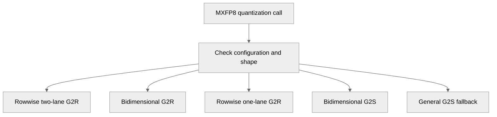

# [Common] More CuTeDSL MXFP8 specialized kernels 

[Upstream PR](https://github.com/NVIDIA/TransformerEngine/pull/3642) · state: open · merged: False

## Original PR description

# Description

Add specialized MXFP8 CuTeDSL quantization kernels ported from #3459
And also some refactoring of the existing kernel -- so `quantize_mxfp8.py` becomes
- `quantize_mxfp8_common.py`: kernel config, signature, dispatching and registeration
- `quantize_mxfp8_g2s_general.py`: the same general MXFP8 kernel that handles all cases
- `quantize_mxfp8_g2r_rowwise_1lane.py`: the same old rowwise specialized kernel
- `quantize_mxfp8_g2s_bidim.py`: the same old bidim specialized kernel

`g2s` and `g2r` mean the kernel uses SMEM / RMEM to quantize 

Note: CuTeDSL cannot exactly mirror CUDA's implementation due to a bug in cutlass: https://github.com/NVIDIA/cutlass/issues/3726

## Type of change

- [ ] Documentation change (change only to the documentation, either a fix or a new content)
- [ ] Bug fix (non-breaking change which fixes an issue)
- [x] New feature (non-breaking change which adds functionality)
- [ ] Breaking change (fix or feature that would cause existing functionality to not work as expected)
- [ ] Infra/Build change
- [ ] Code refactoring

## Changes

- Split the original MXFP8 CuTeDSL file into 3 different files (generic, bidim specialized, rowwise specialized)
- Added new kernels

Difference with the CUDA path:
- G2R bidim kernel also works with swizzled scale
- G2R bidim kernel also handles colwise only quantization
- G2R kernels also support ACT / DACT fusion
- Due to CuTeDSL's G2R activation fusion uses different paths than CUDA, sometimes they disagree with +0 and -0. I think both should be legal so I relaxed bit-exact tests to tolerate +0 and -0

Benchmark result (full sweep on the tip of this branch including things that aren't changed by this PR):

https://claude.ai/artifact/GsCNMy9S4YTxHnR7W3b1Vo?sk=DtZFlcQxJpBxCOlmq-W8_A

Or download it as a static HTML: 
[Quantization Benchmark .html](https://github.com/user-attachments/files/33782869/Quantization.Benchmark.html)

To examine which kernel is dispatched, expand "Data table" and you can see kernel names

# Checklist:

- [x] I have read and followed the [contributing guidelines](https://github.com/NVIDIA/TransformerEngine/blob/main/CONTRIBUTING.rst)
- [x] The functionality is complete
- [x] I have commented my code, particularly in hard-to-understand areas
- [x] I have made corresponding changes to the documentation
- [x] My changes generate no new warnings
- [x] I have added tests that prove my fix is effective or that my feature works
- [x] New and existing unit tests pass locally with my changes

## Review and discussion

### reviews

- greptile-apps[bot] · COMMENTED · 2026-10-12T20:32:18Z · [source](https://github.com/NVIDIA/TransformerEngine/pull/3642#pullrequestreview-5495674360)

(No body; status only.)

- greptile-apps[bot] · COMMENTED · 2026-10-12T21:18:21Z · [source](https://github.com/NVIDIA/TransformerEngine/pull/3642#pullrequestreview-5496037398)

(No body; status only.)

- kainzhong · COMMENTED · 2026-10-12T22:25:31Z · [source](https://github.com/NVIDIA/TransformerEngine/pull/3642#pullrequestreview-5496599370)

(No body; status only.)

- greptile-apps[bot] · COMMENTED · 2026-10-12T22:26:29Z · [source](https://github.com/NVIDIA/TransformerEngine/pull/3642#pullrequestreview-5496609076)

(No body; status only.)

- greptile-apps[bot] · COMMENTED · 2026-10-12T22:31:38Z · [source](https://github.com/NVIDIA/TransformerEngine/pull/3642#pullrequestreview-5496658363)

(No body; status only.)

- greptile-apps[bot] · COMMENTED · 2026-10-12T22:33:02Z · [source](https://github.com/NVIDIA/TransformerEngine/pull/3642#pullrequestreview-5496671302)

(No body; status only.)

- greptile-apps[bot] · COMMENTED · 2026-10-15T20:36:17Z · [source](https://github.com/NVIDIA/TransformerEngine/pull/3642#pullrequestreview-5539556934)

(No body; status only.)

- greptile-apps[bot] · COMMENTED · 2026-10-15T21:55:28Z · [source](https://github.com/NVIDIA/TransformerEngine/pull/3642#pullrequestreview-5540415343)

(No body; status only.)

- tdophung · COMMENTED · 2026-10-28T00:32:48Z · [source](https://github.com/NVIDIA/TransformerEngine/pull/3642#pullrequestreview-5657240369)

(No body; status only.)

- kainzhong · COMMENTED · 2026-10-28T00:34:12Z · [source](https://github.com/NVIDIA/TransformerEngine/pull/3642#pullrequestreview-5676343789)

(No body; status only.)

- tdophung · COMMENTED · 2026-10-28T00:45:24Z · [source](https://github.com/NVIDIA/TransformerEngine/pull/3642#pullrequestreview-5676409835)

(No body; status only.)

- kainzhong · COMMENTED · 2026-10-28T00:50:07Z · [source](https://github.com/NVIDIA/TransformerEngine/pull/3642#pullrequestreview-5676442097)

(No body; status only.)

- tdophung · COMMENTED · 2026-10-28T01:00:46Z · [source](https://github.com/NVIDIA/TransformerEngine/pull/3642#pullrequestreview-5676506833)

(No body; status only.)

- Oleg-Goncharov · COMMENTED · 2026-10-28T12:38:45Z · [source](https://github.com/NVIDIA/TransformerEngine/pull/3642#pullrequestreview-5682691614)

(No body; status only.)

- Oleg-Goncharov · DISMISSED · 2026-10-28T12:55:55Z · [source](https://github.com/NVIDIA/TransformerEngine/pull/3642#pullrequestreview-5682898065)

LGTM

- kainzhong · COMMENTED · 2026-10-28T18:30:45Z · [source](https://github.com/NVIDIA/TransformerEngine/pull/3642#pullrequestreview-5687740195)

(No body; status only.)

- kainzhong · COMMENTED · 2026-10-28T18:34:31Z · [source](https://github.com/NVIDIA/TransformerEngine/pull/3642#pullrequestreview-5687786293)

(No body; status only.)

- kainzhong · COMMENTED · 2026-10-28T18:37:34Z · [source](https://github.com/NVIDIA/TransformerEngine/pull/3642#pullrequestreview-5687823884)

(No body; status only.)

- kainzhong · COMMENTED · 2026-10-28T21:03:06Z · [source](https://github.com/NVIDIA/TransformerEngine/pull/3642#pullrequestreview-5689657742)

(No body; status only.)

- kainzhong · COMMENTED · 2026-10-28T21:03:18Z · [source](https://github.com/NVIDIA/TransformerEngine/pull/3642#pullrequestreview-5689659663)

(No body; status only.)

- tdophung · COMMENTED · 2026-10-28T21:22:53Z · [source](https://github.com/NVIDIA/TransformerEngine/pull/3642#pullrequestreview-5689871614)

(No body; status only.)

- kainzhong · COMMENTED · 2026-10-28T21:30:10Z · [source](https://github.com/NVIDIA/TransformerEngine/pull/3642#pullrequestreview-5689947204)

(No body; status only.)

- tdophung · COMMENTED · 2026-10-28T21:46:08Z · [source](https://github.com/NVIDIA/TransformerEngine/pull/3642#pullrequestreview-5690109079)

(No body; status only.)

- tdophung · APPROVED · 2026-10-28T21:47:35Z · [source](https://github.com/NVIDIA/TransformerEngine/pull/3642#pullrequestreview-5690124512)

Approve pending CI (and #3743 + #3737 )

### issue_comments

- greptile-apps[bot] · comment · 2026-10-12T20:32:14Z · [source](https://github.com/NVIDIA/TransformerEngine/pull/3642#issuecomment-6132118419)

<!-- greptile_summary -->

<h2><a href="https://app.greptile.com/api/retrigger?id=79386043"><picture><source media="(prefers-color-scheme: dark)" srcset="https://greptile-static-assets.s3.amazonaws.com/badges/RetriggerDark.svg?v=2"><source media="(prefers-color-scheme: light)" srcset="https://greptile-static-assets.s3.amazonaws.com/badges/Retrigger.svg?v=2"></picture></a><a href="https://app.greptile.com/nvidia-public-github/github/NVIDIA/transformerengine/-/pull/3642?utm_source=greptile_review&amp;utm_medium=github&amp;utm_campaign=view_in_greptile"><picture><source media="(prefers-color-scheme: dark)" srcset="https://greptile-static-assets.s3.amazonaws.com/badges/ViewInGreptileDark.svg?v=2"><source media="(prefers-color-scheme: light)" srcset="https://greptile-static-assets.s3.amazonaws.com/badges/ViewInGreptile.svg?v=2"></picture></a>Confidence Score: 5/5</h2>

**[Medium impact]** The PR appears safe to merge; no new actionable issue was found.

<h3>Summary</h3>

Adds register-based BF16 MXFP8 kernels and splits the existing kernels into separate files.
- Rowwise MXFP8 casts can use register-based kernels for more input layouts.
- Bidimensional MXFP8 casts can quantize from a register-loaded tile.
- MXFP8 calls now select specialized kernels when their inputs fit.

Previous-thread context:
- The added BF16 cases address the missing launch-shape coverage.
- `kainzhong` accepted the lack of exact kernel-selection assertions because these tests check correctness, not performance. Greptile withdrew that concern.
- `kainzhong` explicitly accepts positive-zero versus negative-zero differences in the PR description. Both backend tests now allow that difference.
- The coverage and signed-zero threads were manually resolved without explanatory replies.

<h3>Diagram</h3>

<!-- greptile_confidence_score:5 -->

Reviews (18) · Last reviewed commit: ["Merge branch &#39;main&#39; into more\_cutedsl\_mx..."](https://github.com/nvidia/transformerengine/commit/44d2c22aa35b9054ce65fceeee59916ba4e36feb) · [Reviewed by Greptile](https://www.greptile.com/?utm_source=greptile_review&utm_medium=github&utm_campaign=review_public&utm_content=nvidia/transformerengine)

### inline_comments

- greptile-apps[bot] · comment · 2026-10-12T20:32:17Z · [source](https://github.com/NVIDIA/TransformerEngine/pull/3642#discussion_r4252079294)

File: `transformer_engine/common/CuTeDSL/cast/mxfp8/quantize_mxfp8_common.py` · line None

 **New launches lack test coverage**

The existing `MATRIX_SIZES` never selects the narrow bidimensional tile, the deep cluster launch, or rowwise work that spills into `grid.z`. The rowwise overflow test uses `torch.float16`, so it cannot select `MXFP8QuantizeG2RRowwise2LaneKernel`.

Add BF16 cross-backend cases that reach these branches and compare output bytes and scales. Otherwise, changes to these paths could break large or less common shapes without failing the existing tests.

Note: If this suggestion doesn't match your team's coding style, reply to this and let me know. I'll remember it for next time!

- greptile-apps[bot] · comment · 2026-10-12T21:18:20Z · [source](https://github.com/NVIDIA/TransformerEngine/pull/3642#discussion_r4252404123)

File: `tests/pytorch/mxfp8/test_mxfp8_cutedsl_backend.py` · line 424

 **Wrong kernel can pass**

Removing the `expected_kernel` check lets `test_specialized_kernels` pass when a case runs the general kernel instead of its intended specialized kernel. `run_test_case` checks registration and matching output, but neither shows which kernel ran. This leaves the specialized kernel untested and lets lost speed benefits go unnoticed. Keep a check of which kernel ran alongside the output comparison.

- kainzhong · comment · 2026-10-12T22:25:30Z · [source](https://github.com/NVIDIA/TransformerEngine/pull/3642#discussion_r4252864075)

File: `tests/pytorch/mxfp8/test_mxfp8_cutedsl_backend.py` · line 424

CUDA tests also don't validate this. This is a perf thing not a correctness thing

- greptile-apps[bot] · comment · 2026-10-12T22:26:29Z · [source](https://github.com/NVIDIA/TransformerEngine/pull/3642#discussion_r4252870719)

File: `tests/pytorch/mxfp8/test_mxfp8_cutedsl_backend.py` · line 424

That’s fair. This test is intended to validate output correctness and supported configurations; selecting a particular specialized implementation is a performance concern, and the CUDA tests don’t assert that either. I’ll withdraw this comment—kernel-selection validation would be better covered by a benchmark or dedicated dispatch/performance test.

- greptile-apps[bot] · comment · 2026-10-12T22:31:37Z · [source](https://github.com/NVIDIA/TransformerEngine/pull/3642#discussion_r4252905310)

File: `tests/pytorch/mxfp8/test_mxfp8_cutedsl_backend.py` · line 424

That’s fair—the existing CUDA-backend tests also validate output/configuration rather than the exact internal kernel choice, so this is not a regression introduced by this PR.

My concern is specific to the new test’s stated purpose: these cases are labeled as covering specialized launch tiers, while `run_test_case` only proves that the CuTeDSL configuration is registered and produces matching output. A dispatcher could still select the generic implementation for those shapes and the test would pass.

I’ll treat this as a consistency/coverage suggestion rather than a blocking issue, unless the project already has a supported way to observe the selected kernel.

- greptile-apps[bot] · comment · 2026-10-12T22:33:02Z · [source](https://github.com/NVIDIA/TransformerEngine/pull/3642#discussion_r4252914944)

File: `tests/pytorch/mxfp8/test_mxfp8_cutedsl_backend.py` · line 424

That’s fair—the existing CUDA tests also validate behavior rather than the selected implementation, so this is an inconsistency rather than a new correctness requirement. My concern is specific to this test’s stated purpose: `test_specialized_kernels` and its cases are intended to cover each specialized launch path, while `run_test_case` only proves that the CuTeDSL output matches CUDA and that a config is registered. A registered config can still dispatch to the generic implementation, so the test would remain green if a specialized launch path were accidentally removed. We should either add an explicit dispatch/kernel-selection check for these cases, or rename/reframe the test as shape/output coverage; I’d withdraw the comment if implementation selection is intentionally out of scope for all CUDA/CuTeDSL tests.

- greptile-apps[bot] · comment · 2026-10-15T20:36:15Z · [source](https://github.com/NVIDIA/TransformerEngine/pull/3642#discussion_r4288014575)

File: `transformer_engine/common/CuTeDSL/utils_fp8.py` · line 209

 **Backward output loses negative zero**

Before CUDA 13.1, these instructions add positive zero to the product, changing negative zero to positive zero. The new fused backward paths reach this case: `drelu` with a negative gradient and a nonpositive activation input produces negative zero. The CUDA general kernel preserves its sign with multiplication, but the new G2R kernels write positive zero. Existing `test_sizes` cases compare raw output bytes and fail for these configurations.

Use a sign-preserving multiply for fused activation paths while keeping plain casts consistent with their CUDA counterpart.

- greptile-apps[bot] · comment · 2026-10-15T21:55:27Z · [source](https://github.com/NVIDIA/TransformerEngine/pull/3642#discussion_r4288677315)

File: `transformer_engine/common/CuTeDSL/utils_fp8.py` · line None

 **Plain casts disagree on zero**

Before CUDA 13.1, adding negative zero here also changes plain BF16 casts. A rowwise `(1024, 4096)` input containing `-0.0` now produces FP8 byte `0x80`, while CUDA's specialized cast still adds positive zero and produces `0x00`. This breaks the required byte-for-byte agreement between backends.

Keep the sign-preserving path for fused activations, but retain CUDA's behavior for plain casts.

- tdophung · comment · 2026-10-26T18:42:15Z · [source](https://github.com/NVIDIA/TransformerEngine/pull/3642#discussion_r4381113597)

File: `transformer_engine/common/CuTeDSL/cast/mxfp8/quantize_mxfp8_g2r_bidim.py` · line 743

See #3737 where they identified and fix a bug in my CUDA-version kernel. The 2024/4096 columns fast path that I hard coded the default scalee pitches, so a caller provided larger pitch would put the scales in the wrong rows. So we should add a condition to check of the caller provided strides is the same as the default strides here and redirect to the g2s kernel if not

- tdophung · comment · 2026-10-26T18:43:54Z · [source](https://github.com/NVIDIA/TransformerEngine/pull/3642#discussion_r4381129145)

File: `transformer_engine/common/CuTeDSL/cast/mxfp8/quantize_mxfp8_g2r_bidim.py` · line 743

might also need to import the test case they added in #3737 into the cute DSL test file as well as well

- tdophung · comment · 2026-10-26T19:01:40Z · [source](https://github.com/NVIDIA/TransformerEngine/pull/3642#discussion_r4381300962)

File: `transformer_engine/common/CuTeDSL/utils.py` · line 349

I do not understand why #3717 is related here?

- tdophung · comment · 2026-10-27T00:24:13Z · [source](https://github.com/NVIDIA/TransformerEngine/pull/3642#discussion_r4383918828)

File: `transformer_engine/common/CuTeDSL/cast/mxfp8/quantize_mxfp8_g2r_rowwise_1lane.py` · line None

comment not needed

- tdophung · comment · 2026-10-27T23:48:38Z · [source](https://github.com/NVIDIA/TransformerEngine/pull/3642#discussion_r4395458118)

File: `docs/envvars.rst` · line 153

nit: also need cuda.core for cheecking compatibility

- tdophung · comment · 2026-10-27T23:50:21Z · [source](https://github.com/NVIDIA/TransformerEngine/pull/3642#discussion_r4395472837)

File: `transformer_engine/common/CuTeDSL/cast/mxfp8/quantize_mxfp8_common.py` · line None

nit: comment out of date since you also have fused activation on some of the register resident kernels

- tdophung · comment · 2026-10-28T00:23:52Z · [source](https://github.com/NVIDIA/TransformerEngine/pull/3642#discussion_r4395678534)

File: `transformer_engine/common/CuTeDSL/cast/mxfp8/quantize_mxfp8_g2r_bidim.py` · line 76

for the case of `WITH_ACT/WITH_DACT`, the scale computed by this CuteDSL function is different from how thee CUDA kernel fused case compute it. CUDA version ignores NaN  and the `scale =  e8m0(fmaxf(amax * max_norm_rcp, 0))`, so it scale will be 0 when there is NaN.  However this function in cuteDSL will return 0xFF for the scale here. 
I know that the cast-only version in CUDA also uses the same scale calculation, which returns 0xFF. And numerically this should not matter, but since you have the byte-for-byte test between CuteDSL and CUDA, thought I might call it out for the fused activation case.

- kainzhong · comment · 2026-10-28T00:34:12Z · [source](https://github.com/NVIDIA/TransformerEngine/pull/3642#discussion_r4395732859)

File: `transformer_engine/common/CuTeDSL/utils.py` · line 349

It's cutlass's 3717, not our 3717

- tdophung · comment · 2026-10-28T00:45:09Z · [source](https://github.com/NVIDIA/TransformerEngine/pull/3642#discussion_r4395789427)

File: `transformer_engine/common/CuTeDSL/cast/mxfp8/quantize_mxfp8_common.py` · line 358

this dispatch logic reads the private attributes of the kernels here. Maybe we can have the general kernel owning its shape divide check internally and just call it here.

- kainzhong · comment · 2026-10-28T00:50:07Z · [source](https://github.com/NVIDIA/TransformerEngine/pull/3642#discussion_r4395817549)

File: `transformer_engine/common/CuTeDSL/cast/mxfp8/quantize_mxfp8_common.py` · line 358

I have a solution in https://github.com/kainzhong/TransformerEngine/pull/11 which is more elegant. I plan to merge that one after this is merged

- tdophung · comment · 2026-10-28T01:00:46Z · [source](https://github.com/NVIDIA/TransformerEngine/pull/3642#discussion_r4395872804)

File: `transformer_engine/common/CuTeDSL/cast/mxfp8/quantize_mxfp8_common.py` · line 358

good! that looks better. Resolving

- Oleg-Goncharov · comment · 2026-10-28T12:38:45Z · [source](https://github.com/NVIDIA/TransformerEngine/pull/3642#discussion_r4400629321)

File: `transformer_engine/common/CuTeDSL/cast/mxfp8/quantize_mxfp8_g2r_bidim.py` · line 76

I’d keep the new behavior and define all-NaN blocks to produce a NaN scale (0xFF), consistently with the cast-only path. The fused CUDA reduction currently loses the all-NaN condition by starting `fmaxf` from zero.
As we’re planning to transition to CuTeDSL kernels (and eventually retire the legacy CUDA implementations), we should probably prefer to standardize this behavior. And the remaining inconsistencies between backends can be fixed in a separate fix PR

- kainzhong · comment · 2026-10-28T18:30:44Z · [source](https://github.com/NVIDIA/TransformerEngine/pull/3642#discussion_r4404540122)

File: `transformer_engine/common/CuTeDSL/cast/mxfp8/quantize_mxfp8_g2r_bidim.py` · line 743

I think I'll probably wait for his PR to be merged first. Currently on our CI all pytorch tests run with CuTeDSL enabled so after his PR is merged I'll need to make his test run with CuTeDSL and add a bit-exact test for CuTeDSL and CUDA anyway (he disables CuTeDSL for that test for now)

- kainzhong · comment · 2026-10-28T18:34:31Z · [source](https://github.com/NVIDIA/TransformerEngine/pull/3642#discussion_r4404577632)

File: `transformer_engine/common/CuTeDSL/cast/mxfp8/quantize_mxfp8_g2r_rowwise_1lane.py` · line None

I want to keep this comment because technically you can set it to false and the kernel still runs correctly. It's just for now the kernel is faster with this being true, but it might be useful in the future like you can subclass this kernel and override this if not stashing scales to SMEM is faster

- kainzhong · comment · 2026-10-28T18:37:34Z · [source](https://github.com/NVIDIA/TransformerEngine/pull/3642#discussion_r4404607525)

File: `docs/envvars.rst` · line 153

#3743 fixes this

- kainzhong · comment · 2026-10-28T21:03:06Z · [source](https://github.com/NVIDIA/TransformerEngine/pull/3642#discussion_r4406055075)

File: `transformer_engine/common/CuTeDSL/cast/mxfp8/quantize_mxfp8_common.py` · line None

Fixed

- kainzhong · comment · 2026-10-28T21:03:17Z · [source](https://github.com/NVIDIA/TransformerEngine/pull/3642#discussion_r4406056706)

File: `transformer_engine/common/CuTeDSL/cast/mxfp8/quantize_mxfp8_g2r_bidim.py` · line 76

OK so... I'm just not gonna change anything?

- tdophung · comment · 2026-10-28T21:22:52Z · [source](https://github.com/NVIDIA/TransformerEngine/pull/3642#discussion_r4406225580)

File: `transformer_engine/common/CuTeDSL/cast/mxfp8/quantize_mxfp8_g2r_rowwise_1lane.py` · line None

then maybe an explanation on why you would hard code it would make sense here so that we have a way to determine when this should be revisit

- kainzhong · comment · 2026-10-28T21:30:10Z · [source](https://github.com/NVIDIA/TransformerEngine/pull/3642#discussion_r4406285431)

File: `transformer_engine/common/CuTeDSL/cast/mxfp8/quantize_mxfp8_g2r_rowwise_1lane.py` · line None

Fixed

- tdophung · comment · 2026-10-28T21:46:08Z · [source](https://github.com/NVIDIA/TransformerEngine/pull/3642#discussion_r4406409749)

File: `transformer_engine/common/CuTeDSL/cast/mxfp8/quantize_mxfp8_g2r_bidim.py` · line 76

Yeah you do not need to change anything then, per Oleg. I'll fix the inconsistencies in the CUDA sidee  in the next PR. Keeping this thread open and not resolved so I remember it though

## Changed files and fixed code

- `docs/envvars.rst` · modified · additions 1 / deletions 1
  - [head](https://github.com/kainzhong/TransformerEngine/blob/44d2c22aa35b9054ce65fceeee59916ba4e36feb/docs/envvars.rst)
  - [base](https://github.com/NVIDIA/TransformerEngine/blob/dfc4158d1597f72972fe2863adac436fa3fe1d4d/docs/envvars.rst)
- `tests/cpp/operator/test_cast_mxfp8.cu` · modified · additions 3 / deletions 0
  - [head](https://github.com/kainzhong/TransformerEngine/blob/44d2c22aa35b9054ce65fceeee59916ba4e36feb/tests/cpp/operator/test_cast_mxfp8.cu)
  - [base](https://github.com/NVIDIA/TransformerEngine/blob/dfc4158d1597f72972fe2863adac436fa3fe1d4d/tests/cpp/operator/test_cast_mxfp8.cu)
- `tests/jax/test_mxfp8_cutedsl_backend.py` · modified · additions 34 / deletions 1
  - [head](https://github.com/kainzhong/TransformerEngine/blob/44d2c22aa35b9054ce65fceeee59916ba4e36feb/tests/jax/test_mxfp8_cutedsl_backend.py)
  - [base](https://github.com/NVIDIA/TransformerEngine/blob/dfc4158d1597f72972fe2863adac436fa3fe1d4d/tests/jax/test_mxfp8_cutedsl_backend.py)
- `tests/pytorch/mxfp8/test_mxfp8_cutedsl_backend.py` · modified · additions 66 / deletions 5
  - [head](https://github.com/kainzhong/TransformerEngine/blob/44d2c22aa35b9054ce65fceeee59916ba4e36feb/tests/pytorch/mxfp8/test_mxfp8_cutedsl_backend.py)
  - [base](https://github.com/NVIDIA/TransformerEngine/blob/dfc4158d1597f72972fe2863adac436fa3fe1d4d/tests/pytorch/mxfp8/test_mxfp8_cutedsl_backend.py)
- `transformer_engine/common/CuTeDSL/__init__.py` · modified · additions 1 / deletions 1
  - [head](https://github.com/kainzhong/TransformerEngine/blob/44d2c22aa35b9054ce65fceeee59916ba4e36feb/transformer_engine/common/CuTeDSL/__init__.py)
  - [base](https://github.com/NVIDIA/TransformerEngine/blob/dfc4158d1597f72972fe2863adac436fa3fe1d4d/transformer_engine/common/CuTeDSL/__init__.py)
- `transformer_engine/common/CuTeDSL/cast/mxfp8/__init__.py` · modified · additions 1 / deletions 1
  - [head](https://github.com/kainzhong/TransformerEngine/blob/44d2c22aa35b9054ce65fceeee59916ba4e36feb/transformer_engine/common/CuTeDSL/cast/mxfp8/__init__.py)
  - [base](https://github.com/NVIDIA/TransformerEngine/blob/dfc4158d1597f72972fe2863adac436fa3fe1d4d/transformer_engine/common/CuTeDSL/cast/mxfp8/__init__.py)
- `transformer_engine/common/CuTeDSL/cast/mxfp8/quantize_mxfp8.py` · removed · additions 0 / deletions 2846
  - [head](https://github.com/kainzhong/TransformerEngine/blob/44d2c22aa35b9054ce65fceeee59916ba4e36feb/transformer_engine/common/CuTeDSL/cast/mxfp8/quantize_mxfp8.py)
  - [base](https://github.com/NVIDIA/TransformerEngine/blob/dfc4158d1597f72972fe2863adac436fa3fe1d4d/transformer_engine/common/CuTeDSL/cast/mxfp8/quantize_mxfp8.py)
- `transformer_engine/common/CuTeDSL/cast/mxfp8/quantize_mxfp8_common.py` · added · additions 609 / deletions 0
  - [head](https://github.com/kainzhong/TransformerEngine/blob/44d2c22aa35b9054ce65fceeee59916ba4e36feb/transformer_engine/common/CuTeDSL/cast/mxfp8/quantize_mxfp8_common.py)
  - [base](https://github.com/NVIDIA/TransformerEngine/blob/dfc4158d1597f72972fe2863adac436fa3fe1d4d/transformer_engine/common/CuTeDSL/cast/mxfp8/quantize_mxfp8_common.py)
- `transformer_engine/common/CuTeDSL/cast/mxfp8/quantize_mxfp8_g2r_bidim.py` · added · additions 919 / deletions 0
  - [head](https://github.com/kainzhong/TransformerEngine/blob/44d2c22aa35b9054ce65fceeee59916ba4e36feb/transformer_engine/common/CuTeDSL/cast/mxfp8/quantize_mxfp8_g2r_bidim.py)
  - [base](https://github.com/NVIDIA/TransformerEngine/blob/dfc4158d1597f72972fe2863adac436fa3fe1d4d/transformer_engine/common/CuTeDSL/cast/mxfp8/quantize_mxfp8_g2r_bidim.py)
- `transformer_engine/common/CuTeDSL/cast/mxfp8/quantize_mxfp8_g2r_rowwise_1lane.py` · added · additions 336 / deletions 0
  - [head](https://github.com/kainzhong/TransformerEngine/blob/44d2c22aa35b9054ce65fceeee59916ba4e36feb/transformer_engine/common/CuTeDSL/cast/mxfp8/quantize_mxfp8_g2r_rowwise_1lane.py)
  - [base](https://github.com/NVIDIA/TransformerEngine/blob/dfc4158d1597f72972fe2863adac436fa3fe1d4d/transformer_engine/common/CuTeDSL/cast/mxfp8/quantize_mxfp8_g2r_rowwise_1lane.py)
- `transformer_engine/common/CuTeDSL/cast/mxfp8/quantize_mxfp8_g2r_rowwise_2lane.py` · added · additions 689 / deletions 0
  - [head](https://github.com/kainzhong/TransformerEngine/blob/44d2c22aa35b9054ce65fceeee59916ba4e36feb/transformer_engine/common/CuTeDSL/cast/mxfp8/quantize_mxfp8_g2r_rowwise_2lane.py)
  - [base](https://github.com/NVIDIA/TransformerEngine/blob/dfc4158d1597f72972fe2863adac436fa3fe1d4d/transformer_engine/common/CuTeDSL/cast/mxfp8/quantize_mxfp8_g2r_rowwise_2lane.py)
- `transformer_engine/common/CuTeDSL/cast/mxfp8/quantize_mxfp8_g2s_bidim.py` · added · additions 737 / deletions 0
  - [head](https://github.com/kainzhong/TransformerEngine/blob/44d2c22aa35b9054ce65fceeee59916ba4e36feb/transformer_engine/common/CuTeDSL/cast/mxfp8/quantize_mxfp8_g2s_bidim.py)
  - [base](https://github.com/NVIDIA/TransformerEngine/blob/dfc4158d1597f72972fe2863adac436fa3fe1d4d/transformer_engine/common/CuTeDSL/cast/mxfp8/quantize_mxfp8_g2s_bidim.py)
- `transformer_engine/common/CuTeDSL/cast/mxfp8/quantize_mxfp8_g2s_general.py` · added · additions 1411 / deletions 0
  - [head](https://github.com/kainzhong/TransformerEngine/blob/44d2c22aa35b9054ce65fceeee59916ba4e36feb/transformer_engine/common/CuTeDSL/cast/mxfp8/quantize_mxfp8_g2s_general.py)
  - [base](https://github.com/NVIDIA/TransformerEngine/blob/dfc4158d1597f72972fe2863adac436fa3fe1d4d/transformer_engine/common/CuTeDSL/cast/mxfp8/quantize_mxfp8_g2s_general.py)
- `transformer_engine/common/CuTeDSL/utils.py` · modified · additions 98 / deletions 0
  - [head](https://github.com/kainzhong/TransformerEngine/blob/44d2c22aa35b9054ce65fceeee59916ba4e36feb/transformer_engine/common/CuTeDSL/utils.py)
  - [base](https://github.com/NVIDIA/TransformerEngine/blob/dfc4158d1597f72972fe2863adac436fa3fe1d4d/transformer_engine/common/CuTeDSL/utils.py)
- `transformer_engine/common/CuTeDSL/utils_fp8.py` · modified · additions 43 / deletions 0
  - [head](https://github.com/kainzhong/TransformerEngine/blob/44d2c22aa35b9054ce65fceeee59916ba4e36feb/transformer_engine/common/CuTeDSL/utils_fp8.py)
  - [base](https://github.com/NVIDIA/TransformerEngine/blob/dfc4158d1597f72972fe2863adac436fa3fe1d4d/transformer_engine/common/CuTeDSL/utils_fp8.py)

## Evidence and interpretation boundary

[Original JSON, discussions and patches](../../../../../../evidence/prs/NVIDIA--TransformerEngine/3642-e4a0485f6cca8c4d32a26718e52c6f01eb59060a1bbb60021065d349514748ca.json) · SHA-256 `e4a0485f6cca8c4d32a26718e52c6f01eb59060a1bbb60021065d349514748ca`.

Diff complete: False. Missing/binary/truncated patches require pinned source inspection. This is a source page, not an independently verified optimization case. Open, merged and released are different states; recheck the deployed dependency.
