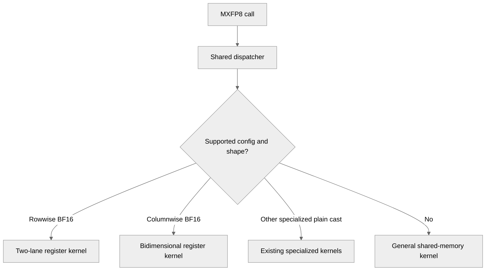

# [Common] More CuTeDSL MXFP8 specialized kernels 

[Upstream PR](https://github.com/NVIDIA/TransformerEngine/pull/3642) · state: open · merged: False

## Original PR description

# Description

Add specialized MXFP8 CuTeDSL quantization kernels ported from #3459
And also some refactoring of the existing kernel -- so `quantize_mxfp8.py` becomes
- `quantize_mxfp8_common.py`: kernel config, signature, dispatching and registeration
- `quantize_mxfp8_g2s_general.py`: the same general MXFP8 kernel that handles all cases
- `quantize_mxfp8_g2r_rowwise_1lane.py`: the same old rowwise specialized kernel
- `quantize_mxfp8_g2s_bidim.py`: the same old bidim specialized kernel

`g2s` and `g2r` mean the kernel uses SMEM / RMEM to quantize 

Note: CuTeDSL cannot exactly mirror CUDA's implementation due to a bug in cutlass: https://github.com/NVIDIA/cutlass/issues/3726

## Type of change

- [ ] Documentation change (change only to the documentation, either a fix or a new content)
- [ ] Bug fix (non-breaking change which fixes an issue)
- [x] New feature (non-breaking change which adds functionality)
- [ ] Breaking change (fix or feature that would cause existing functionality to not work as expected)
- [ ] Infra/Build change
- [ ] Code refactoring

## Changes

- Split the original MXFP8 CuTeDSL file into 3 different files (generic, bidim specialized, rowwise specialized)
- Added new kernels

Difference with the CUDA path:
- G2R bidim kernel also works with swizzled scale
- G2R bidim kernel also handles colwise only quantization
- G2R kernels also support ACT / DACT fusion
- Due to CuTeDSL's G2R activation fusion uses different paths than CUDA, sometimes they disagree with +0 and -0. I think both should be legal so I relaxed bit-exact tests to tolerate +0 and -0

Benchmark result: (BF16 only, since the new G2R kernels only support BF16, and activation is gelu)

https://claude.ai/artifact/8FtZ986WSykc7T9KoB6gqJ?sk=wr6ECZReAGDo11dCSpeaLw

# Checklist:

- [x] I have read and followed the [contributing guidelines](https://github.com/NVIDIA/TransformerEngine/blob/main/CONTRIBUTING.rst)
- [x] The functionality is complete
- [x] I have commented my code, particularly in hard-to-understand areas
- [x] I have made corresponding changes to the documentation
- [x] My changes generate no new warnings
- [x] I have added tests that prove my fix is effective or that my feature works
- [x] New and existing unit tests pass locally with my changes

## Review and discussion

### reviews

- greptile-apps[bot] · COMMENTED · 2026-10-12T20:32:18Z · [source](https://github.com/NVIDIA/TransformerEngine/pull/3642#pullrequestreview-5495674360)

(No body; status only.)

- greptile-apps[bot] · COMMENTED · 2026-10-12T21:18:21Z · [source](https://github.com/NVIDIA/TransformerEngine/pull/3642#pullrequestreview-5496037398)

(No body; status only.)

- kainzhong · COMMENTED · 2026-10-12T22:25:31Z · [source](https://github.com/NVIDIA/TransformerEngine/pull/3642#pullrequestreview-5496599370)

(No body; status only.)

- greptile-apps[bot] · COMMENTED · 2026-10-12T22:26:29Z · [source](https://github.com/NVIDIA/TransformerEngine/pull/3642#pullrequestreview-5496609076)

(No body; status only.)

- greptile-apps[bot] · COMMENTED · 2026-10-12T22:31:38Z · [source](https://github.com/NVIDIA/TransformerEngine/pull/3642#pullrequestreview-5496658363)

(No body; status only.)

- greptile-apps[bot] · COMMENTED · 2026-10-12T22:33:02Z · [source](https://github.com/NVIDIA/TransformerEngine/pull/3642#pullrequestreview-5496671302)

(No body; status only.)

- greptile-apps[bot] · COMMENTED · 2026-10-15T20:36:17Z · [source](https://github.com/NVIDIA/TransformerEngine/pull/3642#pullrequestreview-5539556934)

(No body; status only.)

- greptile-apps[bot] · COMMENTED · 2026-10-15T21:55:28Z · [source](https://github.com/NVIDIA/TransformerEngine/pull/3642#pullrequestreview-5540415343)

(No body; status only.)

### issue_comments

- greptile-apps[bot] · comment · 2026-10-12T20:32:14Z · [source](https://github.com/NVIDIA/TransformerEngine/pull/3642#issuecomment-6132118419)

<!-- greptile_summary -->

<h2><a href="https://app.greptile.com/api/retrigger?id=79386043"><picture><source media="(prefers-color-scheme: dark)" srcset="https://greptile-static-assets.s3.amazonaws.com/badges/RetriggerDark.svg?v=2"><source media="(prefers-color-scheme: light)" srcset="https://greptile-static-assets.s3.amazonaws.com/badges/Retrigger.svg?v=2"></picture></a><a href="https://app.greptile.com/nvidia-public-github/github/NVIDIA/transformerengine/-/pull/3642"><picture><source media="(prefers-color-scheme: dark)" srcset="https://greptile-static-assets.s3.amazonaws.com/badges/ViewInGreptileDark.svg?v=2"><source media="(prefers-color-scheme: light)" srcset="https://greptile-static-assets.s3.amazonaws.com/badges/ViewInGreptile.svg?v=2"></picture></a>Confidence Score: 5/5</h2>

**[High impact]** The PR appears safe to merge; no new actionable defect was established.

<h3>Summary</h3>

Adds BF16 register-based MXFP8 kernels and splits the existing implementation into shared dispatch code and separate kernel files.

- BF16 rowwise casts can use a two-lane register-based kernel.
- BF16 casts can produce rowwise and columnwise outputs from one register-loaded tile.
- The one-lane rowwise cast now has its own kernel module.
- The staged bidimensional cast now has its own kernel module.
- MXFP8 calls now select a specialized kernel when its config fits.

<h3>Diagram</h3>

<!-- greptile_confidence_score:5 -->

Reviews (13) · Last reviewed commit: ["fix"](https://github.com/nvidia/transformerengine/commit/287505f070f1cd9cc8691425aa161d1b0192fe5f) · [Reviewed by Greptile](https://www.greptile.com/?utm_source=greptile_review&utm_medium=github&utm_campaign=review_public&utm_content=nvidia/transformerengine)

### inline_comments

- greptile-apps[bot] · comment · 2026-10-12T20:32:17Z · [source](https://github.com/NVIDIA/TransformerEngine/pull/3642#discussion_r4252079294)

File: `transformer_engine/common/CuTeDSL/cast/mxfp8/quantize_mxfp8_common.py` · line None

 **New launches lack test coverage**

The existing `MATRIX_SIZES` never selects the narrow bidimensional tile, the deep cluster launch, or rowwise work that spills into `grid.z`. The rowwise overflow test uses `torch.float16`, so it cannot select `MXFP8QuantizeG2RRowwise2LaneKernel`.

Add BF16 cross-backend cases that reach these branches and compare output bytes and scales. Otherwise, changes to these paths could break large or less common shapes without failing the existing tests.

Note: If this suggestion doesn't match your team's coding style, reply to this and let me know. I'll remember it for next time!

- greptile-apps[bot] · comment · 2026-10-12T21:18:20Z · [source](https://github.com/NVIDIA/TransformerEngine/pull/3642#discussion_r4252404123)

File: `tests/pytorch/mxfp8/test_mxfp8_cutedsl_backend.py` · line 424

 **Wrong kernel can pass**

Removing the `expected_kernel` check lets `test_specialized_kernels` pass when a case runs the general kernel instead of its intended specialized kernel. `run_test_case` checks registration and matching output, but neither shows which kernel ran. This leaves the specialized kernel untested and lets lost speed benefits go unnoticed. Keep a check of which kernel ran alongside the output comparison.

- kainzhong · comment · 2026-10-12T22:25:30Z · [source](https://github.com/NVIDIA/TransformerEngine/pull/3642#discussion_r4252864075)

File: `tests/pytorch/mxfp8/test_mxfp8_cutedsl_backend.py` · line 424

CUDA tests also don't validate this. This is a perf thing not a correctness thing

- greptile-apps[bot] · comment · 2026-10-12T22:26:29Z · [source](https://github.com/NVIDIA/TransformerEngine/pull/3642#discussion_r4252870719)

File: `tests/pytorch/mxfp8/test_mxfp8_cutedsl_backend.py` · line 424

That’s fair. This test is intended to validate output correctness and supported configurations; selecting a particular specialized implementation is a performance concern, and the CUDA tests don’t assert that either. I’ll withdraw this comment—kernel-selection validation would be better covered by a benchmark or dedicated dispatch/performance test.

- greptile-apps[bot] · comment · 2026-10-12T22:31:37Z · [source](https://github.com/NVIDIA/TransformerEngine/pull/3642#discussion_r4252905310)

File: `tests/pytorch/mxfp8/test_mxfp8_cutedsl_backend.py` · line 424

That’s fair—the existing CUDA-backend tests also validate output/configuration rather than the exact internal kernel choice, so this is not a regression introduced by this PR.

My concern is specific to the new test’s stated purpose: these cases are labeled as covering specialized launch tiers, while `run_test_case` only proves that the CuTeDSL configuration is registered and produces matching output. A dispatcher could still select the generic implementation for those shapes and the test would pass.

I’ll treat this as a consistency/coverage suggestion rather than a blocking issue, unless the project already has a supported way to observe the selected kernel.

- greptile-apps[bot] · comment · 2026-10-12T22:33:02Z · [source](https://github.com/NVIDIA/TransformerEngine/pull/3642#discussion_r4252914944)

File: `tests/pytorch/mxfp8/test_mxfp8_cutedsl_backend.py` · line 424

That’s fair—the existing CUDA tests also validate behavior rather than the selected implementation, so this is an inconsistency rather than a new correctness requirement. My concern is specific to this test’s stated purpose: `test_specialized_kernels` and its cases are intended to cover each specialized launch path, while `run_test_case` only proves that the CuTeDSL output matches CUDA and that a config is registered. A registered config can still dispatch to the generic implementation, so the test would remain green if a specialized launch path were accidentally removed. We should either add an explicit dispatch/kernel-selection check for these cases, or rename/reframe the test as shape/output coverage; I’d withdraw the comment if implementation selection is intentionally out of scope for all CUDA/CuTeDSL tests.

- greptile-apps[bot] · comment · 2026-10-15T20:36:15Z · [source](https://github.com/NVIDIA/TransformerEngine/pull/3642#discussion_r4288014575)

File: `transformer_engine/common/CuTeDSL/utils_fp8.py` · line 209

 **Backward output loses negative zero**

Before CUDA 13.1, these instructions add positive zero to the product, changing negative zero to positive zero. The new fused backward paths reach this case: `drelu` with a negative gradient and a nonpositive activation input produces negative zero. The CUDA general kernel preserves its sign with multiplication, but the new G2R kernels write positive zero. Existing `test_sizes` cases compare raw output bytes and fail for these configurations.

Use a sign-preserving multiply for fused activation paths while keeping plain casts consistent with their CUDA counterpart.

- greptile-apps[bot] · comment · 2026-10-15T21:55:27Z · [source](https://github.com/NVIDIA/TransformerEngine/pull/3642#discussion_r4288677315)

File: `transformer_engine/common/CuTeDSL/utils_fp8.py` · line None

 **Plain casts disagree on zero**

Before CUDA 13.1, adding negative zero here also changes plain BF16 casts. A rowwise `(1024, 4096)` input containing `-0.0` now produces FP8 byte `0x80`, while CUDA's specialized cast still adds positive zero and produces `0x00`. This breaks the required byte-for-byte agreement between backends.

Keep the sign-preserving path for fused activations, but retain CUDA's behavior for plain casts.

## Changed files and fixed code

- `docs/envvars.rst` · modified · additions 1 / deletions 1
  - [head](https://github.com/kainzhong/TransformerEngine/blob/287505f070f1cd9cc8691425aa161d1b0192fe5f/docs/envvars.rst)
  - [base](https://github.com/NVIDIA/TransformerEngine/blob/eb3c860a4d3394b7eb5e21dba3021fa10782a52e/docs/envvars.rst)
- `tests/cpp/operator/test_cast_mxfp8.cu` · modified · additions 3 / deletions 0
  - [head](https://github.com/kainzhong/TransformerEngine/blob/287505f070f1cd9cc8691425aa161d1b0192fe5f/tests/cpp/operator/test_cast_mxfp8.cu)
  - [base](https://github.com/NVIDIA/TransformerEngine/blob/eb3c860a4d3394b7eb5e21dba3021fa10782a52e/tests/cpp/operator/test_cast_mxfp8.cu)
- `tests/jax/test_mxfp8_cutedsl_backend.py` · modified · additions 34 / deletions 1
  - [head](https://github.com/kainzhong/TransformerEngine/blob/287505f070f1cd9cc8691425aa161d1b0192fe5f/tests/jax/test_mxfp8_cutedsl_backend.py)
  - [base](https://github.com/NVIDIA/TransformerEngine/blob/eb3c860a4d3394b7eb5e21dba3021fa10782a52e/tests/jax/test_mxfp8_cutedsl_backend.py)
- `tests/pytorch/mxfp8/test_mxfp8_cutedsl_backend.py` · modified · additions 66 / deletions 5
  - [head](https://github.com/kainzhong/TransformerEngine/blob/287505f070f1cd9cc8691425aa161d1b0192fe5f/tests/pytorch/mxfp8/test_mxfp8_cutedsl_backend.py)
  - [base](https://github.com/NVIDIA/TransformerEngine/blob/eb3c860a4d3394b7eb5e21dba3021fa10782a52e/tests/pytorch/mxfp8/test_mxfp8_cutedsl_backend.py)
- `transformer_engine/common/CuTeDSL/__init__.py` · modified · additions 1 / deletions 1
  - [head](https://github.com/kainzhong/TransformerEngine/blob/287505f070f1cd9cc8691425aa161d1b0192fe5f/transformer_engine/common/CuTeDSL/__init__.py)
  - [base](https://github.com/NVIDIA/TransformerEngine/blob/eb3c860a4d3394b7eb5e21dba3021fa10782a52e/transformer_engine/common/CuTeDSL/__init__.py)
- `transformer_engine/common/CuTeDSL/cast/mxfp8/__init__.py` · modified · additions 1 / deletions 1
  - [head](https://github.com/kainzhong/TransformerEngine/blob/287505f070f1cd9cc8691425aa161d1b0192fe5f/transformer_engine/common/CuTeDSL/cast/mxfp8/__init__.py)
  - [base](https://github.com/NVIDIA/TransformerEngine/blob/eb3c860a4d3394b7eb5e21dba3021fa10782a52e/transformer_engine/common/CuTeDSL/cast/mxfp8/__init__.py)
- `transformer_engine/common/CuTeDSL/cast/mxfp8/quantize_mxfp8.py` · removed · additions 0 / deletions 2846
  - [head](https://github.com/kainzhong/TransformerEngine/blob/287505f070f1cd9cc8691425aa161d1b0192fe5f/transformer_engine/common/CuTeDSL/cast/mxfp8/quantize_mxfp8.py)
  - [base](https://github.com/NVIDIA/TransformerEngine/blob/eb3c860a4d3394b7eb5e21dba3021fa10782a52e/transformer_engine/common/CuTeDSL/cast/mxfp8/quantize_mxfp8.py)
- `transformer_engine/common/CuTeDSL/cast/mxfp8/quantize_mxfp8_common.py` · added · additions 600 / deletions 0
  - [head](https://github.com/kainzhong/TransformerEngine/blob/287505f070f1cd9cc8691425aa161d1b0192fe5f/transformer_engine/common/CuTeDSL/cast/mxfp8/quantize_mxfp8_common.py)
  - [base](https://github.com/NVIDIA/TransformerEngine/blob/eb3c860a4d3394b7eb5e21dba3021fa10782a52e/transformer_engine/common/CuTeDSL/cast/mxfp8/quantize_mxfp8_common.py)
- `transformer_engine/common/CuTeDSL/cast/mxfp8/quantize_mxfp8_g2r_bidim.py` · added · additions 919 / deletions 0
  - [head](https://github.com/kainzhong/TransformerEngine/blob/287505f070f1cd9cc8691425aa161d1b0192fe5f/transformer_engine/common/CuTeDSL/cast/mxfp8/quantize_mxfp8_g2r_bidim.py)
  - [base](https://github.com/NVIDIA/TransformerEngine/blob/eb3c860a4d3394b7eb5e21dba3021fa10782a52e/transformer_engine/common/CuTeDSL/cast/mxfp8/quantize_mxfp8_g2r_bidim.py)
- `transformer_engine/common/CuTeDSL/cast/mxfp8/quantize_mxfp8_g2r_rowwise_1lane.py` · added · additions 334 / deletions 0
  - [head](https://github.com/kainzhong/TransformerEngine/blob/287505f070f1cd9cc8691425aa161d1b0192fe5f/transformer_engine/common/CuTeDSL/cast/mxfp8/quantize_mxfp8_g2r_rowwise_1lane.py)
  - [base](https://github.com/NVIDIA/TransformerEngine/blob/eb3c860a4d3394b7eb5e21dba3021fa10782a52e/transformer_engine/common/CuTeDSL/cast/mxfp8/quantize_mxfp8_g2r_rowwise_1lane.py)
- `transformer_engine/common/CuTeDSL/cast/mxfp8/quantize_mxfp8_g2r_rowwise_2lane.py` · added · additions 689 / deletions 0
  - [head](https://github.com/kainzhong/TransformerEngine/blob/287505f070f1cd9cc8691425aa161d1b0192fe5f/transformer_engine/common/CuTeDSL/cast/mxfp8/quantize_mxfp8_g2r_rowwise_2lane.py)
  - [base](https://github.com/NVIDIA/TransformerEngine/blob/eb3c860a4d3394b7eb5e21dba3021fa10782a52e/transformer_engine/common/CuTeDSL/cast/mxfp8/quantize_mxfp8_g2r_rowwise_2lane.py)
- `transformer_engine/common/CuTeDSL/cast/mxfp8/quantize_mxfp8_g2s_bidim.py` · added · additions 737 / deletions 0
  - [head](https://github.com/kainzhong/TransformerEngine/blob/287505f070f1cd9cc8691425aa161d1b0192fe5f/transformer_engine/common/CuTeDSL/cast/mxfp8/quantize_mxfp8_g2s_bidim.py)
  - [base](https://github.com/NVIDIA/TransformerEngine/blob/eb3c860a4d3394b7eb5e21dba3021fa10782a52e/transformer_engine/common/CuTeDSL/cast/mxfp8/quantize_mxfp8_g2s_bidim.py)
- `transformer_engine/common/CuTeDSL/cast/mxfp8/quantize_mxfp8_g2s_general.py` · added · additions 1400 / deletions 0
  - [head](https://github.com/kainzhong/TransformerEngine/blob/287505f070f1cd9cc8691425aa161d1b0192fe5f/transformer_engine/common/CuTeDSL/cast/mxfp8/quantize_mxfp8_g2s_general.py)
  - [base](https://github.com/NVIDIA/TransformerEngine/blob/eb3c860a4d3394b7eb5e21dba3021fa10782a52e/transformer_engine/common/CuTeDSL/cast/mxfp8/quantize_mxfp8_g2s_general.py)
- `transformer_engine/common/CuTeDSL/utils.py` · modified · additions 98 / deletions 0
  - [head](https://github.com/kainzhong/TransformerEngine/blob/287505f070f1cd9cc8691425aa161d1b0192fe5f/transformer_engine/common/CuTeDSL/utils.py)
  - [base](https://github.com/NVIDIA/TransformerEngine/blob/eb3c860a4d3394b7eb5e21dba3021fa10782a52e/transformer_engine/common/CuTeDSL/utils.py)
- `transformer_engine/common/CuTeDSL/utils_fp8.py` · modified · additions 43 / deletions 0
  - [head](https://github.com/kainzhong/TransformerEngine/blob/287505f070f1cd9cc8691425aa161d1b0192fe5f/transformer_engine/common/CuTeDSL/utils_fp8.py)
  - [base](https://github.com/NVIDIA/TransformerEngine/blob/eb3c860a4d3394b7eb5e21dba3021fa10782a52e/transformer_engine/common/CuTeDSL/utils_fp8.py)

## Evidence and interpretation boundary

[Original JSON, discussions and patches](../../../../../../evidence/prs/NVIDIA--TransformerEngine/3642-d64b0a411ad519245fbf0d066622f459b90f935d5bd97d7063183dfd38855ec9.json) · SHA-256 `d64b0a411ad519245fbf0d066622f459b90f935d5bd97d7063183dfd38855ec9`.

Diff complete: False. Missing/binary/truncated patches require pinned source inspection. This is a source page, not an independently verified optimization case. Open, merged and released are different states; recheck the deployed dependency.
