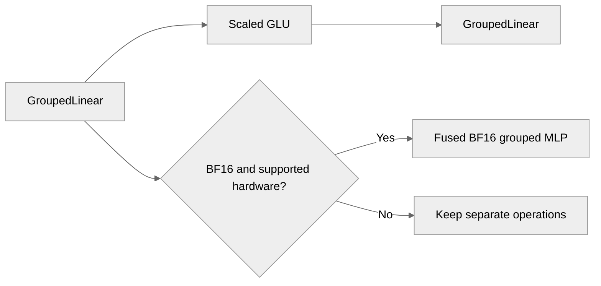

# [PyTorch] Add BF16 fused grouped MLP support

[Upstream PR](https://github.com/NVIDIA/TransformerEngine/pull/3646) · state: closed · merged: True

## Original PR description

# Description

Adds an unquantized (BF16) fused path for the MoE grouped MLP `GroupedLinear → ScaledSwiGLU/ScaledClampedQGeGLU → GroupedLinear`. Until now `NVTE_CUTEDSL_FUSED_GROUPED_MLP=1` fused only MXFP8/NVFP4. Without a block-scaled recipe the MLP ran as three separate ops.

The implementation uses cuDNN Frontend CuTeDSL grouped-GEMM kernels for forward, dgrad/dGLU, and wgrad on Blackwell. It requires cuDNN Frontend ≥ 1.32.0 with canonical BF16 layout support.

Thanks @hwanseoc for the help on N-major dgrad weights and direct weight-gradient allocation optimizations (https://github.com/hwanseoc/TransformerEngine/pull/4).

## Type of change

- [ ] Documentation change (change only to the documentation, either a fix or a new content)
- [ ] Bug fix (non-breaking change which fixes an issue)
- [X] New feature (non-breaking change which adds functionality)
- [ ] Breaking change (fix or feature that would cause existing functionality to not work as expected)
- [ ] Infra/Build change
- [ ] Code refactoring

## Benchmarks

### Unfused vs. fused, Qwen3.5-397B-A17B per-GPU shape

Benchmarked on one B300 using the per-GPU workload for EP32: 16 local experts, hidden size 4096, expert FFN size 1024 with SwiGLU, and 2,560 rows per expert (40,960 tokens total).

The benchmark uses BF16 eager execution with TE from this branch, cuDNN Frontend 1.32.0 (`develop` at `87531690`), and NGC PyTorch 26.09. Times are CUDA-event GPU times: the median of 7 trials × 50 iterations, with 3 interleaved rounds per configuration.

| Weight layout | Path | Forward (ms) | Backward (ms) | Train step (ms) | Step TFLOP/s | Step speedup |
|---|---|---:|---:|---:|---:|---:|
| Per-expert | Unfused | 0.889 | 1.683 | 2.556 | 1,210 | — |
| Per-expert | Fused | 0.820 | 1.580 | 2.400 | 1,288 | **1.065×** |
| Packed | Unfused | 0.881 | 1.677 | 2.557 | 1,209 | — |
| Packed | Fused | 0.820 | 1.574 | 2.393 | 1,292 | **1.068×** |

At the target shape, fusion improves forward performance by 1.075–1.084× and backward performance by approximately 1.065×. End-to-end training-step throughput improves by 1.065–1.068×. Packed and per-expert weights show nearly identical fused performance.

### Token-load sweep

The following sweep uses per-expert weights and measures the complete training step:

| Rows per expert | Total tokens | Unfused (ms) | Fused (ms) | Speedup |
|---:|---:|---:|---:|---:|
| 2,560 | 40,960 | 2.567 | 2.428 | **1.057×** |
| 4,096 | 65,536 | 3.992 | 3.753 | **1.064×** |
| 8,192 | 131,072 | 7.872 | 7.383 | **1.066×** |

The fused speedup remains stable as token load increases, reaching 1.066× at 8,192 rows per expert.

## Testing
Added coverage for:

- Fusion and capability matching
- SwiGLU and GeGLU forward/backward
- FC2 scale_bias and separate scale gradients
- Packed, discrete, and distributed weights
- Main-gradient accumulation and delayed wgrad
- FP16/BF16 autocast behavior
- Zero-token batches and wgrad semantics
- Strided FP32 activation probabilities and FC2 scales
- Determinism rejection for atomic scale gradients

# Checklist:

- [X] I have read and followed the [contributing guidelines](https://github.com/NVIDIA/TransformerEngine/blob/main/CONTRIBUTING.rst)
- [X] The functionality is complete
- [X] I have commented my code, particularly in hard-to-understand areas
- [X] I have made corresponding changes to the documentation
- [X] My changes generate no new warnings
- [X] I have added tests that prove my fix is effective or that my feature works
- [X] New and existing unit tests pass locally with my changes

## Review and discussion

### reviews

- greptile-apps[bot] · COMMENTED · 2026-10-23T23:59:57Z · [source](https://github.com/NVIDIA/TransformerEngine/pull/3646#pullrequestreview-5635676701)

(No body; status only.)

- zhongbozhu · APPROVED · 2026-10-28T23:05:47Z · [source](https://github.com/NVIDIA/TransformerEngine/pull/3646#pullrequestreview-5690854036)

(No body; status only.)

- timmoon10 · DISMISSED · 2026-10-29T03:04:57Z · [source](https://github.com/NVIDIA/TransformerEngine/pull/3646#pullrequestreview-5692367604)

Overall LGTM, pending CI. It may be worth dealing with Greptile's comments by erroring out if the input tensors is not 2D and the scale tensor is not 1D.

- greptile-apps[bot] · COMMENTED · 2026-10-29T03:05:42Z · [source](https://github.com/NVIDIA/TransformerEngine/pull/3646#pullrequestreview-5692371950)

(No body; status only.)

- tingyangk · COMMENTED · 2026-10-30T21:25:25Z · [source](https://github.com/NVIDIA/TransformerEngine/pull/3646#pullrequestreview-5718825129)

(No body; status only.)

- tingyangk · COMMENTED · 2026-10-30T21:25:58Z · [source](https://github.com/NVIDIA/TransformerEngine/pull/3646#pullrequestreview-5718832570)

(No body; status only.)

- tingyangk · COMMENTED · 2026-10-30T21:26:41Z · [source](https://github.com/NVIDIA/TransformerEngine/pull/3646#pullrequestreview-5718840046)

(No body; status only.)

- tingyangk · COMMENTED · 2026-10-30T21:30:37Z · [source](https://github.com/NVIDIA/TransformerEngine/pull/3646#pullrequestreview-5718873226)

(No body; status only.)

- timmoon10 · APPROVED · 2026-10-31T07:27:17Z · [source](https://github.com/NVIDIA/TransformerEngine/pull/3646#pullrequestreview-5721806304)

(No body; status only.)

### issue_comments

- greptile-apps[bot] · comment · 2026-10-23T23:59:53Z · [source](https://github.com/NVIDIA/TransformerEngine/pull/3646#issuecomment-6377180044)

<!-- greptile_summary -->

<h2><a href="https://app.greptile.com/api/retrigger?id=87108781"><picture><source media="(prefers-color-scheme: dark)" srcset="https://greptile-static-assets.s3.amazonaws.com/badges/RetriggerDark.svg?v=2"><source media="(prefers-color-scheme: light)" srcset="https://greptile-static-assets.s3.amazonaws.com/badges/Retrigger.svg?v=2"></picture></a><a href="https://app.greptile.com/-/switch-tenant?tenant=nvidia-public-github&amp;next=%2FNVIDIA%2Ftransformerengine%2Fpull%2F3646&amp;utm_source=greptile_review&amp;utm_medium=github&amp;utm_campaign=view_in_greptile"><picture><source media="(prefers-color-scheme: dark)" srcset="https://greptile-static-assets.s3.amazonaws.com/badges/ViewInGreptileDark.svg?v=2"><source media="(prefers-color-scheme: light)" srcset="https://greptile-static-assets.s3.amazonaws.com/badges/ViewInGreptile.svg?v=2"></picture></a>Confidence Score: 5/5</h2>

**[Medium impact]** The PR appears safe to merge; no new actionable issues were found.

<h3>Summary</h3>

Adds a BF16 fused grouped MLP path on supported Blackwell GPUs.

- Compatible BF16 expert MLPs can run through one fused operation.

<h3>Diagram</h3>

<!-- greptile_confidence_score:5 -->

Reviews (5) · Last reviewed commit: ["Merge branch &#39;main&#39; into tingyangk/add-f..."](https://github.com/nvidia/transformerengine/commit/e3e8a5066781f1a0590bdfa87df22a8a991fcc33) · [Reviewed by Greptile](https://www.greptile.com/?utm_source=greptile_review&utm_medium=github&utm_campaign=review_public&utm_content=nvidia/transformerengine)

- timmoon10 · comment · 2026-10-29T03:05:09Z · [source](https://github.com/NVIDIA/TransformerEngine/pull/3646#issuecomment-6486747210)

/te-ci pytorch

- zhongbozhu · comment · 2026-10-30T21:47:33Z · [source](https://github.com/NVIDIA/TransformerEngine/pull/3646#issuecomment-6534177810)

/te-ci pytorch

- vthumbe1503 · comment · 2026-10-30T22:52:27Z · [source](https://github.com/NVIDIA/TransformerEngine/pull/3646#issuecomment-6535191057)

@greptileai

- timmoon10 · comment · 2026-10-31T02:42:27Z · [source](https://github.com/NVIDIA/TransformerEngine/pull/3646#issuecomment-6537937582)

/te-ci pytorch

### inline_comments

- greptile-apps[bot] · comment · 2026-10-23T23:59:56Z · [source](https://github.com/NVIDIA/TransformerEngine/pull/3646#discussion_r4365195203)

File: `transformer_engine/pytorch/ops/fused/grouped_mlp.py` · line None

 **Batch dimensions disappear**

The BF16 path flattens `input_` before recording `in_shape`. A supported input shaped `[2, 256, hidden]` therefore returns `[512, out_features]` instead of `[2, 256, out_features]`. Backward also returns a flat input gradient, which can fail because its shape does not match the input. The unfused `GroupedLinear` preserves the leading dimensions.

Save the original shape before flattening, and restore it for both the output and input gradient.

**Knowledge Base Used:** [PyTorch tensor and operator abstractions](https://app.greptile.com/nvidia-public-github/-/custom-context/knowledge-base/nvidia/transformerengine/-/docs/pytorch-tensors-and-ops.md)

- greptile-apps[bot] · comment · 2026-10-23T23:59:56Z · [source](https://github.com/NVIDIA/TransformerEngine/pull/3646#discussion_r4365195209)

File: `transformer_engine/pytorch/ops/fused/grouped_mlp.py` · line None

 **Routing gradients have wrong shape**

The BF16 path flattens the activation’s scales and returns `grad_scales` without restoring their original shape. For a `[512, hidden]` input with trainable scales shaped `[2, 256]`, forward succeeds but backward returns a `[512]` scale gradient, which autograd rejects. The unfused activation accepts this scales shape and preserves it in the gradient.

Save the scales’ original shape and reshape their gradient before returning it.

**Knowledge Base Used:** [PyTorch tensor and operator abstractions](https://app.greptile.com/nvidia-public-github/-/custom-context/knowledge-base/nvidia/transformerengine/-/docs/pytorch-tensors-and-ops.md)

- greptile-apps[bot] · comment · 2026-10-29T03:05:40Z · [source](https://github.com/NVIDIA/TransformerEngine/pull/3646#discussion_r4408297297)

File: `transformer_engine/pytorch/ops/fused/grouped_mlp.py` · line None

 **Frozen layers still get gradients**

The BF16 path gives both layers the same `weight_requires_grad` flag. If FC1 is frozen but FC2 is trainable, `_compute_grad_params` still computes FC1’s weight gradient. With `accumulate_into_main_grad=True`, backward fails if the frozen weights have no `main_grad` buffer. If that buffer exists, it is updated despite the weights being frozen.

Set each layer’s flag from its own weight’s `requires_grad`, and save each layer’s input only when that layer needs a weight gradient.

- greptile-apps[bot] · comment · 2026-10-29T03:05:40Z · [source](https://github.com/NVIDIA/TransformerEngine/pull/3646#discussion_r4408297300)

File: `transformer_engine/pytorch/ops/fused/grouped_mlp.py` · line None

 **Routing gradients lose precision**

The BF16 backward path casts `dprob_tensor` to the weights’ BF16 dtype even when the caller supplied FP32 routing probabilities. The unfused activation creates this gradient with the scales’ dtype, so fusion adds BF16 rounding to a gradient that should remain FP32. Autograd can convert it back to FP32, but cannot recover the lost precision.

Keep the FP32 result for FP32 scales, or cast to the scales’ saved dtype instead.

- tingyangk · comment · 2026-10-30T21:25:25Z · [source](https://github.com/NVIDIA/TransformerEngine/pull/3646#discussion_r4428617762)

File: `transformer_engine/pytorch/ops/fused/grouped_mlp.py` · line None

Guards to input/scale tensors are added.

- tingyangk · comment · 2026-10-30T21:25:58Z · [source](https://github.com/NVIDIA/TransformerEngine/pull/3646#discussion_r4428622580)

File: `transformer_engine/pytorch/ops/fused/grouped_mlp.py` · line None

Guards to input/scale tensors are added.

- tingyangk · comment · 2026-10-30T21:26:41Z · [source](https://github.com/NVIDIA/TransformerEngine/pull/3646#discussion_r4428627993)

File: `transformer_engine/pytorch/ops/fused/grouped_mlp.py` · line None

Fixed by having `fc1_weight_requires_grad` and `fc2_weight_requires_grad` independently.

- tingyangk · comment · 2026-10-30T21:30:37Z · [source](https://github.com/NVIDIA/TransformerEngine/pull/3646#discussion_r4428654544)

File: `transformer_engine/pytorch/ops/fused/grouped_mlp.py` · line None

Saved scale tensor's `dtype` to `ctx` for backward's `grad_scales` to use.

## Changed files and fixed code

- `tests/pytorch/test_grouped_mlp.py` · modified · additions 870 / deletions 2
  - [head](https://github.com/tingyangk/TransformerEngine/blob/e3e8a5066781f1a0590bdfa87df22a8a991fcc33/tests/pytorch/test_grouped_mlp.py)
  - [base](https://github.com/NVIDIA/TransformerEngine/blob/70ee2bbb25abf3e99ca476e1173ece6b9ac45e37/tests/pytorch/test_grouped_mlp.py)
- `transformer_engine/pytorch/ops/basic/grouped_linear.py` · modified · additions 5 / deletions 2
  - [head](https://github.com/tingyangk/TransformerEngine/blob/e3e8a5066781f1a0590bdfa87df22a8a991fcc33/transformer_engine/pytorch/ops/basic/grouped_linear.py)
  - [base](https://github.com/NVIDIA/TransformerEngine/blob/70ee2bbb25abf3e99ca476e1173ece6b9ac45e37/transformer_engine/pytorch/ops/basic/grouped_linear.py)
- `transformer_engine/pytorch/ops/fused/__init__.py` · modified · additions 1 / deletions 0
  - [head](https://github.com/tingyangk/TransformerEngine/blob/e3e8a5066781f1a0590bdfa87df22a8a991fcc33/transformer_engine/pytorch/ops/fused/__init__.py)
  - [base](https://github.com/NVIDIA/TransformerEngine/blob/70ee2bbb25abf3e99ca476e1173ece6b9ac45e37/transformer_engine/pytorch/ops/fused/__init__.py)
- `transformer_engine/pytorch/ops/fused/grouped_mlp.py` · modified · additions 989 / deletions 6
  - [head](https://github.com/tingyangk/TransformerEngine/blob/e3e8a5066781f1a0590bdfa87df22a8a991fcc33/transformer_engine/pytorch/ops/fused/grouped_mlp.py)
  - [base](https://github.com/NVIDIA/TransformerEngine/blob/70ee2bbb25abf3e99ca476e1173ece6b9ac45e37/transformer_engine/pytorch/ops/fused/grouped_mlp.py)

## Evidence and interpretation boundary

[Original JSON, discussions and patches](../../../../../../evidence/prs/NVIDIA--TransformerEngine/3646-0bfbc1ac673dc1b29a0ef7f63800adaf48458fa73f9d3f0934b770013b5b6561.json) · SHA-256 `0bfbc1ac673dc1b29a0ef7f63800adaf48458fa73f9d3f0934b770013b5b6561`.

Diff complete: True. Missing/binary/truncated patches require pinned source inspection. This is a source page, not an independently verified optimization case. Open, merged and released are different states; recheck the deployed dependency.
