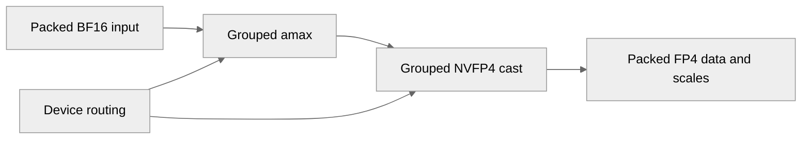

# [Common][PyTorch] Add NVFP4 row-scaled grouped cast with graph-safe path

[Upstream PR](https://github.com/NVIDIA/TransformerEngine/pull/3649) · state: closed · merged: True

## Original PR description

# Description

Add a single-launch grouped row-scaled NVFP4 cast to the common layer, replacing the per-expert quantize loop used by MoE activations, together with a CUDA-graph-safe variant for dynamic-routing experts.

The grouped cast runs in two single-launch kernels: a grouped amax kernel over the packed (sum_M, K) buffer that produces per-expert rowwise [sum_M] and columnwise [num_tensors*K] amax vectors (both directions fused into one pass), followed by a grouped cast that consumes them. 

Both steps have a graph-safe counterpart that reads routing from the grouped tensor's device `first_dims`/`tensor_offsets` instead of host split metadata, so an MoE cast can be captured once and replayed with changed routing. The host-split and graph-safe kernels share the same device body, so their outputs are byte-identical.

## Type of change

- [ ] Documentation change (change only to the documentation, either a fix or a new content)
- [ ] Bug fix (non-breaking change which fixes an issue)
- [x] New feature (non-breaking change which adds functionality)
- [ ] Breaking change (fix or feature that would cause existing functionality to not work as expected)
- [ ] Infra/Build change
- [ ] Code refactoring

## Changes

Please list the changes introduced in this PR:

- Change A
- Change B

# Checklist:

- [ ] I have read and followed the [contributing guidelines](https://github.com/NVIDIA/TransformerEngine/blob/main/CONTRIBUTING.rst)
- [ ] The functionality is complete
- [ ] I have commented my code, particularly in hard-to-understand areas
- [ ] I have made corresponding changes to the documentation
- [ ] My changes generate no new warnings
- [ ] I have added tests that prove my fix is effective or that my feature works
- [x] New and existing unit tests pass locally with my changes


## Review and discussion

### reviews

- greptile-apps[bot] · COMMENTED · 2026-10-08T07:53:26Z · [source](https://github.com/NVIDIA/TransformerEngine/pull/3649#pullrequestreview-5453472565)

(No body; status only.)

- timmoon10 · CHANGES_REQUESTED · 2026-10-21T06:17:13Z · [source](https://github.com/NVIDIA/TransformerEngine/pull/3649#pullrequestreview-5595008779)

(No body; status only.)

- greptile-apps[bot] · COMMENTED · 2026-10-21T06:18:01Z · [source](https://github.com/NVIDIA/TransformerEngine/pull/3649#pullrequestreview-5595669477)

(No body; status only.)

- greptile-apps[bot] · COMMENTED · 2026-10-22T07:01:43Z · [source](https://github.com/NVIDIA/TransformerEngine/pull/3649#pullrequestreview-5610379830)

(No body; status only.)

- cael-ling · COMMENTED · 2026-10-22T08:30:32Z · [source](https://github.com/NVIDIA/TransformerEngine/pull/3649#pullrequestreview-5611351476)

(No body; status only.)

- cael-ling · COMMENTED · 2026-10-22T08:33:51Z · [source](https://github.com/NVIDIA/TransformerEngine/pull/3649#pullrequestreview-5611387789)

(No body; status only.)

- cael-ling · COMMENTED · 2026-10-22T08:43:29Z · [source](https://github.com/NVIDIA/TransformerEngine/pull/3649#pullrequestreview-5611495874)

(No body; status only.)

- cael-ling · COMMENTED · 2026-10-22T08:45:12Z · [source](https://github.com/NVIDIA/TransformerEngine/pull/3649#pullrequestreview-5611515108)

(No body; status only.)

- cael-ling · COMMENTED · 2026-10-22T08:46:05Z · [source](https://github.com/NVIDIA/TransformerEngine/pull/3649#pullrequestreview-5611525738)

(No body; status only.)

- cael-ling · COMMENTED · 2026-10-22T08:46:21Z · [source](https://github.com/NVIDIA/TransformerEngine/pull/3649#pullrequestreview-5611528497)

(No body; status only.)

- cael-ling · COMMENTED · 2026-10-22T08:47:21Z · [source](https://github.com/NVIDIA/TransformerEngine/pull/3649#pullrequestreview-5611539963)

(No body; status only.)

- cael-ling · COMMENTED · 2026-10-22T08:47:29Z · [source](https://github.com/NVIDIA/TransformerEngine/pull/3649#pullrequestreview-5611541579)

(No body; status only.)

- timmoon10 · COMMENTED · 2026-10-26T18:46:28Z · [source](https://github.com/NVIDIA/TransformerEngine/pull/3649#pullrequestreview-5656794669)

(No body; status only.)

- greptile-apps[bot] · COMMENTED · 2026-10-26T22:27:54Z · [source](https://github.com/NVIDIA/TransformerEngine/pull/3649#pullrequestreview-5659957222)

(No body; status only.)

- timmoon10 · DISMISSED · 2026-10-26T22:39:54Z · [source](https://github.com/NVIDIA/TransformerEngine/pull/3649#pullrequestreview-5660064461)

LGTM, pending CI

- timmoon10 · APPROVED · 2026-10-27T06:17:03Z · [source](https://github.com/NVIDIA/TransformerEngine/pull/3649#pullrequestreview-5662984361)

(No body; status only.)

### issue_comments

- greptile-apps[bot] · comment · 2026-10-08T07:53:21Z · [source](https://github.com/NVIDIA/TransformerEngine/pull/3649#issuecomment-6055366893)

<!-- greptile_summary -->

<h2><a href="https://app.greptile.com/api/retrigger?id=76929587"><picture><source media="(prefers-color-scheme: dark)" srcset="https://greptile-static-assets.s3.amazonaws.com/badges/RetriggerDark.svg?v=2"><source media="(prefers-color-scheme: light)" srcset="https://greptile-static-assets.s3.amazonaws.com/badges/Retrigger.svg?v=2"></picture></a><a href="https://app.greptile.com/nvidia-public-github/github/NVIDIA/transformerengine/-/pull/3649"><picture><source media="(prefers-color-scheme: dark)" srcset="https://greptile-static-assets.s3.amazonaws.com/badges/ViewInGreptileDark.svg?v=2"><source media="(prefers-color-scheme: light)" srcset="https://greptile-static-assets.s3.amazonaws.com/badges/ViewInGreptile.svg?v=2"></picture></a>Confidence Score: 5/5</h2>

**[Medium impact]** The changes appear safe to merge, with no outstanding findings.

<h3>Summary</h3>

Adds grouped row-scaled NVFP4 quantization with device-side routing for CUDA graph replay.
- Grouped casts encode packed expert rows as row-scaled NVFP4.
- Grouped amax calls compute per-row values for row-scaled NVFP4.
- PyTorch grouped quantization routes row-scaled NVFP4 calls through the grouped cast.

The latest change adds the header that declares `nvte_group_amax`. No new issues were found. All six earlier findings are addressed: the per-expert fallback preserves supported shapes, empty inputs, and quantizer checks; grouped input is made contiguous; uniform expert sizes require 128-row alignment; and the operator test includes the required declaration.

<h3>Diagram</h3>



<!-- greptile_confidence_score:5 -->

<sub>Reviews (10) · Last reviewed commit: ["Add missing header include"](https://github.com/nvidia/transformerengine/commit/07f45a161245cfd7637f0ca73745556b4080edd8) · [Reviewed by Greptile](https://www.greptile.com/?utm_source=greptile_review&utm_medium=github&utm_campaign=review_public&utm_content=nvidia/transformerengine)</sub>

- cael-ling · comment · 2026-10-22T09:10:55Z · [source](https://github.com/NVIDIA/TransformerEngine/pull/3649#issuecomment-6337097665)

@timmoon10 Thanks, the reviews have been replied separately, please help review once you have a window.


- timmoon10 · comment · 2026-10-26T22:39:07Z · [source](https://github.com/NVIDIA/TransformerEngine/pull/3649#issuecomment-6429012784)

/te-ci

- timmoon10 · comment · 2026-10-27T02:10:21Z · [source](https://github.com/NVIDIA/TransformerEngine/pull/3649#issuecomment-6432004499)

/te-ci

### inline_comments

- greptile-apps[bot] · comment · 2026-10-08T07:53:24Z · [source](https://github.com/NVIDIA/TransformerEngine/pull/3649#discussion_r4216410760)

File: `transformer_engine/pytorch/csrc/extensions/cast.cpp` · line None

<a href="#"></a> **Supported casts now fail**

The new `split_quantize` selection does not check the grouped kernels' column alignment or 64-expert limit. BF16 input shaped `(256, 64)` with splits `[128, 128]` previously used the per-expert path, but now fails the grouped amax check. A request with 65 experts also now fails. Include both limits in the selection and keep the per-expert fallback.

**Knowledge Base Used:** [Native CUDA kernel platform](https://app.greptile.com/nvidia-public-github/-/custom-context/knowledge-base/nvidia/transformerengine/-/docs/native-kernels.md)

- greptile-apps[bot] · comment · 2026-10-08T07:53:24Z · [source](https://github.com/NVIDIA/TransformerEngine/pull/3649#discussion_r4216410765)

File: `transformer_engine/pytorch/csrc/extensions/cast.cpp` · line None

<a href="#"></a> **Empty routing now fails**

`split_quantize_nvfp4_row_scaled_impl` launches grouped work even when every split is empty. With input shaped `(0, 128)` and splits `[0, 0]`, the new selection succeeds, but grouped amax launches a zero-sized grid and the cast has no non-empty output. The previous per-expert path returned without launching work. Return early for empty input here.

**Knowledge Base Used:** [Native CUDA kernel platform](https://app.greptile.com/nvidia-public-github/-/custom-context/knowledge-base/nvidia/transformerengine/-/docs/native-kernels.md)

- greptile-apps[bot] · comment · 2026-10-08T07:53:24Z · [source](https://github.com/NVIDIA/TransformerEngine/pull/3649#discussion_r4216410772)

File: `transformer_engine/pytorch/csrc/extensions/cast.cpp` · line None

<a href="#"></a> **Strided input reads wrong values**

The new binding passes `tensor.data_ptr()` and sizes to a packed-layout kernel without checking or copying non-contiguous input. A transposed BF16 `(128, 128)` tensor passes the checks, but the kernel reads its storage in row order rather than its logical order. It therefore quantizes the wrong values. Make the input contiguous before wrapping it, or reject non-contiguous tensors.

- greptile-apps[bot] · comment · 2026-10-08T07:53:24Z · [source](https://github.com/NVIDIA/TransformerEngine/pull/3649#discussion_r4216410785)

File: `transformer_engine/pytorch/csrc/extensions/cast.cpp` · line None

<a href="#"></a> **Quantizer settings are ignored**

The new helper checks only `stochastic_rounding` before bypassing `NVFP4Quantizer::quantize_impl`. That previous path also rejects row-scaled requests with `with_rht`, `with_2d_quantization`, or `with_amax_reduction`. Those settings now silently produce a plain row-scaled cast. Keep the same checks here and in the new graph-safe binding so unsupported settings do not appear to work.

**Knowledge Base Used:** [Native GEMM and quantization kernels](https://app.greptile.com/nvidia-public-github/-/custom-context/knowledge-base/nvidia/transformerengine/-/docs/native-gemm-and-quantization.md)

- timmoon10 · comment · 2026-10-21T04:35:45Z · [source](https://github.com/NVIDIA/TransformerEngine/pull/3649#discussion_r4333074832)

File: `transformer_engine/common/include/transformer_engine/cast.h` · line 1

These new APIs are redundant. The user can configure `NVTETensor` as a row-scaled NVFP4 tensor and then call the existing APIs (namely `nvte_group_quantize`).

- timmoon10 · comment · 2026-10-21T04:50:13Z · [source](https://github.com/NVIDIA/TransformerEngine/pull/3649#discussion_r4333146696)

File: `transformer_engine/common/include/transformer_engine/cast.h` · line None

This group quantize API with splits on CPU is being phased out. It adds a D2H copy and is not compatible with CUDA Graphs. I think we only need two implementations:
- Grouped quantize kernel with `NVTEGroupedTensor`: splits are on GPU, supports CUDA Graph, maximum performance.
- Split tensor and quantize each tensor independently: splits are on CPU, reuse single quantize kernel instead of writing a new kernel, maximum generalization.

This kernel is in an awkward position of being both non-performant and non-general.

- timmoon10 · comment · 2026-10-21T05:10:27Z · [source](https://github.com/NVIDIA/TransformerEngine/pull/3649#discussion_r4333250547)

File: `transformer_engine/common/include/transformer_engine/cast.h` · line None

Is there a need to separate the amax calculation from the quantization? It's useful for tensor-scaled NVFP4 when the amax calculation is fused into the previous kernel. However, that's an advanced technique that's not yet used for row-scaled NVFP4. Better to expand the general-purpose API (`nvte_group_quantize`) than to create a custom API specific to row-scaled NVFP4.

- timmoon10 · comment · 2026-10-21T05:14:19Z · [source](https://github.com/NVIDIA/TransformerEngine/pull/3649#discussion_r4333270642)

File: `transformer_engine/pytorch/csrc/extensions/cast.cpp` · line None

If we have a graph-safe kernel for row-scaled NVFP4, there's basically no reason to use an optimized split-quantize implementation.
```suggestion
  enum class QuantizationMethod { UNFUSED, FUSED_NVFP4 };
```

- timmoon10 · comment · 2026-10-21T05:20:27Z · [source](https://github.com/NVIDIA/TransformerEngine/pull/3649#discussion_r4333302354)

File: `transformer_engine/pytorch/csrc/extensions/cast.cpp` · line None

No value in separating the amax calculation from the quantization: 
```suggestion
  NVTE_SCOPED_GIL_RELEASE({
    nvte_group_quantize(grouped_input_tensor.data(),
                        grouped_output_tensor_cpp.data(),
                        quant_config, stream);
  });
```

- timmoon10 · comment · 2026-10-21T05:24:03Z · [source](https://github.com/NVIDIA/TransformerEngine/pull/3649#discussion_r4333322971)

File: `transformer_engine/pytorch/csrc/extensions/pybind.cpp` · line None

It would be better to expand `tex.group_quantize` to handle row-scaled NVFP4 than to add a function that's specific to row-scaled NVFP4.

- timmoon10 · comment · 2026-10-21T05:29:55Z · [source](https://github.com/NVIDIA/TransformerEngine/pull/3649#discussion_r4333354874)

File: `transformer_engine/pytorch/ep.py` · line 1

This file is dedicated to NCCL EP support. The new helper function is not related to EP, and in fact is general enough that it could be used beyond MoEs. `transformer_engine/pytorch/tensor/grouped_tensor.py` would be a more natural place.

@phu0ngng We should consider renaming this file `ncclep.py` to avoid confusion.

- timmoon10 · comment · 2026-10-21T05:39:19Z · [source](https://github.com/NVIDIA/TransformerEngine/pull/3649#discussion_r4333405556)

File: `transformer_engine/pytorch/ep.py` · line None

This function is redundant with `tex.group_quantize`.

- timmoon10 · comment · 2026-10-21T05:48:50Z · [source](https://github.com/NVIDIA/TransformerEngine/pull/3649#discussion_r4333457148)

File: `tests/pytorch/nvfp4/test_nvfp4_group_row_scaled_cast_graph_safe.py` · line 1

Nit: The test name is inaccurate because it tests non-graph-safe paths like `tex.split_quantize`.

- timmoon10 · comment · 2026-10-21T06:15:19Z · [source](https://github.com/NVIDIA/TransformerEngine/pull/3649#discussion_r4333612260)

File: `tests/cpp/test_common.h` · line 117

If we don't have access to a type, we can't instantiate the template and this concern is moot. If we do have access to the type and we don't add it to the tuple, won't we still increment to infinity? If we want to be safe, I think the right implementation is something like:
```suggestion
        constexpr static DType getType() {
            constexpr int i = static_cast<int>(current);
            static_assert(i < static_cast<int>(std::tuple_size<types>::value));
            if (std::is_same<U, typename std::tuple_element<i, types>::type>::value) {
                return current;
            }
            return Helper<U, static_cast<DType>(i + 1)>::getType();
        }
```

@greptile-apps Please sanity check.

- greptile-apps[bot] · comment · 2026-10-21T06:18:01Z · [source](https://github.com/NVIDIA/TransformerEngine/pull/3649#discussion_r4333628414)

File: `tests/cpp/test_common.h` · line 117

Your concern about an omitted type is valid, but the recursion is still bounded: `Helper<U, DType::kNumTypes>` is an explicit terminating specialization, so it returns `kNumTypes` rather than incrementing indefinitely. The proposed `static_assert(i < tuple_size)` would not work here, because the recursive call is instantiated while walking the enum even after a matching tuple entry is found (and it must also walk enum values that have no corresponding tuple entry). It would therefore fire for valid types when the walk reaches the first enum value past the tuple.

The `if constexpr` guard is the appropriate fix for the out-of-range `tuple_element` instantiation. If we want to reject a type that is absent from the tuple, that check should be applied to the final result in the outer `getType`, rather than at each recursion step, e.g. `static_assert(Helper<U, DType::kByte>::getType() != DType::kNumTypes, "Type is not registered");` (assuming unsupported `TypeInfo<U>` instantiations should be diagnosed).

- greptile-apps[bot] · comment · 2026-10-22T07:01:42Z · [source](https://github.com/NVIDIA/TransformerEngine/pull/3649#discussion_r4345430583)

File: `transformer_engine/pytorch/csrc/extensions/cast.cpp` · line None

<a href="#"></a> **Small experts get wrong scales**

For BF16 input shaped `(128, 128)` with two tensors and no `first_dims`, this check accepts two 64-row experts. The cast assigns each 128-row block to one expert. The second expert's rows then fall outside the first expert's row bound and use an encode scale of `1.0f` instead of their row amax. The call silently returns incorrect FP4 data and scales.

Require `logical_first_dim / num_tensors` to be a multiple of 128 before creating uniform routing.

**Knowledge Base Used:** [Native GEMM and quantization kernels](https://app.greptile.com/nvidia-public-github/-/custom-context/knowledge-base/nvidia/transformerengine/-/docs/native-gemm-and-quantization.md)

- cael-ling · comment · 2026-10-22T08:30:32Z · [source](https://github.com/NVIDIA/TransformerEngine/pull/3649#discussion_r4346163834)

File: `transformer_engine/common/include/transformer_engine/cast.h` · line 1

Agreed. I have removed nvte_group_nvfp4_row_scaled_cast_with_amax, nvte_group_nvfp4_compute_amax_graph_safe and nvte_group_nvfp4_row_scaled_cast_with_amax_graph_safe. Row scaling is a grouped tensor param (kNVTEGroupedRowScaledNVFP4), and nvte_group_quantize dispatches row-scaled NVFP4 outputs to the graph-safe amax + cast kernels. Done in the  new commit.

- cael-ling · comment · 2026-10-22T08:33:50Z · [source](https://github.com/NVIDIA/TransformerEngine/pull/3649#discussion_r4346191603)

File: `transformer_engine/common/include/transformer_engine/cast.h` · line None

Makes sense. I removed the host-split row-scaled cast kernel and its API entirely. Row-scaled nvfp4 now has the two paths you describe: nvte_group_quantize with NVTEGroupedTensor (device splits, graph-safe), and split_quantize, which quantizes each split with the single-tensor kernel. 

- cael-ling · comment · 2026-10-22T08:43:29Z · [source](https://github.com/NVIDIA/TransformerEngine/pull/3649#discussion_r4346274316)

File: `transformer_engine/common/include/transformer_engine/cast.h` · line None

No need. The amax is now computed inside nvte_group_quantize, and the separate graph-safe amax API is removed.

- cael-ling · comment · 2026-10-22T08:45:11Z · [source](https://github.com/NVIDIA/TransformerEngine/pull/3649#discussion_r4346289610)

File: `transformer_engine/pytorch/csrc/extensions/cast.cpp` · line None

Agreed this. I removed FUSED_NVFP4_ROW_SCALED and split_quantize_nvfp4_row_scaled_impl, so row-scaled quantizers in split_quantize go through UNFUSED.

- cael-ling · comment · 2026-10-22T08:46:05Z · [source](https://github.com/NVIDIA/TransformerEngine/pull/3649#discussion_r4346298192)

File: `transformer_engine/pytorch/csrc/extensions/cast.cpp` · line None

Good logits. The standalone binding is removed, and the row-scaled branch in tex.group_quantize calls nvte_group_quantize directly.

- cael-ling · comment · 2026-10-22T08:46:20Z · [source](https://github.com/NVIDIA/TransformerEngine/pull/3649#discussion_r4346300434)

File: `transformer_engine/pytorch/csrc/extensions/pybind.cpp` · line None

Done. tex.nvfp4_group_row_scaled_cast_graph_safe is removed, and tex.group_quantize handles row-scaled NVFP4 quantizers. If first_dims is not given, uniform splits are derived from num_tensors. Output reuse is not supported for row-scaled yet and raises an error.

- cael-ling · comment · 2026-10-22T08:47:21Z · [source](https://github.com/NVIDIA/TransformerEngine/pull/3649#discussion_r4346309504)

File: `transformer_engine/pytorch/ep.py` · line None

Agreed, removed.

- cael-ling · comment · 2026-10-22T08:47:29Z · [source](https://github.com/NVIDIA/TransformerEngine/pull/3649#discussion_r4346310881)

File: `tests/pytorch/nvfp4/test_nvfp4_group_row_scaled_cast_graph_safe.py` · line 1

Renamed to test_nvfp4_group_row_scaled_quantize.py. It now tests tex.group_quantize (including CUDA graph capture/replay with changed routing), with the split_quantize fallback cases alongside.

- timmoon10 · comment · 2026-10-26T18:09:17Z · [source](https://github.com/NVIDIA/TransformerEngine/pull/3649#discussion_r4380784946)

File: `transformer_engine/common/cast/nvfp4/group_quantize_transpose_nvfp4.cuh` · line None

This function name is misleading since it is specific to row-scaled NVFP4, not normal NVFP4.
```suggestion
inline void group_row_amax_graph_safe(const GroupedTensor *input, const Tensor *noop,
```
Beyond the scope of this PR, but it would also be good to rename `group_compute_fused_amax` to something like `group_row_amax` (see https://github.com/NVIDIA/TransformerEngine/pull/3467).

- timmoon10 · comment · 2026-10-26T18:39:57Z · [source](https://github.com/NVIDIA/TransformerEngine/pull/3649#discussion_r4381092100)

File: `transformer_engine/pytorch/csrc/extensions/cast.cpp` · line None

Now that we have the graph-safe path, robustness is more important than performance for the split-quantize path. I suggest simplifying the logic:
```suggestion
      const bool has_row_scaled_nvfp4 =
          std::any_of(quantizer_cpp_list.begin(), quantizer_cpp_list.end(),
                      [](const std::unique_ptr<Quantizer> &quantizer) {
                        return static_cast<NVFP4Quantizer *>(quantizer.get())->row_scaled_nvfp4;
                      });
      if (has_row_scaled_nvfp4) {
        allocation_method = AllocationMethod::UNFUSED;
        quantization_method = QuantizationMethod::UNFUSED;
      } else {
        allocation_method = AllocationMethod::BULK_NVFP4;
        quantization_method = QuantizationMethod::FUSED_NVFP4;
      }
```

- timmoon10 · comment · 2026-10-26T18:43:46Z · [source](https://github.com/NVIDIA/TransformerEngine/pull/3649#discussion_r4381127835)

File: `tests/cpp/test_common.h` · line None

This comment is misleading. The problem isn't specific to UE5M3, but rather to any case where the list of available types does not match the number of dtype enums.
```suggestion
```

- greptile-apps[bot] · comment · 2026-10-26T22:27:53Z · [source](https://github.com/NVIDIA/TransformerEngine/pull/3649#discussion_r4383204175)

File: `tests/cpp/operator/test_row_scaled_nvfp4_grouped_amax.cu` · line 83

<a href="#"></a> **Operator tests cannot compile**

`test_row_scaled_nvfp4_grouped_amax.cu` now calls `nvte_group_amax`, but does not include `transformer_engine/multi_tensor.h`, which declares it. Neither `cast.h` nor `test_common.h` provides that declaration, so `test_operator` cannot compile. Add the missing include.

## Changed files and fixed code

- `tests/cpp/operator/CMakeLists.txt` · modified · additions 1 / deletions 0
  - [head](https://github.com/cael-ling/TransformerEngine/blob/07f45a161245cfd7637f0ca73745556b4080edd8/tests/cpp/operator/CMakeLists.txt)
  - [base](https://github.com/NVIDIA/TransformerEngine/blob/5e994640625626263aa62250c709e35601563566/tests/cpp/operator/CMakeLists.txt)
- `tests/cpp/operator/test_row_scaled_nvfp4_grouped_amax.cu` · modified · additions 6 / deletions 6
  - [head](https://github.com/cael-ling/TransformerEngine/blob/07f45a161245cfd7637f0ca73745556b4080edd8/tests/cpp/operator/test_row_scaled_nvfp4_grouped_amax.cu)
  - [base](https://github.com/NVIDIA/TransformerEngine/blob/5e994640625626263aa62250c709e35601563566/tests/cpp/operator/test_row_scaled_nvfp4_grouped_amax.cu)
- `tests/cpp/operator/test_row_scaled_nvfp4_grouped_cast.cu` · added · additions 419 / deletions 0
  - [head](https://github.com/cael-ling/TransformerEngine/blob/07f45a161245cfd7637f0ca73745556b4080edd8/tests/cpp/operator/test_row_scaled_nvfp4_grouped_cast.cu)
  - [base](https://github.com/NVIDIA/TransformerEngine/blob/5e994640625626263aa62250c709e35601563566/tests/cpp/operator/test_row_scaled_nvfp4_grouped_cast.cu)
- `tests/cpp/test_common.h` · modified · additions 7 / deletions 4
  - [head](https://github.com/cael-ling/TransformerEngine/blob/07f45a161245cfd7637f0ca73745556b4080edd8/tests/cpp/test_common.h)
  - [base](https://github.com/NVIDIA/TransformerEngine/blob/5e994640625626263aa62250c709e35601563566/tests/cpp/test_common.h)
- `tests/pytorch/nvfp4/test_nvfp4_group_row_scaled_quantize.py` · added · additions 280 / deletions 0
  - [head](https://github.com/cael-ling/TransformerEngine/blob/07f45a161245cfd7637f0ca73745556b4080edd8/tests/pytorch/nvfp4/test_nvfp4_group_row_scaled_quantize.py)
  - [base](https://github.com/NVIDIA/TransformerEngine/blob/5e994640625626263aa62250c709e35601563566/tests/pytorch/nvfp4/test_nvfp4_group_row_scaled_quantize.py)
- `transformer_engine/common/cast/cast_grouped.cu` · modified · additions 2 / deletions 12
  - [head](https://github.com/cael-ling/TransformerEngine/blob/07f45a161245cfd7637f0ca73745556b4080edd8/transformer_engine/common/cast/cast_grouped.cu)
  - [base](https://github.com/NVIDIA/TransformerEngine/blob/5e994640625626263aa62250c709e35601563566/transformer_engine/common/cast/cast_grouped.cu)
- `transformer_engine/common/cast/dispatch/quantize.cuh` · modified · additions 23 / deletions 0
  - [head](https://github.com/cael-ling/TransformerEngine/blob/07f45a161245cfd7637f0ca73745556b4080edd8/transformer_engine/common/cast/dispatch/quantize.cuh)
  - [base](https://github.com/NVIDIA/TransformerEngine/blob/5e994640625626263aa62250c709e35601563566/transformer_engine/common/cast/dispatch/quantize.cuh)
- `transformer_engine/common/cast/nvfp4/group_quantize_transpose_nvfp4.cuh` · modified · additions 549 / deletions 21
  - [head](https://github.com/cael-ling/TransformerEngine/blob/07f45a161245cfd7637f0ca73745556b4080edd8/transformer_engine/common/cast/nvfp4/group_quantize_transpose_nvfp4.cuh)
  - [base](https://github.com/NVIDIA/TransformerEngine/blob/5e994640625626263aa62250c709e35601563566/transformer_engine/common/cast/nvfp4/group_quantize_transpose_nvfp4.cuh)
- `transformer_engine/common/common.h` · modified · additions 8 / deletions 2
  - [head](https://github.com/cael-ling/TransformerEngine/blob/07f45a161245cfd7637f0ca73745556b4080edd8/transformer_engine/common/common.h)
  - [base](https://github.com/NVIDIA/TransformerEngine/blob/5e994640625626263aa62250c709e35601563566/transformer_engine/common/common.h)
- `transformer_engine/common/hadamard_transform/graph_safe_group_hadamard_transform.cu` · modified · additions 10 / deletions 1
  - [head](https://github.com/cael-ling/TransformerEngine/blob/07f45a161245cfd7637f0ca73745556b4080edd8/transformer_engine/common/hadamard_transform/graph_safe_group_hadamard_transform.cu)
  - [base](https://github.com/NVIDIA/TransformerEngine/blob/5e994640625626263aa62250c709e35601563566/transformer_engine/common/hadamard_transform/graph_safe_group_hadamard_transform.cu)
- `transformer_engine/common/hadamard_transform/group_hadamard_transform.cu` · modified · additions 27 / deletions 1
  - [head](https://github.com/cael-ling/TransformerEngine/blob/07f45a161245cfd7637f0ca73745556b4080edd8/transformer_engine/common/hadamard_transform/group_hadamard_transform.cu)
  - [base](https://github.com/NVIDIA/TransformerEngine/blob/5e994640625626263aa62250c709e35601563566/transformer_engine/common/hadamard_transform/group_hadamard_transform.cu)
- `transformer_engine/common/include/transformer_engine/cast.h` · modified · additions 2 / deletions 16
  - [head](https://github.com/cael-ling/TransformerEngine/blob/07f45a161245cfd7637f0ca73745556b4080edd8/transformer_engine/common/include/transformer_engine/cast.h)
  - [base](https://github.com/NVIDIA/TransformerEngine/blob/5e994640625626263aa62250c709e35601563566/transformer_engine/common/include/transformer_engine/cast.h)
- `transformer_engine/common/include/transformer_engine/multi_tensor.h` · modified · additions 9 / deletions 3
  - [head](https://github.com/cael-ling/TransformerEngine/blob/07f45a161245cfd7637f0ca73745556b4080edd8/transformer_engine/common/include/transformer_engine/multi_tensor.h)
  - [base](https://github.com/NVIDIA/TransformerEngine/blob/5e994640625626263aa62250c709e35601563566/transformer_engine/common/include/transformer_engine/multi_tensor.h)
- `transformer_engine/common/include/transformer_engine/transformer_engine.h` · modified · additions 13 / deletions 0
  - [head](https://github.com/cael-ling/TransformerEngine/blob/07f45a161245cfd7637f0ca73745556b4080edd8/transformer_engine/common/include/transformer_engine/transformer_engine.h)
  - [base](https://github.com/NVIDIA/TransformerEngine/blob/5e994640625626263aa62250c709e35601563566/transformer_engine/common/include/transformer_engine/transformer_engine.h)
- `transformer_engine/common/transformer_engine.cpp` · modified · additions 6 / deletions 0
  - [head](https://github.com/cael-ling/TransformerEngine/blob/07f45a161245cfd7637f0ca73745556b4080edd8/transformer_engine/common/transformer_engine.cpp)
  - [base](https://github.com/NVIDIA/TransformerEngine/blob/5e994640625626263aa62250c709e35601563566/transformer_engine/common/transformer_engine.cpp)
- `transformer_engine/pytorch/csrc/extensions/cast.cpp` · modified · additions 63 / deletions 6
  - [head](https://github.com/cael-ling/TransformerEngine/blob/07f45a161245cfd7637f0ca73745556b4080edd8/transformer_engine/pytorch/csrc/extensions/cast.cpp)
  - [base](https://github.com/NVIDIA/TransformerEngine/blob/5e994640625626263aa62250c709e35601563566/transformer_engine/pytorch/csrc/extensions/cast.cpp)
- `transformer_engine/pytorch/csrc/quantizer.cpp` · modified · additions 1 / deletions 0
  - [head](https://github.com/cael-ling/TransformerEngine/blob/07f45a161245cfd7637f0ca73745556b4080edd8/transformer_engine/pytorch/csrc/quantizer.cpp)
  - [base](https://github.com/NVIDIA/TransformerEngine/blob/5e994640625626263aa62250c709e35601563566/transformer_engine/pytorch/csrc/quantizer.cpp)
- `transformer_engine/pytorch/csrc/type_converters.cpp` · modified · additions 4 / deletions 0
  - [head](https://github.com/cael-ling/TransformerEngine/blob/07f45a161245cfd7637f0ca73745556b4080edd8/transformer_engine/pytorch/csrc/type_converters.cpp)
  - [base](https://github.com/NVIDIA/TransformerEngine/blob/5e994640625626263aa62250c709e35601563566/transformer_engine/pytorch/csrc/type_converters.cpp)

## Evidence and interpretation boundary

[Original JSON, discussions and patches](../../../../../../evidence/prs/NVIDIA--TransformerEngine/3649-6b12eaaafe5bace883f61b3dd3f607c764c4ba5969283e73fa78227761f8c523.json) · SHA-256 `6b12eaaafe5bace883f61b3dd3f607c764c4ba5969283e73fa78227761f8c523`.

Diff complete: True. Missing/binary/truncated patches require pinned source inspection. This is a source page, not an independently verified optimization case. Open, merged and released are different states; recheck the deployed dependency.
