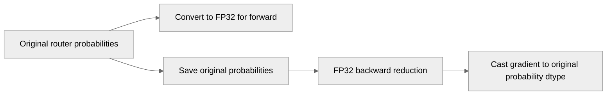

# Preserve router probability precision in fused grouped MLP

[Upstream PR](https://github.com/NVIDIA/TransformerEngine/pull/3653) · state: open · merged: False

## Original PR description

# Description

Keep forward probabilities in FP32 and return probability gradients in the original probability dtype. Add SReLU, tanh-SReLU, and SwiGLU regression coverage for MXFP8 and NVFP4. 

Fixes # (issue)

## Type of change

- [ ] Documentation change (change only to the documentation, either a fix or a new content)
- [ ] Bug fix (non-breaking change which fixes an issue)
- [ ] New feature (non-breaking change which adds functionality)
- [ ] Breaking change (fix or feature that would cause existing functionality to not work as expected)
- [ ] Infra/Build change
- [ ] Code refactoring

## Changes

Please list the changes introduced in this PR:

- Change A
- Change B

# Checklist:

- [ ] I have read and followed the [contributing guidelines](https://github.com/NVIDIA/TransformerEngine/blob/main/CONTRIBUTING.rst)
- [ ] The functionality is complete
- [ ] I have commented my code, particularly in hard-to-understand areas
- [ ] I have made corresponding changes to the documentation
- [ ] My changes generate no new warnings
- [ ] I have added tests that prove my fix is effective or that my feature works
- [ ] New and existing unit tests pass locally with my changes

## Review and discussion

### reviews

- ptrendx · COMMENTED · 2026-10-09T23:47:23Z · [source](https://github.com/NVIDIA/TransformerEngine/pull/3653#pullrequestreview-5476417776)

(No body; status only.)

### issue_comments

- greptile-apps[bot] · comment · 2026-10-08T17:51:08Z · [source](https://github.com/NVIDIA/TransformerEngine/pull/3653#issuecomment-6065811658)

<!-- greptile_summary -->

<h2><a href="https://app.greptile.com/api/retrigger?id=77255395"><picture><source media="(prefers-color-scheme: dark)" srcset="https://greptile-static-assets.s3.amazonaws.com/badges/RetriggerDark.svg?v=2"><source media="(prefers-color-scheme: light)" srcset="https://greptile-static-assets.s3.amazonaws.com/badges/Retrigger.svg?v=2"></picture></a>Confidence Score: 5/5</h2>

**[Medium risk]** Adjusts numerical precision in grouped MLP router probability calculations\.

The PR appears safe to merge; no actionable issues were found.

What we checked:
- Probability gradients keep their dtype: The forward pass saves the original `scales` tensor. The backward pass casts `grad_scales` to `scales.dtype`, and the fuser returns it without another cast.

<h3>Summary</h3>

Preserves router probability precision in fused grouped MLPs.
- Forward kernels now receive FP32 probabilities for both MXFP8 and NVFP4.
- Probability gradients return in the original probability dtype.
- Adds numerical and exact-value regression checks for SReLU, tanh-SReLU, and SwiGLU.
- No actionable issues found. GPU tests were not run.

<h3>Diagram</h3>

<!-- greptile_confidence_score:5 -->

Reviews (1) · Last reviewed commit: ["Preserve router probability precision in..."](https://github.com/nvidia/transformerengine/commit/3855c1677542dba62ea6211455f0288614484257) · [Reviewed by Greptile](https://www.greptile.com/?utm_source=greptile_expert&utm_medium=github&utm_campaign=code_reviews&utm_content=nvidia/transformerengine)

### inline_comments

- ptrendx · comment · 2026-10-09T23:47:23Z · [source](https://github.com/NVIDIA/TransformerEngine/pull/3653#discussion_r4235459287)

File: `transformer_engine/pytorch/ops/fused/grouped_mlp.py` · line 1614

That's not the right approach. FP4 needs FP32 due to cuDNN kernel limitation, but MXFP8 does not have such issue. So the right fix should be to cast only when use_nvfp4 is True and leave the type of the scales unchanged (either BF16 or FP32), depending on what type we got.

## Changed files and fixed code

- `tests/pytorch/test_grouped_mlp.py` · modified · additions 144 / deletions 2
  - [head](https://github.com/mkhona-nvidia/TransformerEngine/blob/3855c1677542dba62ea6211455f0288614484257/tests/pytorch/test_grouped_mlp.py)
  - [base](https://github.com/NVIDIA/TransformerEngine/blob/c25fa275259808f6f6cc4fa0b8b285cfd453287a/tests/pytorch/test_grouped_mlp.py)
- `transformer_engine/pytorch/ops/fused/grouped_mlp.py` · modified · additions 4 / deletions 4
  - [head](https://github.com/mkhona-nvidia/TransformerEngine/blob/3855c1677542dba62ea6211455f0288614484257/transformer_engine/pytorch/ops/fused/grouped_mlp.py)
  - [base](https://github.com/NVIDIA/TransformerEngine/blob/c25fa275259808f6f6cc4fa0b8b285cfd453287a/transformer_engine/pytorch/ops/fused/grouped_mlp.py)

## Evidence and interpretation boundary

[Original JSON, discussions and patches](../../../../../../evidence/prs/NVIDIA--TransformerEngine/3653-978535c65ca5bcce23ea40ea26c29b692fc3fdaf959eeab3ee6cfa24fb3f9461.json) · SHA-256 `978535c65ca5bcce23ea40ea26c29b692fc3fdaf959eeab3ee6cfa24fb3f9461`.

Diff complete: True. Missing/binary/truncated patches require pinned source inspection. This is a source page, not an independently verified optimization case. Open, merged and released are different states; recheck the deployed dependency.
