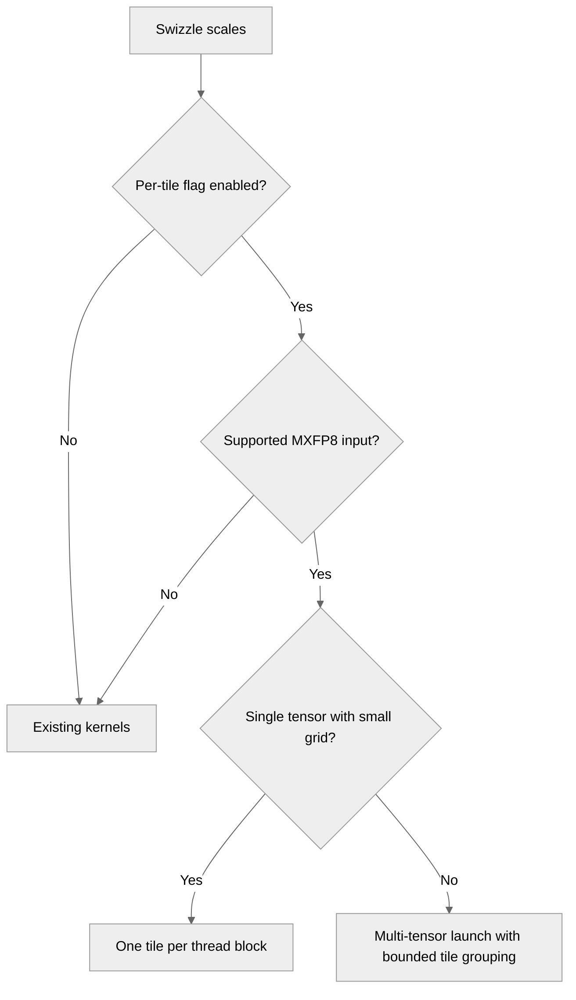

# [Common] Swizzle MXFP8 scaling factors with one CTA per scale tile

[Upstream PR](https://github.com/NVIDIA/TransformerEngine/pull/3658) · state: closed · merged: True

## Original PR description

The MXFP8 scale swizzle is latency bound. The narrow-K and narrow-M kernels put up to 32 128x4 scale tiles in one 1024-thread CTA, so the scaling factors of a 4096-row activation are swizzled by a single CTA.

Give every 128-row M-tile (row-wise) or 128-column x 32-row block (column-wise) its own CTA, which moves a contiguous chunk with coalesced 16-byte loads and stores through shared memory. Multi-tensor launches group tiles per CTA only when the grid would otherwise be very large. The existing kernels remain for NVFP4, unaligned buffers, and row-wise scales too wide for 48 KB of shared memory.

# Description

Please include a brief summary of the changes, relevant motivation and context.

Fixes # (issue)

## Type of change

- [ ] Documentation change (change only to the documentation, either a fix or a new content)
- [ ] Bug fix (non-breaking change which fixes an issue)
- [ ] New feature (non-breaking change which adds functionality)
- [ ] Breaking change (fix or feature that would cause existing functionality to not work as expected)
- [ ] Infra/Build change
- [ ] Code refactoring

## Changes

Please list the changes introduced in this PR:

- Change A
- Change B

# Checklist:

- [ ] I have read and followed the [contributing guidelines](https://github.com/NVIDIA/TransformerEngine/blob/main/CONTRIBUTING.rst)
- [ ] The functionality is complete
- [ ] I have commented my code, particularly in hard-to-understand areas
- [ ] I have made corresponding changes to the documentation
- [ ] My changes generate no new warnings
- [ ] I have added tests that prove my fix is effective or that my feature works
- [ ] New and existing unit tests pass locally with my changes

## Review and discussion

### reviews

- greptile-apps[bot] · COMMENTED · 2026-10-08T19:02:46Z · [source](https://github.com/NVIDIA/TransformerEngine/pull/3658#pullrequestreview-5461538765)

(No body; status only.)

- vthumbe1503 · COMMENTED · 2026-10-08T19:26:34Z · [source](https://github.com/NVIDIA/TransformerEngine/pull/3658#pullrequestreview-5461816348)

(No body; status only.)

- sraman-rgb · COMMENTED · 2026-10-08T20:09:45Z · [source](https://github.com/NVIDIA/TransformerEngine/pull/3658#pullrequestreview-5462270773)

(No body; status only.)

- vthumbe1503 · APPROVED · 2026-10-11T00:52:18Z · [source](https://github.com/NVIDIA/TransformerEngine/pull/3658#pullrequestreview-5481391442)

(No body; status only.)

### issue_comments

- greptile-apps[bot] · comment · 2026-10-08T19:02:41Z · [source](https://github.com/NVIDIA/TransformerEngine/pull/3658#issuecomment-6067016739)

<!-- greptile_summary -->

<h2><a href="https://app.greptile.com/api/retrigger?id=77302773"><picture><source media="(prefers-color-scheme: dark)" srcset="https://greptile-static-assets.s3.amazonaws.com/badges/RetriggerDark.svg?v=2"><source media="(prefers-color-scheme: light)" srcset="https://greptile-static-assets.s3.amazonaws.com/badges/Retrigger.svg?v=2"></picture></a>Confidence Score: 5/5</h2>

**[Medium impact]** The PR appears safe to merge; no blocking issue was found.

<h3>Summary</h3>

Adds optional MXFP8 scale-swizzle kernels that give small tiles separate thread blocks to reduce latency.
- `NVTE_MXFP8_PER_TILE_SWIZZLE` defaults to off.
- Large grids group tiles, while unsupported inputs keep the existing kernels.
- Tests cover both flag settings, multiple launches, grouped tiles, and clipped chunks.
- The earlier unnumbered coverage comment is addressed by `{20, 4224, 2048, false}`, which checks a full 128-row chunk and a final four-row chunk.
- No new actionable issues were found. CUDA tests were not run.

<h3>Diagram</h3>

<!-- greptile_confidence_score:5 -->

Reviews (5) · Last reviewed commit: ["Merge branch &#39;main&#39; into sraman/mxfp8-sw..."](https://github.com/nvidia/transformerengine/commit/d8abc9406b19e637d967bf44fb216f5fab737df5) · [Reviewed by Greptile](https://www.greptile.com/?utm_source=greptile_expert&utm_medium=github&utm_campaign=code_reviews&utm_content=nvidia/transformerengine)

- sraman-rgb · comment · 2026-10-09T16:06:47Z · [source](https://github.com/NVIDIA/TransformerEngine/pull/3658#issuecomment-6084612375)

/te-ci L1 pytorch

- sraman-rgb · comment · 2026-10-09T20:08:16Z · [source](https://github.com/NVIDIA/TransformerEngine/pull/3658#issuecomment-6088416607)

  │ Scaling factors of │ Row-wise: existing → per-tile │ Column-wise: existing → per-tile │
  ├────────────────────┼───────────────────────────────┼──────────────────────────────────┤
  │ [4096, 7168]       │ 2.63 → 2.27                   │ 4.39 → 1.59                      │
  ├────────────────────┼───────────────────────────────┼──────────────────────────────────┤
  │ [4096, 2048]       │ 1.80 → 1.27                   │ 4.41 → 1.44                      │
  ├────────────────────┼───────────────────────────────┼──────────────────────────────────┤
  │ [4096, 1536]       │ 11.62 → 1.51                  │ 10.36 → 1.43                     │
  ├────────────────────┼───────────────────────────────┼──────────────────────────────────┤
  │ [4096, 512]        │ 3.45 → 1.15                   │ 4.46 → 1.59                      │
  ├────────────────────┼───────────────────────────────┼──────────────────────────────────┤
  │ [7168, 4096]       │ 2.20 → 1.62                   │ 4.29 → 1.58                      │
  ├────────────────────┼───────────────────────────────┼──────────────────────────────────┤
  │ [2048, 7168]       │ 2.60 → 2.26                   │ 2.97 → 1.47                      │
  ├────────────────────┼───────────────────────────────┼──────────────────────────────────┤
  │ 8 x [4096, 7168]   │ 5.12 → 3.20                   │ 5.02 → 3.23                      │
  ├────────────────────┼───────────────────────────────┼──────────────────────────────────┤
  │ 8 x [4096, 2048]   │ 3.35 → 1.78                   │ 4.95 → 2.10                      │
  ├────────────────────┼───────────────────────────────┼──────────────────────────────────┤
  │ 8 x [7168, 4096]   │ 5.77 → 2.40                   │ 4.95 → 3.27                      │
  ├────────────────────┼───────────────────────────────┼──────────────────────────────────┤
  │ 32 x [1024, 7168]  │ 6.04 → 3.75                   │ 7.50 → 5.16                      │

- sraman-rgb · comment · 2026-10-09T20:09:30Z · [source](https://github.com/NVIDIA/TransformerEngine/pull/3658#issuecomment-6088434682)

/te-ci L1 pytorch

- sraman-rgb · comment · 2026-10-10T13:30:00Z · [source](https://github.com/NVIDIA/TransformerEngine/pull/3658#issuecomment-6098004881)

/te-ci L1 pytorch

- vthumbe1503 · comment · 2026-10-10T15:58:20Z · [source](https://github.com/NVIDIA/TransformerEngine/pull/3658#issuecomment-6099400524)

/te-ci L1 pytorch

- vthumbe1503 · comment · 2026-10-11T00:52:04Z · [source](https://github.com/NVIDIA/TransformerEngine/pull/3658#issuecomment-6103933818)

LGTM. Perf is definitely better compared to the existing kernels for DSV3 sizes of weights/activations. However, currently the kernels are gated by env variable, since we want to make sure the perf is consistent across the board for all sizes. The variable will be removed once that is verified.

### inline_comments

- greptile-apps[bot] · comment · 2026-10-08T19:02:45Z · [source](https://github.com/NVIDIA/TransformerEngine/pull/3658#discussion_r4223020816)

File: `tests/cpp/operator/test_multi_swizzle.cu` · line 397

 **Larger chunks lack useful coverage**

This case selects `tile_swizzle_col_multi_kernel<128>`, but its scale buffer has only four rows: `M / MXFP8_BLOCK_SIZE = 128 / 32`. It never checks scale rows beyond the first 32, so mistakes in the larger-chunk path can pass these tests.

Add a case such as `{20, 4224, 2048, false}` to check a full 128-row chunk and a clipped final chunk against the reference.

Note: If this suggestion doesn't match your team's coding style, reply to this and let me know. I'll remember it for next time!

- vthumbe1503 · comment · 2026-10-08T19:26:34Z · [source](https://github.com/NVIDIA/TransformerEngine/pull/3658#discussion_r4223252542)

File: `transformer_engine/common/swizzle/swizzle.cu` · line None

If multi tensor swizzle is the problem, then most likely we are using it for the weights and not the activation. Could you please confirm @sraman-rgb ?

- sraman-rgb · comment · 2026-10-08T20:09:44Z · [source](https://github.com/NVIDIA/TransformerEngine/pull/3658#discussion_r4223638817)

File: `transformer_engine/common/swizzle/swizzle.cu` · line None

multi tensor path is mostly expert weights. but single tensor path is for activation and dense fp8 for shared experts, and dense layers

## Changed files and fixed code

- `docs/envvars.rst` · modified · additions 6 / deletions 0
  - [head](https://github.com/sraman-rgb/TransformerEngine/blob/d8abc9406b19e637d967bf44fb216f5fab737df5/docs/envvars.rst)
  - [base](https://github.com/NVIDIA/TransformerEngine/blob/76ae4b0981849d4b85a528d26f39981974b409f8/docs/envvars.rst)
- `tests/cpp/operator/test_multi_swizzle.cu` · modified · additions 28 / deletions 10
  - [head](https://github.com/sraman-rgb/TransformerEngine/blob/d8abc9406b19e637d967bf44fb216f5fab737df5/tests/cpp/operator/test_multi_swizzle.cu)
  - [base](https://github.com/NVIDIA/TransformerEngine/blob/76ae4b0981849d4b85a528d26f39981974b409f8/tests/cpp/operator/test_multi_swizzle.cu)
- `tests/cpp/operator/test_swizzle.cu` · modified · additions 17 / deletions 3
  - [head](https://github.com/sraman-rgb/TransformerEngine/blob/d8abc9406b19e637d967bf44fb216f5fab737df5/tests/cpp/operator/test_swizzle.cu)
  - [base](https://github.com/NVIDIA/TransformerEngine/blob/76ae4b0981849d4b85a528d26f39981974b409f8/tests/cpp/operator/test_swizzle.cu)
- `transformer_engine/common/swizzle/swizzle.cu` · modified · additions 385 / deletions 4
  - [head](https://github.com/sraman-rgb/TransformerEngine/blob/d8abc9406b19e637d967bf44fb216f5fab737df5/transformer_engine/common/swizzle/swizzle.cu)
  - [base](https://github.com/NVIDIA/TransformerEngine/blob/76ae4b0981849d4b85a528d26f39981974b409f8/transformer_engine/common/swizzle/swizzle.cu)

## Evidence and interpretation boundary

[Original JSON, discussions and patches](../../../../../../evidence/prs/NVIDIA--TransformerEngine/3658-7e39157c3807a0b4c51a5554d545602d78891f2bd2749412585afffa3c6bc447.json) · SHA-256 `7e39157c3807a0b4c51a5554d545602d78891f2bd2749412585afffa3c6bc447`.

Diff complete: True. Missing/binary/truncated patches require pinned source inspection. This is a source page, not an independently verified optimization case. Open, merged and released are different states; recheck the deployed dependency.
