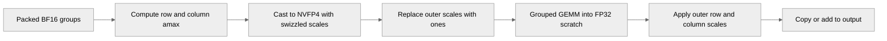

# [Common][PyTorch] Add row-scaled NVFP4 support to grouped-tensor GEMM

[Upstream PR](https://github.com/NVIDIA/TransformerEngine/pull/3661) · state: open · merged: False

## Original PR description

# Description

Depends on the merge of #3649. This PR is stacked on top of it, please review only the incremental changes.

This PR does three things:
1. **Produce swizzled scales in the cast.** When `optimize_for_gemm` is set, the row-scaled grouped NVFP4 cast bakes the cuBLAS-swizzled scale layout directly (for both the rowwise and columnwise/transpose scales). No separate swizzle pass is needed.
2. **Consume row-scaled operands in the GEMM.** `general_grouped_gemm_for_grouped_tensor` neutralizes the per-row/per-column FP32 outer scale, runs the per-tensor grouped GEMM into an FP32 scratch, and applies the outer scale afterward, mirroring the dense `general_gemm` path.
3. **Enable columnwise for row-scaled grouped tensors.** The prior restriction forbidding columnwise usage for row-scaled grouped NVFP4 is lifted, and the columnwise amax is sized per column so wgrad can consume the transpose. The cast kernel already emitted the columnwise transpose, per-column amax, and swizzled scales.

## Type of change

- [ ] Documentation change (change only to the documentation, either a fix or a new content)
- [ ] Bug fix (non-breaking change which fixes an issue)
- [x] New feature (non-breaking change which adds functionality)
- [ ] Breaking change (fix or feature that would cause existing functionality to not work as expected)
- [ ] Infra/Build change
- [ ] Code refactoring

## Changes

- `common/cast/nvfp4/group_quantize_transpose_nvfp4.cuh`: add a `WITH_GEMM_SWIZZLED_SCALES` template path to the row-scaled grouped cast body, both kernels, and both host launchers; the scale-factor epilogue writes cuBLAS-swizzled indices (compact scale column count) for rowwise and columnwise when enabled.
- `pytorch/cpp_extensions/gemm.py`: consume row-scaled operands in `general_grouped_gemm_for_grouped_tensor` via outer-scale neutralization + FP32 scratch + post-scale, covering discrete-out (wgrad) and grouped-out paths.
- `pytorch/csrc/quantizer.cpp` and `pytorch/tensor/storage/grouped_tensor_storage.py`: allow columnwise usage for row-scaled grouped NVFP4, size the columnwise amax per column, and split it per-expert per-column.
- `tests/pytorch/nvfp4/test_nvfp4_gemm_exact.py`: add fprop (TN), CUDA-graph, and wgrad (NT) parity tests against a per-expert dense row-scaled GEMM over byte-identical operands.

# Checklist:

- [ ] I have read and followed the [contributing guidelines](https://github.com/NVIDIA/TransformerEngine/blob/main/CONTRIBUTING.rst)
- [ ] The functionality is complete
- [ ] I have commented my code, particularly in hard-to-understand areas
- [ ] I have made corresponding changes to the documentation
- [ ] My changes generate no new warnings
- [ ] I have added tests that prove my fix is effective or that my feature works
- [x] New and existing unit tests pass locally with my changes

## Review and discussion

### reviews

- greptile-apps[bot] · COMMENTED · 2026-10-09T09:34:46Z · [source](https://github.com/NVIDIA/TransformerEngine/pull/3661#pullrequestreview-5468334282)

(No body; status only.)

- greptile-apps[bot] · COMMENTED · 2026-10-09T11:51:14Z · [source](https://github.com/NVIDIA/TransformerEngine/pull/3661#pullrequestreview-5469634704)

(No body; status only.)

- greptile-apps[bot] · COMMENTED · 2026-10-09T12:24:54Z · [source](https://github.com/NVIDIA/TransformerEngine/pull/3661#pullrequestreview-5469973444)

(No body; status only.)

- greptile-apps[bot] · COMMENTED · 2026-10-09T13:19:38Z · [source](https://github.com/NVIDIA/TransformerEngine/pull/3661#pullrequestreview-5470566389)

(No body; status only.)

### issue_comments

- greptile-apps[bot] · comment · 2026-10-09T09:34:40Z · [source](https://github.com/NVIDIA/TransformerEngine/pull/3661#issuecomment-6078302315)

<!-- greptile_summary -->

<h2><a href="https://app.greptile.com/api/retrigger?id=77702857"><picture><source media="(prefers-color-scheme: dark)" srcset="https://greptile-static-assets.s3.amazonaws.com/badges/RetriggerDark.svg?v=2"><source media="(prefers-color-scheme: light)" srcset="https://greptile-static-assets.s3.amazonaws.com/badges/Retrigger.svg?v=2"></picture></a>Confidence Score: 4/5</h2>

**[High impact]** Adds grouped\-tensor GEMM support for row\-scaled NVFP4 quantization\.

The PR still needs the remaining output-shape cases from previous finding 1 addressed before merging.

<h2>Findings</h2>

1. &nbsp;**Different output widths fail** <a href="https://github.com/NVIDIA/TransformerEngine/pull/3661#discussion_r4230054917">▶</a>

<h3>Summary</h3>

This PR adds row-scaled NVFP4 casts and grouped GEMM support.
- The cast can write scales directly in the layout cuBLAS expects.
- Grouped GEMM runs into FP32 scratch, then applies row and column scales.
- The latest changes correct the cuBLAS test gate and limit output scaling to `logical_shape[0]`.
- No new findings were accepted.

<h3>Diagram</h3>

<!-- greptile_confidence_score:4 -->

Reviews (6) · Last reviewed commit: ["Fix grouped row-scaled GEMM post-scale g..."](https://github.com/nvidia/transformerengine/commit/e2517b9602e1e70251e9eaa6a149fdfdbfac736b) · [Reviewed by Greptile](https://www.greptile.com/?utm_source=greptile_expert&utm_medium=github&utm_campaign=code_reviews&utm_content=nvidia/transformerengine)

### inline_comments

- greptile-apps[bot] · comment · 2026-10-09T09:34:44Z · [source](https://github.com/NVIDIA/TransformerEngine/pull/3661#discussion_r4228709731)

File: `transformer_engine/pytorch/cpp_extensions/gemm.py` · line 1288

 **`beta` reads uninitialized output**

When a caller supplies nonzero `beta`, the row-scaled GEMM reads uninitialized `scratch` instead of the existing `out`. The GEMM receives `scratch` as both its previous output and its destination. Setting `accumulate = False` only changes the default `beta`; the supplied value still reaches the GEMM.

Run the scratch GEMM with zero `beta`, then apply the caller's `beta` to the existing output after scaling.

- greptile-apps[bot] · comment · 2026-10-09T09:34:44Z · [source](https://github.com/NVIDIA/TransformerEngine/pull/3661#discussion_r4228709743)

File: `transformer_engine/pytorch/cpp_extensions/gemm.py` · line None

 **Uneven groups get wrong scales**

The column-scale step divides the output into equal-sized groups. A `TN` call with row-scaled grouped weights and activation splits `[128, 256, 128]` fails because `flat.view(3, -1, last_dim)` cannot divide 512 rows into three groups. When the total is divisible, uneven groups instead receive each other's scales. The discrete-output scale views also assume equal shapes.

Apply scales using each group's actual row and column offsets rather than equal-sized views.

- greptile-apps[bot] · comment · 2026-10-09T09:34:44Z · [source](https://github.com/NVIDIA/TransformerEngine/pull/3661#discussion_r4228709750)

File: `transformer_engine/pytorch/csrc/extensions/cast.cpp` · line None

 **Higher-rank casts now fail**

The new default `split_quantize` path passes first-dimension split counts to kernels that expect flattened row counts. A BF16 input shaped `[256, 2, 128]` with splits `[128, 128]` passes these checks, but the amax kernel sees 512 rows and rejects the split sum of 256. The previous per-expert path flattened each split correctly. Partial splits also fail because the new kernels require the split sum to cover the entire input.

Fall back for these inputs, or flatten the split counts and restrict the packed input to the requested region.

- greptile-apps[bot] · comment · 2026-10-09T09:34:44Z · [source](https://github.com/NVIDIA/TransformerEngine/pull/3661#discussion_r4228709759)

File: `transformer_engine/pytorch/csrc/extensions/cast.cpp` · line None

 **Sliced counts change the cast**

The binding passes `first_dims.data_ptr()` to a kernel that reads consecutive entries, without checking or copying the tensor's strides. The public helper computes offsets with `splits_to_offsets`, which does make a contiguous copy. The two kernels can therefore see different counts.

For example, `[256, 0, 128, 0][::2]` represents valid counts `[256, 128]`, but the cast reads the second count as zero. This gives the second expert incorrect row scaling and, when a transpose is requested, the wrong output stride. Make `first_dims` contiguous before creating either grouped tensor, or reject it before launch.

- greptile-apps[bot] · comment · 2026-10-09T09:34:44Z · [source](https://github.com/NVIDIA/TransformerEngine/pull/3661#discussion_r4228709768)

File: `transformer_engine/pytorch/cpp_extensions/gemm.py` · line 1146

 **Listed weights lose row scales**

`_is_row_scaled` ignores row-scaled weights stored in a list. A supported `TN` call with listed row-scaled `NVFP4TensorStorage` weights and row-scaled grouped activations therefore restores only the activation scales. The grouped GEMM reads each weight's first amax value and applies it to every output column, producing incorrectly scaled results.

Detect row-scaled list entries too, replace their selected amax values with ones for the GEMM, and restore their per-column scales afterward.

- greptile-apps[bot] · comment · 2026-10-09T11:51:13Z · [source](https://github.com/NVIDIA/TransformerEngine/pull/3661#discussion_r4229785414)

File: `transformer_engine/pytorch/cpp_extensions/gemm.py` · line None

 **Grouped GEMM capture fails**

With row-scaled grouped weights and an output that has device `first_dims` but no `tensor_shapes`, the new `out.first_dims.tolist()` call copies GPU counts to the CPU. That makes CUDA graph capture fail, even when the output was built before capture. This output layout is supported by `GroupedTensorStorage` and used by `_make_grouped_tensor`.

Apply column scales using device row counts instead of reading them on the CPU.

- greptile-apps[bot] · comment · 2026-10-09T12:24:53Z · [source](https://github.com/NVIDIA/TransformerEngine/pull/3661#discussion_r4230054909)

File: `transformer_engine/pytorch/csrc/extensions/cast.cpp` · line 2287

 **Mixed casts overwrite GPU buffers**

The fused path is selected when any quantizer has `row_scaled_nvfp4`, but bulk allocation sizes every `amax` from the first quantizer's setting. For a BF16 `[256, 128]` input, splits `[128, 128]`, and quantizers ordered tensor-scaled then row-scaled, both outputs get one-element `amax` buffers. The grouped kernel writes 128 values into each buffer, overwriting nearby storage.

Require matching row-scale settings before selecting this path and allocating its outputs.

- greptile-apps[bot] · comment · 2026-10-09T12:24:53Z · [source](https://github.com/NVIDIA/TransformerEngine/pull/3661#discussion_r4230054917)

File: `transformer_engine/pytorch/cpp_extensions/gemm.py` · line 1336

 **Different output widths fail**

The post-scale step treats the entire grouped output as rows with one common width. For listed weights shaped `[128, 128]` and `[256, 128]`, with two row-scaled activation groups of 128 rows each, the output has `logical_shape` `[128, 384]`. That makes `flat` have 128 rows, while `post_scale_rows` has 256 values. The multiply raises after GEMM, even though GEMM supports these per-group shapes.

The same assumption fails when an activation's capacity exceeds the live output row count. Apply scales using each group's actual shape and offsets instead of multiplying the whole buffer.

- greptile-apps[bot] · comment · 2026-10-09T13:19:37Z · [source](https://github.com/NVIDIA/TransformerEngine/pull/3661#discussion_r4230523206)

File: `tests/pytorch/nvfp4/test_nvfp4_gemm_exact.py` · line None

 **Tests accept unsupported cuBLAS**

The new test gate accepts cuBLAS 13.3, but grouped NVFP4 GEMM requires 13.4. On Blackwell with cuBLAS 13.3, these tests run instead of skipping and fail at the GEMM version check. Change the threshold to `130400` and update the skip reason.

## Changed files and fixed code

- `tests/cpp/operator/CMakeLists.txt` · modified · additions 1 / deletions 0
  - [head](https://github.com/cael-ling/TransformerEngine/blob/e2517b9602e1e70251e9eaa6a149fdfdbfac736b/tests/cpp/operator/CMakeLists.txt)
  - [base](https://github.com/NVIDIA/TransformerEngine/blob/39c30c577f5dd4f9fba921ee011b5cd797ae667e/tests/cpp/operator/CMakeLists.txt)
- `tests/cpp/operator/test_row_scaled_nvfp4_grouped_cast.cu` · added · additions 759 / deletions 0
  - [head](https://github.com/cael-ling/TransformerEngine/blob/e2517b9602e1e70251e9eaa6a149fdfdbfac736b/tests/cpp/operator/test_row_scaled_nvfp4_grouped_cast.cu)
  - [base](https://github.com/NVIDIA/TransformerEngine/blob/39c30c577f5dd4f9fba921ee011b5cd797ae667e/tests/cpp/operator/test_row_scaled_nvfp4_grouped_cast.cu)
- `tests/cpp/test_common.h` · modified · additions 8 / deletions 4
  - [head](https://github.com/cael-ling/TransformerEngine/blob/e2517b9602e1e70251e9eaa6a149fdfdbfac736b/tests/cpp/test_common.h)
  - [base](https://github.com/NVIDIA/TransformerEngine/blob/39c30c577f5dd4f9fba921ee011b5cd797ae667e/tests/cpp/test_common.h)
- `tests/pytorch/nvfp4/test_nvfp4_gemm_exact.py` · modified · additions 455 / deletions 1
  - [head](https://github.com/cael-ling/TransformerEngine/blob/e2517b9602e1e70251e9eaa6a149fdfdbfac736b/tests/pytorch/nvfp4/test_nvfp4_gemm_exact.py)
  - [base](https://github.com/NVIDIA/TransformerEngine/blob/39c30c577f5dd4f9fba921ee011b5cd797ae667e/tests/pytorch/nvfp4/test_nvfp4_gemm_exact.py)
- `tests/pytorch/nvfp4/test_nvfp4_group_row_scaled_cast_graph_safe.py` · added · additions 329 / deletions 0
  - [head](https://github.com/cael-ling/TransformerEngine/blob/e2517b9602e1e70251e9eaa6a149fdfdbfac736b/tests/pytorch/nvfp4/test_nvfp4_group_row_scaled_cast_graph_safe.py)
  - [base](https://github.com/NVIDIA/TransformerEngine/blob/39c30c577f5dd4f9fba921ee011b5cd797ae667e/tests/pytorch/nvfp4/test_nvfp4_group_row_scaled_cast_graph_safe.py)
- `transformer_engine/common/cast/cast_grouped.cu` · modified · additions 93 / deletions 0
  - [head](https://github.com/cael-ling/TransformerEngine/blob/e2517b9602e1e70251e9eaa6a149fdfdbfac736b/transformer_engine/common/cast/cast_grouped.cu)
  - [base](https://github.com/NVIDIA/TransformerEngine/blob/39c30c577f5dd4f9fba921ee011b5cd797ae667e/transformer_engine/common/cast/cast_grouped.cu)
- `transformer_engine/common/cast/nvfp4/group_quantize_transpose_nvfp4.cuh` · modified · additions 777 / deletions 17
  - [head](https://github.com/cael-ling/TransformerEngine/blob/e2517b9602e1e70251e9eaa6a149fdfdbfac736b/transformer_engine/common/cast/nvfp4/group_quantize_transpose_nvfp4.cuh)
  - [base](https://github.com/NVIDIA/TransformerEngine/blob/39c30c577f5dd4f9fba921ee011b5cd797ae667e/transformer_engine/common/cast/nvfp4/group_quantize_transpose_nvfp4.cuh)
- `transformer_engine/common/include/transformer_engine/cast.h` · modified · additions 68 / deletions 0
  - [head](https://github.com/cael-ling/TransformerEngine/blob/e2517b9602e1e70251e9eaa6a149fdfdbfac736b/transformer_engine/common/include/transformer_engine/cast.h)
  - [base](https://github.com/NVIDIA/TransformerEngine/blob/39c30c577f5dd4f9fba921ee011b5cd797ae667e/transformer_engine/common/include/transformer_engine/cast.h)
- `transformer_engine/pytorch/cpp_extensions/gemm.py` · modified · additions 133 / deletions 10
  - [head](https://github.com/cael-ling/TransformerEngine/blob/e2517b9602e1e70251e9eaa6a149fdfdbfac736b/transformer_engine/pytorch/cpp_extensions/gemm.py)
  - [base](https://github.com/NVIDIA/TransformerEngine/blob/39c30c577f5dd4f9fba921ee011b5cd797ae667e/transformer_engine/pytorch/cpp_extensions/gemm.py)
- `transformer_engine/pytorch/csrc/extensions.h` · modified · additions 5 / deletions 0
  - [head](https://github.com/cael-ling/TransformerEngine/blob/e2517b9602e1e70251e9eaa6a149fdfdbfac736b/transformer_engine/pytorch/csrc/extensions.h)
  - [base](https://github.com/NVIDIA/TransformerEngine/blob/39c30c577f5dd4f9fba921ee011b5cd797ae667e/transformer_engine/pytorch/csrc/extensions.h)
- `transformer_engine/pytorch/csrc/extensions/cast.cpp` · modified · additions 181 / deletions 7
  - [head](https://github.com/cael-ling/TransformerEngine/blob/e2517b9602e1e70251e9eaa6a149fdfdbfac736b/transformer_engine/pytorch/csrc/extensions/cast.cpp)
  - [base](https://github.com/NVIDIA/TransformerEngine/blob/39c30c577f5dd4f9fba921ee011b5cd797ae667e/transformer_engine/pytorch/csrc/extensions/cast.cpp)
- `transformer_engine/pytorch/csrc/extensions/pybind.cpp` · modified · additions 5 / deletions 0
  - [head](https://github.com/cael-ling/TransformerEngine/blob/e2517b9602e1e70251e9eaa6a149fdfdbfac736b/transformer_engine/pytorch/csrc/extensions/pybind.cpp)
  - [base](https://github.com/NVIDIA/TransformerEngine/blob/39c30c577f5dd4f9fba921ee011b5cd797ae667e/transformer_engine/pytorch/csrc/extensions/pybind.cpp)
- `transformer_engine/pytorch/csrc/quantizer.cpp` · modified · additions 6 / deletions 3
  - [head](https://github.com/cael-ling/TransformerEngine/blob/e2517b9602e1e70251e9eaa6a149fdfdbfac736b/transformer_engine/pytorch/csrc/quantizer.cpp)
  - [base](https://github.com/NVIDIA/TransformerEngine/blob/39c30c577f5dd4f9fba921ee011b5cd797ae667e/transformer_engine/pytorch/csrc/quantizer.cpp)
- `transformer_engine/pytorch/ep.py` · modified · additions 43 / deletions 0
  - [head](https://github.com/cael-ling/TransformerEngine/blob/e2517b9602e1e70251e9eaa6a149fdfdbfac736b/transformer_engine/pytorch/ep.py)
  - [base](https://github.com/NVIDIA/TransformerEngine/blob/39c30c577f5dd4f9fba921ee011b5cd797ae667e/transformer_engine/pytorch/ep.py)
- `transformer_engine/pytorch/tensor/storage/grouped_tensor_storage.py` · modified · additions 18 / deletions 6
  - [head](https://github.com/cael-ling/TransformerEngine/blob/e2517b9602e1e70251e9eaa6a149fdfdbfac736b/transformer_engine/pytorch/tensor/storage/grouped_tensor_storage.py)
  - [base](https://github.com/NVIDIA/TransformerEngine/blob/39c30c577f5dd4f9fba921ee011b5cd797ae667e/transformer_engine/pytorch/tensor/storage/grouped_tensor_storage.py)

## Evidence and interpretation boundary

[Original JSON, discussions and patches](../../../../../../evidence/prs/NVIDIA--TransformerEngine/3661-b86d1c8c1443a636aed54f361effc45a921d629270a73552c8a5e209e450a6a9.json) · SHA-256 `b86d1c8c1443a636aed54f361effc45a921d629270a73552c8a5e209e450a6a9`.

Diff complete: True. Missing/binary/truncated patches require pinned source inspection. This is a source page, not an independently verified optimization case. Open, merged and released are different states; recheck the deployed dependency.
