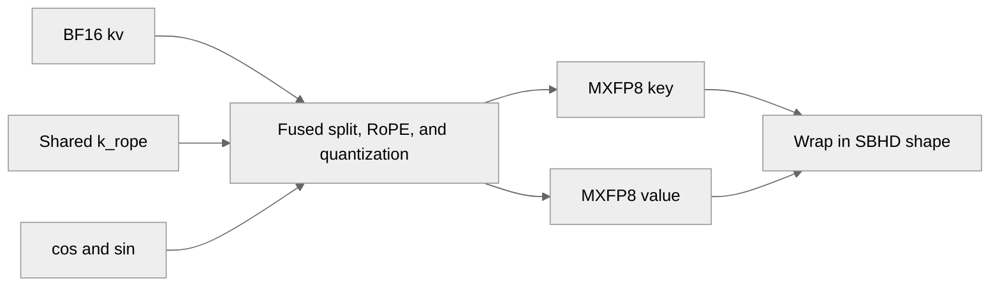

# [Common][PyTorch] Fuse the MLA key/value RoPE with MXFP8 quantization

[Upstream PR](https://github.com/NVIDIA/TransformerEngine/pull/3672) · state: closed · merged: True

## Original PR description

For MXFP8 attention, multi-latent attention writes its key and value in BF16 (the key/value split, with the shared key position embedding rotated and appended to every head's key) and then reads them again to quantize them. Add a kernel that reads the key/value up-projection output and the key position embedding once and writes the MXFP8 key and value directly: the same bytes as mxfp8_quantize_only applied to the RoPE'd key and the value, row-wise and column-wise, with compact scaling factors.

The RoPE is that of Megatron-LM's MLA kernels, with their roundings, for DeepSeek-V3's head dimensions (128 + 64 key, 128 value) on SM 10.0+. It is exposed as nvte_fused_mla_kv_rope_mxfp8 and, for PyTorch, as fused_mla_kv_rope_mxfp8 next to mxfp8_quantize_only, whose re-wrap of the quantized 2D view in the input's 4D shape moves into a helper that both use.

At [4096, 1, 128 heads] on VR200, the key/value split and quantization take 100.1 us instead of 60.8 + 75.6 us.

# Description

Please include a brief summary of the changes, relevant motivation and context.

Fixes # (issue)

## Type of change

- [ ] Documentation change (change only to the documentation, either a fix or a new content)
- [ ] Bug fix (non-breaking change which fixes an issue)
- [ ] New feature (non-breaking change which adds functionality)
- [ ] Breaking change (fix or feature that would cause existing functionality to not work as expected)
- [ ] Infra/Build change
- [ ] Code refactoring

## Changes

Please list the changes introduced in this PR:

- Change A
- Change B

# Checklist:

- [ ] I have read and followed the [contributing guidelines](https://github.com/NVIDIA/TransformerEngine/blob/main/CONTRIBUTING.rst)
- [ ] The functionality is complete
- [ ] I have commented my code, particularly in hard-to-understand areas
- [ ] I have made corresponding changes to the documentation
- [ ] My changes generate no new warnings
- [ ] I have added tests that prove my fix is effective or that my feature works
- [ ] New and existing unit tests pass locally with my changes

## Review and discussion

### reviews

- greptile-apps[bot] · COMMENTED · 2026-10-12T14:27:39Z · [source](https://github.com/NVIDIA/TransformerEngine/pull/3672#pullrequestreview-5492150048)

(No body; status only.)

- greptile-apps[bot] · COMMENTED · 2026-10-12T21:28:41Z · [source](https://github.com/NVIDIA/TransformerEngine/pull/3672#pullrequestreview-5496141861)

(No body; status only.)

- sudhakarsingh27 · APPROVED · 2026-10-12T23:48:59Z · [source](https://github.com/NVIDIA/TransformerEngine/pull/3672#pullrequestreview-5497151674)

LGTM

### issue_comments

- greptile-apps[bot] · comment · 2026-10-12T14:27:34Z · [source](https://github.com/NVIDIA/TransformerEngine/pull/3672#issuecomment-6126280471)

<!-- greptile_summary -->

<h2><a href="https://app.greptile.com/api/retrigger?id=79179458"><picture><source media="(prefers-color-scheme: dark)" srcset="https://greptile-static-assets.s3.amazonaws.com/badges/RetriggerDark.svg?v=2"><source media="(prefers-color-scheme: light)" srcset="https://greptile-static-assets.s3.amazonaws.com/badges/Retrigger.svg?v=2"></picture></a>Confidence Score: 5/5</h2>

**[High impact]** The PR appears safe to merge, with a non-blocking scale-byte mismatch for all-NaN key blocks.

<h2>Findings</h2>

1. &nbsp;**All\-NaN scales differ** <a href="https://github.com/NVIDIA/TransformerEngine/pull/3672#discussion_r4252484599">▶</a>

<h3>Summary</h3>

Adds a fused MLA key/value split, key RoPE, and MXFP8 quantization path to avoid writing intermediate BF16 key/value tensors.
- MLA key and value can be rotated and quantized in one step.

<h3>Diagram</h3>

<!-- greptile_confidence_score:5 -->

Reviews (2) · Last reviewed commit: ["Merge branch &#39;main&#39; into sraman/mla-kv-r..."](https://github.com/nvidia/transformerengine/commit/f9da319550c9047495216283250f0b52d3e840b7) · [Reviewed by Greptile](https://www.greptile.com/?utm_source=greptile_expert&utm_medium=github&utm_campaign=code_reviews&utm_content=nvidia/transformerengine)

- sudhakarsingh27 · comment · 2026-10-12T21:23:02Z · [source](https://github.com/NVIDIA/TransformerEngine/pull/3672#issuecomment-6132858200)

/te-ci pytorch L0

### inline_comments

- greptile-apps[bot] · comment · 2026-10-12T14:27:37Z · [source](https://github.com/NVIDIA/TransformerEngine/pull/3672#discussion_r4249127910)

File: `transformer_engine/pytorch/csrc/extensions/apply_rope.cpp` · line 361

 **Outputs use the wrong GPU**

If the inputs are on `cuda:1` while `cuda:0` is current, `fused_mla_kv_rope_mxfp8` allocates key/value buffers on `cuda:0` and launches there with pointers from another GPU. This can cause an illegal memory access or return tensors on the wrong device.

Check that all inputs are CUDA tensors on the same device, then guard `kv.device()` before allocating outputs or launching the kernel.

**Knowledge Base Used:** [Native CUDA kernel platform](https://app.greptile.com/nvidia-public-github/-/custom-context/knowledge-base/nvidia/transformerengine/-/docs/native-kernels.md)

- greptile-apps[bot] · comment · 2026-10-12T14:27:38Z · [source](https://github.com/NVIDIA/TransformerEngine/pull/3672#discussion_r4249127918)

File: `transformer_engine/pytorch/csrc/extensions/apply_rope.cpp` · line 349

 **Quantizer settings are ignored**

The binding accepts `MXFP8Quantizer(with_2d_quantization=True)`, but the fused kernel ignores that setting and chooses separate scales for each row and column. `mxfp8_quantize_only` instead shares scales across a two-dimensional block when this option is enabled. With different magnitudes across neighboring rows, the fused key/value bytes and scales differ from what the caller requested.

Reject `with_2d_quantization=True` explicitly unless the fused kernel supports it.

**Knowledge Base Used:** [PyTorch FP8 and low-precision quantization](https://app.greptile.com/nvidia-public-github/-/custom-context/knowledge-base/nvidia/transformerengine/-/docs/pytorch-quantization.md)

- greptile-apps[bot] · comment · 2026-10-12T21:28:40Z · [source](https://github.com/NVIDIA/TransformerEngine/pull/3672#discussion_r4252484599)

File: `transformer_engine/common/fused_rope/fused_mla_kv_rope_mxfp8.cu` · line 211

 **All-NaN scales differ**

With two heads and one batch entry, an all-NaN block in `k_nope` gets scale byte 255 instead of the 0 produced by `mxfp8_quantize_only`. The 384-column key uses the staged reference kernel, which starts its maximum at zero and ignores NaNs. `quantize_head` instead starts from the first input pair, so an all-NaN block stays NaN.

This breaks the promised byte-identical results for a supported shape. Match the staged reference's zero-initialized maximum for this path.

## Changed files and fixed code

- `qa/L0_pytorch_unittest/test.sh` · modified · additions 1 / deletions 1
  - [head](https://github.com/sraman-rgb/TransformerEngine/blob/f9da319550c9047495216283250f0b52d3e840b7/qa/L0_pytorch_unittest/test.sh)
  - [base](https://github.com/NVIDIA/TransformerEngine/blob/81775f2cc0052d3e75608664357a8f3d3f453897/qa/L0_pytorch_unittest/test.sh)
- `tests/pytorch/attention/test_fused_mla.py` · renamed · additions 159 / deletions 4
  - [head](https://github.com/sraman-rgb/TransformerEngine/blob/f9da319550c9047495216283250f0b52d3e840b7/tests/pytorch/attention/test_fused_mla.py)
  - [base](https://github.com/NVIDIA/TransformerEngine/blob/81775f2cc0052d3e75608664357a8f3d3f453897/tests/pytorch/attention/test_fused_mla_q_uproj.py)
- `transformer_engine/common/CMakeLists.txt` · modified · additions 1 / deletions 0
  - [head](https://github.com/sraman-rgb/TransformerEngine/blob/f9da319550c9047495216283250f0b52d3e840b7/transformer_engine/common/CMakeLists.txt)
  - [base](https://github.com/NVIDIA/TransformerEngine/blob/81775f2cc0052d3e75608664357a8f3d3f453897/transformer_engine/common/CMakeLists.txt)
- `transformer_engine/common/fused_rope/fused_mla_kv_rope_mxfp8.cu` · added · additions 451 / deletions 0
  - [head](https://github.com/sraman-rgb/TransformerEngine/blob/f9da319550c9047495216283250f0b52d3e840b7/transformer_engine/common/fused_rope/fused_mla_kv_rope_mxfp8.cu)
  - [base](https://github.com/NVIDIA/TransformerEngine/blob/81775f2cc0052d3e75608664357a8f3d3f453897/transformer_engine/common/fused_rope/fused_mla_kv_rope_mxfp8.cu)
- `transformer_engine/common/include/transformer_engine/fused_rope.h` · modified · additions 41 / deletions 0
  - [head](https://github.com/sraman-rgb/TransformerEngine/blob/f9da319550c9047495216283250f0b52d3e840b7/transformer_engine/common/include/transformer_engine/fused_rope.h)
  - [base](https://github.com/NVIDIA/TransformerEngine/blob/81775f2cc0052d3e75608664357a8f3d3f453897/transformer_engine/common/include/transformer_engine/fused_rope.h)
- `transformer_engine/pytorch/attention/dot_product_attention/utils.py` · modified · additions 109 / deletions 39
  - [head](https://github.com/sraman-rgb/TransformerEngine/blob/f9da319550c9047495216283250f0b52d3e840b7/transformer_engine/pytorch/attention/dot_product_attention/utils.py)
  - [base](https://github.com/NVIDIA/TransformerEngine/blob/81775f2cc0052d3e75608664357a8f3d3f453897/transformer_engine/pytorch/attention/dot_product_attention/utils.py)
- `transformer_engine/pytorch/csrc/extensions.h` · modified · additions 4 / deletions 0
  - [head](https://github.com/sraman-rgb/TransformerEngine/blob/f9da319550c9047495216283250f0b52d3e840b7/transformer_engine/pytorch/csrc/extensions.h)
  - [base](https://github.com/NVIDIA/TransformerEngine/blob/81775f2cc0052d3e75608664357a8f3d3f453897/transformer_engine/pytorch/csrc/extensions.h)
- `transformer_engine/pytorch/csrc/extensions/apply_rope.cpp` · modified · additions 65 / deletions 0
  - [head](https://github.com/sraman-rgb/TransformerEngine/blob/f9da319550c9047495216283250f0b52d3e840b7/transformer_engine/pytorch/csrc/extensions/apply_rope.cpp)
  - [base](https://github.com/NVIDIA/TransformerEngine/blob/81775f2cc0052d3e75608664357a8f3d3f453897/transformer_engine/pytorch/csrc/extensions/apply_rope.cpp)
- `transformer_engine/pytorch/csrc/extensions/pybind.cpp` · modified · additions 4 / deletions 0
  - [head](https://github.com/sraman-rgb/TransformerEngine/blob/f9da319550c9047495216283250f0b52d3e840b7/transformer_engine/pytorch/csrc/extensions/pybind.cpp)
  - [base](https://github.com/NVIDIA/TransformerEngine/blob/81775f2cc0052d3e75608664357a8f3d3f453897/transformer_engine/pytorch/csrc/extensions/pybind.cpp)

## Evidence and interpretation boundary

[Original JSON, discussions and patches](../../../../../../evidence/prs/NVIDIA--TransformerEngine/3672-a59fa2dc1cd8959b4695812b0409a24505f2eb7ca7cdbe9a9278994744a838ec.json) · SHA-256 `a59fa2dc1cd8959b4695812b0409a24505f2eb7ca7cdbe9a9278994744a838ec`.

Diff complete: True. Missing/binary/truncated patches require pinned source inspection. This is a source page, not an independently verified optimization case. Open, merged and released are different states; recheck the deployed dependency.
