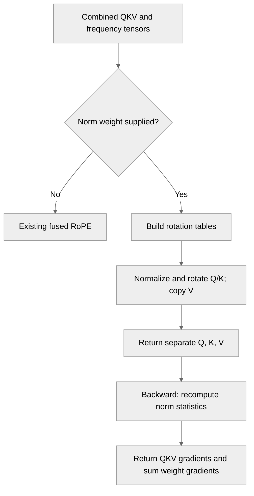

# [Common][PyTorch] Fuse the per-head Q/K RMSNorm into the single-QKV RoPE kernel

[Upstream PR](https://github.com/NVIDIA/TransformerEngine/pull/3673) · state: open · merged: False

## Original PR description

Fuse the per-head Q/K RMSNorm into TE's single-QKV RoPE kernel, so QK-norm models keep the fast fused attention-input path instead of splitting QKV and running the norm and RoPE separately.

[This Megatron Core PR](https://github.com/NVIDIA/Megatron-LM/pull/8147) hands the TE RMSNorm weights to that fused call instead of splitting QKV, falling back to today's split path on older TE.

The tests compare the fused output and all gradients against an fp32 unfused reference across formats, CP, dtypes and head sizes.

## Review and discussion

### reviews

- greptile-apps[bot] · COMMENTED · 2026-10-12T18:37:42Z · [source](https://github.com/NVIDIA/TransformerEngine/pull/3673#pullrequestreview-5494706870)

(No body; status only.)

### issue_comments

- greptile-apps[bot] · comment · 2026-10-12T18:37:38Z · [source](https://github.com/NVIDIA/TransformerEngine/pull/3673#issuecomment-6130347612)

<!-- greptile_summary -->

<h2><a href="https://app.greptile.com/api/retrigger?id=79322211"><picture><source media="(prefers-color-scheme: dark)" srcset="https://greptile-static-assets.s3.amazonaws.com/badges/RetriggerDark.svg?v=2"><source media="(prefers-color-scheme: light)" srcset="https://greptile-static-assets.s3.amazonaws.com/badges/Retrigger.svg?v=2"></picture></a>Confidence Score: 4/5</h2>

**[High impact]** Adds fused kernel for attention head normalization and rotation\.

The PR appears safe to merge, with a non-blocking gap in tests for backward with position offsets.

<h2>Findings</h2>

1. &nbsp;**Offset gradients go unchecked** <a href="https://github.com/NVIDIA/TransformerEngine/pull/3673#discussion_r4251241043">▶</a>

<h3>Summary</h3>

Adds optional per-head Q/K RMSNorm to the combined-QKV RoPE path.
- The fused QKV call now normalizes Q and K before RoPE.

<h3>Diagram</h3>

<!-- greptile_confidence_score:4 -->

Reviews (1) · Last reviewed commit: ["\[PyTorch\] Fuse the per-head Q/K RMSNorm ..."](https://github.com/nvidia/transformerengine/commit/ff09dbb5ed2a42da0b66e7c99b29058acee7c543) · [Reviewed by Greptile](https://www.greptile.com/?utm_source=greptile_expert&utm_medium=github&utm_campaign=code_reviews&utm_content=nvidia/transformerengine)

### inline_comments

- greptile-apps[bot] · comment · 2026-10-12T18:37:41Z · [source](https://github.com/NVIDIA/TransformerEngine/pull/3673#discussion_r4251241043)

File: `tests/pytorch/test_fused_rope.py` · line 596

 **Offset gradients go unchecked**

The new tests skip backward whenever `start_positions` is supplied, even though the new norm path supports backward with offsets. A mistake in the input or norm weight gradients could therefore pass the new test suite. Use `apply_rotary_pos_emb(..., fused=False)` for the reference and compare gradients for these cases too.

## Changed files and fixed code

- `tests/pytorch/test_fused_rope.py` · modified · additions 161 / deletions 0
  - [head](https://github.com/filaretov/TransformerEngine/blob/ff09dbb5ed2a42da0b66e7c99b29058acee7c543/tests/pytorch/test_fused_rope.py)
  - [base](https://github.com/NVIDIA/TransformerEngine/blob/2e959f352c8e2d4b2709e6775867f2c7494656f3/tests/pytorch/test_fused_rope.py)
- `transformer_engine/common/triton/fused_qkv_norm_rope.py` · added · additions 499 / deletions 0
  - [head](https://github.com/filaretov/TransformerEngine/blob/ff09dbb5ed2a42da0b66e7c99b29058acee7c543/transformer_engine/common/triton/fused_qkv_norm_rope.py)
  - [base](https://github.com/NVIDIA/TransformerEngine/blob/2e959f352c8e2d4b2709e6775867f2c7494656f3/transformer_engine/common/triton/fused_qkv_norm_rope.py)
- `transformer_engine/pytorch/attention/rope.py` · modified · additions 152 / deletions 1
  - [head](https://github.com/filaretov/TransformerEngine/blob/ff09dbb5ed2a42da0b66e7c99b29058acee7c543/transformer_engine/pytorch/attention/rope.py)
  - [base](https://github.com/NVIDIA/TransformerEngine/blob/2e959f352c8e2d4b2709e6775867f2c7494656f3/transformer_engine/pytorch/attention/rope.py)
- `transformer_engine/pytorch/triton/fused_qkv_norm_rope.py` · added · additions 312 / deletions 0
  - [head](https://github.com/filaretov/TransformerEngine/blob/ff09dbb5ed2a42da0b66e7c99b29058acee7c543/transformer_engine/pytorch/triton/fused_qkv_norm_rope.py)
  - [base](https://github.com/NVIDIA/TransformerEngine/blob/2e959f352c8e2d4b2709e6775867f2c7494656f3/transformer_engine/pytorch/triton/fused_qkv_norm_rope.py)

## Evidence and interpretation boundary

[Original JSON, discussions and patches](../../../../../../evidence/prs/NVIDIA--TransformerEngine/3673-7987cb587e0e819a8f3ac59c1d322c3ebeabd33593f28e34e59aeef74a593c7a.json) · SHA-256 `7987cb587e0e819a8f3ac59c1d322c3ebeabd33593f28e34e59aeef74a593c7a`.

Diff complete: True. Missing/binary/truncated patches require pinned source inspection. This is a source page, not an independently verified optimization case. Open, merged and released are different states; recheck the deployed dependency.
