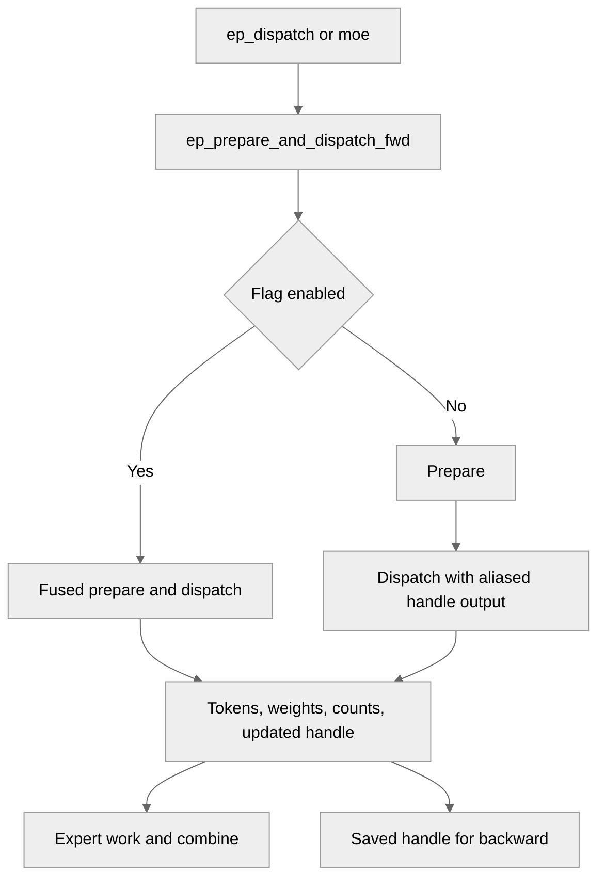

# [JAX] EP with Fused Prepare and Dispatch (NVL Only)

[Upstream PR](https://github.com/NVIDIA/TransformerEngine/pull/3674) · state: closed · merged: True

## Original PR description

## Summary

Adds an opt-in fused prepare + dispatch path for the JAX EP frontend (`NVTE_EP_FUSED_PREPARE_DISPATCH=1`, default off), mirroring PyTorch's `nvte_ep_prepare_and_dispatch`.

Also fixes the unfused path: `ep_dispatch` now returns `handle_mem` as an aliased XLA output, making the forward/backward data dependency visible to the scheduler and removing the need to force `NCCL_EP_HT_EM_AG_SCAN_MODE=1`.

`ep_prepare` and `ep_dispatch_fwd` are deprecated in favor of `ep_prepare_and_dispatch_fwd`, with removal planned for January 2027.

## Implementation

- `EpPrepareAndDispatchPrimitive`: fused FFI call returning `recv_tokens`, `recv_topk_weights`, `token_counts`, `total_recv_tokens`, `handle_mem`.
- `tex.ep_prepare_and_dispatch_fwd`: single entry point that selects the fused or unfused path from `NVTE_EP_FUSED_PREPARE_DISPATCH` (latched on first use). Called by both `ep_dispatch` and `_moe_fwd_rule`; neither branches itself.
- `tex.ep_prepare` / `tex.ep_dispatch_fwd`: now emit a `DeprecationWarning`. The unfused path calls private `_ep_prepare` / `_ep_dispatch_fwd`, so internal use does not warn.
- `EpDispatchPrimitive`: `operand_output_aliases={0: 2}` enforces dispatch -> combine ordering; backward now uses `ncclEpImportHandle` on the post-dispatch `handle_mem`.
- Shared C++ buffer helper rejects non-float32 `topk_weights` on both paths.
- `examples/jax/ep/bench/ep_bench.py`: `run_dispatch` unpacks the new `handle_mem` return value.
- Env var documented in `docs/envvars.rst`.

## Type of change

- [ ] Documentation change (change only to the documentation, either a fix or a new content)
- [ ] Bug fix (non-breaking change which fixes an issue)
- [x] New feature (non-breaking change which adds functionality)
- [ ] Breaking change (fix or feature that would cause existing functionality to not work as expected)
- [ ] Infra/Build change
- [ ] Code refactoring

# Checklist:

- [x] I have read and followed the [contributing guidelines](https://github.com/NVIDIA/TransformerEngine/blob/main/CONTRIBUTING.rst)
- [x] The functionality is complete
- [x] I have commented my code, particularly in hard-to-understand areas
- [x] I have made corresponding changes to the documentation
- [x] My changes generate no new warnings
- [x] I have added tests that prove my fix is effective or that my feature works
- [x] New and existing unit tests pass locally with my changes

## Review and discussion

### reviews

- greptile-apps[bot] · COMMENTED · 2026-10-12T17:28:41Z · [source](https://github.com/NVIDIA/TransformerEngine/pull/3674#pullrequestreview-5494081292)

(No body; status only.)

- greptile-apps[bot] · COMMENTED · 2026-10-12T23:05:39Z · [source](https://github.com/NVIDIA/TransformerEngine/pull/3674#pullrequestreview-5496902020)

(No body; status only.)

- jberchtold-nvidia · COMMENTED · 2026-10-13T13:47:33Z · [source](https://github.com/NVIDIA/TransformerEngine/pull/3674#pullrequestreview-5504353361)

(No body; status only.)

- phu0ngng · COMMENTED · 2026-10-13T16:18:45Z · [source](https://github.com/NVIDIA/TransformerEngine/pull/3674#pullrequestreview-5506656017)

(No body; status only.)

- jberchtold-nvidia · DISMISSED · 2026-10-14T18:32:39Z · [source](https://github.com/NVIDIA/TransformerEngine/pull/3674#pullrequestreview-5522787099)

LGTM, thanks!

- greptile-apps[bot] · COMMENTED · 2026-10-14T18:35:07Z · [source](https://github.com/NVIDIA/TransformerEngine/pull/3674#pullrequestreview-5522821595)

(No body; status only.)

- jberchtold-nvidia · APPROVED · 2026-10-16T15:55:43Z · [source](https://github.com/NVIDIA/TransformerEngine/pull/3674#pullrequestreview-5550288698)

(No body; status only.)

### issue_comments

- greptile-apps[bot] · comment · 2026-10-12T17:28:37Z · [source](https://github.com/NVIDIA/TransformerEngine/pull/3674#issuecomment-6129260747)

<!-- greptile_summary -->

<h2><a href="https://app.greptile.com/api/retrigger?id=79283422"><picture><source media="(prefers-color-scheme: dark)" srcset="https://greptile-static-assets.s3.amazonaws.com/badges/RetriggerDark.svg?v=2"><source media="(prefers-color-scheme: light)" srcset="https://greptile-static-assets.s3.amazonaws.com/badges/Retrigger.svg?v=2"></picture></a><a href="https://app.greptile.com/nvidia-public-github/github/NVIDIA/transformerengine/-/pull/3674"><picture><source media="(prefers-color-scheme: dark)" srcset="https://greptile-static-assets.s3.amazonaws.com/badges/ViewInGreptileDark.svg?v=2"><source media="(prefers-color-scheme: light)" srcset="https://greptile-static-assets.s3.amazonaws.com/badges/ViewInGreptile.svg?v=2"></picture></a>Confidence Score: 5/5</h2>

**[High impact]** No new blocking issue was established in this review.

<h3>Summary</h3>

Adds an opt-in fused prepare-and-dispatch path for JAX EP.
- JAX can run expert prepare and dispatch as one operation.
- Dispatch returns its handle buffer as an output.
- The old JAX prepare and dispatch helpers now warn callers to switch.

No new actionable findings were established.

<h3>Diagram</h3>

<!-- greptile_confidence_score:5 -->

Reviews (8) · Last reviewed commit: ["Merge branch &#39;main&#39; into ep\_jax\_bench"](https://github.com/nvidia/transformerengine/commit/0adb050f23afaa8d171599d4c5219c4fbcd5291e) · [Reviewed by Greptile](https://www.greptile.com/?utm_source=greptile_review&utm_medium=github&utm_campaign=review_public&utm_content=nvidia/transformerengine)

- phu0ngng · comment · 2026-10-12T17:37:40Z · [source](https://github.com/NVIDIA/TransformerEngine/pull/3674#issuecomment-6129406142)

/te-ci L1 JAX

- phu0ngng · comment · 2026-10-12T23:03:15Z · [source](https://github.com/NVIDIA/TransformerEngine/pull/3674#issuecomment-6134287346)

/te-ci L1 JAX

- phu0ngng · comment · 2026-10-13T18:59:57Z · [source](https://github.com/NVIDIA/TransformerEngine/pull/3674#issuecomment-6152949069)

/te-ci L1 JAX

- phu0ngng · comment · 2026-10-14T18:30:22Z · [source](https://github.com/NVIDIA/TransformerEngine/pull/3674#issuecomment-6175461287)

/te-ci L1 JAX

- phu0ngng · comment · 2026-10-14T18:40:53Z · [source](https://github.com/NVIDIA/TransformerEngine/pull/3674#issuecomment-6175657499)

/te-ci L1 JAX

### inline_comments

- greptile-apps[bot] · comment · 2026-10-12T17:28:40Z · [source](https://github.com/NVIDIA/TransformerEngine/pull/3674#discussion_r4250703939)

File: `transformer_engine/jax/ep.py` · line None

 **MoE ignores the new option**

Setting `NVTE_EP_FUSED_PREPARE_DISPATCH=1` only switches `ep_dispatch`. The full `moe` path calls `tex.ep_prepare` and `tex.ep_dispatch_fwd` directly, and the Flax `_MoEBlock` calls `moe`. Those users still run separate prepare and dispatch calls despite enabling the documented option. Apply the same latched choice in the full MoE forward path, keeping its counts, handle, and backward results unchanged.

**Knowledge Base Used:** [JAX distributed and MoE execution](https://app.greptile.com/nvidia-public-github/-/custom-context/knowledge-base/nvidia/transformerengine/-/docs/jax-distributed-moe.md)

- greptile-apps[bot] · comment · 2026-10-12T17:28:40Z · [source](https://github.com/NVIDIA/TransformerEngine/pull/3674#discussion_r4250703951)

File: `tests/jax/multi_process_launch_ep.sh` · line None

 **Fused cases lack coverage**

The new fused run selects only `TestEP`. It excludes `TestEPOverflowDrop` and `TestEPBorrowedComm`, so the new path has no JAX coverage for dropped tokens or XLA-owned communicators. Counts now come from dispatch rather than prepare, making the overflow checks especially useful. Add fresh fused runs for both classes; keep the existing borrowed-communicator capability skip.

**Knowledge Base Used:** [Verification and CI matrix](https://app.greptile.com/nvidia-public-github/-/custom-context/knowledge-base/nvidia/transformerengine/-/docs/verification-and-ci.md)

Note: If this suggestion doesn't match your team's coding style, reply to this and let me know. I'll remember it for next time!

- greptile-apps[bot] · comment · 2026-10-12T23:05:37Z · [source](https://github.com/NVIDIA/TransformerEngine/pull/3674#discussion_r4253106173)

File: `transformer_engine/jax/cpp_extensions/ep.py` · line 510

 **EP benchmark fails at startup**

`ep_dispatch_fwd` now returns three values, but `run_dispatch` in `examples/jax/ep/bench/ep_bench.py:156` still unpacks two. The benchmark calls it during startup, so tracing fails with `ValueError: too many values to unpack` before any timings run. Update the benchmark to receive the returned `handle_mem` and pass it to combine.

**Knowledge Base Used:** [JAX runtime and public API](https://app.greptile.com/nvidia-public-github/-/custom-context/knowledge-base/nvidia/transformerengine/-/docs/jax-runtime.md)

- greptile-apps[bot] · comment · 2026-10-12T23:05:37Z · [source](https://github.com/NVIDIA/TransformerEngine/pull/3674#discussion_r4253106180)

File: `transformer_engine/jax/ep.py` · line 156

 **Bootstrap no longer saves flag**

Removing `_fused_prepare_dispatch_enabled()` from `ep_bootstrap` also removes the documented flag latch. The flag is now read when the first `ep_prepare_dispatch_fwd` call is traced. If a caller changes or clears the environment variable after bootstrap, the forward call can select a different path than the bootstrap setting promised. Keep the latch call in `ep_bootstrap`, even if the warning and scan-mode default are removed.

Note: If this suggestion doesn't match your team's coding style, reply to this and let me know. I'll remember it for next time!

- jberchtold-nvidia · comment · 2026-10-13T13:35:25Z · [source](https://github.com/NVIDIA/TransformerEngine/pull/3674#discussion_r4259305671)

File: `transformer_engine/jax/cpp_extensions/ep.py` · line None

Why are `ep_prepare_and_dispatch_fwd` and `ep_prepare_dispatch_fwd` two different functions? By the name it is not clear to me how they are different

From looking at the code, it seems like the latter supports deciding between the fused and unfused path based on the env var, but I'm wondering why we don't expose a single function (with either of those names) that can support this automatic selection.

If there are cases where you need to explicitly call the fused or unfused versions, then I'd prefer a bool argument to this single function for forcing fused/unfused, with the default None falling back to what the env var says, rather than exporting multiple similarly named functions.

If there was additional reasoning on this naming that I've missed, lmk. Thanks!

- jberchtold-nvidia · comment · 2026-10-13T13:46:01Z · [source](https://github.com/NVIDIA/TransformerEngine/pull/3674#discussion_r4259426107)

File: `transformer_engine/jax/ep.py` · line None

Unnecessary import

- phu0ngng · comment · 2026-10-13T16:18:45Z · [source](https://github.com/NVIDIA/TransformerEngine/pull/3674#discussion_r4261176872)

File: `transformer_engine/jax/cpp_extensions/ep.py` · line None

Ah, it's stale. Let me remove one. 

- greptile-apps[bot] · comment · 2026-10-14T18:35:06Z · [source](https://github.com/NVIDIA/TransformerEngine/pull/3674#discussion_r4274758311)

File: `transformer_engine/jax/cpp_extensions/ep.py` · line 678

 **Fused dispatch cannot run**

With `NVTE_EP_FUSED_PREPARE_DISPATCH=1`, this call leaves out `topk_idx_dtype`. `EpPrepareAndDispatchHandler` requires that attribute through `EpConfig`, so both `ep_dispatch` and `moe` fail before dispatch runs.

Thread `cfg.topk_idx_dtype` through the new primitive and include it in the lowering.

## Changed files and fixed code

- `docs/envvars.rst` · modified · additions 6 / deletions 0
  - [head](https://github.com/phu0ngng/TransformerEngine/blob/0adb050f23afaa8d171599d4c5219c4fbcd5291e/docs/envvars.rst)
  - [base](https://github.com/NVIDIA/TransformerEngine/blob/049e79b5d222aa093b52901a2e23bddcec25c8e4/docs/envvars.rst)
- `examples/jax/ep/bench/ep_bench.py` · modified · additions 3 / deletions 1
  - [head](https://github.com/phu0ngng/TransformerEngine/blob/0adb050f23afaa8d171599d4c5219c4fbcd5291e/examples/jax/ep/bench/ep_bench.py)
  - [base](https://github.com/NVIDIA/TransformerEngine/blob/049e79b5d222aa093b52901a2e23bddcec25c8e4/examples/jax/ep/bench/ep_bench.py)
- `tests/jax/multi_process_launch_ep.sh` · modified · additions 4 / deletions 0
  - [head](https://github.com/phu0ngng/TransformerEngine/blob/0adb050f23afaa8d171599d4c5219c4fbcd5291e/tests/jax/multi_process_launch_ep.sh)
  - [base](https://github.com/NVIDIA/TransformerEngine/blob/049e79b5d222aa093b52901a2e23bddcec25c8e4/tests/jax/multi_process_launch_ep.sh)
- `tests/jax/test_multi_process_ep.py` · modified · additions 1 / deletions 1
  - [head](https://github.com/phu0ngng/TransformerEngine/blob/0adb050f23afaa8d171599d4c5219c4fbcd5291e/tests/jax/test_multi_process_ep.py)
  - [base](https://github.com/NVIDIA/TransformerEngine/blob/049e79b5d222aa093b52901a2e23bddcec25c8e4/tests/jax/test_multi_process_ep.py)
- `transformer_engine/jax/cpp_extensions/ep.py` · modified · additions 280 / deletions 9
  - [head](https://github.com/phu0ngng/TransformerEngine/blob/0adb050f23afaa8d171599d4c5219c4fbcd5291e/transformer_engine/jax/cpp_extensions/ep.py)
  - [base](https://github.com/NVIDIA/TransformerEngine/blob/049e79b5d222aa093b52901a2e23bddcec25c8e4/transformer_engine/jax/cpp_extensions/ep.py)
- `transformer_engine/jax/csrc/extensions.h` · modified · additions 1 / deletions 0
  - [head](https://github.com/phu0ngng/TransformerEngine/blob/0adb050f23afaa8d171599d4c5219c4fbcd5291e/transformer_engine/jax/csrc/extensions.h)
  - [base](https://github.com/NVIDIA/TransformerEngine/blob/049e79b5d222aa093b52901a2e23bddcec25c8e4/transformer_engine/jax/csrc/extensions.h)
- `transformer_engine/jax/csrc/extensions/ep.cpp` · modified · additions 84 / deletions 10
  - [head](https://github.com/phu0ngng/TransformerEngine/blob/0adb050f23afaa8d171599d4c5219c4fbcd5291e/transformer_engine/jax/csrc/extensions/ep.cpp)
  - [base](https://github.com/NVIDIA/TransformerEngine/blob/049e79b5d222aa093b52901a2e23bddcec25c8e4/transformer_engine/jax/csrc/extensions/ep.cpp)
- `transformer_engine/jax/csrc/extensions/pybind.cpp` · modified · additions 3 / deletions 0
  - [head](https://github.com/phu0ngng/TransformerEngine/blob/0adb050f23afaa8d171599d4c5219c4fbcd5291e/transformer_engine/jax/csrc/extensions/pybind.cpp)
  - [base](https://github.com/NVIDIA/TransformerEngine/blob/049e79b5d222aa093b52901a2e23bddcec25c8e4/transformer_engine/jax/csrc/extensions/pybind.cpp)
- `transformer_engine/jax/ep.py` · modified · additions 2 / deletions 8
  - [head](https://github.com/phu0ngng/TransformerEngine/blob/0adb050f23afaa8d171599d4c5219c4fbcd5291e/transformer_engine/jax/ep.py)
  - [base](https://github.com/NVIDIA/TransformerEngine/blob/049e79b5d222aa093b52901a2e23bddcec25c8e4/transformer_engine/jax/ep.py)
- `transformer_engine/jax/moe.py` · modified · additions 3 / deletions 4
  - [head](https://github.com/phu0ngng/TransformerEngine/blob/0adb050f23afaa8d171599d4c5219c4fbcd5291e/transformer_engine/jax/moe.py)
  - [base](https://github.com/NVIDIA/TransformerEngine/blob/049e79b5d222aa093b52901a2e23bddcec25c8e4/transformer_engine/jax/moe.py)

## Evidence and interpretation boundary

[Original JSON, discussions and patches](../../../../../../evidence/prs/NVIDIA--TransformerEngine/3674-86152c013f8399bd110f23ee5f799a7f4c9e85c34bc30b5f25296f329d50e227.json) · SHA-256 `86152c013f8399bd110f23ee5f799a7f4c9e85c34bc30b5f25296f329d50e227`.

Diff complete: True. Missing/binary/truncated patches require pinned source inspection. This is a source page, not an independently verified optimization case. Open, merged and released are different states; recheck the deployed dependency.
