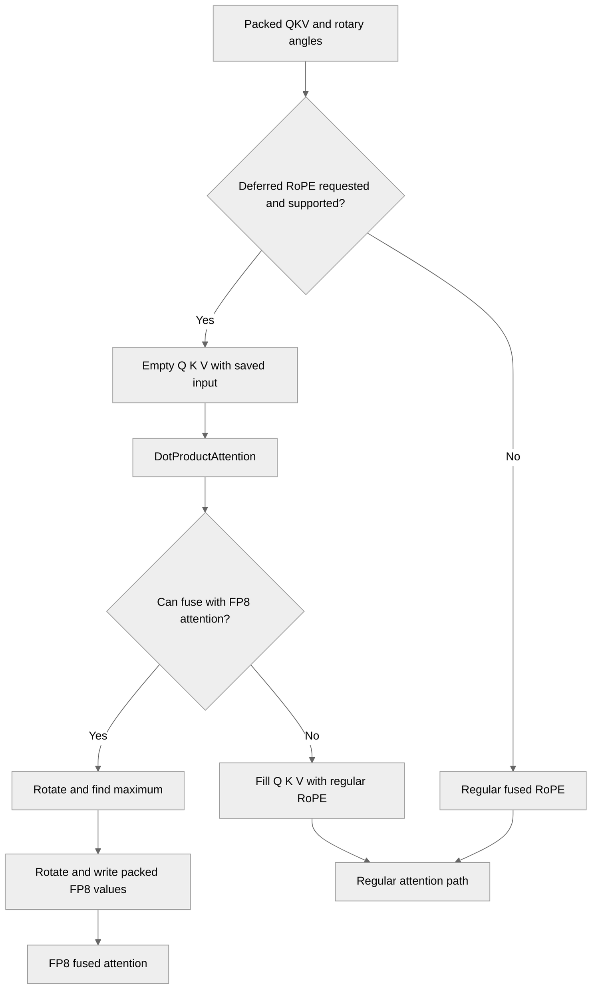

# Fused QKV ROPE - CS FP8 quantization

[Upstream PR](https://github.com/NVIDIA/TransformerEngine/pull/3675) · state: open · merged: False

## Original PR description

# Description

Please include a brief summary of the changes, relevant motivation and context.

Fixes # (issue)

## Type of change

- [ ] Documentation change (change only to the documentation, either a fix or a new content)
- [ ] Bug fix (non-breaking change which fixes an issue)
- [ ] New feature (non-breaking change which adds functionality)
- [ ] Breaking change (fix or feature that would cause existing functionality to not work as expected)
- [ ] Infra/Build change
- [ ] Code refactoring

## Changes

Please list the changes introduced in this PR:

- Change A
- Change B

# Checklist:

- [ ] I have read and followed the [contributing guidelines](https://github.com/NVIDIA/TransformerEngine/blob/main/CONTRIBUTING.rst)
- [ ] The functionality is complete
- [ ] I have commented my code, particularly in hard-to-understand areas
- [ ] I have made corresponding changes to the documentation
- [ ] My changes generate no new warnings
- [ ] I have added tests that prove my fix is effective or that my feature works
- [ ] New and existing unit tests pass locally with my changes

## Review and discussion

### reviews

- greptile-apps[bot] · COMMENTED · 2026-10-12T17:41:58Z · [source](https://github.com/NVIDIA/TransformerEngine/pull/3675#pullrequestreview-5494199252)

(No body; status only.)

### issue_comments

- greptile-apps[bot] · comment · 2026-10-12T17:41:52Z · [source](https://github.com/NVIDIA/TransformerEngine/pull/3675#issuecomment-6129469927)

<!-- greptile_summary -->

<h2><a href="https://app.greptile.com/api/retrigger?id=79287917"><picture><source media="(prefers-color-scheme: dark)" srcset="https://greptile-static-assets.s3.amazonaws.com/badges/RetriggerDark.svg?v=2"><source media="(prefers-color-scheme: light)" srcset="https://greptile-static-assets.s3.amazonaws.com/badges/Retrigger.svg?v=2"></picture></a>Confidence Score: 0/5</h2>

**[High impact]** Adds Triton kernels for FP8 quantization and fused RoPE operations\.

Fix the deferred-attention fallback, KV-cache ordering, kernel shape limits, table cache, and optional imports before merging.

<h2>Findings</h2>

1. &nbsp;**Attention fallback raises** <a href="https://github.com/NVIDIA/TransformerEngine/pull/3675#discussion_r4250803434">▶</a>
2. &nbsp;**KV cache reads empty placeholders** <a href="https://github.com/NVIDIA/TransformerEngine/pull/3675#discussion_r4250803438">▶</a>
3. &nbsp;**Some head counts cannot compile** <a href="https://github.com/NVIDIA/TransformerEngine/pull/3675#discussion_r4250803442">▶</a>
4. &nbsp;**Inference mode raises** <a href="https://github.com/NVIDIA/TransformerEngine/pull/3675#discussion_r4250803450">▶</a>
5. &nbsp;**Streams read unfinished tables** <a href="https://github.com/NVIDIA/TransformerEngine/pull/3675#discussion_r4250803458">▶</a>
6. &nbsp;**Ordinary attention now needs Triton** <a href="https://github.com/NVIDIA/TransformerEngine/pull/3675#discussion_r4250803462">▶</a>

<h3>Summary</h3>

Adds deferred fused-QKV RoPE and two-pass Triton FP8 current-scaling quantization.
- Attention can rotate and quantize deferred Q/K/V in one FP8 path.
- Large rowwise FP8 tensors use Triton for current scaling.

<h3>Diagram</h3>

<!-- greptile_confidence_score:0 -->

Reviews (1) · Last reviewed commit: ["\[pre-commit.ci\] auto fixes from pre-comm..."](https://github.com/nvidia/transformerengine/commit/c1ea01ddd630f40ebc214c36e5328d8b80de1001) · [Reviewed by Greptile](https://www.greptile.com/?utm_source=greptile_expert&utm_medium=github&utm_campaign=code_reviews&utm_content=nvidia/transformerengine)

### inline_comments

- greptile-apps[bot] · comment · 2026-10-12T17:41:55Z · [source](https://github.com/NVIDIA/TransformerEngine/pull/3675#discussion_r4250803434)

File: `transformer_engine/pytorch/attention/deferred_qkv_rope.py` · line 200

 **Attention fallback raises**

With `checkpoint_core_attention=True`, or FP8 forward with `NVTE_FP8_DPA_BWD=0`, `DotProductAttention` first calls `materialize()`. That sets `state.consumed=True` but leaves the state attached to `q`. The fused backend then calls `quantize_deferred()`, which raises “already consumed” instead of quantizing the filled tensors. Return `None` for an already materialized state so the regular quantization path can run.

**Knowledge Base Used:** [PyTorch attention execution](https://app.greptile.com/nvidia-public-github/-/custom-context/knowledge-base/nvidia/transformerengine/-/docs/pytorch-attention.md)

- greptile-apps[bot] · comment · 2026-10-12T17:41:55Z · [source](https://github.com/NVIDIA/TransformerEngine/pull/3675#discussion_r4250803438)

File: `transformer_engine/pytorch/attention/dot_product_attention/dot_product_attention.py` · line 2938

 **KV cache reads empty placeholders**

The new `materialize()` call runs after `inference_params.step()`. For an `sbhd` prefill using deferred RoPE, that earlier step already copies the uninitialized K/V placeholders into the cache and replaces `key_layer` and `value_layer` with cache tensors. The fallback then copies `sbhd` RoPE results into the `bshd` cache, which can raise for mismatched shapes or overwrite cached data incorrectly. Materialize the original placeholders before any KV-cache update.

**Knowledge Base Used:** [PyTorch attention execution](https://app.greptile.com/nvidia-public-github/-/custom-context/knowledge-base/nvidia/transformerengine/-/docs/pytorch-attention.md)

- greptile-apps[bot] · comment · 2026-10-12T17:41:56Z · [source](https://github.com/NVIDIA/TransformerEngine/pull/3675#discussion_r4250803442)

File: `transformer_engine/common/triton/rope_fp8.py` · line 77

 **Some head counts cannot compile**

`G` and `HQ` are passed directly to `tl.arange()`, which requires power-of-two range sizes. The deferred input checks allow other head counts, such as 12 query heads across 3 groups (`G=3`, `HQ=4`). These inputs reach the kernel and fail to compile instead of using the promised fallback. Pad these ranges and mask their loads and stores, or reject unsupported counts before returning placeholders.

- greptile-apps[bot] · comment · 2026-10-12T17:41:56Z · [source](https://github.com/NVIDIA/TransformerEngine/pull/3675#discussion_r4250803450)

File: `transformer_engine/pytorch/triton/rope_fp8.py` · line 37

 **Inference mode raises**

Accessing `freqs._version` raises for tensors created under `torch.inference_mode()`. A user who creates rotary embeddings inside that context and runs full-sequence FP8 attention without `InferenceParams` reaches this function through the deferred path. Even the first cache miss raises when storing the entry. Handle inference tensors without reading their version counter, for example by computing their tables without this cache.

- greptile-apps[bot] · comment · 2026-10-12T17:41:56Z · [source](https://github.com/NVIDIA/TransformerEngine/pull/3675#discussion_r4250803458)

File: `transformer_engine/pytorch/triton/rope_fp8.py` · line 32

 **Streams read unfinished tables**

The table cache is shared across CUDA streams, but a cache hit does not wait for the stream that computed `cos` and `sin`. If two attention calls share an already-ready frequency tensor on different streams, the second call can reuse the entry while the first stream is still writing its tables. It then rotates Q/K using unfinished values. Cache tables per stream or record an event and wait before another stream uses them.

- greptile-apps[bot] · comment · 2026-10-12T17:41:56Z · [source](https://github.com/NVIDIA/TransformerEngine/pull/3675#discussion_r4250803462)

File: `transformer_engine/pytorch/attention/deferred_qkv_rope.py` · line 198

 **Ordinary attention now needs Triton**

`quantize_deferred()` imports the Triton wrapper before checking whether `q` has deferred state. If Triton is absent, every ordinary FP8 fused-attention call now fails here, even when deferred RoPE is not requested. The new automatic large-tensor quantization path in `float8_tensor.py` also imports Triton without a fallback. The declared PyTorch requirements do not include Triton, and the existing fused MLA code treats it as optional. Move the deferred import below the state check and retain the native path when Triton is unavailable.

## Changed files and fixed code

- `tests/pytorch/test_float8_current_scaling_exact.py` · modified · additions 54 / deletions 0
  - [head](https://github.com/vasunvidia/TransformerEngine/blob/c1ea01ddd630f40ebc214c36e5328d8b80de1001/tests/pytorch/test_float8_current_scaling_exact.py)
  - [base](https://github.com/NVIDIA/TransformerEngine/blob/81775f2cc0052d3e75608664357a8f3d3f453897/tests/pytorch/test_float8_current_scaling_exact.py)
- `tests/pytorch/test_fused_rope.py` · modified · additions 89 / deletions 0
  - [head](https://github.com/vasunvidia/TransformerEngine/blob/c1ea01ddd630f40ebc214c36e5328d8b80de1001/tests/pytorch/test_fused_rope.py)
  - [base](https://github.com/NVIDIA/TransformerEngine/blob/81775f2cc0052d3e75608664357a8f3d3f453897/tests/pytorch/test_fused_rope.py)
- `transformer_engine/common/triton/current_scaling.py` · added · additions 69 / deletions 0
  - [head](https://github.com/vasunvidia/TransformerEngine/blob/c1ea01ddd630f40ebc214c36e5328d8b80de1001/transformer_engine/common/triton/current_scaling.py)
  - [base](https://github.com/NVIDIA/TransformerEngine/blob/81775f2cc0052d3e75608664357a8f3d3f453897/transformer_engine/common/triton/current_scaling.py)
- `transformer_engine/common/triton/rope_fp8.py` · added · additions 169 / deletions 0
  - [head](https://github.com/vasunvidia/TransformerEngine/blob/c1ea01ddd630f40ebc214c36e5328d8b80de1001/transformer_engine/common/triton/rope_fp8.py)
  - [base](https://github.com/NVIDIA/TransformerEngine/blob/81775f2cc0052d3e75608664357a8f3d3f453897/transformer_engine/common/triton/rope_fp8.py)
- `transformer_engine/pytorch/attention/deferred_qkv_rope.py` · added · additions 228 / deletions 0
  - [head](https://github.com/vasunvidia/TransformerEngine/blob/c1ea01ddd630f40ebc214c36e5328d8b80de1001/transformer_engine/pytorch/attention/deferred_qkv_rope.py)
  - [base](https://github.com/NVIDIA/TransformerEngine/blob/81775f2cc0052d3e75608664357a8f3d3f453897/transformer_engine/pytorch/attention/deferred_qkv_rope.py)
- `transformer_engine/pytorch/attention/dot_product_attention/backends.py` · modified · additions 17 / deletions 10
  - [head](https://github.com/vasunvidia/TransformerEngine/blob/c1ea01ddd630f40ebc214c36e5328d8b80de1001/transformer_engine/pytorch/attention/dot_product_attention/backends.py)
  - [base](https://github.com/NVIDIA/TransformerEngine/blob/81775f2cc0052d3e75608664357a8f3d3f453897/transformer_engine/pytorch/attention/dot_product_attention/backends.py)
- `transformer_engine/pytorch/attention/dot_product_attention/dot_product_attention.py` · modified · additions 32 / deletions 0
  - [head](https://github.com/vasunvidia/TransformerEngine/blob/c1ea01ddd630f40ebc214c36e5328d8b80de1001/transformer_engine/pytorch/attention/dot_product_attention/dot_product_attention.py)
  - [base](https://github.com/NVIDIA/TransformerEngine/blob/81775f2cc0052d3e75608664357a8f3d3f453897/transformer_engine/pytorch/attention/dot_product_attention/dot_product_attention.py)
- `transformer_engine/pytorch/attention/rope.py` · modified · additions 26 / deletions 0
  - [head](https://github.com/vasunvidia/TransformerEngine/blob/c1ea01ddd630f40ebc214c36e5328d8b80de1001/transformer_engine/pytorch/attention/rope.py)
  - [base](https://github.com/NVIDIA/TransformerEngine/blob/81775f2cc0052d3e75608664357a8f3d3f453897/transformer_engine/pytorch/attention/rope.py)
- `transformer_engine/pytorch/tensor/float8_tensor.py` · modified · additions 41 / deletions 0
  - [head](https://github.com/vasunvidia/TransformerEngine/blob/c1ea01ddd630f40ebc214c36e5328d8b80de1001/transformer_engine/pytorch/tensor/float8_tensor.py)
  - [base](https://github.com/NVIDIA/TransformerEngine/blob/81775f2cc0052d3e75608664357a8f3d3f453897/transformer_engine/pytorch/tensor/float8_tensor.py)
- `transformer_engine/pytorch/triton/current_scaling.py` · added · additions 61 / deletions 0
  - [head](https://github.com/vasunvidia/TransformerEngine/blob/c1ea01ddd630f40ebc214c36e5328d8b80de1001/transformer_engine/pytorch/triton/current_scaling.py)
  - [base](https://github.com/NVIDIA/TransformerEngine/blob/81775f2cc0052d3e75608664357a8f3d3f453897/transformer_engine/pytorch/triton/current_scaling.py)
- `transformer_engine/pytorch/triton/rope_fp8.py` · added · additions 99 / deletions 0
  - [head](https://github.com/vasunvidia/TransformerEngine/blob/c1ea01ddd630f40ebc214c36e5328d8b80de1001/transformer_engine/pytorch/triton/rope_fp8.py)
  - [base](https://github.com/NVIDIA/TransformerEngine/blob/81775f2cc0052d3e75608664357a8f3d3f453897/transformer_engine/pytorch/triton/rope_fp8.py)

## Evidence and interpretation boundary

[Original JSON, discussions and patches](../../../../../../evidence/prs/NVIDIA--TransformerEngine/3675-f5183b851caa1ccf1f91fb7183d3e6b07f852c3045b6ceed2ce836873434ca09.json) · SHA-256 `f5183b851caa1ccf1f91fb7183d3e6b07f852c3045b6ceed2ce836873434ca09`.

Diff complete: True. Missing/binary/truncated patches require pinned source inspection. This is a source page, not an independently verified optimization case. Open, merged and released are different states; recheck the deployed dependency.
