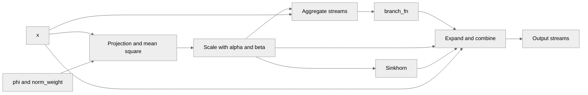

# Integrating TE Triton mHC kernels into JAX

[Upstream PR](https://github.com/NVIDIA/TransformerEngine/pull/3680) · state: open · merged: False

## Original PR description

# Description

This PR integrates TE's mHC Triton kernels into an API that can be called by JAX users so that they can use fused mHC kernels. This will provide speedup over JAX's native mHC implementation and thus improve E2E performance. This is important to maintain the best possible E2E training perf across all frameworks and support new models, such as DSv4.

## Type of change

- [ ] Documentation change (change only to the documentation, either a fix or a new content)
- [ ] Bug fix (non-breaking change which fixes an issue)
- [x] New feature (non-breaking change which adds functionality)
- [ ] Breaking change (fix or feature that would cause existing functionality to not work as expected)
- [ ] Infra/Build change
- [ ] Code refactoring

## Changes

Please list the changes introduced in this PR:

- Created JAX bindings to the mHC Triton kernels (following the same pattern as `permutation.py`)
- Exposed an API with custom_vjp bindings for seamless jax.grad compatibility
- Added tests for mHC triton kernels on the Jax implementation side
- Fixed a race condition in the Triton `_mhc_sinkhorn_bwd_fused_recompute` kernel where threads starting the backward pass started reading recomputed forward pass activations before they were done being written
- Made framework-agnostic support for querying `_max_shared_mem()` depending on Triton version

# Checklist:

- [x] I have read and followed the [contributing guidelines](https://github.com/NVIDIA/TransformerEngine/blob/main/CONTRIBUTING.rst)
- [x] The functionality is complete
- [x] I have commented my code, particularly in hard-to-understand areas
- [x] I have made corresponding changes to the documentation
- [x] My changes generate no new warnings
- [x] I have added tests that prove my fix is effective or that my feature works
- [x] New and existing unit tests pass locally with my changes


## Review and discussion

### reviews

- greptile-apps[bot] · COMMENTED · 2026-10-13T14:39:52Z · [source](https://github.com/NVIDIA/TransformerEngine/pull/3680#pullrequestreview-5505277349)

(No body; status only.)

- dinodeep · COMMENTED · 2026-10-13T17:01:14Z · [source](https://github.com/NVIDIA/TransformerEngine/pull/3680#pullrequestreview-5507150624)

(No body; status only.)

- greptile-apps[bot] · COMMENTED · 2026-10-13T17:01:43Z · [source](https://github.com/NVIDIA/TransformerEngine/pull/3680#pullrequestreview-5507156285)

(No body; status only.)

- greptile-apps[bot] · COMMENTED · 2026-10-13T17:12:22Z · [source](https://github.com/NVIDIA/TransformerEngine/pull/3680#pullrequestreview-5507279364)

(No body; status only.)

- greptile-apps[bot] · COMMENTED · 2026-10-13T17:25:35Z · [source](https://github.com/NVIDIA/TransformerEngine/pull/3680#pullrequestreview-5507427089)

(No body; status only.)

- jberchtold-nvidia · COMMENTED · 2026-10-13T22:45:16Z · [source](https://github.com/NVIDIA/TransformerEngine/pull/3680#pullrequestreview-5510731416)

(No body; status only.)

- dinodeep · COMMENTED · 2026-10-14T13:37:16Z · [source](https://github.com/NVIDIA/TransformerEngine/pull/3680#pullrequestreview-5518789174)

(No body; status only.)

- dinodeep · COMMENTED · 2026-10-14T13:54:51Z · [source](https://github.com/NVIDIA/TransformerEngine/pull/3680#pullrequestreview-5519056161)

(No body; status only.)

- jberchtold-nvidia · COMMENTED · 2026-10-14T15:37:28Z · [source](https://github.com/NVIDIA/TransformerEngine/pull/3680#pullrequestreview-5520532433)

(No body; status only.)

- jberchtold-nvidia · COMMENTED · 2026-10-14T15:38:08Z · [source](https://github.com/NVIDIA/TransformerEngine/pull/3680#pullrequestreview-5520539012)

(No body; status only.)

- jberchtold-nvidia · COMMENTED · 2026-10-14T15:39:54Z · [source](https://github.com/NVIDIA/TransformerEngine/pull/3680#pullrequestreview-5520565431)

(No body; status only.)

- dinodeep · COMMENTED · 2026-10-14T16:34:16Z · [source](https://github.com/NVIDIA/TransformerEngine/pull/3680#pullrequestreview-5521278643)

(No body; status only.)

- dinodeep · COMMENTED · 2026-10-14T16:41:47Z · [source](https://github.com/NVIDIA/TransformerEngine/pull/3680#pullrequestreview-5521372882)

(No body; status only.)

- kainzhong · COMMENTED · 2026-10-14T17:40:25Z · [source](https://github.com/NVIDIA/TransformerEngine/pull/3680#pullrequestreview-5522103637)

(No body; status only.)

- greptile-apps[bot] · COMMENTED · 2026-10-14T21:42:01Z · [source](https://github.com/NVIDIA/TransformerEngine/pull/3680#pullrequestreview-5525052115)

(No body; status only.)

### issue_comments

- greptile-apps[bot] · comment · 2026-10-13T14:39:46Z · [source](https://github.com/NVIDIA/TransformerEngine/pull/3680#issuecomment-6148093460)

<!-- greptile_summary -->

<h2><a href="https://app.greptile.com/api/retrigger?id=79931616"><picture><source media="(prefers-color-scheme: dark)" srcset="https://greptile-static-assets.s3.amazonaws.com/badges/RetriggerDark.svg?v=2"><source media="(prefers-color-scheme: light)" srcset="https://greptile-static-assets.s3.amazonaws.com/badges/Retrigger.svg?v=2"></picture></a><a href="https://app.greptile.com/nvidia-public-github/github/NVIDIA/transformerengine/-/pull/3680"><picture><source media="(prefers-color-scheme: dark)" srcset="https://greptile-static-assets.s3.amazonaws.com/badges/ViewInGreptileDark.svg?v=2"><source media="(prefers-color-scheme: light)" srcset="https://greptile-static-assets.s3.amazonaws.com/badges/ViewInGreptile.svg?v=2"></picture></a>Confidence Score: 5/5</h2>

**[Medium impact]** The latest change appears safe to merge; the two remaining gradient-precision findings are non-blocking.

<h2>Findings</h2>

1. &nbsp;**Projection gradients lose precision** <a href="https://github.com/NVIDIA/TransformerEngine/pull/3680#discussion_r4261722815">▶</a>
2. &nbsp;**Float32 gradients lose precision** <a href="https://github.com/NVIDIA/TransformerEngine/pull/3680#discussion_r4261849237">▶</a>

<h3>Summary</h3>

Adds JAX APIs for the Triton mHC kernels, with custom backward rules and tests.
- JAX users can run four-stream mHC through fused Triton operations.
- JAX Triton launches pass aligned pointers and support global scratch.
- Sinkhorn backward waits for recomputed history before reading it.
- mHC config pruning can query shared memory across Triton versions.

Thread context: `dinodeep` deferred `jax.vmap` support to a future PR. The earlier-gradient thread was manually resolved without explanation; the current API now explicitly says that `mhc_expand_combine_bwd` overwrites the supplied buffer. The bias-gradient and distributed-test threads were resolved without explanatory replies; the current code keeps `grad_beta` in float32 and adds distributed gradient tests.

<h3>Diagram</h3>



<!-- greptile_confidence_score:5 -->

<sub>Reviews (9) · Last reviewed commit: ["Fixing test that should be gated by jax ..."](https://github.com/nvidia/transformerengine/commit/1fbfeb4a41ed0498f219222a69bfe992fbb3eb50) · [Reviewed by Greptile](https://www.greptile.com/?utm_source=greptile_expert&utm_medium=github&utm_campaign=code_reviews&utm_content=nvidia/transformerengine)</sub>

- jberchtold-nvidia · comment · 2026-10-13T22:07:04Z · [source](https://github.com/NVIDIA/TransformerEngine/pull/3680#issuecomment-6156198496)

/te-ci L1 jax

- jberchtold-nvidia · comment · 2026-10-14T18:06:17Z · [source](https://github.com/NVIDIA/TransformerEngine/pull/3680#issuecomment-6175008916)

/te-ci L1

- jberchtold-nvidia · comment · 2026-10-15T15:48:07Z · [source](https://github.com/NVIDIA/TransformerEngine/pull/3680#issuecomment-6196190334)

/te-ci L1

- jberchtold-nvidia · comment · 2026-10-16T16:05:47Z · [source](https://github.com/NVIDIA/TransformerEngine/pull/3680#issuecomment-6219532872)

/te-ci L1 arm

### inline_comments

- greptile-apps[bot] · comment · 2026-10-13T14:39:50Z · [source](https://github.com/NVIDIA/TransformerEngine/pull/3680#discussion_r4260061377)

File: `transformer_engine/jax/triton_extensions/mhc.py` · line 1326

<a href="#"></a> **Earlier gradients are overwritten**

`mhc_expand_combine_bwd` promises to add its gradient to `grad_x_acc`, but the kernel only overwrites that buffer. Passing a nonzero buffer loses the gradients already stored there. Add the incoming buffer to the new gradient before storing it, or add them outside the kernel.

- greptile-apps[bot] · comment · 2026-10-13T14:39:50Z · [source](https://github.com/NVIDIA/TransformerEngine/pull/3680#discussion_r4260061394)

File: `transformer_engine/jax/triton_extensions/mhc.py` · line 148

<a href="#"></a> **Mapped mHC calls fail**

The new primitives inherit `BasePrimitive.batcher`, which takes no arguments and implements no batching rule. `jax.vmap` over `mhc_aggregate`, or over the composed `mhc`, reaches this method and fails instead of running the operator. Add batching rules that keep the mapped axis among the token dimensions.

- greptile-apps[bot] · comment · 2026-10-13T14:39:50Z · [source](https://github.com/NVIDIA/TransformerEngine/pull/3680#discussion_r4260061402)

File: `transformer_engine/jax/triton_extensions/mhc.py` · line None

<a href="#"></a> **Bias gradients lose precision**

`mhc_scale_bwd` casts `grad_beta` to `alpha.dtype` before the public backward rule casts it to `beta.dtype`. With bfloat16 `alpha` and float32 `beta`, this needlessly rounds the float32 bias gradient. The second cast cannot recover that precision. Keep `grad_beta` in float32 until the public rule casts it to `beta.dtype`, and cover this mixed-type case.

```suggestion
    return grad_h, grad_alpha.astype(alpha.dtype), grad_beta, grad_ms
```

- greptile-apps[bot] · comment · 2026-10-13T14:39:50Z · [source](https://github.com/NVIDIA/TransformerEngine/pull/3680#discussion_r4260061431)

File: `tests/jax/test_mhc.py` · line 520

<a href="#"></a> **Distributed gradients lack coverage**

The new tests never exercise token sharding, so they do not check the cross-device sums added by `_MHCPrimitive.partition`. Add a multi-device forward-and-gradient comparison with a token dimension split across devices. Check `phi`, `norm_weight`, `alpha`, `beta`, and the optional branch bias against the unsharded reference.

- dinodeep · comment · 2026-10-13T17:01:14Z · [source](https://github.com/NVIDIA/TransformerEngine/pull/3680#discussion_r4261611487)

File: `transformer_engine/jax/triton_extensions/mhc.py` · line 148

For now, this PR doesn't plan to add the features for `jax.vmap` support. It can come in a future PR

- greptile-apps[bot] · comment · 2026-10-13T17:01:43Z · [source](https://github.com/NVIDIA/TransformerEngine/pull/3680#discussion_r4261616481)

File: `transformer_engine/jax/triton_extensions/mhc.py` · line 148

Understood — if `jax.vmap` is intentionally out of scope for this PR, this can be deferred to a follow-up rather than blocking the current change. The limitation should still be documented in the JAX API documentation (and ideally covered by an explicit unsupported-transform test or follow-up issue), since users may otherwise expect standard JAX transformations such as `vmap` to work with the `custom_vjp` API.

Tip: You can customize Greptile's behavior for this repo with [`.greptile/rules.md` and `.greptile/config.json`](https://www.greptile.com/docs/code-review/custom-standards).

- greptile-apps[bot] · comment · 2026-10-13T17:12:21Z · [source](https://github.com/NVIDIA/TransformerEngine/pull/3680#discussion_r4261722804)

File: `transformer_engine/jax/triton_extensions/mhc.py` · line None

<a href="#"></a> **Mixed-type branches cannot train**

With bfloat16 `x`, a branch that returns float32 `f` can run forward but cannot compile backward. `mhc_expand_combine_bwd` passes both arrays unchanged to the kernel, where `grad_H_post` uses `tl.dot` on float32 `f` and bfloat16 `grad_out`. A float32 branch bias causes the same mismatch.

Cast these dot-product inputs to a common type while preserving each returned gradient's expected type.

- greptile-apps[bot] · comment · 2026-10-13T17:12:21Z · [source](https://github.com/NVIDIA/TransformerEngine/pull/3680#discussion_r4261722815)

File: `transformer_engine/jax/triton_extensions/mhc.py` · line 1555

<a href="#"></a> **Projection gradients lose precision**

`mhc_projection_bwd` passes the original bfloat16 `phi` to the input-gradient kernel, even when forward promoted it to float32 for `use_tf32=False`. The kernel then rounds float32 `grad_h` to bfloat16 before multiplying. It also rounds a float32 `norm_weight` to bfloat16, unlike forward.

This needlessly reduces gradient accuracy. Promote `phi` before the input-gradient call so these values keep their precision.

- greptile-apps[bot] · comment · 2026-10-13T17:25:34Z · [source](https://github.com/NVIDIA/TransformerEngine/pull/3680#discussion_r4261849237)

File: `transformer_engine/jax/triton_extensions/mhc.py` · line 1799

<a href="#"></a> **Float32 gradients lose precision**

With float32 `f` and bfloat16 `x`, this cast also makes the kernel allocate and store `grad_f` in bfloat16. Casting it back to float32 cannot recover the lost bits, so the branch's backward pass receives unnecessarily rounded gradients.

Keep the gradient buffer and final kernel store in the original `f.dtype`, even if the dot-product inputs need separate casts. The new test compares against a bfloat16 `f`, so it misses this extra rounding.

- jberchtold-nvidia · comment · 2026-10-13T22:20:17Z · [source](https://github.com/NVIDIA/TransformerEngine/pull/3680#discussion_r4264660868)

File: `tests/jax/test_distributed_mhc.py` · line 147

I wasn't aware of `.sharding.is_equivalent_to` and `is_fully_replicated`, good to know!

- jberchtold-nvidia · comment · 2026-10-13T22:33:37Z · [source](https://github.com/NVIDIA/TransformerEngine/pull/3680#discussion_r4264767689)

File: `transformer_engine/common/triton/mhc.py` · line 342

Was this fix found by you+your agent or did you pull this from a recent TE PR? I recall a similar issue a few weeks ago with some Triton kernels, but I can't recall if it was mHC. Let me follow-up with Kaining about this to get more info

- jberchtold-nvidia · comment · 2026-10-13T22:39:03Z · [source](https://github.com/NVIDIA/TransformerEngine/pull/3680#discussion_r4264806337)

File: `transformer_engine/jax/triton_extensions/mhc.py` · line None

Did you find `USE_TMA=False` to be required for correctness in your debugging? If so, what behavior did USE_TMA=True cause?

If this is a core limitation of JAX/XLA's Triton bindings, then we may need to use this WAR for now but also try to get this fixed in JAX/XLA as I suspect USE_TMA=False will be less performant.

- dinodeep · comment · 2026-10-14T13:37:16Z · [source](https://github.com/NVIDIA/TransformerEngine/pull/3680#discussion_r4271496231)

File: `transformer_engine/common/triton/mhc.py` · line 342

Yea this was found by me+agent. Apparently prior to triton 3.8, `driver.utils.get_device_properties(driver.get_current_device())` here would import torch which is not desirable for JAX. 

Since Triton 3.8 is relatively new, it would be hard to restrict users to it, but there is a way to request max shared mem for users differently until Triton 3.2 (and maybe earlier versions as well) which was released early 2025. I thought that this was more acceptable and would be valid for users who aren't using the most up-to-date Triton

- dinodeep · comment · 2026-10-14T13:54:51Z · [source](https://github.com/NVIDIA/TransformerEngine/pull/3680#discussion_r4271700913)

File: `transformer_engine/jax/triton_extensions/mhc.py` · line None

It was more that I didn't know how to try out `USE_TMA=True`. To enable TMA, you need to set Triton's allocator with a way to eagerly allocate memory like how `torch` does it

```
    def alloc_fn(
        size: int, alignment: int, stream: Optional[int]
    ):  # pylint: disable=unused-argument
        return torch.empty(size, device="cuda", dtype=torch.int8)

    triton.set_allocator(alloc_fn)
```

This is necessary so that triton can allocate memory in its kernels, specifically for allocating TMA descriptors on the device ` x_desc = tl.make_tensor_descriptor(...)`. Supposedly, with the current way Triton kernels execute in XLA, they wouldn't call Triton's Python `allocator` since that is only called through the Python launch (which does allocation, compilation, and execution). Instead, JAX/XLA compiles it directly and doesn't do the Python launch which misses the allocation of the extra scratch space.

 If you have any ideas on how to do this, that would be great. This might require more support from TE's current handling of Triton kernels or even JAX/XLA, but for now, I just left it as False. Hacking a working change would require changes based on non-public implementation details I fear, so I was kind of stumped. 
 
~~The TMA usage is primarily used to load memory among other operations in the kernel (as opposed to a copy operation), so I thought the performance improvement wouldn't be super significant which is another reason why I left it as False.~~

- jberchtold-nvidia · comment · 2026-10-14T15:37:28Z · [source](https://github.com/NVIDIA/TransformerEngine/pull/3680#discussion_r4272917982)

File: `transformer_engine/common/triton/mhc.py` · line 960

Why was this added? Was this a bug in the original kernel? And if so, what behavior do you observe when this fix wasn't included?

- jberchtold-nvidia · comment · 2026-10-14T15:38:08Z · [source](https://github.com/NVIDIA/TransformerEngine/pull/3680#discussion_r4272923467)

File: `transformer_engine/common/triton/mhc.py` · line 342

Got it, thanks! This solution sounds good to me

- jberchtold-nvidia · comment · 2026-10-14T15:39:54Z · [source](https://github.com/NVIDIA/TransformerEngine/pull/3680#discussion_r4272944829)

File: `transformer_engine/jax/triton_extensions/mhc.py` · line None

Got it, I was expecting something along these lines. I'm not aware of any way to get the JAX/XLA allocator here either, I think this is a limitation in JAX/XLA, let me follow-up offline for improving that, but this solution works for this PR

- dinodeep · comment · 2026-10-14T16:34:16Z · [source](https://github.com/NVIDIA/TransformerEngine/pull/3680#discussion_r4273533915)

File: `transformer_engine/common/triton/mhc.py` · line 960

Yea, this was a bug in the original kernel that I observed when testing it out
```
Fixed a race condition in the Triton _mhc_sinkhorn_bwd_fused_recompute kernel where threads starting the backward pass started reading recomputed forward pass activations before they were done being written
```

There was a race condition that would occur when the number of sinkhorn iterations were small (<= 2) which wasn't exposed when the iteration count was large (e.g. 20, which is what prior tests for this kernel were implemented with). Without this barrier, when the sinkhorn iterations were small, readers would read unwritten values which would lead to garbage final results in the kernel.

This barrier prevents that from happening. It only occurs once per invocation of that kernel, so it shouldn't be impact perf heavily.

- dinodeep · comment · 2026-10-14T16:41:46Z · [source](https://github.com/NVIDIA/TransformerEngine/pull/3680#discussion_r4273611847)

File: `transformer_engine/jax/triton_extensions/mhc.py` · line None

When comparing the runs in pytorch, it turns out setting `USE_TMA=True` improves perf by `1.72x (416us -> 241us)` which is quite substantial, so it would actually be useful to enable this option.

- kainzhong · comment · 2026-10-14T17:40:25Z · [source](https://github.com/NVIDIA/TransformerEngine/pull/3680#discussion_r4274206405)

File: `transformer_engine/common/triton/mhc.py` · line 960

Ah yes you are right. I was using 20 all the time (which is the number of iteration they use for the real model) so I didn't notice. Thanks for fixing it!

- greptile-apps[bot] · comment · 2026-10-14T21:42:00Z · [source](https://github.com/NVIDIA/TransformerEngine/pull/3680#discussion_r4276575783)

File: `tests/jax/test_mhc.py` · line None

<a href="#"></a> **Older JAX tests fail**

On Hopper or newer GPUs with JAX 0.8.0 through versions below 0.11.1, `test_mhc_projection_tma_gate` expects TMA when the GPU and row strides qualify. But `_projection_fwd_use_tma` also requires JAX 0.11.1, so three cases fail even though the gate behaves correctly. The `triton` marker does not skip these supported versions.

Include the JAX version requirement in the expected value.

Note: If this suggestion doesn't match your team's coding style, reply to this and let me know. I'll remember it for next time!

## Changed files and fixed code

- `tests/jax/test_distributed_mhc.py` · added · additions 153 / deletions 0
  - [head](https://github.com/dinodeep/TransformerEngine/blob/1fbfeb4a41ed0498f219222a69bfe992fbb3eb50/tests/jax/test_distributed_mhc.py)
  - [base](https://github.com/NVIDIA/TransformerEngine/blob/6ca7b5aa88ef2e1497f7a896ca1d9bd80442222e/tests/jax/test_distributed_mhc.py)
- `tests/jax/test_mhc.py` · added · additions 577 / deletions 0
  - [head](https://github.com/dinodeep/TransformerEngine/blob/1fbfeb4a41ed0498f219222a69bfe992fbb3eb50/tests/jax/test_mhc.py)
  - [base](https://github.com/NVIDIA/TransformerEngine/blob/6ca7b5aa88ef2e1497f7a896ca1d9bd80442222e/tests/jax/test_mhc.py)
- `transformer_engine/common/triton/mhc.py` · modified · additions 27 / deletions 3
  - [head](https://github.com/dinodeep/TransformerEngine/blob/1fbfeb4a41ed0498f219222a69bfe992fbb3eb50/transformer_engine/common/triton/mhc.py)
  - [base](https://github.com/NVIDIA/TransformerEngine/blob/6ca7b5aa88ef2e1497f7a896ca1d9bd80442222e/transformer_engine/common/triton/mhc.py)
- `transformer_engine/jax/mhc.py` · added · additions 444 / deletions 0
  - [head](https://github.com/dinodeep/TransformerEngine/blob/1fbfeb4a41ed0498f219222a69bfe992fbb3eb50/transformer_engine/jax/mhc.py)
  - [base](https://github.com/NVIDIA/TransformerEngine/blob/6ca7b5aa88ef2e1497f7a896ca1d9bd80442222e/transformer_engine/jax/mhc.py)
- `transformer_engine/jax/triton_extensions/__init__.py` · modified · additions 1 / deletions 0
  - [head](https://github.com/dinodeep/TransformerEngine/blob/1fbfeb4a41ed0498f219222a69bfe992fbb3eb50/transformer_engine/jax/triton_extensions/__init__.py)
  - [base](https://github.com/NVIDIA/TransformerEngine/blob/6ca7b5aa88ef2e1497f7a896ca1d9bd80442222e/transformer_engine/jax/triton_extensions/__init__.py)
- `transformer_engine/jax/triton_extensions/mhc.py` · added · additions 1813 / deletions 0
  - [head](https://github.com/dinodeep/TransformerEngine/blob/1fbfeb4a41ed0498f219222a69bfe992fbb3eb50/transformer_engine/jax/triton_extensions/mhc.py)
  - [base](https://github.com/NVIDIA/TransformerEngine/blob/6ca7b5aa88ef2e1497f7a896ca1d9bd80442222e/transformer_engine/jax/triton_extensions/mhc.py)
- `transformer_engine/jax/triton_extensions/utils.py` · modified · additions 95 / deletions 9
  - [head](https://github.com/dinodeep/TransformerEngine/blob/1fbfeb4a41ed0498f219222a69bfe992fbb3eb50/transformer_engine/jax/triton_extensions/utils.py)
  - [base](https://github.com/NVIDIA/TransformerEngine/blob/6ca7b5aa88ef2e1497f7a896ca1d9bd80442222e/transformer_engine/jax/triton_extensions/utils.py)
- `transformer_engine/jax/version_utils.py` · modified · additions 5 / deletions 0
  - [head](https://github.com/dinodeep/TransformerEngine/blob/1fbfeb4a41ed0498f219222a69bfe992fbb3eb50/transformer_engine/jax/version_utils.py)
  - [base](https://github.com/NVIDIA/TransformerEngine/blob/6ca7b5aa88ef2e1497f7a896ca1d9bd80442222e/transformer_engine/jax/version_utils.py)

## Evidence and interpretation boundary

[Original JSON, discussions and patches](../../../../../../evidence/prs/NVIDIA--TransformerEngine/3680-c33b54f57604b14c9f4b4b2733554ced9de7ac8d5bf464bc08114f9e8e728a94.json) · SHA-256 `c33b54f57604b14c9f4b4b2733554ced9de7ac8d5bf464bc08114f9e8e728a94`.

Diff complete: True. Missing/binary/truncated patches require pinned source inspection. This is a source page, not an independently verified optimization case. Open, merged and released are different states; recheck the deployed dependency.
