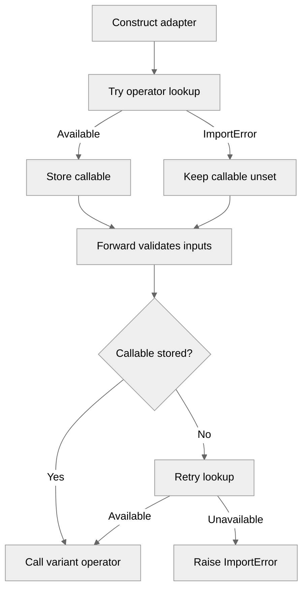

# [PyTorch] Fix full-graph compilation of linear attention

[Upstream PR](https://github.com/NVIDIA/TransformerEngine/pull/3685) · state: closed · merged: True

## Original PR description

# Description

Fix `torch.compile(fullgraph=True)` for GDN, GDN2, and DeltaProduct. Importing the cuDNN operator during forward makes Dynamo reject the full graph, including after eager warm-up.

## Type of change

- [x] Bug fix

## Changes

Resolve and store `self._op` during adapter construction when the cuDNN backend is available. If importing the operator fails, construction still succeeds and the adapter retries on its first forward call. Importing TE remains independent of loading this backend.

The variant-specific `_call_op` implementations invoke `self._op` directly, removing the cached import helper and redundant `op` parameter. Public signatures, explicit kernel arguments, validation, Householder reshaping, and the dense sequence-offset cache are preserved.

Add 36 fullgraph variants to the existing tests, covering FP16/BF16 BSHD/SBHD layouts and THD outputs, final state, and gradients against independent FP64 references. Compile runs without eager warm-up; existing tolerances and eager/checkpoint coverage remain.

Keep module construction independent of backend availability and test that a missing runtime is reported on the first run.

Adapt KDA, added by the merge from `main`, to the same dispatch contract: remove its obsolete `op` argument and call `self._op`. Existing KDA numerical tests already run in PyTorch L0.

## Validation

The B100 results below describe the earlier GDN/GDN2/DeltaProduct revision, before the October 20 optional-backend and KDA follow-ups.

On B100 with PyTorch 2.15 nightly, CUDA 13.5, and cuDNN Frontend 1.29:

- Final-source focused validation: 27 passed (24 THD fullgraph cases and 3 state round-trip cases), without skips.
- With the backend import blocked: all six module-logic tests pass and 123 kernel cases skip; the previous tests fail at construction. The required-backend collection guards still fail as intended.
- With the backend available: all six module-logic tests pass, followed in the same process by three real fullgraph BF16 numerical cases (one per API).
- Pre-fix regression check: one BF16 BSHD compile case per API failed at the original import in forward.
- Pre-commit, full production Python lint (10.00/10), license checks, and `git diff --check` passed. Lint retains an informational I1101 in unchanged MLA code.
- All 224 local, installed, and lint-tree Python sources matched the validated snapshot.

For the KDA dispatch follow-up, isolated checks of the actual adapter methods on the workstation reproduced the original missing-`cu_seqlens` error and passed after the fix, including default and optional argument forwarding. All four adapter signatures match the shared call; Black, syntax, source-hash and diff checks passed. This check did not execute TE kernels or `torch.compile`; PyTorch L0 was requested for the new commit.

Existing native libraries were reused. Local validation did not cover dynamic shapes, CUDA Graphs, or the full L0 suite.

# Checklist

- [x] Read and followed the contributing guidelines
- [x] DCO sign-off included
- [x] Focused validation and applicable lint checks passed
- [x] Added repository regression coverage
- [x] Human author reviewed and approved publication for maintainer review

## Review and discussion

### reviews

- greptile-apps[bot] · COMMENTED · 2026-10-14T15:17:08Z · [source](https://github.com/NVIDIA/TransformerEngine/pull/3685#pullrequestreview-5520245863)

(No body; status only.)

- ksivaman · DISMISSED · 2026-10-20T15:54:28Z · [source](https://github.com/NVIDIA/TransformerEngine/pull/3685#pullrequestreview-5587780050)

LGTM.

Made a minor refactor to not require cudnnFE during init, as this would cause errors in many workloads that import parts from TE without having FE in the environment.

- greptile-apps[bot] · COMMENTED · 2026-10-20T15:54:35Z · [source](https://github.com/NVIDIA/TransformerEngine/pull/3685#pullrequestreview-5587781195)

(No body; status only.)

- ksivaman · APPROVED · 2026-10-20T16:22:45Z · [source](https://github.com/NVIDIA/TransformerEngine/pull/3685#pullrequestreview-5588151205)

(No body; status only.)

### issue_comments

- pggPL · comment · 2026-10-14T15:13:45Z · [source](https://github.com/NVIDIA/TransformerEngine/pull/3685#issuecomment-6171635407)

/te-ci pytorch L0

- greptile-apps[bot] · comment · 2026-10-14T15:17:03Z · [source](https://github.com/NVIDIA/TransformerEngine/pull/3685#issuecomment-6171701417)

<!-- greptile_summary -->

<h2><a href="https://app.greptile.com/api/retrigger?id=80742744"><picture><source media="(prefers-color-scheme: dark)" srcset="https://greptile-static-assets.s3.amazonaws.com/badges/RetriggerDark.svg?v=2"><source media="(prefers-color-scheme: light)" srcset="https://greptile-static-assets.s3.amazonaws.com/badges/Retrigger.svg?v=2"></picture></a><a href="https://app.greptile.com/nvidia-public-github/github/NVIDIA/transformerengine/-/pull/3685"><picture><source media="(prefers-color-scheme: dark)" srcset="https://greptile-static-assets.s3.amazonaws.com/badges/ViewInGreptileDark.svg?v=2"><source media="(prefers-color-scheme: light)" srcset="https://greptile-static-assets.s3.amazonaws.com/badges/ViewInGreptile.svg?v=2"></picture></a>Confidence Score: 5/5</h2>

**[Medium impact]** The PR appears safe to merge; no actionable new issue remains.

<h3>Summary</h3>

The PR resolves and stores each cuDNN operator during module construction so normal forward calls no longer import it while `torch.compile` traces them.

- Linear attention uses cuDNN operators resolved before its forward calls.

<h3>Diagram</h3>

<!-- greptile_confidence_score:5 -->

Reviews (5) · Last reviewed commit: ["Merge branch &#39;main&#39; into gdn\_compile\_op\_..."](https://github.com/nvidia/transformerengine/commit/29c592a1c0ca81a8dcf74b63c6955e1b0e61c834) · [Reviewed by Greptile](https://www.greptile.com/?utm_source=greptile_review&utm_medium=github&utm_campaign=review_public&utm_content=nvidia/transformerengine)

- ksivaman · comment · 2026-10-20T16:23:14Z · [source](https://github.com/NVIDIA/TransformerEngine/pull/3685#issuecomment-6295704500)

/te-ci pytorch L0

### inline_comments

- greptile-apps[bot] · comment · 2026-10-14T15:17:06Z · [source](https://github.com/NVIDIA/TransformerEngine/pull/3685#discussion_r4272677420)

File: `transformer_engine/pytorch/attention/linear_attention/base.py` · line None

 **Tests without cuDNN now fail**

If a CUDA machine lacks the optional linear-attention operators, construction now raises `ImportError` in existing tests that do not require this backend. `test_gdn_runs_te_forward_lifecycle` fails before it can replace the kernel, and `test_gdn2_module_carries_no_quantization_state` fails before its assertions. Several gate-validation tests also lack backend guards.

Mock operator lookup in tests meant to run without the backend, or add the matching availability guard where the backend is required.

- greptile-apps[bot] · comment · 2026-10-20T15:54:33Z · [source](https://github.com/NVIDIA/TransformerEngine/pull/3685#discussion_r4327111859)

File: `transformer_engine/pytorch/attention/linear_attention/base.py` · line 329

 **KDA forward calls fail**

`_run` no longer passes `op` to `_call_op`, but `_KDAKernelAdapter._call_op` still requires it. With the KDA backend installed, valid `KimiDeltaAttention` calls now raise `TypeError` for the missing `cu_seqlens` argument before reaching the kernel. Update the KDA override to drop `op` and call `self._op`, like the other adapters.

**Knowledge Base Used:** [PyTorch attention execution](https://app.greptile.com/nvidia-public-github/-/custom-context/knowledge-base/nvidia/transformerengine/-/docs/pytorch-attention.md)

## Changed files and fixed code

- `tests/pytorch/attention/test_gdn2_attention.py` · modified · additions 11 / deletions 4
  - [head](https://github.com/pggPL/TransformerEngine/blob/29c592a1c0ca81a8dcf74b63c6955e1b0e61c834/tests/pytorch/attention/test_gdn2_attention.py)
  - [base](https://github.com/NVIDIA/TransformerEngine/blob/fd7d03b1fa8e4b4b77232498684e95024f0d5407/tests/pytorch/attention/test_gdn2_attention.py)
- `tests/pytorch/attention/test_gdn_attention.py` · modified · additions 25 / deletions 4
  - [head](https://github.com/pggPL/TransformerEngine/blob/29c592a1c0ca81a8dcf74b63c6955e1b0e61c834/tests/pytorch/attention/test_gdn_attention.py)
  - [base](https://github.com/NVIDIA/TransformerEngine/blob/fd7d03b1fa8e4b4b77232498684e95024f0d5407/tests/pytorch/attention/test_gdn_attention.py)
- `tests/pytorch/attention/test_gdp_attention.py` · modified · additions 11 / deletions 6
  - [head](https://github.com/pggPL/TransformerEngine/blob/29c592a1c0ca81a8dcf74b63c6955e1b0e61c834/tests/pytorch/attention/test_gdp_attention.py)
  - [base](https://github.com/NVIDIA/TransformerEngine/blob/fd7d03b1fa8e4b4b77232498684e95024f0d5407/tests/pytorch/attention/test_gdp_attention.py)
- `transformer_engine/pytorch/attention/linear_attention/base.py` · modified · additions 24 / deletions 19
  - [head](https://github.com/pggPL/TransformerEngine/blob/29c592a1c0ca81a8dcf74b63c6955e1b0e61c834/transformer_engine/pytorch/attention/linear_attention/base.py)
  - [base](https://github.com/NVIDIA/TransformerEngine/blob/fd7d03b1fa8e4b4b77232498684e95024f0d5407/transformer_engine/pytorch/attention/linear_attention/base.py)
- `transformer_engine/pytorch/attention/linear_attention/gdn.py` · modified · additions 2 / deletions 3
  - [head](https://github.com/pggPL/TransformerEngine/blob/29c592a1c0ca81a8dcf74b63c6955e1b0e61c834/transformer_engine/pytorch/attention/linear_attention/gdn.py)
  - [base](https://github.com/NVIDIA/TransformerEngine/blob/fd7d03b1fa8e4b4b77232498684e95024f0d5407/transformer_engine/pytorch/attention/linear_attention/gdn.py)
- `transformer_engine/pytorch/attention/linear_attention/gdn2.py` · modified · additions 2 / deletions 3
  - [head](https://github.com/pggPL/TransformerEngine/blob/29c592a1c0ca81a8dcf74b63c6955e1b0e61c834/transformer_engine/pytorch/attention/linear_attention/gdn2.py)
  - [base](https://github.com/NVIDIA/TransformerEngine/blob/fd7d03b1fa8e4b4b77232498684e95024f0d5407/transformer_engine/pytorch/attention/linear_attention/gdn2.py)
- `transformer_engine/pytorch/attention/linear_attention/gdp.py` · modified · additions 3 / deletions 5
  - [head](https://github.com/pggPL/TransformerEngine/blob/29c592a1c0ca81a8dcf74b63c6955e1b0e61c834/transformer_engine/pytorch/attention/linear_attention/gdp.py)
  - [base](https://github.com/NVIDIA/TransformerEngine/blob/fd7d03b1fa8e4b4b77232498684e95024f0d5407/transformer_engine/pytorch/attention/linear_attention/gdp.py)
- `transformer_engine/pytorch/attention/linear_attention/kda.py` · modified · additions 2 / deletions 3
  - [head](https://github.com/pggPL/TransformerEngine/blob/29c592a1c0ca81a8dcf74b63c6955e1b0e61c834/transformer_engine/pytorch/attention/linear_attention/kda.py)
  - [base](https://github.com/NVIDIA/TransformerEngine/blob/fd7d03b1fa8e4b4b77232498684e95024f0d5407/transformer_engine/pytorch/attention/linear_attention/kda.py)

## Evidence and interpretation boundary

[Original JSON, discussions and patches](../../../../../../evidence/prs/NVIDIA--TransformerEngine/3685-5a82d8163237819373867293c8c66c2e08a78fa3e5009f386f5ee0c6f0cbe356.json) · SHA-256 `5a82d8163237819373867293c8c66c2e08a78fa3e5009f386f5ee0c6f0cbe356`.

Diff complete: True. Missing/binary/truncated patches require pinned source inspection. This is a source page, not an independently verified optimization case. Open, merged and released are different states; recheck the deployed dependency.
