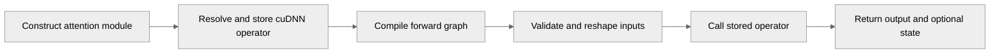

# [PyTorch] Fix full-graph compilation of linear attention

[Upstream PR](https://github.com/NVIDIA/TransformerEngine/pull/3685) · state: open · merged: False

## Original PR description

# Description

Fix `torch.compile(fullgraph=True)` for GDN, GDN2, and DeltaProduct. Importing the cuDNN operator during forward makes Dynamo reject the full graph, including after eager warm-up.

## Type of change

- [x] Bug fix

## Changes

Resolve and store `self._op` during adapter construction using a local import. Importing TE still defers loading this backend; an unavailable operator now raises when constructing a linear attention module rather than on its first forward call.

The variant-specific `_call_op` implementations invoke `self._op` directly, removing the cached import helper and redundant `op` parameter. Public signatures, explicit kernel arguments, validation, Householder reshaping, and the dense sequence-offset cache are preserved.

Add 36 fullgraph variants to the existing tests, covering FP16/BF16 BSHD/SBHD layouts and THD outputs, final state, and gradients against independent FP64 references. Compile runs without eager warm-up; existing tolerances and eager/checkpoint coverage remain.

Keep the six tests for argument validation, forward lifecycle, and module state independent of the cuDNN kernel runtime by mocking its import only during each test.

## Validation

On B100 with PyTorch 2.15 nightly, CUDA 13.5, and cuDNN Frontend 1.29:

- Final-source focused validation: 27 passed (24 THD fullgraph cases and 3 state round-trip cases), without skips.
- With the backend import blocked: all six module-logic tests pass and 123 kernel cases skip; the previous tests fail at construction. The required-backend collection guards still fail as intended.
- With the backend available: all six module-logic tests pass, followed in the same process by three real fullgraph BF16 numerical cases (one per API).
- Pre-fix regression check: one BF16 BSHD compile case per API failed at the original import in forward.
- Pre-commit, full production Python lint (10.00/10), license checks, and `git diff --check` passed. Lint retains an informational I1101 in unchanged MLA code.
- All 224 local, installed, and lint-tree Python sources matched the validated snapshot.

Existing native libraries were reused. Local validation did not cover dynamic shapes, CUDA Graphs, or the full L0 suite.

# Checklist

- [x] Read and followed the contributing guidelines
- [x] DCO sign-off included
- [x] Focused validation and applicable lint checks passed
- [x] Added repository regression coverage
- [x] Human author reviewed and approved publication for maintainer review

## Review and discussion

### reviews

- greptile-apps[bot] · COMMENTED · 2026-10-14T15:17:08Z · [source](https://github.com/NVIDIA/TransformerEngine/pull/3685#pullrequestreview-5520245863)

(No body; status only.)

### issue_comments

- pggPL · comment · 2026-10-14T15:13:45Z · [source](https://github.com/NVIDIA/TransformerEngine/pull/3685#issuecomment-6171635407)

/te-ci pytorch L0

- greptile-apps[bot] · comment · 2026-10-14T15:17:03Z · [source](https://github.com/NVIDIA/TransformerEngine/pull/3685#issuecomment-6171701417)

<!-- greptile_summary -->

<h2><a href="https://app.greptile.com/api/retrigger?id=80742744"><picture><source media="(prefers-color-scheme: dark)" srcset="https://greptile-static-assets.s3.amazonaws.com/badges/RetriggerDark.svg?v=2"><source media="(prefers-color-scheme: light)" srcset="https://greptile-static-assets.s3.amazonaws.com/badges/Retrigger.svg?v=2"></picture></a>Confidence Score: 5/5</h2>

**[Medium impact]** The PR appears safe to merge; the previous optional-backend test failure is fixed.

<h3>Summary</h3>

Moves cuDNN operator lookup into adapter construction so linear attention can run with `torch.compile(fullgraph=True)`.
- Linear-attention adapters store cuDNN operators before forward tracing begins.

<h3>Diagram</h3>

<!-- greptile_confidence_score:5 -->

Reviews (2) · Last reviewed commit: ["\[PyTorch\] Mock linear attention backends..."](https://github.com/nvidia/transformerengine/commit/5472ab5dc00185d0bea0d2b0f092b48434567661) · [Reviewed by Greptile](https://www.greptile.com/?utm_source=greptile_expert&utm_medium=github&utm_campaign=code_reviews&utm_content=nvidia/transformerengine)

### inline_comments

- greptile-apps[bot] · comment · 2026-10-14T15:17:06Z · [source](https://github.com/NVIDIA/TransformerEngine/pull/3685#discussion_r4272677420)

File: `transformer_engine/pytorch/attention/linear_attention/base.py` · line 110

 **Tests without cuDNN now fail**

If a CUDA machine lacks the optional linear-attention operators, construction now raises `ImportError` in existing tests that do not require this backend. `test_gdn_runs_te_forward_lifecycle` fails before it can replace the kernel, and `test_gdn2_module_carries_no_quantization_state` fails before its assertions. Several gate-validation tests also lack backend guards.

Mock operator lookup in tests meant to run without the backend, or add the matching availability guard where the backend is required.

## Changed files and fixed code

- `tests/pytorch/attention/test_gdn2_attention.py` · modified · additions 14 / deletions 4
  - [head](https://github.com/pggPL/TransformerEngine/blob/5472ab5dc00185d0bea0d2b0f092b48434567661/tests/pytorch/attention/test_gdn2_attention.py)
  - [base](https://github.com/NVIDIA/TransformerEngine/blob/53e241c5a1c978a56c784b37ee794db739c04df8/tests/pytorch/attention/test_gdn2_attention.py)
- `tests/pytorch/attention/test_gdn_attention.py` · modified · additions 15 / deletions 4
  - [head](https://github.com/pggPL/TransformerEngine/blob/5472ab5dc00185d0bea0d2b0f092b48434567661/tests/pytorch/attention/test_gdn_attention.py)
  - [base](https://github.com/NVIDIA/TransformerEngine/blob/53e241c5a1c978a56c784b37ee794db739c04df8/tests/pytorch/attention/test_gdn_attention.py)
- `tests/pytorch/attention/test_gdp_attention.py` · modified · additions 13 / deletions 6
  - [head](https://github.com/pggPL/TransformerEngine/blob/5472ab5dc00185d0bea0d2b0f092b48434567661/tests/pytorch/attention/test_gdp_attention.py)
  - [base](https://github.com/NVIDIA/TransformerEngine/blob/53e241c5a1c978a56c784b37ee794db739c04df8/tests/pytorch/attention/test_gdp_attention.py)
- `transformer_engine/pytorch/attention/linear_attention/base.py` · modified · additions 10 / deletions 19
  - [head](https://github.com/pggPL/TransformerEngine/blob/5472ab5dc00185d0bea0d2b0f092b48434567661/transformer_engine/pytorch/attention/linear_attention/base.py)
  - [base](https://github.com/NVIDIA/TransformerEngine/blob/53e241c5a1c978a56c784b37ee794db739c04df8/transformer_engine/pytorch/attention/linear_attention/base.py)
- `transformer_engine/pytorch/attention/linear_attention/gdn.py` · modified · additions 2 / deletions 3
  - [head](https://github.com/pggPL/TransformerEngine/blob/5472ab5dc00185d0bea0d2b0f092b48434567661/transformer_engine/pytorch/attention/linear_attention/gdn.py)
  - [base](https://github.com/NVIDIA/TransformerEngine/blob/53e241c5a1c978a56c784b37ee794db739c04df8/transformer_engine/pytorch/attention/linear_attention/gdn.py)
- `transformer_engine/pytorch/attention/linear_attention/gdn2.py` · modified · additions 2 / deletions 3
  - [head](https://github.com/pggPL/TransformerEngine/blob/5472ab5dc00185d0bea0d2b0f092b48434567661/transformer_engine/pytorch/attention/linear_attention/gdn2.py)
  - [base](https://github.com/NVIDIA/TransformerEngine/blob/53e241c5a1c978a56c784b37ee794db739c04df8/transformer_engine/pytorch/attention/linear_attention/gdn2.py)
- `transformer_engine/pytorch/attention/linear_attention/gdp.py` · modified · additions 3 / deletions 5
  - [head](https://github.com/pggPL/TransformerEngine/blob/5472ab5dc00185d0bea0d2b0f092b48434567661/transformer_engine/pytorch/attention/linear_attention/gdp.py)
  - [base](https://github.com/NVIDIA/TransformerEngine/blob/53e241c5a1c978a56c784b37ee794db739c04df8/transformer_engine/pytorch/attention/linear_attention/gdp.py)

## Evidence and interpretation boundary

[Original JSON, discussions and patches](../../../../../../evidence/prs/NVIDIA--TransformerEngine/3685-57b522cc73d313c8e4d2e803e33e06b172efbf73f96402ad4af7e50ef67f4404.json) · SHA-256 `57b522cc73d313c8e4d2e803e33e06b172efbf73f96402ad4af7e50ef67f4404`.

Diff complete: True. Missing/binary/truncated patches require pinned source inspection. This is a source page, not an independently verified optimization case. Open, merged and released are different states; recheck the deployed dependency.
