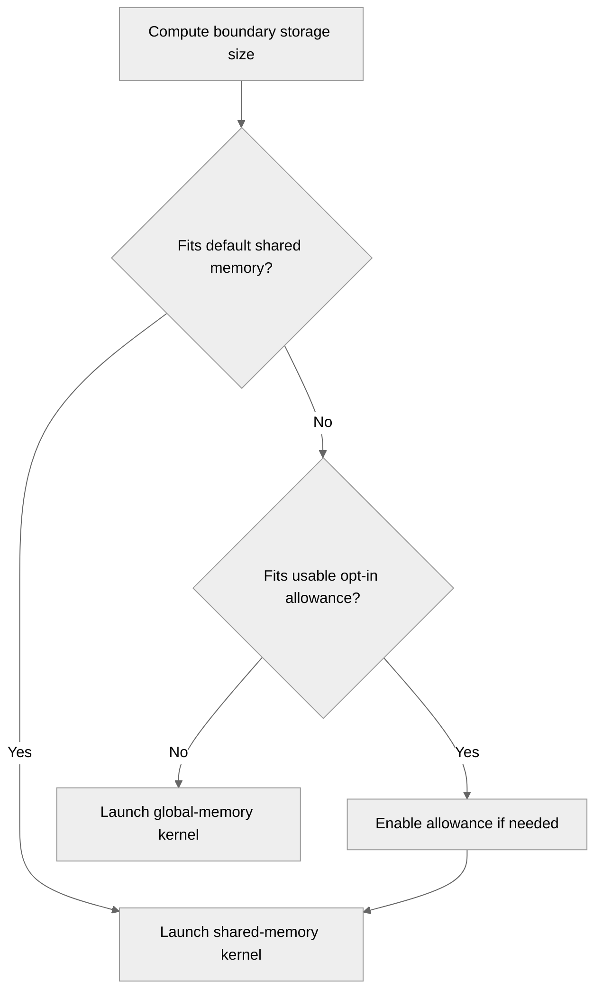

# [PyT][CP] Use global memory when number of sequences exceed shared memory size

[Upstream PR](https://github.com/NVIDIA/TransformerEngine/pull/3690) · state: closed · merged: False

## Original PR description

# Description

Please include a brief summary of the changes, relevant motivation and context.

Fixes # (issue)

## Type of change

- [ ] Documentation change (change only to the documentation, either a fix or a new content)
- [ ] Bug fix (non-breaking change which fixes an issue)
- [ ] New feature (non-breaking change which adds functionality)
- [ ] Breaking change (fix or feature that would cause existing functionality to not work as expected)
- [ ] Infra/Build change
- [ ] Code refactoring

## Changes

Please list the changes introduced in this PR:

- Change A
- Change B

# Checklist:

- [ ] I have read and followed the [contributing guidelines](https://github.com/NVIDIA/TransformerEngine/blob/main/CONTRIBUTING.rst)
- [ ] The functionality is complete
- [ ] I have commented my code, particularly in hard-to-understand areas
- [ ] I have made corresponding changes to the documentation
- [ ] My changes generate no new warnings
- [ ] I have added tests that prove my fix is effective or that my feature works
- [ ] New and existing unit tests pass locally with my changes

## Review and discussion

### reviews

- greptile-apps[bot] · COMMENTED · 2026-10-15T16:24:03Z · [source](https://github.com/NVIDIA/TransformerEngine/pull/3690#pullrequestreview-5536430984)

(No body; status only.)

### issue_comments

- greptile-apps[bot] · comment · 2026-10-15T16:23:59Z · [source](https://github.com/NVIDIA/TransformerEngine/pull/3690#issuecomment-6196927945)

<!-- greptile_summary -->

<h2><a href="https://app.greptile.com/api/retrigger?id=81605681"><picture><source media="(prefers-color-scheme: dark)" srcset="https://greptile-static-assets.s3.amazonaws.com/badges/RetriggerDark.svg?v=2"><source media="(prefers-color-scheme: light)" srcset="https://greptile-static-assets.s3.amazonaws.com/badges/Retrigger.svg?v=2"></picture></a><a href="https://app.greptile.com/nvidia-public-github/github/NVIDIA/transformerengine/-/pull/3690"><picture><source media="(prefers-color-scheme: dark)" srcset="https://greptile-static-assets.s3.amazonaws.com/badges/ViewInGreptileDark.svg?v=2"><source media="(prefers-color-scheme: light)" srcset="https://greptile-static-assets.s3.amazonaws.com/badges/ViewInGreptile.svg?v=2"></picture></a>Confidence Score: 4/5</h2>

**[High impact]** Changes memory allocation strategy in GPU attention kernel\.

The PR appears safe to merge, with a non-blocking gap in the fallback test.

<h2>Findings</h2>

1. &nbsp;**Longer chunks remain untested** <a href="https://github.com/NVIDIA/TransformerEngine/pull/3690#discussion_r4285552918">▶</a>

<h3>Summary</h3>

This PR lets `thd_get_partitioned_indices` use global memory when sequence boundaries exceed the GPU’s shared-memory limit.
- THD partition indices work when sequence boundaries outgrow shared memory.

<h3>Diagram</h3>

<!-- greptile_confidence_score:4 -->

Reviews (1) · Last reviewed commit: ["\[CUDA\] Share THD partition indexing acro..."](https://github.com/nvidia/transformerengine/commit/1bb742f28b2334f859d0303972e174ba7909a18f) · [Reviewed by Greptile](https://www.greptile.com/?utm_source=greptile_review&utm_medium=github&utm_campaign=review_public&utm_content=nvidia/transformerengine)

- sudhakarsingh27 · comment · 2026-10-16T19:41:03Z · [source](https://github.com/NVIDIA/TransformerEngine/pull/3690#issuecomment-6223316188)

Closing in favor of a complete version here: https://github.com/NVIDIA/TransformerEngine/pull/3698

### inline_comments

- greptile-apps[bot] · comment · 2026-10-15T16:24:02Z · [source](https://github.com/NVIDIA/TransformerEngine/pull/3690#discussion_r4285552918)

File: `tests/pytorch/attention/test_cp_utils.py` · line 1034

 **Longer chunks remain untested**

The new boundary test gives every sequence exactly two tokens per rank, so each chunk contains only one token. It reaches the global-memory branch but never checks positions within longer chunks or unequal sequence lengths. A mistake affecting those inputs could pass this test.

Add a case above the opt-in limit with mixed sequence lengths and chunks longer than one token. Compare every returned index with a per-sequence reference.

Note: If this suggestion doesn't match your team's coding style, reply to this and let me know. I'll remember it for next time!

## Changed files and fixed code

- `tests/pytorch/attention/test_cp_utils.py` · modified · additions 24 / deletions 0
  - [head](https://github.com/sudhakarsingh27/TransformerEngine/blob/1bb742f28b2334f859d0303972e174ba7909a18f/tests/pytorch/attention/test_cp_utils.py)
  - [base](https://github.com/NVIDIA/TransformerEngine/blob/33f3b3561943fcd9dd2f544f67dc2dfd62efdc9e/tests/pytorch/attention/test_cp_utils.py)
- `transformer_engine/common/fused_attn/context_parallel.cu` · modified · additions 67 / deletions 20
  - [head](https://github.com/sudhakarsingh27/TransformerEngine/blob/1bb742f28b2334f859d0303972e174ba7909a18f/transformer_engine/common/fused_attn/context_parallel.cu)
  - [base](https://github.com/NVIDIA/TransformerEngine/blob/33f3b3561943fcd9dd2f544f67dc2dfd62efdc9e/transformer_engine/common/fused_attn/context_parallel.cu)

## Evidence and interpretation boundary

[Original JSON, discussions and patches](../../../../../../evidence/prs/NVIDIA--TransformerEngine/3690-9499f34f93909da4e9ea90718be316073cec66749010d6a7a95140da03cc258a.json) · SHA-256 `9499f34f93909da4e9ea90718be316073cec66749010d6a7a95140da03cc258a`.

Diff complete: True. Missing/binary/truncated patches require pinned source inspection. This is a source page, not an independently verified optimization case. Open, merged and released are different states; recheck the deployed dependency.
