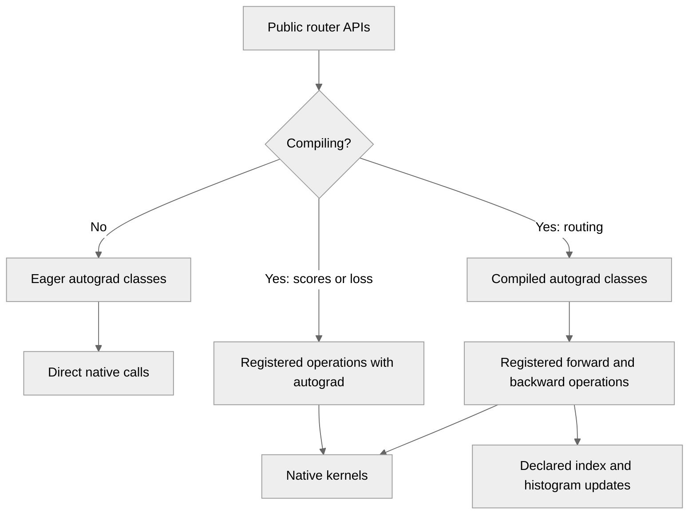

# [PyTorch] Add torch.compile support for fused MoE routing

[Upstream PR](https://github.com/NVIDIA/TransformerEngine/pull/3691) · state: open · merged: False

## Original PR description

# Description

Enable `torch.compile(fullgraph=True)` for fused MoE routing and auxiliary
loss computation, including forward and backward.

The existing buffer contract is preserved: routing overwrites the supplied
dense-index buffer, and quantile balancing (QB) accumulates counts into the
supplied histogram. Eager execution keeps direct native calls to avoid
custom-op dispatch overhead.

Draft for review of the integration, particularly mutation handling and
the QB bounds-validation policy.

## Type of change

- [x] New feature
- [x] Bug fix

## Changes

- Add custom ops, fake implementations and autograd integration for
  `fused_topk_with_score_function`,
  `fused_compute_score_for_moe_aux_loss` and `fused_moe_aux_loss`.
- Declare mutations of dense indices and QB histograms so compilation
  can preserve their existing behavior.
- Skip QB bounds value validation during compiled execution to avoid
  CPU synchronization. Callers must provide finite bounds with
  `lower < upper`; tensor metadata checks remain enabled.
- Fix an existing QB autograd issue: report both mutated buffers in
  a single `mark_dirty` call.
- Extend router tests with compiled numerical comparisons, dynamic shapes,
  buffer reuse checks, histogram accumulation and CUDA graph replay.

Automatic CUDA graph replay with mutated inputs requires suitable persistent
buffers, such as module buffers or inputs marked with `mark_static_address`.
Dense indices must remain unchanged until their backward completes.

## Torch.compile logic

The existing API mutates caller-owned buffers: dense routing overwrites
`topk_indices`, and QB adds counts to `qb_histogram`. The compiled path
preserves these updates and returns the supplied index buffer. The custom
ops declare these mutations through `mutates_args`, so the compiler can
track them.

PyTorch's `register_autograd` does not support mutable operator schemas,
even when only integer auxiliary buffers are mutated. Top-k and QB therefore
use an outer `torch.autograd.Function` around the registered forward and
backward ops. The inner forward ops expose the kernel calls and mutations to
the compiler; the outer Function owns autograd state, returns the mutated
buffers as Function outputs, and calls `mark_dirty` for them. The mutable
custom ops themselves do not have a registered autograd formula.

The separate compiled Function classes use a `forward` without `ctx` and a
`setup_context` that marks auxiliary outputs non-differentiable and saves the
routing data and intermediate needed for backward. This lets training and
inference share the same forward: Dynamo can trace inference without running
the autograd context setup. The intermediate is an additional internal output
so `setup_context` can access it; the public router still returns two outputs.
The compiled classes inherit the eager classes' backward methods, which
select the registered backward op for the compiled path.

Scores and auxiliary loss do not mutate their inputs, so their custom ops
can use `register_autograd` directly and do not need an additional compiled
Function class.

Eager execution keeps the original `autograd.Function` path and direct
`tex.*` calls in both forward and backward. Measurements showed that routing
eager calls through the custom-op machinery or using the separate
`setup_context` style everywhere adds CPU overhead. Selecting the registered
ops only under `torch.compiler.is_compiling()` preserves the faster eager
path while giving compilation explicit kernel boundaries, fake implementations,
and mutation metadata.

## Review and discussion

### reviews

### issue_comments

- pggPL · comment · 2026-10-16T11:01:04Z · [source](https://github.com/NVIDIA/TransformerEngine/pull/3691#issuecomment-6214048945)

/te-ci pytorch

- greptile-apps[bot] · comment · 2026-10-16T11:04:22Z · [source](https://github.com/NVIDIA/TransformerEngine/pull/3691#issuecomment-6214107066)

<!-- greptile_summary -->

<h2><a href="https://app.greptile.com/api/retrigger?id=82175505"><picture><source media="(prefers-color-scheme: dark)" srcset="https://greptile-static-assets.s3.amazonaws.com/badges/RetriggerDark.svg?v=2"><source media="(prefers-color-scheme: light)" srcset="https://greptile-static-assets.s3.amazonaws.com/badges/Retrigger.svg?v=2"></picture></a><a href="https://app.greptile.com/nvidia-public-github/github/NVIDIA/transformerengine/-/pull/3691"><picture><source media="(prefers-color-scheme: dark)" srcset="https://greptile-static-assets.s3.amazonaws.com/badges/ViewInGreptileDark.svg?v=2"><source media="(prefers-color-scheme: light)" srcset="https://greptile-static-assets.s3.amazonaws.com/badges/ViewInGreptile.svg?v=2"></picture></a>Confidence Score: 5/5</h2>

**[Medium impact]** The PR appears safe to merge; no actionable issues were found.

<h3>Summary</h3>

Adds `torch.compile(fullgraph=True)` support for fused routing, scores, and auxiliary loss.
- Fused top-k routing runs inside `torch.compile` and keeps its eager path.
- QB routing updates caller buffers during compiled runs.
- MoE score calculation runs in compiled forward and backward passes.
- MoE auxiliary loss runs inside compiled training graphs.

Intentional behavior acknowledged by `pggPL`: compiled QB calls skip bounds-value checks to avoid CPU synchronization. Callers must supply finite bounds with `lower < upper`.

Review checks were based on source inspection; GPU tests were not run.

<h3>Diagram</h3>

<!-- greptile_confidence_score:5 -->

Reviews (1) · Last reviewed commit: ["Check fused router backward custom opera..."](https://github.com/nvidia/transformerengine/commit/c2fb139df19e44f45272de9398f0204e547dd3da) · [Reviewed by Greptile](https://www.greptile.com/?utm_source=greptile_review&utm_medium=github&utm_campaign=review_public&utm_content=nvidia/transformerengine)

### inline_comments

## Changed files and fixed code

- `tests/pytorch/test_fused_router.py` · modified · additions 572 / deletions 137
  - [head](https://github.com/pggPL/TransformerEngine/blob/c2fb139df19e44f45272de9398f0204e547dd3da/tests/pytorch/test_fused_router.py)
  - [base](https://github.com/NVIDIA/TransformerEngine/blob/33f3b3561943fcd9dd2f544f67dc2dfd62efdc9e/tests/pytorch/test_fused_router.py)
- `transformer_engine/pytorch/router.py` · modified · additions 672 / deletions 13
  - [head](https://github.com/pggPL/TransformerEngine/blob/c2fb139df19e44f45272de9398f0204e547dd3da/transformer_engine/pytorch/router.py)
  - [base](https://github.com/NVIDIA/TransformerEngine/blob/33f3b3561943fcd9dd2f544f67dc2dfd62efdc9e/transformer_engine/pytorch/router.py)

## Evidence and interpretation boundary

[Original JSON, discussions and patches](../../../../../../evidence/prs/NVIDIA--TransformerEngine/3691-b4771ce7fed8be662a31892678292991989c494ba1a2e8ca02b946e64f4833dd.json) · SHA-256 `b4771ce7fed8be662a31892678292991989c494ba1a2e8ca02b946e64f4833dd`.

Diff complete: True. Missing/binary/truncated patches require pinned source inspection. This is a source page, not an independently verified optimization case. Open, merged and released are different states; recheck the deployed dependency.
