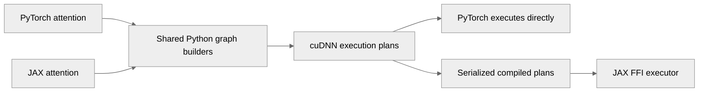

# Switch to Python binding for cuDNN frontend

[Upstream PR](https://github.com/NVIDIA/TransformerEngine/pull/3693) · state: open · merged: False

## Original PR description

# Description

This PR changes TE to use Python binding for cuDNN backend.

The public nvte_* functions remain in TE/Common, but are no longer used by FW-specific code

## Type of change

- [ ] Documentation change (change only to the documentation, either a fix or a new content)
- [ ] Bug fix (non-breaking change which fixes an issue)
- [x] New feature (non-breaking change which adds functionality)
- [ ] Breaking change (fix or feature that would cause existing functionality to not work as expected)
- [ ] Infra/Build change
- [x] Code refactoring

## Changes

Please list the changes introduced in this PR:

- Migrate PyTorch and JAX cuDNN attention to Python binding of cuDNN FE API API, sharing graph construction, plan caching, diagnostics, and flex attention support.
- Close JAX feature gaps: add FP8/MXFP8 attention, ALiBi.
- Fix existing callback-cache collisions, SM12x handling, JAX dropout replay, and backward-precision support queries.
 
# Checklist:

- [ ] I have read and followed the [contributing guidelines](https://github.com/NVIDIA/TransformerEngine/blob/main/CONTRIBUTING.rst)
- [x] The functionality is complete
- [ ] I have commented my code, particularly in hard-to-understand areas
- [ ] I have made corresponding changes to the documentation
- [ ] My changes generate no new warnings
- [x] I have added tests that prove my fix is effective or that my feature works
- [x] New and existing unit tests pass locally with my changes

## Review and discussion

### reviews

- greptile-apps[bot] · COMMENTED · 2026-10-19T21:34:39Z · [source](https://github.com/NVIDIA/TransformerEngine/pull/3693#pullrequestreview-5578055574)

(No body; status only.)

- vcherepanov-nv · COMMENTED · 2026-10-19T23:41:20Z · [source](https://github.com/NVIDIA/TransformerEngine/pull/3693#pullrequestreview-5579062090)

(No body; status only.)

- vcherepanov-nv · COMMENTED · 2026-10-19T23:41:34Z · [source](https://github.com/NVIDIA/TransformerEngine/pull/3693#pullrequestreview-5579063522)

(No body; status only.)

- vcherepanov-nv · COMMENTED · 2026-10-19T23:41:47Z · [source](https://github.com/NVIDIA/TransformerEngine/pull/3693#pullrequestreview-5579064880)

(No body; status only.)

### issue_comments

- vcherepanov-nv · comment · 2026-10-19T21:23:25Z · [source](https://github.com/NVIDIA/TransformerEngine/pull/3693#issuecomment-6277621812)

@Greptile full review

- greptile-apps[bot] · comment · 2026-10-19T21:34:34Z · [source](https://github.com/NVIDIA/TransformerEngine/pull/3693#issuecomment-6277856293)

<!-- greptile_summary -->

<h2><a href="https://app.greptile.com/api/retrigger?id=83939872"><picture><source media="(prefers-color-scheme: dark)" srcset="https://greptile-static-assets.s3.amazonaws.com/badges/RetriggerDark.svg?v=2"><source media="(prefers-color-scheme: light)" srcset="https://greptile-static-assets.s3.amazonaws.com/badges/Retrigger.svg?v=2"></picture></a><a href="https://app.greptile.com/nvidia-public-github/github/NVIDIA/transformerengine/-/pull/3693?utm_source=greptile_review&amp;utm_medium=github&amp;utm_campaign=view_in_greptile"><picture><source media="(prefers-color-scheme: dark)" srcset="https://greptile-static-assets.s3.amazonaws.com/badges/ViewInGreptileDark.svg?v=2"><source media="(prefers-color-scheme: light)" srcset="https://greptile-static-assets.s3.amazonaws.com/badges/ViewInGreptile.svg?v=2"></picture></a>Confidence Score: 5/5</h2>

**[High impact]** The PR appears safe to merge based on the reviewed code.

<h3>Summary</h3>

Moves PyTorch and JAX cuDNN attention to shared Python graph builders while retaining the public common APIs.

- PyTorch and JAX attention use Python-built cuDNN graphs.
- JAX attention can use FP8, MXFP8, and ALiBi.
- Score-mod attention graphs share callback-aware caching.
- JAX builds pin the cuDNN frontend version they use.

<h3>Diagram</h3>

<!-- greptile_confidence_score:5 -->

Reviews (3) · Last reviewed commit: ["Propagate fused attention setup errors a..."](https://github.com/nvidia/transformerengine/commit/8ee7f42a78c8327dc66a61fafe2467c908277261) · [Reviewed by Greptile](https://www.greptile.com/?utm_source=greptile_review&utm_medium=github&utm_campaign=review_public&utm_content=nvidia/transformerengine)

- vcherepanov-nv · comment · 2026-10-19T23:20:57Z · [source](https://github.com/NVIDIA/TransformerEngine/pull/3693#issuecomment-6279519285)

@Greptile full review

### inline_comments

- greptile-apps[bot] · comment · 2026-10-19T21:34:37Z · [source](https://github.com/NVIDIA/TransformerEngine/pull/3693#discussion_r4319107800)

File: `transformer_engine/pytorch/cpp_extensions/cudnn_fused_attn.py` · line 630

 **Supported THD training gets rejected**

On cuDNN before 9.26, this check rejects FP16/BF16 THD training with learnable softmax even when the value-head dimension is 64, 128, or 256. The previous selector explicitly allowed those specialized kernels. Previously supported JAX calls now fail, and PyTorch THD requests can be left without a backend.

Restore the dimension exceptions here and in the matching JAX check in `cudnn_attention.py`. Keep the stricter FP8 restriction.

**Knowledge Base Used:** [Preserve safe THD learnable-softmax kernels](https://app.greptile.com/nvidia-public-github/-/custom-context/knowledge-base/nvidia/transformerengine/-/reverts/incident-mitigation_3470-20261014-thd-learnable-softmax-dsink-cudnn-c3081a5.md)

- greptile-apps[bot] · comment · 2026-10-19T21:34:37Z · [source](https://github.com/NVIDIA/TransformerEngine/pull/3693#discussion_r4319107806)

File: `transformer_engine/jax/cpp_extensions/cudnn_attention.py` · line 275

 **Unsafe FP8 backward gets allowed**

For FP8 THD training on cuDNN 9.23–9.25, `OFF_BY_ONE_SOFTMAX` passes these checks even though it supplies a sink token. The earlier check only covers `LEARNABLE_SOFTMAX`. Those cuDNN releases can read saved statistics at the wrong positions during sink-token backward and return incorrect gradients.

Require cuDNN 9.26 for FP8 THD backward with every non-vanilla softmax, as the previous selector does.

**Knowledge Base Used:** [Gate FP8 THD sink-token backward on cuDNN 9.26](https://app.greptile.com/nvidia-public-github/-/custom-context/knowledge-base/nvidia/transformerengine/-/reverts/incident-mitigation_3441-20260830-fp8-thd-sink-backward-cudnn-gate-0ae8996.md)

- greptile-apps[bot] · comment · 2026-10-19T21:34:38Z · [source](https://github.com/NVIDIA/TransformerEngine/pull/3693#discussion_r4319107818)

File: `transformer_engine/jax/csrc/extensions/cudnn_graph.cpp` · line 141

 **Dense outputs get cleared unnecessarily**

`ExecuteGraph` now clears every output on every call, including dense attention outputs and all three dense input gradients. The previous ordinary path only cleared ragged buffers, and the previous `score_mod` executor did not clear these fully written outputs. This adds GPU writes and launches to every dense forward and backward call.

Pass explicit fill requirements and skip clearing outputs that cuDNN writes completely.

- vcherepanov-nv · comment · 2026-10-19T23:41:20Z · [source](https://github.com/NVIDIA/TransformerEngine/pull/3693#discussion_r4319988002)

File: `transformer_engine/pytorch/cpp_extensions/cudnn_fused_attn.py` · line 630

Addressed by commit 13141e3

- vcherepanov-nv · comment · 2026-10-19T23:41:34Z · [source](https://github.com/NVIDIA/TransformerEngine/pull/3693#discussion_r4319989382)

File: `transformer_engine/jax/cpp_extensions/cudnn_attention.py` · line 275

Addressed by commit 13141e3

- vcherepanov-nv · comment · 2026-10-19T23:41:47Z · [source](https://github.com/NVIDIA/TransformerEngine/pull/3693#discussion_r4319990618)

File: `transformer_engine/jax/csrc/extensions/cudnn_graph.cpp` · line 141

Addressed by commit 13141e3

## Changed files and fixed code

- `build_tools/jax.py` · modified · additions 12 / deletions 1
  - [head](https://github.com/vcherepanov-nv/TransformerEngine/blob/8ee7f42a78c8327dc66a61fafe2467c908277261/build_tools/jax.py)
  - [base](https://github.com/NVIDIA/TransformerEngine/blob/c83e856caebff2be63561026b873bfc4771044da/build_tools/jax.py)
- `build_tools/wheel_utils/build_wheels.sh` · modified · additions 1 / deletions 1
  - [head](https://github.com/vcherepanov-nv/TransformerEngine/blob/8ee7f42a78c8327dc66a61fafe2467c908277261/build_tools/wheel_utils/build_wheels.sh)
  - [base](https://github.com/NVIDIA/TransformerEngine/blob/c83e856caebff2be63561026b873bfc4771044da/build_tools/wheel_utils/build_wheels.sh)
- `docs/api/jax.rst` · modified · additions 6 / deletions 0
  - [head](https://github.com/vcherepanov-nv/TransformerEngine/blob/8ee7f42a78c8327dc66a61fafe2467c908277261/docs/api/jax.rst)
  - [base](https://github.com/NVIDIA/TransformerEngine/blob/c83e856caebff2be63561026b873bfc4771044da/docs/api/jax.rst)
- `docs/envvars.rst` · modified · additions 2 / deletions 2
  - [head](https://github.com/vcherepanov-nv/TransformerEngine/blob/8ee7f42a78c8327dc66a61fafe2467c908277261/docs/envvars.rst)
  - [base](https://github.com/NVIDIA/TransformerEngine/blob/c83e856caebff2be63561026b873bfc4771044da/docs/envvars.rst)
- `docs/examples/jax/attention.rst` · modified · additions 74 / deletions 0
  - [head](https://github.com/vcherepanov-nv/TransformerEngine/blob/8ee7f42a78c8327dc66a61fafe2467c908277261/docs/examples/jax/attention.rst)
  - [base](https://github.com/NVIDIA/TransformerEngine/blob/c83e856caebff2be63561026b873bfc4771044da/docs/examples/jax/attention.rst)
- `docs/installation.rst` · modified · additions 25 / deletions 0
  - [head](https://github.com/vcherepanov-nv/TransformerEngine/blob/8ee7f42a78c8327dc66a61fafe2467c908277261/docs/installation.rst)
  - [base](https://github.com/NVIDIA/TransformerEngine/blob/c83e856caebff2be63561026b873bfc4771044da/docs/installation.rst)
- `tests/jax/test_build_tools.py` · added · additions 54 / deletions 0
  - [head](https://github.com/vcherepanov-nv/TransformerEngine/blob/8ee7f42a78c8327dc66a61fafe2467c908277261/tests/jax/test_build_tools.py)
  - [base](https://github.com/NVIDIA/TransformerEngine/blob/c83e856caebff2be63561026b873bfc4771044da/tests/jax/test_build_tools.py)
- `tests/jax/test_fused_attn.py` · modified · additions 827 / deletions 0
  - [head](https://github.com/vcherepanov-nv/TransformerEngine/blob/8ee7f42a78c8327dc66a61fafe2467c908277261/tests/jax/test_fused_attn.py)
  - [base](https://github.com/NVIDIA/TransformerEngine/blob/c83e856caebff2be63561026b873bfc4771044da/tests/jax/test_fused_attn.py)
- `tests/jax/test_fused_attn_score_mod.py` · modified · additions 44 / deletions 3
  - [head](https://github.com/vcherepanov-nv/TransformerEngine/blob/8ee7f42a78c8327dc66a61fafe2467c908277261/tests/jax/test_fused_attn_score_mod.py)
  - [base](https://github.com/NVIDIA/TransformerEngine/blob/c83e856caebff2be63561026b873bfc4771044da/tests/jax/test_fused_attn_score_mod.py)
- `tests/jax/test_mxfp8_attention.py` · added · additions 609 / deletions 0
  - [head](https://github.com/vcherepanov-nv/TransformerEngine/blob/8ee7f42a78c8327dc66a61fafe2467c908277261/tests/jax/test_mxfp8_attention.py)
  - [base](https://github.com/NVIDIA/TransformerEngine/blob/c83e856caebff2be63561026b873bfc4771044da/tests/jax/test_mxfp8_attention.py)
- `tests/pytorch/attention/test_attention.py` · modified · additions 862 / deletions 9
  - [head](https://github.com/vcherepanov-nv/TransformerEngine/blob/8ee7f42a78c8327dc66a61fafe2467c908277261/tests/pytorch/attention/test_attention.py)
  - [base](https://github.com/NVIDIA/TransformerEngine/blob/c83e856caebff2be63561026b873bfc4771044da/tests/pytorch/attention/test_attention.py)
- `tests/pytorch/attention/test_attention_backend_selection.py` · modified · additions 41 / deletions 0
  - [head](https://github.com/vcherepanov-nv/TransformerEngine/blob/8ee7f42a78c8327dc66a61fafe2467c908277261/tests/pytorch/attention/test_attention_backend_selection.py)
  - [base](https://github.com/NVIDIA/TransformerEngine/blob/c83e856caebff2be63561026b873bfc4771044da/tests/pytorch/attention/test_attention_backend_selection.py)
- `tests/pytorch/attention/test_flex_attention.py` · modified · additions 105 / deletions 0
  - [head](https://github.com/vcherepanov-nv/TransformerEngine/blob/8ee7f42a78c8327dc66a61fafe2467c908277261/tests/pytorch/attention/test_flex_attention.py)
  - [base](https://github.com/NVIDIA/TransformerEngine/blob/c83e856caebff2be63561026b873bfc4771044da/tests/pytorch/attention/test_flex_attention.py)
- `tests/pytorch/test_torch_compile.py` · modified · additions 4 / deletions 3
  - [head](https://github.com/vcherepanov-nv/TransformerEngine/blob/8ee7f42a78c8327dc66a61fafe2467c908277261/tests/pytorch/test_torch_compile.py)
  - [base](https://github.com/NVIDIA/TransformerEngine/blob/c83e856caebff2be63561026b873bfc4771044da/tests/pytorch/test_torch_compile.py)
- `transformer_engine/common/cudnn/__init__.py` · added · additions 5 / deletions 0
  - [head](https://github.com/vcherepanov-nv/TransformerEngine/blob/8ee7f42a78c8327dc66a61fafe2467c908277261/transformer_engine/common/cudnn/__init__.py)
  - [base](https://github.com/NVIDIA/TransformerEngine/blob/c83e856caebff2be63561026b873bfc4771044da/transformer_engine/common/cudnn/__init__.py)
- `transformer_engine/common/cudnn/attention.py` · added · additions 234 / deletions 0
  - [head](https://github.com/vcherepanov-nv/TransformerEngine/blob/8ee7f42a78c8327dc66a61fafe2467c908277261/transformer_engine/common/cudnn/attention.py)
  - [base](https://github.com/NVIDIA/TransformerEngine/blob/c83e856caebff2be63561026b873bfc4771044da/transformer_engine/common/cudnn/attention.py)
- `transformer_engine/common/cudnn/graph.py` · added · additions 261 / deletions 0
  - [head](https://github.com/vcherepanov-nv/TransformerEngine/blob/8ee7f42a78c8327dc66a61fafe2467c908277261/transformer_engine/common/cudnn/graph.py)
  - [base](https://github.com/NVIDIA/TransformerEngine/blob/c83e856caebff2be63561026b873bfc4771044da/transformer_engine/common/cudnn/graph.py)
- `transformer_engine/common/cudnn/mxfp8.py` · added · additions 59 / deletions 0
  - [head](https://github.com/vcherepanov-nv/TransformerEngine/blob/8ee7f42a78c8327dc66a61fafe2467c908277261/transformer_engine/common/cudnn/mxfp8.py)
  - [base](https://github.com/NVIDIA/TransformerEngine/blob/c83e856caebff2be63561026b873bfc4771044da/transformer_engine/common/cudnn/mxfp8.py)
- `transformer_engine/common/cudnn/score_mod.py` · added · additions 125 / deletions 0
  - [head](https://github.com/vcherepanov-nv/TransformerEngine/blob/8ee7f42a78c8327dc66a61fafe2467c908277261/transformer_engine/common/cudnn/score_mod.py)
  - [base](https://github.com/NVIDIA/TransformerEngine/blob/c83e856caebff2be63561026b873bfc4771044da/transformer_engine/common/cudnn/score_mod.py)
- `transformer_engine/common/fused_attn/config_and_params.cpp` · modified · additions 2 / deletions 1
  - [head](https://github.com/vcherepanov-nv/TransformerEngine/blob/8ee7f42a78c8327dc66a61fafe2467c908277261/transformer_engine/common/fused_attn/config_and_params.cpp)
  - [base](https://github.com/NVIDIA/TransformerEngine/blob/c83e856caebff2be63561026b873bfc4771044da/transformer_engine/common/fused_attn/config_and_params.cpp)
- `transformer_engine/jax/attention.py` · modified · additions 83 / deletions 4
  - [head](https://github.com/vcherepanov-nv/TransformerEngine/blob/8ee7f42a78c8327dc66a61fafe2467c908277261/transformer_engine/jax/attention.py)
  - [base](https://github.com/NVIDIA/TransformerEngine/blob/c83e856caebff2be63561026b873bfc4771044da/transformer_engine/jax/attention.py)
- `transformer_engine/jax/cpp_extensions/attention.py` · modified · additions 140 / deletions 310
  - [head](https://github.com/vcherepanov-nv/TransformerEngine/blob/8ee7f42a78c8327dc66a61fafe2467c908277261/transformer_engine/jax/cpp_extensions/attention.py)
  - [base](https://github.com/NVIDIA/TransformerEngine/blob/c83e856caebff2be63561026b873bfc4771044da/transformer_engine/jax/cpp_extensions/attention.py)
- `transformer_engine/jax/cpp_extensions/cudnn_attention.py` · added · additions 620 / deletions 0
  - [head](https://github.com/vcherepanov-nv/TransformerEngine/blob/8ee7f42a78c8327dc66a61fafe2467c908277261/transformer_engine/jax/cpp_extensions/cudnn_attention.py)
  - [base](https://github.com/NVIDIA/TransformerEngine/blob/c83e856caebff2be63561026b873bfc4771044da/transformer_engine/jax/cpp_extensions/cudnn_attention.py)
- `transformer_engine/jax/cpp_extensions/cudnn_graph.py` · added · additions 142 / deletions 0
  - [head](https://github.com/vcherepanov-nv/TransformerEngine/blob/8ee7f42a78c8327dc66a61fafe2467c908277261/transformer_engine/jax/cpp_extensions/cudnn_graph.py)
  - [base](https://github.com/NVIDIA/TransformerEngine/blob/c83e856caebff2be63561026b873bfc4771044da/transformer_engine/jax/cpp_extensions/cudnn_graph.py)
- `transformer_engine/jax/cpp_extensions/flex_attention.py` · modified · additions 115 / deletions 371
  - [head](https://github.com/vcherepanov-nv/TransformerEngine/blob/8ee7f42a78c8327dc66a61fafe2467c908277261/transformer_engine/jax/cpp_extensions/flex_attention.py)
  - [base](https://github.com/NVIDIA/TransformerEngine/blob/c83e856caebff2be63561026b873bfc4771044da/transformer_engine/jax/cpp_extensions/flex_attention.py)
- `transformer_engine/jax/cpp_extensions/mxfp8_attention.py` · added · additions 306 / deletions 0
  - [head](https://github.com/vcherepanov-nv/TransformerEngine/blob/8ee7f42a78c8327dc66a61fafe2467c908277261/transformer_engine/jax/cpp_extensions/mxfp8_attention.py)
  - [base](https://github.com/NVIDIA/TransformerEngine/blob/c83e856caebff2be63561026b873bfc4771044da/transformer_engine/jax/cpp_extensions/mxfp8_attention.py)
- `transformer_engine/jax/csrc/extensions.h` · modified · additions 2 / deletions 26
  - [head](https://github.com/vcherepanov-nv/TransformerEngine/blob/8ee7f42a78c8327dc66a61fafe2467c908277261/transformer_engine/jax/csrc/extensions.h)
  - [base](https://github.com/NVIDIA/TransformerEngine/blob/c83e856caebff2be63561026b873bfc4771044da/transformer_engine/jax/csrc/extensions.h)
- `transformer_engine/jax/csrc/extensions/attention.cpp` · removed · additions 0 / deletions 1115
  - [head](https://github.com/vcherepanov-nv/TransformerEngine/blob/8ee7f42a78c8327dc66a61fafe2467c908277261/transformer_engine/jax/csrc/extensions/attention.cpp)
  - [base](https://github.com/NVIDIA/TransformerEngine/blob/c83e856caebff2be63561026b873bfc4771044da/transformer_engine/jax/csrc/extensions/attention.cpp)
- `transformer_engine/jax/csrc/extensions/cudnn_graph.cpp` · added · additions 197 / deletions 0
  - [head](https://github.com/vcherepanov-nv/TransformerEngine/blob/8ee7f42a78c8327dc66a61fafe2467c908277261/transformer_engine/jax/csrc/extensions/cudnn_graph.cpp)
  - [base](https://github.com/NVIDIA/TransformerEngine/blob/c83e856caebff2be63561026b873bfc4771044da/transformer_engine/jax/csrc/extensions/cudnn_graph.cpp)
- `transformer_engine/jax/csrc/extensions/pybind.cpp` · modified · additions 6 / deletions 19
  - [head](https://github.com/vcherepanov-nv/TransformerEngine/blob/8ee7f42a78c8327dc66a61fafe2467c908277261/transformer_engine/jax/csrc/extensions/pybind.cpp)
  - [base](https://github.com/NVIDIA/TransformerEngine/blob/c83e856caebff2be63561026b873bfc4771044da/transformer_engine/jax/csrc/extensions/pybind.cpp)
- `transformer_engine/jax/flax/transformer.py` · modified · additions 47 / deletions 2
  - [head](https://github.com/vcherepanov-nv/TransformerEngine/blob/8ee7f42a78c8327dc66a61fafe2467c908277261/transformer_engine/jax/flax/transformer.py)
  - [base](https://github.com/NVIDIA/TransformerEngine/blob/c83e856caebff2be63561026b873bfc4771044da/transformer_engine/jax/flax/transformer.py)
- `transformer_engine/pytorch/attention/dot_product_attention/backends.py` · modified · additions 7 / deletions 3
  - [head](https://github.com/vcherepanov-nv/TransformerEngine/blob/8ee7f42a78c8327dc66a61fafe2467c908277261/transformer_engine/pytorch/attention/dot_product_attention/backends.py)
  - [base](https://github.com/NVIDIA/TransformerEngine/blob/c83e856caebff2be63561026b873bfc4771044da/transformer_engine/pytorch/attention/dot_product_attention/backends.py)
- `transformer_engine/pytorch/attention/dot_product_attention/context_parallel.py` · modified · additions 6 / deletions 1
  - [head](https://github.com/vcherepanov-nv/TransformerEngine/blob/8ee7f42a78c8327dc66a61fafe2467c908277261/transformer_engine/pytorch/attention/dot_product_attention/context_parallel.py)
  - [base](https://github.com/NVIDIA/TransformerEngine/blob/c83e856caebff2be63561026b873bfc4771044da/transformer_engine/pytorch/attention/dot_product_attention/context_parallel.py)
- `transformer_engine/pytorch/attention/dot_product_attention/flex_attention.py` · modified · additions 96 / deletions 261
  - [head](https://github.com/vcherepanov-nv/TransformerEngine/blob/8ee7f42a78c8327dc66a61fafe2467c908277261/transformer_engine/pytorch/attention/dot_product_attention/flex_attention.py)
  - [base](https://github.com/NVIDIA/TransformerEngine/blob/c83e856caebff2be63561026b873bfc4771044da/transformer_engine/pytorch/attention/dot_product_attention/flex_attention.py)
- `transformer_engine/pytorch/attention/dot_product_attention/utils.py` · modified · additions 62 / deletions 78
  - [head](https://github.com/vcherepanov-nv/TransformerEngine/blob/8ee7f42a78c8327dc66a61fafe2467c908277261/transformer_engine/pytorch/attention/dot_product_attention/utils.py)
  - [base](https://github.com/NVIDIA/TransformerEngine/blob/c83e856caebff2be63561026b873bfc4771044da/transformer_engine/pytorch/attention/dot_product_attention/utils.py)
- `transformer_engine/pytorch/cpp_extensions/cudnn.py` · added · additions 65 / deletions 0
  - [head](https://github.com/vcherepanov-nv/TransformerEngine/blob/8ee7f42a78c8327dc66a61fafe2467c908277261/transformer_engine/pytorch/cpp_extensions/cudnn.py)
  - [base](https://github.com/NVIDIA/TransformerEngine/blob/c83e856caebff2be63561026b873bfc4771044da/transformer_engine/pytorch/cpp_extensions/cudnn.py)
- `transformer_engine/pytorch/cpp_extensions/cudnn_fused_attn.py` · added · additions 828 / deletions 0
  - [head](https://github.com/vcherepanov-nv/TransformerEngine/blob/8ee7f42a78c8327dc66a61fafe2467c908277261/transformer_engine/pytorch/cpp_extensions/cudnn_fused_attn.py)
  - [base](https://github.com/NVIDIA/TransformerEngine/blob/c83e856caebff2be63561026b873bfc4771044da/transformer_engine/pytorch/cpp_extensions/cudnn_fused_attn.py)
- `transformer_engine/pytorch/cpp_extensions/fused_attn.py` · modified · additions 82 / deletions 77
  - [head](https://github.com/vcherepanov-nv/TransformerEngine/blob/8ee7f42a78c8327dc66a61fafe2467c908277261/transformer_engine/pytorch/cpp_extensions/fused_attn.py)
  - [base](https://github.com/NVIDIA/TransformerEngine/blob/c83e856caebff2be63561026b873bfc4771044da/transformer_engine/pytorch/cpp_extensions/fused_attn.py)
- `transformer_engine/pytorch/csrc/extensions.h` · modified · additions 1 / deletions 30
  - [head](https://github.com/vcherepanov-nv/TransformerEngine/blob/8ee7f42a78c8327dc66a61fafe2467c908277261/transformer_engine/pytorch/csrc/extensions.h)
  - [base](https://github.com/NVIDIA/TransformerEngine/blob/c83e856caebff2be63561026b873bfc4771044da/transformer_engine/pytorch/csrc/extensions.h)
- `transformer_engine/pytorch/csrc/extensions/attention.cpp` · modified · additions 8 / deletions 632
  - [head](https://github.com/vcherepanov-nv/TransformerEngine/blob/8ee7f42a78c8327dc66a61fafe2467c908277261/transformer_engine/pytorch/csrc/extensions/attention.cpp)
  - [base](https://github.com/NVIDIA/TransformerEngine/blob/c83e856caebff2be63561026b873bfc4771044da/transformer_engine/pytorch/csrc/extensions/attention.cpp)
- `transformer_engine/pytorch/csrc/extensions/pybind.cpp` · modified · additions 3 / deletions 6
  - [head](https://github.com/vcherepanov-nv/TransformerEngine/blob/8ee7f42a78c8327dc66a61fafe2467c908277261/transformer_engine/pytorch/csrc/extensions/pybind.cpp)
  - [base](https://github.com/NVIDIA/TransformerEngine/blob/c83e856caebff2be63561026b873bfc4771044da/transformer_engine/pytorch/csrc/extensions/pybind.cpp)

## Evidence and interpretation boundary

[Original JSON, discussions and patches](../../../../../../evidence/prs/NVIDIA--TransformerEngine/3693-8270a3a4ee4381aa135badce43089c7438c0b8442dc950d391c0cca90c46319d.json) · SHA-256 `8270a3a4ee4381aa135badce43089c7438c0b8442dc950d391c0cca90c46319d`.

Diff complete: True. Missing/binary/truncated patches require pinned source inspection. This is a source page, not an independently verified optimization case. Open, merged and released are different states; recheck the deployed dependency.
