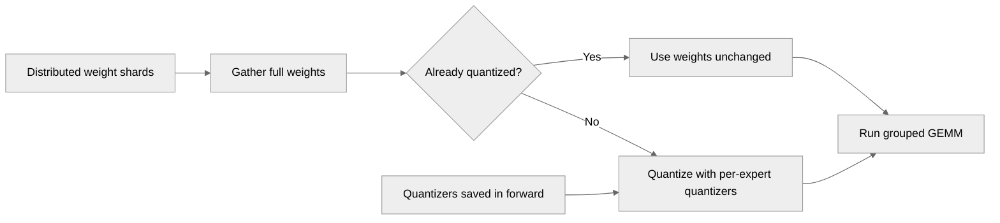

# [PyTorch] Quantize distributed BF16 weights in the fused grouped MLP

[Upstream PR](https://github.com/NVIDIA/TransformerEngine/pull/3695) · state: closed · merged: False

## Original PR description

A distributed (e.g. GTP) weight whose shards are not natively quantized is re-gathered as BF16. The fused grouped-MLP op assumed gathered weights were already quantized: forward quantized the shards before the gather, and backward read _columnwise_data / the NVFP4 amax straight off the gathered tensor, which fails for a module whose per-module recipe (e.g. MXFP8 experts under a global NVFP4 recipe) does not create native-quantized params.

Gather first, then quantize whatever is still unquantized with the op's per-expert weight quantizers, mirroring module/linear.py's handling of a re-gathered BF16 distributed weight. Native-quantized shards gather as quantized tensors and pass through unchanged. The FC2 backward re-gather moves ahead of the NVFP4 global-scale computation so that path no longer reads un-gathered shards.

# Description

Please include a brief summary of the changes, relevant motivation and context.

Fixes # (issue)

## Type of change

- [ ] Documentation change (change only to the documentation, either a fix or a new content)
- [ ] Bug fix (non-breaking change which fixes an issue)
- [ ] New feature (non-breaking change which adds functionality)
- [ ] Breaking change (fix or feature that would cause existing functionality to not work as expected)
- [ ] Infra/Build change
- [ ] Code refactoring

## Changes

Please list the changes introduced in this PR:

- Change A
- Change B

# Checklist:

- [ ] I have read and followed the [contributing guidelines](https://github.com/NVIDIA/TransformerEngine/blob/main/CONTRIBUTING.rst)
- [ ] The functionality is complete
- [ ] I have commented my code, particularly in hard-to-understand areas
- [ ] I have made corresponding changes to the documentation
- [ ] My changes generate no new warnings
- [ ] I have added tests that prove my fix is effective or that my feature works
- [ ] New and existing unit tests pass locally with my changes


## Review and discussion

### reviews

- greptile-apps[bot] · COMMENTED · 2026-10-16T06:20:55Z · [source](https://github.com/NVIDIA/TransformerEngine/pull/3695#pullrequestreview-5543796397)

(No body; status only.)

- greptile-apps[bot] · COMMENTED · 2026-10-17T09:03:09Z · [source](https://github.com/NVIDIA/TransformerEngine/pull/3695#pullrequestreview-5557141077)

(No body; status only.)

- greptile-apps[bot] · COMMENTED · 2026-10-17T09:29:55Z · [source](https://github.com/NVIDIA/TransformerEngine/pull/3695#pullrequestreview-5557212878)

(No body; status only.)

### issue_comments

- greptile-apps[bot] · comment · 2026-10-16T06:20:51Z · [source](https://github.com/NVIDIA/TransformerEngine/pull/3695#issuecomment-6209431810)

<!-- greptile_summary -->

<h2><a href="https://app.greptile.com/api/retrigger?id=82054734"><picture><source media="(prefers-color-scheme: dark)" srcset="https://greptile-static-assets.s3.amazonaws.com/badges/RetriggerDark.svg?v=2"><source media="(prefers-color-scheme: light)" srcset="https://greptile-static-assets.s3.amazonaws.com/badges/Retrigger.svg?v=2"></picture></a><a href="https://app.greptile.com/nvidia-public-github/github/NVIDIA/transformerengine/-/pull/3695"><picture><source media="(prefers-color-scheme: dark)" srcset="https://greptile-static-assets.s3.amazonaws.com/badges/ViewInGreptileDark.svg?v=2"><source media="(prefers-color-scheme: light)" srcset="https://greptile-static-assets.s3.amazonaws.com/badges/ViewInGreptile.svg?v=2"></picture></a>Confidence Score: 5/5</h2>

**[Medium impact]** The PR appears safe to merge; no new blocking issues were found.

<h3>Summary</h3>

The fused grouped MLP now gathers distributed BF16 weights before quantizing them with each expert’s quantizer. Already-quantized weights pass through unchanged.

- Distributed grouped MLP weights are gathered before plain weights are quantized.
- Backward saves only the grouped input data its weight gradients use.

The three earlier, unnumbered findings are addressed: regression tests were added, CI runs both files, and both saved-input test layers set `split_alignment=256`. No new actionable issues were found. CUDA tests were not run.

<h3>Diagram</h3>



<!-- greptile_confidence_score:5 -->

<sub>Reviews (12) · Last reviewed commit: ["\[PyTorch\] Drop NVFP4 rowwise input copie..."](https://github.com/nvidia/transformerengine/commit/cb1ffc4afd19aa6f18d4ee51505ab1d41395474a) · [Reviewed by Greptile](https://www.greptile.com/?utm_source=greptile_review&utm_medium=github&utm_campaign=review_public&utm_content=nvidia/transformerengine)</sub>

- xrennvidia · comment · 2026-10-18T09:41:06Z · [source](https://github.com/NVIDIA/TransformerEngine/pull/3695#issuecomment-6248352724)

Close because the changes have been cherry-picked into [PR3545](https://github.com/NVIDIA/TransformerEngine/pull/3545).

### inline_comments

- greptile-apps[bot] · comment · 2026-10-16T06:20:54Z · [source](https://github.com/NVIDIA/TransformerEngine/pull/3695#discussion_r4291515121)

File: `transformer_engine/pytorch/ops/fused/grouped_mlp.py` · line 2556

<a href="#"></a> **BF16 gather fix lacks tests**

This PR changes forward gathers and backward quantization without adding a regression test. The existing distributed `GroupedLinear` test covers only the unfused path, so it would not catch this failure returning.

Add a fused test with a fake distributed weight that returns BF16 tensors. Check forward and backward results with per-module MXFP8 under global NVFP4, and check that already-quantized gathered weights pass through unchanged.

Note: If this suggestion doesn't match your team's coding style, reply to this and let me know. I'll remember it for next time!

- greptile-apps[bot] · comment · 2026-10-17T09:03:08Z · [source](https://github.com/NVIDIA/TransformerEngine/pull/3695#discussion_r4302139275)

File: `tests/pytorch/test_ops_grouped_mlp_distributed_weight.py` · line 160

<a href="#"></a> **CI skips the new tests**

`qa/L0_pytorch_unittest/test.sh` lists test files explicitly and runs neither this file nor `test_ops_grouped_mlp_nvfp4_saved_tensors.py`. CI therefore will not catch a return of the distributed-weight bug or the extra saved NVFP4 copies. Add both files to that runner, or move these cases into `test_grouped_mlp.py`, which already runs there.

- greptile-apps[bot] · comment · 2026-10-17T09:29:54Z · [source](https://github.com/NVIDIA/TransformerEngine/pull/3695#discussion_r4302208635)

File: `tests/pytorch/test_ops_grouped_mlp_nvfp4_saved_tensors.py` · line 74

<a href="#"></a> **Saved-input tests cannot pass**

Both `GroupedLinear` layers omit `split_alignment=256`, so they use the default of 128. `fuse_grouped_mlp_ops` rejects that alignment, and the assertion on line 77 fails on supported GPUs. The new L0 invocation therefore fails instead of checking saved NVFP4 inputs.

Pass `split_alignment=256` to both layers.

```suggestion
    fc1 = te.ops.GroupedLinear(
        group_size, hidden_size, 2 * hidden_size, bias=False, device=device, dtype=dtype,
        split_alignment=256,
    )
    fc2 = te.ops.GroupedLinear(
        group_size, hidden_size, hidden_size, bias=False, device=device, dtype=dtype,
        split_alignment=256,
    )
```

## Changed files and fixed code

- `qa/L0_pytorch_unittest/test.sh` · modified · additions 2 / deletions 0
  - [head](https://github.com/xrennvidia/TransformerEngine/blob/cb1ffc4afd19aa6f18d4ee51505ab1d41395474a/qa/L0_pytorch_unittest/test.sh)
  - [base](https://github.com/NVIDIA/TransformerEngine/blob/eb3c860a4d3394b7eb5e21dba3021fa10782a52e/qa/L0_pytorch_unittest/test.sh)
- `tests/pytorch/test_ops_grouped_mlp_distributed_weight.py` · added · additions 368 / deletions 0
  - [head](https://github.com/xrennvidia/TransformerEngine/blob/cb1ffc4afd19aa6f18d4ee51505ab1d41395474a/tests/pytorch/test_ops_grouped_mlp_distributed_weight.py)
  - [base](https://github.com/NVIDIA/TransformerEngine/blob/eb3c860a4d3394b7eb5e21dba3021fa10782a52e/tests/pytorch/test_ops_grouped_mlp_distributed_weight.py)
- `tests/pytorch/test_ops_grouped_mlp_nvfp4_saved_tensors.py` · added · additions 116 / deletions 0
  - [head](https://github.com/xrennvidia/TransformerEngine/blob/cb1ffc4afd19aa6f18d4ee51505ab1d41395474a/tests/pytorch/test_ops_grouped_mlp_nvfp4_saved_tensors.py)
  - [base](https://github.com/NVIDIA/TransformerEngine/blob/eb3c860a4d3394b7eb5e21dba3021fa10782a52e/tests/pytorch/test_ops_grouped_mlp_nvfp4_saved_tensors.py)
- `transformer_engine/pytorch/ops/fused/grouped_mlp.py` · modified · additions 89 / deletions 35
  - [head](https://github.com/xrennvidia/TransformerEngine/blob/cb1ffc4afd19aa6f18d4ee51505ab1d41395474a/transformer_engine/pytorch/ops/fused/grouped_mlp.py)
  - [base](https://github.com/NVIDIA/TransformerEngine/blob/eb3c860a4d3394b7eb5e21dba3021fa10782a52e/transformer_engine/pytorch/ops/fused/grouped_mlp.py)

## Evidence and interpretation boundary

[Original JSON, discussions and patches](../../../../../../evidence/prs/NVIDIA--TransformerEngine/3695-99e24b0e7cdd63ae29e2262f6418032effaa3e28bb543813d3dddfe818553c80.json) · SHA-256 `99e24b0e7cdd63ae29e2262f6418032effaa3e28bb543813d3dddfe818553c80`.

Diff complete: True. Missing/binary/truncated patches require pinned source inspection. This is a source page, not an independently verified optimization case. Open, merged and released are different states; recheck the deployed dependency.
