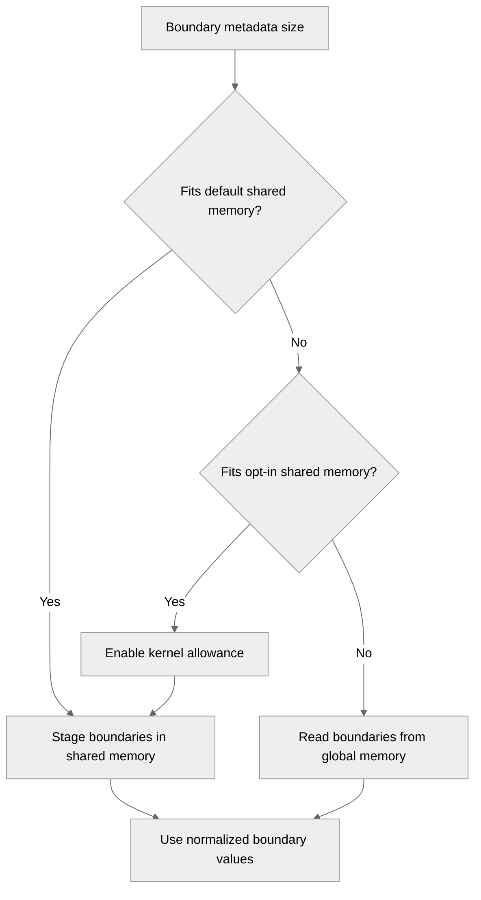

# [PyTorch][CP] Make THD CP helper kernels to be shared memory size aware

[Upstream PR](https://github.com/NVIDIA/TransformerEngine/pull/3698) · state: open · merged: False

## Original PR description

# Description

Fix THD context-parallel utility kernel launch failures when sequence-boundary metadata exceeds shared-memory capacity.

## Type of change

- [ ] Documentation change (change only to the documentation, either a fix or a new content)
- [x] Bug fix (non-breaking change which fixes an issue)
- [ ] New feature (non-breaking change which adds functionality)
- [ ] Breaking change (fix or feature that would cause existing functionality to not work as expected)
- [ ] Infra/Build change
- [x] Code refactoring

## Changes

- Use device-derived default/opt-in shared-memory limits, then fall back to existing global metadata.
- Centralize boundary scaling, preserve shared-memory staging, and add boundary regression tests.

### Validation

Focused native CUDA checks: 7 tests and 32 subtests passed. Full package suite not run.

[pre-commit CI](https://results.pre-commit.ci/run/github/539057023/1792175867.AqR-18DvQ4GuNcnSVU4BLw): pending; DCO passed.

# Checklist:

- [x] I have read and followed the [contributing guidelines](https://github.com/NVIDIA/TransformerEngine/blob/main/CONTRIBUTING.rst)
- [x] The functionality is complete
- [x] I have commented my code, particularly in hard-to-understand areas
- [ ] I have made corresponding changes to the documentation
- [x] My changes generate no new warnings
- [x] I have added tests that prove my fix is effective or that my feature works
- [ ] New and existing unit tests pass locally with my changes

## Review and discussion

### reviews

- greptile-apps[bot] · COMMENTED · 2026-10-16T18:42:40Z · [source](https://github.com/NVIDIA/TransformerEngine/pull/3698#pullrequestreview-5552234437)

(No body; status only.)

### issue_comments

- greptile-apps[bot] · comment · 2026-10-16T18:42:36Z · [source](https://github.com/NVIDIA/TransformerEngine/pull/3698#issuecomment-6222346859)

<!-- greptile_summary -->

<h2><a href="https://app.greptile.com/api/retrigger?id=82422543"><picture><source media="(prefers-color-scheme: dark)" srcset="https://greptile-static-assets.s3.amazonaws.com/badges/RetriggerDark.svg?v=2"><source media="(prefers-color-scheme: light)" srcset="https://greptile-static-assets.s3.amazonaws.com/badges/Retrigger.svg?v=2"></picture></a><a href="https://app.greptile.com/nvidia-public-github/github/NVIDIA/transformerengine/-/pull/3698"><picture><source media="(prefers-color-scheme: dark)" srcset="https://greptile-static-assets.s3.amazonaws.com/badges/ViewInGreptileDark.svg?v=2"><source media="(prefers-color-scheme: light)" srcset="https://greptile-static-assets.s3.amazonaws.com/badges/ViewInGreptile.svg?v=2"></picture></a>Confidence Score: 5/5</h2>

**[High impact]** The PR appears safe to merge; no actionable issues remain.

<h3>Summary</h3>

The PR makes THD context-parallel helpers choose shared memory based on the current GPU’s limits.
- THD helper kernels choose a memory path that fits their boundaries.

The previous and current commits have different merge bases with the target, so the full PR diff was reviewed. No new actionable issues were found. CUDA tests were not run during this review.

<h3>Diagram</h3>

<!-- greptile_confidence_score:5 -->

Reviews (4) · Last reviewed commit: ["Merge branch &#39;main&#39; into sudhakars/thd-a..."](https://github.com/nvidia/transformerengine/commit/a3a3cec433ded7657edc83fc133afa7610c803d2) · [Reviewed by Greptile](https://www.greptile.com/?utm_source=greptile_review&utm_medium=github&utm_campaign=review_public&utm_content=nvidia/transformerengine)

- sudhakarsingh27 · comment · 2026-10-16T19:39:25Z · [source](https://github.com/NVIDIA/TransformerEngine/pull/3698#issuecomment-6223290141)

/te-ci pytorch L0

- sudhakarsingh27 · comment · 2026-10-19T02:20:06Z · [source](https://github.com/NVIDIA/TransformerEngine/pull/3698#issuecomment-6258273264)

/te-ci pytorch L3

### inline_comments

- greptile-apps[bot] · comment · 2026-10-16T18:42:39Z · [source](https://github.com/NVIDIA/TransformerEngine/pull/3698#discussion_r4298114244)

File: `tests/pytorch/attention/test_cp_utils.py` · line 1026

 **Tests fail on older PyTorch**

Both new tests read `shared_memory_per_block` and `shared_memory_per_block_optin`, which PyTorch exposes only from 2.6 onward. This repository still supports PyTorch 2.1–2.5, so those versions raise `AttributeError` before either test reaches a kernel. Guard both tests when these properties are unavailable, or get the limits through an API supported by the declared minimum version.

## Changed files and fixed code

- `tests/pytorch/attention/test_cp_utils.py` · modified · additions 121 / deletions 0
  - [head](https://github.com/sudhakarsingh27/TransformerEngine/blob/a3a3cec433ded7657edc83fc133afa7610c803d2/tests/pytorch/attention/test_cp_utils.py)
  - [base](https://github.com/NVIDIA/TransformerEngine/blob/eb3c860a4d3394b7eb5e21dba3021fa10782a52e/tests/pytorch/attention/test_cp_utils.py)
- `transformer_engine/common/fused_attn/context_parallel.cu` · modified · additions 194 / deletions 124
  - [head](https://github.com/sudhakarsingh27/TransformerEngine/blob/a3a3cec433ded7657edc83fc133afa7610c803d2/transformer_engine/common/fused_attn/context_parallel.cu)
  - [base](https://github.com/NVIDIA/TransformerEngine/blob/eb3c860a4d3394b7eb5e21dba3021fa10782a52e/transformer_engine/common/fused_attn/context_parallel.cu)

## Evidence and interpretation boundary

[Original JSON, discussions and patches](../../../../../../evidence/prs/NVIDIA--TransformerEngine/3698-58a55a433a7990cf4572949b5261b39b1dfe2b29bc9b16c49f93fe42c6719096.json) · SHA-256 `58a55a433a7990cf4572949b5261b39b1dfe2b29bc9b16c49f93fe42c6719096`.

Diff complete: True. Missing/binary/truncated patches require pinned source inspection. This is a source page, not an independently verified optimization case. Open, merged and released are different states; recheck the deployed dependency.
