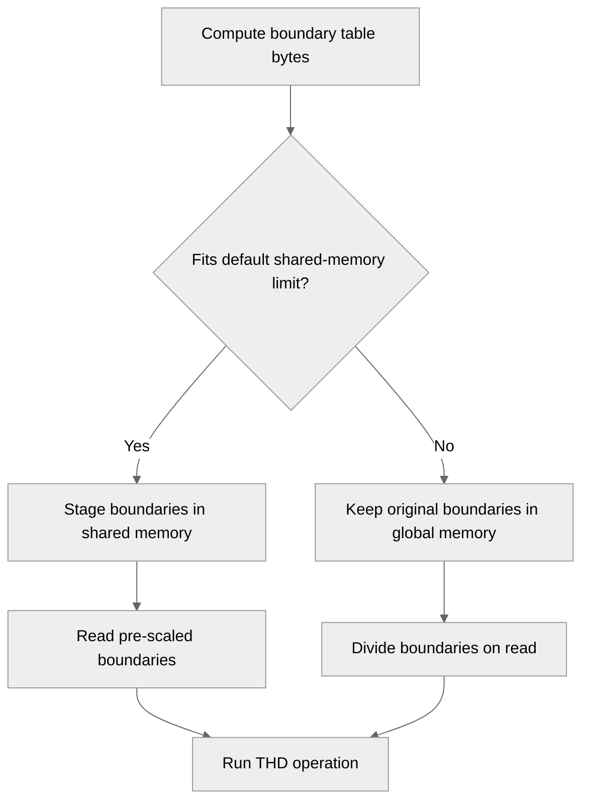

# [PyTorch][CP] Make THD CP helper kernels to be shared memory size aware

[Upstream PR](https://github.com/NVIDIA/TransformerEngine/pull/3698) · state: closed · merged: True

## Original PR description

# Description

Large packed-document counts could make `cu_seqlens` exceed the per-block shared-memory allowance, causing THD context-parallel kernel launch failures.

## Type of change

- [ ] Documentation change (change only to the documentation, either a fix or a new content)
- [x] Bug fix (non-breaking change which fixes an issue)
- [ ] New feature (non-breaking change which adds functionality)
- [ ] Breaking change (fix or feature that would cause existing functionality to not work as expected)
- [ ] Infra/Build change
- [x] Code refactoring

## Changes

Boundary storage was selected using device-reported limits: default shared memory when the table fits, otherwise the original global table. Opt-in shared memory was removed to avoid staging large boundary tables per block.

Existing shared-memory pre-scaling was retained. For example, partition/reorder with `world_size = 2` stages `[0, 8, 24]` as `[0, 4, 12]`. Shared reads use divisor `1`; global reads use the original table and divisor `2`.

Compile-time `use_shared` specializations were retained to preserve shared-path optimization. The boundary view was replaced with ordinary pointer and explicit `read_divisor` arguments in the kernels and other boundary-reading helpers (e.g. `binary_search` and `thd_partition_src_index`). No global scratch allocation was introduced.

The following seven THD utility kernels were updated:

- `thd_partition_indices_kernel`
- `thd_reorder_between_sequence_and_cp_rank_order_kernel`
- `thd_copy_valid_tokens_from_per_split_to_rank_local_kernel`
- `thd_read_half_tensor_kernel`
- `thd_lse_kernel` — second-half LSE reads and correction
- `thd_out_correction_kernel`
- `thd_grad_correction_kernel`

Regression tests cover default-shared and global-memory boundaries, including the two-table copy case.

# Checklist:

- [x] I have read and followed the [contributing guidelines](https://github.com/NVIDIA/TransformerEngine/blob/main/CONTRIBUTING.rst)
- [x] The functionality is complete
- [x] I have commented my code, particularly in hard-to-understand areas
- [ ] I have made corresponding changes to the documentation
- [x] My changes generate no new warnings
- [x] I have added tests that prove my fix is effective or that my feature works
- [ ] New and existing unit tests pass locally with my changes

## Review and discussion

### reviews

- greptile-apps[bot] · COMMENTED · 2026-10-16T18:42:40Z · [source](https://github.com/NVIDIA/TransformerEngine/pull/3698#pullrequestreview-5552234437)

(No body; status only.)

- cyanguwa · APPROVED · 2026-10-27T19:03:20Z · [source](https://github.com/NVIDIA/TransformerEngine/pull/3698#pullrequestreview-5672759040)

(No body; status only.)

### issue_comments

- greptile-apps[bot] · comment · 2026-10-16T18:42:36Z · [source](https://github.com/NVIDIA/TransformerEngine/pull/3698#issuecomment-6222346859)

<!-- greptile_summary -->

<h2><a href="https://app.greptile.com/api/retrigger?id=82422543"><picture><source media="(prefers-color-scheme: dark)" srcset="https://greptile-static-assets.s3.amazonaws.com/badges/RetriggerDark.svg?v=2"><source media="(prefers-color-scheme: light)" srcset="https://greptile-static-assets.s3.amazonaws.com/badges/Retrigger.svg?v=2"></picture></a><a href="https://app.greptile.com/nvidia-public-github/github/NVIDIA/transformerengine/-/pull/3698"><picture><source media="(prefers-color-scheme: dark)" srcset="https://greptile-static-assets.s3.amazonaws.com/badges/ViewInGreptileDark.svg?v=2"><source media="(prefers-color-scheme: light)" srcset="https://greptile-static-assets.s3.amazonaws.com/badges/ViewInGreptile.svg?v=2"></picture></a>Confidence Score: 5/5</h2>

**[Medium impact]** The PR appears safe to merge; no actionable issues remain.

<h3>Summary</h3>

The PR lets THD context-parallel kernels use global memory when their boundary tables exceed the device’s default shared-memory limit.

- THD helpers handle boundary tables that exceed shared memory.

No new actionable issues were found. CUDA builds and GPU tests were not run.

<h3>Diagram</h3>

<!-- greptile_confidence_score:5 -->

Reviews (6) · Last reviewed commit: ["Merge upstream main into the THD boundar..."](https://github.com/nvidia/transformerengine/commit/2aaf4b7eaa8da201b32c6fb5fa885ba35dcf80ca) · [Reviewed by Greptile](https://www.greptile.com/?utm_source=greptile_review&utm_medium=github&utm_campaign=review_public&utm_content=nvidia/transformerengine)

- sudhakarsingh27 · comment · 2026-10-16T19:39:25Z · [source](https://github.com/NVIDIA/TransformerEngine/pull/3698#issuecomment-6223290141)

/te-ci pytorch L0

- sudhakarsingh27 · comment · 2026-10-19T02:20:06Z · [source](https://github.com/NVIDIA/TransformerEngine/pull/3698#issuecomment-6258273264)

/te-ci pytorch L3

- sudhakarsingh27 · comment · 2026-10-27T05:10:13Z · [source](https://github.com/NVIDIA/TransformerEngine/pull/3698#issuecomment-6434303832)

/te-ci pytorch L1 L3

### inline_comments

- greptile-apps[bot] · comment · 2026-10-16T18:42:39Z · [source](https://github.com/NVIDIA/TransformerEngine/pull/3698#discussion_r4298114244)

File: `tests/pytorch/attention/test_cp_utils.py` · line 1024

 **Tests fail on older PyTorch**

Both new tests read `shared_memory_per_block` and `shared_memory_per_block_optin`, which PyTorch exposes only from 2.6 onward. This repository still supports PyTorch 2.1–2.5, so those versions raise `AttributeError` before either test reaches a kernel. Guard both tests when these properties are unavailable, or get the limits through an API supported by the declared minimum version.

## Changed files and fixed code

- `tests/pytorch/attention/test_cp_utils.py` · modified · additions 110 / deletions 0
  - [head](https://github.com/sudhakarsingh27/TransformerEngine/blob/2aaf4b7eaa8da201b32c6fb5fa885ba35dcf80ca/tests/pytorch/attention/test_cp_utils.py)
  - [base](https://github.com/NVIDIA/TransformerEngine/blob/fac8d4a90601e37cc2d6da12bf5ba13d52537d18/tests/pytorch/attention/test_cp_utils.py)
- `transformer_engine/common/fused_attn/context_parallel.cu` · modified · additions 202 / deletions 143
  - [head](https://github.com/sudhakarsingh27/TransformerEngine/blob/2aaf4b7eaa8da201b32c6fb5fa885ba35dcf80ca/transformer_engine/common/fused_attn/context_parallel.cu)
  - [base](https://github.com/NVIDIA/TransformerEngine/blob/fac8d4a90601e37cc2d6da12bf5ba13d52537d18/transformer_engine/common/fused_attn/context_parallel.cu)

## Evidence and interpretation boundary

[Original JSON, discussions and patches](../../../../../../evidence/prs/NVIDIA--TransformerEngine/3698-ecf37026a29c80a4c885166a0de9201b83e313254ca48d833b90a978f697a73e.json) · SHA-256 `ecf37026a29c80a4c885166a0de9201b83e313254ca48d833b90a978f697a73e`.

Diff complete: True. Missing/binary/truncated patches require pinned source inspection. This is a source page, not an independently verified optimization case. Open, merged and released are different states; recheck the deployed dependency.
